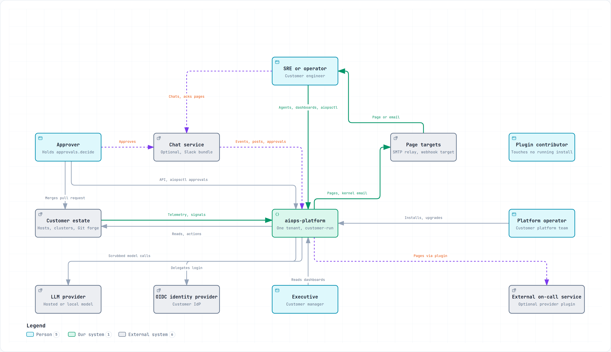

# aiops-platform

[](https://github.com/mutex-solutions/aiops-platform/actions/workflows/ci.yml)
[](LICENSE)

An open-source AIOps platform for on-prem estates, built on the Grafana®
observability stack, where every feature is a plugin.

> **Status: early development (phase S0).** There is nothing to install yet.
> The repository holds the architecture and the kernel experiments that decide
> how the plugin runtime is built. See [progress](docs/design/s0-progress.md).



## What it will be

- **One agent per host or cluster.** Unmodified Grafana Alloy with a one-command
  install, shipping metrics, logs, traces, profiles and eBPF signals.
- **One control-plane binary, `aiops`.** It takes in alerts, correlates
  incidents, investigates them with an AI agent, pages on-call, and runs
  approved changes behind safety gates.
- **Seven pillars.** Incident, Change, Compliance, SecOps, FinOps, Continuous
  Improvement and Executive Reporting.
- **Everything is a plugin.** Each capability sits behind a versioned service
  definition with a fake and a conformance suite, so a plugin is testable alone.
  Plugins run in process (Go) or out of process over gRPC (any language).
- **Bring your own stack.** Grafana Mimir™, Loki®, Tempo® and Pyroscope™ are
  the default. Other observability systems plug in through connector packs.
- **On-prem first.** Kubernetes, virtual machines and bare metal. No public
  cloud API is required.

## Roadmap

| Phase | Goal | State |
|---|---|---|
| S0 | Choose the kernel concurrency core and prove it against the reference model | In progress |
| S1 to S8 | Kernel, SDK, plugin runtime, first plugins | Planned |
| 0.1.0 | First community release: something you can run | Planned |

Details are in the [roadmap](docs/architecture/08-profiles-roadmap-adrs.md).

## Run the tests

Requires Go 1.26.

```sh
go build ./...
go test -race ./...
```

Database probes and the reference comparison are opt-in and skip by default.
The [CI workflow](.github/workflows/ci.yml) shows how to run them with
PostgreSQL 16 and the pinned Node.js runtime.

## Repository layout

| Path | Contents |
|---|---|
| [`docs/architecture/`](docs/architecture/README.md) | Decision record and C4 diagrams. Start with [`00-decisions.md`](docs/architecture/00-decisions.md) |
| [`docs/design/`](docs/design/) | Design records: [plugin system](docs/design/plugin-system-2026-11.md), [community edition](docs/design/community-first-2026-11.md), [agent harness](docs/design/harness-and-upstreams-2026-11.md), [licence audit](docs/design/licence-audit-2026-11.md) |
| [`docs/adr/`](docs/adr/) | Architecture decision records |
| [`docs/research/`](docs/research/) | Research on upstream projects and licences |
| [`test/spike/s0/`](test/spike/s0/) | Kernel experiments: two candidate cores, property tests, replay |
| [`test/differential/`](test/differential/README.md) | Scenario corpus and the reference oracle |
| [`plugins/jobs-river/`](plugins/jobs-river/) | Job queue and transaction probes on PostgreSQL |

## Contributing

The project is not ready for feature contributions yet. Issues, questions and
design feedback are welcome. The plan for community plugins and connector
packs is in the [community record](docs/design/community-first-2026-11.md).

## License and trademarks

Licensed under [Apache-2.0](LICENSE); see [NOTICE](NOTICE).

The kernel is a Go port of Cordis and cordis-plugin-loader, both MIT, as
published by the DeepSeek Harness. Upstream components keep their own licenses.
The AGPL-3.0 services of the default stack run unmodified as separate
processes, and the project links none of their code. The full review is in the
[licence audit](docs/design/licence-audit-2026-11.md).

The Grafana Labs Marks are trademarks of Grafana Labs, and are used with Grafana Labs' permission. We are not affiliated with, endorsed or sponsored by Grafana Labs or its affiliates.
