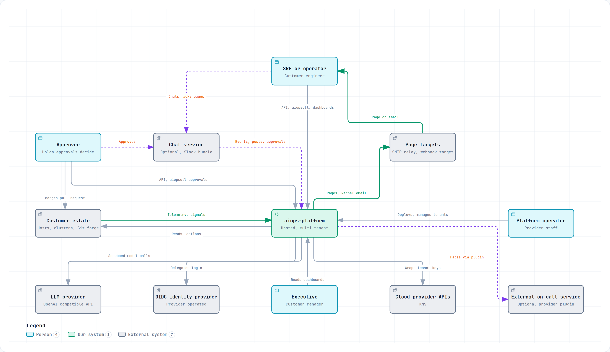
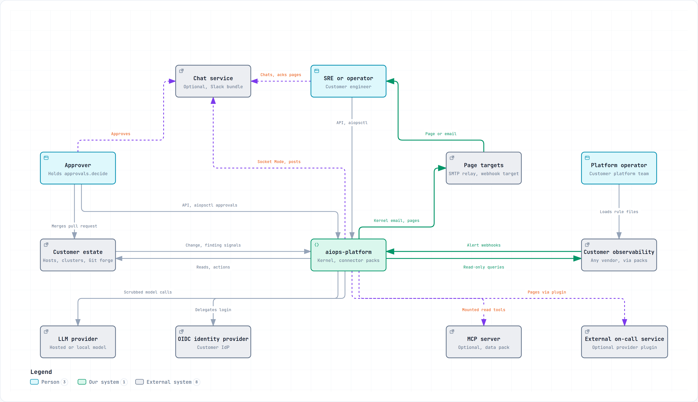
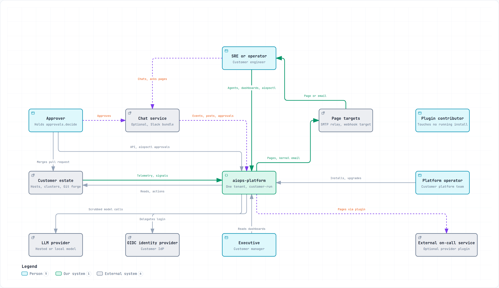
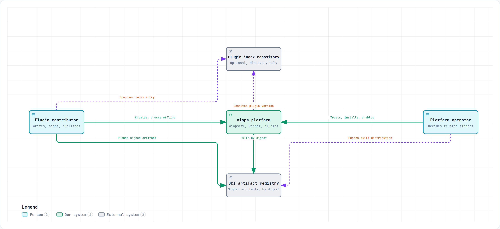
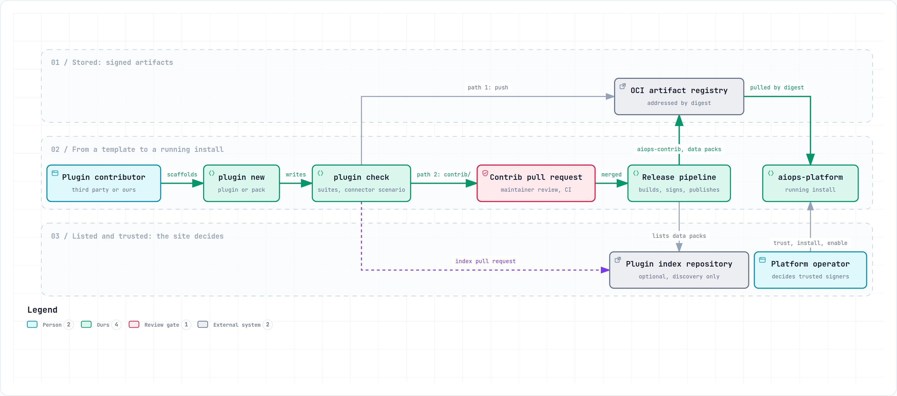

# 01. C1 system context

Status: draft, 2026-10-27; revised 2026-11-11 to follow `00-decisions.md` as amended three times on that date: the plugin system, the community-first order of work, marketplace readiness and vendor-neutral connectors, then the agent harness as a plugin point, upstreams as plugins and the licence record, then the owner's confirmation of W2 to W13 (D §2.4), which are owner decisions from that date and no longer working assumptions. Obeys `00-decisions.md` (cited as "D §n"). The plugin record `docs/design/plugin-system-2026-11.md` is cited as "plugin record §n", the community record `docs/design/community-first-2026-11.md` as "community record §n", the harness record `docs/design/harness-and-upstreams-2026-11.md` as "harness record §n" and the licence record `docs/design/licence-audit-2026-11.md` as "licence record §n". The licence record is engineering analysis, not legal advice, and lists the questions a lawyer must answer. Research citations use `<file> §n` under `docs/research/`. Next level down: `02-c2-containers.md`.

## 1. Scope

**Product.** aiops-platform is an Apache-2.0 AIOps platform on the Grafana observability stack, on-prem and open-source first. The end goal is a plugin marketplace where users contribute and sell plugins to each other. This document describes the community edition, which is phase 1; the marketplace with billing is a later enterprise edition and is not built. The Grafana stack is first-party and the default, not a contract: other observability systems are reached through connector packs that a contributor can write and contribute back (D §1, §6.2). An upstream is a plugin, never the product: the agent harness, the on-call provider and the chat surface are named in this document by role, and nothing in the core names or needs one upstream (D §1 principle 9).

**Target estate.** P1 and P2 cover Kubernetes clusters and Linux hosts on virtual machines or bare metal, and from P2 network devices polled over SNMP. Hypervisors, hardware health and self-hosted databases enter on named triggers (D §7.3). Cloud inputs are optional later rows. No row in `self-host-full` needs a public cloud provider API (D §1).

**This document.** It shows aiops-platform as one box: the people who use it and the external systems it depends on or talks to. It answers three questions: who touches the system, through which surface, and which systems sit outside our boundary in each profile. It does not show containers, roles, plugins or deployment topology; those start in `02-c2-containers.md`. The estate model and the troubleshooting method sit inside the box at this level; their components are in `09-c3-estate-and-troubleshooting.md`. Where this document says the kernel does something, it means the server, the second sense of D §8.2: the plugin named in D §4 does it.

**Views.** `hosted` (§4) has the widest set of external systems and is the profile we operate; it follows S9b and is not part of the first community release (D §6.3). `aiops-only` (§5) is where the boundary shrinks and the customer's own observability systems, reached through connector packs, become an external system. `self-host-full`, the profile in which a customer runs the whole stack on its own premises and on which leg A of the first community release runs (D §7.1), has its own figure in §6 and is described there as a delta of §4, together with `dev`, on which the same fixtures replay and pages go to a local webhook sink (D §7.1). The plugin supply path (§7), from a plugin's author to a running install and back into the project, is one view for every profile.

**Phases and editions.** The order of work is community first (D §2.4, §7.2). P0 is the model core, steps S0, S1, S2a, S2b, S3, S4a and S5: the kernel, the loader, the authoring path, both plugin runtimes, the infrastructure definitions, tenancy on one process and the policy spine. P1 is the community release: S6a (the plugin manager and the index in their single-site form, and `contrib/`), S7 (the telemetry base), S8a (the agent runtime: the harness contract, the first-party loop and the read tools) and S8b (the incident loop, on-call and the optional upstream adapters). The exit of S8b is the first community release, version `0.1.0`: `self-host-full` with the tenant `default` and one `aiops --role all` process, `dev`, and `aiops-only` for the connector scenario. It is accepted when six legs pass (D §7.1). P2 runs two tracks: the community second wave (S9a) beside the multi-replica and multi-tenant runtime, the full plugin manager and hosted (S4b, S6b, S9b). P3 (S10) is breadth. The enterprise edition is not planned, and the boundary between the two editions is an open owner decision (ADR-049). No step has a date (D §7.2). A `P1`, `P2` or `P3` tag in this document keeps the meaning D §7.2 gives it.

## 2. Where the system boundary sits

**Rule used in this set.** A component is inside the aiops-platform boundary when a composed profile row renders its configuration and the system owns its lifecycle (install, upgrade, tenant limits, tenant delete). It is outside when the system only calls it, with credentials someone else issued. Five consequences:

- **Location does not decide.** The agent runs on customer machines, yet it is inside: we ship the installer and chart, enrol it and serve its config (D §2.1 rows 6, 7, 11).
- **Who operates it does not decide.** In `self-host-full` the customer's platform team runs everything, yet the stack is the same composition of rows as `hosted` (D §6.3), so it is inside.
- **Being read or written by us does not decide.** From P2 an agent polls network devices over SNMP, and `remediation-executor-gitops-pr` opens pull requests on the customer's Git forge. Devices and forge stay outside, in `ext-customer-estate`: the system only calls them, with credentials the customer issues (D §2.1 row 19, §3.3, §5.4).
- **Who wrote it does not decide.** A remote plugin instance runs a third party's image, yet it is inside: install renders its deployment unit, and the system gives it its identity and its virtual key, revokes both and removes it (D §3.1 `remote-plugin`, §5.4; the instance identity on a single-tenant self-host is ADR-041). The registry its artifact was pulled from stays outside, as `ext-artifact-registry` (§7).
- **Which upstream it is does not decide.** An optional plugin may bring an upstream process. A process the chart or compose file renders when the operator sets its value is inside: `harness-sidecar` for an external agent harness, `oncall-engine` for an external on-call engine (D §3.2, §6.3). An engine or service the customer already runs or subscribes to, which the same kind of plugin only calls, is outside: `ext-oncall-service`, and `ext-mcp-server` for the tools of a connector pack (D §3.3). Neither kind is in a default set, so by default no agent harness and no on-call engine is a process of its own or an external system: both are first-party rows in the kernel process (D §2.1 rows 2, 3).

The dashboard server and the four backends are where the boundary flips with the profile. In `hosted`, `self-host-full` and `dev` they are upstream components we deploy unmodified and configure through rows (D §3.2). In `aiops-only` the customer already runs its own observability systems, and the kernel only reads from them and receives their alerts, through the connector packs the profile composes (D §3.3 `ext-customer-observability`, §6.2).

| Component (D §3) | `hosted` (follows S9b) | `self-host-full` | `aiops-only` |
|---|---|---|---|
| `dashboard-ui`, the dashboard server | Inside. Grafana OSS 13.x in dashboard pools of 25 orgs, one org per tenant, provisioned by `dashboard-sync` (P2, D §2.1 row 8) | Inside. One instance, tenant `default`, provisioned from files the chart or compose renders | Outside: the customer's own dashboard server, whichever it runs; the profile may compose `aiops-dashboards` against it (D §6.3). Where that server is a Grafana instance, from P2 `aiops-app` may be installed into it at the signature level ADR-023 sets: unsigned and allow-listed, privately signed by the customer, or commercially signed. The app is optional, and no row of the core or of a shipped profile needs it (D §3.1) |
| `metrics-store`, `logs-store`, `traces-store`, `profiles-store` | Inside. Multi-tenant on `X-Scope-OrgID`, behind `gateway`, limits from the renderer rows of `limits` (P2) | Inside. Monolithic, single tenant | Outside: the customer's own stores. Prometheus-compatible and Loki-compatible stores are covered by the default connector pack `aiops-datasources`, any other system by a connector pack a contributor ships (D §6.2, §6.3). They are read by the kernel's read tools, first-party `tools` contributions that the kernel calls with a read credential the customer supplies. A system with no first-party tool is read by a `tools` contribution of a read connector, or by allow-listed tools of an MCP server that rows of `tool-mcp` mount (D §2.1 row 2, §4.1, §6.2) |
| `gateway`, `agent` (and the `fleet` plugin) | Inside | Inside | Absent. The customer's own collectors feed their own stores; the agent label contract is published so that they can meet it (D §2.1 row 11) |
| Detection rule files `kubernetes-workload` and `host-basics` (P1, D §2.1 row 17) | Inside. Loaded per tenant into the tenant's ruler (P2, D §7.2) | Inside. Shipped by `aiops-stack` and loaded into the stack's own ruler | Published as plain Prometheus rule files. The customer loads them into its own ruler, which is outside (D §6.3). A connector pack for a system with another rule format carries its own rule content (D §6.2) |
| Agent harness | Inside, in the kernel process: `harness-native` on the worker role. No harness process per tenant. An external harness is an optional plugin; its upstream process `harness-sidecar` would run one instance per tenant, and no default bundle carries one (D §1 principle 6, §3.2) | Inside, in the kernel process: `harness-native`, the default by owner decision A (D §2.4; its scope at the release is W7). A first install runs no harness container. Optional: `harness-sidecar`, one shared instance, rendered only when the operator enables an external harness plugin and sets its value; with `harness-holmesgpt` it is HolmesGPT 0.46, pulled by digest from upstream | As `self-host-full` |
| On-call provider | Inside, in the kernel process: `on-call-provider-builtin` (D §2.4 W11, owner decision of 2026-11-11; no code before the lawyer's answer to licence record Q3). No engine per tenant, no second database, no subdomain proxy and no carrier subaccount. An external engine per tenant run by us waits for a hosted tenant's request and its own ADR (D §7.3) | Inside, in the kernel process: `on-call-provider-builtin`. A first install runs no on-call container. Optional: `oncall-engine`, one shared instance behind a chart or compose value that is off by default; with `on-call-provider-goalert` it is GoAlert 0.35. An engine or service the customer runs or subscribes to is outside, as `ext-oncall-service` | As `self-host-full` |
| `remote-plugin` (a plugin's own image, any language) | Inside, one instance per (tenant, plugin), from S4b. Third-party plugins on hosted are deferred to the enterprise edition (D §2.4, §7.3); when they are admitted they run only this way, as remote contributions (D §2.4 W4) | Inside, optional, one shared instance per plugin, from S2b (D §2.4 W5). Third-party code may also enter the process, through a distribution the operator builds and signs (D §2.4 W3) | As `self-host-full` |
| Chat app, with the optional bundle `aiops-chatops-slack`, which no shipped profile lists (D §2.4 W13) | Where enabled: one distributed Slack app of ours, Events API | Where enabled: the customer's internal Slack app, Socket Mode | As `self-host-full` |
| Identity provider | Operated by the provider, not built by us | The customer's | The customer's |
| Who operates the box | Platform provider | Customer platform team | Customer platform team |

What the flip changes, and what it does not:

1. **The AGPL boundary does not move.** The dashboard server and the four backends always run unmodified as separate processes behind HTTP, whether inside or outside our box, from OSS images pinned by digest that we do not mirror; no AGPL package is linked (D §1 principle 7, §3.2; licence record §7.3; grafana-stack §13.1).
2. **The telemetry write path disappears in `aiops-only`.** No agent, no tenant gateway, no `fleet`, no `limits`: the whole `aiops-stack` bundle is absent, and `agent-base` with it. The static graph of `aiopsctl profile render` shows that no row of the other bundles needs a key only `aiops-stack` provides (D §6.3). These parts stay specific to the default stack in this edition: the system collects, stores, isolates and limits telemetry only on the default stack, and reads from other systems through connector packs (D §6.2; community record §6.6).
3. **Data custody changes.** In `hosted` the system stores customer telemetry. In `aiops-only` it stores only kernel state: casefiles, run transcripts, the audit chain, approvals, the on-call roster with its contact addresses, and references to telemetry, never copies (D §5.2, §5.3). From P2 the kernel also keeps the `estate` projection, in every profile. It can be dropped and rebuilt from its sources, so the customer's series, catalog files and inventory stay the record and the system never becomes a configuration database (D §1, §2.1 row 15).
4. **Host identity changes.** With `fleet`, a host that runs our agent is keyed by its enrolled agent id, `host:agent/<fleet_collector_id>`. `aiops-only` has no `fleet`, so a host is keyed `host:ext/<value>`, from `host_id` or a label the tenant maps (D §6.3, §8.1). The key forms and the correlation ladder are in `09-c3-estate-and-troubleshooting.md`.
5. **Which outside systems are read is a choice of packs, not of code.** No row outside a connector pack or a stack bundle holds a query string or calls a telemetry store's query API, and payload parsers are `signals` contributions; CI checks this on the static graph (D §1 principle 7). So a pack for another observability system changes what `ext-customer-observability` stands for in a deployment and nothing inside the box (§5.1).
6. **Agent runs and paging do not move.** In every profile the default harness and the default on-call provider run in the kernel process, a harness holds no credential, and the only model route is `llm-gateway` (D §2.1 rows 2, 3, 13, §2.2). The leave-one-out render proves that every shipped profile renders without each upstream bundle it lists (D §6.3, §7.1 leg F).

**Optional bindings.** Four external systems are bindings a deployment may leave out (D §1). With none of them bound, the incident loop still runs.

| Binding | External system | Used for | With it unbound |
|---|---|---|---|
| Chat service | `ext-chat-service` (Slack, with the optional bundle `aiops-chatops-slack`) | Chat-ops, approvals in the thread, digests, pages by direct message | The state of a first install, because no shipped profile lists the bundle (D §2.4 W13). People work the loop through the kernel API and `aiopsctl`, which carry questions, acks and approvals from P1 (D §3.1, §7.1 step 6). Notices go out through `notifier-email` and `notifier-webhook`. Once the bundle is enabled, a chat row that is not yet bound does not stop boot: it is outside the required set, so it appears in the one grouped warning with its state and what it waits for (D §6.1) |
| External on-call engine | `ext-oncall-service`, through an optional `on-call-provider-<service>` plugin | A pager with schedules, escalation and a process of its own, for an operator who wants one that does not share fate with the kernel | The built-in provider pages the on-call person of the bound policy (D §2.1 row 3). With no provider or no policy bound nobody is paged, the incident says so, and the incident notice still goes to the notifier rows that receive incidents |
| Paging carrier | An SMS or voice carrier in `ext-page-targets`, reached by a contributed carrier notifier | SMS and voice pages | Pages go by email, a chat direct message, or a webhook to a push service or an SMS gateway, which need only a relay or a target the customer can run. No carrier notifier is first-party at the first release (D §2.1 row 3). See A8 in §8 |
| Hosted model | A hosted API as `ext-llm-provider` | Model completions | A local model endpoint: a model server the customer runs (vLLM, Ollama or LiteLLM) behind `llm-provider-openai-compatible` (D §2.1 row 13, §3.3). §8 states how far that configuration is proven |

Of the other external systems, `ext-customer-estate`, `ext-customer-observability` and the identity provider in self-host are the customer's own, and `ext-cloud-apis` is used by `hosted` only (KMS). `ext-page-targets` is present in every server profile, because kernel email leaves through it. `ext-mcp-server` is present only where a connector pack mounts the tools of an MCP server (§5.1). `ext-artifact-registry` is whatever OCI registry the publisher or the site chooses, one the customer runs included (D §3.3); a deployment that installs no plugin uses it only for the distribution image it runs. `ext-plugin-index` exists from S6a and is used only where the operator configures an index; none is configured by default (D §3.3).

## 3. People

The same five roles appear in every profile. What changes is the employer of the platform operator and the surfaces that are composed. A chat service is an optional binding (§2): with none bound, the same roles work the loop through the kernel API and `aiopsctl` (D §1, §7.1 step 6).

| ID | Name | Who | Surfaces | Responsibility | Permissions (gap-slack §5) |
|---|---|---|---|---|---|
| `person-sre` | SRE or operator | Customer engineer, often on call | The kernel API and `aiopsctl`; dashboards (`aiops-app` from P2, where installed); the link in a page; a chat client where a chat surface is enabled; shell for agent install | Installs agents on Linux hosts and clusters (`curl \| sh` with a bootstrap token, `helm install aiops-agent`), receives pages and acks them by the link, the API, `aiopsctl` or a chat button, asks pillar agents questions (`aiopsctl ask`, the API or chat), follows incidents, and asks for an investigation where the kernel starts none on its own (`unmapped:` and `control:` incidents, D §2.1 row 12) | `chat.ask`, `incidents.view`, `incidents.act`; with the Slack bundle, an email link to the Slack identity is enough |
| `person-approver` | Approver | Customer engineer or lead holding `approvals.decide` | The kernel API and `aiopsctl`; chat buttons where a chat surface is enabled; `aiops-app` from P2, where installed; from P2 the customer's Git forge | Releases gated changes. L3 needs two distinct verified platform users, neither the requester, re-checked at dispatch (D §2.2). From P2, where the fix is a pull request, a person merges it on the forge (H19) | `approvals.decide`; with the Slack bundle, a Sign in with Slack link is needed before a click in Slack counts (D §2.1 row 4) |
| `person-exec` | Executive | Customer manager or leadership | Dashboards, chat digests where a chat surface is enabled, PDF reports (P3) | Reads posture, incident and change trends, compliance score, cost | `report.view`, read-only |
| `person-platform-op` | Platform operator | Hosted: provider staff. Self-host and aiops-only: the customer's platform team | `aiopsctl`, Helm or compose, admin API | Deploys and upgrades the stack, composes profiles (`aiopsctl profile render --dump`), binds or leaves out the optional systems of §2. Applies the on-call roster and policies as a file (`aiopsctl oncall apply`) and sets the platform-health receiver (H20). Decides which plugin signers and indexes the site trusts and installs, enables and removes plugins, connector packs and the optional first-party bundles (§7). From S4b runs tenant create, suspend and delete as operator actions (D §5.6, §7.2), and manages pools and cohorts in hosted; until then the create saga makes the one tenant `default` at first boot. From P2 exports the estate model as files (`aiopsctl estate export`, D §3.1) | Platform admin; cross-tenant read tokens are admin-only (D §5.1) |
| `person-contributor` | Plugin contributor | Our engineers or a third party; the plugin author of plugin record §4 | The SDK module in Go or `aiops-sdk` in Python, `aiopsctl plugin` commands and their templates, an OCI registry, the git host of an index, the project repository for a pull request under `contrib/` | Writes a plugin or a connector pack against a service definition, starting from a template (`aiopsctl plugin new <registry>` or `plugin new connector`). Proves it alone on the real kernel with the definition's fake and conformance suite, with one command before a pull request, `aiopsctl plugin check ./`. Publishes it as a signed artifact and lists it in an index, or contributes it back as a pull request under `contrib/` (§7). Needs no kernel checkout (D §3.4, §4.5). A connector pack for another observability vendor or stack needs no customer and no other trigger (D §7.3) | None on any running tenant. Plugin signing ships at S2a (ADR-020) |

The approver is a role, not a separate population: most approvers are SREs approving someone else's request. It is drawn separately because the approval path has its own identity requirements.

## 4. System context, `hosted` profile

### 4.1 Scope

This view shows aiops-platform as the provider runs it for many tenants. It follows S9b, on the second track of P2, and is not part of the first community release (D §6.3, §7.2); whether the `hosted` profile stays in this repository is part of the open edition boundary (ADR-049). Inside the box are the agent on customer hosts and clusters, the tenant gateway, the kernel roles, dashboard pools, the four backends, per-tenant remote plugin instances, PostgreSQL and object storage; none of them is drawn here. The agent loop, the read tools and the on-call provider are rows in the kernel process, so no harness process and no on-call engine runs per tenant (D §6.3). Customer people reach the system through the kernel API and `aiopsctl`, through dashboards in their Grafana org, through the link in a page, through a chat service where the chat bundle is enabled, or through a shell when they install an agent. No external system writes to the backends directly: telemetry enters through the tenant gateway, pages and kernel email leave through the `notifiers` rows to `ext-page-targets` (H12, H18), and everything else passes through the kernel. An external on-call service is reached only through an optional provider plugin (H14); no capacity rule sends hosted tenants to one. A ticketing system (ITSM) is not an element of this set; §8 lists it as a candidate. The customer's Git forge is part of `ext-customer-estate` (D §3.3), so its merge events, its runbooks and, from P2, the pull requests opened on it belong to H16.

### 4.2 Diagram

*Figure 01-c1-context-hosted. Source: [diagrams/src/01-c1-context-hosted.json](diagrams/src/01-c1-context-hosted.json).*

System context of the `hosted` profile, which follows S9b. Green is the main path: telemetry and signals in (H16), pages and kernel email out to the page targets (H12, with H18 and H20 on the same arrow) and on to the SRE (H13). Dashed arrows are bindings a deployment may leave out: the chat service (H2, H3, H9) and an external on-call service reached through an optional provider plugin (H14). H16 is drawn as two one-way arrows. Not drawn: `person-contributor`, `ext-artifact-registry` and `ext-plugin-index` (§7), `ext-mcp-server` with H21 (§5.2), and `ext-package-source` (`04-c3-agent-fleet-gateway.md`). The figure shows the main path; the tables in §4.3 and §4.4 are complete.

### 4.3 Elements

| ID | Name | Technology | Responsibility |
|---|---|---|---|
| `person-sre` | SRE or operator | Human; browser, `aiopsctl`, shell, a chat client where enabled | See §3 |
| `person-approver` | Approver | Human; browser, `aiopsctl`, a chat client where enabled | See §3 |
| `person-exec` | Executive | Human; browser, a chat client where enabled | See §3 |
| `person-platform-op` | Platform operator | Human; `aiopsctl`, Helm, admin API | Provider staff running cells, pools and tenant lifecycle |
| `person-contributor` | Plugin contributor | Human; SDK module or `aiops-sdk`, `aiopsctl`, git | See §3 and §7 |
| `aiops` | aiops-platform | Go `aiops` kernel, with the first-party agent loop, read tools and on-call provider in process, and `aiopsctl`; the agent (Alloy), the tenant gateway proxy (Envoy), the dashboard server (Grafana OSS), the four backends, remote plugin instances, PostgreSQL, object storage. By default no harness process and no on-call engine | Collects telemetry, ingests alerts, correlates incidents on a typed key, investigates them with an agent harness, pages the on-call person, runs approved changes, serves chat-ops and dashboards. Every feature of the kernel is a plugin behind a service definition, composed from a profile, and every upstream enters as one plugin behind a definition (D §1). From P2 it keeps a rebuildable projection of the estate and publishes its vocabulary, rule table and export as files (D §1, §2.1 rows 15, 16). Decomposed in `02-c2-containers.md`; the estate model and the troubleshooting method in `09-c3-estate-and-troubleshooting.md` |
| `ext-chat-service` | Chat service | With the optional Slack bundle: Slack Events API, Web API, OAuth v2 | Chat surface, approvals, digests, pages by direct message. In hosted, one distributed app owned by the provider, installed per workspace or Grid org (gap-slack §3). An optional binding in every profile (§2) |
| `ext-idp` | OIDC identity provider | OpenID Connect | Human login for dashboards and the kernel API. Operated by the provider in hosted; building our own IdP is out of scope (D §1) |
| `ext-llm-provider` | LLM provider | HTTPS; OpenAI-compatible API (other vendors through a customer-run proxy such as LiteLLM) | Model completions for every agent run: investigations, answers to questions and pillar routing. A hosted API, or a model server that whoever operates the box runs (D §3.3); the hosted model is an optional binding (§2) |
| `ext-page-targets` | Page targets | An SMTP relay, a webhook target such as a push service or an SMS gateway; a carrier where a contributed carrier notifier is installed | Where the `notifiers` rows deliver pages and where `notifier-email`, which every server profile composes through `aiops-base`, delivers kernel email (D §3.3, §4.4). D §3.3 also lists a chat direct message as a page target; it travels through `ext-chat-service` and exists only where a chat service is bound. The platform-health receiver is counted here too (A13 in §8). A carrier is an optional binding (§2) |
| `ext-oncall-service` | External on-call service | An on-call service or engine that the customer runs or subscribes to, over its own API | Target of an optional `on-call-provider-<service>` plugin, with the tenant's own credentials (D §3.3). An optional binding (§2); no shipped profile composes such a plugin |
| `ext-mcp-server` | MCP server | An MCP server the customer or a vendor runs, over Streamable HTTP | Read tools that rows of `tool-mcp` in a connector pack mount (D §3.3, §6.2). Present only with such a pack. On hosted, packs from third parties are deferred with third-party code (§7.5) |
| `ext-customer-estate` | Customer estate | Linux hosts on virtual machines or bare metal (Windows from P2), Kubernetes clusters, apps, GitOps (Argo CD, Flux) and its Git forge, scanners (Kyverno, Trivy Operator, Kubescape); from P2 network devices polled over SNMP | Where agents run, executors act and `tool-kubernetes-read` reads; origin of change and finding signals and of host change evidence (D §2.1 row 19, §3.3). Hypervisors, hardware health and self-hosted databases join this element on the triggers of D §7.3; they are not new external systems |
| `ext-cloud-apis` | Cloud provider APIs | KMS; cloud control-plane APIs | KEK for per-tenant DEKs from P2, through `kek-kms` (D §5.4). Cloud inputs for FinOps and SecOps and cloud instance identity are optional later rows (D §1, §3.3). In P1 and P2 only `hosted` uses this element, for KMS |
| `ext-artifact-registry` | OCI artifact registry | OCI registry API over HTTPS; any registry the publisher or the site chooses | Holds signed plugin artifacts and distribution images, addressed by digest. Pull credentials stay with the orchestrator and `aiopsctl`, never the kernel (D §3.3, §5.4). Flows in §7 |
| `ext-plugin-index` | Plugin index repository | Git repository with one file per plugin, composed by its CI into one document in format 1.0 (with a serial and an expiry) and a detached signature; kept by the project, a community or the site | Discovery only, from S6a: it resolves `<id>@<version>` to an artifact. No index is configured by default, and a private index never falls through to a public one. We publish the format and the commands that compose and sign it, so a third party can run an index or a marketplace of its own (D §3.3). Flows in §7 |

**Ids.** Every `ext-` id in this table is in D §3.3, named by role as D §8.1 requires, and the people and the system box carry the ids of D §3.4. A vendor name appears only in a Technology cell or in prose. The three profile figures, now redrawn, name every element by role; the only vendor words left in them are in sublabels and arrow labels of optional or protocol detail (`Slack bundle`, `Socket Mode`, `OpenAI-compatible API`). Two ids of D §3.3 are not in this table. `ext-customer-observability` exists only in `aiops-only` (§5). `ext-package-source`, the upstream release download or a customer-run mirror from which the host installer fetches the pinned agent package (D §2.1 row 11), is not drawn at this level: it carries no tenant data and is described in `04-c3-agent-fleet-gateway.md`. `ext-oncall-service` is an optional binding in every profile: an alternative to the built-in provider that the operator chooses by enabling an optional provider plugin. The profile figures therefore draw it dashed. Three further systems, the customer's automation controller, an inventory API and a ticketing system (ITSM), appear in no element table, relationship table or diagram of this set until D §3.3 names them (§8).

### 4.4 Relationships worth explaining

| # | From | To | What crosses | Transport and trust | Phase | Source |
|---|---|---|---|---|---|---|
| H1 | `person-sre` | `aiops` | Agent install; incident, fleet and change dashboards (`aiops-app` pages from P2, where installed); incidents, RCAs and questions to a pillar agent through the kernel API and `aiopsctl`; the ack of a page by its link, the API or `aiopsctl` | Bootstrap token (TTL, `max_uses`, optional CIDR) for enrolment; OIDC login to the tenant's Grafana org and to the kernel API; the ack link is a signed one-time token, valid until the page closes, served on the public listener | S7 hosts, S8b clusters and the loop, P2 hosted | D §2.1 rows 3, 7, 11, §3.1, §5.4 |
| H2 | `person-sre` | `ext-chat-service` | `/aiops <pillar> …`, `@aiops` mentions, ack buttons | Only where the chat bundle is enabled. Slack identity linked to a platform user by email, scoped to the installation | P2 | D §2.1 row 4; gap-slack §5, §6 |
| H3 | `person-approver` | `ext-chat-service` | Approve or Deny on a Block Kit message | Only where the chat bundle is enabled. Counts only with a Sign in with Slack link (`verified_for_approvals`); quorum is evaluated by `approval` on platform users, never in Slack | P2 | D §2.1 row 4, §2.2 |
| H4 | `person-approver` | `aiops` | Approve or Deny through the kernel API and `aiopsctl`; from P2 also in `aiops-app`, where the optional bundle `aiops-dashboard-app` is enabled | Every surface calls `approval.Decide`, and quorum counts verified platform users. The API takes the OIDC identity. The app takes a verified `X-Grafana-Id`; a missing header means `actor=plugin`, read-only | P1 (API, `aiopsctl`); P2 (app) | D §2.1 row 8, §2.2, §4.4; ADR-006 |
| H5 | `person-exec` | `aiops` | Dashboards, compliance score, later PDF reports | OIDC login, read-only role | P1 dashboards, P3 reports | D §7.2 |
| H6 | `person-platform-op` | `aiops` | Cells, pools, cohorts, tenant sagas, upgrades. Plugin installs and updates are E4 of §7 | `aiopsctl` and admin API with platform credentials | P2 | D §5.6, §7.2 |
| H9 | `ext-chat-service` | `aiops` | Inbound events, interactivity and slash commands; outbound posts, streamed answers, `chat.update` | Only where the chat bundle is enabled. With the Slack bundle in `events` mode: signed HTTPS requests acked within 3 s; tenant from the installation record via `authorizations[0]` and its owner-approved grants; the bot token is held on the platform installation record, not in one tenant's secrets | P2 | D §2.1 row 4, §5.4; gap-slack §3, §7 |
| H10 | `aiops` | `ext-idp` | OIDC login for humans | Standard OIDC; a customer that needs its own auth provider is the trigger for the instance-per-tenant dashboard tier | P2 | D §3.3, §7.3 |
| H11 | `aiops` | `ext-llm-provider` | Prompts and tool results, completions | Only `llm-gateway` calls out, for whichever harness runs, after the PII scrub, which is an inner step of its dispatch that no hook can skip. It holds the provider key (or, from P2, the tenant's own key); no harness holds one. It meters every model call under its run id, enforces the per-run caps and a daily budget with a typed unit (USD where the price table states a rate, runs where the price is an explicit zero; an absent price is a configuration error), and refuses every call while `agents-paused` is set. Per-tenant rate limits from P2 | P1 | D §2.1 row 13, §2.2, §6.1 |
| H12 | `aiops` | `ext-page-targets` | Pages: notifications of class `page`, each with one recipient, that the built-in on-call provider sends through the `notifiers` rows that receive pages | `paging` calls the bound provider once per incident, when the incident first meets the paging threshold, at open or on a join. Withholding an investigation never withholds a page, paging has no hook, and no hook can withhold, digest or pace a `page` notification. The provider walks the escalation steps of the bound policy until an ack or the last repeat. With no provider or no policy bound nobody is paged and the incident says so. SMS and voice need a contributed carrier notifier. Pages share fate with `kernel-db`, `notifications` and `pii`, which H20 covers | P1 (S8b), per tenant in P2 | D §2.1 rows 3, 5, §4.1 `notifiers`, §6.1 |
| H13 | `ext-page-targets` | `person-sre` | The page, or the kernel's email | The SRE acks by the signed one-time link in the page, the API or `aiopsctl` (H1), or by a chat button where a chat service is bound (H2) | P1 | D §2.1 row 3, §7.1 step 2 |
| H14 | `aiops` | `ext-oncall-service` | `Page`, `Ack`, `Resolve`, `Status`, `WhoIsOnCall` and, where the service offers one, `Heartbeat`, from an optional `on-call-provider-<service>` plugin | Only where the operator enables such a plugin. The tenant's own credentials for the service, kept in tenant secrets under the provider plugin's scope and declared in its manifest. Alert webhooks still land in the kernel first: an on-call provider never receives them, with one stated exception, the `Watchdog` beat, which the alert router also posts straight to a heartbeat target the bound provider returns. `on-call-provider-goalert` ships as an optional bundle that no shipped profile lists (D §2.4 W8). A plugin for another service is a contribution or a first customer request, and a first-party PagerDuty plugin is not written or announced without PagerDuty's written consent | S8b (the optional bundle); otherwise on the trigger of D §7.3 | D §2.1 rows 3, 5, §3.3, §5.4, §7.3; licence record §2.4 |
| H16 | `aiops` | `ext-customer-estate` | Telemetry from the agent on hosts and clusters, stamped with the identity labels (`fleet_collector_id`, `host_name`) and including host log lines labelled as change evidence (P1); read tools, `tool-kubernetes-read` among them, and the five Kubernetes actions; GitOps, Git forge merge and scanner signals in; runbook reads out. From P2: SNMP polls of network devices by an agent, the Kubernetes audit file, and pull requests that `remediation-executor-gitops-pr` opens on the Git forge | Agent writes through the gateway with 15 min JWTs; executors use leased write credentials; `tool-kubernetes-read` uses the Kubernetes read credential, which the kernel holds and which reads no `Secret` object; webhooks carry a per-tenant bearer token, and Git forge merge events use the generic parser of `signal-ingest-gitops-webhook`; `tool-runbook-fetch` reads runbooks, read-only. The SNMP credential stays on the polling agent, and ADR-031 sets the repository credential of `remediation-executor-gitops-pr` per forge; both classes enter the D §5.4 table before their rows are built. No SSH or shell runs from the kernel or any harness, and no tool starts a process on a target | S7 to P2 | D §2.1 rows 2, 5, 7, 11, 19, §2.2, §4.1, §5.4; ADR-016, ADR-018, ADR-019, ADR-025, ADR-031, ADR-053 |
| H17 | `aiops` | `ext-cloud-apis` | Wrap and unwrap tenant DEKs | The `kek-kms` row, with one KMS key per tenant; tenant delete schedules that key's deletion, and D §5.4 states the full erasure bound | P2 | D §5.4 |
| H18 | `aiops` | `ext-page-targets` | Incident notices, digests and, from P3, reports by email | `notifier-email` over SMTP to the relay, in every server profile, with or without an on-call policy bound. The relay credential is the SMTP row of the D §5.4 credential table | P1 | D §3.3, §4.1 `notifiers`, §4.4 `aiops-base`; reports: 05 §8 |
| H19 | `person-approver` | `ext-customer-estate` | Merges the pull request that `remediation-executor-gitops-pr` opened on the Git forge | The executor opens the pull request under D §2.2 like any other write. The merge happens outside the system, under the forge's own login and branch protection. Any customer engineer with merge rights may do it; it is attached to the approver because it is the last human gate | P2 | D §2.1 row 19, §2.2; ADR-031 |
| H20 | `aiops` | `ext-page-targets` | Platform-health alerts: the rule group `platform-page-path`, on the kernel's own readiness series | Sent by the alert router inside the box straight to the platform-health receiver, a static email or webhook receiver from operator config. This path never crosses the kernel, so it still fires when the kernel or its page path is down. It is one of two watchers in two failure domains; the other is the kernel, which watches the alerting path through the always-firing `Watchdog` alert and the bound provider's monitor. Both watchers on one lost machine page nobody | P1 (S8b) | D §2.1 row 5, §5.7; ADR-021; harness record §8.5; A13 in §8 |
| H21 | `aiops` | `ext-mcp-server` | Read tool calls from rows of the instantiable `tool-mcp`, which mount allow-listed tools of the server; results return to the run | Only where a connector pack with such rows is installed (§5.1). Streamable HTTP, dialled through `dialer`. The credential is the customer's, kept in tenant secrets under the pack's scope and read per call; the pack states that it is read-only. Every call passes the `tools` dispatcher like any other tool. The effects class of a mounted tool is asserted by the pack, not proven, and boot says so | P1 (S8a) | D §2.1 row 2, §3.3, §5.4, §5.7, §6.2 |

There is no H7, H8 or H15: the contributor's flows are E1 to E3 of §7, and ids are not renumbered when a flow is removed.

Four notes on these relationships:

- **H16 is several flows in one row.** The figures draw it as two arrows, one into the system and one out. Git forge merge events, runbook reads and pull requests belong to it, because D §3.3 places the Git forge in `ext-customer-estate` (A2 in §8). Telemetry never touches the kernel: agents write through the stateless gateway, and token issuance is the only control-plane call on the ingest path (D §1 principle 4). How the hosted kernel reaches a customer's private Kubernetes API for read tools and executors is open (ADR-016); until it closes, this document assumes hosted read tools and executors reach only clusters whose API the provider can already reach.
- **On hosts the system only reads in P1 and P2.** The agent ships telemetry and labelled change evidence. In P1 the kernel does not read that evidence and the first message says so: the harness of the incident pillar reads it with `tool-logs-query` and the host runbook of the default pack. From P2 the kernel reads it too, through the `evidenceSources` registry (D §2.1 row 19). No action is offered on a host, because there is no host executor (D §7.1 host leg). On GitOps-owned targets the P2 write is a pull request that a person merges (H19). A host executor that drives the customer's automation controller waits for its trigger (§8).
- **Alerts are internal in this view.** In hosted, rules run in the `metrics-store` and `logs-store` rulers and in dashboard alerting, all inside the box, and their webhooks reach `signal-core` without crossing the boundary. The shipped rule files `kubernetes-workload` and `host-basics` are loaded into the tenant's ruler (D §2.1 row 17). A customer's own Alertmanager in the estate can also post to `signal-ingest-alert-webhook`; that flow is part of H16, and its alerts are keyed like any other (§8).
- **Paging stays inside until the last hop.** Schedules, escalation and the ack are state of the kernel (D §5.3), and only the notification leaves the box (H12). An operator who needs a pager that survives a dead kernel installs an external provider (H14); without one, H20 is the path that still reaches a person (D §2.1 row 3).

## 5. System context, `aiops-only` profile

### 5.1 Scope

This view shows aiops-platform for a customer that keeps its own observability systems and wants only the AIOps features: incident correlation and investigation, on-call, approvals and changes, and optionally chat-ops. The customer's platform team runs the kernel with its PostgreSQL on Helm or compose, against an S3-compatible endpoint of its own or the bundled object store (D §3.2, §6.3; A14 in §8). The agent loop, the read tools and the on-call provider run in the kernel process, so a first install runs no harness container and no on-call container. The box has no agent, gateway, dashboard server or backend; those belong to the customer and appear as `ext-customer-observability`, which stands for the customer's own observability systems that a composed connector pack covers (D §3.3). The profile is supported from the first community release for the connector scenario; the full demo on it is P2 (D §6.3; D §2.4 W6). The view assumes `aiops-only` is self-hosted; hosted `aiops-only` against external datasources is open (ADR-016). The plugin contributor and the plugin supply path are omitted because nothing about them is specific to this profile; they are in §7. The profile composes `aiops-oncall` like every server profile; leg B of the release runs it with no policy bound and asserts that the timeline says so (D §7.1).

**What the missing `fleet` changes.** With no agent of ours and no `fleet` row, nothing stamps `fleet_collector_id`. A host is therefore keyed `host:ext/<value>`, from `host_id` with its OpenTelemetry meaning or from a label the tenant maps to a host (D §6.3, §8.1). The detection rule files and the agent label contract are published, so the customer's own ruler can load the rules and its own collectors can emit the labels (D §2.1 rows 11, 17; A8 in §5.4). Everything after the alert uses the same rows as every other profile; the key ladder is in `09-c3-estate-and-troubleshooting.md`.

**Connector packs.** A connector pack makes one external observability system usable for one or more capabilities: alert intake, the reads of an agent run, kernel reads, change evidence, estate sources, rule content. It is a bundle published as one signed artifact (`plugin.yaml`, rows, content and at most one plugin) and sits in the profile's bundle list like any bundle (D §6.2). Packs cover capabilities, not stacks, so several compose in one profile, and a pack never adds a second provider of a singular key: it ships a profile-layer snippet that repoints the existing row.

| Pack | What it holds | Code | Reaches an install by |
|---|---|---|---|
| Default pack, `aiops-datasources` | The first-party rows and content that are specific to the default stack's dialects: `metrics-query-http` and `logs-query-http`; the read tools every harness is offered, `tool-metrics-query`, `tool-logs-query` and `tool-traces-query`; `signal-ingest-alert-webhook`, which parses the Alertmanager and dashboard-alerting payload families; the host runbook; from S9a `tool-profiles-query`; from P2 `estate-source-series` and `evidence-source-logs` (D §4.4) | First-party, in the release | The release distribution. In this profile the profile layer points its query and tool rows at the customer's endpoints, or disables them in favour of another pack's tools |
| Data pack | Rows of the instantiable first-party plugins `tool-mcp`, `signal-ingest-generic-json` and `notifier-webhook`, plus content such as a label map, rule content and a host runbook. Its reads reach only a system that offers a Streamable HTTP MCP server with read tools (D §2.4 W9) | None | `aiopsctl plugin install`, with no rebuild (§7) |
| Read connector | The same, plus one plugin that contributes to `signals`, to `tools`, and at P2 to `evidenceSources` and `estateSources` | In-process Go or remote in any language | A remote install with no rebuild, or a distribution the site builds, or `aiops-contrib` (§7) |

A stack bundle, which would add agents, a gateway, limits and provisioning for a second stack, is not planned in this edition and waits for a contributor who proposes one (D §6.2, §7.3). A pack proves itself with the suites of the registries it feeds and with the connector scenario, one vendor-neutral script replayed from the pack's fixtures on this profile: a firing alert becomes one incident on the expected entity, the first message lists the bound signals, the default harness, on replayed model turns, makes one successful call on each tool the pack offers, and the resolve yields `cleared`. The scenario runs in `aiopsctl` and needs no container runtime (D §6.2). CI composes this profile with one reference pack for a store outside the default stack and replays the scenario (D §6.3).

### 5.2 Diagram

*Figure 01-c1-context-aiops-only. Source: [diagrams/src/01-c1-context-aiops-only.json](diagrams/src/01-c1-context-aiops-only.json).*

System context of the `aiops-only` profile. Green is the main path: alert webhooks in (A1), read-only queries out (A2), kernel email and pages out to the page targets (A7) and on to the SRE (H13). Dashed arrows are optional bindings: the chat service (A3, A5 and the SRE's chat arrow), an MCP server whose tools a data pack mounts (A9) and an external on-call service (H14). A6 is drawn as two one-way arrows, and its inbound arrow carries only change and finding signals. Not drawn: `person-exec`, whose surfaces here are the customer's own dashboards and, where enabled, chat digests (§3); A4, the SRE's use of those dashboards; H6, the platform operator installing the system and composing the profile (§4.4); `person-contributor`, `ext-artifact-registry` and `ext-plugin-index`, the plugin supply path (§7); the customer's own collectors writing into its stores, a flow that never touches the system. `ext-cloud-apis` is absent in this profile (§5.3). Arrows with no row in §5.4 keep their §4.4 definition. The figure shows the main path; the tables in §5.3 and §5.4 are complete.

### 5.3 Elements

Elements with the same ID as in §4.3 keep that definition; only the differences are listed.

| ID | Name | Technology | Responsibility in this profile |
|---|---|---|---|
| `person-platform-op` | Platform operator | Human; Helm or compose, `aiopsctl` | The customer's team. Points the default pack's query and tool rows at its own endpoints in the profile layer, or installs another connector pack, enables its tools and disables the default ones (D §6.3). Applies the on-call file, loads the published rule files and the dead-man snippet into the customer's ruler and alert router, and applies the label contract in its collectors (A8 in §5.4). Where it wants chat, enables the Slack bundle and creates the app from `aiopsctl slack manifest` |
| `aiops` | aiops-platform | Go `aiops` kernel (`--role all`) with the agent loop, read tools and on-call provider in process, PostgreSQL, the composed connector packs; optional bundled object store, remote plugin instances, the process of an optional external harness or on-call engine, `aiops-app` (P2) | Same capabilities as §4.3 minus telemetry collection, storage and dashboards. The `estate` projection (P2) is kept here too, read from the customer's stores (A2) |
| `ext-customer-observability` | Customer observability | The observability systems the customer runs or subscribes to, a vendor-hosted service included, that a composed connector pack covers. By default Prometheus-compatible and Loki-compatible stores, Alertmanager and a dashboard server, with optional trace and profile stores; with another pack, the stores and alert senders of another vendor or stack | Source of alerts and of the data that agent runs query (D §3.3). Where its ruler loads Prometheus rule files it can run the published rule files, and its collectors can meet the published label contract (D §6.3) |
| `ext-mcp-server` | MCP server | Streamable HTTP | The MCP server of a store or service that a data pack covers. Leg C of the release proves the path with the reference pack for a logs store outside the default stack (D §7.1) |
| `ext-chat-service` | Chat service | With the optional Slack bundle: Socket Mode, Web API | The customer's internal app; outbound-only connection, no public URL (gap-slack §3). An optional binding (§2) |
| `ext-idp` | OIDC identity provider | OpenID Connect | The customer's IdP |
| `ext-llm-provider` | LLM provider | OpenAI-compatible API | Hosted API, or a customer-run vLLM, Ollama or LiteLLM behind `llm-provider-openai-compatible`; LiteLLM also fronts Anthropic and other vendors. The hosted API is an optional binding (§2) |
| `ext-page-targets` | Page targets | SMTP relay; a webhook target; a carrier with a contributed notifier | The SMTP relay always carries the kernel's email (H18). Pages go out once a policy is bound (A7) |
| `ext-oncall-service` | External on-call service | An engine or service the customer runs or subscribes to | As §4.3: reached only where the operator enables an optional provider plugin (H14) |
| `ext-customer-estate` | Customer estate | Linux hosts on virtual machines or bare metal, Kubernetes clusters, apps, GitOps (Argo CD, Flux) and its Git forge, scanners; from P2 network devices | Target of read tools and executors; origin of change and finding signals. No agent of ours runs here, so hosts and devices are known only through the labels that the customer's collectors and rules emit |

`ext-cloud-apis` is absent: this profile keeps `kek-local-file`, which `aiops-base` composes (D §4.4, §5.4). The customer's own collectors writing into its stores are not drawn because that flow never touches the system.

### 5.4 Relationships that differ from §4.4

| # | From | To | What crosses | Transport and trust | Source |
|---|---|---|---|---|---|
| A1 | `ext-customer-observability` | `aiops` | Alert webhooks: Alertmanager v4 and dashboard-alerting v1 through `signal-ingest-alert-webhook`, and any other payload family through a `signals` contribution that a composed pack brings; ack after one durable insert | Per-tenant bearer token plus dashboard HMAC with a 5 min window; tenant is `default`. The token is a row of `signal_core.ingest_token`, owned by `signal-core` in `aiops-base`, so it exists although this profile composes no `auth` (D §5.2, §6.3). The busy reply follows the sender family: 429 by default, 503 for a family whose sender retries only 5xx. Each alert is keyed by the ladder service, entity, `unmapped`. A host alert is keyed `host:ext/<value>`, and `job` is never an identity | D §2.1 rows 5, 16, §4.1 `signals`, §5.2 `signal_core`, §6.2, §6.3 |
| A2 | `aiops` | `ext-customer-observability` | Read-only queries from the kernel's read tools, first-party `tools` contributions that every harness is offered: `tool-metrics-query`, `tool-logs-query` and `tool-traces-query`, and from S9a `tool-profiles-query`. The model writes the query and the tool bounds it. For a system the default pack does not cover, read-only calls made by a `tools` contribution of a read connector. In both cases the `tools` dispatcher filters by the actor's permissions, classifies effects, caps and scrubs the output and writes an audit row (D §4.1, §6.2). From P2 also the kernel's own reads: `estate-source-series` through `metricsQuery` (`metrics-query-http`), and change evidence through the `evidenceSources` registry, whose first contribution `evidence-source-logs` reads through `logsQuery` (`logs-query-http`). `metricsQuery` and `logsQuery` are dialect contracts: a store that does not speak the dialect provides nothing under the key, and a pack for it contributes a reader of its own | Credentials the customer supplies, kept in tenant secrets under the scope of the pack that inserted the row and read per call by the kernel's read tools, so one pack cannot read another pack's credential and no harness holds one; no write scope. A pack states whether its vendor's credential is read-only; one that is not is refused in the project index and in `contrib/`, and boot warns on it. Tenant-supplied URLs are dialled through `dialer`. Where the query rows take endpoint and credential in this profile is ADR-028. One declared departure exists: an optional external harness in its native mode reads with its own toolsets and its own credential, loses the tool fences and says so at boot and on every run (D §2.1 row 2) | D §2.1 rows 2, 15, 19, §2.2, §4.1 `tools`, §4.4, §5.4, §5.7, §6.2, §6.3 |
| A3 | `aiops` | `ext-chat-service` | Same payloads as H9 | Only where the chat bundle is enabled. With the Slack bundle in `socket` mode the kernel opens the Socket Mode WebSocket outbound. The bot token stays on the installation record under a platform DEK, as in every profile (H9). Only the app's own secrets are in tenant `default` secrets: the client secret and the Socket Mode app-level token, which belong to the chat service credentials of the D §5.4 credential table | D §2.1 row 4, §5.2 `chat_surface_slack`, §5.4; gap-slack §3 |
| A4 | `person-sre` | `ext-customer-observability` | Their existing dashboards; where the dashboard server is a Grafana instance, optionally `aiops-app` pages (P2) | The customer's own login to its dashboard server. `aiops-app` is installed at the signature level ADR-023 sets (unsigned and allow-listed, privately signed by the customer, or commercially signed) and proxies to the kernel | D §2.1 row 8, §3.1, §9 ADR-023 |
| A5 | `person-approver` | `ext-chat-service` | Approvals | As H3, only where the chat bundle is enabled; by default approvals go through the API and `aiopsctl` (H4). From P2, approving in `aiops-app` goes through `approval-surface-app`, a row of the optional bundle `aiops-dashboard-app`, which calls `approval.Decide` like every surface | D §2.2, §4.4 |
| A6 | `aiops` | `ext-customer-estate` | Read tools and the five Kubernetes actions; GitOps, Git forge merge and scanner signals in; runbook reads out; from P2 pull requests from `remediation-executor-gitops-pr` (as H16, without the agent flows) | Executors run in process, as first-party executors do in every profile (D §1 principle 6), and take a write credential only through `credentials.Write(token)`, which `credential-lease` provides. `tool-kubernetes-read` uses the chart's read-only ServiceAccount where the kernel runs in the cluster it reads, else a read-only kubeconfig the customer supplies. A pull request is merged by a person, as H19 | D §2.1 row 19, §2.2, §4.1, §5.4; ADR-018, ADR-019, ADR-031, ADR-053 |
| A7 | `aiops` | `ext-page-targets` | Kernel email as H18; pages as H12 | H18 applies in every case, because `notifier-email` is in `aiops-base`. H12 applies once the operator has applied a roster and bound a policy. Until then nobody is paged, the incident says so, and people hear of it through the notifier rows that receive incidents. H20 does not apply: the alert router is the customer's, so the platform-health route runs wholly outside the box (A8) | D §2.1 rows 3, 5, §4.4, §6.3, §7.1 leg B |
| A8 | `person-platform-op` | `ext-customer-observability` | The published rule files `kubernetes-workload` and `host-basics` into the customer's ruler; the dead-man rule and route, which `aiopsctl` prints as a snippet, into the customer's ruler and alert router; the agent label contract into the customer's collectors | Files, applied with the customer's own tooling and credentials; the system holds no write access to the customer's stores. A rule from these files carries `rule_id`, `rule_pack` and `signal_type`, so its alerts arrive typed (A1). The files are plain Prometheus rule files; for a system with another rule format, rule content is part of that system's connector pack | D §2.1 rows 5, 11, 17, §3.1 `aiopsctl`, §6.2, §6.3 |
| A9 | `aiops` | `ext-mcp-server` | As H21: read tool calls from the `tool-mcp` rows of a data pack | As H21. A `tool-mcp` row carries a digest of the recorded tool list of its server, and the recorded text only where the server's licence is open | D §2.1 row 2, §3.3, §5.4, §6.2; licence record §7.4 |

## 6. Deltas for `self-host-full` and `dev`

Both keep the §4 picture: the dashboard server and the backends stay inside the box. `self-host-full` is the profile of the first community release: leg A of its acceptance, the six-step operator demo with its host leg, runs on it with the tenant `default` and one `aiops --role all` process, and with a provider map that names no optional upstream plugin (D §7.1 legs A, F). No row in it needs a public cloud provider API (D §1). `dev` replays the same fixtures: it composes `aiops-oncall` and pages a local webhook sink (D §7.1).

*Figure 01-c1-context-self-host-full. Source: [diagrams/src/01-c1-context-self-host-full.json](diagrams/src/01-c1-context-self-host-full.json).*

System context of the `self-host-full` profile, on which leg A of the first community release runs; `dev` has no figure of its own. Green is the main path: telemetry and signals in (H16), pages and kernel email out to the page targets (H12, with H18 and H20 on the same arrow) and on to the SRE (H13), who works the loop through dashboards and `aiopsctl` (H1). Dashed arrows are bindings the customer may leave out: the chat service (H2, H3, H9) and an external on-call service reached through an optional provider plugin (H14). `person-contributor` is drawn without arrows: its flows are E1 to E3 of §7 and none touches a running install. Not drawn: `ext-artifact-registry` and `ext-plugin-index` (§7), `ext-mcp-server` and H21 (§5.2), and the optional processes `harness-sidecar` and `oncall-engine`, which are inside the box (`02-c2-containers.md`). `ext-cloud-apis` and H17 are absent in this profile. The figure shows the main path; the table and the relationship list below are complete. Against §4, only these elements change.

| Element | `self-host-full` | `dev` |
|---|---|---|
| `person-platform-op` | The customer's platform team, compose or Helm, one tenant `default`; tiny estates run it on one VM | A contributor's laptop or a demo host; not a production tier |
| `ext-chat-service` | With the Slack bundle enabled, the customer's internal app in Socket Mode, as in §5; an optional binding (§2) | Same as `self-host-full` |
| `ext-idp` | The customer's IdP | Not fixed by D; any OIDC provider the developer runs (assumption A6) |
| `ext-llm-provider` | Hosted API, or a model server the customer runs. With a local endpoint, and with no chat service, external on-call engine or carrier bound, the loop runs on systems the customer operates (D §1) | A local OpenAI-compatible endpoint, or `llm-provider-replay` fixtures in CI (D §4.4 `aiops-dev`) |
| `ext-page-targets` | Pages of the built-in provider (H12), kernel email (H18) and the platform-health receiver (H20): an SMTP relay or a webhook target the customer runs. A carrier only with a contributed carrier notifier | Pages go to a local webhook sink (D §4.4 `aiops-dev`). Kernel email goes to whatever SMTP relay the developer configures; without one, the row says what it waits for (D §6.3) |
| `ext-oncall-service` | Only where the operator enables an optional provider plugin for an engine or service the customer runs or subscribes to. An engine the chart or compose file renders for that plugin (`oncall-engine`, off by default) is inside the box | Absent |
| `ext-mcp-server` | Only where a connector pack with `tool-mcp` rows is installed (H21) | As `self-host-full` |
| `ext-customer-estate` | As §4.3 | As §4.3 |
| `ext-cloud-apis` | Absent (`kek-local-file`) | Absent |
| `ext-artifact-registry` | A registry the site chooses, one the customer runs included (§7) | Optional: a plugin can be installed from a local path (§7) |
| `ext-plugin-index` | Optional, from S6a: only where the operator configures an index (§7) | As `self-host-full` |
| Inside the box | Same rows as hosted, single tenant, in-process executors, monolithic backends; one process at the first community release, and several replicas from S4b (D §6.1). A first install runs no harness container and no on-call container (D §6.3) | The same compose as `self-host-full` (PostgreSQL, Envoy, SeaweedFS, the backends), single replicas |

**Relationships in `self-host-full`.** H1 to H21 of §4.4 apply with these changes:

- H2, H3 and H9 exist only where the operator enables the chat bundle. With the Slack bundle they run over Socket Mode as A3 of §5.4. The bundle is built in P1 (D §7.2), and the release gate replays its path from synthetic cassettes (D §7.1 leg F).
- H4 goes through the kernel API and `aiopsctl`, which carry approvals from P1 (D §7.1 step 6); the figure labels the arrow so. The app surface needs `aiops-app` and its optional bundle (P2).
- H6 is the customer's team installing and upgrading with Helm or compose, from P1. H10 goes to the customer's IdP.
- H11 goes to a hosted API or stays in the customer's network.
- H12 reaches a carrier only where a contributed carrier notifier is installed.
- H14 exists only where the operator enables an optional provider plugin. With `aiops-oncall-goalert` it points at an engine the customer already runs, or at the `oncall-engine` the chart or compose file renders, which is inside the box.
- H16 carries no ADR-016 question, because the kernel runs in the customer's network.
- H17 is absent.
- H21 exists only with a connector pack that carries `tool-mcp` rows.

**The lab is not a fifth view.** `lab/` deploys `self-host-full` unchanged, is neither a bundle nor a profile, and adds no external system (D §2.1 row 18, §6.2).

## 7. Plugin supply path, every profile

### 7.1 Scope

This view shows how a plugin travels from the person who writes it into a running install, and which systems outside the box it passes. It is the same in every profile, with the differences of §7.5. It does not show the builder, the module table, the compatibility gate or the remote protocol; those are in `02-c2-containers.md`, `07-c4-plugin-sdk.md`, `08-profiles-roadmap-adrs.md`, plugin record §11 and §12 and community record §4. The project repository holds the source of the system and is not a system that a running install talks to, so it is not an element. A contribution back into it, a pull request under `contrib/`, changes that source and reaches an install only through the release pipeline, by the flows of this view (§7.6).

A plugin reaches an install in one of three forms, all built and proven before the first community release (D §2.1 row 1, §6.1):

| Form | What it is | How it arrives | From |
|---|---|---|---|
| In-process Go plugin | Code compiled into the server binary by the distribution builder | A new image: the release, `aiops-contrib`, or a distribution the site builds and signs | S2a |
| Remote plugin | Its own process in any language, dialled by the kernel; a set of contributions, not a full plugin | Installed with no rebuild; on self-host one shared instance per plugin | S2b, in its single-tenant form (D §2.4 W5) |
| Pack with no code | Rows of instantiable first-party plugins plus content; the data pack of §5.1 | Installed with no rebuild and no deployment unit | S2a |

In every form install is not enable, and install runs no third-party code (D §6.1). The optional first-party bundles take no path of their own. `aiops-chatops-slack`, `aiops-harness-holmesgpt`, `aiops-oncall-goalert` and, from P2, `aiops-dashboard-app` are listed by no shipped profile, and their modules are in the release table, so the operator enables one with `aiopsctl plugin install` and `plugin enable`, with no rebuild (D §6.3; D §2.4 W8 and W13). What makes this the base of a later marketplace is fixed now, because changing it later would be a migration: a version per definition with a support window, a manifest schema with publisher and licence fields, a remote protocol with a versioned handshake, the compatibility gate and the conformance attestation (D §2.4, §4.3). Billing, entitlement for paid plugins, publisher verification, review and the marketplace UI belong to the enterprise edition and are not on this path (D §7.3).

### 7.2 Diagram

*Figure 01-c1-plugin-supply. Source: [diagrams/src/01-c1-plugin-supply.json](diagrams/src/01-c1-plugin-supply.json).*

Plugin supply path, every profile: flows E1 to E7 of §7.4. Green is the main path: the contributor creates a plugin or a pack from a template and checks it (E1), pushes a signed artifact (E2), the operator trusts, installs and enables (E4), and the system pulls by digest (E5). Dashed arrows are optional flows: the index pull request (E3), index resolution (E6) and, on self-host only, a distribution the operator built and signed (E7; D §2.4 W3). The project repository and a pull request under `contrib/` are not drawn here; §7.6 gives that path.

### 7.3 Elements

Every element keeps its §4.3 definition; this table states its part in this view.

| ID | Name | Technology | Part in this view |
|---|---|---|---|
| `person-contributor` | Plugin contributor | Human; SDK module or `aiops-sdk`, `aiopsctl` with its templates, git | Creates a plugin or a connector pack from a template, checks, packs, signs and pushes it, and lists it in an index or contributes it under `contrib/` |
| `person-platform-op` | Platform operator | Human; `aiopsctl`, Helm or compose | Decides which signers and indexes the site trusts; installs, enables, updates and removes plugins and packs; on self-host may build and sign a distribution |
| `aiops` | aiops-platform | `aiopsctl`, the `aiops` kernel, remote plugin instances | Checks a plugin offline, admits it at install and at every later composition, and runs it: a remote plugin as an instance inside the box, an in-process plugin only from the module table of the distribution it was started from, a pack with no code as disabled rows of instantiable first-party plugins under one group named by the artifact |
| `ext-artifact-registry` | OCI artifact registry | OCI registry API over HTTPS | Holds signed plugin and pack artifacts, remote plugin images and distribution images, by digest |
| `ext-plugin-index` | Plugin index repository | Git repository; one composed document in format 1.0 with a detached signature | Optional discovery of `<id>@<version>`, from S6a. The project keeps one; a third party can run its own with the published format and commands. It lists kernel plugins, remote plugins and packs; a dashboard-server plugin never enters an index (D §2.4; licence record §3) |

### 7.4 Relationships

| # | From | To | What crosses | Transport and trust | Phase | Source |
|---|---|---|---|---|---|---|
| E1 | `person-contributor` | `aiops` | Creates a plugin or a pack from a template (`aiopsctl plugin new <registry>`, or `plugin new connector` for a pack), writes it against a service definition, and runs one command before a pull request, `aiopsctl plugin check ./`: T0 to T2 in every runtime the manifest lists, manifest parity and, for a pack, the connector scenario. Where a container runtime is at hand, also `aiopsctl plugin smoke ./ --against <release>` | Offline, on the contributor's machine. `aiopsctl` carries the kernel, the definition fakes and the conformance suites, so the plugin is tested alone on the real kernel with no kernel checkout. CI generates a plugin from the template of every registry, so a template does not lag its definition. No running tenant is touched. Inside the project repository `make check` does the same for changed plugins | P0 (S2a; the remote runtimes S2b) | D §1 principle 2, §3.4, §4.5; plugin record §14; community record §7.2 |
| E2 | `person-contributor` | `ext-artifact-registry` | One OCI artifact per plugin version, with its signature and attestation as referrers: the image digest (remote), the module path, version and sum (in-process) or neither (a pack with no code); `plugin.yaml` in manifest schema 1.0, with its publisher and licence and the generated `requires`; a bundle whose rows are disabled; content; an SBOM | `aiopsctl plugin pack`, `sign` and `push`, with the publisher's own registry credential and signer key. Signing is in key mode, in the Sigstore bundle format that cosign also writes and verifies; keyless is not offered at S2a, and whether keyless verification works at an air-gapped site stays unconfirmed (ADR-020) | P0 (S2a) | D §4.1, §5.4; plugin record §11 |
| E3 | `person-contributor` | `ext-plugin-index` | Optional: a pull request that adds or updates the plugin's file | The index's git host and its pull-request checks: the entry schema, the name lint, the artifact signature against the publisher's recorded key, the attestation subject and the gate against what the current and the previous minor release serve; for a pack with no code also the connector scenario. The index CI composes one document and signs it with the index key | P1 (S6a) | D §3.3, §5.4, §7.2; community record §4.5 |
| E4 | `person-platform-op` | `aiops` | `aiopsctl trust add`, `plugin inspect`, `plugin install <spec>`, `plugin enable <row>`; from S6a the plugin manager on the profile files (list, inspect, install, enable, disable, remove, purge) and `plugin search`; from S6b `plugin update --cohort`, `quarantine` and exemptions by version | Platform credentials. Install checks the artifact's signature, the site's `trust.yaml`, the compatibility gate (the generated `requires` against what the distribution `serves`) and the attestation, and locks a remote plugin or a pack with no code by digest in `plugins.lock`. An installed artifact's bundle may only insert rows, each disabled, of its own plugin or of an instantiable first-party plugin. Every operation is audited and goes through the reload queue. The plugin manager is not an agent tool, so no model can install or enable a plugin | P0 (S2a); manager S6a, its cohort methods S6b | D §3.1 `aiopsctl`, §4.3, §6.1; plugin record §11, §12 |
| E5 | `aiops` | `ext-artifact-registry` | Pulls by digest: the plugin or pack artifact at inspect and install, a remote plugin's image when its instance starts, the release `dist.yaml` and the server image | `aiopsctl` and the orchestrator hold the pull credentials; the kernel holds none (D §5.4). Trust comes from the artifact's signature and the locked digest, so a registry is a location and not a trust root | P0 (S2a) | D §3.3, §5.4, §6.1 |
| E6 | `aiops` | `ext-plugin-index` | Reads the composed index document to resolve `<id>@<version>` to an artifact reference | Only where the operator configured an index. None is configured by default, and the default spec is an OCI reference. The detached signature is checked before the document is parsed, the index is trusted for discovery only and may list only the id patterns `trust.yaml` allows it, and a private index never falls through to a public one. The readers are the `plugin-index` row of `aiops-core` and `aiopsctl` | P1 (S6a) | D §3.3, §4.4, §5.4, §6.1; plugin record §11 |
| E7 | `person-platform-op` | `ext-artifact-registry` | Self-host only: the image of a distribution the operator built with `aiopsctl dist build` and signed with `aiopsctl dist sign`, pushed where the site keeps its images and rolled out with `aiopsctl dist use` | The site's distribution key, listed in `trust.yaml`. Boot prints every departure from the release bindings. A self-hoster may add an in-process plugin, or rebind a bound key, this way (D §2.4 W3) | P0 (S2a) | D §3.1 `builder`, §4.2, §6.1; ADR-044 |

Five notes on these relationships:

- **Nothing on this path carries tenant data.** E1 to E3 and E7 happen before any tenant is involved, and E4 to E6 move artifacts and manifests. What a running plugin may see is fixed inside the box: a remote plugin reaches the system only through its dispatcher and a fixed callback set, and every payload a remote listener receives is scrubbed (D §2.1 row 1, §2.2).
- **A third party uses the published plugin interfaces without core changes.** At the S2a exit a repository with no kernel checkout creates an in-process Go plugin from the template, checks, packs and signs it, and a clean machine builds and signs a distribution that holds it, installs a pack with no code with no rebuild, and calls both. At the S2b exit the same repository publishes a remote Go echoer and a remote Python stamper; a clean machine installs them into `dev` from signed artifacts with no rebuild and calls each through the toy caller; a plugin that offers only an unknown protocol major is refused at the handshake, with the reason logged on both sides; and no policy service and no tenant data are involved (D §7.2).
- **Another vendor's stack connects through contribution interfaces, without core changes.** Leg C of the first community release proves it: with `aiopsctl` and no SDK, toolchain or container runtime, the reference data pack for a logs store outside the default stack, rows of `tool-mcp` for that store's MCP server, is created from the template, checked, packed, signed, installed with no rebuild and enabled, and the connector scenario passes with its fixtures; with the SDK, `aiopsctl` and a Go toolchain, a `signals` contribution for a sample sender family enters a distribution and is green as a pull request under `contrib/` (D §7.1). A pack that passes conformance and the connector scenario needs no customer and no other trigger (D §7.3).
- **The first-party release takes the same path.** The release pipeline runs the builder, signs the distribution manifest and publishes the `aiops` and `aiops-contrib` images and the release `dist.yaml`; an install pulls them as E5 (D §3.1).
- **Upstream images are pulled, never republished.** Every upstream process a bundle deploys, the optional `harness-sidecar` and `oncall-engine` included, runs from its upstream image pinned by digest and pulled from the upstream's own registry. We publish no mirror and no offline bundle: an air-gapped site copies the pinned digests itself, with a script we ship. Each upstream has one entry in the upstream register `tools/upstream-components.yaml`, and an entry marked `unverified` blocks the release that first ships it (D §3.2; licence record §7.2).

### 7.5 What differs by profile

| | `hosted` (follows S9b) | `self-host-full`, `aiops-only` | `dev` |
|---|---|---|---|
| Third-party code | Not in this edition: third-party plugins on hosted are deferred to the enterprise edition (D §2.4, §7.3). When they are admitted, as remote contributions only, one instance per (tenant, plugin) (D §2.4 W4) | Remote, one shared instance per plugin (D §2.4 W5), or in process through a distribution the operator builds and signs (E7; D §2.4 W3). A site with nothing to build can run the `aiops-contrib` image from S6a, which adds the in-process plugins under `contrib/`, whose suites run in our CI, each row disabled by default | As self-host |
| Packs with no code | As third-party code | Installed with no rebuild. `aiops-only` is the profile on which a connector pack for another observability system is supported and proven by the connector scenario (§5.1) | As self-host |
| Optional first-party bundles | The release distribution holds their modules, so a bundle can be offered later with no new image. No upstream process is deployed per tenant by default (D §6.3; harness record §7.5) | Enabled by the operator with no rebuild. The chart or compose file renders an upstream process (`harness-sidecar`, `oncall-engine`) only when the operator sets its value (D §6.3) | As self-host; no `oncall-engine` (D §3.2) |
| Distribution that runs | The release distribution only (D §4.2) | The release, `aiops-contrib`, or a self-built one | As self-host |
| Unsigned plugins | Never: `allowUnsigned` is empty and the gate denies exemptions (D §6.1) | Only the ids the site lists in `trust.yaml` | As self-host |
| Plugin manager | With cohort update, quarantine and exemptions by version, from S6b | On the profile files, from S6a | As self-host |
| `person-platform-op` | Provider staff. From S4b a tenant overlay can then switch a `scope: tenant` row on or off for that tenant (D §6.1) | The customer's platform team | The contributor |
| `ext-artifact-registry` | Any the publisher or the provider chooses | Any, one the customer runs included | Optional; a local path is a valid spec |
| `ext-plugin-index` | Optional | Optional: the project index, a private one or none | As self-host |

### 7.6 Where a plugin lives, and the way back into the project

The owner's open-source wish is that the project ships first-party connectors and plugins for the default stack and that a contributor can add another observability vendor or stack and contribute it back (D §1; community record §1). Four tiers say where a plugin's source lives and who checks it (D §4.5, §8.1; community record §7.1):

| Tier | Source | Id owner | Enters an install by | Who checks it |
|---|---|---|---|---|
| First-party | `plugins/<name>/` in the project repository. A first-party plugin that wraps an optional upstream lives here too, in an optional bundle (D §2.4 W8) | `aiops` | The release distribution (E5) | Maintainers |
| Contrib | `contrib/<name>/` in the project repository, added by a contributor's pull request | `contrib` | Code: the `aiops-contrib` image, with every contrib row disabled (E5). A data pack: a signed artifact that the release CI publishes and the index lists (E5, E6) | Maintainers review the pull request; our CI runs its suites on every commit |
| Indexed | The author's own repository | The author's publisher id | E2, E3, then a remote install, a pack install or a distribution the site builds (E4, E5, E7) | The index pull-request checks only |
| Unlisted | Anywhere | Any | An OCI reference the site trusts (E2, E4, E5) | The site |

*Figure 01-c1-contribution-paths. Source: [diagrams/src/01-c1-contribution-paths.json](diagrams/src/01-c1-contribution-paths.json).*

The figure shows the two main paths and is not the full list; the tier table above and §7.4 are complete. Path 2, the pull request under `contrib/`, is in green. Path 1 is the grey push to the registry, and its index pull request is dashed because it is optional. Index resolution by the install (E6) and a distribution the site builds (E7) are not drawn.

The same `aiopsctl plugin check ./` gates both paths. What a contributor can support for another vendor through the plugin interfaces without core changes: alert intake, every read an agent run makes (as `tools` contributions or `tool-mcp` rows), kernel metric reads for stores that speak the Prometheus query API, change evidence and estate sources at P2, agent harnesses, notifiers and with them page carriers, on-call providers, chat surfaces, executors, rule content and runbooks. A plugin that wraps an external system carries that system's lowercase technical name once, as the suffix of its id, and only where the owner's policy allows it; an owner whose policy asks for approval keeps a generic id until cleared (D §8.1; licence record §7.5). What stays specific to the default stack in this edition: the agent and fleet, the tenant gateway, limits rendering, backend provisioning, the dead-man rule and route, provisioned dashboards with the annotator, the shipped rule files as written and the lab (D §6.2; community record §7.3). A contrib row is disabled by default, is never in a required set and is never needed by a first-party row, and whoever changes a `v0` definition fixes every plugin under `plugins/` and `contrib/` in the same pull request, as far as replay can prove (D §3.1, §7.2; community record §7.4). The contributor agreement and who the maintainers are remain open owner decisions (ADR-050).

## 8. Assumptions and open items

Assumptions this document makes where D is silent or ambiguous:

| ID | Assumption | Why |
|---|---|---|
| A1 | The dashboard server and the four backends are placed by the rule in §2 (renders config and owns lifecycle), so `self-host-full` keeps them inside even though the customer operates them | D §3.2 lists them for H, S and D and lists the customer's own stack as `ext-customer-observability` only for `aiops-only` |
| A2 | Merge events from the customer's Git forge enter through the generic parser of `signal-ingest-gitops-webhook`, and `tool-runbook-fetch` reads the customer's runbooks from that forge. Both flows are part of H16 | D §3.3 places the Git forge in `ext-customer-estate`, and D §4.4 gives the Change pillar one ingest row, `signal-ingest-gitops-webhook`. D does not list the payload families that row parses, and it does not say where a customer keeps its runbooks; the host runbook we ship is bundle content (D §4.4) |
| A3 | A customer's ticketing system (ITSM) is reached like any other webhook endpoint: `notifier-webhook` posts to it, and it posts to `signal-ingest-generic-json` with the tenant's signal-ingest token. It is not an external system of this set, and this document defers no dedicated ITSM row | D has no ITSM row, no ITSM id in §3.3 and no ITSM item in §7.3. Both rows are in `aiops-base` (D §4.4), so the path exists in every server profile. See the candidate table below |
| A4 | Settled in D §5.4: in `aiops-only` the customer supplies the datasource credentials, which are kept in tenant secrets under the scope of the pack that inserted the binding row. A pack states whether its vendor's credential is read-only, and one that is not is refused in the project index and in `contrib/` and warned about at boot | |
| A5 | Settled in D §2.2 and §4.4: every approval surface injects `approval` and calls `approval.Decide`, `approval` is the bound provider of its key in every profile, and `approval-surface-api` is in `aiops-base`. `approval-surface-slack` comes with the optional chat bundle and, from P2, `approval-surface-app` with the optional bundle `aiops-dashboard-app`. So the surface every profile has is the API, with `aiopsctl` | |
| A6 | `dev` uses any OIDC provider the developer runs, or none for API-token-only flows | D §3.3 defines the IdP for H, S and A only |
| A7 | Settled in D §3.3: `ext-page-targets` is the target of the `notifiers` rows that receive pages and of kernel email from `notifier-email`, so kernel email has an external system in every server profile, with or without an on-call policy bound. The D §5.4 SMTP credential is held by `notifier-email` | |
| A8 | "The paging carrier" that D §1 names as an optional binding is an SMS or voice carrier, reached by a contributed carrier notifier. It is part of `ext-page-targets` and no element of its own. Email paging still needs an SMTP relay and webhook paging a webhook target; the customer can run both itself | D §1 names "email or webhook paging" as what the loop uses without the carrier. D §2.1 row 3 says that SMS and voice are `notifiers` contributions and are not first-party at the first release, and D §3.3 lists a carrier in `ext-page-targets` only where a contributed carrier notifier is installed |
| A9 | A remote plugin's own outbound calls go only where its manifest declares under `capabilities.network`. Those targets are whatever the plugin integrates with; none has an id in D §3.3, so none is an element of this set | D §3.1 places the instance inside the box, and plugin record §4 and §11 derive its network policy from the manifest. D names no external system per plugin |
| A10 | Settled in D §3.3: the plugin index repository is the external system `ext-plugin-index`, from S6a, kept by the project, a community or the site. Its readers are the `plugin-index` row of `aiops-core` (D §4.4) and `aiopsctl` | |
| A11 | Every system a connector pack reads or receives alerts from is part of `ext-customer-observability`, whichever vendor or stack it is, a vendor-hosted service the customer subscribes to included. No pack adds an external system id, and the figures draw one element however many packs are composed | Settled in D §3.3: `ext-customer-observability` is the observability systems the customer runs or subscribes to, a vendor-hosted service included, that a composed connector pack covers |
| A12 | The project repository is not an element, although a contributor sends pull requests to it under `contrib/`. The contribution path is shown through its outputs: the `aiops-contrib` image and release-signed pack artifacts in `ext-artifact-registry`, and entries in `ext-plugin-index` (§7.6) | D §3.3 names the index repository as an external system and names none for the project repository. See "Questions for D" below |
| A13 | The platform-health receiver, the static email or webhook receiver of the rule group `platform-page-path`, is counted in `ext-page-targets`, although the alert router reaches it and no `notifiers` row does (H20) | D §2.1 row 5 and §5.7 describe the receiver and give it no id. It is the same kind of system as the other page targets, an SMTP relay or a webhook target, and a separate element would add a box and no information. See "Questions for D" below |
| A14 | An S3-compatible endpoint that the customer provides for kernel blobs is treated as the container `object-store` and is not drawn as an external system, in `self-host-full` and in `aiops-only` alike | D §3.2 lists a customer-provided endpoint under `object-store` and D §3.3 gives it no `ext-` id. By the rule of §2 it would be outside, because the system only calls it. See "Questions for D" below |

What this view does not assume:

- **No identity from `job`.** Nothing here assumes that an alert's `job` label names a service. The kernel keys an alert by the ladder service, then the entity the alert names, then `unmapped`, and `job` is never an identity (D §2.1 row 16). The alert senders in H16 and A1 therefore need no `job` convention; an alert that names nothing we can key lands in an `unmapped:` incident, which a person investigates on demand (D §2.1 row 12).
- **No upstream harness and no upstream on-call engine.** By default the box holds neither. The default harness `harness-native` and the default provider `on-call-provider-builtin` are first-party rows written new, and nothing in the core names or needs HolmesGPT or GoAlert (D §1 principle 9, §2.4). Both enter only as optional plugins, `harness-holmesgpt` and `on-call-provider-goalert`, which a user may select, the first as the harness of any pillar agent. Leg F of the first community release proves that legs A and B pass with a provider map that names no optional upstream plugin (D §7.1). The default harness is first-party by owner decision A, with the scope at the release that W7 states; the default on-call provider is first-party by owner decision W11 (D §2.4), with no code before the lawyer's answer on schedule patents (licence record Q3), and the ADR table below says what moves if that answer is missing at S8b start. Neither outcome puts an upstream on a release gate.
- **No licence forces a rebuild in this view.** The licence record finds that no software base must be rebuilt for its licence (D §2.4; licence record §3). What it changes at this level is which systems are optional: the chat bundle is operator-enabled because the Slack API terms restrict commercial distribution, `aiops-app` is an optional plugin, and no first-party plugin for a commercial on-call service is written without that vendor's consent (licence record §2.3, §2.4). Two questions for a lawyer touch this view: schedule patents for the built-in on-call provider (licence record Q3) and the Slack terms for a paid edition (licence record Q14).
- **Local model.** A local open-weight model is a documented configuration, not a qualified one. Leg A of the first community release records the live demo once more on such a model, served locally with public egress denied, and leg E records a smoke baseline on it. That run has no pass threshold, and the release notes name both models and what passed on each. Its weights are under Apache-2.0 or MIT at a pinned revision (D §7.1; licence record §5).
- **No sandbox in process.** In-process Go is trusted code, not a sandbox (D §1 principle 6). This view does not assume that an in-process third-party plugin is contained; that is why hosted admits third parties only as remote plugins (D §2.4 W4).
- **No second stack.** This view does not assume that the system collects, stores, isolates or limits telemetry on any stack but the default one. Other systems are read through connector packs in `aiops-only`. A second stack bundle is not designed and waits for a contributor who proposes one (D §6.2, §7.3).
- **No marketplace.** No external system of this set is a marketplace, a billing service or an entitlement issuer. Those belong to the enterprise edition, which is not built; each would attach to a seam that exists in the community edition (D §7.2, §7.3).

Candidate external systems. None is in D §3.3, so none has an id, and none appears in an element table, a relationship table or a diagram of this set until D §3.3 names it. The first two wait on a trigger of D §7.3, and the ADR that trigger opens adds an `ext-` id for it. ITSM has no trigger in D:

| Candidate | What it is | Trigger (D §7.3) | Flow it would add |
|---|---|---|---|
| Automation controller | The customer's automation controller, which a host executor would drive | The first design partner with a host fleet and an automation controller. The trigger opens its own ADR, which edits D §2.2 in the same change | Approved host actions out, through the customer's controller |
| Inventory API | An inventory or firewall policy API of the customer, read by an `estate-source-*` row that holds its own credential | The first design partner that asks us to read such an API | Read-only estate facts in |
| Ticketing system (ITSM) | The customer's ticketing system (for example ServiceNow or Jira) | None in D §7.3, so nothing is deferred. Reached today through `notifier-webhook` and `signal-ingest-generic-json` (A3). See "Questions for D" below | Incident notices out and ticket events in, which today travel as webhook payloads on those two rows |

Open ADRs that change this view when they close:

| ADR | Effect on C1 |
|---|---|
| ADR-003, ADR-004 | Re-scoped to the optional plugin `harness-holmesgpt`: among the open points, whether every model call of the upstream at 0.46.0 honours `llm-gateway` as its only base URL, and how an external harness reaches the run's tools. They touch H11 and A2 only where that plugin is enabled |
| ADR-016 | How hosted reaches private customer clusters for read tools and executors (H16), and whether a hosted `aiops-only` exists |
| ADR-018 | How compliance findings leave the customer side without a kernel-held cluster credential (H16, A6) |
| ADR-019 | The credential-lease mechanism per target type; S8b start decides the Kubernetes lease only (H16, A6) |
| ADR-021 | The dead-man contract by role: the monitor timeout, which readiness series the rule group `platform-page-path` reads, and whether the platform-health receiver may be one of the tenant's own notifier webhooks (H20, A8 in §5.4) |
| ADR-025 | The identity and label contract: the labels the agent stamps (H16) and the contract a customer-run collector meets in `aiops-only` (A1 and A8 in §5.4) |
| ADR-028 | The kernel's P2 read of change evidence through `evidenceSources`, the holder of its read credential, and where `logs-query-http`, and `metrics-query-http` in `aiops-only`, take their endpoint and credential (A2 in §5.4) |
| ADR-031 | The repository credential of `remediation-executor-gitops-pr` per Git forge (H16, H19, A6) |
| ADR-010 | Hosted Slack app details, where the optional chat bundle is enabled: token rotation and the 10-install Marketplace gate (H9) |
| ADR-006 | Grafana version floor for approvals in `aiops-app` (H4, P2) |
| ADR-023 | Signature level of `aiops-app`: how it is installed into the customer's Grafana in `aiops-only` and in self-host (§2 table, A4) |
| ADR-020 | Decided 2026-11-23 and kept in this table for what it fixes in this view: plugin artifacts and distributions are signed in key mode only, and keyless signing is not offered at S2a. It is taken up when a public release is planned after L14 clears, and whether keyless verification works at an air-gapped site stays unconfirmed until then. The signature of the index is S6a (E2, E3, E5 to E7) |
| ADR-033 | Decided 2026-11-11 and kept in this table for what it fixes in this view: the owner confirmed W2 to W13 of D §2.4, which are owner decisions from that date. By W7, `harness-native` is the default harness of every shipped profile, with the scope D §2.4 states, and no shipped profile composes an external harness. By W8, the optional upstream adapters ship in the release image, in optional bundles that no shipped profile lists (§7.5, §7.6). By W9, a pack with no code reads through `tool-mcp`, so `ext-mcp-server` exists (H21, A9). By W11, on-call is inside the box by default (§2, H12). The lawyer's answer on schedule patents (licence record Q3) is still open, and if it is missing at S8b start, providers only ships: `aiops-oncall` leaves the profiles, leg A step 2 asserts the no-provider path, and a page then needs an optional provider plugin that the operator enables, with `oncall-engine` or `ext-oncall-service` (§2, H12, H14). By W12, the loop, the read tools and the built-in provider run in the kernel process. By W13, the chat bundle stays out of the shipped profiles (§2, H2, H3, H9). By W3 and W4, a self-hoster may bring third-party code into the process through a distribution it builds and signs, and hosted admits third parties as remote contributions only (§2 table, §7.5). By W5, the remote runtime ships before the first community release (§7.1, §7.5). By W6, `aiops-only` is a supported profile of that release, with one reference pack kept green in CI (§5.1) |
| ADR-041 | The remote protocol, and the instance identity of a remote plugin on a single-tenant self-host, where no cell certificate authority exists (§2, §7.5) |
| ADR-044 | The builder for a self-hoster on one VM, possibly air-gapped, which decides what E7 needs from a registry or a module cache |
| ADR-047 | Vendor-neutral connectors: the read contract, `tools` as the read seam and `tool-mcp` with the digest of the recorded tool list carried by the pack, the `signals` fields and busy reply, the pack artifact form and the naming rules for other vendors' plugins. It fixes what crosses A1, A2 and A9 of §5.4 and what a pack may insert (E4) |
| ADR-048 | Manifest schema 1.0 and index format 1.0, with the trust roots for indexes (E2, E3, E6) |
| ADR-049 | The owner's boundary between the community and the enterprise edition. It decides whether the `hosted` profile of §4 stays in this repository and whether tenant create and delete are offered on a self-host (§3) |
| ADR-050 | The owner's contributor agreement, whether plugins under `contrib/` are promised free in every edition, and who the maintainers are. It decides the terms of the pull request of §7.6 |
| ADR-051 | The harness definition: the contract, the ten departures and their fallbacks. It fixes what an external harness may do at the boundary, including the native-reads departure of A2 |
| ADR-053 | Read tools: operations and bounds, the Kubernetes kind list, credentials and the closed list of gateway read routes (H16, A2, A6) |
| ADR-054 | The upstream rule: the register, the checks and the exception list. It decides which names may appear in an element of this set and which upstream processes a default set may carry (§2, §7.4) |
| ADR-055 | The built-in on-call provider, the default by owner decision of 2026-11-11 (D §2.4 W11). Open: its design, and the lawyer's answer on schedule patents before any code (licence record Q3). If that answer is missing at S8b start, pages do not leave through H12 by default |

**Questions for D.** This document raises four questions about D §3.3. Neither is an ADR: D §9 lists none for them, and ADRs carry the numbers of D §9 (D §8.1).

- **ITSM (A3).** Whether a ticketing system becomes a named external system. If the owner wants it, D changes first: an `ext-` id in §3.3, a trigger row in §7.3 and a numbered ADR in §9. Only then does it enter the element tables and diagrams here and in C2.
- **Project repository (A12).** Whether the project repository, which now receives contributors' pull requests under `contrib/`, becomes a named external system beside `ext-plugin-index`. If D §3.3 gains an id for it, the contribution path of §7.6 becomes a relationship of §7.4 and is drawn in the §7.2 figure.
- **Platform-health receiver (A13).** Whether the receiver of the dead-man route belongs to `ext-page-targets` or gets an id of its own. D §3.3 defines `ext-page-targets` by the `notifiers` rows, and the alert router that reaches the receiver is not one of them.
- **Customer-provided object storage (A14).** Whether an S3-compatible endpoint the customer provides is the container `object-store` or an external system. It matters most in `aiops-only`, where `blob-s3` needs such an endpoint and the bundled store is optional.

## 9. Trademark attribution

The Grafana Labs Marks are trademarks of Grafana Labs, and are used with Grafana Labs' permission. We are not affiliated with, endorsed or sponsored by Grafana Labs or its affiliates.

Product and component names in this set avoid the marks, as D §8.1 and grafana-stack §13.2 require.
