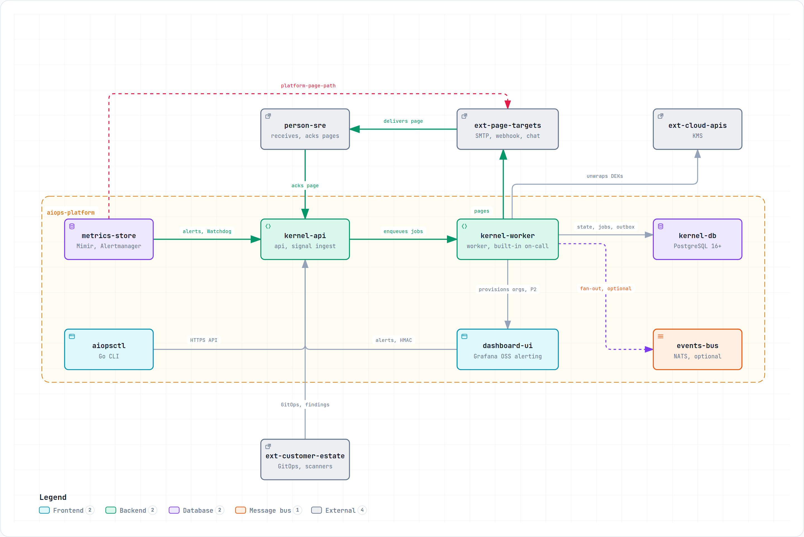
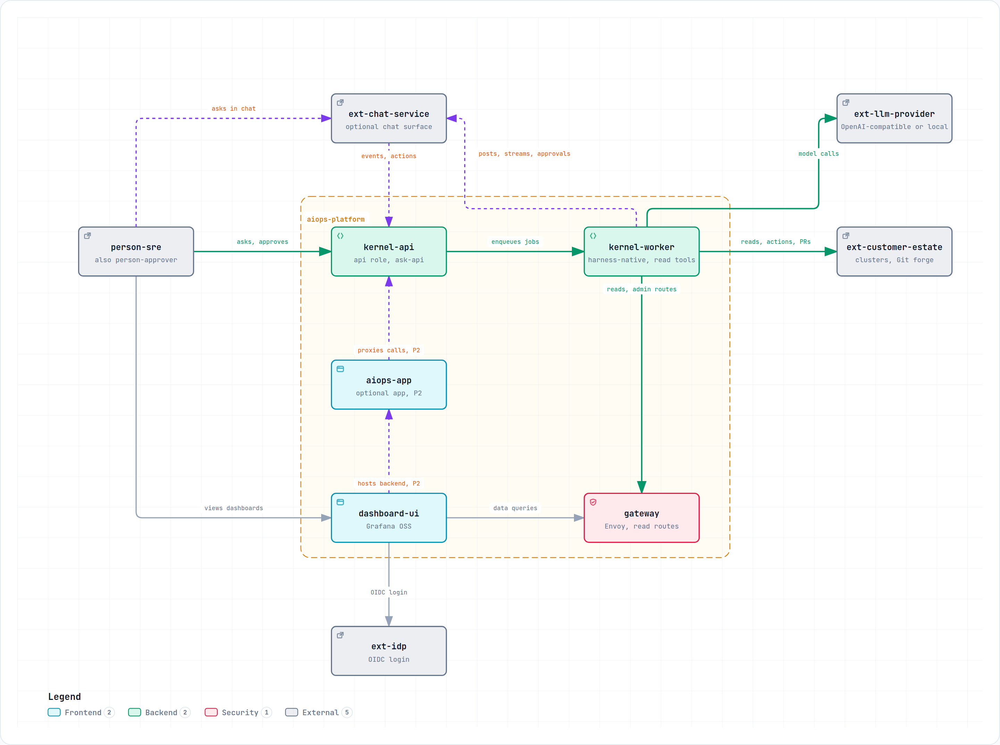
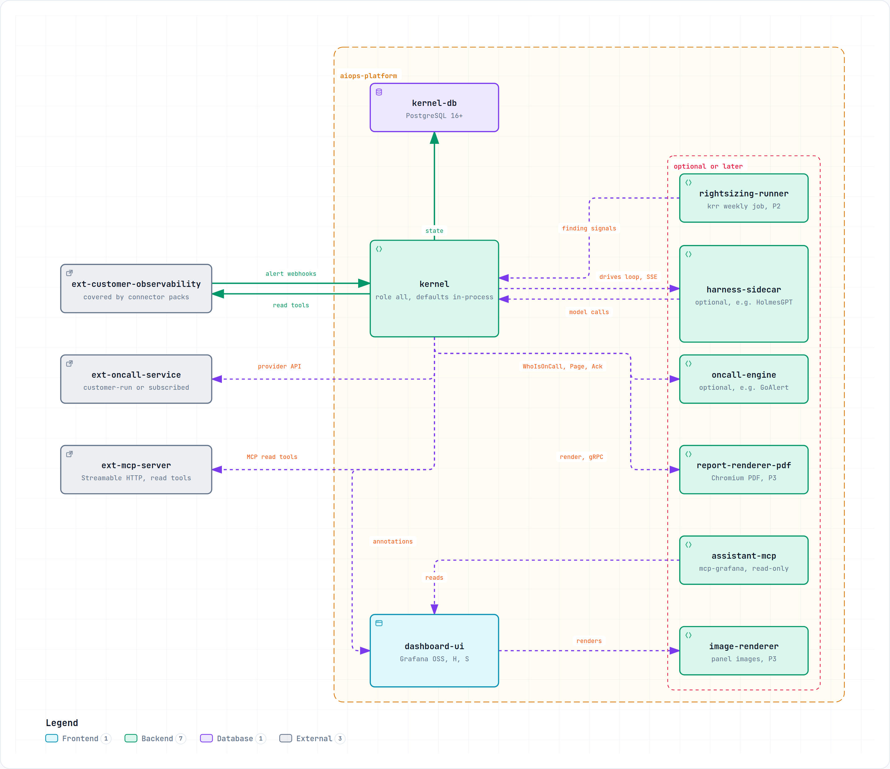
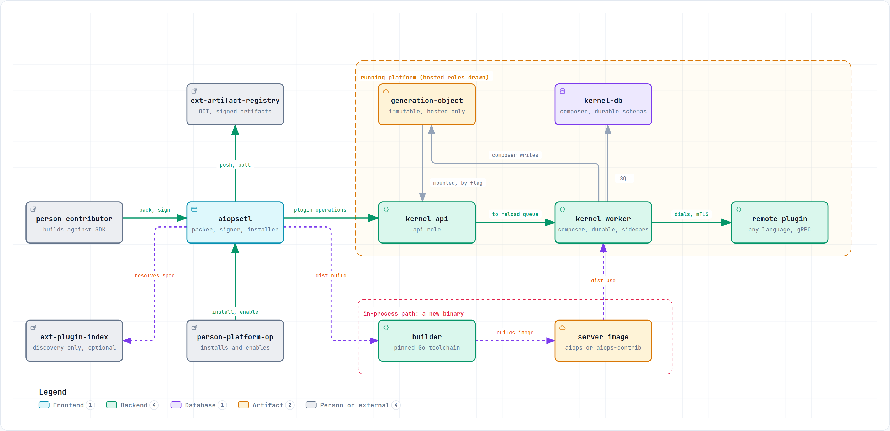
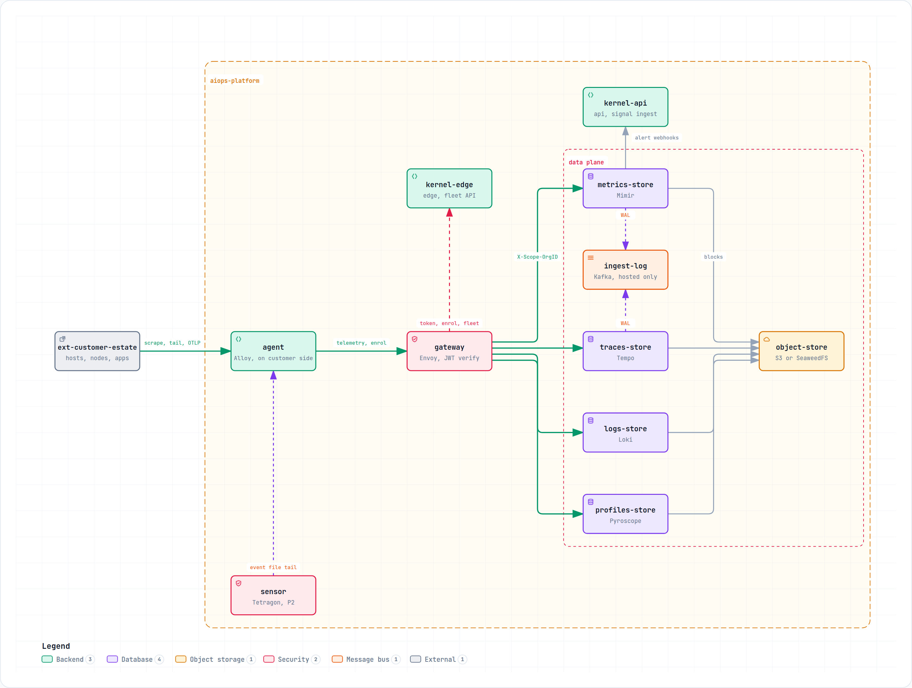
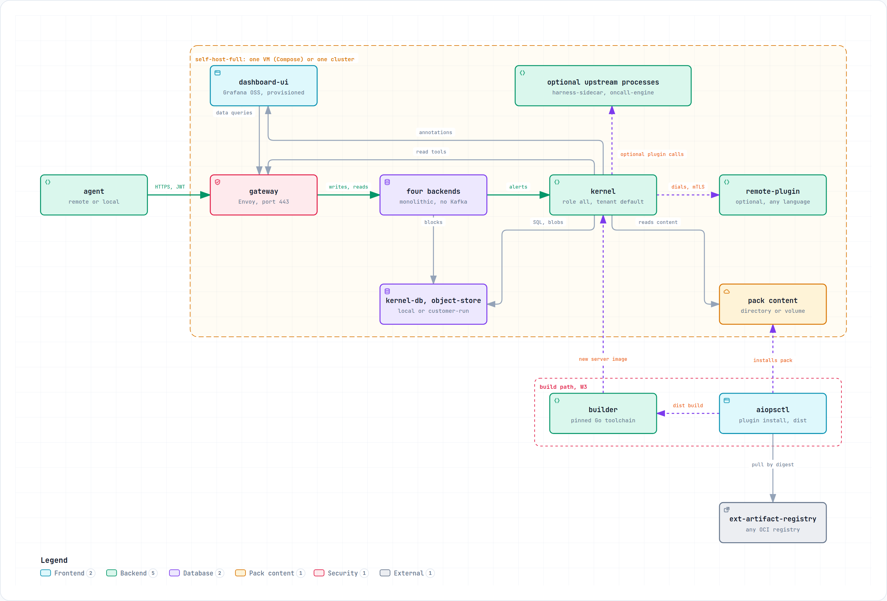
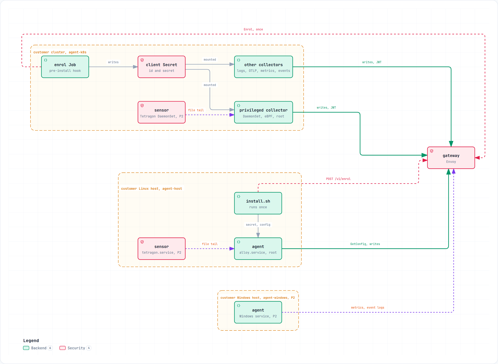

# 02. C2 containers

Status: draft, 2026-10-28; revised 2026-11-11 to the amended `00-decisions.md`, its plugin-system amendment, its community-first amendment, its second amendment of 2026-11-11 (the agent harness as a plugin point, upstreams as plugins, the licence record) and its third amendment of 2026-11-11 (the owner's confirmation of W2 to W13, which are owner decisions from that date) included. This document obeys `00-decisions.md`; where the two disagree, `00-decisions.md` wins. The level above is `01-c1-system-context.md`. The levels below are `03-c3-kernel.md`, `04-c3-agent-fleet-gateway.md`, `05-c3-pillars.md`, `06-c3-chatops-oncall.md`, `07-c4-plugin-sdk.md` and `09-c3-estate-and-troubleshooting.md`. Profiles, phases and ADRs are in `08-profiles-roadmap-adrs.md`.

Citations: `00 §n` is `docs/architecture/00-decisions.md`. `plugin record §n` is `docs/design/plugin-system-2026-11.md`, which holds the detail of the plugin system that 00 decides. `community record §n` is `docs/design/community-first-2026-11.md`, which holds the detail of the community-first order of work and of connector packs. `harness record §n` is `docs/design/harness-and-upstreams-2026-11.md`, which holds the detail of the harness definition, the first-party loop, the read tools, the upstream rule and on-call. `licence record §n` is `docs/design/licence-audit-2026-11.md`, which holds the licence, verdict and conditions of every upstream; it is engineering analysis, not legal advice, and its section 6 lists the questions a lawyer must answer. Research citations use the short names from `00-decisions.md`, all under `docs/research/`: grafana-stack, datadog-agent, oncall-and-aiops-oss, gap-tenant-gateway (`gap-tenant-gateway-and-agent-enrolment.md`), gap-remotecfg (`gap-remotecfg-server-build-vs-adopt.md`), gap-slack (`gap-slack-chatops-tenancy-and-runtime.md`), gap-ebpf (`gap-ebpf-sensor-bundle-and-kernel-floor.md`) and gap-kernel-hot-path (`gap-kernel-hot-path-and-grafana-ui-integration.md`). Product requirements, including rows 15 to 19 of 00 §2.1, are stated in the canonical record on their technical merits and cited by their 00 section.

## 1. Scope and reading guide

A container here is a separately runnable process or deployable artefact. Upstream components we deploy unmodified sit inside the system boundary because we render their configuration and own their lifecycle (00 §1 principle 7, §3.2): by default the tenant gateway proxy (Envoy), PostgreSQL, the object store (SeaweedFS), the four backends, the dashboard server (Grafana OSS) and, from P2, the runtime security sensor (Tetragon). An upstream is a plugin, never the product (00 §1 principle 9): the process of an optional upstream plugin, `harness-sidecar` or `oncall-engine`, is a container only where the operator enables that plugin, and it is in no default set (00 §3.2). Systems we do not deploy are external (00 §3.3). These are not containers: pillars (groups of rows), plugins and their rows such as `fleet`, `auth`, `tenant-directory`, `agent-runs`, `harness-native`, `paging` and, from P2, `estate`, service definitions and the registries behind them, the leaders `composer`, `durable` and `sidecars`, and bundle content such as rule files, runbooks and playbooks (00 §3, §4.1, §4.4). Replicas, namespaces, hosts and packaging belong to the deployment views in §4, not to the C2 diagrams.

**On-prem first.** The target estate is Kubernetes clusters and Linux hosts on virtual machines or bare metal, and from P2 network devices polled over SNMP (00 §1). No container in `self-host-full` needs a public cloud provider API. A chat service, an external on-call engine, a paging carrier and a hosted model are optional bindings: with none bound, the loop runs through the kernel API and `aiopsctl`, the built-in on-call provider pages by email or webhook, and `ext-llm-provider` is a model endpoint the customer serves locally.

**Two senses of kernel.** In this document `kernel`, `kernel-edge`, `kernel-api` and `kernel-worker` are containers: the server binary `aiops` and its roles. The module `sdk/kernel`, the Go port of the Cordis model, is a library inside each of them and inside `aiopsctl`; `03-c3-kernel.md` and `07-c4-plugin-sdk.md` describe it (00 §2.1 row 1, §8.2).

**Two senses of agent.** `agent` is the customer agent, a container on customer infrastructure (§3). A pillar agent is a pillar group's persona, tool set and harness selection; its runs execute inside the kernel containers, and it is not a container (00 §8.2).

**The plugin system at this level.** Every feature of the kernel is a plugin behind a service definition, composed from a profile as rows (00 §1). Almost none of that shows at C2, because a first-party row runs in process in every profile: the loader, the `reload` queue, `plugin-manager`, the compatibility gate, the tenant trees and the leaders are all inside the kernel containers. What does show is four containers and two external systems (00 §3.1, §3.3):

- `remote-plugin`, an out-of-process plugin instance in any language, which the kernel dials: one shared instance per plugin on self-host (S2b), one per (tenant, plugin) in hosted from S4b;
- `builder`, the distribution builder that produces a server image (S2a);
- `aiops-contrib`, a server image built from a wider module table that adds the in-process plugins under `contrib/`, each row disabled (S6a);
- `generation-object`, the hosted object from which every replica reads its composition (S4b);
- `ext-artifact-registry`, the OCI registry that holds signed plugin artifacts and distribution images;
- `ext-plugin-index`, a signed index repository used for discovery, from S6a.

§2.3 draws and lists them, and the tables of D-1 and the figure and tables of D-2 and D-3 place them. Four statements behind these views are owner decisions of 2026-11-11 (00 §2.4): a self-hoster may rebind bound keys by building and signing a distribution (W3); hosted third parties are remote contributions only (W4); the remote runtime in its single-tenant form ships before the first community release (W5); and `aiops-only` is a supported profile of that release for the connector scenario (W6). W3 and W4 govern §2.3 and the `remote-plugin` rows of §4, W5 places `remote-plugin` before the release, and W6 sets the phase of §2.2.

**Upstreams at this level.** Every upstream enters through one provider or contribution behind a definition and lives in a bundle of its own, and removing any one upstream plugin leaves a binary that builds and boots every shipped profile (00 §1 principle 9, §4.3). Three consequences show in the views. First, the default sets hold no harness container and no on-call container: the default harness `harness-native`, the read tools and the default on-call provider `on-call-provider-builtin` are first-party rows that run inside the kernel containers (00 §2.1 rows 2 and 3, §6.3). Second, HolmesGPT and GoAlert are each one optional plugin, `harness-holmesgpt` and `on-call-provider-goalert`, in optional bundles that no shipped profile lists; their processes are the optional containers `harness-sidecar` and `oncall-engine` of C2-a2 (§2.2). Third, container ids, compose services and chart keys name roles, never an upstream (00 §8.1).

The licence record found no software base that must be rebuilt for its licence (licence record §1, §3). What it changes at this level is packaging: every upstream image is pulled by digest from its own registry and sits in no image, mirror or offline bundle of ours, and the `aiops` chart renders its own templates for the metrics store and the profiles store instead of packaging their upstream charts (00 §3.2; licence record §3, §5; §4.2, §4.3).

The default harness is `harness-native`, first-party and new, by owner decision A (00 §2.4), and W7 fixes its scope at the first community release. Four more statements behind these views are owner decisions of 2026-11-11 (00 §2.4): the two optional adapters live under `plugins/`, ship in the release image and are built in S8b (W8); the built-in on-call provider is the default, and no code of it is written before a lawyer's answer on schedule patents, which is still open (W11; licence record Q3); the first-party loop, the read tools and the built-in provider run in the kernel process (W12); and `aiops-chatops-slack` is operator-enabled and listed by no shipped profile (W13). §6 item 24 says what each decision governs here and the fallback kept under W11.

**The first community release.** The order of work is community first (00 §2.4, §7.2). The first community release, version `0.1.0`, is `self-host-full` with the tenant `default` and one `aiops --role all` process, `dev`, and `aiops-only` for the connector scenario (00 §7.1). Its containers are the P0 and P1 containers of C2-a2 and C2-b, deployed as in D-2 to D-5, with `remote-plugin`, `builder` and `aiops-contrib` from C2-a3. A first install runs no harness container and no on-call container (00 §6.3). On that one process the `reload` row commits generations, so the release has no `composer` leader, no canary replica and no `generation-object` (00 §6.1). `hosted` follows S9b and is not part of the release: `kernel-edge`, `kernel-api`, `kernel-worker`, `generation-object`, the per-tenant remote plugin instances and D-1 belong to the hosted track (S4b, S6b, S9b). The views that draw the hosted roles do so because those are the superset, not because they ship first. The enterprise edition, the marketplace with billing, is not planned and adds no container here; whether the `hosted` profile stays in this repository is part of the open edition boundary (00 §7.2, ADR-049; §6 item 27).

**Connector packs add no container.** The default stack is a choice of bundles, not of contracts (00 §1 principle 7). Another observability system is reached through a connector pack: a bundle published as one signed artifact with rows, content and at most one plugin, which a contributor can write and contribute back (00 §6.2). A pack with no code is installed with no rebuild, and its content is unpacked into a directory on the kernel's host or a volume of its chart (§4.2). A pack with code carries an in-process Go plugin or a `remote-plugin`. At this level a pack shows in four places: what `ext-customer-observability` stands for (§2.2), `ext-mcp-server`, which the `tool-mcp` rows of a data pack read (§2.2), the install path of C2-a3 (§2.3), and the `pack content` node of D-2 and D-3 (§4.2). What stays specific to the default stack in this edition is the data plane and agent side of §3 and what provisions it: the agent and fleet, the tenant gateway, limits rendering, backend provisioning, the dead-man rule and route, provisioned dashboards with the annotator, the shipped rule files and the lab (00 §6.2).

**What adds no container.** The agent runtime, the on-call provider, the estate model, the troubleshooting method, detection content, evaluation, and on-prem change evidence and remediation (00 §2.1 rows 2, 3 and 15 to 19) live inside the containers below: the dispatcher `agent-runs` with its schema `agent_runs`, the first-party loop `harness-native` with its four loop rows, the read tools, `paging` with `on-call-provider-builtin` and its schema, a plugin with its schema (`estate`, P2), first-party plugins around whichever harness a pillar selects (`correlate`, `casefile`, `context-pack`, `rca-contract`), a second executor row (`remediation-executor-gitops-pr`, P2), rule files that run in the `metrics-store` ruler, agent config templates, labelled log lines in `logs-store`, and the evaluation case set with its grader, which `aiopsctl eval` runs. At this level they show in four places:

- The kernel reads telemetry and the Kubernetes API itself, with its own read credentials: the read tools of a run query the `gateway` read routes, or the customer's stores in `aiops-only`, and `tool-kubernetes-read` reads the customer's clusters. No harness holds a credential (§2.1, §2.2; 00 §2.2).
- The agent stamps identity on host pipelines and labels change evidence (§3, §4.4, §4.5).
- From P2 two more rows of the default connector pack read on the same paths: `estate-source-series` for the `estate` plugin and `evidence-source-logs` for the change-evidence read of `change-hub` (§2.1, §2.2).
- From P2 the kernel opens pull requests on the customer's Git forge (§2.1).

The estate model and the troubleshooting method are detailed in `09-c3-estate-and-troubleshooting.md`, the agent templates in `04-c3-agent-fleet-gateway.md`. The harness definition, the first-party loop, the read tools and the on-call provider are detailed in the harness record.

**Not in any view.** Build-time and lab-only tools are deployed in no profile, so they are neither containers nor nodes of a deployment view: an RDF command-line tool that parses the estate vocabulary and export in CI, and a fault engine with its host daemon under `lab/` (00 §3.2; `08-profiles-roadmap-adrs.md` lists them with their licences). The lab is neither a bundle nor a profile (00 §6.2). It deploys `self-host-full` unchanged, so its deployment view is D-2 or D-3 with agents as in D-4 and D-5; ADR-027 fixes its layout. The `builder` is also deployed in no profile, but 00 §3.1 lists it as a container we build, so §2.3 draws it and the D-2 and D-3 figure places it outside the boundary.

Profile codes follow 00 §3: H `hosted`, S `self-host-full`, A `aiops-only`, D `dev`, AH `agent-host`, AK `agent-k8s`. Phases follow 00 §7.2 and carry no dates. P0 is the model core (steps S0, S1, S2a, S2b, S3, S4a and S5). P1 is the community release: S6a, the manager and index in their single-site form, S7, the telemetry base, S8a, the agent runtime, and S8b, the incident loop, whose exit is the first community release. P2 runs two tracks: S9a, the community second wave, beside S4b, S6b and S9b, which are the multi-replica and multi-tenant runtime, the full manager and hosted. P3 is S10. A tag of S7, S8a or S8b names the step inside P1, a phase tag with a step in brackets names the step that builds the container, and "MVP" means the scope of the first community release (00 §7.1).

| View | Figure | Section |
|---|---|---|
| C2-a1 core control plane, part 1 (signals in, pages out, tenant setup) and part 2 (investigate and act) | `02-control-signals`, `02-control-investigate` | §2.1 |
| C2-a2 optional containers and the aiops-only shape | `02-optional-aiops-only` | §2.2 |
| C2-a3 plugin runtimes, distribution and generations | `02-plugin-distribution` | §2.3 |
| C2-b data plane and agent side | `02-data-plane` | §3 |
| D-1 hosted cell | none until a later pass; the tables govern | §4.1 |
| D-2 self-host on one VM | `02-deploy-self-host` | §4.2 |
| D-3 self-host on Kubernetes | `02-deploy-self-host`, shared with D-2 | §4.3, figure in §4.2 |
| D-4 agent on a Kubernetes cluster | `02-deploy-agent`, cluster lane | §4.4 |
| D-5 agent on a Linux host | `02-deploy-agent`, Linux host lane | §4.5, figure in §4.4 |
| D-6 agent on a Windows host | `02-deploy-agent`, Windows host lane | §4.6, figure in §4.4 |

Each figure shows the main path of its view. The element and relationship tables next to it are complete, and the text under a figure names what the figure leaves out.

**Figure status.** Seven figures are current. Four were redrawn after owner decisions A and B, with the role ids of 00 §3 and without `oncall-db`: `02-control-signals`, `02-control-investigate`, `02-optional-aiops-only` and `02-deploy-self-host`. Each PNG was checked as rendered against the element count stated under it. The other three, `02-plugin-distribution`, `02-data-plane` and `02-deploy-agent`, name neither upstream and were already current. D-1 has no figure until a later pass: its earlier figure drew per-tenant HolmesGPT and GoAlert instances, a second PostgreSQL and an on-call hostname, none of which exists (00 §6.3), and `hosted` follows S9b and is not part of the first community release. The tables of §4.1 are complete and govern (§6 item 31).

## 2. Control plane

### 2.1 C2-a1: core control plane

This section shows the containers that decide and act: the kernel roles, the dashboard surfaces, the kernel's state stores, and the external systems they call. It draws no upstream engine, because none is in a default set: the agent loop, the read tools and the default on-call provider are rows inside the kernel roles (00 §2.1 rows 2 and 3), and the optional processes `harness-sidecar` and `oncall-engine` are drawn in C2-a2 (§2.2). The section is split into two figures. Part 1 follows an alert from its source to a page and its ack, and adds tenant setup. Part 2 follows a question or an incident run to a read-only answer and, after approval, a remediation. Both draw the hosted role split because that is the superset, although `hosted` follows S9b and is not part of the first community release (§1). A row states its `roles` (`edge`, `api`, `worker`), fixed at insert, and a process started with `--role` mounts only the rows of that role. In `self-host-full`, `aiops-only` and `dev` one process runs every role (`aiops --role all`, drawn in C2-a2). First-party remediation executors run in process in every profile, on `kernel-worker` in H, so they are not a container (00 §2.1 row 1, §3.1). A plugin that runs out of process is one: `remote-plugin`, drawn in §2.3. `kernel-edge` is drawn only in C2-b, because agents reach it through the gateway and nothing in these two views calls it. The `gateway` and `metrics-store` appear only where the control plane meets the data plane; §3 draws the data plane.

*Figure 02-control-signals. Source: [diagrams/src/02-control-signals.json](diagrams/src/02-control-signals.json).*

*Figure 02-control-investigate. Source: [diagrams/src/02-control-investigate.json](diagrams/src/02-control-investigate.json).*

Each figure shows its main path in green, and the tables below are complete.

Part 1 draws eleven elements: the senders `metrics-store`, `dashboard-ui`, `ext-customer-estate` and `aiopsctl`, then `kernel-api`, `kernel-worker`, `kernel-db`, `ext-page-targets` and `person-sre`, with `ext-cloud-apis` and `events-bus` at the side. Its main path runs from the alert in `metrics-store` through `kernel-api` and `kernel-worker` to a page at `ext-page-targets`, which reaches `person-sre`, and back as the ack of `person-sre` on `kernel-api`. The red dashed arrow from `metrics-store` to `ext-page-targets` is the `platform-page-path` route, which reaches the platform-health receiver without passing the kernel. The other arrows are the webhooks of `dashboard-ui` and `ext-customer-estate` into `kernel-api`, the API calls of `aiopsctl`, the state write from `kernel-worker` to `kernel-db`, the org provisioning from `kernel-worker` to `dashboard-ui` (P2), the KMS call to `ext-cloud-apis` and the optional fan-out to `events-bus`. Part 1 leaves out `object-store`, which §3 draws, the chat surface and `ext-llm-provider`, which part 2 draws, `kernel-edge`, which C2-b draws, `oncall-engine` and `ext-oncall-service`, which C2-a2 draws, and the P1 annotation write, which C2-a2 and the D-2 and D-3 figure draw.

Part 2 draws ten elements: `person-sre`, `kernel-api`, `kernel-worker`, `gateway`, `ext-llm-provider`, `ext-customer-estate`, `dashboard-ui`, `ext-idp`, and the two optional ones, `ext-chat-service` and `aiops-app`. Its main path runs from a question or an approval of `person-sre` on `kernel-api` to `kernel-worker`, which reads through `gateway`, calls the model at `ext-llm-provider`, and reads and acts on `ext-customer-estate`. The arrows through `ext-chat-service` and `aiops-app` are dashed, because both are optional. The grey arrows are `person-sre` viewing dashboards in `dashboard-ui`, the data queries of `dashboard-ui` through `gateway` and its login against `ext-idp`. Part 2 leaves out `kernel-db`, `aiopsctl` and `object-store`, the optional `harness-sidecar` with its calls back to `/v1/llm` and `/v1/tools`, which C2-a2 draws, and the OIDC check of `kernel-api` against `ext-idp`.

The `enqueues jobs` arrow in both parts stands for `kernel-db`: `kernel-api` inserts and enqueues, and `kernel-worker` runs the job.

| ID | Name | Technology | Responsibility | Profiles, phase |
|---|---|---|---|---|
| `kernel` | Kernel, all roles | Go `aiops` binary, `--role all` | Every in-process row in one process, the leaders included: API, ingest, correlation, the agent loop and the read tools, the on-call provider, chat and the remediation executors (00 §3.1). It replaces the three hosted roles drawn in C2-a1 and is drawn in C2-a2. It is the only kernel container of the first community release, where it serves the tenant `default` and its `reload` row is the single committer of generations (00 §6.1, §7.1) | S, A, D; P0 |
| `kernel-edge` | Kernel edge role | same binary, `--role edge` | The rows with role `edge`, such as `auth-endpoints` and `fleet-agentapi`: `/oauth2/token`, `/v1/enrol`, the JWKS publisher and the fleet agent API (`collector.v1.CollectorService`, three RPCs). The only control-plane endpoints on the ingest SLO | H; P2 (S9b) |
| `kernel-api` | Kernel API role | same binary, `--role api` | The rows with role `api`. Public listener: HTTP and gRPC API (`ask-api` included), signal ingest (`signal-core` with its `signal-ingest-*` rows), the page ack link, the chat events receiver where a chat surface in Events mode is enabled, and the `aiops-app` proxy target (P2, optional). Internal listener, never routed by the public load balancer: `/v1/admin` (`admin-api`, which enqueues `kernel-worker` jobs), `/v1/llm` (the OpenAI-compatible HTTP surface of `llm-gateway`, off by default and enabled by whoever installs an external harness) and `/v1/tools` (`tools-mcp-facade`, a row of an optional external-harness bundle, §2.2); the last two exist only where an external harness plugin is enabled. Holds no cross-tenant database role and no admin-scope signing key | H; P2 (S9b) |
| `kernel-worker` | Kernel worker role | same binary, `--role worker` | The rows with role `worker`: job workers (the agent runs, with the first-party loop and the read tools in process; the escalation steps of the built-in on-call provider; from P2 the `estate` readers and the change-evidence read), the leaders (`jobs`, `durable`, `composer`, `sidecars`), reconcilers (tenant, dashboard-sync, fleet revisions, limits), notifiers, remediation executors in process, and cross-tenant admin jobs under the platform role. The only holder of the admin-scope signing key and of the cell's plugin CA | H; P2 (S9b) |
| `aiops-app` | Dashboard app plugin | Scenes frontend, Go backend on the plugin SDK | Incident, approval, change, finding and fleet pages; three backend handlers: `CallResource` proxy, `CheckHealth`, settings. Rated `optional-plugin-only`: no row of the core, of a shipped profile or of a suite needs it, and the rows that do need it sit in the optional bundle `aiops-dashboard-app` (00 §3.1, §4.4; licence record §2.3). Provisioned dashboards cover these views from P1 | H, S, A optional; P2 |
| `aiopsctl` | Operator and contributor CLI | Go; the `cli` profile of the same launcher and module table | Operator and CI path and, with the API, the path the loop runs through when no chat surface is enabled. Also the check runner for plugins in any language, because it carries the kernel, the definition fakes and the suites. P0: `profile render --dump`, `--dump-hooks` and `verify`; the `plugin` commands from `new` and `check` to `install`, `enable` and `purge`; `plugin gate --against`; `trust add`; `dist build`, `sign` and `use`. From S6a `plugin search` and the `index` commands (`add`, `compose`, `sign`, `verify`); from S6b `plugin update --cohort`, `quarantine`, `allow-version` and `profile rollback`. P1: `agent render/check` (S7), `ask`, `eval`, `oncall apply`, `oncall who` and `oncall override`, `slack manifest`, approvals, the incident loop without a chat service, and the dead-man rule and route printed as a snippet for a customer-run ruler and Alertmanager. P2: `app install`, `estate export`, `llm probe` (00 §3.1; §2.3) | all; P0 |
| `dashboard-ui` | Dashboard server | Grafana OSS 13.x | Dashboards, explore, managed alerting, provisioned dashboards (P1), host process for the optional `aiops-app` (P2) | H, S, D; S7 |
| `kernel-db` | Kernel database | PostgreSQL 16+ in every profile | Kernel state in one schema and one role per plugin, the job tables, outbox, secrets, audit chain, the `durable` tables and, from S4b, the `composer` tables; the run transcripts of every harness in schema `agent_runs` and, with the default on-call provider, responders, rotations, policies and page state in schema `on_call_provider_builtin` (00 §5.2); from P2 the `estate` schema, a projection that can be dropped and rebuilt from its sources; in H also one database and role per dashboard pool, in S also the dashboard database. It holds no database of an upstream engine: an external on-call engine keeps its own data | H, S, A, D; P0 |
| `object-store` | Object storage | S3 bucket (H); a customer-provided S3-compatible endpoint or the bundled SeaweedFS (S, D); 08-profiles-roadmap-adrs.md DR-15 | Kernel blobs under `aiops/<tenant>/`; backend blocks (§3). In A the bundled store is optional, but `blob-s3` still needs an S3-compatible endpoint (00 §3.2) | H, S, D, A optional; P0 |
| `events-bus` | Fan-out bus | NATS JetStream (`events-nats`) | Low-latency fan-out across kernel replicas, as a second relay of the same outbox table; never the source of truth | H optional; on ADR-007 |
| `gateway`, `metrics-store` | see §3 | Envoy; Mimir 3.2 | Drawn here only as touchpoints | see §3 |

External systems in this view: `ext-chat-service` (a chat service, optional in every profile; with the optional bundle `aiops-chatops-slack`, Slack, as chat surface and approval surface), `ext-llm-provider` (an OpenAI-compatible upstream, or a customer-run vLLM, Ollama or LiteLLM, which also fronts Anthropic and other vendors; on-prem it can be a model served locally), `ext-idp` (human login: ours in H, the customer's in S and A), `ext-cloud-apis` (KMS for `kek-kms` in H from P2; nothing in `self-host-full` needs it), `ext-customer-estate` (clusters the executors act on and `tool-kubernetes-read` reads; GitOps controllers and scanners that send signals; from P2 the Git forge that receives pull requests; its hosts and network devices are drawn in §3), `ext-page-targets` (an SMTP relay, a chat direct message, a webhook push target or an SMS gateway: the targets of the `notifiers` rows that receive pages and of kernel email from `notifier-email`; a carrier only where a contributed carrier notifier is installed; this file also draws the platform-health receiver here, §6 item 10). `ext-mcp-server` and `ext-oncall-service` are drawn in C2-a2 (§2.2). The one person drawn is `person-sre`, who receives and acks pages, asks and approves through the API, `aiopsctl` or an enabled chat surface, and follows the loop in `dashboard-ui`; the same box stands for `person-approver` (00 §3.4; §6 item 18).

| From → to | Protocol, auth | Why it matters |
|---|---|---|
| `gateway` → `kernel-edge` | HTTPS; token and enrol routes carry client auth in the body, fleet routes need scope `fleet` | Agents reach the control plane only through the gateway route table (gap-tenant-gateway §2.3). `kernel-edge` is scaled and deployed apart from the other roles, so token issuance is the only control-plane call on the ingest SLO (00 §1 principle 4). |
| `ext-customer-estate` → `kernel-api` | HTTPS webhooks, per-tenant token in `Authorization: Bearer` | GitOps controllers (Argo CD, Flux) post change events to `signal-ingest-gitops-webhook`. Each change row carries a set of target entity references, which is what lets the kernel offer a change as a candidate for an incident (00 §2.1 row 16, §5.2). A pusher on the customer side posts PolicyReport, Trivy and Kubescape results to `signal-ingest-policyreport`, and its payload marks a complete snapshot (ADR-018). |
| `metrics-store`, `dashboard-ui` → `kernel-api` | HTTPS; per-tenant token in `Authorization: Bearer` (the path form only for senders that cannot set headers), plus HMAC with a 5 min window for dashboard alerts | Every alert lands in `signal-core` first, through one of its `signal-ingest-*` rows: admission against the per-replica bucket before any write, one deduplicated durable insert, then ack, then correlation on the typed correlation key by `correlate`. An empty bucket answers the busy reply of the sender family and writes nothing: 429 with `Retry-After` by default, or 503 for a family whose route entry says the sender retries only 5xx, and shed deliveries are counted per row. One idempotency key, quota, audit row and PII scrub before anyone is paged (00 §2.1 row 5). The shipped rule files `kubernetes-workload` and `host-basics` run in the `metrics-store` ruler, and each of their alerts keeps one identity label and carries `rule_id`, `rule_pack` and `signal_type` (00 §2.1 row 17). Every Alertmanager webhook configuration we render sets `max_alerts`, and the truncated count a payload reports is added to the storm counter. |
| `metrics-store` → `kernel-api` → the bound on-call provider (`Watchdog`) | The alert webhook of the row above, then `paging.Heartbeat` in process | The first watcher of the dead-man contract: the kernel watches the alerting path. The always-firing `Watchdog` alert enters signal ingest every minute and beats the bound provider's end-to-end monitor through `paging.Heartbeat`, which proves ingest, job and provider per tenant; a beat missed for 10 minutes pages the tenant's platform policy through the bound provider. With the default provider the whole path stays inside the kernel roles and `kernel-db`. Where the bound provider returns a heartbeat target of its own, the route also posts straight to it (§2.2). Otherwise an on-call provider never receives an alert webhook: the exception list is closed and stated by class, so platform health may bypass ingest and estate alerts never do (00 §2.1 row 5; harness record §8.5; ADR-021). |
| `metrics-store` → `ext-page-targets` (`platform-page-path`) | The alert router's own email or webhook notifier, to the platform-health receiver, a static receiver from operator config | The second watcher, in another failure domain: the alerting stack watches the kernel's page path. One rule group, `platform-page-path`, on the kernel's own readiness series, is routed by the alert router straight to the platform-health receiver and never through the kernel. It fires when the page path of the kernel is lost, for example when pages of the built-in provider wait on a lost `pii` or `audit` provider (00 §2.1 row 5, §5.7, §6.1). `Watchdog` and `platform-page-path` are the two P1 entries of the exception list. Both watchers on one lost machine page nobody (harness record §8.5). The monitor timeout, the readiness series the group reads and whether the receiver may be one of the tenant's own notifier webhooks are ADR-021 (§6 items 10, 16). |
| `kernel-worker`: `agent-runs` → the selected harness | Go calls inside the worker role; no container boundary in a default set | Every pillar agent runs through the `harnesses` registry, which is provider-bound to its dispatcher `agent-runs`. The default harness is `harness-native`, first-party and new (owner decision A, 00 §2.4): a loop on the worker role that reaches a model only through `llm` and a tool only through `tools`. `agent-runs` takes the budget lease and the slot lease, writes every step to schema `agent_runs` before forwarding it, and enforces the caps at the tool set and the model view the harness holds. `context-pack` builds the first message on `run/first-message` and `rca-contract` checks the answer on `run/answer`, around whichever harness runs (00 §2.1 rows 2, 13, 16; `09-c3-estate-and-troubleshooting.md`). A worker crash restarts the run, which is safe because every tool is a read. That the loop and the read tools run in the kernel process is an owner decision (00 §2.4 W12). An external harness is an optional plugin whose process is `harness-sidecar` (§2.2), and a third-party harness can also be a `remote-plugin` (§2.3). |
| `kernel-worker` → `gateway` | HTTPS on the read routes with a service token, read-only and per tenant; `kernel-worker` also holds the admin-scope JWT, whose own issuer the gateway accepts only on its internal listener (§3) | The kernel reads telemetry itself. The read tools `tool-metrics-query`, `tool-logs-query` and `tool-traces-query` (and `tool-profiles-query` at S9a) are first-party `tools` contributions in `aiops-datasources`, the default connector pack. The model writes the query, the tool bounds it with a time range and a limit, and the kernel calls the gateway read routes with its own read credential, so the gateway decides the tenant and every call gets the actor filter, the effects gate, the cap, the scrub and an audit row (00 §2.1 row 2, §4.4; harness record §5). The closed list of gateway read routes is ADR-053. In P1 the reads include host change evidence: a run of the incident pillar reads it from `logs-store` with `tool-logs-query` and the host runbook of the default pack, and `change-hub` does not read it before P2 (00 §2.1 row 19). `fleet-sweeper` reads metrics through `metrics-query-http`. From P2 two more rows of `aiops-datasources` read on the same routes: `estate-source-series`, a contribution to `estateSources`, through the `metricsQuery` key, and `evidence-source-logs`, the first contribution to `evidenceSources`, through `logsQuery` (`logs-query-http`) when `change-hub` asks, at incident open and again when the answer arrives. `estate` and `change-hub` hold no query string (00 §2.1 rows 15, 19; §1 principle 7). The credential of all these reads is the service token class of 00 §5.4; ADR-028 names its holder in `aiops-only` (§6 item 2). No harness and no chat turn sees a write credential (00 §2.2). |
| `kernel-worker` → `ext-customer-estate` | Kubernetes API through the `dialer` key, which is provider-bound to `dialer-guarded`; its refused ranges are row config, the cell ranges in hosted and link-local only by default on self-host (00 §5.7). Reads use the Kubernetes read credential, writes a leased credential. From P2 also HTTPS to the customer's Git forge, with the repository credential that ADR-031 decides per forge | Reads: `tool-kubernetes-read`, a read tool of `pillar-incident`, gets and lists a closed kind list without `Secret` objects, events, a bounded log tail and rollout status. Its credential is the chart's read-only ServiceAccount where the kernel runs in the cluster it reads, else a read-only kubeconfig that the customer supplies as a tenant secret (00 §5.4; harness record §5.1; ADR-053). Writes: the executor row runs in process on `kernel-worker` and is reachable only through the `remediation` dispatcher. Its guard refuses `Apply` without a valid `ChangeToken` from `change-hub`. The write credential comes from `credentials.Write(token)`, provided by `credential-lease`, as a lease scoped to one action, and a missed deadline marks the change `uncertain`, never `applied` (00 §2.2). The MVP catalogue is five typed Kubernetes actions on `remediation-executor-kubernetes`, and a catalogue target is an entity reference (ADR-019). From P2 `remediation-executor-gitops-pr` makes the write a pull request that a person merges (00 §2.1 row 19). There is no SSH or shell from the kernel or any harness and no tool that starts a process on a target, so P1 offers no action on a host; a host executor on the customer's automation controller waits for its trigger and its own ADR (00 §7.3). The lease mechanism per target is ADR-019. How hosted reaches a private customer cluster, for the read tool and for the executors, and whether that needs a customer-side runner, is ADR-016. |
| `dashboard-ui` → `aiops-app` → `kernel-api` (P2) | go-plugin gRPC, then HTTPS with the app token and a verified `X-Grafana-Id` | Grafana owns the plugin backend process, so the backend is a stateless proxy and the kernel runs without Grafana (gap-kernel-hot-path §3.1). A missing `X-Grafana-Id` means `actor=plugin`, read-only (00 §2.1 row 8). The app is optional: the rows that need it sit in the bundle `aiops-dashboard-app`, which no shipped profile lists (00 §4.4, §6.3). |
| `kernel`, `kernel-worker` → `dashboard-ui` | P1, from `kernel` in S and D: the dashboard server's HTTP API, annotation writes in the single provisioned org; the credential of this write is a class due in 00 §5.4 before the row is built (§6 item 17). P2, from `kernel-worker` in H: Grafana org HTTP API with the pool server-admin credential (00 §5.4) | In P1 the `annotator` row writes incident, RCA and change annotations, which is how the RCA of the exit demo reaches a dashboard (00 §4.4, §5.3, §7.1 step 3). The row ships in `aiops-dashboards`, a bundle listed where a dashboard server is ours or the customer's, so `aiops-only` writes annotations only where it composes that bundle against the customer's own dashboard server; otherwise its RCA reaches the API and an enabled chat surface (00 §4.4, §6.3). Everything else `dashboard-ui` needs in P1 comes from provisioning files that the chart and compose render: data sources and dashboards (00 §2.1 row 8). From P2 `dashboard-sync` writes the annotations in place of `annotator` and, in H, provisions the tenant's org, read-only data sources (bearer service JWT through the gateway), app instance settings and membership, with tenant admins on the Editor role (00 §5.7). Pools hold 25 orgs (00 §2.1 row 8). C2-a1 part 1 draws only the P2 arrow from `kernel-worker`; the P1 write leaves the single `kernel` process and is drawn as `annotations` in C2-a2 and in the D-2 and D-3 figure (§6 item 17). |
| `ext-chat-service` → `kernel-api` (inbound, optional) | With the bundle `aiops-chatops-slack` enabled. H: Events API, signed HTTPS, 3 s ack. S, A, D: Socket Mode, outbound WSS from `kernel` | The bundle is operator-enabled and listed by no shipped profile, because the Slack API terms restrict commercial distribution; no release gate and no row outside the bundle needs it (owner decision, 00 §2.4 W13; licence record §2.4). The `chat` dispatcher is a row of `aiops-base`. One app, one bot; the pillar is a routing dimension; tenant routing uses `authorizations[0]` (00 §2.1 row 4, gap-slack §3, §4). `kernel-api` only verifies, resolves the tenant, inserts and enqueues (00 §3.1). |
| `kernel-worker` → `ext-chat-service` (outbound, optional) | Slack Web API, bot token | Incident posts, streamed answers and approval messages. The conversation, the streamer, `notifier-slack` and `approval-surface-slack` run on `kernel-worker` (00 §3.1 "notifiers"; `06-c3-chatops-oncall.md`), the role that also runs the agent loop whose steps the streamer relays. In S, A and D the same calls leave the single `kernel` process. |
| `kernel-worker` → `ext-page-targets` | SMTP, an HTTPS webhook or a chat direct message, through the `notifiers` rows that receive pages: `notifier-email` and `notifier-webhook`, and `notifier-slack` where that bundle is enabled | A job keyed on the incident id calls `Page` through `paging` when the incident first meets the paging threshold, at open or on a join. Withholding an investigation never withholds a page, and paging has no hook, so nothing a plugin registers can withhold one (00 §2.1 row 5). The default provider is `on-call-provider-builtin` in `aiops-oncall`, first-party and written new (owner decision, 00 §2.4 W11; no code of it is written before a lawyer's answer on schedule patents, licence record Q3, which is still open): responders with contact methods, one rotation shape with overrides, and escalation steps as durable jobs, with its state in schema `on_call_provider_builtin` on `kernel-db`. It sends through `notifiers` with the class `page`, which no hook can gate, digest or pace, and it has no carrier client: SMS and voice are `notifiers` contributions and are not first-party at the first release (00 §2.1 row 3; harness record §8.4). Paging by this provider shares fate with `kernel-db`, `notifications` and `pii`, which the `platform-page-path` route covers. A profile or tenant with no provider or no bound policy pages no one and says so on the incident, and the incident notice still goes to the notifier rows that receive incidents. |
| `person-sre` → `kernel-api` (ack) | HTTPS on the public listener: the signed one-time link in the page, whose token lives until the page closes; or the API, `aiopsctl` or a chat button | An ack stops the escalation. The ack link is the one public route the built-in provider adds, and its token acks one page only (00 §2.1 row 3, §3.1, §5.4). H has no on-call hostname per tenant, no engine per tenant, no second database and no carrier subaccount (00 §2.1 row 3). |
| kernel roles → `kernel-db` | SQL, each plugin under its own no-login role | One database for state, jobs and the outbox, written in the same transaction; `LISTEN/NOTIFY` is the doorbell; RLS on in every profile; one schema and one role per plugin, so a plugin cannot write another plugin's rows (00 §2.1 row 9, §5.2). Drawn from `kernel-worker` only; `kernel-edge` and `kernel-api` use the same database. The `enqueues jobs` arrow from `kernel-api` to `kernel-worker` in both parts stands for this database: `kernel-api` inserts and enqueues, and `kernel-worker` runs the job. `kernel-api` also verifies OIDC subjects against `ext-idp` (not drawn), and `kernel-worker` publishes to `events-bus` when ADR-007 enables `events-nats` (the dashed arrow in part 1). The same database holds the schemas `agent_runs` and `on_call_provider_builtin` and, from P2, `estate`, so no profile has a second database (00 §2.1 row 3, §5.2). |
| kernel roles → `ext-cloud-apis` | KMS API | The KEK that wraps per-tenant DEKs, through `kek-kms`; drawn from `kernel-worker` only. S uses `kek-local-file` and makes no such call (00 §5.4). |
| `kernel-worker`, `kernel-api` → `ext-llm-provider` | OpenAI-compatible HTTPS with an upstream key that only `llm-gateway` holds; a customer-supplied base URL goes through the `dialer` key (00 §5.7) | `llm-gateway` is the only model route, and no harness holds a provider key. It scrubs PII through the bound `pii` key, meters every model call under its run id, enforces the per-run caps and enforces a daily budget with a typed unit: USD where the price table states a rate, runs where the price is an explicit zero, so a model the customer serves locally is still budgeted. An absent price is a configuration error, an overloaded model server snoozes the job, and every call is refused while `agents-paused` is set. The call leaves through the `llm-provider-openai-compatible` row (00 §2.1 row 13). The default harness calls `llm` in process on `kernel-worker`, so in the default path the call leaves from there. The OpenAI-compatible HTTP surface at `/v1/llm` on `kernel-api` is off by default; with an external harness enabled its calls enter there and leave from `kernel-api` (§2.2; §6 item 28). |
| `aiopsctl` → `kernel-api` | HTTPS API; OIDC subject or service token | Operator and CI path. With the API it is how the loop runs when no chat surface is enabled: `ask`, incidents and RCAs, approvals, `oncall who` and `oncall override` (00 §1, §3.1, §7.1 step 6). |
| `kernel-worker` → `object-store` | S3 API | Kernel blobs under `aiops/<tenant>/`: artifacts, reports and exports (00 §3.2). Not drawn in part 1; `object-store` is drawn in §3. |
| Customer engineer → `kernel-api`, `ext-chat-service`, `dashboard-ui`; `dashboard-ui` → `ext-idp` | HTTPS API, directly or through `aiopsctl`, with an OIDC subject; the chat client; HTTPS; OIDC | The surfaces a person uses. MVP approvals go through `aiopsctl`, the API or an enabled chat surface, and approving from Slack needs a Sign in with Slack link (00 §2.1 row 4, §7.1 step 6). |

### 2.2 C2-a2: optional containers and the aiops-only shape

This diagram shows the containers that are optional or come later (`harness-sidecar`, `oncall-engine`, `assistant-mcp`, `rightsizing-runner`, `image-renderer`, `report-renderer-pdf`), and the `aiops-only` shape, where the kernel runs as one process against the customer's own observability systems and `aiops-stack` is absent (00 §6.3). Those systems are whatever the composed connector packs cover: Prometheus-compatible and Loki-compatible stores, an Alertmanager and a dashboard server through the default pack `aiops-datasources`, an MCP server through the `tool-mcp` rows of a data pack, and any other system through a pack that a contributor writes (00 §3.3, §6.2). The profile is supported from the first community release for the connector scenario (owner decision, 00 §2.4 W6), and the full demo on it is P2. In `aiops-only` there is no `gateway`, no backend and no `fleet`. The profile composes `aiops-oncall`, so the built-in provider is present, and a tenant with no bound policy pages no one and says so on the incident. `aiops-app` is optional from P2 and installed into the customer's own Grafana. With no `fleet`, a host is keyed `host:ext/` from `host_id` or a mapped label, and the rule files and the agent label contract are published so that the customer's own ruler and collector can meet them (00 §6.3, §8.1). `dashboard-ui` appears because `assistant-mcp` and `image-renderer` attach to it in H and S.

The two optional upstream processes are where principle 9 shows as containers (00 §1). `harness-sidecar` is the role id for the process of any external harness plugin; with `harness-holmesgpt` it is the unmodified HolmesGPT image. `oncall-engine` is the engine of an optional on-call provider plugin; with `on-call-provider-goalert` it is GoAlert, for an operator who wants a pager that does not share fate with the kernel. Both plugins are first-party, live in the release image and sit in optional bundles that no shipped profile lists, so the operator enables one with `aiopsctl plugin install` and `plugin enable` and no rebuild (owner decision, 00 §2.4 W8; 00 §6.3). The chart or compose file renders the process only when the operator sets its value and pulls its image by digest from the upstream registry; the image is in no image, mirror or bundle of ours (harness record §6.1; licence record §5). Both upstreams are Apache-2.0 and rated `ok-with-conditions`: they are optional by owner decision, not by verdict (licence record §2.2, §2.4, §4). Legs A and B of the release pass with the default provider map, which names no optional upstream plugin, and the steps each optional plugin serves are replayed from that plugin's own cassettes (00 §7.1 leg F).

*Figure 02-optional-aiops-only. Source: [diagrams/src/02-optional-aiops-only.json](diagrams/src/02-optional-aiops-only.json).*

The figure draws twelve elements. The `aiops-only` main path is green: alert webhooks from `ext-customer-observability` into `kernel`, the read tools of `kernel` back to those stores, and `kernel` to `kernel-db`. The optional containers sit in the group `optional or later`, and dashed arrows are optional or come later: `kernel` to `ext-mcp-server`, `kernel` to `harness-sidecar` and the model calls back, `kernel` to `oncall-engine` and to `ext-oncall-service`, `assistant-mcp` to `dashboard-ui`, the annotation write from `kernel` to `dashboard-ui`, `dashboard-ui` to `image-renderer`, `kernel` to `report-renderer-pdf`, and `rightsizing-runner` to `kernel`. The tables below are complete: `aiops-app`, `object-store`, `ext-chat-service`, `ext-llm-provider`, `ext-page-targets` and the person have rows and no box here, and §2.1 and §3 draw them. The figure also leaves out the read of `rightsizing-runner` through `gateway`, the native-mode reads of `harness-sidecar`, the heartbeat post to `oncall-engine`, and it draws no connector pack, which is not a container; §2.3 draws the path by which a pack is installed.

| ID | Name | Technology | Responsibility | Profiles, phase |
|---|---|---|---|---|
| `kernel` | Kernel, all roles | Go `aiops` binary, `--role all` | In A: the profile layer points the query and tool rows of the default pack at customer endpoints, or enables another pack's tools and disables the default ones. The agent loop, the read tools and the built-in on-call provider run in this process. From P2 the `estate` plugin runs unchanged, because its readers are `estateSources` contributions of a connector pack and never read `fleet` tables | S, A, D; P0 |
| `kernel-db` | Kernel database | PostgreSQL 16+ | Required in every profile | H, S, A, D; P0 |
| `object-store` | Object storage | S3-compatible endpoint or SeaweedFS | Reports and exports. In A the bundled store is optional, but `blob-s3` still needs an S3-compatible endpoint of the customer's (00 §3.2, §6.3) | H, S, D, A optional; P0 |
| `harness-sidecar` | External agent harness process (optional) | The upstream process of an optional harness plugin; with `harness-holmesgpt`, HolmesGPT 0.46, pulled by digest | Runs the loop of an external harness. It reaches a model only through `llm-gateway` and tools through the run's tool set, and holds no provider key | In no default set. S, A, D optional, one shared instance; one per tenant in a multi-tenant profile; P1 (S8b) |
| `oncall-engine` | External on-call engine (optional) | The engine of an optional provider plugin; with `on-call-provider-goalert`, GoAlert 0.35, pulled by digest | Schedules, escalation and paging of its own, with its own data and its own carrier, for an operator who wants an independent pager | In no default set. S, A optional, one shared instance, off by default in the chart; P1 (S8b) |
| `aiops-app` | Dashboard app plugin | Scenes, Go plugin SDK | Unsigned build, allow-listed in the customer's Grafana; rated `optional-plugin-only` (00 §3.1) | A optional; P2 |
| `dashboard-ui` | Dashboard server | Grafana OSS 13.x | Ours in H and S; in A the customer's own Grafana plays this role and is external | H, S, D; S7 |
| `assistant-mcp` | Bring-your-own-assistant endpoint | mcp-grafana, streamable-http, `--disable-write` | Read-only MCP endpoint for the customer's own AI clients; pulled from upstream and never mirrored (licence record §2.2) | S, A optional; H on request; P2 on request |
| `rightsizing-runner` | Rightsizing runner | krr 1.31, run weekly as a scheduled job | Reads usage history on the gateway query routes and posts `finding` signals for FinOps | H, S optional; P2 on ADR-032 |
| `image-renderer` | Panel image renderer | grafana-image-renderer | Panel images for reports | H, S optional; P3 |
| `report-renderer-pdf` | PDF renderer | Headless Chromium, a `reportRenderers` contribution over gRPC | Executive PDF reports | H, S optional; P3 |

| From → to | Protocol, auth | Why it matters |
|---|---|---|
| `ext-customer-observability` → `kernel` | HTTPS webhooks with the tenant's bearer token | A boots with `aiops-stack` absent: the static graph of `aiopsctl profile render` shows that no row of the other bundles needs a key that only `aiops-stack` provides (00 §6.3). Alert sources still enter through the `signal-ingest-*` rows of `signal-core`. A sender with a payload family of its own enters through a `signals` contribution that a connector pack carries, with that family's busy reply and default label map (00 §4.1, §6.2). The shipped rule files are plain Prometheus rule files, so the customer's own ruler can load them (00 §2.1 row 17); a pack for a system with another rule format carries its own rule content. |
| `kernel` → `ext-customer-observability` | HTTPS, with the customer datasource credential of each store: a tenant secret under the scope of the pack that inserted the row, read per call by the kernel's read tools (00 §5.4) | A has no gateway, so the read tools of the default pack query the customer's stores directly: the profile layer points `metrics-query-http`, `logs-query-http` and the three query tools at customer endpoints. `metricsQuery` and `logsQuery` are dialect contracts: the Prometheus HTTP query API with PromQL and the Loki HTTP query API with LogQL. A store that does not speak the dialect provides nothing under the key, and a connector pack for it contributes its own tools, and at P2 its own readers to `estateSources` or `evidenceSources`, with its own client (00 §4.1, §6.2). A pack states whether its vendor's credential is read-only; one that is not is refused in the project index and in `contrib/`, and boot warns on it. From P2, with the default pack, `estate-source-series` queries the customer's metrics store and `evidence-source-logs` the customer's logs store, where the customer's collector labels change evidence under the published contract (00 §2.1 rows 11, 15, 19). Where the query rows take endpoint and credential in A is ADR-028. |
| `kernel` → `ext-mcp-server` | MCP over Streamable HTTP, never stdio, through the `dialer` key; the MCP server credential, a tenant secret under the pack's scope, read per call by `tool-mcp` (00 §5.4, §5.7) | The vendor-neutral read seam is `tools`. A data pack inserts rows of the instantiable first-party plugin `tool-mcp`: a row is one MCP server, and each allow-listed tool becomes a `tools` contribution that every harness is offered through the same dispatcher. The pack carries a digest of the recorded tool list, and the row fails when the live list hashes differently. Its effects class is asserted by the pack, not proven, and boot says so. A pack with no code therefore reads only from systems that offer a Streamable HTTP MCP server with read tools (owner decision, 00 §2.4 W9; 00 §2.1 row 2, §6.2; harness record §5.3). The reference pack of leg C1 has this form. |
| `kernel` → `harness-sidecar` (optional) | HTTP `POST /api/chat` with server-sent events, from the in-process row `harness-holmesgpt`, a `scope: tenant` contribution to `harnesses`; the endpoint comes from `sidecars` | The row is an HTTP and SSE client that links nothing of the upstream and drives the unmodified image. In its default mode every native toolset of the upstream is off and the run's tools are sent with each request in pause mode: the adapter resumes each paused iteration, so `agent-runs` counts steps and the tool fences hold. The row declares its departures from the harness contract (`instance-key`, `opaque-history`, `wrapped-prompt`), and `context-pack` and `rca-contract` wrap it as they wrap the default harness. A pillar group selects it in its `harness` field, so a user may choose it for the incident, the compliance or the FinOps agent; a selected harness that is not ACTIVE falls back to the default and the timeline says so (00 §2.1 row 2; harness record §6). The fence around the process is an internal compose network that the plugin renders, or a NetworkPolicy on Kubernetes; for a static unit, boot says that the fence is the operator's (harness record §2.5). Four points of the upstream's behaviour are UNVERIFIED until the cassettes of the S8a spike (ADR-003; harness record §6.2). |
| `harness-sidecar` → `kernel` (optional) | On the kernel's internal listener. `/v1/llm`: OpenAI-compatible HTTP with the instance's virtual key, which the gateway accepts only while `agent-runs` holds a run lease for that instance. As the second choice for tools, `/v1/tools`: MCP streamable HTTP from `tools-mcp-facade`, with the virtual key in a static header | `llm-gateway` is the only model base URL, so budgets, caps, PII scrub and metering apply to an external harness as to the default one. The HTTP surface is off until whoever installs the plugin enables it (00 §2.1 row 13, §5.4). How an external harness reaches tools is ADR-004: first the run's tools sent with each request, second the facade (§6 item 12). |
| `harness-sidecar` → `gateway` in S and D, or `ext-customer-observability` in A (opt-in native mode) | HTTPS, with a read-only credential that the instance holds itself; in S and D a service JWT on the gateway read routes, in A a read-only customer datasource credential from tenant secrets under the harness plugin's scope (both classes in 00 §5.4) | Only where the row config names native toolsets (departure `native-reads`). The upstream then reads with its own toolsets, which loses the actor filter, the effects gate, the output cap, the tool-side scrub and our audit of tool calls. Boot prints the lost fences, every run records that its tool calls were not gated, and `agent-runs` refuses kind `ask` unless the actor holds the full read permission of the instance credential (00 §2.1 row 2; harness record §6.2). Not drawn. |
| `kernel` → `oncall-engine`, or an engine the operator already runs (optional) | The engine's own API, from the row `on-call-provider-goalert`, a contribution to `oncallProviders`; external on-call provider credentials, tenant secrets under the provider plugin's scope (00 §5.4) | `paging` calls `WhoIsOnCall`, `Page`, `Ack`, `Resolve` and `Status` on whichever provider is bound, so replacing the built-in provider changes the provider binding and no other row (00 §2.1 row 3, §5.2). GoAlert is one provider plugin, not the on-call engine of the product: the plugin connects to an instance the operator runs, or to one shared `oncall-engine` that the chart or compose file renders behind a value that is off by default. The engine keeps its own data and reaches its own carrier, and the kernel holds neither; where the chart puts the engine's store is open (§6 item 29). No engine runs per tenant, and hosted has no second database, no subdomain proxy and no carrier subaccount. |
| `metrics-store`, or the customer's alert router in A → `oncall-engine` (optional) | HTTPS to the heartbeat target that the provider returns | An external provider that implements `Heartbeat` keeps the stronger, schedule-aware form of the first dead-man watcher: `Watchdog` is also sent straight to it (00 §2.1 row 5, §5.7; harness record §8.5). Not drawn. |
| `kernel` → `ext-chat-service`, `ext-llm-provider`, `ext-page-targets` | Socket Mode WSS and Slack Web API, with the optional Slack bundle; OpenAI-compatible HTTPS; SMTP or a webhook | Outside H the Slack surface uses Socket Mode, so the kernel needs no inbound port for it (00 §2.1 row 4). A chat service is an optional binding, the model endpoint can be one the customer serves locally, and pages of the built-in provider leave through the notifier rows (00 §1; §2.1). |
| `kernel` → `kernel-db`, `object-store` | SQL; S3 API | `kernel-db` is required in every profile. In A the bundled object store is optional, but `blob-s3` needs an S3-compatible endpoint (00 §3.2, §6.3). |
| `ext-customer-observability` → `aiops-app` → `kernel` (P2) | go-plugin gRPC inside the customer's Grafana; HTTPS with the app token | In A the customer's own Grafana hosts the unsigned, allow-listed build (ADR-023). |
| Customer engineer → `assistant-mcp` → `dashboard-ui` | MCP streamable HTTP from the customer's own AI client; Grafana HTTP API | Writes disabled. Gated by ADR-004 and customer demand (00 §7.3). |
| `rightsizing-runner` → `gateway`, `kernel` (P2; the figure draws the post to `kernel`, not the read through `gateway`) | HTTPS query routes with a read-only service token; HTTPS webhook to `signal-ingest-generic-json` with a signal-ingest token | The weekly run reads usage history and posts its result as `finding` signals. Both credentials are existing classes of 00 §5.4. ADR-032 decides how the scheduled job is modelled and where it runs in A (00 §3.2). |
| `kernel` → `report-renderer-pdf` (P3) | gRPC, as a `reportRenderers` contribution under `reports` | Executive PDF reports, stored in `object-store`. |
| `kernel` → `dashboard-ui` | The dashboard server's HTTP API, annotation writes (§2.1) | Drawn as `annotations`. It applies where `aiops-dashboards` is composed: against our `dashboard-ui` in S and D, and in A only where the operator composes the bundle against the customer's own dashboard server. Leg B, on A with the default pack, asserts no annotation (00 §4.4, §6.3, §7.1). |
| `kernel` → `dashboard-ui` → `image-renderer` | HTTP render API | grafana-stack §10.1 records that Grafana 13.0 removed Image Renderer plugin support. This row assumes the remote rendering service still works with 13.x; re-check before P3. The figure labels the first arrow with the annotation write of the row above; the render call runs between the same two containers. |
| `kernel` → `ext-oncall-service` (optional) | The service's own API, with the tenant's own credentials (00 §5.4) | An optional `on-call-provider-<service>` plugin for an external on-call service that the customer runs or subscribes to. It arrives as a contribution or on a first customer request. A first-party PagerDuty plugin is not written or announced without PagerDuty's written consent, and no Opsgenie row is planned because that service ends 2027-04-05 (00 §3.3, §7.3; licence record §2.4). |

### 2.3 C2-a3: plugin runtimes, distribution and generations

This view shows how plugin code reaches a running kernel and how a kernel replica learns what to compose. There are two runtimes, both built and proven before the first community release (00 §2.1 row 1; plugin record §11). In-process Go enters a server image through the `builder` and its generated module table, and changes only with a new binary (S2a). A remote plugin is a separate program that the kernel dials over gRPC, and it is installed and enabled live (S2b, in its single-tenant form). The remote protocol carries its major in the proto package and opens every connection with one frozen handshake message (00 §4.3). A remote plugin is a set of contributions, not a full plugin: it registers with registries marked `contrib`, listens on hooks marked remote and calls a fixed callback set. It cannot provide a key, register a route or a job handler, or join a transaction. `wasm` is a reserved value of the manifest's `runtimes` and is not built, so it has no container.

A third artifact form has no runtime: a pack with no code, whose manifest lists no runtime. It holds rows of first-party plugins marked `instantiable` plus content, is installed with no rebuild and no deployment unit, and is how a contributor connects another observability system with no code. The instantiable plugins are `tool-mcp`, `signal-ingest-generic-json` and `notifier-webhook`, so such a pack reaches a system that offers a Streamable HTTP MCP server with read tools or that sends a payload the generic rows accept (00 §6.2; owner decision, 00 §2.4 W9). A connector that needs code uses one of the two runtimes.

The optional bundles of the release need neither runtime nor rebuild: `aiops-chatops-slack`, `aiops-harness-holmesgpt`, `aiops-oncall-goalert` and, from P2, `aiops-dashboard-app`. Their modules are in the release module table and no shipped profile lists them, so the operator enables one with `aiopsctl plugin install` and `plugin enable` (00 §6.3; owner decision, 00 §2.4 W8). Where such a plugin drives an upstream process, the chart or compose file renders that process only when the operator sets its value (§2.2).

Three owner decisions of 2026-11-11 shape this view (00 §2.4). Under W5, the remote runtime ships before the first community release with one shared instance per plugin; per-tenant instances and activations across replicas arrive at S4b. Under W4, hosted runs every third-party plugin as a `remote-plugin`, one instance per (tenant, plugin); hosted also runs the release distribution only (00 §4.2). Under W3, a self-hoster may also put third-party Go code in process, and may rebind bound keys, by building and signing a distribution of their own. In-process Go is trusted code, not a sandbox (00 §1 principle 6).

*Figure 02-plugin-distribution. Source: [diagrams/src/02-plugin-distribution.json](diagrams/src/02-plugin-distribution.json).*

The figure shows the main path in green: a contributor packs and signs, `aiopsctl` pushes the artifact, a platform operator installs and enables, the operation reaches the `reload` queue through `kernel-api`, and the kernel dials the remote instance. Dashed arrows are the in-process path, which ends in a new server image, and the optional index lookup. The node `server image` stands for `aiops` and `aiops-contrib`. The figure and the tables use the hosted roles because those are the superset. In S, A and D, which is every profile of the first community release, the single `kernel` process stands for `kernel-api` and `kernel-worker`, its `reload` row commits generations, and there is no `composer` leader and no `generation-object`; both arrive at S4b.

Three arrows stand for a wider set. The dial is drawn from `kernel-worker` only, though every replica that mounts the proxy row dials. The mount of `generation-object` is drawn into `kernel-api` only, though every replica mounts it. `dist use` is drawn into `kernel-worker` only, though it rolls the image of every role. Not drawn: the contributor's pull request to `ext-plugin-index` or to `contrib/` in this repository, the unpacking of a pack's content on the kernel's host (§4.2), the callbacks of `remote-plugin` on the stream the kernel dialled, and the calls by which the `sidecars` leader creates and deletes the instance. The figure shows the main path, and the tables below are complete.

| ID | Name | Technology | Responsibility | Profiles, phase |
|---|---|---|---|---|
| `remote-plugin` | Remote plugin instance | The plugin's own image, any language, speaking the remote protocol over gRPC | Contributions to registries marked `contrib` and listeners on hooks marked remote. The kernel dials it through one `aiops/remote` proxy row per instance, and its callbacks ride that stream. On self-host one shared instance serves each plugin. In hosted every third-party plugin runs this way (owner decision, 00 §2.4 W4), one instance per (tenant, plugin). A third-party harness in its remote form is one of these: it reaches the model and the tools through the `llm` and `tools` callbacks, each carrying the run handle, under deny-all egress (harness record §2.5) | S, A, D optional, one shared instance per plugin; H per tenant, from S4b; P0 (S2b) |
| `builder` | Distribution builder | Builder image with the pinned Go toolchain, run by `aiopsctl dist build` | Generates the module table and `go.mod` from `dist.yaml`, builds with the release's pinned versions, runs the licence scan, the import boundary and conformance, and writes notices and an SBOM into the image. The builder image itself carries the licence texts of the toolchain and of every tool in it, and a source offer for the copyleft packages of its base layer (00 §3.1; licence record §2.1). Run by the release pipeline, and by a self-hoster who adds an in-process plugin (owner decision, 00 §2.4 W3) | build time, deployed in no profile; P0 (S2a) |
| `aiops-contrib` | Contrib server image | The `aiops` binary built from a wider module table, `dist/contrib.yaml` | First-party rows plus the in-process plugins under `contrib/` in this repository, whose suites run in our CI, each row disabled by default, for a self-hoster with nothing to build. It runs as `kernel` in place of the `aiops` image and takes no licence acceptance. A data pack under `contrib/` has no module-table entry and is not in this image: the release pipeline publishes it as a signed artifact under the `contrib` id and lists it in the project index (00 §3.1) | S, A, D optional; P1 (S6a) |
| `generation-object` | Hosted generation object | An immutable object written by `composer`, mounted into every replica and named by flag | The committed process-scope generation and at most one candidate with its target replica set, read by the launcher before any row mounts | H; P2 (S4b) |
| `aiopsctl` | see §2.1 | | Here: the scaffolder, packer, signer, installer and check runner, the front end of the `builder`, and from S6a the composer and signer of an index | all; P0 |
| `kernel` | see §2.1 | | At the first community release the one process holds every row of this view: `reload` as the single committer, `plugin-manager` from S6a, `durable`, `sidecars-static` and the `remote` proxy rows | S, A, D; P0 |
| `kernel-api`, `kernel-worker`, `kernel-db` | see §2.1 | | `kernel-worker` holds the leaders `durable` and `sidecars`, from S4b `composer`, and the cell's plugin CA; `kernel-db` holds the `durable` schema and from S4b the `composer` schema | see §2.1 |

External in this view: `ext-artifact-registry`, an OCI registry of the publisher's or the site's choosing, which holds signed plugin artifacts and distribution images addressed by digest, and `ext-plugin-index`, a Git repository with one file per plugin, composed by its CI into one document with a detached signature and kept by the project, a community or the site. The index is for discovery only: it resolves an `<id>@<version>` spec to an artifact, none is configured by default, and a private index never falls through to a public one. Its readers are the `plugin-index` row of `aiops-core` and `aiopsctl`, from S6a. The format (version 1.0, with a serial and an expiry) and the commands that compose and sign it are published, so a third party can run an index or a marketplace of its own; a running index is deployed in no profile (00 §3.3, §4.4). The people are `person-contributor`, who builds a plugin against the SDK with no kernel checkout and touches no running tenant, and `person-platform-op`, who installs and enables it (00 §3.4).

| From → to | Protocol, auth | Why it matters |
|---|---|---|
| `person-contributor` → `aiopsctl` | Local commands: `plugin new <registry>` or `plugin new connector`, then `check`, `smoke`, `pack`, `sign`, `push` | A plugin is tested alone before it is attached. `plugin new` writes a plugin or pack skeleton from a template that CI regenerates for every registry (it compiles, passes T0 and the generated tests, and fails conformance with one line per obligation left to write), and `plugin check ./` is the one command before a pull request: T0 to T2 in every runtime the manifest lists, manifest parity and, for a pack, the connector scenario. `aiopsctl` carries the kernel, the definition fakes and the suites, and drives a non-Go plugin over a Unix socket with no Go toolchain, so the contributor needs the SDK and `aiopsctl` and no kernel checkout (00 §1 principle 2, §4.5). `pack` builds one OCI artifact: the image digest for a remote plugin, the module path, version and sum for a Go one, or neither for a pack with no code; `plugin.yaml` in manifest schema 1.0, with its publisher, licence and the generated `requires`; a bundle whose rows are disabled; content; the signed conformance attestation and an SBOM (00 §4.1, §4.3; plugin record §11). |
| `aiopsctl` → `ext-artifact-registry` | OCI push, and pull by digest; a cosign signature on the artifact (ADR-020); registry pull credentials held by `aiopsctl` and the orchestrator | The registry is storage, not trust: install checks the artifact's own signature against `trust.yaml`, whose signers are limited to id patterns and runtimes. The kernel never holds a pull credential (00 §3.3, §5.4). |
| `person-contributor` → `ext-plugin-index`; `aiopsctl` → `ext-plugin-index` (from S6a) | A pull request to the index repository; a read of the composed document, whose detached signature is checked before the document is parsed | Optional on both sides. The index is trusted for discovery only, because install still checks each artifact's signature, and `trust.yaml` limits each index to the id patterns it may list. With no index configured, a spec is an OCI reference by digest or a local path (00 §3.3, §5.4, §6.1). A contributor gives a plugin back in one of two ways: it stays in its author's repository and is listed in the index, or it is merged under `contrib/<name>/` in this repository with the id owner `contrib` and ships disabled in `aiops-contrib` (00 §4.5). |
| `person-platform-op` → `aiopsctl` | Local commands: `trust add`; `plugin inspect`, `install`, `enable`, `disable`, `remove`, `purge`; `profile render` and `verify`; from S6b `plugin update --cohort`, `quarantine` and `profile rollback` | Install is not enable and runs no third-party code. It runs the compatibility gate, ten checks that read manifests only; check 2 compares the plugin's `requires` with the `serves` of the signed distribution manifest, so a plugin that needs a definition version the release does not serve is refused. It locks a remote plugin, or a pack with no code, by digest in `plugins.lock` and appends its bundle with the rows disabled, with no rebuild; for a remote plugin it also renders a deployment unit, and for a pack it unpacks the content (§4.2). The bundle of an installed artifact may only insert rows, of its own plugin or of a first-party plugin marked `instantiable`, under one group named by the artifact. For an in-process Go plugin install answers `rebuild-required` (00 §4.3, §6.1; plugin record §11, §12). |
| `aiopsctl` → `builder` → server image | `aiopsctl dist build` runs the builder image. Its inputs are `dist.yaml` (`release`, `plugins`, `bindings`, `acceptLicenses`) and the Go modules it lists, taken from a module cache on an air-gapped site (ADR-044) | The in-process path. The build fails when a version pinned by the release would change, when a `fake` package is in the package graph of the binary (ADR-060 decision 58), or when a licence is outside the allow-list and not accepted. `dist sign` signs the distribution manifest (module table, both binding maps, required set, accepted licences and the generated `serves`) with the site's key, and `dist use` rolls the image. Boot prints every departure from the release bindings (00 §4.2, §4.3, §6.1; owner decision, 00 §2.4 W3). The release pipeline builds `aiops` and, from `dist/contrib.yaml`, `aiops-contrib` the same way. |
| `aiopsctl` → `kernel-api` → `kernel-worker` | HTTPS API with an OIDC subject or service token; the change then enters the one `reload` queue | From S6a every plugin operation goes through `plugin-manager`: it is audited and submitted to the reload queue, and it cannot disable itself, a required row or the last provider of a bound key. `plugin-manager` is not an agent tool. It ships working on the profile files: on self-host the files on disk are the source and `aiopsctl` on the host writes them. Cohort update, quarantine and exemptions by version are methods added at S6b. In hosted the source is platform tables of the `composer` schema, written only through `plugin-manager` on the worker role (00 §6.1; plugin record §12; §6 item 23). |
| `kernel` → `kernel-db` (one process) | SQL; one PostgreSQL advisory lock | On one process, which is every profile of the first community release, the `reload` row is the committer: it holds the lock, applies a generation, judges it and commits or restores it, and writes the verdict to the audit chain. A second process that cannot take the lock fails readiness and names `composer` (00 §6.1). |
| `kernel-worker` → `kernel-db` (from S4b) | SQL, schemas `composer` and `durable` | In every profile that runs more than one process, `composer`, a leader on the worker role, owns one generation state machine per scope: `proposed`, `canary`, `promoting`, `committed` or `rolled-back`. Replicas report their verdicts and never select a generation. The `durable` leader, which exists from S3, records every namespace a plugin owns, creates what a candidate adds before its canary and deletes what a generation drops only after it commits (00 §5.2, §6.1). |
| `kernel-worker` → `generation-object` → every kernel replica (from S4b) | `composer` writes an immutable object; each replica mounts it and is told its name by flag | The process-scope generation must be readable before any row mounts, so it is never in a table that a row of the same generation serves. `reload-generation` follows the mount. A restarted replica boots the committed generation, never an unjudged candidate. Hosted only: on self-host the layer files on disk are the source (00 §6.1; plugin record §9). |
| kernel replica → `remote-plugin` | gRPC over mutual TLS, dialled by the kernel, opened by the frozen handshake message, in which both sides list the protocol majors they speak. In hosted the instance presents a certificate issued for (tenant, plugin instance) by the cell's plugin CA, and the replica presents the cell's kernel certificate; the instance identity on a single-tenant self-host, where no cell certificate authority exists, is open (ADR-041; §6 item 25). The endpoint comes from `sidecars` | Row and tenant come from the connection, never from a request field. The compatibility gate runs at every handshake, and a plugin that offers only an unknown protocol major is refused there. At the first community release one process holds one stream per remote row, for the tenant `default`. From S4b activation is per connection across replicas: every replica that mounts the proxy row holds its own stream and its own activation, so replicas on different generations are served correctly. A remote plugin provides no key, so losing it never restarts another fiber: its contributions fail fast behind a breaker and are unwound when the reconnect budget runs out (00 §4.3, §6.1; plugin record §11; ADR-041). |
| `remote-plugin` → kernel replica | Callbacks on the same stream, never a load-balanced listener: telemetry over OTLP, own-scope read-only secrets, `kv`, `blob`, audit append, `llm` with the instance's virtual key, `tools` for the offered set of the active run (ADR-041), and `credentials` for an executor only through `remediation` | A remote plugin has no credential for the kernel beyond its certificate, joins no transaction and receives scrubbed payloads on the hooks it listens on. Its dispatcher commits state, event and audit for it (00 §4.3, §5.4). |
| `kernel`, `kernel-worker` → `remote-plugin` (lifetime) | A table of endpoints on self-host (`sidecars-static`, S4a); the Kubernetes API in H (`sidecars-kubernetes`) | The instance, its certificate, its virtual key and its secret scope are durable effects of the `sidecars` and `durable` leaders, never of a fiber. On disable, remove and quarantine the leader revokes the certificate and the virtual key first and then deletes the instance. The external orchestrator launches plugin processes; the kernel connects to them and never launches them. On one VM the leader can revoke but cannot stop a unit, so `aiopsctl plugin disable` run on the host also stops it (00 §5.4; plugin record §11). |

## 3. C2-b: data plane and agent side

This diagram shows the write path from the customer's infrastructure to storage, the agent's control path to `kernel-edge`, and the alert path out of `metrics-store`. The read and admin paths into the gateway from `dashboard-ui` and `kernel-worker` are drawn in C2-a1 part 2. `agent` and `sensor` run on customer infrastructure but are containers of our system: we ship the installer, chart, enrolment and served configuration (00 §3.1, §2.1 row 11). Every host pipeline of the agent stamps `fleet_collector_id` and `host_name`, and its `host-logs` template labels change evidence, so one write path carries the identity an incident is keyed on and the evidence a run reads (00 §2.1 rows 11, 16, 19). Every byte of telemetry passes the stateless `gateway`, which verifies a short-lived JWT and injects `X-Scope-OrgID` from a signed claim, because none of the four backends authenticates (grafana-stack §12.1). Nothing else in the cell can reach a backend: the data-plane namespace is default-deny, with ingress only from `gateway` and the backends' own pods (00 §5.7). `kernel-edge` and `kernel-api` appear only where they touch the data plane.

*Figure 02-data-plane. Source: [diagrams/src/02-data-plane.json](diagrams/src/02-data-plane.json).*

The figure shows the write path in green, and the tables below are complete. One arrow of each fan carries the label: all four arrows from `gateway` carry `X-Scope-OrgID`, and all four arrows into `object-store` carry blocks, chunks or segments. Not drawn: the person who installs the agent, `ext-package-source`, the logs ruler alerts, the kernel's own blobs in `object-store`, the `platform-page-path` route from the `metrics-store` Alertmanager to the platform-health receiver, which C2-a1 part 1 draws, and SNMP polling from P2.

| ID | Name | Technology | Responsibility | Profiles, phase |
|---|---|---|---|---|
| `agent` | Customer agent | Alloy 1.21.x unmodified; our `install.sh`, `aiops-agent` umbrella chart and enrol Job | Collect metrics, logs, traces, profiles and eBPF signals; `remotecfg` on hosts. Host pipelines stamp `fleet_collector_id` and `host_name` (S7). The `host-logs` template labels package, privileged-command and unit lines as change evidence (P1). From P2 an agent can also poll network devices over SNMP (`networkDevices`) and read the Kubernetes audit file (`changeEvidence`) | AH, AK; S7 hosts, S8b Kubernetes |
| `sensor` | Runtime security sensor | Tetragon 1.7 plus tetragon-operator | Runtime security events, shipped to `logs-store` by the agent. Not installed before SecOps has a consumer | AH, AK; P2 |
| `gateway` | Tenant gateway | Envoy, config rendered by the `gateway-renderer` row | JWT verify, `X-Scope-OrgID` inject, route table, body limits, fail closed; gateway-generated 401 and 403 on write routes answered as 503 with `Retry-After` | H, S, D; S7 |
| `metrics-store` | Metrics backend | Mimir 3.2 | Metrics, recording and alerting rules, multi-tenant Alertmanager. Its ruler runs the shipped rule files `kubernetes-workload` and `host-basics` (P1), loaded per tenant with hosted (P2) | H, S, D; S7 |
| `logs-store` | Logs backend | Loki 3.7 | Logs, patterns, ruler, alert state history (hosted mechanism open, ADR-024), sensor events, change evidence | H, S, D; S7 |
| `traces-store` | Traces backend | Tempo 3.1 | Traces, service graphs, TraceQL metrics | H, S, D; S7 |
| `profiles-store` | Profiles backend | Pyroscope 2.4 | Continuous profiles | H, S, D; S7 |
| `ingest-log` | Data-plane Kafka | Kafka, one per cell | Write-ahead log for `metrics-store` ingest storage and `traces-store` microservices; never a kernel dependency | H; P2 on ADR-011 |
| `object-store` | Object storage | S3 bucket (H); customer S3-compatible endpoint or SeaweedFS (S, D) | Blocks and chunks for all four backends; bundled MinIO subcharts disabled | H, S, D; P0 |
| `kernel-edge`, `kernel-api` | see §2.1 | | Drawn here only as touchpoints | |

External in this view: `ext-customer-estate`, here the hosts (virtual machines, bare metal), cluster nodes and applications the agent observes, and from P2 the network devices it polls. `ext-package-source` is listed and not drawn: the upstream release download, or a mirror the customer runs, from which the host installer fetches the pinned agent package (00 §2.1 row 11, §3.3). The person who installs the agent (`person-sre`, 00 §3.4) has a row below and is not drawn.

| From → to | Protocol, auth | Why it matters |
|---|---|---|
| Customer engineer → `agent` | `install.sh` on a host, `helm install aiops-agent` on a cluster; a bootstrap token | One enrol flow for hosts and clusters. On a host the installer fetches the pinned agent package from `ext-package-source` and verifies its sha256 against the one `Enrol` returned (00 §2.1 row 11). |
| `agent` ↔ `ext-customer-estate` | Scrapes, journal and file tails, eBPF; OTLP from applications to the agent; from P2 SNMP polls of network devices | What is collected follows the `features` document. Change evidence is not a separate source: the `host-logs` template labels package, privileged-command and unit lines in the logs it already tails (00 §2.1 row 19). From P2 the `networkDevices` template polls devices, which become entities of kind `device`; the SNMP credential is held by the polling agent and is a class due in 00 §5.4 before the template is built (00 §4.4, §8.1). |
| `agent` → `gateway` | HTTPS. Each Alloy block has its own `oauth2` client-credentials block and refreshes a 15 min JWT itself. Writes are HTTP/1.1 POSTs only (remote write, logs push, OTLP/HTTP, profiles push); no OTLP gRPC at the edge | One credential per agent, minted at enrolment from a bootstrap token (00 §2.1 row 7). Host pipelines arrive stamped with `fleet_collector_id` and `host_name`; `host_id` keeps its OpenTelemetry meaning as upstream components ship it and is never overwritten (00 §2.1 row 11). A 401 or 403 is terminal for remote write, logs and profiles writes (gap-tenant-gateway §1.1), so the gateway answers its own 401 and 403 on write routes as 503 with `Retry-After`, which writers retry from their buffers instead of dropping data. |
| `gateway` → four backends | HTTP with `X-Scope-OrgID` from the signed `orgid` claim (`claim_to_headers`); client-sent values are stripped | Tenancy is the invariant: fail closed, write tokens never carry a pipe, keys come from the JWKS inlined in the rendered listener file, so the gateway has no runtime dependency on the kernel (gap-tenant-gateway §2.2, §3). |
| `gateway` → `kernel-edge` | HTTPS; Connect-RPC for the fleet API | Token refresh and config polling. Alloy keeps its cached config on any `GetConfig` error, but a failed `RegisterCollector` at startup stops polling until restart, so `kernel-edge` availability matters at agent start (gap-remotecfg §0 item 2). `Enrol` records the machine id, so a re-enrol keeps the agent id when its machine id and host name match exactly one active agent of the tenant (00 §2.1 row 11; ADR-025 bounds the match). |
| four backends → `object-store` | S3 API | Blocks, chunks and segments. The kernel's own blobs share the store under `aiops/<tenant>/` (00 §3.2). |
| `metrics-store`, `traces-store` → `ingest-log` | Kafka | Mimir ingest storage and Tempo 3 microservices need it; monolithic modes do not (grafana-stack §12.3). S and D never run Kafka; H adds one per cell when ADR-011 fires. |
| `sensor` → `agent` | Tetragon JSON export to `/var/log/tetragon`, tailed by the agent | The sensor has no network path of its own; events reach `logs-store` with the agent's tenant credential, and SecOps derives findings with ruler rules (gap-ebpf §6.3). |
| `metrics-store` → `kernel-api` | HTTPS webhook, per-tenant bearer token | The multi-tenant Alertmanager posts to the `signal-ingest-alert-webhook` row of `signal-core`. Loki ruler alerts reach the same Alertmanager (not drawn). The always-firing `Watchdog` alert takes the same path every minute (§2.1). An alert from a shipped rule carries the identity labels of one entity and the `signal_type` from which `correlate` computes the correlation key and the priority (00 §2.1 rows 16, 17). |
| `kernel-worker` → `gateway` → `logs-store`: change-evidence reads (drawn in C2-a1 part 2) | Read routes of the `gateway`, service token (00 §5.4) | P1: a run of the incident pillar reads the stream through `tool-logs-query`, which the kernel calls with its own read credential, with the host runbook of the default pack. `change-hub` does not read it, and the first message of the run says so. P2: `change-hub` reads it through the `evidenceSources` registry, whose first contribution is `evidence-source-logs`, at incident open and again when the answer arrives, maps lines to `change_hub.external_change` rows and reports what it could not see. `kernel-db` keeps a reference to the evidence, never the lines (00 §2.1 row 19, §5.2, §5.3). |
| `dashboard-ui` → `gateway` (drawn in C2-a1 part 2) | HTTPS, `Authorization: Bearer <service JWT>` via `httpHeaderName1` | Data source queries use the same `jwt_authn` path as agents; a static `X-Scope-OrgID` header would be stripped (gap-tenant-gateway §4.1). Alert state history is not shown on this path. Its backend is instance-level config with one `loki_remote_url` per Grafana instance, and the tenant and auth keys are UNVERIFIED (grafana-stack §10.5, gap-kernel-hot-path §3.4). In a pool of 25 orgs, one instance-level bearer JWT carries one `orgid`, so history from 25 tenants would land in one tenant or be rejected. 00 §2.1 row 8 states the goal; the mechanism is ADR-024 (§6 item 11). |
| `kernel-worker` → `gateway` (drawn in C2-a1 part 2) | HTTPS, admin-scope JWT (own issuer, internal listener only) | Drift read-back and delete saga steps use the admin routes. Per-tenant limits do not travel this path: from P2 the renderer rows of `limits`, contributions to `limitsRenderers`, write overrides files that each backend mounts (ConfigMap in Kubernetes, shared volume in compose), and the `traces-store` block is written atomically because Tempo keeps no last value (00 §5.5). |

## 4. Deployment views

### 4.1 D-1: hosted cell

One hosted cell is a complete stack in one region on Kubernetes. The `hosted` profile follows S9b and is not part of the first community release, so this view is the target of the hosted track: `composer`, the `generation-object`, canary replicas and per-tenant remote plugin instances arrive at S4b, and the cell itself at S9b (00 §6.3, §7.2). `cell` has a single value until P3, when the second region arrives (00 §5.1, §7.2). The view shows the steady state after ADR-011: backends in microservices or distributed mode, with one Kafka per cell feeding only `metrics-store` and `traces-store`. The first cell runs without Kafka: `traces-store` starts monolithic and `metrics-store` runs microservices in the classic architecture (00 §3.2, ADR-011).

D-1 has no figure in this pass. The earlier figure drew a node of per-tenant upstream instances, a second PostgreSQL and an on-call hostname, none of which exists, so it was removed. `hosted` is not part of the first community release, and the redraw waits for a later pass (§6 item 31). The tables below are complete and govern.

The tables list one by one what the redraw will group, and §5 uses the same group names in its D-1 column: `data plane` is the four backends and `ingest-log`; `managed services`, outside the cell boundary, is `kernel-db`, `object-store` and the KMS. There is one database server and no second one. The tenant namespace `t-<tenant id>` holds the tenant's `remote-plugin` pods and nothing else: the agent loop, the read tools and the on-call provider run in `kernel-worker`, so no harness process and no on-call process runs per tenant (00 §6.3). One canary replica sits in each kernel role, and `kernel-worker` carries its leaders `composer`, `durable` and `sidecars`.

| Node | Placement and sizing | Source |
|---|---|---|
| L4 load balancer | Agent and data-source hostnames. L4 pass-through with PROXY protocol v2, or a mode that keeps the client source address; TLS terminates at Envoy in `gateway`, because the bootstrap-token CIDR check needs the real client address. The tenant gateway route table carries only agent, query, admin, fleet and token routes | 04-c3-agent-fleet-gateway.md §4 `pub`, §6; gap-tenant-gateway §2.3 |
| TLS ingress | UI, API, webhook, chat-event and page-ack hostnames; terminates TLS and routes to `kernel-api`'s public listener and the pools. There is no on-call hostname per tenant. Nothing routes to `kernel-api`'s internal listener (`/v1/admin`, and `/v1/llm` and `/v1/tools` where enabled) | 00 §2.1 row 3, §3.1; `06-c3-chatops-oncall.md` |
| `gateway` | Stateless Envoy Deployment, horizontally scaled; `jwt_cache_size` at least 5x the active agents per replica; JWKS inlined in the rendered listener file; write-route 401 and 403 answered as 503 | 00 §2.1 row 7 |
| `kernel-edge` | 3 or more replicas, deployed separately from `kernel-api` and `kernel-worker`; sized for 278 token requests/s at 50,000 agents | 00 §2.1 row 7, §3.1 |
| `kernel-api`, `kernel-worker` | Scale independently. The leaders run on `kernel-worker`, one holder each among its replicas: `jobs`, `durable`, `composer` and `sidecars`. The `sidecars` leader holds the cell's plugin CA. `kernel-worker` runs the agent loop and the read tools in process, with a run concurrency per tenant of the smaller of 2 and the model endpoint's parallelism, and the escalation jobs of the built-in on-call provider. It reads through `gateway` for the read tools, `fleet-sweeper` and the admin routes, and from P2 for the `estate` readers and the change-evidence read (§2.1) | 00 §2.1 rows 2, 3, 9, 15, 19; §3.1; §5.4; §5.5 |
| Canary replica | Not a Deployment of its own. For a candidate generation `composer` names one running replica per role that mounts a row the generation touches as the canary, and the others follow on promotion, so a process-scope generation reaches one replica at a time. A replica whose image lacks a module reports `module-missing` and keeps the last generation it can serve. Placed as one replica in each kernel role (§6 item 20). It is not the canary cohort, whose `kernel-worker` Deployment runs a new binary for canary tenants | 00 §6.1, §6.4; plugin record §9 |
| `generation-object` | One immutable object per cell, from S4b, written by `composer` and mounted into every `kernel-edge`, `kernel-api` and `kernel-worker` replica, each told its name by flag. It holds the committed process-scope generation and at most one candidate with its target replica set (§6 item 21) | 00 §3.1, §6.1 |
| `dashboard-ui` pools | Shared Grafana OSS instances of 25 orgs each; the pool is the unit of upgrade, `rootUrls` re-signing and restore; the optional `aiops-app`, private-signed, on our own pools only and only where the operator enables `aiops-dashboard-app` (ADR-023); read-only data sources, tenant admins on Editor; egress to tenant-supplied URLs denied to cluster CIDRs | 00 §2.1 row 8, §5.7 |
| Data plane | Metrics (classic architecture until ADR-011) and profiles in microservices mode, logs distributed, traces monolithic in the first cell then microservices; `ingest-log` per cell only after ADR-011. `logs-store` also holds change evidence, and each tenant's ruler in `metrics-store` runs the shipped rule files, loaded per tenant. Default-deny NetworkPolicy: ingress only from `gateway` and the backends' own pods; the egress of the `metrics-store` Alertmanager allows its fixed peers, the platform-health receiver and a provider's heartbeat target, and denies node, pod, service and link-local CIDRs | 00 §3.2, §5.7, §7.2; grafana-stack §12.3 |
| Tenant namespace | Named `t-<tenant id>`. It holds the tenant's remote plugin pods only. No harness process, no on-call engine and no first-party executor runs per tenant, so by default a tenant has no always-on pod, which is the standing target of the idle-cost review (00 §7.2). The `sidecars` leader (`sidecars-kubernetes`) may deploy only into namespaces labelled as tenant namespaces, without hostPath or privileged pods (ValidatingAdmissionPolicy). The `hosted` profile lists no optional bundle. A single-tenant upstream process runs one instance per tenant in a multi-tenant profile, so an external harness that a hosted operator made tenant-selectable would add one `harness-sidecar` per tenant here; that is not planned (§6 item 30) | 00 §1 principle 6; §2.1 rows 1 to 3; §5.1; §6.3; §7.2 |
| `remote-plugin` pods | One pod per (tenant, remote plugin), from S4b, placed in the tenant's namespace (§6 item 19). Every third-party plugin in H runs this way (owner decision, 00 §2.4 W4). The pod's network policy follows the `capabilities` its manifest declares. The kernel dials it and its callbacks ride that stream, so it needs no route to a kernel listener. Its certificate lives one day and is rotated, and the leader revokes it and the virtual key before it deletes the pod. An instance behind a definition that tolerates a cold start may scale to zero; ADR-036 sets the cost model of one pod per (tenant, remote plugin) | 00 §3.1, §5.4; plugin record §10, §11 |
| `kernel-db` | PostgreSQL HA, RLS on, one schema and one no-login role per plugin; the runtime role owns no tables. Holds the `composer` and `durable` schemas, the run transcripts in `agent_runs`, the on-call state in `on_call_provider_builtin`, one database and role per dashboard pool, and the `estate` schema once that plugin ships. It is the only database server of the cell, so paging by the built-in provider shares fate with it, which the `platform-page-path` route covers | 00 §2.1 rows 3, 9; §3.2; §5.2 |
| `object-store` | One S3 bucket per cell; kernel blobs under `aiops/<tenant>/` | 00 §3.2 |
| KMS | One provider, from P2, behind `kek-kms`; one key per tenant wraps that tenant's DEK, so tenant delete schedules that key's deletion | 00 §5.4 |
| `ext-customer-estate` | Outside the cell. `kernel-worker` reaches it through the `dialer` key (`dialer-guarded`): the Kubernetes API for `tool-kubernetes-read` and the typed actions and, with `remediation-executor-gitops-pr`, the customer's Git forge for pull requests. Reach into private estates is ADR-016 | 00 §2.1 row 19, §5.7 |

Relationships this view adds to those of §2.1, §2.3 and §3:

| From → to | Protocol, auth | Why it matters |
|---|---|---|
| `kernel-worker` (`composer`) → `generation-object` → `kernel-edge`, `kernel-api`, `kernel-worker` | Object write; a mount in every replica | Each replica composes from the committed generation, or from the candidate when `composer` names it in the canary or promoting set (§2.3). |
| kernel replicas → `kernel-db` (`composer` schema) | SQL | Each replica reports (replica, scope, generation, digest, verdict). Any failed verdict during canary or promotion rolls the scope back on every replica (ADR-038). |
| kernel replicas → `remote-plugin` pods in the tenant namespace | gRPC over mutual TLS, dialled by the kernel | One stream and one activation per replica that mounts the tenant's proxy row. A tenant tree mounts on first use and unloads when idle, and a tree with remote rows holds one stream per remote row (§2.3; plugin record §10). |
| `kernel-worker` (`sidecars` and `durable` leaders) → tenant namespace | Kubernetes API | The leaders create and delete the tenant's remote plugin instances with their certificates and virtual keys, as durable effects, and nothing else runs per tenant. Tenant delete removes them in its `external` stage (00 §5.6). |

### 4.2 D-2: self-host on one VM

Tiny estates run `self-host-full` on one Linux VM: the `aiops` binary in role `all`, plus a Docker Compose project for the upstream services, all backends in monolithic mode and no Kafka (00 §2.3 on profile renames, grafana-stack §14 item 3). A first install runs no harness container and no on-call container (00 §6.3). Remote agents need only the gateway's port. People reach `dashboard-ui` and the kernel's public listener, for the API and the page ack link, and a chat surface in Socket Mode, where enabled, needs no inbound port. Compose service names are the container ids, which name roles and never an upstream (00 §8.1), and the compose file and the chart reference every upstream image by digest at its own registry (licence record §5). D-2 and D-3 are the deployment views of the first community release: one `kernel` process, the tenant `default`, and a directory or volume that holds the content of installed packs (00 §7.1).

*Figure 02-deploy-self-host. Source: [diagrams/src/02-deploy-self-host.json](diagrams/src/02-deploy-self-host.json).*

The figure serves D-2 and D-3: the boundary is the VM or the cluster, and the node `kernel-db, object-store` stands for both stores, which run on the VM or are run by the customer (§4.3). It shows the main path in green. `kernel` is one process. `four backends` stands for `metrics-store`, `logs-store`, `traces-store` and `profiles-store`, and `agent` for agents on other hosts and the optional local one. The node `pack content` is the directory on the VM, or the volume of the chart, that holds the content of installed packs. The arrow from `kernel` to `gateway` is the read path of the read tools. The node `optional upstream processes` stands for `harness-sidecar` and `oncall-engine`, which exist only where the operator enables the plugin and sets its value. The figure draws twelve elements.

Dashed arrows are optional paths: the dial to a `remote-plugin` unit inside the boundary, the calls from `kernel` to the optional upstream processes, the install of a pack from `aiopsctl` into `pack content`, and the build path outside the boundary, where `aiopsctl` runs the `builder` and the new server image reaches `kernel`. The build path sits outside the boundary because it is build time, and `ext-artifact-registry` because it is external. The group's label names W3: the path, and with it the right to rebind a bound key, is an owner decision of 2026-11-11 (00 §2.4).

Among the relationships the figure leaves out are the agent control path through `gateway` to `kernel` (token, enrol and fleet), which C2-b draws, the calls from `harness-sidecar` back to `kernel`, the alert webhooks and the `aiops-app` proxy from `dashboard-ui` to `kernel`, the `platform-page-path` route from the alert router to the platform-health receiver, the pages from `kernel` to `ext-page-targets` and the ack back, the reads of `tool-kubernetes-read`, the plugin operations that `aiopsctl` runs on the host other than a pack install, the optional index lookup, the callbacks of `remote-plugin`, and the calls to `ext-chat-service` and `ext-llm-provider`. The figure shows the main path, and the tables of §2.1, §2.2, §2.3, §3 and this section are complete.

| Node | D-2, one VM | D-3, one cluster | Source |
|---|---|---|---|
| `kernel` | The `aiops` binary in role `all`, one process, serving the tenant `default`. It holds every row and every leader, and its `reload` row is the single committer under one PostgreSQL advisory lock, so a generation is applied, judged and committed or restored on that one process, which is not ready while a restart in place settles | A Deployment of one replica in the namespace `aiops`, with the same single committer; a second process that cannot take the lock fails readiness and names `composer`. From S4b several replicas share one database, compose `composer` and elect one holder each for the `jobs`, `durable`, `composer` and `sidecars` leaders | 00 §3.1, §6.1, §7.1 |
| `gateway`, `dashboard-ui` | Compose services | Deployments in the namespace `aiops` | 00 §3.2, §4.4 |
| `harness-sidecar`, `oncall-engine` (optional) | Absent by default. A compose service rendered only when the operator sets the value of an enabled optional plugin: one shared instance, with its endpoint from `sidecars-static`, on an internal compose network that the plugin renders | Absent by default. A Deployment in the namespace `aiops` behind a chart value that is off by default, fenced by a NetworkPolicy | 00 §3.2, §6.3; harness record §2.5, §6.1 |
| four backends | Compose services, monolithic | A namespace of their own, monolithic | 00 §3.2 |
| `kernel-db`, `object-store` | Compose services, or run by the customer | Whatever the customer runs, or the bundled SeaweedFS for the object store | 00 §3.2; 08-profiles-roadmap-adrs.md DR-15 |
| `remote-plugin` (optional) | One shared instance per plugin: a compose fragment and a line in the `sidecars-static` table, started with `aiopsctl plugin start <id>`, or a systemd unit | One shared instance per plugin: a `plugins.remote[]` entry in the chart values, applied by `helm upgrade`, or, once that row ships with hosted (S9b), `sidecars-kubernetes` enabled with its RBAC | 00 §3.1; plugin record §11 |
| `pack content` | The directory `$AIOPS_HOME/content/<plugin id>/` on the VM, written by `aiopsctl plugin install` and read by the `kernel` process | A volume of the `aiops` chart, mounted into `kernel` at the same path | community record §6.4; 00 §4.1 `content`, §6.1 |
| Server image | `aiops`, from S6a `aiops-contrib`, or an image from the site's own `builder` run; `aiopsctl dist use <image>` rewrites the compose file | The same three choices; `image.tag` and `helm upgrade` | 00 §3.1; plugin record §11 |
| Composition source | The layer files on disk, with `plugins.lock` and `trust.yaml` beside them. There is no generation object, and `reload-watch-files` is off in server profiles | The same layer files, as the chart delivers them to the one replica; delivery to several replicas is open (§6 item 22) | 00 §6.1 |

Notes: executors, the agent loop, the read tools and the built-in on-call provider run in process inside `kernel`. The read tools read telemetry through `gateway`, host change evidence included. No listener of `kernel` serves a harness unless the operator enables an external one (§2.2). The shipped rule files run in the `metrics-store` ruler. The create saga of the tenant `default` sets the alert router's contact point with the `Watchdog` rule, the `platform-page-path` rule group and their routes, and the platform-health receiver is a static email or webhook receiver from operator config (00 §2.1 row 5, §5.6). Both dead-man watchers on one lost machine page nobody, and the self-host notes say so (harness record §8.5). In P1 `dashboard-ui` loads provisioning files rendered by compose: data sources carrying the bearer service JWT and the provisioned dashboards; from P2, where the operator enables it, also the unsigned `aiops-app` build, loaded through `allow_loading_unsigned_plugins` (grafana-stack §10.6). In P1 the `annotator` row, in process inside `kernel`, writes incident, RCA and change annotations through the dashboard server's HTTP API in the single provisioned org; from P2 `dashboard-sync` writes them (00 §4.4, §7.1 step 3). The figure draws this write as the `annotations` arrow (§6 item 17). The object store is the bundled SeaweedFS or a customer S3-compatible endpoint (08-profiles-roadmap-adrs.md DR-15). `assistant-mcp`, `image-renderer` and `report-renderer-pdf` are optional extra services. The `dev` profile is this view for laptops and demos: the same compose with PostgreSQL, Envoy, SeaweedFS and the backends, with `aiops-oncall` composed and pages sent to a local webhook sink. It is not a production tier (single replicas, demo credentials; 00 §2.3, §7.1).

Plugins on self-host: `aiopsctl` on the host writes the layer files through the same operations library as `plugin-manager`, and every change enters the one `reload` queue. There are five extension paths through plugin interfaces and distribution builds, with no core changes:

| What the operator adds | How it arrives | Rebuild |
|---|---|---|
| A pack with no code, such as a connector pack for another observability system | `plugin install` checks the signature and the gate, locks the pack by digest, unpacks its content into `pack content` and appends its rows, disabled; `plugin enable` per row. The content digest is part of the generation digest | No |
| An optional bundle of the release: `aiops-chatops-slack`, `aiops-harness-holmesgpt`, `aiops-oncall-goalert`; from P2 `aiops-dashboard-app` | `plugin install` appends the bundle with its rows disabled, and `plugin enable` turns a row on; the modules are already in the release module table. Where the plugin drives an upstream process, the operator sets its chart or compose value, or gives the row the endpoint of one already running | No |
| A remote plugin, in any language | `plugin install` renders the unit, the operator starts it, and `plugin enable` refuses, printing the exact command, while the endpoint is missing from the `sidecars` table or does not answer the handshake | No |
| An in-process plugin under `contrib/` | The operator runs the `aiops-contrib` image, from S6a, and enables the row | No |
| Any other in-process Go plugin | A new image: `aiopsctl dist build`, `dist sign` and `dist use`, with a module cache for an air-gapped site (ADR-044) | Yes |

The last path, and with it the right to rebind a bound key, is an owner decision of 2026-11-11 (00 §2.4 W3). A self-hoster with nothing to build runs `aiops` or `aiops-contrib`.

Relationships this view adds to those of §2.1, §2.3 and §3:

| From → to | Protocol, auth | Why it matters |
|---|---|---|
| `kernel` → `remote-plugin` | gRPC over mutual TLS, on the VM's or the cluster's network, opened by the handshake of §2.3 | One stream per remote row to the plugin's one shared instance, with the single tenant `default`. How the instance proves its identity where no cell certificate authority exists is open (ADR-041; §6 item 25). On a VM the leader can revoke the instance's credential but cannot stop a unit, so `aiopsctl plugin disable` run on the host also stops it, and the inventory flags an instance that still answers after revocation. |
| `aiopsctl` → `pack content`; `kernel` → `pack content` | A local write at `plugin install`; a file read by the `content` row and by the rows the pack inserted | A pack's runbooks, rule content, label maps and webhook templates are served under its plugin id. The rows of a pack mount under one group named by the pack, and their secret scope and purge key are the pack's, so one pack cannot read another pack's credential (00 §4.1, §6.1; community record §6.4). |
| `aiopsctl` → `builder` → server image → `kernel` | Local build; `dist use` rolls the image | New in-process code arrives only as a new binary and a rolling restart of `kernel`. Every other change is applied live or by a restart in place (00 §6.1). |
| `aiopsctl` → `ext-artifact-registry` | OCI pull by digest | Signed plugin artifacts and distribution images, from a registry the publisher or the site chooses (00 §3.3). |

On-prem bindings: nothing in this view needs a public cloud provider API. The KEK comes from `kek-local-file`, and the object store is local or the customer's own. The plugin path needs none either: `ext-artifact-registry` is any OCI registry the site chooses, and no index is configured by default. `ext-chat-service`, `ext-oncall-service` and a paging carrier behind `ext-page-targets` are optional bindings, and `ext-llm-provider` can be a model served on the customer's own network (§1). Upstream images are pulled by digest from their own registries, and we publish no mirror and no offline bundle: an air-gapped site copies the pinned digests into its own registry with a script we ship (00 §3.2; licence record §5). Leg A of the first community release is recorded once more on an open-weight model served locally with public egress denied (00 §1, §7.1).

### 4.3 D-3: self-host on Kubernetes

`self-host-full` on the customer's own cluster: the same containers as D-2, as Kubernetes workloads. Backends stay monolithic. The server chart is `aiops` (08-profiles-roadmap-adrs.md §4.1). It packages no upstream chart for the metrics store or the profiles store and renders its own templates for both (00 §3.2; licence record §3). The customer usually installs `aiops-agent` (D-4) on the same cluster and points it at the in-cluster gateway Service.

D-3 has no figure of its own: it runs the same containers with the same relationships as D-2, so the figure in §4.2 serves both. What differs is where things run. Agents in other clusters and on hosts enter through the customer's ingress, which routes to `gateway` and `dashboard-ui`. `gateway`, `kernel` and `dashboard-ui` are Deployments in the namespace `aiops`; the optional `harness-sidecar` and `oncall-engine` join them only behind chart values that are off by default. The four backends run in a namespace of their own. The `aiops-agent` collectors of D-4 run in a third and reach `gateway` through its in-cluster Service. `dashboard-ui` logs users in against the customer's `ext-idp`.

Notes: at the first community release `kernel` is a Deployment of one replica, and the content of installed packs sits on a volume of the chart (§4.2). From S4b `kernel` replicas share one database and elect one holder each for the `jobs`, `durable`, `composer` and `sidecars` leaders, and a process-scope generation reaches one replica at a time. Where the optional Slack bundle is enabled, Socket Mode allows up to 10 connections per app (gap-slack §3). In-process executors act on this cluster with leased credentials (ADR-019), and `tool-kubernetes-read` reads it with the chart's read-only ServiceAccount, which cannot read `Secret` objects (00 §5.4); from P2 `remediation-executor-gitops-pr` opens pull requests on the customer's Git forge (ADR-031). The agent loop and the read tools run inside `kernel` and read through the in-cluster `gateway` Service. As in D-2, `kernel` writes incident, RCA and change annotations to `dashboard-ui`, through the `annotator` row in P1 and `dashboard-sync` from P2; the figure draws it as the `annotations` arrow (§6 item 17). The on-prem bindings of D-2 apply here too. PostgreSQL and the object store are whatever the customer runs (an operator or a managed service), or the bundled SeaweedFS for the object store; MinIO is not supported (08-profiles-roadmap-adrs.md DR-15). 00 fixes only the PostgreSQL version floor.

### 4.4 D-4: agent on a Kubernetes cluster

`agent-k8s`: the `aiops-agent` umbrella chart with the upstream k8s-monitoring chart pinned as a subchart, plus a pre-install enrol Job that calls `Enrol` once per cluster and writes the client Secret (00 §2.1 row 11). The collector layout is the k8s-monitoring reference layout of presets (grafana-stack §3.8), because the umbrella chart pins that chart as a subchart and never re-implements it (00 §2.1 row 11). gap-ebpf §6.1 instead folds node logs and the OTLP receiver into the privileged DaemonSet. Both layouts keep what 00 §2.1 row 10 relies on: `beyla.ebpf` and `pyroscope.ebpf` run in the one privileged Alloy DaemonSet, and the sensor is a DaemonSet of its own (the "two DaemonSets" of the research). The privileged collector, not the logs collector, tails the Tetragon file: `tetragon.log` is mode 600, and the research only establishes root for the `privileged` preset (gap-ebpf §3.1, §6.1). Nothing in the research says the `filesystem-log-reader` preset runs as root. In MVP the chart renders collector config from the features document without `remotecfg`; ADR-005 decides whether destinations can carry the per-agent OAuth2 block and a `remotecfg` block.

Identity and change evidence follow the same contract as on a host (00 §2.1 row 11). Host pipelines stamp `fleet_collector_id` and `host_name`, and `host_id` keeps its OpenTelemetry meaning as upstream components ship it. A cluster node with no host agent is the entity `host:k8s/<cluster>/<node>` (00 §8.1). The `host-logs` template, with its change-evidence stages, is part of `agent-base`, which both agent profiles compose (00 §4.4, §6.3), so this view reads those stages as applying to the node logs the chart collects. From P2 two more templates can be enabled (00 §4.4): `changeEvidence`, which reads the Kubernetes audit file on control-plane nodes the agent can reach, and `networkDevices`, which polls network devices over SNMP. A cluster whose control-plane nodes the agent cannot reach has no audit file source, and `signal-ingest-kube-audit` waits for that trigger (00 §7.3). Which collector carries each of these is open (§6 item 14).

*Figure 02-deploy-agent. Source: [diagrams/src/02-deploy-agent.json](diagrams/src/02-deploy-agent.json).*

The figure has three lanes that write to one `gateway`: the cluster of this section, the Linux host of §4.5 and the Windows host of §4.6. It shows the main path in green, and the tables are complete. In the cluster lane, `other collectors` stands for the logs collector, the OTLP receiver, the metrics collector and the events collector. Not drawn: the collector operator (the alloy-operator subchart), `tetragon-operator`, the kube-state-metrics and node-exporter exporters that the metrics collector scrapes, and the application pods.

| Workload | Kind, preset | Contents and privilege | Source |
|---|---|---|---|
| enrol Job | Job, Helm pre-install hook | One `Enrol` per cluster; writes the Secret every collector mounts | 00 §2.1 row 11; gap-tenant-gateway §1.3 |
| logs collector | DaemonSet, `filesystem-log-reader` | Pod and node logs from `/var/log`. Node log lines that match the `host-logs` change-evidence stages are labelled as change evidence (P1; placement open, §6 item 14) | grafana-stack §3.8; 00 §2.1 row 19, §4.4 |
| OTLP receiver | DaemonSet | OTLP from application pods | grafana-stack §3.8 |
| privileged collector | DaemonSet, `privileged` | `beyla.ebpf` as a supervised child process, `pyroscope.ebpf` in-process behind a flag; from P2 also tails `/var/log/tetragon/tetragon.log` (mode 600, readable because this collector runs as root); root, `hostPID`, AppArmor unconfined, explicit capability list, not `privileged: true`. Tier C clusters (Autopilot, Fargate) get no privileged DaemonSet, so no eBPF and no sensor | gap-ebpf §2.1, §2.2, §3.1, §6.1 |
| metrics collector | StatefulSet, `clustered` | Cluster and host metrics, ServiceMonitor and PodMonitor, annotation discovery; also the source of cluster inventory (self-reported series) and, from P2, of the series the `estate` readers query | grafana-stack §3.8; 00 §2.1 rows 11, 15 |
| events collector | `singleton` | Kubernetes events, anything that must not be duplicated | grafana-stack §3.8 |
| sensor | DaemonSet plus `tetragon-operator` Deployment | Caps drop ALL, add `SYS_ADMIN`, `SYS_PTRACE`, `SYS_RESOURCE`, `DAC_OVERRIDE`, `SYSLOG`. Not installed before P2 | 00 §2.1 row 10; gap-ebpf §6.1 |
| audit file reader (P2) | Template `changeEvidence` on a node collector, control-plane nodes only | Tails the Kubernetes audit file and pushes it to `gateway` as change evidence. Not tied to a preset here: the file's owner and mode decide which collector can read it, as for the sensor file | 00 §2.1 row 19, §4.4 |
| network device poller (P2) | Template `networkDevices` on one collector | Polls the customer's network devices over SNMP and writes their series to `gateway`. Polling must not be duplicated, so it belongs on a collector that is not replicated. The SNMP credential stays in the cluster with that collector | 00 §4.4, §5.4 |

Subchart bumps are tested on kind before release (00 §2.1 row 11). gap-ebpf §6.1 also lists an optional OBI Kubernetes metadata cache Deployment for clusters above about 50 nodes; 00 does not include it, so it is not drawn.

### 4.5 D-5: agent on a Linux host

`agent-host`: `curl | sh` enrols, installs the Alloy package after checking the sha256 that `Enrol` returned, writes a 0600 secret and a local config that holds only a `remotecfg` block, then starts the unit. Everything else is served by the fleet API, generated from the customer's `features` document and the host facts, including the eBPF tier (00 §2.1 rows 10, 11; gap-tenant-gateway §1.3). `Enrol` records the machine id, so a bootstrap-token enrol keeps the agent id when its machine id and host name match exactly one active agent of the tenant.

The Linux host lane of the figure in §4.4 draws this view: `install.sh`, the agent unit `alloy.service`, the sensor unit `tetragon.service` (P2) and `gateway`. Inside the agent unit, which runs as root, the collector core carries the metrics, logs and OTLP pipelines, `beyla.ebpf` is a child process on Tiers A and B, and `pyroscope.ebpf` runs in process behind a flag. Local applications send OTLP to the core, and from P2 the core tails the file the sensor writes under `/var/log/tetragon`. These inner parts are not drawn.

The served config adds three things that the unit carries without a new process:

| Addition | Connects | What it is | Phase | Source |
|---|---|---|---|---|
| identity stamps | every host pipeline in the collector core, on its way to `gateway` | Each pipeline stamps `fleet_collector_id`, the enrolled agent id, and `host_name`. `host_id` keeps its OpenTelemetry meaning as upstream components ship it, is an alias and is never overwritten. The host is the entity `host:agent/<fleet_collector_id>` | S7 | 00 §2.1 rows 6, 11; §8.1 |
| change-evidence stages | journal and listed log files → collector core → `gateway` (logs push) | Stages of the existing `host-logs` template, with no new feature key: they label package, privileged-command and unit lines as change evidence under one label contract and ship them with the other logs to `logs-store` | P1 | 00 §2.1 rows 11, 19; §4.4 |
| network device poller | collector core → the customer's network devices (SNMP), then → `gateway` (remote write) | The `networkDevices` template on a host agent: the collector core polls the devices and ships their series, which name the device they describe, an entity of kind `device`, and not the polling host. The SNMP credential is held by this agent, never by the kernel | P2 | 00 §1, §4.4, §5.4, §8.1 |

Nothing on the host takes a command from the kernel or any harness: there is no SSH, no shell and, in P1, no host executor, so a host incident offers no action button (00 §2.1 row 19, §7.1).

Paths follow gap-tenant-gateway §1.3: `/etc/aiops-agent/client_secret` and `/etc/alloy/config.alloy`. Tiers: A is kernel 5.10+ with BTF on amd64 or arm64 with cgroup v2; B is RHEL 8.5+, best effort; C gets no eBPF components (00 §2.1 row 10). `beyla.ebpf` runs as a supervised child process, so a verifier failure does not stop the metrics and logs pipeline; a `pyroscope.ebpf` fault is an Alloy fault, restarted by systemd (gap-ebpf §2.1, §2.2). Rotating the client secret means re-enrolling; in-place rotation depends on ADR-001. Docker-only hosts run the same two units as containers with `--pid=host` and the capability lists, never `--privileged` (gap-ebpf §6.2).

### 4.6 D-6: agent on a Windows host

`agent-windows` arrives in P2 and collects metrics and event logs only (00 §2.1 row 11, §6.2). There is no eBPF, no sensor, and no network, protocol or runtime security telemetry on Windows (gap-ebpf §7 item 1).

The Windows host lane of the figure in §4.4 draws this view as one node and one arrow: the agent as a Windows service, which writes metrics and event logs to `gateway`. The install steps are not drawn, because they are the assumptions below.

Assumptions: 00 fixes the scope but not the mechanics. This view assumes the same `Enrol` call, a secret file readable only by the service account and administrators, and the same `remotecfg`-only local config as Linux. The install script technology and the Windows Alloy package format are open for `04-c3-agent-fleet-gateway.md`. The two components, `prometheus.exporter.windows` for metrics and `loki.source.windowsevent` for event logs, are from grafana-stack §3.4. The identity stamps of 00 §2.1 row 11 apply to both pipelines as to any host pipeline; 00 names no change-evidence source on Windows.

## 5. Coverage check

Every container in 00 §3.1 and §3.2 appears in at least one C2 view. `rightsizing-runner`, which 00 §3.2 added with ADR-032, is drawn in C2-a2. The four containers of the plugin-system amendment are drawn in C2-a3 (§2.3). The two optional upstream processes, `harness-sidecar` and `oncall-engine`, are drawn in C2-a2 (§2.2) and are in no default set. A connector pack and its content are not containers, so they have no row: `pack content` is a node of D-2 and D-3 only (§4.2). Columns D-1 to D-6 show where a container is drawn in the deployment views: D-2 and D-3 share one figure (§4.2), D-4 to D-6 share one (§4.4), and "in" names the node that stands for the container. D-1 has no figure until a later pass, so its column reads against the node table of §4.1 with the group names stated there, and "not drawn" in that column means the table has no row for the container.

| Container | C2 view | D-1 | D-2 | D-3 | D-4 | D-5 | D-6 |
|---|---|---|---|---|---|---|---|
| `kernel` | a2 (a1 draws its hosted roles) | | yes | yes | | | |
| `kernel-edge`, `kernel-api`, `kernel-worker` | a1 (api, worker), b (edge, api), a3 (api, worker) | yes | | | | | |
| `aiops-app` (P2) | a1 part 2; a2 listed, not drawn | optional, in pools where the operator enables `aiops-dashboard-app` | in `dashboard-ui` | in `dashboard-ui` | | | |
| `agent` | b | yes, on customer sites | yes, remote or local | yes, remote or local | yes | yes | yes |
| `aiopsctl` | a1 part 1, a3 | operator workstation or CI, not drawn | yes, in the build path outside the boundary | yes, in the build path outside the boundary | | | |
| `gateway` | a1, b | yes | yes | yes | target | target | target |
| `kernel-db` | a1 part 1, a2, a3 | in managed services | in `kernel-db, object-store` | in `kernel-db, object-store` | | | |
| `object-store` | b; a1 and a2 listed, not drawn | in managed services | in `kernel-db, object-store` | in `kernel-db, object-store` | | | |
| `metrics-store`, `logs-store`, `traces-store`, `profiles-store` | b (`metrics-store` also a1 part 1) | in data plane | in four backends | in four backends | | | |
| `ingest-log` | b | in data plane | | | | | |
| `dashboard-ui` | a1, a2 | yes | yes | yes | | | |
| `harness-sidecar` (optional, S8b) | a2 | not deployed, not drawn | optional, in `optional upstream processes` | optional, in `optional upstream processes` | | | |
| `oncall-engine` (optional, S8b) | a2 | not deployed | optional, in `optional upstream processes` | optional, in `optional upstream processes` | | | |
| `sensor` | b | | | | yes, P2 | yes, P2 | |
| `events-bus` | a1 part 1 | optional, not drawn | | | | | |
| `assistant-mcp`, `image-renderer`, `report-renderer-pdf` | a2 | optional, not drawn | optional, not drawn | optional, not drawn | | | |
| `rightsizing-runner` (P2, on ADR-032) | a2 | optional, not drawn | optional, not drawn | optional, not drawn | | | |
| `remote-plugin` | a3 | yes, in the tenant namespace (S4b) | yes, optional unit, one per plugin | yes, optional workload, one per plugin | | | |
| `aiops-contrib` (S6a) | a3, in `server image` | | optional, as the image of `kernel` | optional, as the image of `kernel` | | | |
| `generation-object` (S4b) | a3 | yes | | | | | |
| `builder` | a3 | | yes, in the build path outside the boundary | yes, in the build path outside the boundary | | | |

Build-time and lab-only tools have no row on purpose: they are deployed in no profile (00 §3.2). `builder` has a row because 00 §3.1 lists it as a container we build, though it is deployed in no profile.

Every external system in 00 §3.3 appears in at least one C2 view. `ext-customer-estate` is listed by part, because the views draw its parts in different places.

| External system | C2 view | Deployment view |
|---|---|---|
| `ext-chat-service` | a1 part 2; a2 listed, not drawn | not drawn; in D-1 its events enter through the TLS ingress, and §4.2 names it for D-2 and D-3 |
| `ext-llm-provider` | a1 part 2; a2 listed, not drawn | not drawn; §4.2 names it |
| `ext-idp` | a1 part 2 | not drawn; §4.3 names it |
| `ext-cloud-apis` | a1 part 1 | D-1, as the KMS in managed services |
| `ext-customer-observability` | a2 | none; it stands in for the data plane in A, whatever systems the composed connector packs cover |
| `ext-page-targets` | a1 part 1; a2 listed, not drawn | not drawn; §4.1 and §4.2 name it |
| `ext-oncall-service` | a2 | not drawn |
| `ext-mcp-server` | a2 | not drawn |
| `ext-package-source` | b, listed, not drawn | D-5, not drawn |
| `ext-artifact-registry` | a3 | D-2, D-3, outside the boundary; D-1 not drawn |
| `ext-plugin-index` | a3 | not drawn; deployed in no profile |
| `ext-customer-estate`: hosts on virtual machines or bare metal | b | D-5; D-6 for Windows (P2) |
| `ext-customer-estate`: clusters and their nodes | b; a1 part 2 as the target of `tool-kubernetes-read` and of the typed actions | D-4 |
| `ext-customer-estate`: applications | b | not drawn; §4.4 and §4.5 name them |
| `ext-customer-estate`: GitOps controllers (Argo CD, Flux) | a1 part 1 | not drawn |
| `ext-customer-estate`: the Git forge | a1 part 2, from P2, as the target of `remediation-executor-gitops-pr` | not drawn |
| `ext-customer-estate`: scanners (Kyverno, Trivy Operator, Kubescape) | a1 part 1 | not drawn |
| `ext-customer-estate`: network devices (P2) | b, listed, not drawn | not drawn; the tables of §4.4 and §4.5 list the poller |

## 6. Assumptions and open items

| # | Item | Reading taken here | Settled by |
|---|---|---|---|
| 1 | Where human and Slack traffic enters in H | Settled: agent and data-source hostnames reach `gateway` through an L4 pass-through load balancer with PROXY protocol v2, and TLS terminates at Envoy; UI, API, webhook, chat-event and page-ack hostnames reach `kernel-api`'s public listener and the pools through a TLS ingress. The tenant gateway carries only the routes in gap-tenant-gateway §2.3 | `04-c3-agent-fleet-gateway.md` §4 `pub`, §6 |
| 2 | Kernel reads of telemetry | Through the gateway read routes with the service token class in H, S and D; direct to customer endpoints in A, with customer datasource credentials. Only dialect-specific rows of a connector pack or a stack bundle hold a query string or call a store's query API. In P1 the readers are the read tools of `aiops-datasources`, which the kernel calls for a run, and `fleet-sweeper` through `metrics-query-http`. From P2 `estate-source-series` (`metricsQuery`) and `evidence-source-logs` (`logsQuery`) take the same paths. All are drawn from `kernel-worker` because they run as jobs. A tool or reader that another pack contributes for a store outside the two dialects dials that store with its own client and is not drawn | `03-c3-kernel.md`, `09-c3-estate-and-troubleshooting.md`; ADR-053 closes the list of gateway read routes at S7 start; ADR-028 names the credential holder and where the query rows take endpoint and credential in A, at S8a start; ADR-047 |
| 3 | Backend modes in the first hosted cell | Settled: the first cell runs without Kafka, with `metrics-store` in the classic microservices architecture, `profiles-store` in microservices, `logs-store` distributed and `traces-store` monolithic; ADR-011 moves metrics to ingest storage and traces to microservices with a per-cell Kafka. D-1 describes the post-ADR-011 state and notes the starting state | 00 §3.2, §9 ADR-011 |
| 4 | Database for the dashboard pools and the self-host `dashboard-ui` | Settled: one database and role per pool on `kernel-db` in H, one `dashboard` database on `kernel-db` in S | 00 §3.2 `kernel-db`; `08-profiles-roadmap-adrs.md` §4.1 |
| 5 | Image rendering on `dashboard-ui` 13.x | Remote rendering service assumed to still work; see §2.2 | before P3 |
| 6 | Windows install mechanics | Same `Enrol` and `remotecfg` flow as Linux | `04-c3-agent-fleet-gateway.md` |
| 7 | Server chart for self-host Kubernetes | Settled: one chart named `aiops`. Upstream images are referenced by digest at their own registries, with bundled MinIO and `enterprise.*` disabled. The chart packages no upstream chart for the metrics store or the profiles store and renders its own templates for both; which other upstream charts it keeps as dependencies is for 08 (00 §3.2; licence record §3) | `08-profiles-roadmap-adrs.md` §4.1 |
| 8 | Hosted executor reach into customer clusters | Drawn as direct Kubernetes API calls from `kernel-worker`, for `tool-kubernetes-read` and for the executors; private clusters, allow-lists and a possible customer-side runner unresolved. From P2 the same question applies to a private Git forge for `remediation-executor-gitops-pr` | ADR-016 |
| 9 | Compliance collection on the customer side | Drawn as webhooks from `ext-customer-estate` into `signal-ingest-policyreport`; the payload marks a complete snapshot | ADR-018 |
| 10 | Paging when the kernel itself is down | Settled by role in 00 §2.1 row 5: two watchers in two failure domains. `Watchdog` enters ingest and beats the bound provider through `paging.Heartbeat`, and the rule group `platform-page-path` is routed by the alert router straight to the platform-health receiver. 00 §3.3 gives that receiver no external id, so this file draws it as part of `ext-page-targets`, because it is a static email or webhook receiver. Open: the monitor timeout under a long `group_interval`, which readiness series the group reads, and whether the receiver may be one of the tenant's own notifier webhooks | ADR-021 (00 §9), S8b; `06-c3-chatops-oncall.md` |
| 11 | Per-tenant alert state history from shared dashboard pools | 00 §2.1 row 8 sends state history to the tenant's `logs-store` through the gateway, but `[unified_alerting.state_history]` is instance-level config, and its tenant and auth keys are UNVERIFIED (grafana-stack §10.5, gap-kernel-hot-path §3.4). One instance-level JWT carries one `orgid`, which cannot serve 25 tenants. Mechanism unverified; not drawn | ADR-024 (00 §9), before the first hosted pool (P2) |
| 12 | How an external harness reaches tools | The default harness calls `tools` in process, so no view draws a tools path for it. For an external harness §2.2 takes the first choice as the main form: the run's tools are sent with each request in pause mode, so nothing calls back for tools. The second choice, `tools-mcp-facade` at `/v1/tools` on the internal listener with the virtual key in a static header, adds a call from `harness-sidecar` to the kernel in C2-a2. Open until the cassettes at HolmesGPT 0.46.0 show which form holds | ADR-004, with the ADR-003 spike in S8a; S8b |
| 13 | Labels on the wire | The identity stamps and the change-evidence labels are drawn as 00 states them. The label sets that the pinned agent, the chart and the eBPF child emit are read on the dev stack before the contract closes | ADR-025, S7 |
| 14 | Placement of agent templates in the cluster layout | D-4 reads the `host-logs` change-evidence stages as applying to node logs, and lists `changeEvidence` (Kubernetes audit file) and `networkDevices` (SNMP) without a fixed collector: the audit file needs a collector on control-plane nodes that can read it, and polling needs a collector that is not replicated. Which agent in an estate polls is also open | `04-c3-agent-fleet-gateway.md`; the SNMP credential class enters 00 §5.4 before the template is built |
| 15 | `remediation-executor-gitops-pr` reach and credential | Drawn as HTTPS from `kernel-worker`, or `kernel`, to the customer's Git forge, which is part of `ext-customer-estate`. The credential per forge is not decided, nor the bound on a standing token where a forge issues no expiring one | ADR-031, P2 start |
| 16 | Entries of the provider exception list | 00 §2.1 row 5 closes the list at two P1 entries: `Watchdog`, which enters ingest and is also posted straight to the bound provider's own heartbeat target where the provider returns one, and `platform-page-path`. C2-a1 part 1 draws `Watchdog` on the alert arrow into `kernel-api` and `platform-page-path` as the red dashed arrow. The direct heartbeat post exists only with an external provider and is listed in §2.2, not drawn | ADR-021 (00 §9), S8b; `06-c3-chatops-oncall.md` |
| 17 | The annotation write to `dashboard-ui` | Read as calls to the dashboard server's HTTP annotation API in the single provisioned org, by the `annotator` row of `aiops-dashboards` in P1, from `kernel` in S and D and in A only where that bundle is composed against the customer's own dashboard server, and by `dashboard-sync` from P2 (00 §4.4). 00 §5.4 lists the credential of the P1 write as a class due before the row is built, bounded to annotation writes in that one org and never a server-admin credential. C2-a2 and the D-2 and D-3 figure draw the `kernel` to `dashboard-ui` arrow as `annotations`, and C2-a1 part 1 draws the P2 call from `kernel-worker`. D-1 has no figure (item 31) | The credential row enters the 00 §5.4 table before the row is built (S8b) |
| 18 | Person ids in the figures | Settled: 00 §3.4 fixes `person-sre`, `person-approver`, `person-exec`, `person-platform-op` and `person-contributor`. The figures of this file draw one person with the id `person-sre`, which also stands for `person-approver` where it approves. The tables use the role name | 00 §3.4 |
| 19 | Namespace of hosted remote plugin pods | 00 and the plugin record fix one instance per (tenant, plugin), reconciled by the `sidecars` and `durable` leaders, and do not name its namespace. Placed here in the tenant namespace `t-<tenant id>`, under the admission policy of `sidecars-kubernetes` | `08-profiles-roadmap-adrs.md`; ADR-036 sets the cost model of one pod per (tenant, remote plugin), S4b |
| 20 | Canary replica and the role split | Settled in 00 §6.1 for profiles that run more than one process, from S4b: a generation gets one canary replica per role that mounts a row it creates, changes or enables, and each canary judges the rows of its own role. The D-1 table therefore places one replica in each kernel role. The order of the canaries of several roles is open. The first community release has no canary replica: `reload` commits on the one process | ADR-038, S4a (restore on one process), S4b |
| 21 | Form of the generation object | 00 §3.1 says an immutable object, mounted into every replica and named by flag. The kind of object and the mount are not fixed, and D-1 lists one object per cell | `03-c3-kernel.md`, `08-profiles-roadmap-adrs.md`; S4b |
| 22 | Composition source for several self-host replicas | 00 §6.1 names the layer files on disk as the self-host source, and the first community release runs one `kernel` process, so D-2 and D-3 draw one. How the chart delivers one set of layer files and one `pack content` volume to several `kernel` replicas, and how a new process-scope generation then reaches them one at a time, is open and is part of the ADR-038 question (00 §9) | `08-profiles-roadmap-adrs.md`; ADR-038, S4b |
| 23 | How `aiopsctl` reaches `plugin-manager` in H | Listed in §2.3 as the HTTPS API on `kernel-api` with the work done on `kernel-worker`, because 00 §3.1 has `/v1/admin` enqueue `kernel-worker` jobs and 00 §6.1 has the platform tables written only through `plugin-manager` on the worker role. 00 does not name the route. On self-host, from S6a, `plugin-manager` works on the profile files and `aiopsctl` runs on the host | `03-c3-kernel.md` |
| 24 | Owner decisions W3 to W13 behind these views | All of these are owner decisions, confirmed 2026-11-11, and no longer working assumptions: W3 (a self-hoster may rebind bound keys by building and signing a distribution), W4 (hosted third parties are remote contributions only), W5 (the remote runtime in its single-tenant form and the Python SDK ship before the first community release), W6 (`aiops-only` is supported at that release for the connector scenario), W7 (`harness-native` is the default harness of every shipped profile, with its scope at the first release, and 0.1.0 waits for it), W8 (the optional adapters live under `plugins/`, in the release image, and are built in S8b), W9 (`tool-mcp` ships in 0.1.0 as the read path of a pack with no code), W11 (the built-in on-call provider is the default, with the fallback below), W12 (the loop, the read tools and the built-in provider run in the kernel process) and W13 (the Slack bundle is operator-enabled). Changing one needs an ADR that edits 00 in the places it names. What each governs in these views: W3, who may run `builder` and sign a distribution; W4, what runs in the tenant namespace; W5, `remote-plugin` in D-2 and D-3 at the release; W6, the phase of the `aiops-only` shape in §2.2; W7, the loop rows and caps that the kernel containers hold at the release, and nothing in the default sets; W8, the two adapters in the release image, so enabling one needs no image switch; W9, the `tool-mcp` rows and `ext-mcp-server` in §2.2; W11, the bundle `aiops-oncall`, its schema and the page and ack relationships of §2.1; W12, the loop, the read tools and the provider in the kernel process, with no container of their own; W13, the Slack bundle outside the shipped profiles and `ext-chat-service` off the main path of C2-a1 part 2. One fallback is kept under W11: the lawyer's answer on schedule patents (licence record Q3) is still open and no code of the built-in provider is written before it. If that answer is missing at S8b start, providers only ships: the bundle `aiops-oncall`, its schema and the page and ack relationships of §2.1 leave the views, and leg A step 2 asserts the no-provider path (00 §2.1 row 3, §7.1), so no fallback puts `oncall-engine` in a default set or on the release gate | ADR-033 (00 §2.4), confirmed 2026-11-11; still open: the lawyer's answer of licence record Q3, by S8b start |
| 25 | Identity of a remote plugin instance on self-host | 00 §5.4 has the instance certificate issued by the cell's plugin CA, which exists in hosted only. D-2 and D-3 draw the dial as mutual TLS and leave the issuer of the instance's credential open | ADR-041, S2b |
| 26 | Where pack content sits | Community record §6.4 names `$AIOPS_HOME/content/<plugin id>/`, a volume on Helm; 00 fixes that install needs no rebuild and that `content` serves pack content under the plugin id, and names no path. D-2 and D-3 draw it as the node `pack content`. Whether a `kernel` that runs as a container on the VM mounts the same host directory is not stated | `08-profiles-roadmap-adrs.md`; ADR-047, S2a |
| 27 | Edition of the hosted views | The boundary between the community and the enterprise edition is an open owner decision. The proposed principle, recorded and not decided: what one organisation needs to self-host is community, and what serves selling to and operating for many organisations is enterprise. Until it is settled, D-1 and the hosted roles are kept as designed, in this set, and the marketplace service of the enterprise edition has no container here | ADR-049, before S9b is planned |
| 28 | Which role dials the model | `llm-gateway` is mounted on the api role and the worker role (`03-c3-kernel.md`). The default harness runs on the worker role and calls `llm` in process, so §2.1 draws its model call from `kernel-worker`. The HTTP surface for an external harness is on the internal listener of `kernel-api`, so that call leaves from `kernel-api`. 00 §3.1 names the listener and not the role of the outbound call | `03-c3-kernel.md`; ADR-012, S8a start |
| 29 | Store of an optional `oncall-engine` | 00 §5.2 says that an external engine keeps its own data, and 00 §3.2 no longer puts an engine database on `kernel-db`. Neither says where the chart or compose file puts that store when it deploys the one shared engine. The views draw the engine with no store and treat the store as the operator's | `08-profiles-roadmap-adrs.md`, `06-c3-chatops-oncall.md`; S8b |
| 30 | An external harness in hosted | The `hosted` profile lists no optional bundle, and 00 §6.3 has it prove that no harness or on-call process runs per tenant, so D-1 places none. 00 §3.2 gives `harness-sidecar` one instance per tenant in a multi-tenant profile, and tenant selection of a harness arrives at S4b for rows an operator marked tenant-selectable. Whether hosted offers an external harness, and at what cost per tenant, is not decided | ADR-036 (the cost model), S4b; ADR-049 |
| 31 | Figure for D-1 | Four of the five stale figures are redrawn with the role ids of 00 §3 and without `oncall-db`, and each PNG matches the element count stated under it: eleven and ten in §2.1, twelve in §2.2 and twelve in §4.2. D-1 has no figure. The earlier source and PNG, `02-deploy-hosted-cell`, still sit under `diagrams/`, are stale and are referenced nowhere in this file. The redraw has eleven elements and changes the earlier source in five places: the node of per-tenant upstream instances and its arrow go; `managed services` reads PostgreSQL, S3, KMS; the TLS ingress reads UI, API, chat, ack; the group `namespace t-<id>` wraps `remote-plugin` only; and a read arrow runs from `kernel-worker` to `gateway`. It shows the main paths only. Until then the tables of §4.1 govern | Harness record §7.6; a later figure pass |

---

The Grafana Labs Marks are trademarks of Grafana Labs, and are used with Grafana Labs' permission. We are not affiliated with, endorsed or sponsored by Grafana Labs or its affiliates.
