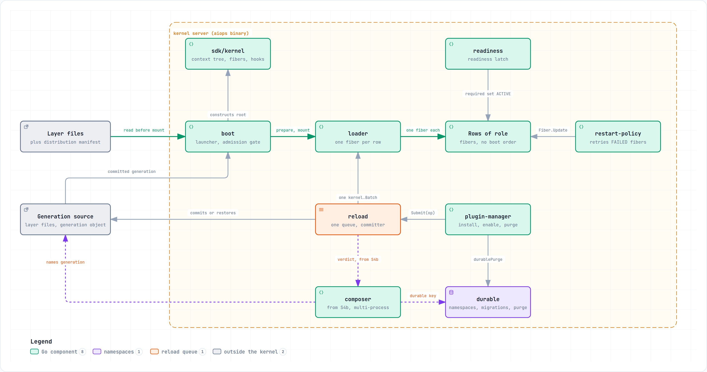
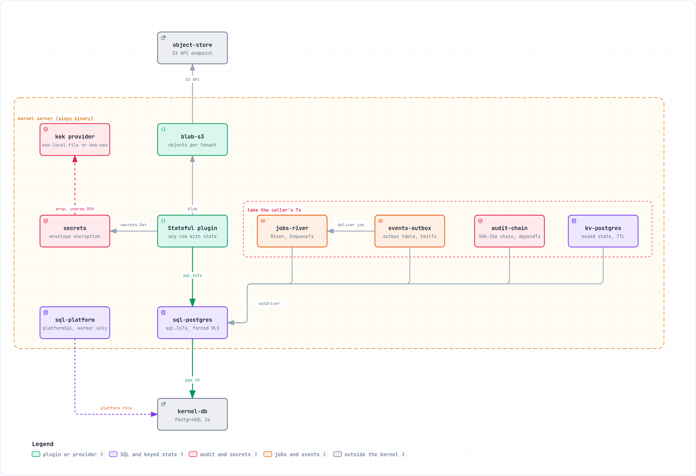
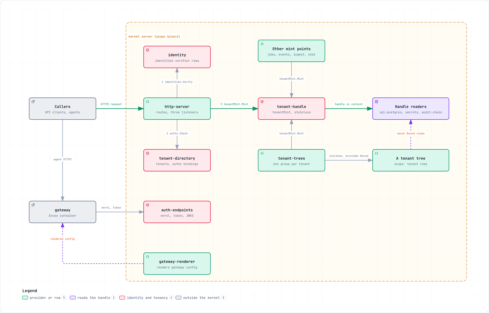
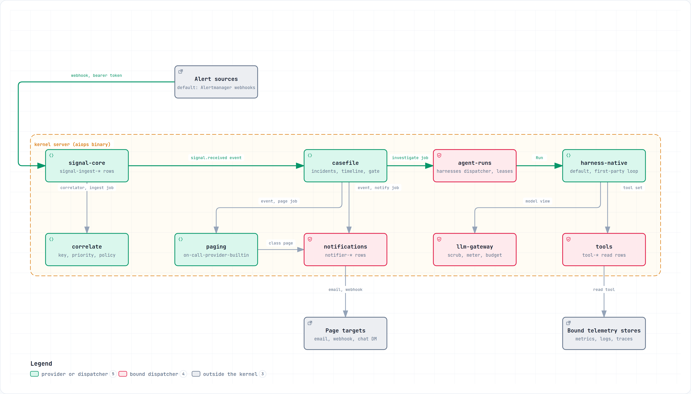
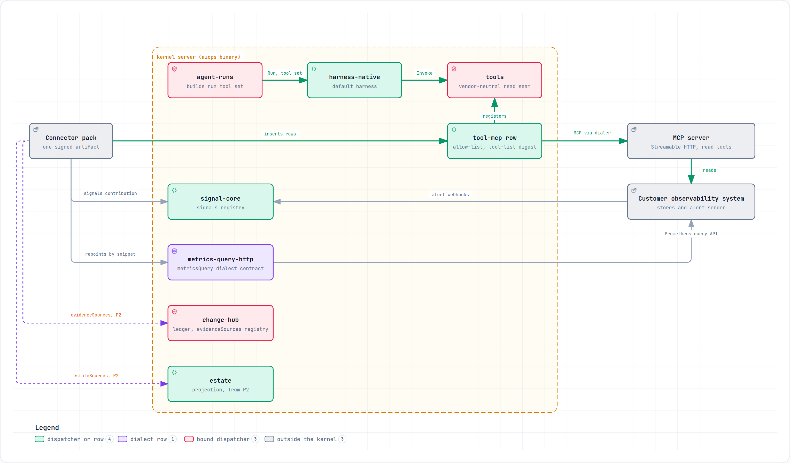
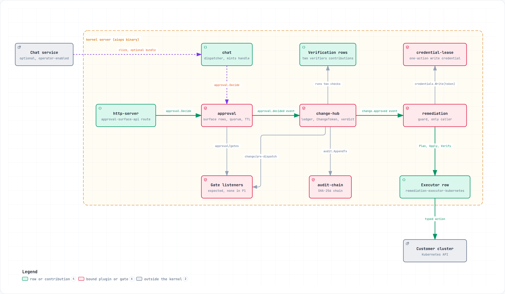
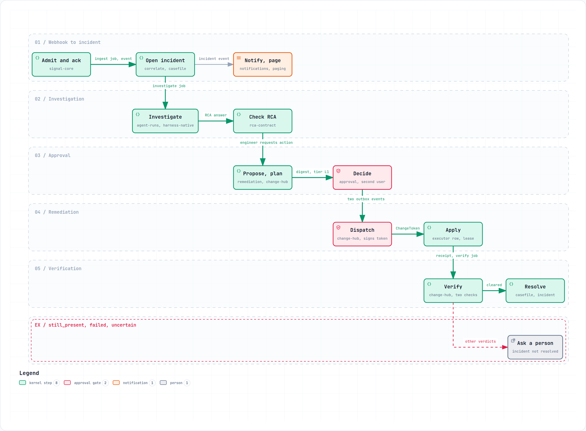

# 03. C3: kernel components

Status: draft for review, 2026-11-11, written to `00-decisions.md` as amended for the plugin system (ADR-033), for the community-first order of work, marketplace readiness and vendor-neutral connectors, and for the agent harness as a plugin point, upstreams as plugins and the licence record (its §2.4), and for the owner's confirmation of W2 to W13 on 2026-11-11, which are owner decisions from that date. This document obeys `00-decisions.md`. Where it is more specific than that record, it is filling a gap, and every gap it fills is listed in §10.

Citations use the short names from `00-decisions.md`. "plugin record §n" is `docs/design/plugin-system-2026-11.md` and "community record §n" is `docs/design/community-first-2026-11.md`. "harness record §n" is `docs/design/harness-and-upstreams-2026-11.md` and "licence record §n" is `docs/design/licence-audit-2026-11.md`. `gap-kernel-hot-path` is `docs/research/gap-kernel-hot-path-and-grafana-ui-integration.md`, `gap-tenant-gateway` is `docs/research/gap-tenant-gateway-and-agent-enrolment.md` and `gap-slack` is `docs/research/gap-slack-chatops-tenancy-and-runtime.md`.

## 1. Scope

This document opens one C2 container: the kernel server, which is the Go `aiops` binary (`kernel` in 02-c2-containers.md). "Kernel" has two senses (00-decisions §8.2). Here it means the server: the launcher `boot`, the kernel module `sdk/kernel`, the `loader` plugin and the plugins of one distribution. The text says "kernel module" when it means `sdk/kernel`. Where prose says the kernel does a product thing, the plugin named in the tables does it.

The same binary runs as `--role all` in `self-host-full`, `aiops-only` and `dev`. In `hosted` it runs as three roles: `kernel-edge`, `kernel-api` and `kernel-worker`. Every row states its `roles`, and a process mounts only the rows of its role (§9). The first community release (00-decisions §7.1) is the one-process form with the tenant `default`; `hosted` follows S9b and is not part of it.

**Order of work.** The plugin model is built whole and the order of work is community first (00-decisions §2.4, §7.2). What a plugin author compiles against is complete at the first community release. What an operator of many tenants or many replicas needs arrives later, as a provider row, a new row or a new layer behind the same definitions. This document tags such a part with its step; a `P1`, `P2` or `P3` tag keeps the meaning of 00-decisions §7.2.

| Part | In the first community release | Later, behind the same definition |
|---|---|---|
| Committing a generation | `reload`, the single committer on one process (S4a) | `composer` with canary and promotion, the generation object and `reload-generation` (S4b) |
| Tenant trees | `tenant-trees` mounts one pinned tree per tenant of the directory (S4a) | Trees as a cache, mounted on first use; the tenant overlay, layer 5 (S4b) |
| Tenant lifecycle | The create saga, which makes `default` at first boot, and the hooks `tenant/create` and `tenant/purge` (S4a) | Tenant create, suspend and delete as operator actions (S4b) |
| Remote plugins | The remote runtime in its single-tenant form, one shared instance per plugin (S2b) | One instance per (tenant, plugin), and activations across replicas (S4b). S4b delivers the mechanism only; admitting third-party plugins on hosted is deferred to the enterprise edition (00-decisions §2.4, §7.3) |
| Plugin manager | Working on the profile files: list, inspect, install, enable, disable, remove, purge (S6a) | Cohort update, quarantine and exemptions by version, added as methods (S6b) |
| Harness selection | The pillar group's `harness` field, then `defaultHarness` on `agent-runs`, which is `harness-native` in every shipped profile (S8a) | A tenant's `harnessFor.<pillar>`, for rows an operator marked tenant-selectable (S4b) |
| Roles | `--role all`; every server row already states its `roles` | The three-role split of `hosted` (S9b) |

**Upstreams.** An upstream is a plugin, never the product (00-decisions §1, principle 9). Rows are named by role (00-decisions §4.3, §8.1). The one exception is the row that wraps an upstream and a bundle whose rows all wrap it: each carries the upstream's lowercase technical name once, as the suffix, and only where the upstream register marks the entry `suffix-ok`. An entry marked `needs-approval`, which is also the default where no mark policy has been read, keeps a generic id until cleared (licence record §7.5). Rows of a stack bundle keep role names, and the stated exceptions of 00-decisions §4.3 are contracts, not defaults. Everywhere else an upstream appears only in a *Kind and technology* cell, after "default:", or as a fact of the row that wraps it. `harness-holmesgpt`, `aiops-harness-holmesgpt`, `on-call-provider-goalert` and `aiops-oncall-goalert` are provisional ids: whether an upstream's name may sit in an id is licence record Q4, a question for a lawyer, and the owner of the first mark is UNVERIFIED (licence record §9). Each stands once its register entry is marked `suffix-ok`, and a generic id takes its place if it is not. In `aiops-base` only the rows on the base provider allow-list of the upstream register wrap one: the protocol providers and `jobs-river` (00-decisions §4.3). The rows that wrap an optional upstream (`harness-holmesgpt` with `tools-mcp-facade`, `on-call-provider-goalert`, the rows of `aiops-chatops-slack`) sit in optional bundles that no shipped profile lists (00-decisions §6.3). This document marks each of them optional, and no figure draws one on its main path.

In scope are the kernel module, the launcher and the loader, the core rows, the infrastructure providers, identity and tenancy, the policy spine, the agent runtime (`agent-runs`, the first-party loop and the `tools` dispatcher) and the first-party rows on the incident loop. Out of scope:

- The inside of fleet, gateway rendering and enrolment (04-c3-agent-fleet-gateway.md).
- Pillar bundles, and the inside of a run: the loop rows, the operations of the read tools and an external harness (05-c3-pillars.md §5.4, §5.5, §5.10).
- The internals of chat-ops and on-call: the chat surface of the optional Slack bundle and the built-in on-call provider (06-c3-chatops-oncall.md).
- Code-level contracts: the context API, the manifest, the remote protocol, `kerneltest` and the suites (07-c4-plugin-sdk.md).
- Layer rules, the gate checks and the failure matrix cell by cell (08-profiles-roadmap-adrs.md §1).
- The estate model and the troubleshooting method in detail: entity references, the correlation key ladder, the context pack and the RCA contract (09-c3-estate-and-troubleshooting.md). This document places them on plugins and hooks and states the rules those plugins enforce.

The components are split across four C3 views, and view C3-a has two parts. A component that appears in more than one view (`jobs-river`, `audit-chain`, `identity`, `chat`) is described once, in the view that introduces it. Each figure has at most 12 nodes and shows the main path of its view; the element and relationship tables under it are complete and carry what the figure leaves out.

The element tables use these kinds:

- **kernel module**: `sdk/kernel`, the Go port of the Cordis model. **launcher**: `boot`, library code beside the context tree.
- **provider**: a row whose plugin provides a singular key, one engine or one policy.
- **dispatcher**: a row whose plugin provides a registry (a plural key). It alone calls the contributions registered with it and applies the invariants first.
- **contribution**: a row registered with a registry and provided under no key.
- **listener**: a row that only listens on hooks.
- **row**: any other plugin instance. It provides no key and registers routes, job handlers or subscriptions.

The *Provides* column gives each key with its class in the notation of 00-decisions §4.1: provider class, then consumer class, where `P` is provider-bound, `C` consumer-bound, `s` signed and `-` open. The *Injects* column lists what is specific to the row, and marks a consumer-bound key with `(C)`. Every stateful plugin also injects `sql`, `tenants` and `audit`, most inject `jobs` and `events`, a contribution injects its registry, and no row lists the observability handles (`logger`, `metrics`, `tracer`, `health`), which are never a `Need`. The providers in the need closure of `audit` and `events` (`audit-chain`, `events-outbox`, `jobs-river`, `kv-postgres`, `sql-postgres`), `tenant-directory` and `tenant-handle` are outside that convention and their cells are complete: none of them injects `tenants` or `authz` (§10 A20). The generated manifest of each plugin (`uses`, `provides`, `registers`, `hooks`) is the authority on both columns; where the tables read the plugin record, §10 A16 says so. A row is process scope unless the table says `scope: tenant`.

## 2. C3-a: kernel module, launcher, loader and state

This view covers how the binary turns a profile into running fibers and how a change to the profile reaches them (§2.1), and the infrastructure providers every stateful plugin stands on (§2.2).

### 2.1 Kernel module, launcher, loader and core rows

The figure shows the main path: the profile layers and the signed distribution manifest enter `boot`, which builds the kernel root and mounts `loader`; `loader` owns one fiber per row; `reload` is the one queue that changes the tree, fed in the figure by `plugin-manager`, and on one process it also commits the generation it judged; `composer`, a row from S4b in profiles that run more than one process, then names the generation each replica runs. Outside the kernel it draws the layer files with the distribution manifest, and the generation source (the layer files on self-host; from S4b the generation object in hosted). It draws 12 nodes: those two, `boot`, `sdk/kernel`, `loader`, the rows of the role as one box, `reload`, `composer`, `restart-policy`, `readiness`, `plugin-manager` and `durable`. Thick green arrows are the main path, solid grey arrows exist in the first community release, and dashed arrows exist from S4b. The followers and `aiopsctl`, which submit to `reload` the same way, the other core rows and `kernel-db` appear only in the tables, which are complete.

*Figure 03-kernel-composition-state. Source: [diagrams/src/03-kernel-composition-state.json](diagrams/src/03-kernel-composition-state.json).*

| id | Kind and technology | Provides (class) | Injects | Responsibility |
|---|---|---|---|---|
| `sdk/kernel` | kernel module; Go standard library only, pinned to Cordis 4.1.0 as dsh publishes it | The four built-ins `reflect`, `registry`, `hooks`, `logger` | none | One context tree (`Extend`, `Isolate`, `Intercept`); the service store with typed keys, checked against the two binding maps; fibers with six states, epochs and three deadlines (load, drain, dispose); effects, tracked goroutines and `Enter` leases; `Event` and `Waterfall` hooks, where every dispatch names its audience. It holds no product word and no policy (00-decisions §4.3). |
| `boot` | launcher; Go library outside the tree | The six `launch` keys `profileContext`, `catalog`, `cmdline`, `ready`, `killSwitches`, `appExit` (`P`, bound to the launcher; `profileContext` and `appExit` are `PC`) | none | Parses flags, composes layers 0 to 4, holds the generated module table, runs admission (the ten-check gate, which compares the generated `requires` of each manifest with the `serves` of the signed distribution manifest) and the required audit, reads the committed process-scope generation, provides the launch services in its `prepare` step, mounts `loader`, handles signals and bounded shutdown, and reads the kill switches of layer 6. `aiopsctl profile render` runs the same code with no server. |
| `loader` | provider; mounted by `boot`, in no bundle; builtins `core:group` and `core:include` | `loader` (`C`), `composition` (`-`) | `launch` keys | Owns the entry tree: create, update, remove, await, locate. It mounts one fiber per enabled row whose `roles` include the process's role, commits volatile values in place, and never creates an entry for an id whose previous fiber is not DISPOSED. The rows an installed artifact inserted mount under one group named by the artifact, and the loader records that origin for each of them, so their secret scope and purge key are the artifact's (00-decisions §6.1). `composition` serves the committed generation as read-only data: rows, declared hooks and registrations, states, by scope. |
| `reload` | provider; `aiops-core` | `reload` (`C`) | `loader` (C), `launch` keys | The one queue and its one goroutine. `Submit(ctx, op)` returns an operation id at once; each submission is composed, admitted, planned, applied in one batch, settled and judged (§8.1). On one process, which is every profile of the first community release, it is also the committer (S4a): it holds one PostgreSQL advisory lock, applies a generation, judges it and commits or restores it. A second process that cannot take the lock fails readiness and names `composer` (§10 A22). Without this row every change answers `restart-required`. |
| `restart-policy` | listener; `aiops-core` | none | `clock`; listens on `internal/status` | Failure is sticky in the kernel module. This row retries a FAILED fiber in place with backoff and gives up after a number of failures in a window; giving up on an infrastructure provider is one of the three cases that replace the process (§8.1). |
| `readiness` | row; `aiops-core` | none | `profileContext` (C), `catalog`, `ready`, `composition` | Sets the readiness latch when the required set is ACTIVE, and drops it while a provider the replica cannot serve without restarts in place. |
| `config-refs` | listener; `aiops-core` | `configRefsReady` and `configRefsDryRun` (`sdk/def/configrefs/v0`), both `P`, bound to `config-refs` | `launch` keys; the row's own `secrets` view where one exists; listens on `internal/config` | Resolves the closed references `${env\|file\|secret\|flag:value}` of layers 1 to 4. A reference that fails to resolve is an error on the row. `boot` gives every row whose config holds a reference a row-level `inject` of `configRefsReady`, so such a row is applied only while its references can resolve and is in the restart closure of `config-refs` (ADR-059, "configRefsReady"). `profileContext.Admit` checks the references of the rows a live generation mounts anew through the dry run, which never returns a value (ADR-059 decision 16). |
| `telemetry`, `log-export`, `clock` | providers; `aiops-core` | `metrics`, `tracer` (`-`); the log exporter; `clock` (`-`) | `killSwitches` (`telemetry`) | Per-fiber registerer and tracer, neutral types of `sdk/def`, whose series leave with the fiber. No row of `aiops-core` imports an upstream module: the Prometheus client and the OTel SDK sit only in a row outside `aiops-core` that wraps them, on the base provider allow-list as an OTLP provider or by an ADR that edits 00-decisions §4.3 (ADR-054). `telemetry` exports nothing while `telemetry-disabled` is set and stays ACTIVE; now, timers and tickers as effects. |
| `plugin-inventory` | provider; `aiops-core`; S6a | `pluginInventory`, `health` (`-`) | `composition` | Rows with plugin, version, runtime, scope, state, epoch, what each waits for, health and effects. It sits outside every restart closure it reports on, so the result of a reload is read from it. |
| `plugin-manager`, `plugin-index` | providers; `aiops-core`; S6a, with further methods at S6b | `pluginManager` (`C`); `pluginIndex` (`-`) | `reload` (C), `durablePurge` (C), `catalog` | S6a, working on the profile files: list, inspect, install, enable, disable, remove and purge, reached through `admin-api`. The `aiopsctl plugin` commands exist from S2a and work on the same files, through the one operations library, the plugin `aiops/operations` under the consumer-bound key `operations`, and its write lock `$AIOPS_HOME/write.lock` (ADR-061 decisions 14 to 19). Install is not enable and runs no third-party code. A remote plugin, or a pack with no code, is locked by digest in `plugins.lock` and its bundle is appended to the profile's bundle list with every row disabled, with no rebuild; an in-process Go plugin answers `rebuild-required` (00-decisions §6.1). S6b adds cohort update, quarantine and exemptions by version as methods of the same key, so the binding maps do not change. Every operation is audited and submitted to `reload`. The manager cannot disable itself, a required row or the last provider of a bound key, and it is not an agent tool. `plugin-index` reads a signed index in format 1.0 for discovery only: the signature is verified before the document is parsed, and `trust.yaml` limits each index to the id patterns it may list, which is what lets a third party run an index of its own (ADR-048). |
| `remote` | row; `aiops-core`; S2b; one proxy row per remote plugin instance (`aiops/remote`) | none | `sidecars`, `tenantMint` (C) | The in-process fiber of an out-of-process plugin. It opens every connection with the frozen handshake and registers the plugin's contributions with the dispatchers that serve their definition versions (§8.6). One shared instance per plugin on self-host; one per (tenant, plugin) in hosted, from S4b. |
| `composer` | row; `aiops-base`, from S4b, composed only in profiles that run more than one process; a leader on the worker role | none | `platformSql` (C), `reload` (C), `durable` | Owns one generation state machine per scope: `proposed`, `canary`, `promoting`, `committed` or `rolled-back`. Replicas report and never select a generation. No profile of the first community release composes it: there `reload` commits. |
| `durable` | provider; `aiops-base`, a leader on the worker role | `durable` (`-`), `durablePurge` (`C`) | `platformSql` (C) | The registry of durable namespaces, per plugin and tenant. It creates schemas and per-plugin roles, runs migrations under the owner role, and purges a namespace on `plugin purge` and on tenant delete. |
| `reload-generation` (hosted, S4b), `reload-watch-files` (dev) | rows | none | `reload` (C) | Followers: the first submits when the mounted generation object changes, the second when a layer file changes. Server profiles on self-host run neither, and a change goes through `aiopsctl` or `plugin-manager`. |

| From → to | Interface | Why it matters |
|---|---|---|
| layer files, distribution manifest, `trust.yaml`, `plugins.lock` → `boot` | files read before any row mounts | A cycle, a missing or duplicate provider, a broken binding or an unmet gate check is found from manifests, without running plugin code (§8.1). |
| `boot` → `sdk/kernel` | constructs the root with the two binding maps of the distribution manifest | An entry is the registered `Plugin` value from the module table, never an id a plugin declares about itself, so a child spec that names itself `aiops/approval` gains nothing. On self-host an operator may add entries by building and signing a distribution (00-decisions §2.4 W3, owner decision of 2026-11-11); hosted runs the release distribution only. |
| `boot` → `loader` | `prepare` provides the launch services, then mounts `loader` | Launch services are definitions with fakes, so `reload`, `readiness` and `config-refs` mount alone in a test. |
| `loader` → rows | one fiber per entry of the process's role | There is no boot order. A fiber is PENDING until what it needs is available and says what it waits for. A row outside the process's role is never mounted (§9). |
| followers, `plugin-manager`, `aiopsctl`, from S4b `composer` → `reload` | `reload` key (C): `Submit(ctx, op)`, `Status(id)` | One serialised reload; a submission made under the reload goroutine's own context is rejected. `Submit` never waits inside a leased call. |
| `reload` → `boot` gate library, then `loader` | pure compose, admit and plan; then create, update and remove in one `kernel.Batch`; an entry the plan creates, enables or replaces whose id, or a key it provides in the same realm, still has a previous fiber is mounted in a second batch once that fiber is DISPOSED | A failure before the apply step rejects the generation with nothing touched. |
| `reload` → `composer` (from S4b) | the verdict of a settled generation | `composer` commits the candidate or restores the previous generation on that verdict. On one process there is no such hop: `reload` commits or restores under its advisory lock (§8.1, step 6). |
| the committer (`reload` on one process, `composer` from S4b) → generation source → `boot` | the layer files on self-host; the generation object in hosted | The process-scope generation is read before `prepare`, so it is never in a table that a row of the same generation serves. A restarted replica boots the committed generation, never an unjudged candidate. Not drawn: from S4b tenant-scope generations and replica reports are platform tables of the `composer` schema. |
| `composer` (from S4b) → `durable` | `durable` key | `durable` creates what a candidate adds before its canary and deletes what a generation drops only after it commits. On one process the order is the same with `reload` as the committer: a row whose schema is not yet applied stays PENDING, and nothing is deleted before the commit (§10 A22). |
| `restart-policy` → fibers | `Fiber.Update` on a status event | A failed fiber recovers only through an update; retry policy is a plugin, not kernel code. |
| `durable`, `composer` → `kernel-db` | `platformSql` | Not drawn. Schemas `durable` and, from S4b, `composer` (00-decisions §5.2). |

### 2.2 Infrastructure providers and the transaction contract

These rows of `aiops-base` provide the keys every stateful plugin injects. `sql` is a PostgreSQL dialect contract with one allowed provider, so a second SQL engine is out of scope (00-decisions §2.4 W2, owner decision of 2026-11-11). Where a row here wraps an upstream it is a protocol provider or `jobs-river`, the rows on the base provider allow-list of the upstream register, and the upstream's library is imported only inside that plugin or where its register entry lists it by an accepted decision; pgx v5, behind the PostgreSQL dialect, is also imported by the four participants of `sqlDriver` (00-decisions §4.3).

The figure shows the main path, and the tables under it are complete: a stateful plugin opens one transaction on `sql-postgres` with `sql.InTx`, and `sql-postgres` reaches `kernel-db` over pgx. The four providers in the group labelled "take the caller's Tx" (`jobs-river`, `events-outbox`, `audit-chain`, `kv-postgres`) join that transaction through `sqlDriver`. The group label stands for the four calls a plugin makes with its `Tx` (`EnqueueTx`, `EmitTx`, `AppendTx` and `kv` writes), which are not drawn as arrows. Beside the path the figure draws the `deliver` job from `events-outbox` to `jobs-river`, `sql-platform` reaching `kernel-db` under the platform role (dashed), `secrets` with its `kek` provider as one box, and `blob-s3` with the object store. It draws 12 nodes: the stateful plugin, `sql-postgres`, `sql-platform`, `jobs-river`, `events-outbox`, `audit-chain`, `kv-postgres`, `secrets`, the `kek` provider, `blob-s3`, and outside the kernel `kernel-db` and the object store. `http-server` has no relationship in this view and is drawn in §3. `limiter`, `dialer-guarded`, the two `sidecars` providers, `events-nats`, the KMS behind `kek-kms`, the consumers of `platformSql` and the handle a job or a subscriber runs under appear only in the tables.

*Figure 03-kernel-infrastructure-providers. Source: [diagrams/src/03-kernel-infrastructure-providers.json](diagrams/src/03-kernel-infrastructure-providers.json).*

| id | Kind and technology | Provides (class) | Injects | Responsibility |
|---|---|---|---|---|
| `sql-postgres` | provider; pgx v5 over PostgreSQL 16 | `sql` (`P`), `sqlDriver` (`PC`) | none | `InTx(ctx, fn(Tx))` under forced row-level security, with the caller's own database role (`SET LOCAL ROLE`) and the tenant of the call's handle. The handle is a type of `sdk/def/tenants` read from the call's context, not a call on the `tenants` key, so this row does not inject it (§10 A20). No handle means zero rows. The view is available to a caller only when that plugin's declared schema version is applied. |
| `sql-platform` | provider; worker role only | `platformSql` (`PC`) | none | Cross-tenant and tenant-less transactions under the platform role, for the bound consumers only (`tenant-lifecycle`, `billing-meter`, `durable`, `composer`). It has no row on the api role, so nothing there can open one. |
| `kv-postgres` | provider | `kv` (`-`) | `sqlDriver` (C) | Small keyed state with TTL, in schema `kv_postgres`; a transaction participant. |
| `blob-s3` | provider; S3 API | `blob` (`-`) | none | Objects under `aiops/<tenant>/<plugin>/`. |
| `jobs-river` | provider; default: River, imported only under `plugins/jobs-river/` | `jobs` (`P`) | `sqlDriver` (C), `tenantMint` (C), `kv`, `clock` | Job handlers as effects. `EnqueueTx(tx, ...)` stamps the tenant of `tx` in its own column. Unique, delayed and periodic jobs, priority, snooze and leader election. River has no worker removal, so kinds are registered once and dispatched through a revocable handler table, and a job of an unowned kind snoozes. It checks a per-tenant token bucket when a job starts (§8.2). It also serves leadership: every leader of this document takes it through `jobs`, or takes a lock through `sql`, and none imports the jobs library (00-decisions §2.1 row 9). |
| `events-outbox` | provider; outbox table plus a `LISTEN/NOTIFY` doorbell | `events` (`P`) | `sqlDriver` (C), `tenantMint` (C), `jobs` | `EmitTx(tx, event)` is durable in the caller's transaction and stamped with its tenant. Events are ordered per `(tenant, seq)` and delivered at least once to subscribers, whose subscriptions are effects. `events-nats`, the second allowed provider, writes the same table and differs only in the relay (ADR-007). |
| `limiter` | provider | `limiter` (`-`) | `sql` | Lease rows for money and concurrency in `limiter.tenant_lease`, and per-replica buckets (§8.2). |
| `http-server` | provider; Go `net/http`, connect-go | `http` (`P`) | `identities` (s), `authz`, `tenantMint` (C), `composition` | Routes as effects on the public, internal and edge listeners, for HTTP, gRPC and Connect, and SSE for live views. Every request passes an `identities` verifier and an `authz` binding check, then runs under a minted handle (§3). `http.ServeMux` cannot unregister, so the provider keeps a copy-on-write route table and answers 503 for a declared route whose owner is not ACTIVE. It owns the `http/request` gate. |
| `dialer-guarded` | provider | `dialer` (`P`) | none | Outbound dial that refuses the ranges its row config lists, after DNS resolution: the cell ranges (node, pod, service and link-local) in hosted, and link-local only by default in the self-host profiles, where the operator's own stores sit on private addresses (00-decisions §5.7, ADR-047). Every client of a tenant-supplied URL uses it: notifier webhooks, runbook fetch, a bring-your-own LLM base URL, a customer cluster URL and an MCP server URL. |
| `secrets` | provider; envelope encryption | `secrets` (`P`) | `kek` (C) | `Get(ctx, name)` scoped `(tenant, calling plugin, name)`: the caller is read from the kernel, never from an argument. Ciphertext under the tenant DEK. Write-scoped secrets leave only through `credential-lease` (00-decisions §5.4). |
| `kek-local-file`, `kek-kms` (P2, hosted) | providers | `kek` (`PC`) | none | Wrap and unwrap tenant DEKs. The hosted bundle enables `kek-kms`, with one KMS key per tenant, and disables the other: a choice within the allowed set. |
| `sidecars-static` (self-host), `sidecars-kubernetes` (hosted, a leader on the worker role) | providers; Kubernetes API in hosted | `sidecars` (`-`) | none in `sidecars-static`; `tokens` (C) and `llm` in `sidecars-kubernetes` | `Endpoint(name)` of the shared or per-tenant process of a remote plugin, or of an optional plugin that drives an upstream process, available to a caller only while that instance is ready, so its consumer is PENDING and never FAILED. No default bundle carries such an upstream process, so by default a first install and a hosted cell run no harness process and no on-call process (00-decisions §6.3). In self-host the static provider only names the shared instances that compose or Helm started: the one shared instance of each remote plugin and, where the operator set its chart or compose value, `harness-sidecar` or `oncall-engine`. In hosted the leader starts, scales and probes one instance per (tenant, plugin) of each remote plugin and, where an operator enabled an optional plugin whose manifest says its upstream process is single-tenant, one instance of that process per tenant (00-decisions §1, principle 6). It gives each instance its LLM virtual key, created and revoked through `llm`, and gives an external harness in native mode its read-only service JWT, minted through `tokens` (00-decisions §5.4). It deploys only into namespaces `t-<id>`; a ValidatingAdmissionPolicy limits its service account to namespaces labelled as tenant namespaces and to pod specs without hostPath or privileged settings (00-decisions §5.1). From S9b, when this row ships, it holds the cell's plugin CA and creates and revokes the per-tenant remote plugin instances (§8.6); S4b proves them on a test provider of `sidecars` that holds a test CA (00-decisions §7.2). |
| `audit-chain` | provider; SHA-256 chain, DB trigger | `audit` (`P`), `auditSinks` (`-`) | `sqlDriver` (C), `jobs` | `audit.AppendTx(tx, ...)` appends inside the caller's transaction. A leader job seals the chain and a route exports it (§8.5). The append has no hook. |

| From → to | Interface | Why it matters |
|---|---|---|
| a stateful plugin → `sql-postgres` | `sql.InTx` | A plugin reaches only its own schema, under its own role. It cannot write approval, change, audit, outbox or River rows through `sql` (00-decisions §5.2). |
| a plugin → `jobs-river`, `events-outbox`, `audit-chain`, `kv-postgres` | `EnqueueTx`, `EmitTx`, `AppendTx` and `kv` writes, each taking the caller's `Tx` | Drawn as the group labelled "take the caller's Tx", with no arrow per call. A state change, its outbox event, its audit row and the plugin's own jobs commit or roll back together. Only these four definitions take a caller's `Tx`; domain plugins never pass one to each other (§8.2). |
| `jobs-river`, `events-outbox`, `audit-chain`, `kv-postgres` → `sql-postgres` | `sqlDriver` (C): the pgx transaction behind a `Tx`, and a role switch | `events` and `audit` rows are written through `SECURITY DEFINER` functions their providers own; `jobs-river` switches to its own role around River's unmodified `InsertTx`. ADR-045 measures this on the real stack. |
| `events-outbox` → `jobs-river` | a `deliver` job per `(event_id, subscriber)` | Delivery is at least once and subscribers are idempotent on `event_id`. |
| `jobs-river`, `events-outbox` → a handler or subscriber | a handle minted from the tenant column the provider stamped | Not drawn. A job or event runs under the tenant of the transaction that wrote it, never under a tenant read from job args or a payload (00-decisions §5.1). |
| `sql-postgres`, `sql-platform` → `kernel-db` | pgx v5 | Each profile has one PostgreSQL database, dev included. The kernel uses no Kafka and no Redis (00-decisions §2.1 row 9). |
| a stateful plugin → `secrets`, `blob-s3` | `secrets.Get(ctx, name)`; `blob` | A secret is scoped `(tenant, calling plugin, name)` with the caller read from the kernel, and a plugin's objects sit under its own prefix. |
| `blob-s3` → `object-store` | S3 API: a bucket in hosted, a customer-provided S3-compatible endpoint or the bundled store elsewhere (default: SeaweedFS; 08-profiles-roadmap-adrs.md DR-15) | Blobs live under `aiops/<tenant>/` (00-decisions §5.1). In `aiops-only` the bundled store is optional, but `blob-s3` still needs an S3-compatible endpoint (00-decisions §3.2). |
| `secrets` → `kek-*` → KMS | `kek` (C): wrap and unwrap | The KMS is not drawn. Scheduling deletion of a hosted tenant's KMS key makes its secrets unreadable, in backups too (00-decisions §5.4). |
| `sidecars-kubernetes` → instances | Kubernetes API, health probes | Not drawn. A run whose selected external harness is not ACTIVE waits inside the cold budget and then goes to the default harness (§4). |

## 3. C3-b: identity, tenancy and API surfaces

This view covers how callers reach the kernel and how they are identified, how the tenant travels inside a process, how tenants are created, limited and suspended, and how the kernel configures the components it does not sit in front of: the tenant gateway, the telemetry backends and the dashboard server.

The figure shows the main path: a caller reaches `http-server`, which calls an `identity` verifier to name the tenant and the subject (1), `tenant-directory` to check the binding (2) and `tenant-handle` to mint the handle (3); the handle in the call's context is what `sql-postgres`, `secrets` and `audit-chain` read. Beside it the figure draws the other mint points as one box, `tenant-trees`, which also mints, with one tenant tree and its bound views (dashed), `auth-endpoints` behind the gateway, and `gateway-renderer` writing the gateway's configuration (dashed). It draws 12 nodes: the callers, the gateway (the tenant gateway proxy container), `http-server`, `identity`, `tenant-directory`, `tenant-handle`, the other mint points, the handle readers, `tenant-trees`, a tenant tree, `auth-endpoints` and `gateway-renderer`. The agent is the caller behind the gateway (02-c2-containers.md, 04-c3-agent-fleet-gateway.md). `tenant-lifecycle`, the IdP, the telemetry backends, the dashboard server, `fleet`, `limits` and `dashboard-sync` appear only in the tables, which are complete.

*Figure 03-kernel-identity-tenancy. Source: [diagrams/src/03-kernel-identity-tenancy.json](diagrams/src/03-kernel-identity-tenancy.json).*

| id | Kind and technology | Provides (class) | Injects | Responsibility |
|---|---|---|---|---|
| `identity` with `identity-oidc`, `identity-service-token`; in optional bundles `identity-link-slack` (`aiops-chatops-slack`) and, from P2, `identity-dashboard-token` (`aiops-dashboard-app`) | dispatcher and contributions | `identities` (`Ps`) | none | `Verify` returns `(tenant, subject, verified)`. IdP tokens are checked against the IdP JWKS. Service JWTs are minted by `auth`, which `aiops-only` does not compose (§10 A13). Where a chat bundle is enabled, a user of the chat service maps through the link that its surface keeps. From P2, where the optional dashboard app is installed, `X-Grafana-Id` is checked against `<root_url>/api/signing-keys/keys` together with the app token. No row of a shipped profile needs either optional verifier. A missing or ambiguous tenant is a hard reject (00-decisions §5.1). "Verified" feeds the approval quorum, which is why the key is bound. |
| `tenant-directory` | provider | `tenants`, `authz` (`P`) | `sql`, `audit`, `events` (§10 A20) | The tenant record, `tenant_binding(tenant, subject, role)`, platform users, from S4b overlays, and the versioned `TenantLimits` (schema `tenant_directory`). At the first community release the directory holds one tenant, `default`, made by the create saga at first boot. It keeps the tenant scope, one child context per loaded tenant, and is the only fiber that can write it. It serves `ConfigFor`, `Enabled(ctx, row)`, `Audience(ctx)` and `Check(subject, tenant, permission)`. A write to the tenant record, a binding or `TenantLimits` carries its audit row and its outbox event in the same transaction. It is the only source of approver bindings. |
| `tenant-handle` | provider; stateless | `tenantMint` (`PC`) | none | `Mint(tenant)` returns the opaque `tenants.Handle` to the entry dispatchers the binding lists. It keeps no state and injects nothing, so the providers of `jobs` and `events` mint with no need on `tenant-directory` (00-decisions §5.1; §10 A20). |
| `tenant-trees` | provider | `tenantTrees` (`-`) and the seven `.Bound` keys (`P`) | `loader` (C), `tenantMint` (C), and the process keys behind each bound view | Mounts one group per loaded tenant for the rows whose manifest says `scope: tenant`, and isolates and provides the bound views there. Until S4b it mounts one pinned tree per tenant of the directory: one at the first community release, two on the test-only profile. From S4b a tenant tree is a cache: it mounts on first use (`Ensure(ctx)`), unloads when idle and loads under a concurrency cap, and rows on the ack or page path stay pinned. `Ensure` is in the definition from S4a, so no caller changes. |
| `tenant-lifecycle` | provider; River sagas; worker role; S4a, with the operator actions at S4b | `tenantLifecycle` (`-`) | `platformSql` (C), `durablePurge` (C), `tenantMint` (C) | Runs the tenant sagas as idempotent stages, with per-stage status in `tenant_lifecycle.lifecycle_step` (00-decisions §5.6). S4a ships the create saga, which makes `default` at first boot. Create, suspend, resume and delete as operator actions are S4b, and whether a self-host gets them is a case of ADR-049. It owns the hooks `tenant/create` and `tenant/purge`, on which each participating plugin performs its own step. The participants of a delete come from the `durable` registry, not from the listeners that happen to be loaded. Refuses reserved ids and tombstoned ids. |
| `admin-api` | row; api role | none | `tenants`, `pluginInventory`, `jobs` | `/v1/admin` on the internal listener. S4a: bindings and platform users. S6a: plugin operations, which `plugin-manager` performs. S4b: tenants and overlays. Cross-tenant operations are enqueued as worker jobs. |
| `auth`, `auth-endpoints` (edge), `auth-keys` (worker) | provider and rows; OAuth2 client credentials, JWT signer, SHA-256 secret hashes; `aiops-stack` | `tokens` (`PC`) | `gateway` (s) in `auth-keys` only | `POST /v1/enrol` turns a bootstrap token (TTL, `max_uses`, CIDR) into one OAuth2 client per agent and records the machine id, so a re-enrol keeps the agent id when its machine id and host name match exactly one active agent of the tenant (00-decisions §2.1 row 11; ADR-025 bounds the match). `POST /oauth2/token` issues a 15 min JWT with claims `iss, sub, tenant, orgid, scope, aud, exp, jti`, signed only with a key whose `published_at` is set. Publishes JWKS at `/.well-known/jwks.json` and as a file for the gateway. Mints read-only service tokens (30-day `exp` in hosted) and keeps a `jti` denylist for query routes. Admin-scope tokens have their own issuer and key, loaded only on the worker role. Refuses revoked clients and suspended tenants. `auth` and `fleet` state all three roles, because their keys are injected on each (§9; 04-c3-agent-fleet-gateway.md). |
| `gateway-renderer` | provider; worker role; one implementation | `gateway` (`s`) | `tokens` (C) | Renders the route table, JWKS and `jti` denylist into the configuration of the tenant gateway proxy (default: Envoy) with `local_jwks` inlined in the listener, including the write-route 401 and 403 to 503 mapping. All renders run as one single-flight job. The read routes it renders are the closed list written from the operations of the read tools (ADR-053). Details are in 04-c3-agent-fleet-gateway.md. |
| `stack-provisioning` | listener; worker role | none | `gateway` (s); listens on `tenant/create` and `tenant/purge` | Backend provisioning for a tenant. It declares the `external` durable namespaces of the stack (a backend tenant) and performs their create and purge steps. |
| `fleet`, `fleet-agentapi` (edge), `fleet-sweeper` (worker); `fleet-composer` with `fleet-template-<feature>` (`agent-base`) | provider, rows, and a dispatcher with its contributions; connect-go `collector.v1.CollectorService` | `fleet` (`-`); `fleetTemplates` (`-`) from `fleet-composer` | `tokens` (C) and `fleetTemplates` in `fleet`; `tenantMint` (C) in `fleet-agentapi`; `metricsQuery` in `fleet-sweeper`; none in `fleet-composer` | Holds the agent inventory, with the machine id as an alias, and serves config: one indexed read plus a hash compare in S7 and S8b, the serve cache from P2. Config sources are `fleetTemplates` contributions, one row per feature key, dispatched by `fleet-composer`, a stateless row with no `sql` (00-decisions §4.4). Every host pipeline it serves stamps `fleet_collector_id`, the enrolled agent id, which is the host identity the rest of the kernel reads from signals and series. No plugin outside `fleet` reads `fleet` tables, which keeps `aiops-only` working without it (04-c3-agent-fleet-gateway.md). |
| `limits` with four renderer rows (P2) | dispatcher and contributions; worker role | `limitsRenderers` (`-`) | none | Turns every current `TenantLimits` into one backend's complete overrides file inside one single-flight job per backend, refuses renders that touch other tenants' blocks or drop a limit by more than 50 %, writes with a resourceVersion precondition and records drift (00-decisions §5.5). Until P2 backend limits are static chart values. From P2 the create saga also loads the shipped rule files into the tenant's ruler. |
| `annotator` (P1), `dashboard-sync` (P2); both in `aiops-dashboards` | providers; worker role; Go client of the dashboard server's HTTP API | `annotations` (`-`) | `secrets`; `tokens` (C) in `dashboard-sync` | `annotator` writes annotations for incidents and changes from outbox events, for the single provisioned org. `dashboard-sync` replaces it in hosted: it provisions the tenant's org in a pool, its read-only data sources (bearer service JWT), app settings and membership, with tenant admins on the Editor role, and re-mints the data-source service tokens weekly. The bundle is listed where a dashboard server is ours or the customer's, so `aiops-only` may compose it without `aiops-stack` (00-decisions §4.4). |

**The tenant handle.** Inside a process the tenant travels in the call's `context.Context` as `tenants.Handle`, an opaque value with no exported constructor. Tenant identity is never a string argument of a plugin API. `sql`, `secrets` and `audit` read the handle, and no handle means zero rows. A handle is minted only through `tenantMint`, whose binding in the distribution manifest lists these entry dispatchers and no other plugin (00-decisions §5.1):

| Mint point | What names the tenant |
|---|---|
| `http-server` | The result of the `identities` verifier, after the `authz` binding check |
| `jobs-river`; `events-outbox` (and `events-nats`) | The tenant column the provider stamped from the writing transaction |
| `signal-core` | The per-tenant ingest token, plus the HMAC for dashboard alerting |
| `fleet-agentapi` | The agent JWT's `orgid` claim |
| `chat` | The surface's installation record (for Slack, `authorizations[0]`) and its grants |
| `remote` | The connection. From S4b: the certificate issued for (tenant, plugin instance). On a single-tenant self-host: the one tenant the shared instance serves; how that instance is identified is ADR-041 (S2b) |
| `tenant-trees` | The tenant whose tree it mounts |
| `tenant-lifecycle` and platform fan-out jobs | The tenant a saga stage or a fan-out names, under `platformSql` |

**Tenant trees and bound views.** A row is process scope by default: one fiber serves every tenant, reads tenant fields with `tenants.ConfigFor` and keys every in-memory table by the handle's tenant. A `scope: tenant` row (an external harness such as the optional `harness-holmesgpt`, and every remote row of a multi-tenant profile, §8.6) is mounted once per loaded tenant, inside that tenant's tree. The first-party rows of the default bundles in this document are process scope: `harness-native`, the tool rows and `on-call-provider-builtin` each serve every tenant from one fiber. Until S4b every tenant of the directory is loaded and its tree is pinned. One declared as a child of a process-scope group keeps its composed id there and takes the group's row-level `inject` (00-decisions §5.1). An external harness is not such a child: it is a top-level `scope: tenant` row of its own optional bundle, mounted in each loaded tenant tree and referenced by a pillar group's `harness` field, so one harness row serves every pillar that selects it. There it reaches data only through `sql.Bound`, `kv.Bound`, `blob.Bound`, `secrets.Bound`, `audit.Bound`, `sidecars.Bound` and `tenants.Bound`, which take no tenant argument. No bound key has a root provider, so a process-scope row that injects one never starts, and admission refuses a `scope: tenant` plugin that injects the process form of a key that has a bound form. `Isolate` separates names, never memory or data: data isolation stays with row-level security, the gateway, per-tenant keys and per-tenant upstream processes.

| From → to | Interface | Why it matters |
|---|---|---|
| `dashboard-ui` → `http-server` | P2, with the optional bundle `aiops-dashboard-app`: HTTPS through the app's `CallResource` proxy, carrying `Authorization: Bearer <app token>` and `X-Grafana-Id` | Writes need a verified subject. A request without the header is `actor=plugin` and read-only (00-decisions §2.1 row 8; ADR-006 sets the version floor). In P1 the provisioned dashboards read the kernel's read-only views and never write. |
| `http-server` → `identity` | `identities` (s), before every handler | Every request is verified before its handler runs. A missing or ambiguous tenant is a hard reject (00-decisions §5.1). |
| `http-server` → `tenant-directory`, `tenant-handle` | `authz.Check`, then `tenantMint.Mint` (C) | The Grafana basic role is only a floor. `approvals.decide`, `remediation.apply` and `secrets.write` come only from kernel bindings (gap-kernel-hot-path §3.2). The handler runs under the minted handle. |
| handle → `sql-postgres`, `secrets`, `audit-chain` | the call's `context.Context` | The tenant fence: row-level security, the secret scope and the audit chain read the handle, never an argument. |
| `tenant-trees` → `loader`, a tenant tree | `loader` (C); `Isolate` and `Provide` of the bound keys | Only `tenant-trees` may isolate or provide a `.Bound` key, so a group cannot mount a permissive `audit.Bound`. A tenant lookup first calls `Ensure(ctx)`, which returns at once while every tree is pinned. From S4b a cold lookup waits for the mount; on timeout a job snoozes and a synchronous path answers 503 with `Retry-After`. |
| `agent` → `gateway` → `auth-endpoints` | HTTPS to `kernel-edge` through the gateway's auth routes: no JWT, client auth in the body, `X-Scope-OrgID` removed, behind a per-replica flood guard on the auth routes (04-c3-agent-fleet-gateway.md §4 `rl`). Per-client budgets are watched in `kernel-edge`, and a known client over its budget still gets its token and raises an alert (§8.2; 04-c3-agent-fleet-gateway.md §3.1 `token`) | Agents reach the control plane only through the gateway route table. Enrolment and tokens are the only control-plane calls on the ingest SLO, and the token endpoint is measured at 300 req/s at S7 and the figure recorded; the pass threshold (99.9 % success, p99 below 100 ms) is a gate of S9b (00-decisions §5.5, §7.2). |
| `agent` → `gateway` → `fleet-agentapi` | Not drawn. Connect RPC with a JWT scoped `fleet` | The gateway is the one place that enforces scope per route (gap-tenant-gateway §6). `fleet-agentapi` mints the handle from the verified claim. |
| `auth-keys` → `gateway-renderer` → `gateway` | `gateway` key (s) for the render and the read-back; JWKS file and rendered config | The gateway has no runtime dependency on the kernel. A new key signs only after the worker role has read the listener version back from every ready gateway replica (04-c3-agent-fleet-gateway.md §3.2). `gateway-renderer` injects `tokens`, so `auth` itself does not inject `gateway`: a denylist change reaches the renderer as an outbox event. |
| `tenant-lifecycle` → participants | Not drawn. `tenant/create` and `tenant/purge`, serial events with compensation, signed, in process | Each loaded plugin performs its own step. A delete (S4b) does not finish, and the tombstone is not written, while any participant in the `durable` registry has not reported (00-decisions §5.6). |
| `tenant-lifecycle` → `limits` → backends | Not drawn. P2: overrides files or ConfigMaps, read back through `/runtime_config?mode=diff` and `/api/overrides?scope=merged` | A bad render never stops ingest: three backends keep their last value, the traces file is validated with the pinned Tempo binary first, and the blast-radius guard refuses cross-tenant changes. |
| `tenant-lifecycle` → `dashboard-sync` → `dashboard-ui` | Not drawn. P2: the dashboard server's org API | The tenant's org, its read-only data sources, app settings and membership are provisioned by the kernel. In P1 there is one provisioned org and `annotator` writes its annotations. |
| `tenant-directory` → `auth` | Not drawn. From S4b: `status: suspended` or `deleting` | Token issuance stops within one TTL, and backend limits remain as a second fence. |

## 4. C3-c: signal to incident, investigation and notification

This view covers the alert hot path, from webhook to incident, together with the asynchronous agent run, the page and the first notice.

The figure shows the main path: alert sources post to `signal-core`, whose `ingest` job takes the key from `correlate`; `casefile` opens the incident; the incident is notified through `notifications`, paged through `paging` and investigated through `agent-runs`, which runs the harness the incident pillar selects, by default `harness-native`; the harness calls a model through `llm-gateway` and reads through `tools`. It draws 12 nodes: `signal-core`, `correlate`, `casefile`, `agent-runs`, `harness-native`, `tools`, `llm-gateway`, `notifications` and `paging`, and outside the kernel the alert sources, the bound telemetry stores and the page targets (`ext-page-targets`). Contribution rows are named on the box of their dispatcher: `on-call-provider-builtin` on `paging`, the notifier rows on `notifications`, the tool rows on `tools`. The arrow from `signal-core` to `correlate` is an in-process call inside the `ingest` job. The arrows from `signal-core` to `casefile` and from `casefile` to `notifications` and `paging` are outbox events, each written in the transaction of the state change it reports. The arrow from `casefile` to `agent-runs` is `harnesses.Dispatch` inside its own `investigate` job, and the arrow from `agent-runs` to `harness-native` is `Run`. The arrow from `paging` to `notifications` is the page of the built-in provider, a notification of class `page`. The arrow from `tools` to the bound stores is a read tool of the default connector pack, reading with a credential the kernel holds: by default on the gateway read routes, in `aiops-only` at the customer's systems. Thick green arrows are the main path from the webhook to the run, and solid grey arrows are the other calls and events of the view. The hook listeners `storm-mode`, `context-pack` and `rca-contract`, the four loop rows, and `router`, `chat` (drawn in §5), `ask-api`, `pii-pseudonym`, the `llm-provider-*` rows, GitOps controllers and scanners, the LLM provider, the two dead-man routes and the optional rows (`harness-holmesgpt` with `tools-mcp-facade`, `on-call-provider-goalert`, the rows of `aiops-chatops-slack`) appear only in the tables, which are complete.

Every pillar agent runs through one registry, `harnesses`, whose dispatcher is `agent-runs`. The default harness, `harness-native`, is first-party and new (owner decision A, 00-decisions §2.4; owner decision W7 states its scope at the first release, which waits for it), and any other harness is an optional plugin with declared departures (00-decisions §2.1 row 2). The method is part of no harness: first-party plugins build the first message and check the answer on the `run/*` hooks of `agent-runs`, so most of it runs before the first turn or after the answer, is tested without a model and is the same for every harness and every caller (00-decisions §2.1 row 16). 09-c3-estate-and-troubleshooting.md specifies the key ladder, the priority function, the context pack and the RCA contract, and 05-c3-pillars.md §5.4 the run step by step; the tables below place them on plugins and hooks.

*Figure 03-kernel-signal-to-incident. Source: [diagrams/src/03-kernel-signal-to-incident.json](diagrams/src/03-kernel-signal-to-incident.json).*

| id | Kind and technology | Provides (class) | Injects | Responsibility |
|---|---|---|---|---|
| `signal-core` with `signal-ingest-alert-webhook`, `-generic-json`, `-gitops-webhook`, `-policyreport` | dispatcher and contributions | `signals` (`-`) | `http`, `tenantMint` (C), `limiter`; `correlator` as an optional dependency (§10 A16) | Registers `POST /v1/ingest/<row-id>` per contribution. Resolves the tenant from the bearer token, a row of `signal_core.ingest_token` that this plugin owns, so ingest needs no `auth` row (00-decisions §5.2; the path form `/v1/ingest/<row-id>/<token>` remains only for senders that cannot set headers), mints the handle and checks the Grafana HMAC (5 min window). Admits the request against the per-replica bucket (tenant rate divided by replica count, in requests and bytes) before anything is written; an empty bucket answers the busy reply of the row's sender family (429 with `Retry-After` by default, 503 for a family whose route entry says the sender retries only 5xx), writes nothing and counts the shed delivery per row, for every family (§10 A11). Deduplicates on `(tenant, row, sha256(body))` and answers a duplicate with 200. Writes the raw group and its own `ingest` job in one transaction, then acks. In the `ingest` job the contribution parses its payload family into `Parsed{Signals, Truncated}`, where each `Signal` names its `State` (`firing` or `resolved`) and the sender's `SourceID`; parsing is the only half a remote contribution may supply. The route entry a contribution returns states the family's busy reply and its default label map. The `signal/normalize` waterfall applies that default map, then the tenant map and the `signal_type` lift, the owner takes the correlation key and the priority from `correlate`, and it commits the `Signal{kind}` rows (§10 A1), each with its `correlation_key` and `signal_type`, with a `signal.received` event in the same transaction. It also passes on `Parsed.Truncated`, the truncated count a payload reports. Per-tenant caps on pending ingest jobs and raw-group bytes per day come from `TenantLimits` (00-decisions §5.5). `signal-core` names no sender: a parser for another sender is one more `signals` contribution, or a row of the instantiable `signal-ingest-generic-json` with a label map from a connector pack. |
| `correlate` | provider; Go, no model call | `correlator` (`-`) | `incidents` | Called by `signal-core` in the `ingest` job. It owns no table and decides in code: refresh, join or open, with the rule name that `casefile` writes to the timeline and the audit chain. **Fingerprint** refreshes a signal that an open incident already holds. **Typed correlation key:** an entity reference chosen by the ladder service, entity, `unmapped`: the service the signal declares, else the entity the alert names, such as a host or a workload, else `unmapped:<fingerprint>`. `job` is never an identity (00-decisions §2.1 row 16; grammar in 00-decisions §8.1). A signal joins the open incident with the same key or opens one. An `unmapped:` incident is never joined; above 50 open ones, further unmapped alerts join one digest incident, `storm:unmapped`, which pages once and is never investigated. **Priority** is a pure function of declared criticality and `signal_type`, with its basis on the timeline. It falls back to the sender's severity for an alert with no `signal_type`, only rises on a join, and has no reach or blast-radius input. **Policy:** stamps `investigate_policy`: on demand for `unmapped:` and `control:` keys, automatic otherwise. It owns the `incident/correlate` waterfall, where `storm-mode` is the first stage and fold rules will listen when their trigger fires (00-decisions §7.3). |
| `storm-mode` | listener | none | `sql`; listens on `incident/investigate` and `incident/correlate` (00-decisions §2.1 row 5) | Keeps one counter row per tenant and minute, which also adds each payload's truncated count (§8.2). Above 500 alert items per minute the tenant gets one storm incident, digest-only notifications and no LLM investigation: on the waterfall it answers the `storm:` key without calling `next`, so new alerts join the one storm incident, and on the gate it denies a run for a storm incident. A tenant overlay cannot disable it, because it listens on a gate. |
| `casefile` | provider; `casefile` schema | `incidents` (`-`) | `killSwitches`; `harnesses` on the sub-fiber that holds the `investigate` handler (§10 A24); `routing` as an optional dependency (§10 A16) | Holds the incident state machine (§8.4), keyed on `correlation_key` and carrying `investigate_policy`; the append-only timeline; one `investigation` row per run, with the run id, the RCA and its flags; artifacts and postmortems. The transcript is not here: `agent-runs` keeps it. It consumes `signal.received` with a handler that is idempotent on the signal id and, in its own transaction, refreshes, joins or opens the incident by an upsert on tenant and key among incidents that are not `resolved`. The same transaction writes the incident event (`incident.opened`, or the event of a join), which says whether the incident has first met the paging threshold, and enqueues its own `investigate` job when the policy is automatic. Withholding an investigation never withholds a page: paging has no hook. It owns one hook, the `incident/investigate` gate, which its `investigate` job dispatches after reading `agents-paused`. The job then calls `harnesses.Dispatch` with kind `investigate`, the pillar and the incident as subject, puts each `Message` step on the timeline as it arrives, and stores the answer with the run id. A run that ends with no answer leaves the investigation `incomplete`, with the digest that `agent-runs` built by code from the step rows, and the incident stays open. When alerts or changes arrive after a run started, it writes the not-covered marker, one code-written line on the RCA, and offers "investigate again" in the API, `aiopsctl` and an enabled chat surface. |
| `agent-runs` with `ask-api` | bound dispatcher, and a row on the api role; `agent_runs` schema | `harnesses` (`P`) | `tools`, `llm`, `limiter`, `killSwitches`, `composition`; in `ask-api` `harnesses` and `http` (§10 A24) | The only way to reach a harness. `Dispatch(ctx, task)` takes one task: a kind (`investigate` or `ask`), a pillar and a subject. It reads `agents-paused`, selects the harness, takes the slot lease and the budget lease (§8.2), writes the `run` row (pillar, kind, harness id and version, upstream version, model alias, caps) and dispatches `run/first-message` with the pillar and the kind. It then calls `Run` with the persona, the first message, the answer spec, the tool set, model access by tier and the budget in steps, tool calls, tokens and time. The tool set is the pillar group's defaults plus the enabled tool rows that name the pillar, filtered to effects class `read` and to the actor's permissions. Every step is written to `agent_runs.run_step` before it is forwarded, so the transcript is complete at a crash, and a compliance or FinOps run needs no incident. Caps are enforced at the two views a harness holds, the tool set and the model view with `llm-gateway`, never from the stream it reports (§8.7). On the terminal step it dispatches `run/answer`, releases the leases and returns the answer; with no answer inside the grace after the deadline it builds a digest from the step rows. **Selection:** the tenant's `harnessFor.<pillar>` (from S4b, only rows an operator marked tenant-selectable), then the pillar group's `harness` field, then `defaultHarness`. A selected harness that is not ACTIVE is waited for inside the cold budget; then the run goes to the default and the timeline names both. A harness declares its departures from the contract, a closed list of ten, each with a fallback in this dispatcher; a harness in a shipped profile has none (harness record §2). `ask-api` is the route behind `aiopsctl ask` and the first consumer of the key (S8a): a question is a run of kind `ask` with no incident. |
| `harness-native` with `loop-budget`, `loop-repeat-guard`, `loop-tool-failures`, `loop-compaction` | contribution and provider, with four listener rows; first-party and new; in process, on the worker role | `agentLoop` (`-`) | nothing beyond its registry: the tool set and the model view arrive with each request; `agentLoop` in the loop rows | The default harness. The loop sends the first message, asks the model through the model view, validates each tool call against the offered spec and invokes it through the tool set, up to four calls of one step in parallel, and repeats until the model answers without a tool call. It holds the step ceiling, the wrap-up and cancellation: at the ceiling, or at the deadline minus the wrap-up time, it sends one last request without tools and answers with what it has. It owns the hooks `loop/pre-step` and `loop/tool-result`, on which the loop rows listen (05-c3-pillars.md §5.4). It holds no credential, opens no connection and builds no reference. A worker lost mid-run restarts the run from the first message, which is safe because every tool is a read. The loop and the read tools run in the kernel process under the per-run caps, a deadline and a breaker (00-decisions §2.4 W12, owner decision of 2026-11-11). |
| `context-pack` | listener; Go, no model call | none | `changes`; listens on `run/first-message` for the incident pillar and kind `investigate` | Builds the first message of an incident run, context pack v1, in a fixed order with bounded blocks: the alert digest, the change candidates with their match level (from `change-hub`, §8.3) and a footer that lists each bound signal with its dialect and scope note, as the offered tools describe them, and names absent inputs (§10 A23). In P1 the footer always says that the kernel did not read host change evidence. Order and blocks are ADR-030; later blocks arrive in P2 as further stages with their inputs. The hook is dispatched with the pillar and the kind, so another pillar agent gets a builder of its own. |
| `rca-contract` | listener; Go, no model call | none | `changes`; listens on `run/answer` for the incident pillar and kind `investigate` | Its schema is the answer spec of an incident run, and it checks the answer against RCA contract v1 (ADR-030). The model names the root-cause entity as the labels spell it and code builds the entity reference, or keeps the names raw and flags `unresolved`. A suspect change is accepted only from the candidate list. An answer that does not parse is stored and flagged `degraded`; it never reads as "nothing to do". A harness builds no reference and sets no flag. The parsed RCA goes back to `casefile` with its flags. |
| `router` | provider | `routing` (`-`) | `notifiers`, `composition` | Picks the pillar and target for an incident or a chat turn, from the pillar group config in the committed generation. Its `notify` job consumes the incident and investigation events and calls `notifiers.Notify`, so `casefile` does not inject the bound `notifiers` key and keeps opening incidents while `notifications` or `pii-pseudonym` is not ACTIVE (§10 A16). For a chat turn the first match wins: explicit pillar, thread stickiness, channel binding, the user's last pillar in DMs, then the installation's default pillar (06-c3-chatops-oncall.md §5.3). The LLM intent classifier (gap-slack §6) is deferred; its trigger is users correcting the chosen pillar on more than 10 % of a tenant's chat turns in a month (00-decisions §7.3). |
| `tools` with `tool-oncall-who` (`aiops-base`); `tool-change-lookup`, `tool-runbook-fetch`, `tool-kubernetes-read` (children of `pillar-incident`, in `aiops-pillars-mvp`); `tool-metrics-query`, `tool-logs-query`, `tool-traces-query` (`aiops-datasources`); `tool-profiles-query` (S9a), `tool-estate-lookup` (P2); rows of the instantiable `tool-mcp`, which a connector pack inserts | bound dispatcher and contributions | `tools` (`P`) | `pii`; in the contributions `oncallProviders`, `changes`, `content`, `metricsQuery`, `logsQuery` and `estate`, and `dialer`, `secrets` and `limiter` where a row has a client of its own | The vendor-neutral read seam of every harness. `Describe` returns a tool's parameters, effects, prerequisites, signal, dialect and scope note, and `Invoke` returns raw output. The dispatcher filters by the actor's permissions, classifies effects, caps and scrubs output, writes an audit row per call and owns the hooks `tools/pre-execute` and `tools/post-execute`. A harness in the kernel process calls it in process; a remote harness reaches the offered set of its active run through the `tools` callback (§8.6). **Kernel-data tools.** `tool-change-lookup` returns the same candidate list as the context pack and still answers by namespace and time. `tool-runbook-fetch` serves the host runbook of the default pack (P1) and the playbook pack (P2), which are bundle or pack content served by `content`, not rows. `tool-oncall-who` is offered only where an on-call provider is registered for the tenant. **Read tools.** The model writes the query and the tool bounds it: a call without a time range and a limit is refused, the row's client stops at a maximum of response bytes, and concurrent reads per run and per tenant are a `limiter` lease. The kernel reads the credential per call, the service token on the gateway read routes or a customer credential under the scope of the pack that inserted the row, so a harness holds none (00-decisions §2.2, §5.4). In P1 `tool-logs-query` is also how the agent reads host change evidence, which the `host-logs` template labels and the kernel does not read until P2 (00-decisions §2.1 row 19). **`tool-mcp`.** A row is one MCP server over Streamable HTTP, dialled through `dialer`, and each allow-listed tool of the server becomes a contribution. The pack carries a digest of the recorded tool list and the row fails when the live list hashes differently. Its effects class is asserted by the pack, not proven, and boot says so (00-decisions §6.2). A tool row may state the pillars it joins, so a contributed tool needs no edit of a first-party group (00-decisions §2.1 row 12). Operations and bounds are 05-c3-pillars.md §5.5 and ADR-053. |
| `llm-gateway` with `llm-provider-openai-compatible`, `llm-provider-replay` (dev and tests) | bound provider and dispatcher, with contributions; OpenAI-compatible | `llm` (`P`), `llmProviders` (`-`) | `pii`, `limiter`, `http`, `killSwitches`; `dialer` and `secrets` in the contributions | The only model route. A harness in the kernel process reaches it through the model view of its run, by tier and never by provider, URL or key. It scrubs PII as its inner step, meters every model call under its run id, enforces the per-run caps with the model view and enforces the daily budget in its typed unit, USD or runs; hosted adds per-tenant rate limits, a fair-share limiter per provider and routing by tier (§8.7). It refuses every call while `agents-paused` is set. It owns the `llm/request` hook. Its OpenAI-compatible HTTP surface is off by default: whoever installs an external harness enables it, and the instance key of that harness is accepted only while `agent-runs` holds a run lease for the instance. A provider row is reachable only through the gateway: `Complete`, `Stream`, `Embed` and `Models` against one upstream. Other vendors go through a customer-run OpenAI-compatible proxy. |
| `pii-pseudonym` | provider | `pii` (`P`) | `secrets` | Replaces PII with salted, correlation-preserving pseudonyms. The dispatchers `llm-gateway`, `chat`, `notifications` and `tools` apply it at egress, as do artifacts and outbox sinks, and every payload a remote listener receives is scrubbed. |
| `notifications` with `notifier-email`, `notifier-webhook`; `notifier-slack` in the optional bundle `aiops-chatops-slack` | bound dispatcher and contributions | `notifiers` (`P`) | `pii`, `kv`; `dialer` in the contributions | `Notify` scrubs, runs the `notify/pre-send` gate, keeps a digest window per target in `kv`, then calls `Send`: the first message goes out at once and later ones are digested. A notification of class `page` carries a `Recipient`, is scrubbed and is sent at once: it never passes the gate and is never digested or paced, so no hook can withhold a page (00-decisions §4.1). `Capabilities` says what a notifier row receives (incidents, pages) and whether it can reach one person (`Direct`). Webhook URLs go through `dialer` (00-decisions §5.7). SMS and voice are `notifiers` contributions and are not first-party at the first release. |
| `chat`; with the optional bundle `aiops-chatops-slack`, `chat-surface-slack` and `chat-commands-slack` (drawn in §5) | dispatcher in `aiops-base`; contributions in the optional bundle: one surface row, `mode: events` (H) or `socket` (S, A, D), on slack-go v0.31.0 | `chatSurfaces`, `chatCommands` (`-`) | `http`, `tenantMint` (C), `pii`, `kv`; `routing` as an optional dependency; `harnesses` on the sub-fiber that holds the question handler (§10 A24) | The dispatcher owns no schema and names no chat service. With no surface row enabled it serves nothing, and the loop runs through the API and `aiopsctl` (00-decisions §2.4 W13, owner decision of 2026-11-11). Where a surface is enabled, the surface verifies each inbound envelope (for Slack, the request signature in events mode) and resolves the tenant from its installation record and grants, which it owns in schema `chat_surface_slack`; `chat` mints the handle, dedupes and enqueues, and posts and updates messages through the surface. Every chat click, approvals included, enters here (06-c3-chatops-oncall.md §3). A question becomes a run of kind `ask` through `harnesses`. |
| `paging` with `on-call-provider-builtin` (`aiops-oncall`); optional: `on-call-provider-goalert` (`aiops-oncall-goalert`) | dispatcher and contributions; `paging` schema; the default provider is first-party and written new, with schema `on_call_provider_builtin` | `oncallProviders` (`-`) | `kv`, `incidents`; in the built-in provider `notifiers` (§10 A25), `http` and `identities`; in an external provider `secrets`, with `dialer` or `sidecars` | The dispatcher calls the bound provider for `Page`, `Ack`, `Resolve`, `Status` and `WhoIsOnCall`, with a 60 s cache on `WhoIsOnCall`, and beats its end-to-end monitor through `Heartbeat` where the provider has one. It keeps `provider_binding` (the provider row id and a policy) and `page`. The page job is a job of `paging`, unique on incident id: `paging` enqueues it when it consumes the incident event that says the incident first met the paging threshold, so `Page` is called once per incident, and the outcome goes to the timeline through `incidents`. A profile or tenant with no provider or no bound policy pages no one and says so on the incident, and the incident notice still goes to the notifier rows that receive incidents. **Default (00-decisions §2.4 W11, owner decision of 2026-11-11; no code before the lawyer's answer on schedule patents, licence record Q3).** `on-call-provider-builtin` is process scope: responders with contact methods and notification rules, one rotation shape with overrides, and escalation steps with a repeat count as delayed unique jobs of its own. It sends each page through `notifiers` with the class `page`, and a person acks by chat button, the API, `aiopsctl` or a signed one-time link (§8.8). It has no carrier client. With it paging shares fate with `kernel-db`, `notifications` and `pii` (§8.1). If the lawyer's answer is missing at S8b start, providers only ships: this row and its bundle leave the profiles and nothing else in this view changes. **Other providers.** Any provider plugin. `on-call-provider-goalert` connects to an engine the operator runs, or to one shared `oncall-engine` that the chart or compose file renders behind a value that is off by default. An external engine keeps its own data, and no engine runs per tenant (00-decisions §2.1 row 3). |

Hooks of this view. A gate denies when a listener of its expected set, the rows of the committed generation that declare the hook in that scope, is not ACTIVE. The full list, with access classes and what a remote listener may receive, is plugin record §8.

| Hook | Kind | Owner | Listener rows at P1 scope | Decides |
|---|---|---|---|---|
| `http/request`, `signal/admit` | gate | `http-server`, `signal-core` | none; from P2 the per-row buckets and body limits | Whether a request is admitted, before any write. Process-scope listeners only, so the ack path never waits for a tenant tree. |
| `signal/normalize` | waterfall | `signal-core` | the owner's own stages | The family's default label map, then the tenant map and the `signal_type` lift. It runs before the scrub, so it has no remote listener. |
| `incident/correlate` | waterfall | `correlate` | `storm-mode` (00-decisions §2.1 row 5); fold rules on their trigger | The correlation key of a signal. |
| `incident/investigate` | gate | `casefile` | `storm-mode` | Whether an incident run starts. The budget and the slots are leases taken by `agent-runs`, not listeners, and the P2 per-incident run cap is a check `casefile` makes itself before the dispatch (00-decisions §4.3). A denial never withholds a page. |
| `run/first-message` | waterfall | `agent-runs` | `context-pack`, for the incident pillar and kind `investigate` | The blocks of the first message, in stage order. It is dispatched with the pillar and the kind, so a pillar group names its builder. A remote listener receives the subject key and the scrubbed summary, and its blocks are scrubbed again at `llm-gateway`. |
| `run/answer` | waterfall | `agent-runs` | `rca-contract`, for the incident pillar and kind `investigate` | The answer check and its flags. Signed and not remote. A listener may return one follow-up message, and `agent-runs` allows at most one per kind; no P1 listener returns one (00-decisions §7.3). |
| `loop/pre-step`, `loop/tool-result` | waterfall | `harness-native` | the four loop rows | What the model sees at the next step. Signed and not remote. A listener may only tighten tools and directives: remove a tool, shorten the history view, add one notice, set answer-now or stop. |
| `llm/request` | gate, then waterfall | `llm-gateway` | none in P1; from P2 rate limits and routing by tier | Budget and rate, then the route. The scrub is the owner's inner step and no listener can skip it. |
| `tools/pre-execute`, `tools/post-execute` | gate, waterfall | `tools` | none | The effects class; the output cap. |
| `notify/pre-send` | gate (allow, delay, drop) | `notifications` | none | Digest, pacing and, later, quiet hours. A listener cannot change the recipient or the content. A notification of class `page` never passes this gate. |

| From → to | Interface | Why it matters |
|---|---|---|
| alert sources → `signal-core` | HTTPS with the tenant token in `Authorization: Bearer`, plus Grafana HMAC | Admission comes before any write, and the ack only after one durable insert, so a flood costs no database writes and Alertmanager's re-sends stay harmless (gap-kernel-hot-path §2.5). Every Alertmanager webhook configuration the platform renders sets `max_alerts`, so a group from our own senders cannot outgrow the body limit, and the truncated count the payload reports still reaches the storm counter (00-decisions §2.1 row 5). |
| `ext-customer-estate` → `signal-core` | HTTPS, same token rules; GitOps controllers and scanners | Not drawn. Change and finding webhooks take the same admit-insert-ack path and become `Signal{kind: change\|finding}` (00-decisions §2.1 row 12). A change signal carries the entity references of its targets (§8.3). Finding signals are consumed by `compliance`. |
| `signal-core` → `correlate` | `correlator` key, in process, inside the `ingest` job; `correlate` reads open incidents through `incidents` | Ack p99 must stay at or below 250 ms, and the ack never depends on a row downstream: the job handler sits in a `When` sub-fiber, so if `correlate` or `casefile` is not ACTIVE the routes keep acking and the `ingest` jobs snooze. |
| `signal-core` → `casefile` | outbox event `signal.received`, committed with the `Signal` rows | Ingest is three commits linked by the outbox: the raw group with its job, the signals with their event, the incident with its event (§10 A1). The upsert on tenant and key, with a handler idempotent on the signal id, is what leaves no twin incidents across replicas. `casefile` writes the key, the priority and the policy with the incident. An entity an alert names is its own failure domain: one host's alerts never join another host's incident, and a guessed service is worse than none (00-decisions §2.1 row 16). |
| `ext-chat-service` → the surface row → `chat` | With the optional Slack bundle: the Events API over HTTPS that the service calls in H; Socket Mode over a WSS that the kernel opens in S, A and D | Not drawn here; §5 draws the click path. No shipped profile lists the bundle. Events and clicks flow from the service to the kernel in both modes; only the connection direction differs. The surface verifies the envelope and resolves the tenant before anything reaches the router or an approval surface (00-decisions §5.1). |
| `casefile` → `router` → `notifications` | outbox events `incident.*` and `investigation.*`, then `notifiers.Notify` inside the `notify` job of `router` | Drawn as `casefile` → `notifications`, labelled event, notify job. The router picks pillar and target before the dispatcher sends. Notices are visible after commit and ordered per `(tenant, seq)`; a target that is down delays them and never loses them. |
| `notifications` → `notifier-email`, `notifier-webhook` → `ext-page-targets` | SMTP; HTTPS to a webhook the tenant names, through `dialer` | Drawn as `notifications` → page targets. The first notice for a target goes out at once and later ones are digested; a page is never digested. A notifier that is rate-limited backs off per `Retry-After` (§6). With the optional Slack bundle, `notifier-slack` posts to the thread and to a direct message. |
| `casefile` → `paging` → the bound provider | the incident event, which `paging` turns into its page job, unique on incident id; then `Page`, `Ack`, `Resolve` and `WhoIsOnCall` on the provider | The page is durable with the incident, because the event commits in the incident transaction, and `paging` is idempotent on the incident id. One page per incident, sent when the incident first meets the paging threshold, at open or on a join. On-call providers never receive alert webhooks (00-decisions §2.1 row 5). |
| `on-call-provider-builtin` → `notifications` | `notifiers`: a notification of class `page` with its `Recipient`; each escalation step is a delayed unique job of the provider | Drawn as `paging` → `notifications`. The provider is the second consumer of the key, after `router`. A step that is not acked before its delay runs the next step, and after the last repeat the page is `unacknowledged`. Contact addresses are personal data: they are purged with the schema and never sent to a model (00-decisions §5.2). |
| The alert router → `signal-core` → `paging`; the alert router → the platform-health receiver | `Watchdog`, an always-firing alert, enters ingest every minute and beats the bound provider's end-to-end monitor through `paging.Heartbeat`; the rule group `platform-page-path`, on the kernel's own readiness series, goes straight to a static email or webhook receiver from operator config | Not drawn. These are the two P1 entries of the closed exception list, which is stated by class: platform health may bypass ingest, estate alerts never do. They are two watchers in two failure domains. The kernel watches the alerting path, which proves ingest, job and provider per tenant; a beat missed for 10 minutes pages the tenant's platform policy. The alerting stack watches the kernel's page path without crossing the kernel. Where the bound provider returns a heartbeat target of its own, `Watchdog` is also posted straight to it. The create saga sets the contact point, the rule, the rule group and their routes (00-decisions §5.6). Both watchers on one lost machine page nobody, and the self-host notes say so (00-decisions §2.1 row 5, ADR-021; harness record §8.5). |
| `casefile` → `agent-runs` → `harness-native` | `harnesses.Dispatch`, inside the `investigate` job of `casefile`; then `Run(ctx, request, sink)` | Drawn as `casefile` → `agent-runs`, labelled investigate job, and `agent-runs` → `harness-native`, labelled Run. The job dispatches the gate; the dispatcher selects the harness, takes the leases and runs the first-message waterfall. Incident runs are taken before questions, higher priority first. One `run_step` row per step, written before the step is forwarded, and the answer for `rca-contract`. A harness error is retried by the job with backoff and then marks the investigation `failed`, with the error on the timeline. |
| `harness-native` → `llm-gateway` | the model view of the run: `Stream` at a tier inside the run's range, in process | No harness holds a provider key, a URL or a virtual key. The gateway scrubs the request, meters the call under the run id and refuses it past a cap, outside the tier range or while `agents-paused` is set. |
| `harness-native` → `tools` → tool rows | the tool set of the run: `Specs` and `Invoke`, in process | The set holds effects class `read` only and refuses call N+1 and any tool outside it. Remediation is offered separately as typed actions (§5), and the model never writes a plan. |
| `tool-metrics-query`, `tool-logs-query` → `metrics-query-http`, `logs-query-http` → the bound stores; `tool-traces-query` → the traces store; `tool-kubernetes-read` → the customer cluster | `metricsQuery` and `logsQuery`, then the store's HTTP query API; a client of the row's own; the Kubernetes API | Drawn as `tools` → the bound stores. Reads pass through the kernel, so each one has the actor filter, the effects gate, the cap, the scrub and an audit row. The kernel never parses the query: the logs tool relies on its bounds (licence record §7.3). On the default stack the reads go to the gateway read routes with the service token, and the gateway injects the tenant header. In `aiops-only` the profile layer points the rows at customer endpoints, or enables another pack's tools. |
| a `tool-mcp` row → `ext-mcp-server` | MCP over Streamable HTTP, through `dialer`, with the MCP server credential read per call from `secrets` under the pack's scope | Not drawn here; the connector figure below draws it. Model-written arguments leave the kernel on this path, and boot prints every such row (harness record §2.3). |
| `ask-api`, `chat` → `agent-runs` | `harnesses.Dispatch` with kind `ask` | Not drawn. A question gets the same selection, caps, scrub and transcript as an incident run, and needs no incident. |
| `llm-gateway` → `pii-pseudonym`, `llm-provider-*` → `ext-llm-provider` | `pii`, then the contribution, then HTTPS with the provider key or the tenant's own key from `secrets` | Not drawn. Only the gateway holds provider keys, and it scrubs before it routes (00-decisions §2.1 row 13). |
| `agent-runs` → `harness-holmesgpt` → `harness-sidecar` (optional) | `Run`; then the upstream's chat API over HTTP with SSE, at the endpoint `sidecars.Bound` names. The process calls `/v1/llm` with a lease-bound instance key, and gets the run's tools with each request or through `tools-mcp-facade` at `/v1/tools` | Not drawn; no shipped profile lists the bundle. An external harness declares its departures and `agent-runs` applies the fallback of each. With its native toolsets on, tool calls are not gated, and boot and every run say so. The cassettes at the pinned tag and how the process reaches tools are ADR-003 and ADR-004; the two modes are 05-c3-pillars.md §5.10. |

**Where another observability system attaches.** The default stack is a choice of bundles, not of contracts (00-decisions §1, principle 7). No row of this document outside `aiops-datasources` and `aiops-stack` holds a query string or calls a telemetry store's query API, and CI checks it on the static graph: no plugin of `aiops-base` or of a pillar bundle declares a need on `metricsQuery` or `logsQuery`. A contributor makes another system usable with a connector pack (00-decisions §6.2), whose rows attach to dispatchers of this view, of §5 and of §7. The vendor-neutral read seam is `tools`: a first-party read tool is registered exactly as a tool from a pack is, so the default stack has no private path to the model. The table lists every such seam. How a pack is installed and scoped is §2.1 (`plugin-manager`, `loader`), and its test is the connector scenario (§6).

| Capability | Dispatcher or key | Default rows (in `aiops-datasources` unless stated) | What a pack for another system supplies |
|---|---|---|---|
| Alert intake | `signal-core` (`signals`) | `signal-ingest-alert-webhook` (`aiops-datasources`); `signal-ingest-generic-json` (`aiops-base`) | Nothing if the system sends through Alertmanager; else a row of `signal-ingest-generic-json` with a label map, or a `signals` contribution with its busy reply and default label map |
| The agent's reads | `tools` | `tool-metrics-query`, `tool-logs-query`, `tool-traces-query`; `tool-kubernetes-read` (`aiops-pillars-mvp`) | A data pack: rows of `tool-mcp`, each with its allow-list and the digest of the recorded tool list, for a system that offers a Streamable HTTP MCP server with read tools (00-decisions §2.4 W9, owner decision of 2026-11-11). A read connector: `tools` contributions with code, for any other system |
| Kernel reads | `metricsQuery`, `logsQuery`, dialect contracts | `metrics-query-http`, `logs-query-http` | For a store that speaks the dialect, a profile-layer snippet that repoints the existing row; otherwise nothing under the key, and the rows that need it stay PENDING |
| Change evidence | P1: the agent, with the offered logs tool and the host runbook of its pack. P2: `change-hub` (`evidenceSources`) | `tool-logs-query` and the host runbook; P2 `evidence-source-logs` over `logs-query-http` | A logs tool and the runbook text; at P2 an `evidenceSources` contribution with its own client |
| Estate sources (P2) | `estate` (`estateSources`) | `estate-source-series` | Nothing if the store holds the same series behind the Prometheus query API; otherwise a reader |
| Verification | `change-hub` (`verifiers`) | `verify-alert-cleared`, `verify-readback` (`aiops-base`) | No row. The first check reads resolved signals, so a firing and resolved fixture pair in the `signals` suite is what a pack adds |

A pack never adds a second provider of a singular key. The parts that stay specific to the default stack in this edition are the agent and `fleet`, the tenant gateway, `limits`, `stack-provisioning`, the dead-man rule and route, the provisioned dashboards with `annotator`, the shipped rule files and the lab (00-decisions §6.2).

The figure shows the main path, and the table above is complete: the `tool-mcp` rows of a connector pack register with `tools`; `agent-runs` offers them to the harness in the tool set of a run; `harness-native` invokes one through `tools`, and the row calls the MCP server of the customer's observability system through `dialer`. It draws 11 nodes: outside the kernel the connector pack, which is one signed artifact, the MCP server (`ext-mcp-server`) and the customer's system (`ext-customer-observability`); inside it `tools`, a `tool-mcp` row, `agent-runs`, `harness-native`, `signal-core`, the dialect row `metrics-query-http`, `change-hub` and `estate`. Thick green arrows are the main path, solid grey arrows are seams of P1, and dashed arrows are registries that exist from P2. The `verifiers` seam, which takes a fixture pair and no row, the label-map row of `signal-ingest-generic-json`, the dialect row `logs-query-http`, the runbook text, a read connector with code, the default rows and the install path through `plugin-manager` and `loader` appear only in the tables, and `dialer` is named on its arrow, not drawn as a node.

*Figure 03-kernel-connector-seams. Source: [diagrams/src/03-kernel-connector-seams.json](diagrams/src/03-kernel-connector-seams.json).*

## 5. C3-d: approval, change and verification

This view covers the write path: approval, the change ledger, credential leasing, execution and verification. Every contract in 00-decisions §2.2 is held here by a bound plugin, by the guard of the `remediation` dispatcher or by a gate; the kernel module holds none. The executor runs in process in every profile (00-decisions §2.1 row 1). P1 has no host executor, so a `host:` incident offers no action button (00-decisions §7.1, host leg).

The figure shows the main path: a decision enters through an approval surface, by default the API through `http-server` and, where a chat surface is enabled, a click through `chat`; it becomes a decision in `approval`, moves the record in `change-hub`, and `remediation` applies it through the executor row with a credential from `credential-lease`. It draws 12 nodes: `chat`, `http-server` (the API surface), `approval`, `change-hub`, `remediation`, the executor row, `credential-lease`, the verification rows, `audit-chain`, the two gates as one box with their expected listeners, and outside the kernel the chat service (`ext-chat-service`, optional) and the customer cluster. Thick green arrows are the main path, solid grey arrows are calls, and dashed arrows are the optional chat surface. The arrows from `approval` to `change-hub` and from `change-hub` to `remediation` are outbox events. The first verification check calls no external: it reads the resolved alert signals that `signal-core` already stored (§4), so the alert source is not part of this view. The approver and the engineer, `casefile`, the surface rows and `remediation-executor-gitops-pr` (P2) appear only in the tables, which are complete.

*Figure 03-kernel-approval-change. Source: [diagrams/src/03-kernel-approval-change.json](diagrams/src/03-kernel-approval-change.json).*

| id | Kind and technology | Provides (class) | Injects | Responsibility |
|---|---|---|---|---|
| `approval` with `approval-surface-api`; in optional bundles `approval-surface-slack` (`aiops-chatops-slack`) and, from P2, `approval-surface-app` (`aiops-dashboard-app`) | bound provider, required in every server profile, and surface rows | `approval` (`Ps`) | `identities` (s), `authz`; in the surfaces `approval` (s), `http` or `chatCommands` | `approval.Decide(approval_id, subject, verdict, source)` is the one entry for every surface. A request and a decision each commit with their event (`approval.requested`, `approval.decided`), from which `router` notifies. Creates approval requests bound to a plan digest and a tier from its tier table, which a tenant overlay can only raise. Validates decisions, counts quorum, and denies and escalates on TTL (§8.3). It owns the `approval/gates` gate. Surfaces never count quorum. |
| `change-hub` with `verify-alert-cleared`, `verify-readback`; from P2 `evidence-source-logs` (`aiops-datasources`) | bound provider and dispatcher, with contributions | `changes` (`P`), `verifiers` (`-`); from P2 `evidenceSources` (`-`) | `approval` (s); from P2 `estate`; in the contributions `signals` and `executors`, and from P2 `logsQuery` in `evidence-source-logs` | The ledger. On proposal it writes a `ChangeRecord` in state `planned` from the plan and requests approval. On dispatch, after quorum, it re-checks the quorum, compares the digest of the fresh plan, runs the `change/pre-dispatch` gate, captures pre-state and signs the `ChangeToken`. Its own periodic job rotates the token signing key in every profile, `aiops-only` included, where no `auth` row is composed (00-decisions §5.4). After the receipt it runs the two $0 checks, the alert cleared and the executor's `Verify` read-back, and records one verdict from the closed list `cleared`, `still_present`, `failed`, `uncertain` (§8.3). Owns the change state machine and rollback policy (§8.4). It also owns the feed of outside changes, `change_hub.external_change`, whose rows carry a set of target entity references, and it answers which changes are candidates for an incident (§8.3). From P2 it reads host and cluster change evidence through its typed registry `evidenceSources`, at incident open and again when the answer arrives: `Read(ctx, Scope{Entities, From, To})` returns typed lines and what the source could not see. `change-hub` holds no query string; the first contribution, `evidence-source-logs`, holds the query text (§7). |
| `credential-lease` with `lease-kubernetes` | bound provider and its mechanism row; per target type in ADR-019, which decides the Kubernetes lease at S8b start | `credentials` (`PC`) | `changes`, `secrets` | `Write(token)` issues a write credential for the one action named by a valid `ChangeToken`. The credential lives for minutes and is never standing. The key is consumer-bound to `remediation`, so no other plugin can ask. |
| `remediation` with `remediation-executor-kubernetes` | bound dispatcher and contribution; in process in every profile | `executors` (`P`) | `approval` (s), `changes`, `credentials` (C); `dialer` in the contribution | The only caller of an executor. It runs `Plan` for a proposal, and at dispatch its guard refuses `Apply` without a valid `ChangeToken` or with a changed digest, takes the lease, and gives every call a deadline, a concurrency cap and a breaker per (tenant, row). The contribution implements `Plan`, `Apply`, `Rollback` and `Verify` for the five-action catalogue. A catalogue target is an entity reference, not assumed to be a Kubernetes object (ADR-019). A customer cluster URL is dialled through `dialer` (00-decisions §5.7). |
| `remediation-executor-gitops-pr` | contribution, P2 (not drawn) | none | `dialer`, `secrets` | The registry's second contribution. The write is a pull request that a person merges. Its repository credential is decided per Git forge in ADR-031 and enters the credential table of 00-decisions §5.4 before the row is built. |

The two gates of this view are monotonic: every listener runs, the strictest verdict of allow, raise or deny wins, none may grant, and an error, a panic or a timeout counts as the strictest verdict.

| Gate | Owner | Expected listeners | What a remote listener receives |
|---|---|---|---|
| `approval/gates` | `approval` | none in P1; change windows and freezes from P2; a tenant policy engine on its trigger (00-decisions §7.3) | Plan digest, action class, scrubbed target references, requester subject |
| `change/pre-dispatch` | `change-hub` | none in P1; change windows and freezes from P2 | The same |

An expected listener that is not ACTIVE, is unloading or cannot be reached denies the check for its scope until it is ACTIVE or an operator disables the row, which is audited (ADR-046).

| From → to | Interface | Why it matters |
|---|---|---|
| The API or `aiopsctl` → `approval-surface-api` → `approval`; with an optional bundle, a chat service → `chat` → `approval-surface-slack`, or from P2 `aiops-app` → `approval-surface-app` | `POST .../approvals/{id}:decide`; or a chat click with `approval_id` and a nonce, after the surface has verified the envelope and resolved the tenant; then `approval.Decide` | No click reaches `approval` unverified (06-c3-chatops-oncall.md §3 and §7). A surface only produces a `Decision`. Quorum and bindings are evaluated in `approval`, so two chat identities of one person cannot form a quorum (gap-slack §5). |
| `approval-surface-slack` → `identity` | `identities` (s); the `identity-link-slack` verifier, a row of the same optional bundle | A click carries a verified `(tenant, subject)` before `approval` checks the binding. A missing or ambiguous tenant is a hard reject (00-decisions §5.1). |
| a surface → `remediation`, then `change-hub` → `approval` | `executors` (`Plan`), `changes` (the typed-action request with its plan), `approval.Request` | The offers are the typed catalogue actions the alert labels allow, shown as buttons where a chat surface is enabled; the model never writes a plan. `Plan` has no side effects. Approval binds to a digest over plan, target and inputs. |
| `approval` → `change-hub` → `remediation` | outbox events `approval.decided` and `change.approved`, each written in the transaction of the state change it reports | The decision and the dispatch it causes stay one durable chain: an event cannot commit without its state change. `remediation` runs its `remediate` job on the second event (§10 A16). |
| `remediation` → `change-hub` → `approval` | `changes` (dispatch), then a re-check of quorum and bindings | If re-planning at dispatch yields a different digest, the hub refuses and asks again. If the quorum no longer holds, the change returns to `pending_approval` (§8.3). No token is signed in either case. |
| `remediation` → `credential-lease` → `change-hub` | `credentials.Write(token)` (C), then a token check through `changes` | This is the only way to get a write credential. A harness holds no credential, and the read tools use the kernel's own read credential. `Plan` and `Verify` get none. |
| `remediation` → executor row → customer cluster | in process `Apply` with the token and the leased credential; HTTPS to the Kubernetes API | A missed deadline marks the change `uncertain` with reason `executor_lost`, never `applied`. |
| `change-hub`, `approval`, `remediation` → `audit-chain` | `audit.AppendTx`, inside the caller's transaction | Drawn from `change-hub` only. Each decision and each state change of a `ChangeRecord` commits with its audit row and its outbox event (§8.2). |
| `verify-alert-cleared` → `signal-core`; `verify-readback` → `remediation` | Check 1 reads the resolved alert signals of the incident's source alerts (`Signal.State` is `resolved`) through `signals`. Check 2 is one typed read-back through `Verify`. Both cost $0 | Check 1 makes no query, so it never reaches a backend, whose pods accept ingress only from `gateway` (00-decisions §5.7), and it works in `aiops-only`, which has no `metrics-store`, for any alert source a `signals` contribution parses (05-c3-pillars.md §5.6). The two checks yield exactly one verdict from the closed list (§8.3). A paid agent turn waits for a measured `uncertain` rate (00-decisions §7.3). |
| `context-pack`, `tool-change-lookup` → `change-hub` | `changes` (candidate query) | Not drawn. One candidate list serves the first message and the lookup tool, so an RCA can name a suspect change only from the list the kernel built (§8.3). |
| `change-hub` → `casefile` | Not drawn. Outbox event with the verdict | A `cleared` verdict resolves the incident. |

## 6. Sequence: alert webhook to verified remediation

The figure below is the MVP demo path (00-decisions §7.1, leg A, steps 2 to 4) on `self-host-full`, with the D4 targets from gap-kernel-hot-path §2.5. The acceptance scripts name roles and take a provider map, and the default map names no optional upstream plugin (00-decisions §7.1, leg F2). On `dev` the same fixtures replay with the page sent to a local webhook sink.

The figure shows the main path only: one box per step in five phase bands, with the row that runs the step under its name, and a sixth band where the three verdicts other than `cleared` end with a person. The first table after the figure is complete and lists the messages of each phase in order. It carries what the figure leaves out: the busy reply, the duplicate answer, storm mode and the escalation step in phase 1, the loop of the harness and the deadline in phase 2, the approval notice, deny and TTL in phase 3, a lost quorum or a changed digest at dispatch in phase 4, and the two checks and what each verdict does in phase 5. Each step that changes state also commits its outbox event and audit row in the same transaction; those writes are not drawn.

*Figure 03-alert-to-remediation-flow. Source: [diagrams/src/03-alert-to-remediation-flow.json](diagrams/src/03-alert-to-remediation-flow.json).*

| Phase | Messages, in order |
|---|---|
| 1, webhook to incident | The alert router (default: the Alertmanager of the metrics store) posts a group with the bearer token. `signal-core` resolves the tenant, mints the handle, checks the HMAC and admits against the bucket. Empty bucket: the busy reply of the sender family, here 429 with `Retry-After`, nothing written, the shed delivery counted per row. Duplicate body: 200, nothing new written. Admitted: one transaction with the raw group and the `ingest` job, then 200. In the `ingest` job `signal-ingest-alert-webhook` parses the group and `signal/normalize` runs. `correlate` computes the key and the priority; on its waterfall `storm-mode` first adds the alert items and the truncated count to the storm counter. The signals are committed with the `signal.received` event. `casefile` consumes the event and opens or joins the incident keyed on the entity the rule fired on. Storm mode joins the storm incident, and the gate then denies the investigation. In the incident transaction `casefile` writes the incident event (here the incident meets the paging threshold at open) and enqueues its `investigate` job (the policy is automatic). From the event, `router` picks the target and `notifications` sends the incident notice through the notifier rows that receive incidents, and `paging` enqueues its page job and calls `Page` once on the bound provider. `on-call-provider-builtin` looks up the on-call person of the bound escalation policy and sends a notification of class `page` to their first contact method through `notifications`: a webhook sink in CI, email or a chat direct message live. The engineer acks by the signed link, the API or `aiopsctl`, which stops the escalation. Alternative: the first step times out, and the escalation job pages the second step. |
| 2, investigation | The `investigate` job reads `agents-paused`, dispatches the `incident/investigate` gate and calls `harnesses.Dispatch` with kind `investigate` and the incident pillar. `agent-runs` selects the harness, here the default, takes the slot and budget leases and writes the `run` row. On `run/first-message`, `context-pack` builds context pack v1 with the change candidates from `change-hub`. `agent-runs` calls `Run` on `harness-native` with the first message, the answer spec, the tool set, the model view and the budget. In a loop: the loop rows may tighten the next step on `loop/pre-step`; the harness calls the model through the model view (`llm-gateway`: caps, PII scrub, meter under the run id); it invokes offered tools through the tool set (`tools`: actor filter, read-only check, cap, scrub, audit row), here `tool-logs-query` on the gateway read route with the service token, and `tool-change-lookup`; every step is a `run_step` row before it is forwarded. Before the deadline the harness sends one last request without tools and answers with what it has. On `run/answer`, `rca-contract` checks the answer, builds the root-cause reference and sets the flags, and `casefile` stores the RCA with the run id. A `notify` job sends the RCA with the typed action offers, and the RCA is also written through `annotations`. Alternative: no answer arrives inside the grace after the deadline; `agent-runs` builds a digest by code from the step rows, the investigation is flagged `incomplete`, the digest goes out as a notice and the incident stays open. |
| 3, approval | The engineer asks for rollout restart through the API or `aiopsctl`, or with a button where a chat surface is enabled, and the surface turns the request into a typed-action request with the engineer as requester. `remediation` calls `Plan`, which has no side effects and returns plan, target, blast radius and rollback. `change-hub` writes the `ChangeRecord` in state `planned` and requests approval with the digest and tier L1 from the tier table; `approval` runs `approval/gates`. The approval request is notified to the holders of `approvals.decide`. A second user approves. `approval.Decide` checks the binding, that the subject is not the requester, the digest and the quorum, and commits the decision with its `approval.decided` event. |
| 4, remediation | `change-hub` moves the record to `approved` and emits `change.approved`. The `remediate` job of `remediation` plans again and asks `change-hub` to dispatch, which re-checks quorum and bindings. Alternative: the quorum no longer holds and the change returns to `pending_approval`. Otherwise the digest must match, `change/pre-dispatch` runs, pre-state is captured and the `ChangeToken` is signed. The guard checks the token, takes a lease for it from `credential-lease`, a write credential that lives for minutes, and calls `Apply`. The executor performs the rollout restart and returns the receipt. `change-hub` marks the change applied and enqueues the verify job in the same transaction. |
| 5, verification | The verify job runs `verify-alert-cleared` (the incident's alerts have resolved, read from the resolved webhooks that `signal-core` already stored, with no call to the alert source) and `verify-readback` (the typed read-back through `Verify`). `cleared`: the change completes, the incident resolves and a notice says so. `still_present`, when the check window expires with the write confirmed: the change completes and the incident stays open with the next actions offered. `failed`: the declared rollback of rollout restart is `noop`, so the incident escalates and the change stays `failed`. `uncertain`, with its reason: a person is asked and nothing rolls back. |

**Host leg.** On the enrolled VM a `host-basics` rule fires, and phases 1 and 2 run the same way on a `host:agent/<id>` key, with one page. The first message says that the kernel did not read host change evidence. The agent reads that stream with `tool-logs-query` and the host runbook of the default pack, served by `tool-runbook-fetch`, and the RCA cites a line from it or states that none was found. No action is offered, so phases 3 to 5 do not run (00-decisions §7.1).

**Connector scenario.** Legs B and C1 of the first community release replay a shorter, vendor-neutral script on `aiops-only`, from the fixtures of a connector pack. It has one half and runs in `aiopsctl`, with no container runtime. A firing alert becomes one incident keyed on the expected entity (phase 1). The first message lists the bound signals, and the default harness, on replayed model turns, makes one successful call on each tool the pack offers (phase 2). The recorded resolve yields `cleared` (the first check of phase 5). The script asserts that the timeline says no policy is bound, and asserts no annotation (00-decisions §6.2, §7.1).

| Phase | Target | Metric | On failure |
|---|---|---|---|
| Webhook ack | p99 ≤ 250 ms for ≤ 100 alerts, ≤ 1 s at the 1 MB body limit | `aiops_ingest_ack_seconds` | Bucket empty: the busy reply of the sender family (429 with `Retry-After`, or 503 for a family that retries only 5xx) and nothing is written. Alertmanager re-sends the group at the next `group_interval` while the alert fires; a sender that retries neither reply loses the delivery; every shed delivery is counted per row (§10 A11). Duplicate body: 200. Database down: 503, and delivery depends on the sender retrying (§10 A11). |
| Ack to incident | p99 ≤ 2 s, across the `ingest` job, the event delivery and the incident transaction | `aiops_correlate_seconds` | The job and the delivery retry. The key `(tenant, source, fingerprint, startsAt)` makes duplicates harmless. |
| First notification | p95 ≤ 5 s after the incident opens | `aiops_notify_first_seconds` | A notifier that is rate-limited backs off per `Retry-After`. The digest window starts after the first message, and a page is never digested. |
| Investigation | p50 ≤ 3 min, inside the per-run caps (steps, tool calls, tokens and a deadline) | `aiops_investigation_seconds` | If a lease is refused, because the budget is exhausted or no slot is free, or the model server is overloaded, the job snoozes and the timeline says so. If the worker is lost mid-run, the job retries and the run restarts from the first message. Before the deadline the harness answers with what it has; with no answer the run is `incomplete`, a digest built by code goes out and the incident stays open. |
| Approval | TTL from the tier table | `aiops_approval_wait_seconds` | When the TTL expires the sweep denies the request and escalates the incident. |
| Apply | executor deadline per action | `aiops_change_apply_seconds` | A missed deadline marks the change `uncertain` (`executor_lost`). An `Apply` refused before acting gets no verdict (§8.3). |
| Verify | two $0 checks | `aiops_verify_checks_total` | `failed`: an action whose declared rollback is `noop` (rollout restart, delete pod) escalates and its `ChangeRecord` stays `failed`; any other action gets a rollback request at the same tier (05-c3-pillars.md §6.2). `uncertain`, with its reason, goes to a human and never rolls back. |

## 7. Supporting components not drawn

These components appear in no view, either because they have no interface worth drawing or because they arrive in P2 and are drawn in 09-c3-estate-and-troubleshooting.md.

| id | Provides (class) | Responsibility |
|---|---|---|
| `logger` (built in), `metrics`, `tracer`, `health` | `-` | Per-fiber logger, registerer pre-labelled `plugin` and `tenant`, tracer and health probe; `metrics` and `tracer` hand out neutral types of `sdk/def`, and the Prometheus client and the OTel SDK sit only in a row outside `aiops-core` that wraps them (ADR-054); metric names follow `aiops_<area>_<name>_<unit>`. They are never a `Need`: `metrics.For(c)`, `tracer.For(c)` and `health.For(c)` return a handle that is a no-op until its provider is bound, and series and probes leave with the fiber. Export is disabled by `AIOPS_TELEMETRY_DISABLED`, while the `telemetry` row stays ACTIVE. |
| `content` | `content` (`-`) | Serves runbooks, playbooks, rule files and the content of an installed pack under its plugin id; all of it stays content, never a row. |
| `compliance` | `compliance` (`-`) | Controls, findings and the score, in `pillar-compliance`; consumes finding signals and opens `control:<id>` incidents through `incidents` (05-c3-pillars.md). |
| `metrics-query-http` (`aiops-datasources`) | `metricsQuery` (`-`) | `metricsQuery` is a dialect contract, like `sql`: the Prometheus HTTP query API with PromQL. Only dialect-specific rows of a connector pack or a stack bundle inject it: `fleet-sweeper` and `tool-metrics-query` in P1, and `estate-source-series` from P2. The endpoint is row config, by default the gateway query route with the service token of 00-decisions §5.4. A store that speaks the dialect is reached by repointing this row; one that does not provides nothing under the key, and there is no negotiation. It needs no `aiops-stack` key, so its callers work in `aiops-only`. |
| `logs-query-http` (P1, S8a), `evidence-source-logs` (P2); both in `aiops-datasources` | `logsQuery` (`-`) from the first; the second is a contribution to `evidenceSources` | `logsQuery` is the second dialect contract: the Loki HTTP query API with LogQL. In P1 `tool-logs-query` injects it, and that tool is how the agent reads host change evidence; the kernel does not read it. From P2 `evidence-source-logs` injects it too, holds the query text and answers the typed read of `change-hub`: once at incident open and again when the answer arrives. `change-hub` maps the lines to `external_change` rows with a report of what could not be seen (ADR-028). The kernel stores references to evidence, never lines. |
| `estate` (P2; `aiops-base`) with `estate-source-series` (P2; `aiops-datasources`) | `estate`, `estateSources` (`-`) | `estate` owns schema `estate`: a projection that can be dropped and rebuilt from its sources, never edited through the API or chat. It holds no query string. Its readers are `estateSources` contributions and never read `fleet` tables; the first, `estate-source-series`, reads over `metricsQuery`. Two recursive queries and one grouped count, which are code of the `estate` plugin (00-decisions §2.1 row 15), answer hosting, dependency and lost-redundancy questions, and nothing derived is stored. `correlate`, `casefile`, `change-hub` and `tool-estate-lookup` call the `estate` key. Every answer is advisory, carries a basis and never blocks ingest, paging, approval or `Apply`; a profile without the row answers "not known". The read credential of the readers, of `logs-query-http` and of the read tools is the service token class of 00-decisions §5.4; ADR-028 names its holder in `aiops-only` at S8a start. |
| `cohorts`, `billing-meter` (hosted, P2) | none | The tenant's cohort for queues, sidecar images and remote plugin versions (00-decisions §6.4); hourly usage in `billing_meter`. |

## 8. Component behaviour the diagrams cannot show

### 8.1 Composition, activation and generations

**Boot.** `boot` runs five steps. `aiopsctl profile render` runs the first three with no server.

1. Compose layers 0 to 4 over the empty root (00-decisions §6.1). An empty patch file stops boot; an unknown id prints a warning. From S4b in hosted the tree is the committed process-scope generation from the generation object, and a replica named in the promoting set boots the candidate directly.
2. Admit. Each row's `plugin` is resolved in the generated module table or, for a remote plugin, in `plugins.lock`, which also locks a pack with no code by digest. The gate runs its ten checks on manifests only (08-profiles-roadmap-adrs.md §1). Check 2 compares the definition versions a manifest `requires` with those the distribution `serves` (00-decisions §4.3). Check 8 holds the bundle of an installed artifact to inserts only: each inserted row is disabled, and is a row of the artifact's own plugin or of a first-party plugin marked `instantiable`. At boot a denied optional row is detached as disabled and the dump names the unmet check; a live generation that holds one is rejected whole.
3. Check the static graph from the declared `Inject` and `Provides`. A cycle, two providers of one key in a realm, a broken binding or an `isolate` on a bound key stops boot. The required set is audited: the keys that must have an ACTIVE provider and the rows named by id (00-decisions §6.1).
4. `prepare` provides the launch services, and `boot` mounts `loader`, which creates one fiber per enabled row of the process's role.
5. Activation has no order. A fiber is PENDING until every key it needs has an ACTIVE provider, LOADING while its one `Apply` runs under the load deadline, then ACTIVE. Everything `Apply` registers (a provision, a route, a job handler, a subscription, a contribution, a listener, a goroutine) is an effect of that fiber. A required key or row that is not ACTIVE once the tree settles stops boot. Every other row degrades to one grouped warning that names its state and what it waits for.

**Fibers at run time.**

- **Epoch.** A fiber's epoch derives from the provisions it uses. When a provider restarts or is swapped, its consumers unload and return when it is ACTIVE again, in the running process and in every profile.
- **Unload.** Quiesce, then dispose: the fiber's context is cancelled, new leases and effects are refused, open leases and tracked goroutines are awaited up to the drain deadline, and the disposers run in strict reverse order. A fiber that still has an open lease or a tracked goroutine when the drain deadline passes is marked leaked, as one whose disposer passes the dispose deadline is. A call after disposal returns `ErrInactive`. Registrations leave with their fiber: `http-server` answers 503 for a declared route whose owner is not ACTIVE, and `jobs-river` snoozes a job whose handler is gone.
- **Failure.** A fiber whose `Apply` errors, panics or passes the load deadline is FAILED after its partial effects unwind. Failure is sticky; `restart-policy` retries in place.
- **Losing a policy provider** (`approval`, `changes`, `credentials`, `audit`, `pii`) does not exit the process. Its consumers unload, their routes answer 503, write readiness fails and the provider is retried in place. What keeps running depends on the provider (00-decisions §6.1). Without `approval`, `changes` or `credentials`, ingest, correlation and paging, which never inject them, keep running. Runs keep running without `approval` or `credentials`. Without `changes` a run of the incident pillar waits: `context-pack`, `rca-contract` and `tool-change-lookup` inject it (§4) and are PENDING, `agent-runs` starts no run while the first-message builder or the answer checker that the pillar group names is not ACTIVE, so the `investigate` job snoozes and the timeline says what it waits for. A run never starts without its context pack and answer spec; runs of a pillar whose builder and checker do not inject `changes` keep running. Without `pii` the four dispatchers that inject it unload (`llm-gateway`, `notifications`, `chat`, `tools`), so no model call, tool result, chat message or notice leaves and runs wait, while ingest and correlation keep running and incidents still open (§10 A24). Pages of the built-in on-call provider leave through `notifications`, so they wait too and the `platform-page-path` route fires; an external provider keeps paging. Without `audit` every state-changing provider unloads, so nothing that writes runs on that replica until the provider returns; ingest answers 503 and senders retry, and the `platform-page-path` route, which does not cross the kernel, still reaches the platform-health receiver.
- **Losing `notifications`** alone has the same effect on the built-in on-call provider. Its pages and the incident notices wait as jobs and leave when the dispatcher is ACTIVE again, incidents keep opening, and acks are still accepted (§10 A25). The `platform-page-path` route is what reaches a person meanwhile; which readiness series it reads is ADR-021. An external provider does not send through `notifiers` and keeps paging.
- **Losing a worker during a run** (out of memory, or stalled). The job is retried and the run restarts from the first message, which is safe because every tool is a read; the step rows already written stay in `agent_runs`. Pages already scheduled fire after the restart, and the `platform-page-path` route fires meanwhile. The loop, the read tools and the built-in provider share the process with ingest, under the per-run caps, the per-tool bounds and the run slots (00-decisions §2.4 W12; harness record §4.3).
- **Losing an infrastructure provider** (`sql`, `jobs`, `events`, `http`) unloads everything that needs it. The replica fails readiness, the provider is retried in place and consumers return by epoch.
- **The process is replaced**, not restarted in place, in three cases only: a process-scope fiber leaked past its drain or dispose deadline (a goroutine cannot be killed), a restore failed, or `restart-policy` gave up on an infrastructure provider.

**Reload.** The unit of reload is the row and the unit of change is a generation: one immutable composed tree with a digest over the tree, the module table and the lock digests of every remote plugin and installed pack, so a generation also pins plugin versions. How each kind of change applies (volatile fields in place, a fiber restart, live enable and disable, a provider restart in place, new code as a new binary) is the table of 00-decisions §6.1. Every change goes through the `reload` queue:

1. Compose layers 0 to 4 into a candidate.
2. Admit: gate, signature, bindings, every changed config, the static graph and the `Drained()` precondition of a `durable` provider swap.
3. Plan: diff by row id and print the restart closure. A failure in steps 1 to 3 rejects the generation with nothing touched.
4. Apply in one `kernel.Batch`: remove, update, create. An entry the plan creates, enables or replaces whose id, or a key it provides in the same realm, still has a previous fiber is mounted in a second batch once that fiber is DISPOSED. Per-fiber transitions do the rest; there is no planned wave.
5. Settle, then judge: every row this generation created, changed or enabled and every required row must be ACTIVE, and a row that was ACTIVE must still be. A fiber still UNLOADING at the settle deadline means wait, not judge.
6. Commit or restore. On one process `reload` does it itself, under the advisory lock. From S4b, in a profile that composes `composer`, it reports the verdict to `composer`, which commits or restores. A failed restore ends readiness and the process is replaced.
7. Publish `composition/applied` with the digest and the report, into the audit chain.

**Generations.** On one process, which is every profile of the first community release, `reload` is the committer (S4a). Under one PostgreSQL advisory lock it applies a generation, judges it and commits or restores it, with no canary. A second process that cannot take the lock fails readiness and names `composer`, so running several replicas without it is refused, not undefined. From S4b `composer`, a base row of every profile that runs more than one process, moves each scope through `proposed`, `canary`, `promoting` and `committed`, or to `rolled-back`. A process-scope generation goes to one canary replica per role that mounts a row it touches (00-decisions §6.1) and then to one replica at a time, because a replica is not ready while a provider it cannot serve without restarts. A tenant-scope generation gets its canaries by the same rule, and each force-mounts that tenant's tree before it judges. Any failed verdict during canary or promotion rolls the scope back on every replica. A replica whose image lacks a module reports `module-missing` and keeps the last generation it can serve. What a rollback does not revert, and how a generation reaches several self-host replicas one at a time, are ADR-038.

**Tenants.** Until S4b there is no tenant overlay, and the values of the single tenant come from layers 1 to 4. The two reads a plugin uses, `tenants.ConfigFor` and `tenants.Enabled(ctx, row)`, are in the definition from S4a and are exercised by the generated two-tenant test and the disabled-for-tenant test, so layer 5 changes no plugin. From S4b a tenant overlay (layer 5) is a tenant-scope generation. It touches that tenant's scope and tree only, and it can change two things: `enabled` on a `scope: tenant` row or a tenant-toggleable process-scope row, and the fields a schema marks tenant-writable, which are volatile and read with `tenants.ConfigFor`. A process-scope row is tenant-toggleable only when it registers contributions and hook listeners and nothing else; one predicate, `tenants.Enabled(ctx, row)`, then hides it from the hook audience and from the lookup every registry uses. Disabling a `scope: tenant` row is a real unload in that tenant's tree. A tenant has its own required set: if a stored approval raise is not ACTIVE, write-capable dispatchers refuse that tenant.

**Kill switches.** `boot` reads `AIOPS_AGENTS_PAUSED` and `AIOPS_TELEMETRY_DISABLED` into the `killSwitches` launch service, and config cannot undo them. `casefile` reads `agents-paused` before it dispatches `incident/investigate`, `agent-runs` before every run and `llm-gateway` on every model call, so no run starts and no model call is served, whatever dispatched it. Ingest, paging, approvals and already-approved changes keep running (§10 A3).

The required set and the failure policy are in the one failure matrix of the set, 08-profiles-roadmap-adrs.md §1.6, whose file `test/failure-matrix/matrix.yaml` is both the table and the input of the test that boots the built binary through every cell. The matrix carries the two cells above, a worker lost during a run and the built-in provider without `notifications` or `pii`, each with a test, and its paging cells are written by role: the bound provider, the built-in provider, an external provider.

### 8.2 Transactions, jobs and events

Queues are shared per job kind and cohort: `<cohort>.<kind>`, for example `stable.ingest` (00-decisions §2.1 row 9, §6.4). The tenant is stamped by `jobs-river` from the writing transaction, so no handler parses a queue name or reads a tenant from job args. Jobs that are not about one existing tenant, such as the tenant create and delete sagas, run on `platform.<kind>` and are enqueued under `platformSql`. A canary kernel-worker Deployment polls only the `canary.*` queues. Pausing one tenant sets its bucket to zero.

| Kind (queue `<cohort>.<kind>`) | Jobs, with the plugin that enqueues and handles them | Unique key |
|---|---|---|
| `ingest` | `signal-core`: parse the raw group, normalise, take the key and the priority from `correlate`, write the signals and their event | raw group id (the raw group itself is unique on `(tenant, row, sha256(body))`) |
| `notify` | `router`: notifications and digests; `paging`: the page job (enqueued when an incident first meets the paging threshold, unique on incident id); `on-call-provider-builtin`: escalation steps, as delayed unique jobs; `chat`: click and event handling | `(tenant, incident, target, kind)`; `(page, step, repeat)` for an escalation step |
| `investigate` | `casefile`: incident runs; `chat`: questions from a chat surface; both handlers call `harnesses.Dispatch`. `agent-runs`: a run recorded on the api role, such as a question from `ask-api` (§10 A24). Incident runs before questions, higher priority first | `(tenant, incident)` for incident runs |
| `remediate` | `remediation`: dispatch and rollback; `change-hub`: the two verification checks | `(change, step)` |
| `reconcile` | `gateway-renderer`: the render (one single-flight job); `fleet`: revisions; `audit-chain`: seal; `approval`: TTL sweep; `change-hub`: token key rotation; from P2 `limits`: one job per backend, and `dashboard-sync`; `tenant-lifecycle`: create and delete sagas on `platform.reconcile` | `(tenant, reconciler)`; `(backend)` for limits; one key for the gateway render |
| `compliance` | `compliance`: scans, score snapshots | `(tenant, schedule)` |
| `deliver` | `events-outbox`: outbox delivery to subscribers | `(event_id, subscriber)` |
| `report` (P3) | `reports`: report renders | `(tenant, report, period)` |

- **One transaction per state change.** The change, its outbox event, its audit row and the plugin's own jobs are written together (`EnqueueTx`, `EmitTx`, `AppendTx`). Each suite of `jobs`, `events`, `audit` and `kv` asserts that a rollback leaves nothing enqueued, emitted or appended.
- **Between plugins.** Domain plugins never pass a `Tx` to each other. A plugin enqueues jobs of its own kinds; work that another plugin must do follows an outbox event written in the same transaction, and the subscriber is idempotent on `event_id` (00-decisions §4.3; §10 A16). A remote contribution joins no transaction: it returns a result and its dispatcher commits state, event and audit together.
- **Doorbell.** `NOTIFY` carries only `(tenant_id, event_id)` because the payload must stay under 8000 bytes (gap-kernel-hot-path §2.4). API replicas use it to push SSE without polling, and `jobs-river` uses the same mechanism with a polling fallback.
- **Ordering.** `seq` is a per-tenant counter row locked in the writing transaction, so commit order equals `seq` order within a tenant (§10 A10). `ponytail:` this costs one row lock per tenant per write. Shard the counter when the p99 wait on one tenant's `seq` row lock passes 10 ms over one hour (00-decisions §7.3, kernel simplifications).
- **Fairness.** A token bucket per tenant and kind lives in `kv`. `jobs-river` checks it when a job starts, and jobs over budget snooze. `ponytail:` one table and `FOR UPDATE SKIP LOCKED`. Move to `events-nats` as a work queue (Apache-2.0) when a starvation test fails (gap-kernel-hot-path §2.4); River Pro is not an option, because no row may need a commercial add-on (08-profiles-roadmap-adrs.md §5.1 L9).
- **Order on `investigate`.** Incident runs are taken before questions, and a higher incident priority goes first, using the job priority the `jobs` provider already has. With one slot on a small model endpoint this decides what the model works on. `ponytail:` `jobs-river` has the four priority levels of River, so questions take the lowest and incident priorities share the other three. Add an ordering key when an incident run starts after a later-enqueued run of lower priority on more than 1 % of a tenant's runs over 7 days (00-decisions §7.3, kernel simplifications).
- **Leaders.** Leadership is a capability of `jobs`. Its provider elects one worker replica (in `jobs-river`, River leader election with a 5 s TTL), which runs periodic jobs and maintenance, and every replica registers the same periodic schedule. Tenant cron rows become periodic jobs keyed `(tenant, plugin, schedule_id)`. `durable`, from S4b `composer`, and the hosted `sidecars` provider are leaders on the worker role too: each takes leadership through `jobs` or a lock through `sql`, and none imports the jobs library, which is imported only under `plugins/jobs-river/` (00-decisions §2.1 row 9).
- **Tenancy in the database.** Every tenant table has `tenant_id`, and RLS is on in every profile with `FORCE ROW LEVEL SECURITY`. Each transaction runs under the tenant of the call's handle and under the calling plugin's own role, which is limited to that plugin's schema. The runtime role owns no tables, and the `sql` suite proves that a transaction with no handle sees zero rows. Cross-tenant work (tenant sagas, limits, admin operations) runs as worker jobs through `platformSql`; the api role has no provider of that key.
- **Upgrades.** Each plugin owns its schema, declared in `Spec.Durable`. The `durable` leader runs its migrations under the owner role, and a consumer whose schema is behind stays PENDING. Migrations are expand-then-contract, so binary N-1 runs on an N schema, and anything applied before a generation commits is expand-only. Contract migrations wait until the stable cohort has run N for one bake period. Job args stay compatible for one minor (00-decisions §2.1 row 9).

**Where each limiter keeps its state.** Hot-path fences are per-replica buckets sized at limit/N; money and concurrency are PostgreSQL lease rows; shared pacing state is in `kv` (00-decisions §5.5).

| Limiter | State | Why |
|---|---|---|
| Ingest admission bucket (requests and bytes) | memory per replica, tenant rate divided by replica count | It sits on the 250 ms ack path; a database row would add a hot lock |
| Token endpoint bucket per client | memory per replica at limit/N on kernel-edge | A known client that overflows its bucket (a cluster scaling from 50 to 300 nodes) raises an alert instead of a refusal; the agent-count limit is the real fence |
| Per-tenant RPM and provider fair share (P2) | memory per replica at limit/N | On every model call |
| LLM daily budget in its unit, USD or runs (P1); TPM and concurrency (P2); run slots, the smaller of 2 and the model endpoint's parallelism, which is an operator value until the P2 probe | lease rows in `limiter.tenant_lease`, `UPDATE ... RETURNING`; `agent-runs` takes the slot lease and the budget lease before a run | Money and concurrency must hold across replicas; a worker count of the `jobs` provider is per process |
| Per-run caps: steps, tool calls, tokens and a deadline, keyed by pillar and kind in `TenantLimits` | the tool set and the model view of the run, in the memory of the replica that runs it, with `llm-gateway`; never the stream a harness reports | A cap is held where the harness has no say. A restarted run starts its counts again with its first message |
| Concurrent reads of a read tool, per run and per tenant | a lease row in `limiter.tenant_lease` | One run, or one tenant, must not exhaust the query path of a store |
| On-call limits of the built-in provider: schedules, policies, steps, pages per hour | counts over its own tables, checked when a file is applied; pages per hour as a counter row in its schema (§10 A25) | Off every hot path; the page count must hold across replicas |
| Storm counter (500 alert items/min, including the truncated count a payload reports) | one counter row per tenant and minute, updated by `storm-mode` on the `incident/correlate` waterfall, in the `ingest` job | The threshold must count across ingest workers; it is off the ack path |
| Open `unmapped:` incidents (50) | a count of the tenant's open incidents with an `unmapped:` key, read by `correlate` through `incidents` | Off the ack path. `ponytail:` concurrent workers can overshoot the cap by a few incidents. Use a counter row when open `unmapped:` incidents pass the cap by more than 10 % on any tenant (00-decisions §7.3, kernel simplifications) |
| From P2: admission bucket per tenant and row with a body limit per row; per-incident run cap; `estate` entity and relation caps | memory per replica; a lease row; counted by the readers against `TenantLimits` | The same reasons as the P1 limiter of each kind (00-decisions §5.5) |
| Notifier digest windows; the per-channel pacer of a chat notifier (for Slack, 1 msg/s) | `kv` keyed by target, or by (installation, channel) | Two workers must not both send "the first message". A notification of class `page` passes neither |
| Job fairness bucket | `kv` per tenant and kind | Checked at job start |
| Contribution calls | a deadline, a concurrency cap and a breaker per (tenant, row), in the dispatcher's memory per replica | One hanging contribution is contained to one tenant and one row |
| Agent client verdicts (P2) | kernel-edge loads every `auth.agent_client` row at start (about 5 MB at 50,000 agents) and refreshes by `updated_at` | A database outage just after an edge deploy still issues tokens to known agents |
| Tenant overlays (from S4b) | the committed tenant-scope generation in the `composer` schema; a replica follows the doorbell and polls the generation number every minute (§10 A9) | A replica that missed the doorbell catches up, and replicas never select a generation themselves |

### 8.3 Approval, verification and change-candidate rules

**Approval.** The floor is an invariant of the `approval` plugin and cannot be configured away:

1. Reads are free. Every write needs an approval `Decision`, and MVP has no unattended release.
2. A decision counts only if all of these hold:
   - An `identities` verifier verified the subject. The API needs OIDC. With the optional Slack bundle a chat user needs a link with `verified_for_approvals`, and from P2 the optional dashboard app path needs `X-Grafana-Id`.
   - The subject holds `approvals.decide` in the tenant.
   - The subject is not the requester and has not already voted.
   - The request is open and unexpired.
   - The decision names the request's digest.
3. A deny ends the request. Approval needs the tier's quorum: one approver for L0 to L2, and two distinct platform users for L3 (§10 A6). Quorum counts platform users, never chat identities.
4. At dispatch the change hub re-checks every counted approver's binding. A binding lost in the meantime voids that vote. If the quorum no longer holds, the change returns to `pending_approval`: no `ChangeToken` is signed and nothing is applied.
5. The tier table in the `approval` row's config can only add gates, such as a higher tier, more approvers or a required role. A tenant overlay can only raise it, and a stored raise that fails validation denies every write for that tenant. Policy beyond the table is a listener on `approval/gates` or `change/pre-dispatch`, which can raise or deny and never grant: change windows from P2, and a Rego or CEL policy engine when a tenant asks (00-decisions §7.3).
6. The TTL sweep (a periodic `reconcile` job) denies expired requests and escalates their incidents.
7. `approval` is a provider-bound key that every server profile requires, and `change-hub`, `remediation` and the surfaces inject it. Without an ACTIVE provider they do not exist, so no executor is reachable, and no layer can disable the provider, re-insert its id or isolate the key. `approval.Decide` is the only way a surface records a decision, so no surface can count a vote on its own.

Tier follows the blast radius of the fix, not the severity of the alert. Each catalogue action has a fixed tier (05-c3-pillars.md); rollout restart is L1 (00-decisions §7.1). `test/policy-bypass/` runs the bypass attempts of plugin record §7 on the built binary, and each must end in a refusal or in writes being impossible.

**Verification.** `change-hub` records exactly one verdict per applied change, from a closed list. The checks behind it are `verifiers` contributions, described in 05-c3-pillars.md §5.6.

| Verdict | Recorded when | What follows |
|---|---|---|
| `cleared` | The incident's alerts resolved after the write. An alert that had already cleared before the write counts only after a quiet period with no re-fire (length in 05-c3-pillars.md §5.6) | The change completes and the incident resolves |
| `still_present` | The read-back confirms the write, and the condition remains when the check window expires | The change completes; the incident stays open with the next actions offered |
| `failed` | The read-back shows that the write did not take | The rollback policy starts (§8.4) |
| `uncertain`, with a reason | `unreadable`: the read-back could not read the target. `executor_lost`: the executor missed its deadline or was lost. `no_data`: there is no alert state to judge the condition by | A person is asked; nothing rolls back |

An `Apply` that is refused before acting, for example by the `remediation` guard for a missing or invalid `ChangeToken`, gets no verdict and is not a failed change (§10 A14). The list stays closed: a fifth word would change the meaning of the `uncertain` rate, which is the trigger for the paid verification turn (00-decisions §7.3).

**Change candidates.** An `external_change` row carries a set of target entity references: the service when known, and the workload, namespace, cluster and host. A `ChangeRecord` has its catalogue target, which is an entity reference too. A change is a candidate for an incident when one of its target references equals the incident's correlation key or an entity label on the incident's alerts (host, node, or cluster plus namespace). `change-hub` returns candidates in this order: same key, same host, same namespace, newest first, at most five; then at most two changes matched by time only. Each candidate states its match level. `context-pack` and `tool-change-lookup` use this one list, and `rca-contract` accepts a suspect change only from it. P2 adds the cause window and a ranked shortlist (00-decisions §2.1 row 16).

### 8.4 State machines

| Machine | States | Rules |
|---|---|---|
| Incident, owned by `casefile` | `open` → `investigating` → `awaiting_approval` → `remediating` → `resolved` or `escalated`; `merged` when a human merges it into another incident (automatic re-rooting waits for the fold trigger, 00-decisions §7.3) | An incident is keyed on its `correlation_key`, and an `unmapped:` incident is never joined. Storm incidents, the `storm:unmapped` digest incident included, never enter `investigating`. An incident whose `investigate_policy` is on demand (`unmapped:` and `control:` keys) enters `investigating` only when a person asks, through the API, with `aiopsctl` or in an enabled chat surface. A run that ends with no answer returns the incident to `open` with the investigation flagged `incomplete`; it never reads as resolved. Compliance findings open `control:<id>` incidents on the same machine. |
| `ChangeRecord`, owned by `change-hub` | `planned` → `pending_approval` → `approved` → `applying` → `applied` → `verifying` → `completed`. Side exits: `denied` and `expired` from `pending_approval`; back to `pending_approval` when a dispatch stops before the executor acts, because the quorum no longer holds, the digest changed or `Apply` is refused (§10 A14); `uncertain` on a missed deadline or an `uncertain` verdict, with its reason; `failed` on an `Apply` error after the executor began to act or on a `failed` verdict; from `failed`, `rolling_back` → `rolled_back` once the rollback request is approved | No change becomes `applied` without a receipt. An `Apply` refused before acting writes no verdict and does not make the record `failed`. A rollback is itself an approval-gated change at the same tier in MVP (§10 A7). An action whose declared rollback is `noop` (rollout restart, delete pod) escalates on `failed`, and its record stays `failed` with no `rolling_back` step (05-c3-pillars.md §6.2). |

The fiber states and the generation states are in §8.1.

### 8.5 Audit chain, secrets and PII

- **Audit.** `audit.AppendTx(tx, event)` inserts an `audit_chain.audit_event` row (tenant, per-tenant `seq`, actor, action, object, digest, time) in the caller's transaction, through a `SECURITY DEFINER` function that `audit-chain` owns, and a trigger blocks `UPDATE` and `DELETE`. The append has no hook, so nothing a plugin registers can withhold it, and a dispatcher appends for a remote contribution. A leader job seals new events per tenant in `seq` order, folding each into `hash = sha256(prev_hash || canonical(event))`. It stores the result only in `audit_chain.audit_chain_head`, the one mutable row, and appends a `chain.sealed` event that carries the head hash as a checkpoint. The export returns events, checkpoints and the head, so a third party can recompute the chain. The `tenant_purge(tenant)` SECURITY DEFINER function is the only path past the trigger, used by the delete saga, and each call is recorded in the platform chain (00-decisions §5.6). Each generation's digest and signer set is written to the chain too. `ponytail:` events are not tamper-evident until sealed, so the seal interval is the exposure window. Seal in the write transaction when an auditor or a compliance control requires events to be tamper-evident at commit (00-decisions §7.3, kernel simplifications).
- **Secrets.** `secrets.secret` stores `(tenant, plugin, name, ciphertext, dek_id)` and `secrets.tenant_dek` stores the wrapped DEK. Unwrapped DEKs are cached in memory for a bounded time. A plugin reads only its own `(tenant, plugin)` scope: the view is bound to the caller, and a `scope: tenant` row uses `secrets.Bound`. Deleting a hosted tenant schedules deletion of its KMS key, which leaves its wrapped DEK unreadable (00-decisions §5.4).
- **PII.** Each tenant has its own salt, kept in `secrets`. The same input gives the same pseudonym within a tenant, so correlation survives the scrub. Contributions return raw output and never pre-scrub; their dispatcher scrubs (00-decisions §2.2). The contact addresses of the built-in on-call provider are personal data too: they stay in its schema, are purged with it and are never sent to a model (00-decisions §5.2).

### 8.6 Remote contributions

Every first-party row runs in process in every profile. The remote runtime is built and proven at S2b in its single-tenant form, on two toy registries and with the Python SDK, before any product row and before the first community release (00-decisions §2.4 W5, owner decision of 2026-11-11). S5 ships a notifier as remote Go and as remote Python, S8a ships `tools` with its remote adapter and a remote reference harness, and the S8b exit installs a Python tool as a remote plugin (00-decisions §7.2). One instance per (tenant, plugin) and activations across replicas are S4b. The rules, in short; the protocol is 07-c4-plugin-sdk.md §5.

- **A set of contributions, not a plugin.** A remote plugin can register with registries marked `contrib` (00-decisions §4.1), listen on hooks marked remote and call a fixed callback set. It cannot provide a key, isolate, mount children, register a route, a job handler or SQL, or join a transaction. On self-host it is installed from a signed artifact with no rebuild and runs as one shared instance per plugin. In hosted a remote plugin runs as one instance per (tenant, plugin); S4b delivers that mechanism, with activations across replicas (00-decisions §7.2). A third-party plugin on hosted could run only this way (00-decisions §2.4 W4, owner decision of 2026-11-11), and admitting third-party plugins on hosted is deferred to the enterprise edition by owner decision (00-decisions §2.4, §7.3), so S4b does not offer them.
- **Handshake and versions.** The protocol major is the proto package, `aiops.remote.v<N>`, and is 0 until platform 1.0. Every connection opens with one frozen handshake message: the majors the sender speaks, its kind (kernel or plugin) and a string map for diagnostics. The kernel dials, both sides send their lists and the kernel picks the highest common major. With none, both sides log the two lists and the kernel closes the stream; this is gate check 3. The first message of the chosen major carries the plugin id, version and manifest digest, which is compared with `plugins.lock`, the activation id, and the definitions the plugin registers with as `name@major.minor`. A dispatcher accepts a registration when it serves that major and the minor rule of 00-decisions §4.3 holds.
- **The proxy.** Each remote instance has one `aiops/remote` row, built from the remote's manifest at install. Its needs, hooks and registrations are that row's own, so it activates and unloads like any fiber. The kernel dials the plugin over mutual TLS at the endpoint `sidecars` names, and row and tenant come from the connection, never from a request field. From S4b the certificate is issued for (tenant, plugin instance): by the test CA of the test provider of `sidecars` at S4b, and by the cell's plugin CA, which `sidecars-kubernetes` holds, from S9b (00-decisions §7.2). What identifies the shared instance of a single-tenant self-host, where no cell certificate authority exists, is ADR-041. In a multi-tenant profile a remote row must be `scope: tenant`.
- **Activation is per connection.** Each proxy fiber has its own activation id, and a registration from a superseded activation is refused. From S4b, with three replicas there are three proxy fibers for one instance, so one replica's idle unload does not touch another's contributions.
- **Callbacks** ride the proxy's own stream and are accepted only by the replica that holds that ACTIVE activation: telemetry, own-scope read-only secrets, `kv`, `blob`, audit append, `llm` with a virtual key, `tools` for the offered set of the active run, and `credentials` for an executor through `remediation`. A remote harness reaches a model and its tools only through the `llm` and `tools` callbacks, each carrying the run handle, under deny-all egress (ADR-041; harness record §2.5).
- **Loss.** A remote plugin provides no key, so its loss never changes another fiber's epoch. A short disconnect fails fast behind the breaker; an exhausted reconnect budget unloads the proxy and every registration unwinds. A lost executor call ends `uncertain`, never `applied`.
- **Update.** New remote code is live: the new instance is handshaken before the old contributions are removed (00-decisions §6.1).
- **Lifetime.** In hosted (S9b; proven at S4b on a test provider of `sidecars`), the instance, its certificate, its virtual key and its secret scope are durable effects of the `sidecars` and `durable` leaders. On disable, remove and, from S6b, quarantine the leader revokes the certificate and the virtual key first, then deletes the instance. On self-host, install renders a deployment unit that compose or Helm starts and `sidecars-static` names. Disable and remove revoke the instance's credentials first and unload the proxy, and the operator removes the unit; which credentials those are follows ADR-041. The external orchestrator launches plugin processes; the kernel connects to them and never launches them.
- **Not a remote plugin.** An optional plugin that drives an upstream process, as `harness-holmesgpt` drives `harness-sidecar`, is an in-process row that dials the endpoint `sidecars` names, over that process's own API. It uses none of this protocol (00-decisions §2.1 row 1).

### 8.7 LLM gateway request path

MVP (P1), a pass-through in `llm-gateway`. A harness in the kernel process calls it through the model view of its run, which carries the run id. An external harness calls the HTTP surface with its instance key (below).

1. The caller resolves to `(tenant, run)`: the run of the model view or, for an instance key, the run whose lease `agent-runs` holds for that instance. An unknown or deleted key gets 401, and an instance key with no run lease is refused.
2. If `agents-paused` is set or the tenant is suspended, the request is refused.
3. The per-run caps are checked: a request after the step ceiling, a request with tools at the ceiling, tokens past the cap or a tier outside the run's range is refused.
4. The daily budget is a lease row in its unit (table below). `agent-runs` takes it before a run, and the job snoozes when it is refused, with the reason on the timeline. In USD the gateway adds the spend of each request to the row and refuses a request once the row is exhausted.
5. The request is PII-scrubbed through `pii`. This is the dispatcher's inner step, after the `llm/request` hook, so no listener can skip it.
6. The one `llm-provider-openai-compatible` contribution is called with the gateway's key, with streaming passed through. When the model server answers that it is overloaded, the gateway passes the refusal on, the job snoozes and the timeline says so.
7. Usage is metered under the run id from the provider's usage fields, falling back to the usage a harness reports and then to the static price table, and written to `llm_gateway.llm_usage`.

**Budget unit.** The unit of the daily budget follows the price the operator states for the bound model (00-decisions §2.1 row 13, ADR-012).

| Price state | Unit | Behaviour |
|---|---|---|
| A rate is stated | USD | Spend is added per request from the metered usage and checked against the lease row |
| An explicit zero, as for a model the customer serves | runs | A run is counted once, when `agent-runs` takes its slot, so the budget never cuts a run that has started (§10 A15) |
| Absent | none | A configuration error: `llm-gateway` fails `Validate` with a named reason, and its consumers stay PENDING |

**Per-run caps.** Steps, tool calls, tokens and a deadline, keyed by pillar and kind in `TenantLimits` with one default. They are enforced at the two views a harness holds and never from the stream it reports: the tool set refuses call N+1 and any tool outside the offered set, and the model view with the gateway refuses as in step 3. The deadline is the context of the run, with a grace after a cancel (05-c3-pillars.md §5.4). Run slots, the smaller of 2 and the model endpoint's parallelism, are lease rows (§8.2).

**The HTTP surface.** The OpenAI-compatible surface at `/v1/llm` is off by default and is enabled by whoever installs an external harness. It listens only on the internal listener (§8.8). The instance of an external harness holds one virtual key, which the gateway accepts only while a run lease is held for that instance and which serves one run at a time until a cassette proves a key per slot, so the lease names the run (harness record §2.4).

Hosted (P2) adds: per-tenant virtual keys, with the keys of remote plugin instances and of external harness instances created and revoked by the `sidecars` leader through the `llm` key on the worker role (§9); per-tenant RPM (per replica) and TPM and concurrency (lease rows) before step 5; a fair-share limiter per provider (per replica at limit/N); a route chosen by tier from `llm_gateway.model_route`; and the tenant's own upstream key when one is configured.

### 8.8 API route families

Exact paths and payloads belong to the API spec. This table fixes only which row owns each family, which role and listener serve it and how it authenticates. Every route is an effect registered through `http`. The public load balancer routes only to the public listener; the internal listener is a cluster-internal Service.

| Prefix | Owner row | Hosted role, listener | Callers | Authentication |
|---|---|---|---|---|
| `/v1/enrol`, `/oauth2/token`, `/.well-known/jwks.json` | `auth-endpoints` | edge, behind the gateway | install script, agents | bootstrap token, client secret (SHA-256 at rest); the gateway applies only a per-replica flood guard on these routes, and per-client budgets are watched in `kernel-edge` and alert instead of refusing (§8.2; 04-c3-agent-fleet-gateway.md §3.1 `token`, §4 `rl`) |
| fleet `collector.v1.CollectorService` | `fleet-agentapi` | edge, behind the gateway | agents | JWT scoped `fleet` |
| `/v1/ingest/<row-id>` | `signal-core` | api, public | Alertmanager, dashboard alerting, GitOps, scanners, and the senders of contributed families | bearer token in `Authorization`; `/v1/ingest/<row-id>/<token>` only for senders that cannot set headers; Grafana HMAC; `/v1/ingest/*` is redacted in access logs |
| `/v1/incidents`, `/v1/changes`, `/v1/approvals`, `/v1/findings`, `/v1/audit`; the ask route; the on-call administration routes | `casefile`, `change-hub`, `approval-surface-api`, `compliance`, `audit-chain`; `ask-api`; `on-call-provider-builtin` | api, public | `aiopsctl`, scripts, the `aiops-app` proxy (P2, optional) | `identities` verifiers, then `authz` bindings |
| `/slack` (only with the optional bundle `aiops-chatops-slack`) | `chat-surface-slack` | api, public | the Events API of the chat service (hosted) | the service's request signature |
| The page ack link | `on-call-provider-builtin` | api, public | the paged person, from the page message | the page ack token: a signed one-time link, valid until the page closes (00-decisions §5.4; §10 A18) |
| `/v1/stream` (SSE) | the owners of the family above, on the outbox doorbell | api, public | API clients; `aiops-app` (P2, optional) | `identities` verifiers |
| `/v1/admin` | `admin-api` | api, internal | operators | OIDC plus `tenant-admin` or a platform role; cross-tenant operations are enqueued as worker jobs |
| `/v1/llm` (OpenAI-compatible; off by default) | `llm-gateway` | api, internal | the process of an external harness, where an operator installed one | its instance virtual key, accepted only while `agent-runs` holds a run lease for the instance |
| `/v1/tools` (MCP streamable-HTTP facade over the tools of a run; only with the optional bundle `aiops-harness-holmesgpt`) | `tools-mcp-facade` | api, internal | the process of that external harness, as an MCP client, where the plugin does not send the run's tools with each request | the instance's virtual key in a static header, which names the tenant; a templated header carries the run id (§10 A12) |

The gRPC and Connect services are the same handlers on the same port of each listener. How a route whose credential is not an `identity-*` row gets its handle is §10 A18.

Every step the loop gives to a person (ask a question, investigate on demand, investigate again, map a label, ack a page, approve a change) is an operation on the public API with an `aiopsctl` command, authenticated like the `/v1/incidents` family, so the loop runs with no chat service bound (00-decisions §1).

## 9. Role placement (deployment view)

This is the one role-placement table of the set; 04, 05 and 06 link here. Placement is the `roles` field of each row, fixed at insert: a process started with `--role` mounts only the rows of that role, so the split is a property of a golden dump per role and not of code. In `self-host-full`, `aiops-only` and `dev`, `--role all` mounts every row, and the first community release runs only that form. The three columns are the hosted deployment of S9b; every server row states its `roles` from S1, so the split is a deployment change and not a code change. Where plugin record §6 states a role this table follows it; the rest is this document's (§10 A19).

| Rows | edge | api | worker |
|---|---|---|---|
| `loader`; `telemetry`, `log-export`, `clock`, `restart-policy`, `reload`, `readiness`, `config-refs`, `plugin-inventory`; `reload-generation` (hosted) | yes | yes | yes |
| `sql-postgres`, `kv-postgres`, `blob-s3`, `events-outbox`, `limiter`, `dialer-guarded`, `secrets`, the `kek` provider, `tenant-directory`, `tenant-handle`, `tenant-trees`, `identity` and its verifier rows, `audit-chain` | yes | yes | yes |
| `jobs-river` | insert only | insert only | workers and leader |
| `http-server` | edge listener | public and internal listeners | health only |
| `auth` (the `tokens` signers) | agent JWTs | read-only service tokens, for CI | read-only service tokens, for `dashboard-sync` and the `sidecars` leader |
| `auth-endpoints`, `fleet-agentapi` | yes | | |
| `fleet`, with `fleet-composer` and the template rows on every role it runs in | inventory and served config (serve and outage caches from P2) | management API | revisions |
| `signal-core` with `signal-ingest-*`; `chat`, with the surface rows of an enabled chat bundle (`chat-surface-slack` in events mode, `chat-commands-slack`) | | receivers: verify, dedupe, enqueue | job handlers |
| `approval`, `change-hub`, `casefile`, `compliance`, `pii-pseudonym`, `content`; `paging` with `on-call-provider-builtin`; `agent-runs`; from P2 `estate` | | yes: routes, `approval.Decide` from the API surface, the candidate query, `WhoIsOnCall`, on-call administration and the page ack link, `Dispatch` from `ask-api`, estate lookups | yes: jobs and writers; the runs; page and escalation jobs |
| `tools` with the `tool-*` rows and the rows of `tool-mcp`; `metrics-query-http`, `logs-query-http` | | yes: only the calls of `tools-mcp-facade`, where that optional row is enabled | yes: the in-process calls of the loop, the `tools` callback of a remote harness, and the reads of `fleet-sweeper` over `metricsQuery` |
| `admin-api`, `approval-surface-api`, `ask-api`; with optional bundles `tools-mcp-facade` and, from P2, `approval-surface-app` | | yes | |
| `llm-gateway` with `llm-provider-*` | | yes: `/v1/llm` on the internal listener, where an external harness enabled it | yes: the in-process `llm` calls of the loop through the model view, the virtual keys the `sidecars` leader creates and revokes, and the `llm` callback of the remote rows mounted there |
| `sql-platform`, `durable`, `composer` (from S4b), `plugin-manager`, `plugin-index`, `auth-keys` (key rotation and the admin-scope signer), `tenant-lifecycle`, `stack-provisioning`, `gateway-renderer`, `fleet-sweeper`, the `sidecars` provider, `correlate`, `storm-mode`, `harness-native` with the four `loop-*` rows, `context-pack`, `rca-contract`, `router`, `notifications` with `notifier-*`, `credential-lease` with `lease-kubernetes`, `remediation` with its executor rows, `verify-*`, `annotator` (P1); with optional bundles `harness-holmesgpt`, `on-call-provider-goalert` and `approval-surface-slack`; from P2 `limits` with its renderer rows, `dashboard-sync`, `estate-source-series`, `evidence-source-logs`, `cohorts`, `billing-meter` | | | yes |

- **The security boundary.** The api role faces the internet and has no `sql-platform` row and no `auth-keys` row, so it holds no cross-tenant database role and no admin-scope signing key. A plugin on that role that needs `platformSql` would stay PENDING; cross-tenant operations are enqueued as worker jobs.
- **Rows in two roles.** A row whose parts run in two roles (`signal-core`, `chat`, `paging` with the built-in provider, `approval`, `change-hub`, `casefile`, `agent-runs`) states both. Its job handlers, subscriptions and leader tasks run only on the worker role, because only there `jobs-river` runs workers; on the api role the same row serves its routes and in-process calls and only inserts jobs. `agent-runs` on the api role only records a run and inserts its job, and the run executes on the worker role, where the harness is mounted (§10 A24). `llm-gateway` is in both roles for another reason: virtual keys are rows of `llm_gateway.llm_virtual_key`, which only their owner writes (00-decisions §5.2), and a remote row's `llm` callback is accepted by the replica that holds its activation (§8.6). Its HTTP surface, where enabled, is served on the api role only, because the worker role opens no internal listener.
- **Executors** run in process on `kernel-worker` (00-decisions §2.1 row 1). Out-of-process executors wait for the first third-party executor or ADR-016.
- **Approvals.** `approval-surface-api` calls `approval.Decide` in process on `kernel-api`. Where the optional Slack bundle is enabled, `approval-surface-slack` runs in a click job on `kernel-worker`, because chat receivers only verify, dedupe and enqueue (06-c3-chatops-oncall.md §10). The vote that meets quorum commits its event in its own transaction, and `change-hub` re-checks bindings at dispatch.
- **The agent runtime.** `harness-native`, the loop rows and the tool rows run in process on `kernel-worker`, where the run jobs are handled, so a model call and a tool call are in-process calls and need no route (00-decisions §3.1). `tool-change-lookup` asks `change-hub` for the candidate list of §8.3 there, a read through the `changes` key. The read tools go to the gateway read routes with the service token. Where the optional bundle `aiops-harness-holmesgpt` is enabled, `/v1/llm` and `/v1/tools` are served side by side on `kernel-api`'s internal listener, so the network fence of the harness process allows one egress target.
- **`auth`.** The split matches 04-c3-agent-fleet-gateway.md §3: endpoints on `kernel-edge`, key rotation and the admin-scope key on `kernel-worker`. The signers read the current key from `auth.signing_key` in each role that mints, and the agent signer uses only keys with `published_at` set.
- **Remote rows.** An `aiops/remote` proxy row states its roles like any row, and its instance is dialled only by the replicas of those roles.
- **No process per tenant.** A hosted cell runs no harness process and no on-call process per tenant by default: the default harness and the built-in on-call provider are process-scope rows of the kernel roles. The standing target is no always-on pod per tenant (00-decisions §6.3, §7.2).

The profiles also change what is composed inside the kernel:

- **`aiops-only`** composes no `aiops-stack` rows: no `auth`, `fleet`, `gateway-renderer`, `stack-provisioning` or `limits`. The static graph of `profile render` shows that no row of the other bundles needs a key only `aiops-stack` provides. Nothing there mints service JWTs, so the profile layer points the query rows and the read tools of the default pack at customer endpoints, or disables them in favour of another pack's tools, with credentials in `secrets` under the scope of the pack that inserted the row, and API callers use OIDC. `blob-s3` needs an S3-compatible endpoint of the customer's. The profile is supported from the first community release for the connector scenario, and CI also composes it with the reference pack for a store outside the default stack (00-decisions §2.4 W6, owner decision of 2026-11-11). Ingest tokens live in the `signal_core` schema, which `aiops-base` carries, and `change-hub` rotates its own `ChangeToken` signing key, so neither needs `auth` (§10 A13; 00-decisions §5.2, §5.4, §6.3). It composes `aiops-oncall` like the other server profiles, and with no policy bound the incident says that no one was paged. It composes `aiops-dashboards` only against the customer's own dashboard server, so `annotator` is absent otherwise. With no `fleet`, a host is keyed `host:ext/` from `host_id` or a mapped label, and an alert that names no entity is `unmapped:`, which is why the open-unmapped cap matters most here (00-decisions §6.3). From P2 `estate` works unchanged, because its readers are `estateSources` contributions: `estate-source-series` for a store that speaks the `metricsQuery` dialect, a pack's own reader otherwise.
- **`dev`** runs the same database, tenant gateway proxy and object store as `self-host-full`, in compose, with `reload-watch-files` on and `llm-provider-replay` available. It composes `aiops-oncall` and pages a local webhook sink, so the §6 path replays there with its page (00-decisions §7.1).

## 10. Assumptions and open items

| id | Assumption (where 00-decisions is ambiguous or silent) | Reason | Settle in |
|---|---|---|---|
| A1 | Ingest is three commits linked by the outbox. (1) The request path of `signal-core` admits, dedupes, commits one transaction (the raw group plus an `ingest` job) and then acks. (2) The `ingest` job parses, normalises, takes the key and the priority from `correlate` and commits the `Signal` rows with `signal.received`. (3) `casefile` consumes that event with a handler idempotent on the signal id and, in its own transaction, refreshes, joins or opens the incident by an upsert on tenant and key, with its incident event. | This reconciles 00-decisions §2.1 row 5 ("acks after one durable insert, then correlates") with the 250 ms ack target and the 2 s correlation target (gap-kernel-hot-path §2.5). Round 1 ran steps 2 and 3 as one transaction; with one schema and one role per plugin and no `Tx` passed between domain plugins (00-decisions §4.3) that is not available. | API spec; ADR-045 |
| A2 | Settled in 00-decisions §2.1 row 9: shared queues per kind and cohort with a per-tenant bucket. Still this document's own: the eight kinds of §8.2 are queue classes, and each plugin's job kinds carry the job-kind prefix of its durable namespace (00-decisions §5.2). | 00-decisions gives a queue name per kind and a job-kind prefix per plugin, and does not relate the two. | The `jobs` definition, S3 |
| A3 | `AIOPS_AGENTS_PAUSED` pauses LLM agents, not customer Alloy agents. Settled in 00-decisions §4.3 and §6.1: `casefile`, `agent-runs` and `llm-gateway` read `agents-paused`. | The switch exists to stop model spend and model-driven work at once; telemetry collection is neither. A question does not pass the `incident/investigate` gate, so `agent-runs` and the gateway refuse it too. | 07-c4-plugin-sdk.md |
| A4 | The kernel has no MCP surface for a customer's AI client. The one MCP server the kernel can run, `tools-mcp-facade` at `/v1/tools`, exists only with the optional bundle `aiops-harness-holmesgpt`: it serves the tools of a run to that external harness on the internal listener and is never routed by the public load balancer (A12). In `tool-mcp` rows the kernel is an MCP client. A customer's AI client uses `assistant-mcp` (mcp-grafana, read-only), which 00-decisions §3.2 lists and §7.3 defers to a customer request. | The brief asks for an MCP surface, and mcp-grafana does not reach kernel data such as incidents, changes and findings. A read-only mount that shares the API's operation table is the candidate, but it would overlap `assistant-mcp`, so it is deferred and not drawn. | 00-decisions §7.3: the read-only kernel MCP surface waits for a customer that runs `assistant-mcp` and asks to read kernel data from the same client; no ADR number is reserved for it |
| A5 | Settled in 00-decisions §7.1 step 4: the proposal writes the `ChangeRecord` in state `planned`, and the `ChangeToken` is signed at dispatch. Still this document's own: pre-state is captured at dispatch from a fresh `Plan`. | This satisfies both "ledger before write" and digest binding (00-decisions §2.2). | 05-c3-pillars.md, for the pre-state capture |
| A6 | L0 to L2 need one approver who is not the requester; L3 needs two. Within L0 to L2, tiers differ only in the gates the tier table adds. | 00-decisions §2.2 fixes only the L3 quorum and "every write needs a Decision". | tier table review |
| A7 | After a `failed` verdict, the rollback is offered as an approval-gated change at the same tier, not run unattended. An action whose declared rollback is `noop` (rollout restart, delete pod) escalates instead, and its `ChangeRecord` stays `failed` with no `rolling_back` step (05-c3-pillars.md §6.2). | "No unattended release in MVP" (00-decisions §2.2). | ADR-019 review |
| A8 | Settled in 00-decisions §2.2 and §5.4: a harness holds no credential, and the kernel calls the read tools with its own read credential. The instance of an external harness holds one LLM virtual key, accepted only while a run lease is held, and a read-only service JWT only in its native mode. | | |
| A9 | From S4b, a replica learns of a new tenant-scope generation from the outbox doorbell and from a one-minute poll of the generation number in the `composer` schema, then applies the generation `composer` names through its own `reload` queue. | 00-decisions §6.1 says where tenant-scope generations are stored and that replicas never select one; it does not say how a replica is told. `reload-generation` follows the process-scope object only. | ADR-038, S4b |
| A10 | The outbox `seq` is a per-tenant counter taken in the writing transaction. | A global sequence allocates numbers before commit, so a consumer could skip a late commit. | Implementation |
| A11 | Settled in 00-decisions §2.1 row 5 and §4.1: the busy reply is per sender family. The route entry of a `signals` contribution states it: 429 with `Retry-After` by default, after which Alertmanager re-sends the whole group at the next `group_interval` while the alert still fires, or 503 for a family whose sender retries only 5xx. Either reply writes nothing. Still this document's own: every shed delivery is counted per row, for every family and whichever reply it got, in `aiops_ingest_shed_total`, where the `plugin` label is the row. A family that retries neither reply loses a shed delivery; the count shows it and the release notes name the family. `busy: wait`, which holds the request until the bucket refills, waits for its trigger: a shipped or contributed family that retries neither reply, or a non-zero shed count on a change row over 7 days (00-decisions §7.3). | The research shows Alertmanager's retry stage retrying until the context is cancelled after `group_interval`, but not which status codes the webhook integration retries. Whether dashboard alerting keeps this behaviour is UNVERIFIED, and GitOps controllers and scanners are not covered (gap-kernel-hot-path §2.5, §7). A contributed family may retry only 5xx, so one fixed reply would lose its deliveries without a trace. A single-tenant release rarely empties the bucket, so it states a loss instead of hiding it. | The firing and resolved fixture pair and the busy reply in the `signals` suite, per sender family, at S8b; ADR-018 for scanners; ADR-047 |
| A12 | How an external harness reaches the tools of a run is ADR-004, re-scoped to the optional plugin `harness-holmesgpt`. First choice: the plugin sends the run's tools with each request, in pause mode. Second: `tools-mcp-facade` serves them as one MCP streamable-HTTP facade at `/v1/tools` on `kernel-api`'s internal listener, with the instance's virtual key in a static header that the model never sees and the run id in a templated header. A first-party harness calls `tools` in process and needs neither. | Both paths have been read in the upstream's source and neither has been run. A time-boxed spike in S8a records the cassettes at the pinned tag 0.46.0. No row of a shipped profile depends on the outcome. | ADR-003 spike in S8a; ADR-004, S8b |
| A13 | Settled in 00-decisions §6.3, §5.2 and §5.4: `aiops-only` composes no `auth`, so no agent or service JWT is minted there. The kernel's query rows and read tools use customer credentials from `secrets`, API callers, CI included, use OIDC, ingest tokens are rows of `signal_core.ingest_token`, and `change-hub` rotates its own `ChangeToken` signing key. Still this document's own: `identity-service-token` has no issuer there and rejects every token. | 00-decisions §4.4 puts `auth` in `aiops-stack`, which `aiops-only` omits (00-decisions §6.3). | ADR-028, for the holder of the read credential in `aiops-only` (S8a start) |
| A14 | An `Apply` refused before acting returns the `ChangeRecord` to `pending_approval`, with the refusal and its reason on the timeline, and writes no `verification` row. | The rule that such an `Apply` gets no verdict and is not a failed change names no state. The two other dispatches that stop before a write, a changed digest and a lost quorum, already end in `pending_approval`, and the approval TTL sweep bounds the wait there. | 05-c3-pillars.md §5.6 |
| A15 | In unit runs the daily budget counts once per run, when `agent-runs` takes the slot lease. An absent price fails `Validate` of `llm-gateway`. | 00-decisions §2.1 row 13 fixes the unit and the three price states, not where a run is counted. A run makes many model calls, so a count per request would cut a run that has started. | ADR-012 |
| A16 | The *Injects* columns and the direction of every link between domain plugins are this document's reading of plugin record §5 and §7. The record's consumer lists name several pairs in both directions (`casefile` with the run dispatcher, `paging` and `router`; `change-hub` with `remediation`; `chat` with `router`). A provider-bound key admits no `Want`, and a mutual `Need` is a cycle that stops boot. The reading has five parts. (1) A plugin enqueues only jobs of its own kinds, and work for another plugin follows an outbox event: `signal.received` to `casefile`, the incident events to `router` and `paging`, `approval.decided` to `change-hub`, `change.approved` to `remediation`, the verdict to `casefile`. This also answers 06-c3-chatops-oncall.md: the page is durable with the incident through the event, and `paging` turns it into its own job. (2) `casefile` and `approval` do not inject the bound `notifiers` key; `router` does, and it is a worker row, so neither depends on it on the api role. (3) On the write path `remediation` injects `approval`, `changes` and `credentials`, as plugin record §7 states, so `change-hub` does not inject `executors`: it records, decides and emits, and `remediation` plans, applies and reports. 05-c3-pillars.md and 06-c3-chatops-oncall.md draw `change-hub` calling `Plan`, `Apply` and `Verify` through `remediation`; with both keys provider-bound, that direction would leave `remediation` and `credential-lease` unable to check a token against the ledger. (4) An open key taken as an optional dependency sits in a `When` sub-fiber that holds the job handler: `correlator` in `signal-core`, `routing` in `casefile` and in `chat`. The owner stays ACTIVE without it, also on a role where its provider is not mounted, and the jobs snooze. A need on a bound key that is held on such a sub-fiber is A24 and A25. (5) The same check covers the infrastructure and tenancy providers, where every key is provider-bound and admits no `Want`: the split of `tenant-handle` from `tenant-directory` removes the two cycles through `tenantMint` (A20). | The record's transaction contract has domain plugins coordinate through the outbox, its failure policy keeps ingest, correlation and paging running when a policy provider fails, and its static graph check stops boot on a cycle. It does not draw the graph. | Each definition with its first consumer (S5 for the policy spine, S8a for the agent runtime, S8b for the incident loop); the static graph check of `profile render` is the test |
| A17 | Settled in 00-decisions §2.1 row 5 and §4.3: `storm-mode` has two listeners. On the `incident/investigate` gate it denies a run for a storm incident. On the `incident/correlate` waterfall it is the first stage: it counts alert items, and while the tenant is above the threshold it answers the `storm:` key without calling `next`, so new alerts join the one storm incident. | | ADR-043, for the stage vocabulary only (S5) |
| A18 | Three credentials name a tenant on an HTTP route and are neither an `identity-*` row nor a listed mint point: the bootstrap token and client secret of `auth-endpoints`, the instance virtual key of an external harness on `/v1/llm` and `/v1/tools`, and the page ack token on the ack link of `on-call-provider-builtin`. This document assumes each is checked by a verifier that its owning plugin registers with `identities`, so `http-server` mints for those routes. The alternative is a new entry in the `tenantMint` binding for each owner. How the auth routes read their tables before a tenant is known is the open item of 04-c3-agent-fleet-gateway.md §9. | The `tenantMint` binding of 00-decisions §5.1 lists `signal-core`, `fleet-agentapi` and `chat` for their own credentials and no entry for these. Adding mint points widens a consumer-bound key; a verifier does not. | The S7 `auth` task for the auth routes; ADR-012 for the virtual key; ADR-055 for the ack token |
| A19 | Role placement beyond the rows plugin record §6 marks is this document's. Work that only the worker role does is a job handler or a leader task, so one row on the api and worker roles behaves correctly in both. Two providers differ by role without a split row, `jobs-river` (workers and the leader only on the worker role) and `http-server` (which listeners it opens), and they read the role from the `cmdline` launch service. `llm-gateway`, `tools` with its tool rows and `agent-runs`, for which the record states no role, are placed on the api and worker roles (§9). One conflict is open: `sidecars-kubernetes` needs `llm` for the virtual keys, and `llm` is provider-bound, so while `llm-gateway` fails `Validate`, as it does on an absent price (§8.7), the hosted `sidecars` provider is PENDING and no remote plugin instance has an endpoint, a remote notifier that receives pages among them. A page must not depend on the model configuration. The built-in on-call provider and the in-process notifiers do not. | The record requires every server row to state its roles and gives the letter for about a dozen. 00-decisions §5.4 gives the `sidecars` leader the virtual keys and does not say through which key. | S1 for the two providers; S4b for the key path between the `sidecars` leader and `llm-gateway`, which the test provider of 00-decisions §7.2 meets first (`sidecars-kubernetes` is S9b), with ADR-012 |
| A20 | Settled in 00-decisions §5.1 and §2.3: `tenantMint` is provided by `tenant-handle`, a stateless row that injects nothing. `tenant-directory` provides `tenants` and `authz`, changes state, and injects `sql`, `audit` and `events`. The graph is acyclic because no provider in the need closure of `audit` and `events` (`audit-chain`, `events-outbox`, `jobs-river`, `kv-postgres`, `sql-postgres`, `tenant-handle`) injects `tenants` or `authz`: the tenant handle is a type of `sdk/def/tenants` that `sql-postgres`, `secrets` and `audit-chain` read from the call's context. Still this document's own: the per-tenant job bucket lives in `kv` (§8.2), and its rate is written there by the owner of `TenantLimits`, so `jobs-river` reads no tenant record. | With one row providing both `tenants` and `tenantMint`, `tenant-directory` to `audit-chain` to `jobs-river` and back, and `tenant-directory` to `events-outbox` and back, were `Need` cycles. All of these keys are provider-bound, so none can be optional, and plugin record §13 stops boot on a cycle in every profile. | S4a, with `tenant-directory` and `tenant-handle`; S3 for the bucket rate, with the `jobs` definition; the static graph check of `profile render` is the test |
| A21 | `sidecars-kubernetes` and `dashboard-sync` inject `tokens`, a consumer-bound key: the first mints the read-only service JWT of an external harness in native mode at each instance start, in a multi-tenant profile, and the second re-mints the data-source service tokens (00-decisions §5.4). Both must be entries of the `tokens` binding in the distribution manifest. | Plugin record §5 lists `gateway-renderer`, `fleet` and the `auth-*` rows as the consumers of `tokens` and omits these two, so a manifest written from that list would leave both PENDING. | Plugin record §5 consumer list, amended before S7 builds `auth` |
| A22 | The single committer. On one process `reload` holds one PostgreSQL advisory lock, and the key it takes the lock through is not stated. `reload` is a row of `aiops-core`, which the `cli` profile composes with no database, and it injects no `sql`. Assumed: the committer half sits in a `When` sub-fiber on a database key, so the queue still mounts in the `cli` profile and in a solo test. The key is a new entry for `reload` in the binding of `sqlDriver` or of `platformSql`; either widens a consumer-bound key. Also assumed: `durable` needs no call from `reload`. It applies the schema a newly mounted row declares, the row stays PENDING until then, and it deletes what a generation drops only after the commit, which it reads from `composition`. | 00-decisions §6.1 gives `reload` the lock and the commit, and states the create-before and delete-after order of `durable` only in terms of `composer`, which no profile of the first community release composes. | ADR-038, S4a |
| A23 | Three placements on the vendor-neutral read path. (1) `context-pack` injects no tool key: the payload of `run/first-message` carries the specs of the offered tool set, from which the footer lists each bound signal with its dialect and scope note. (2) `secrets` is injected by the query rows and by the tool rows that have a client of their own, not by the dispatcher `tools`. (3) `evidence-source-logs`, not `change-hub`, injects `logsQuery`. Open: how the first message names the host runbook of a pack, and which one it names when two enabled logs tools are offered. | 00-decisions §2.1 rows 2, 16 and 19 and §6.2 state what the first message lists, that a pack's credential sits under the pack's scope and that `change-hub` holds no query string; they do not say which row injects which key, and `Describe` has no runbook field. A dispatcher that read the credential would read it under its own scope, not the pack's. | ADR-047 and ADR-051, S8a start; the static graph check of `profile render` is the test |
| A24 | The agent runtime, where 00-decisions names the rows and not the graph. (1) `harnesses` is provider-bound and its consumers declare `Need`. `casefile` and `chat` hold that need on the sub-fiber that holds the handler which calls `Dispatch`. It is a full `Need` of the sub-fiber, not a `Want`: no caller exists without the provider, the incident machine stays ACTIVE and its jobs snooze while `agent-runs` is not. (2) `agent-runs` injects `tools`, `llm`, `limiter`, `killSwitches` and `composition`, reads the pillar group's `harness` field from the committed generation and builds the two views of a run; `harness-native` injects nothing beyond its registry. (3) Under the role split `agent-runs` states the api and worker roles. On the api role `Dispatch` writes the `run` row and a job of its own in one transaction and returns the run id; the worker role runs it; `ask-api` streams the step rows on the outbox doorbell. | 00-decisions §6.1 keeps ingest and correlation running, and an external on-call provider paging, when `pii` is lost. That loss unloads `llm-gateway` and `tools`, and with them `agent-runs`, so a plain `Need(harnesses)` on `casefile` would stop incidents from opening. The alternative is that `agent-runs` holds its own needs on `llm` and `tools` on a sub-fiber and stays ACTIVE. `ask-api` is a row of the api role and the loop runs on the worker role (00-decisions §2.1 row 2, §4.4); the record does not say how the first reaches the second. | ADR-051 at S8a start for (1) and (2), with the failure matrix cell for `pii` as the test of (1); S9b for (3), which no profile of the first community release exercises |
| A25 | Paging with the built-in provider, all of it under W11. (1) `on-call-provider-builtin` holds its need on `notifiers` on the sub-fiber that holds its page and escalation handlers, so `WhoIsOnCall`, on-call administration and the ack link stay served on the api role, where `notifications` is not mounted, and while `notifications` is not ACTIVE. (2) Escalation steps are delayed unique jobs of the provider on the `notify` kind. (3) Pages per hour is a counter row in the provider's schema; the other on-call limits are counts checked when a file is applied. | 00-decisions §2.1 row 3 and §5.5 give the provider its schema, its jobs and its limits. They do not say on which role each part runs or where the limits keep their state. Whether `paging` keeps a reconcile poll when the only provider is local is open in harness record §12. | ADR-055, before S8b |

Open ADRs this document depends on:

- ADR-003: re-scoped to the optional plugin `harness-holmesgpt`: cassettes at the pinned tag 0.46.0 for its open points, recorded by a time-boxed spike in S8a (A12).
- ADR-004: re-scoped: how an external harness reaches the tools of a run (A12).
- ADR-006: the `X-Grafana-Id` version floor (P2).
- ADR-007: the `LISTEN/NOTIFY` ceiling and the trigger for `events-nats`.
- ADR-012: LLM gateway scope: per-run metering and caps, the lease-bound key of an external harness, the budget unit and the three price states (§8.7).
- ADR-016: hosted reach into customer clusters, and whether executors need a customer-side runner.
- ADR-019: lease mechanism; S8b start decides the Kubernetes lease and that a catalogue target is an entity reference.
- ADR-021: the dead-man contract by role: the monitor timeout under a long `group_interval`, which readiness series the rule group `platform-page-path` reads, and whether the receiver may be one of the tenant's own notifier webhooks (§4, §8.1).
- ADR-025: the entity reference grammar and kind list that `correlate` keys on, and the bound on the Enrol match on machine id and host name.
- ADR-028 (S8a start, then P2): where the query rows take their endpoint and credential in `aiops-only`; then the kernel read of change evidence, re-scoped by ADR-047 around the `evidenceSources` registry and its first contribution over `logsQuery`.
- ADR-029 (P2): the `estate` plugin, its readers and queries.
- ADR-030: the investigation contract: context pack order, RCA schema, flags, the candidate lookback, the task kinds and the answer spec.
- ADR-031 (P2): the `gitops-pr` credential per Git forge.
- ADR-033: adoption of the plugin record. The owner replaced W1 on 2026-11-11 with the community-first order of work (§1). The owner confirmed W2 to W13 on 2026-11-11, and they are owner decisions from that date (00-decisions §2.4); this document uses W2 in §2.2, W3 in §2.1, W4 and W5 in §8.6, W6 in §9, W7, W9, W11 and W12 in §4 and §8.1, and W13 in §4 and §5.
- ADR-034 (S0): the concurrency core of the kernel module, and what an `Enter` lease costs on the call path.
- ADR-036 (S0 for the bench, S4b for the cost model): the tenancy cost budget for tenant trees.
- ADR-038 (S4a for the restore on one process, then S4b): generations: how the single committer takes its lock (A22), what a rollback does not revert, hooks and gates under mixed generations (A9).
- ADR-040 (decided): a version per definition, the generated `requires` and `serves` that gate check 2 compares, and the support window (§8.1, §8.6).
- ADR-041 (S2b, S5, S4b): the remote protocol, its callback set, which gains `tools` for the offered set of the active run, and the instance identity on a single-tenant self-host. The protocol major and the frozen handshake are decided (§8.6).
- ADR-043 (S5): hook stages (A17).
- ADR-045 (S0 spike, S3): the cross-plugin transaction on the real stack.
- ADR-046 (S5): gate availability when an expected listener is FAILED.
- ADR-047 (S2a for the artifact form and the gate rule, S8a start for the definitions): vendor-neutral connectors: `tools` as the read seam and `tool-mcp` with the digest of the recorded tool list carried by the pack, the `signals` fields and busy reply, `evidenceSources`, the insert-only rule of gate check 8, and the `dialer-guarded` ranges on self-host (§4, A11, A23).
- ADR-048 (S2a, S6a): manifest schema 1.0 and index format 1.0, which the gate, `plugin-manager` and `plugin-index` read (§2.1).
- ADR-049 (owner; the tenant case before S4b): the boundary between the community and the enterprise edition, which decides whether a self-host gets tenant create and delete as operator actions (§3).
- ADR-051 (S8a start): the harness definition: the contract, the ten departures and their fallbacks, the provider-bound class, hook dispatch by pillar and kind (§4, A24).
- ADR-052 (S8a start): the first-party loop: `agentLoop`, the two hooks and what a listener may change, and the loop rows (§4, §8.1). The reading of principle 6 for a loop in the kernel process is decided (00-decisions §2.4 W12).
- ADR-053 (S7 start for the routes, S8a start): the read tools: operations and bounds, credentials, and the closed list of gateway read routes (§3, §4).
- ADR-054 (S2a): the upstream rule: the register, the checks U1 to U4 and U7, the exception list and the base provider allow-list (§1, §2.2).
- ADR-055 (before S8b): the built-in on-call provider, the default by owner decision of 2026-11-11 (00-decisions §2.4 W11): the model, the `page` class, the ack token, limits, and the lawyer's answer on schedule patents before any code (§4, A18, A25).

---

The Grafana Labs Marks are trademarks of Grafana Labs, and are used with Grafana Labs' permission. We are not affiliated with, endorsed or sponsored by Grafana Labs or its affiliates.
