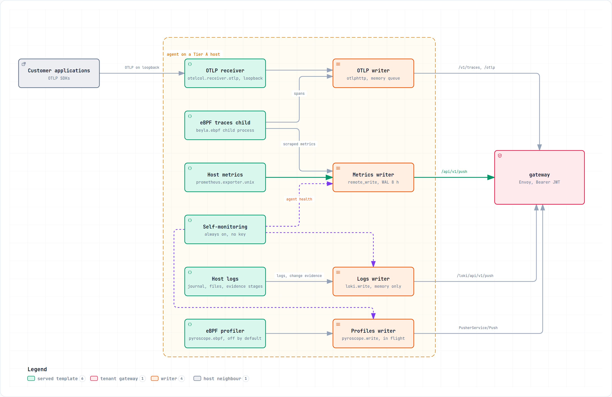
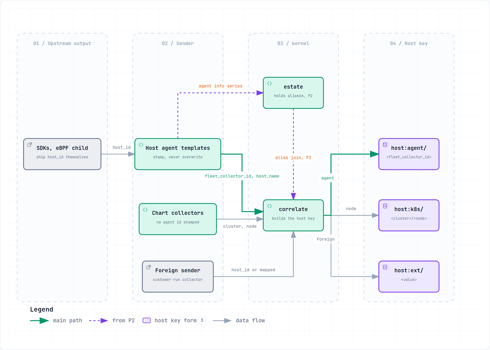
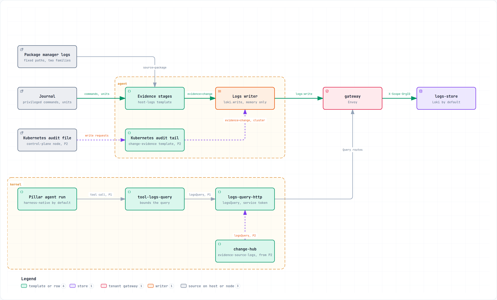
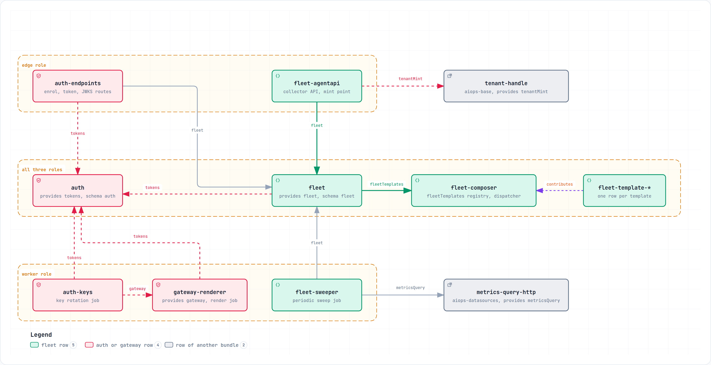
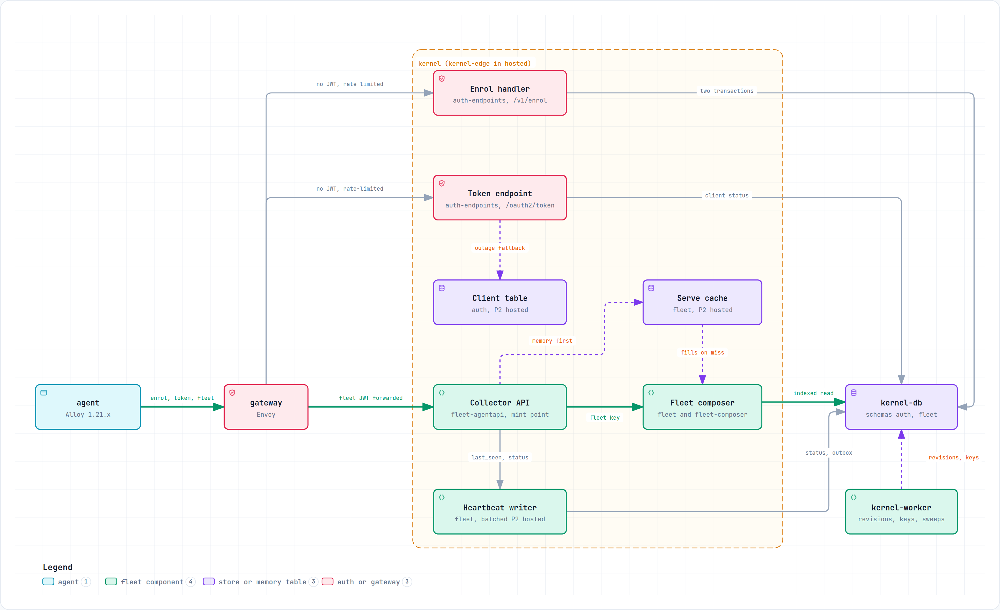
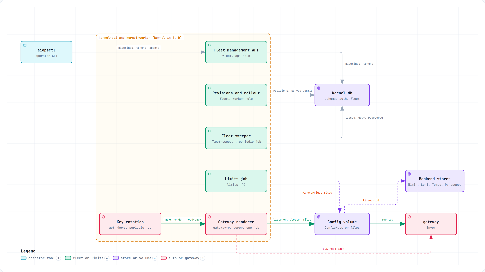
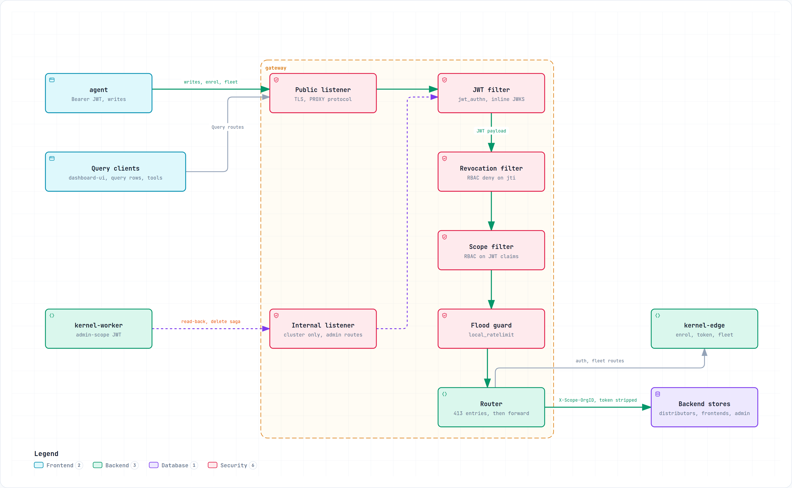
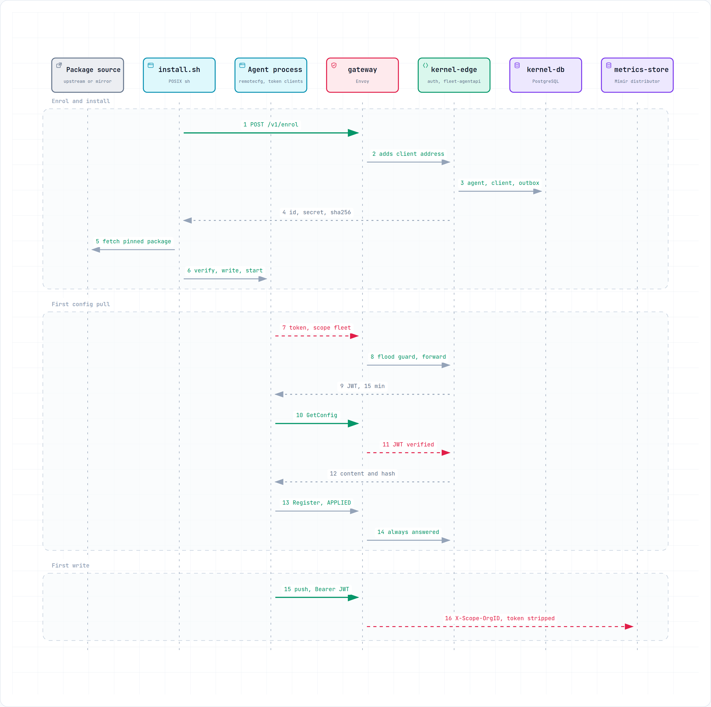
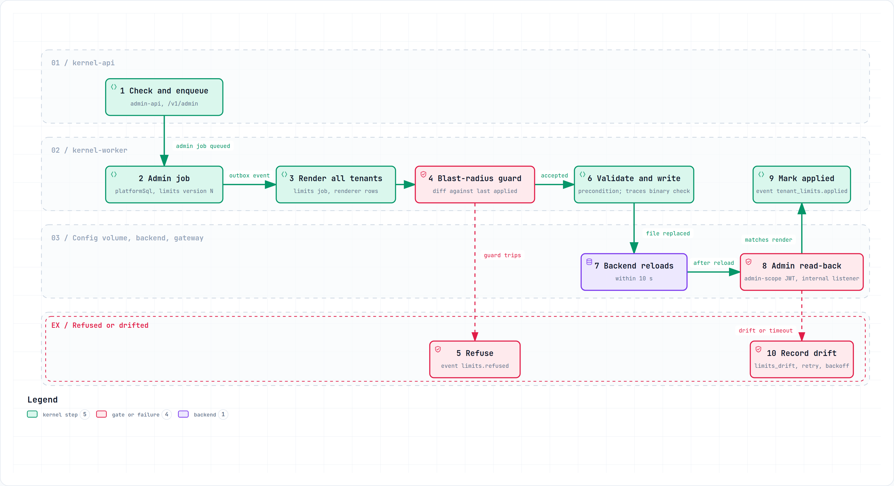

# 04. C3: agent, fleet and tenant gateway (the data plane)

Status: draft, 2026-11-11. Obeys `00-decisions.md` as amended on 2026-11-11 for the community-first order of work and vendor-neutral connectors, and a second time that day for the agent harness as a plugin point, upstreams as plugins and the licence record, and a third time that day for the owner's confirmation of W2 to W13, which are owner decisions from that date, in particular principles 7 and 9, §2.1 rows 1, 2, 6, 7, 10, 11, 15 and 19, §2.4, §3, the rule "Upstreams" of §4.3, the definitions `tokens`, `fleet`, `fleetTemplates`, `gateway` and `limitsRenderers` of §4.1, the bundles `aiops-stack`, `agent-base` and `aiops-datasources` of §4.4, the tenant handle of §5.1, §5.4 to §5.7, the connector packs of §6.2, the phases of §7.2 and the identity rows of §8.1. Research citations use `<file> §n` under `docs/research/`; the plugin record `docs/design/plugin-system-2026-11.md` is cited as "plugin record §n", the community record `docs/design/community-first-2026-11.md` as "community record §n", the harness record `docs/design/harness-and-upstreams-2026-11.md` as "harness record §n" and the licence record `docs/design/licence-audit-2026-11.md` as "licence record §n".

This document zooms into the three containers that carry telemetry from a customer host to the four backends: `agent` (§2), the data-plane plugins of `kernel` (§3: `auth` with `auth-endpoints` and `auth-keys`, `fleet` with `fleet-agentapi` and `fleet-sweeper`, `fleet-composer` with the template rows, `gateway-renderer` and, from P2, `limits` with its renderer rows) and `gateway` (§4). It also publishes the agent label contract: host identity (§2.8) and change evidence (§2.9), written so that a collector the customer runs can meet it. The `sensor` and the deferred `fleet-hostagent` appear as neighbours of the agent. Sequences are in §5, the deployment view in §6, failure behaviour in §7. Context and containers are in `01-c1-system-context.md` and `02-c2-containers.md`, the rest of the kernel in `03-c3-kernel.md`, the estate model and the troubleshooting method that read these labels in `09-c3-estate-and-troubleshooting.md`, the plugin SDK in `07-c4-plugin-sdk.md`, profiles and ADRs in `08-profiles-roadmap-adrs.md`.

**Specific to the default stack, by design.** The agent, the fleet and the tenant gateway belong to the default stack of this edition and are not portable: the templates emit configuration for one agent and its remote-config API, the gateway route table is the paths of four named backends and one tenant header, and each limits renderer emits one backend's overrides block (00-decisions §6.2; community record §6.6). This edition collects, stores, isolates and limits only on the default stack. It reads from other observability systems through connector packs in `aiops-only`, which composes none of the rows of §3. Nothing in this document is a contract that a connector pack implements, with one exception: the label contract of §2.8 and §2.9, which names fields and values and no agent, store or query language, and which a collector the customer runs meets under any pack. How the default logs store carries the change-evidence fields is stated apart from the contract (§2.9) and binds the default stack only. A second stack bundle (agents, gateway, limits and provisioning for other stores) is not designed; its trigger is a contributor who proposes one (00-decisions §7.3).

**Upstreams in this document.** Each upstream below is a default behind a definition or the stack bundle, never a contract of the core (00-decisions principle 9, §4.3 "Upstreams"). Container ids, compose services, chart keys and metrics are role names (`agent`, `gateway`, `sensor`, the four stores); an upstream's name appears in a Technology column, in prose and in the wire names and file paths that upstream itself defines. Each has one entry in the upstream register `tools/upstream-components.yaml`, and an entry marked `unverified` blocks the release that first ships it (00-decisions §3.2). The licences and verdicts are those of the licence record at the versions it read; this document did not read them again, with one exception, the agent config parser, which the licence record does not carry yet and whose read is stated under the table. This is engineering analysis, not legal advice.

| Role | Upstream, as the licence record read it | How we use it | Licence and verdict | Condition this document keeps |
|---|---|---|---|---|
| `agent` | Alloy v1.21.3 | Fetched or pulled from upstream; we render its config | Repository Apache-2.0; the binary links two AGPL-3.0-only packages of the logs store and embeds GPL-2.0 BPF objects. `ok-with-conditions` | Unmodified, never baked into an image of ours, and we publish no mirror. A mirror owes the AGPL-3.0 §6 and GPL-2.0 §3 source; the mirror of §2.2 is one the customer runs. A lawyer must answer whether a chart or compose file that pins an upstream image by digest conveys it, what a mirror owes per delivery form, and whether a redistributor may rely on the Apache-2.0 statement (licence record Q12) |
| Agent config parser | The syntax module of the agent, `github.com/grafana/alloy/syntax`, a Go module of its own inside the agent's repository, read at the agent's tag v1.21.3 | Linked, in `fleet-composer` only, so it is compiled into the `aiops` binary and into `aiopsctl` (§2.4) | Apache-2.0 by the repository's `LICENSE` and `LICENSING.md` at that tag; the module directory holds no licence file of its own, and its `go.mod` requires neither the agent's root module nor a module of a store. UNVERIFIED in the licence record, which has no link-mode row and no verdict for it | Imported only under `plugins/fleet-composer/` (U2). The agent's root module is never imported, because it links the AGPL packages of the logs store. The register entry stays `unverified`, which blocks the release that first ships it, until the licence record carries the row |
| eBPF child and profiler | Beyla v3.40.0 with OBI v1.0.0; the OpenTelemetry eBPF profiler | Inside the unmodified agent binary | Apache-2.0 with GPL-declared BPF objects. `ok-with-conditions` | It reaches a host only inside the upstream binary; we write no BPF program |
| Cluster collection chart | k8s-monitoring 4.6.0 | Shipped as a sub-chart of `aiops-agent` | Apache-2.0, nested charts included; the archive carries no licence file. `ok` | The release adds the Apache-2.0 text and a source line for the chart and every chart nested in it |
| Remote config protocol | alloy-remote-config v0.0.12 | Linked, or its `.proto` files copied | Apache-2.0. `ok-with-conditions` | Copied files keep the licence and a `NOTICE` line; wire names stay upstream's, and a name we choose carries no mark (A5) |
| `gateway` | Envoy v1.40.2 | Pulled by digest; we render its config | Apache-2.0. `ok` | Pulled, never shipped in an image of ours |
| `metrics-store`, `logs-store`, `traces-store`, `profiles-store` | Mimir 3.2.4, Loki v3.7.9, Tempo v3.1.1, Pyroscope v2.4.3 | Pulled by digest, unmodified, separate processes | AGPL-3.0-only. `ok-with-conditions` | No row here imports their AGPL packages: a limits renderer checks its output against our own typed schema, and the traces file is validated by running the pinned binary, never by linking it (§3.2 `lren`) |
| `sensor` (P2) | Tetragon v1.7.1 | Pulled, unmodified | Apache-2.0; `bpf/` dual GPL-2.0-only or BSD-2-Clause, with three GPL-2.0-only headers. `ok-with-conditions` | We elect BSD-2-Clause, which does not reach the three headers (00-decisions §3.2) |
| Conformance oracle | shepherd | Fetched by tests | Apache-2.0 or MIT, as the licence record lists its tool group. `ok` | Fetched at run time, never vendored or baked into an image of ours (§8) |

Sources: licence record §2.1 (remote config protocol, `gateway`, test tools), §2.3 (the rest), §5 rule 1 and §7.3 (pull, do not ship).

**The parser row is open in the licence record.** The `agent` row of licence record §2.3 covers pull and fetch only. The parser is mode `link`, and a linked module with no register entry fails the release check (licence record §7.2). The source log of licence record §2.3 calls the module safe to link; that is a lead, not the record. This document read three files on 2026-11-11 at tag v1.21.3: `https://raw.githubusercontent.com/grafana/alloy/v1.21.3/LICENSING.md` (default Apache-2.0, one MIT file outside the module), `https://raw.githubusercontent.com/grafana/alloy/v1.21.3/LICENSE` (Apache License 2.0) and `https://raw.githubusercontent.com/grafana/alloy/v1.21.3/syntax/go.mod` (module `github.com/grafana/alloy/syntax`, five direct requirements, none of them the agent's root module or a store). `syntax/LICENSE` does not exist at that tag. UNVERIFIED: the module's own version (a nested Go module takes a tag of its own, and no pin is recorded), the commit behind the tag, and the licence files of its five direct and five indirect requirements. The licence record owes a link-mode row with a verdict, and the register an entry with the module pin, before the first community release, which is the first to ship `fleet-composer`.

**Reading rules.** Every server-side piece in this document is a plugin behind a service definition, composed as a row of `aiops-stack` or `agent-base`, or, for the one P2 template row of §2.6, of `agent-security` (00-decisions §4.4, §6.2). What an agent, the gateway and a backend see on the wire does not depend on that, and neither does the label contract. "Kernel" here means the server: the `aiops` binary and its `kernel*` containers (00-decisions §8.2, second sense). "Agent" alone is the customer agent of §2. The model-driven reader of §2.9 and §4 is a pillar agent, and one call of its harness is a run (00-decisions §8.2). "Fleet composer" is the generator of agent config in §2.4; `composer` is the plugin that owns generations from S4b in a profile that runs more than one process, and on one process `reload` is the committer (00-decisions §6.1). Phase tags follow 00-decisions §7.2 in the community-first order of 2026-11-11 (00-decisions §2.4). P0 is the model core (S0, S1, S2a, S2b, S3, S4a, S5) and builds nothing described here. P1 is the community release: S7 is the telemetry base, S8a is the agent runtime, which needs S5 and may run beside S7, and S8b is the incident loop, whose exit is the first community release, version `0.1.0`, which ships `self-host-full` with the tenant `default` and one `aiops --role all` process, `dev`, and `aiops-only` (00-decisions §7.1). P2 runs on two tracks: S9a, the community second wave, and S9b, hosted, which follows S4b and S6b. The table below gives the step of each piece, and a `P1`, `P2` or `P3` tag elsewhere keeps its meaning. "S7 to S8b" means S7, S8a and S8b, which is all of P1 after S6a. `hosted` is not part of the first community release, so every statement about hosted in this document (the three roles, the required set, the availability work, the canaries) describes S9b; until then `kernel` in role `all` is the only server process. No step has a date.

| Piece | Phase | Runs in |
|---|---|---|
| Host installer, `Enrol` (which records the machine id as an alias), token endpoint, the Envoy render by `gateway-renderer`, `CollectorService` (one indexed read plus a hash compare, no caches), the six template rows of `agent-base`, self-monitoring pipeline; the identity stamps `fleet_collector_id` and `host_name` on every host pipeline, asserted by a compose test; the Query group of the gateway route table as the closed list of ADR-053 (§4.1); the token endpoint measured at 300 requests per second, with the figure recorded and no pass threshold (§8) | S7 | `agent` (AH); `kernel` (S, D) |
| Revisions, `agent-k8s` umbrella chart; backend limits as static chart values; the change-evidence stages of the `host-logs` template (a label contract, no feature key) | P1 (S8b) | `agent` (AK); `kernel` |
| Role split into `kernel-edge`, `kernel-api`, `kernel-worker`; the hosted availability work of 00-decisions row 6, switched on by the `aiops-hosted` bundle only (§3): serve cache, DB-outage client table, batched heartbeats, canary for revisions and fleet composer versions; the pass threshold of the token endpoint at 300 requests per second | P2 (S9b) | `kernel` (H) |
| `limits` with its four renderer rows and the single-flight job | P2 (S9b) | `kernel` (H, S, D) |
| Windows agent; `sensor` installed by the `agent-security` bundle, whose Tetragon template and `runtimeSecurity` key are the first `fleetTemplates` contribution from a bundle other than `agent-base` (00-decisions row 10); feature keys `changeEvidence` (Kubernetes audit file) and `networkDevices` (SNMP); the agent info series (A13) | P2 (S9a) | `agent` (AH, AK); template rows in `kernel` (H, S, D) |
| OpAMP listener, `fleet-hostagent`, remotecfg on Kubernetes, cloud instance identity enrolment, runtime validation gates; feature keys `hypervisor`, `hardwareHealth`, `dbState`, `probes` and `networkFlows`; the duplicate cluster name event | on trigger (00-decisions §7.3) | |

## 1. Assumptions and additions

00-decisions leaves these points open or implicit. Each is the reading most consistent with the record and the research; an ADR can overturn any of them.

| # | Point | Reading taken here | Basis |
|---|---|---|---|
| A1 | Who writes the key set the gateway verifies with | `auth-endpoints`, on `kernel-edge`, serves `/.well-known/jwks.json`. The render by `gateway-renderer` in `kernel-worker` inlines the same key set into the rendered listener file (`local_jwks.inline_string`), as 00-decisions row 7 records, because the rotation that changes it is a periodic job of `auth-keys` and a key change must change the listener bytes (§3.2). Both take the key set from `auth` through `tokens`. In `kernel` (role `all`) both are one process. | 00-decisions §3.1, row 7; gap-tenant-gateway §1.4, §3 |
| A2 | Where host facts come from | Alloy reports only `collector.os` and `collector.version`. The installer adds a systemd `ExecStartPre` hook that exports kernel release, BTF presence, distro, arch and cgroup version; the local config sends them as `remotecfg` attributes. The machine id is not one of them: the installer reads it and sends it once, in the `Enrol` request (§3.1 `enrol`). | gap-remotecfg §1.1; gap-ebpf §4.1; 00-decisions row 11 |
| A3 | Per-host values in served config | Agent id and edge URL are read with `sys.env`, as Grafana Cloud's template does, so served content depends only on the composition key, which hashes every input `Compose` reads (§2.4, §3.3), and every agent with that key gets the same bytes. The identity stamps follow the same rule: `fleet_collector_id` is `sys.env("AIOPS_AGENT_ID")` and `host_name` is `constants.hostname`, so stamping adds no input to the key. | gap-tenant-gateway §1.1 item 3 |
| A4 | Admin calls to backends | The limits read-back by `limits` and the backend stage of the delete saga by `stack-provisioning` go through an internal-only gateway listener with an admin-scope JWT, which has its own issuer and key, is minted through `tokens` on the worker role only and is accepted only on that listener (00-decisions §5.4). Each backend has its own prefix there, rewritten to the backend path, so `/runtime_config`, which three backends serve on the same path, joins the group once per backend (§4.1). | gap-tenant-gateway §2.3 |
| A5 | Fleet URL path | `/fleet/collector.v1.CollectorService/*`, not the research's `/api/v1/alloy/...`, to keep a mark out of a path we name. Backend API paths stay as upstream defines them. | 00-decisions §8.1 |
| A6 | `ebpf-profiles` on Tier B | Tier A only. A features document may opt a Tier B scope in, which sets `no_kernel_version_check`. | gap-ebpf §2.2, §8 Q5 |
| A7 | Where the features document lives | As rows of the table `fleet.pipeline` with `kind: features`. Raw Alloy fragments are a later `kind`; trigger: the first customer need the features schema cannot express (00-decisions §7.3, its own row). The runtime `collector-validate` and `version-schema` gates return with them, or with a second supported agent version. A third trigger reopens the choice without deciding it: when the CI job that validates the feature space whole (§8) exceeds ten minutes, an ADR chooses between pruning the validated space, tier floor first, and these gates (00-decisions §7.3). | 00-decisions §5.2, row 6 |
| A8 | Token issuance during a `kernel-db` outage | S7 to S8b, and `self-host-full` and `dev` in every phase: the token endpoint reads `auth.agent_client` per request, so a database outage stops token issuance after one TTL; with one tenant and one database this is accepted. In `hosted`, from P2, `auth` on `kernel-edge` loads every `auth.agent_client` row at start (about 5 MB at 50,000 agents), refreshes them by `updated_at` and issues tokens from that table during an outage. Revocation during the outage waits for the database. The table is hosted availability work, switched on by `aiops-hosted` only (§3). How the edge role reads the client rows of every tenant is open (§9). | 00-decisions principle 4, row 6, §4.4; 03-c3-kernel.md §8.2 |
| A9 | Which templates are host pipelines | Every template served to a host agent in S7 to S8b, the OTLP receiver included: it listens on loopback, so everything it hears comes from this host. The P2 templates `change-evidence` and `network-devices` are not host pipelines: their telemetry is about a cluster and about a device (§2.9, §2.10). | 00-decisions rows 6, 11 |
| A10 | Where a change-evidence field is carried | The contract of §2.9 fixes field names and values for every sender and fixes no carrier. On the default logs store, `evidence`, `source` and the identity labels are stream labels, and `operation`, `outcome`, `actor` and `target` are structured metadata on the entry, because actors and targets are unbounded and a stream per value would multiply streams. ADR-025 freezes the spellings for every sender and the carriers for the default stack only. On another store the pack that reads it maps the fields (§2.9). | 00-decisions principle 7, row 19, §6.2 |
| A11 | Change-evidence inputs when the customer narrows `hostLogs` | The stages keep their own inputs: the journal, filtered to privileged-command and unit entries, and the package manager logs by fixed path. `journal: false` or an empty `files` list stops general log shipping, not these lines. With `hostLogs` off there is no change evidence. | 00-decisions row 19 (always-on stages, no key) |
| A12 | The enrolment id of a cluster | One enrolment serves a cluster, so its id names the enrolment, not a machine. The chart puts no `fleet_collector_id` on node or workload telemetry; a node is named by the cluster and node labels the pinned collectors ship. | 00-decisions row 11, §8.1 (host forms) |
| A13 | The agent info series. Settled in 00-decisions row 11 and §4.4 `agent-base`; the detail here is this document's | From P2 the `self-monitoring` template publishes one constant info series per agent, with the labels `fleet_collector_id`, `host_id` (the machine id), `host_name` and the declared `service`, `team` and `env` (§2.8). It ships with its first reader, the `estate` first slice, in every profile that has `fleet`. It is the one place where a template sets `host_id`. The label goes on a series the template itself creates, so nothing an upstream component shipped is overwritten, and its value is the OpenTelemetry meaning of `host.id` on a machine that is not a cloud instance. | 00-decisions row 11 (the series, its labels and the one `host_id` exception; upstream output is never overwritten); row 15 (readers over `metricsQuery`, never `fleet` tables); §4.4 `agent-base`; §8.1 |
| A14 | Template rows and the template set | A template's row id is `fleet-template-` plus the template name (§2.4). `fleet-composer`, a stateless row of `agent-base`, provides the registry, is its dispatcher and holds what no template can skip: the four writers, the escaping, the `declare` wrapping, the synchronous parse and the self-monitoring template, without which nothing is served. The fleet composer version covers the template set, so a changed set changes the composition keys (§2.4, §3.3). A template row registers a contribution and nothing else, so a tenant overlay (layer 5, which arrives at S4b) may switch it off for that tenant; a key whose row is not registered for a tenant is off for that tenant. Until S4b every tenant of a process has the same set. | 00-decisions row 6, §4.1, §4.4 `agent-base`, §5.1 (tenant-toggleable rows), §8.1 (row ids); plugin record §7 M2 |
| A15 | `Enrol` across two owners | `fleet.agent` and `auth.agent_client` have different owners and database roles, and a domain plugin never passes its transaction to another. `Enrol` is therefore two transactions: `fleet` matches or creates the agent and emits `agent.enrolled`; `auth`, reached through `tokens`, then stores the client secret hash. A crash between them leaves an agent with no client; the installer's rerun matches the same agent on machine id and name and completes it. Open until both plugins are built (§9). | 00-decisions §4.3 (transaction contract), §5.2; plugin record §5 |
| A16 | From a limits change to the limits job | The admin job writes `tenant_directory.tenant_limits` and its outbox event in one transaction; `limits` subscribes and enqueues its own unique job per backend (§5.2). A job kind belongs to the plugin that handles it, so the admin job does not enqueue it. | 00-decisions §4.3, §5.2 (durable namespaces) |
| A17 | Roles, injects and the render trigger | 00-decisions §4.4 gives a role to `auth-endpoints` and `fleet-agentapi` (edge) and to `auth-keys`, `fleet-sweeper`, `gateway-renderer` and `limits` (worker), and none to `auth` and `fleet`. Read here: `auth` and `fleet` state all three roles, because their keys are injected on each, and the admin-scope signing key is loaded on the worker role only (00-decisions §3.1). `gateway-renderer` injects `tokens`, so the provider of `tokens` cannot inject `gateway` without a cycle: the consumers of `gateway` are `auth-keys` and `stack-provisioning`, as 00-decisions §2.3 settles against plugin record §5. `auth-keys` asks for the render and the read-back, and a denylist change reaches the renderer as an outbox event of `auth`. 03-c3-kernel.md §9 is the placement table and wins. | 00-decisions §2.1 row 1 (no cycles), §2.3, §4.4; plugin record §5, §6 |

## 2. Agent container

`agent` is unmodified Alloy 1.21.x, fetched or pulled from upstream and never rebuilt or repackaged by us, plus our `install.sh` (hosts) or the `aiops-agent` umbrella chart and enrol Job (Kubernetes). On hosts the only local configuration is a `remotecfg` block; everything else is served by `fleet` (00-decisions row 11). On Kubernetes in MVP the chart renders collector config from the same features document without remotecfg; the enrol Job writes the Secret, and ADR-005 decides how the OAuth2 block reaches the k8s-monitoring destinations.

### 2.1 Files on a Linux host

| Path | Written by | Content |
|---|---|---|
| `/etc/alloy/config.alloy` | `install.sh` | Only the `remotecfg` block below |
| `/etc/aiops-agent/client_secret` | `install.sh` | 256-bit secret returned once by `Enrol`; mode 0600, owner root; always written as a temp file plus rename |
| `/etc/aiops-agent/agent.env` | `install.sh` | `AIOPS_AGENT_ID`, `AIOPS_EDGE_URL` |
| `/run/aiops-agent/facts.env` | facts hook, every unit start | `AIOPS_KERNEL`, `AIOPS_BTF`, `AIOPS_DISTRO`, `AIOPS_ARCH`, `AIOPS_CGROUP` |
| `/etc/systemd/system/alloy.service.d/aiops.conf` | `install.sh` | `EnvironmentFile=` for both env files, `ExecStartPre=` facts hook, `User=root` (eBPF and journal access, gap-ebpf §6.2) |
| `/etc/systemd/system/aiops-agent-watchdog.{service,timer}` | `install.sh` | Remotecfg watchdog, every 5 min (§2.2 `wd`) |
| `<storage.path>/remotecfg/<args-hash>` | Alloy | Last good served config |

```alloy
remotecfg {
  url            = sys.env("AIOPS_EDGE_URL") + "/fleet"
  id             = sys.env("AIOPS_AGENT_ID")
  name           = constants.hostname
  poll_frequency = "1m"
  attributes = {
    "env"         = "prod",                    // from install.sh --attr env=prod
    "host.kernel" = sys.env("AIOPS_KERNEL"),
    "host.btf"    = sys.env("AIOPS_BTF"),
    "host.distro" = sys.env("AIOPS_DISTRO"),
    "host.arch"   = sys.env("AIOPS_ARCH"),
    "host.cgroup" = sys.env("AIOPS_CGROUP"),
  }
  oauth2 {
    client_id          = sys.env("AIOPS_AGENT_ID")
    client_secret_file = "/etc/aiops-agent/client_secret"
    token_url          = sys.env("AIOPS_EDGE_URL") + "/oauth2/token"
    scopes             = ["fleet"]
  }
}
```

### 2.2 C3 part 1: control and identity

Scope: the components of one host agent that obtain its identity, fetch served config and keep it running. Telemetry components are in §2.3. Neighbours are `gateway`, `kernel-edge` (the `kernel` container plays this role in S and D), the package source and the deferred host helper. This section has no figure of its own: enrolment, the package fetch and sha256 check, the files written, the token requests, `GetConfig` and `RegisterCollector` are drawn as the sequence of §5.1, and the same host is drawn at deployment level in `02-c2-containers.md` §4.5 (D-5). The two tables below are complete; the watchdog, the facts hook, the config cache, the served pipeline controller, the local HTTP server and the deferred host helper appear only in them.

| ID | Name | Technology | Responsibility |
|---|---|---|---|
| `inst` | Install script | POSIX sh, `install.sh` | Collect facts and the machine id, call `Enrol`, verify the package sha256 that `Enrol` returns, install, write the files in §2.1, start the unit. Also `--re-enrol` (authenticates with the current client secret, receives a new one, keeps the agent id; rotation per 00-decisions §5.4), `--upgrade` (§2.7) and `--uninstall`. Re-enrol writes the new secret to a temp file in `/etc/aiops-agent/`, renames it over `client_secret`, then runs `systemctl restart alloy`, because whether Alloy re-reads `client_secret_file` is unverified (ADR-001). The old secret stays valid until it has gone unused for 2 token TTLs (§3.1 `enrol`), so a script that dies between the `Enrol` response and the rename leaves the host on a valid secret and a rerun is safe. |
| `wd` | Remotecfg watchdog | systemd timer and POSIX sh | Every 5 min reads `remotecfg_load_attempts_total` from `127.0.0.1:12345/metrics`, with or without an `alloy_` prefix (unverified, gap-remotecfg §1.3). If the counter has not grown over two checks while the poll is 1 min, the remotecfg service has exited, and the script runs `systemctl restart alloy`, at most once per 30 min so a long outage does not become a restart loop. |
| `facts` | Facts hook | systemd `ExecStartPre` script | Rewrite `facts.env` at every start, so a kernel upgrade (which needs a reboot) is reported on the next start. |
| `localcfg` | Local config | `config.alloy` | Holds only `remotecfg`; the customer never edits it. |
| `secret` | Client secret | file, 0600 | Per-agent OAuth2 client secret; never transits the fleet API. |
| `rc` | Remote config client | Alloy `remotecfg` service | `GetConfig` every minute (also the heartbeat), `RegisterCollector` at start, `UnregisterCollector` at stop; sends status and effective config only when they change. |
| `tok` | Token clients | Alloy `oauth2` blocks | One per block (remotecfg and each writer); client-credentials grant against `/oauth2/token`; each reads `client_secret_file` and refreshes on its own. |
| `ctl` | Served pipeline controller | Alloy isolated controller | Runs served components; on a load failure re-loads the cached config and reports `FAILED`. |
| `cache` | Config cache | file under `storage.path` | Last good served config; loaded at startup when `GetConfig` fails. |
| `httpsrv` | Local HTTP server | Alloy, `127.0.0.1:12345` | UI, `/-/reload`, `/-/support`, self metrics scraped by the self-monitoring pipeline. |
| `pkg` | Agent package source, `ext-package-source` | The upstream release download by default, or a mirror the customer runs; set at install | Pinned Alloy packages. Integrity comes from the sha256 in the `Enrol` response, not from the source, so a host with no public egress installs from the mirror (00-decisions row 11, §3.3). We publish no mirror; whoever runs one carries the source duties of the package (licence record §2.3, §7.3). |
| `helper` | Host helper | `fleet-hostagent`, deferred | §2.7. |
| `gw`, `edge` | `gateway`, `kernel-edge` | | §4 and §3. |

| Relationship | What | Why it matters |
|---|---|---|
| `inst` to `gw` to `edge` | `POST /v1/enrol` with the bootstrap token | The only call that uses a bootstrap token. It carries the host name and the machine id, and returns `agent_id`, `client_secret`, the edge URL and `{version, sha256}`. The secret is returned once and stored only as a SHA-256 hash (00-decisions row 7). The returned `agent_id` is the value every host pipeline stamps as `fleet_collector_id` (§2.8); the machine id is kept as an alias so that a reinstalled host gets the same id back (§3.1 `enrol`). |
| `rc` to `gw` | `GetConfig`, `RegisterCollector` | Connect unary over HTTPS with a `fleet`-scoped JWT. `GetConfig` comes before `RegisterCollector` at startup, and a failed `RegisterCollector` stops polling until restart (gap-remotecfg §1.3); §3.1 has the edge answer it with success for any valid fleet JWT while `fleet-agentapi` is ACTIVE on the replica, a `kernel-db` outage included; a row that is not ACTIVE or an in-place provider restart answers 503 (00-decisions row 6; §7). A failure before the edge (token fetch, `kernel-edge` or `gateway` down, customer DNS or egress) still leaves the agent deaf: it writes on its cached config but takes no config change, rollback or canary disable. `wd` restarts it, and the sweeper raises `agent.deaf` (§3.2, §7). |
| `tok` to `gw` | `/oauth2/token` | Five token clients per host (remotecfg plus four writers), 15 min each: the 278 req/s budget at 50,000 agents in 00-decisions row 7. On Kubernetes one enrolment serves a cluster (gap-tenant-gateway §1.3), so one `client_id` has four writer token clients per collector pod (no remotecfg in MVP): a 300-node cluster with three DaemonSets runs about 900 pods, 3,600 token clients and 4 req/s. The token-rate and `jwt_cache_size` budgets count pods, not clusters (§3.1 `token`, ADR-005). |
| `wd` to `httpsrv`, `rc` | local metrics read, unit restart | Covers every cause of a failed `RegisterCollector` at start, not only a `kernel-db` outage (gap-remotecfg §1.3; 00-decisions row 6). A restart may drop the `loki.write` batches held in memory (§2.5), so the 30 min cap trades a longer deaf window for fewer restarts. |
| `rc` to `cache` | write after load, read on start | The cache file name hashes the `remotecfg` arguments, attributes included, so a changed fact starts with an empty cache (gap-remotecfg §1.1). Accepted: it matters only if the fleet API is down during the first start after a kernel upgrade. |

### 2.3 C3 part 2: telemetry pipelines

Scope: the served components inside one agent, from sources to the four writers, for a Tier A Linux host with every feature on. `fleet` composes them from the template rows, one per template (§2.4). Components marked P2 in the tables are not served before then. Neighbours are customer applications, the `sensor` (P2), network devices (P2) and `gateway`.


*Figure 04-agent-pipelines. Source: [diagrams/src/04-agent-pipelines.json](diagrams/src/04-agent-pipelines.json).*

The figure shows the main path on a Tier A Linux host before P2: six served templates, the four writers and `gateway`; the tables below are complete. It draws the change-evidence stages `chg` inside Host logs, and leaves out the P2 components `sectail`, `kaudit` and `snmp` with their neighbours `sensor` and `devices`, the writers' token clients (§2.2 `tok`), the identity stamp (§2.8) and the Windows templates (§2.4).

| ID | Name | Technology | Responsibility |
|---|---|---|---|
| `hostm` | Host metrics | `prometheus.exporter.unix` + `prometheus.scrape` | Node metrics. Template `host-metrics`. |
| `hostl` | Host logs | `loki.source.journal`, `local.file_match` + `loki.source.file`, `loki.process` | Journal and listed files. Template `host-logs`. |
| `chg` | Change-evidence stages | `loki.process` stages inside the `host-logs` template, over the journal and the package manager logs | Label package, privileged-command and unit lines with the contract of §2.9. On whenever `hostLogs` is on; no feature key. P1. |
| `otlpin` | OTLP receiver | `otelcol.receiver.otlp` + `otelcol.processor.batch` | OTLP from local apps on loopback. Template `otlp-receiver`. |
| `ebpft` | eBPF traces child | `beyla.ebpf` | Zero-code RED metrics, spans, service graph. Template `ebpf-traces`. |
| `ebpfp` | eBPF profiler | `pyroscope.ebpf` | Whole-host CPU profiles. Template `ebpf-profiles`, off by default. |
| `sectail` | Sensor event tail | `loki.source.file` + `loki.process` json stage | Ships sensor events. Template `runtime-security`, which does not exist before P2: it arrives with the `agent-security` bundle, the first `fleetTemplates` contribution from a bundle other than `agent-base` (§2.4, §2.6). |
| `kaudit` | Kubernetes audit tail | `loki.source.file` + `loki.process` json stage | On a control-plane node, tails the API server audit file, keeps write requests and labels them as change evidence (§2.9). Template `change-evidence`, P2. |
| `snmp` | Network device poller | `prometheus.exporter.snmp` + `prometheus.scrape` | Interface series of the declared devices, each stamped with `device` (§2.10). Template `network-devices`, P2. |
| `selfmon` | Self-monitoring | `prometheus.exporter.self`, `loki.source.journal` filtered to the agent unit, `pyroscope.scrape` of the agent's pprof | Agent health, labelled `fleet_collector_id`. Template `self-monitoring`, always on. From P2 it also publishes the agent info series (§2.8). |
| `wm` | Metrics writer | `prometheus.remote_write` with WAL | Writes to `/api/v1/push`. |
| `wl` | Logs writer | `loki.write` | Writes to `/loki/api/v1/push`. |
| `wo` | OTLP writer | `otelcol.exporter.otlphttp` + `otelcol.auth.oauth2` | Traces to `/v1/traces`; app OTLP metrics and logs to `/otlp/v1/metrics` and `/otlp/v1/logs`. OTLP over HTTP only (00-decisions row 7). |
| `wp` | Profiles writer | `pyroscope.write` | Writes to `/push.v1.PusherService/Push`. |
| `apps`, `sensor`, `devices`, `gw` | | | Neighbours; the sensor is §2.6. `devices` are the customer's network devices, polled over SNMP from P2 and never written to. |

| Relationship | Why it matters |
|---|---|
| writers to `gw` | Every writer has its own `oauth2` block with a write scope (`metrics:write`, `logs:write`, `profiles:write`; the OTLP writer asks for `traces:write`, `metrics:write` and `logs:write`) and the same `client_secret_file`. The gateway turns the token's `orgid` claim into `X-Scope-OrgID`; the agent never sets that header. |
| each host source to its writer | Every host template stamps `fleet_collector_id` and `host_name` inside its own block, before the writer (§2.8). The stamp is not a writer-level external label, because from P2 the same writers carry `snmp` series and `kaudit` lines, which name a device and a cluster and must not take the identity of the host that collected them. |
| `hostl` to `chg` to `wl` | Change evidence leaves through the logs writer like any log line, with the identity labels the host's metric series carry, so one label matcher selects the alerting host and its evidence. The logs writer buffers in memory only (§2.5), so an agent restart can lose evidence lines (§7). |
| `kaudit` to `wl` (P2) | Audit lines join the same change-evidence stream, named by the cluster label that the cluster's alerts carry. |
| `devices` to `snmp` to `wm` (P2) | The agent polls; a device never pushes and is never logged into. The SNMP credential is a file on the polling host (§2.10). |
| `ebpft` to `wm`, `wo` | `beyla.ebpf` is a supervised child process: Alloy extracts the embedded binary to a memfd, passes capabilities, reads OTLP from it over a unix socket and restarts it when the watchdog fails, so a verifier failure on an odd kernel does not stop the other pipelines (gap-ebpf §2.1). Metrics leave through exported `targets` scraped with `honor_labels = true`. |
| `ebpfp` to `wp` | `pyroscope.ebpf` runs in process, so a profiler fault is an agent fault. It is on only when the features document and the tier allow it; restart is left to systemd or the kubelet (gap-ebpf §2.2). |
| `selfmon` to writers | Injected into every served config. It carries the `remotecfg_*` metrics and the writers' drop counters, the agent-side truth for fleet status (gap-remotecfg §1.3, §4.1). |
| `sensor` to `sectail` | Tetragon writes JSON lines to `/var/log/tetragon/tetragon.log`; the agent tails and parses them. There is no OTLP path (gap-ebpf §3.1, §6.3). |

### 2.4 Features document and generator

The customer sees one `features` document. The generator, the fleet composer, is a pure function, `Compose(ComposeInput) -> (content, hash)`. `ComposeInput` is the normalised form of the features documents, host facts and agent version: the selected pipeline revisions in order, the tier, `collector.os`, `host.arch`, the agent minor version and the fleet composer version. The fleet composer version is the release constant, bumped by any release that can change `Compose` output, joined with the id and content digest of every template registered for the tenant of the call (§3.4, A14). `Compose` reads this value and the templates it names, and nothing else, and the composition key is the hash of this value (§3.3), so two agents with one key always get the same bytes. It is the row `fleet-composer` of `agent-base`, which provides the `fleetTemplates` registry and needs no `sql`. `fleet` injects the registry and runs it to serve config; `aiopsctl agent render` runs the `agent-host` or `agent-k8s` profile, which composes the same row over the same template rows with no database (00-decisions §4.4, §6.3).

```yaml
apiVersion: aiops/v1
kind: AgentFeatures
metadata:
  name: prod-linux
  matchers: ['env="prod"']   # Alertmanager syntax over agent attributes; empty means the whole tenant
  priority: 10               # higher wins per feature key; a feature block is replaced, never deep-merged
features:
  hostMetrics:     { enabled: true }
  hostLogs:        { enabled: true, journal: true, files: ["/var/log/app/*.log"] }
  otlpReceiver:    { enabled: true }
  ebpfTraces:      { enabled: true }
  ebpfProfiles:    { enabled: false }
```

| Config template | Row, a contribution to `fleetTemplates` | Bundle | Feature key | Tier floor | Default | Key exists from |
|---|---|---|---|---|---|---|
| `host-metrics` | `fleet-template-host-metrics` | `agent-base` | `hostMetrics` | C | on | S7 |
| `host-logs`, with the change-evidence stages from P1 (§2.9) | `fleet-template-host-logs` | `agent-base` | `hostLogs` | C | on | S7 |
| `otlp-receiver` | `fleet-template-otlp-receiver` | `agent-base` | `otlpReceiver` | C | on | S7 |
| `self-monitoring`, with the agent info series from P2 (§2.8) | `fleet-template-self-monitoring` | `agent-base` | none | C | always | S7 |
| `ebpf-traces` | `fleet-template-ebpf-traces` | `agent-base` | `ebpfTraces` | B | on | S7 |
| `ebpf-profiles` | `fleet-template-ebpf-profiles` | `agent-base` | `ebpfProfiles` | A, B by opt-in (A6) | off | S7 |
| `runtime-security` (§2.6) | `fleet-template-runtime-security` | `agent-security` | `runtimeSecurity` | A | off | P2 |
| `change-evidence` (§2.9) | `fleet-template-change-evidence` | `agent-base` | `changeEvidence` | C | off | P2 |
| `network-devices` (§2.10) | `fleet-template-network-devices` | `agent-base` | `networkDevices` | C | off | P2 |

**Key space.** S7 to S8b have five feature keys (`hostMetrics`, `hostLogs`, `otlpReceiver`, `ebpfTraces`, `ebpfProfiles`; 00-decisions §4.4 `agent-base`), and the count does not grow before P2: host change evidence is a set of stages inside `host-logs`, not a key (§2.9). A key enters with its first consumer (00-decisions row 6). P2 adds three: `changeEvidence`, read by the `change-hub` evidence read; `networkDevices`, read by the device rule and the `estate` device reader (`09-c3-estate-and-troubleshooting.md`); and `runtimeSecurity`, which arrives with the Tetragon template once SecOps has a server-side consumer (00-decisions row 10). The keys `hypervisor`, `hardwareHealth`, `dbState`, `probes` and the opt-in `networkFlows` wait for the triggers of 00-decisions §7.3; for each, the key moves first and its rule pack and `estate` reader table ship in the same change.

**Validated whole.** The P1 input space is five feature keys, three tiers, two operating systems and one pinned agent version, and CI validates all of it (§8). That is why no runtime validation gate runs (00-decisions row 6). Every new key multiplies the space; when the CI job passes ten minutes, an ADR chooses between pruning the validated space, tier floor first, and the runtime gates (A7).

**Reserved names.** The features schema reserves the attribute names `service`, `team` and `env` from S7: the service a host runs, the team that owns it and its environment. No feature key and no customer attribute may use them for another meaning; an `env` attribute set at install, as in §2.1, already has the reserved one. S7 to S8b reserve the names only. The block that declares them for the agents a document selects and the agent info series that publishes them arrive together in P2 (§2.8).

**Templates are contributions.** A config source is a contribution to the `fleetTemplates` registry: one row per template, an in-process Go plugin that embeds its template file and registers it with its feature key, tier floor and default (00-decisions row 6, §4.1). `agent-base` composes six template rows in S7 to S8b and adds `change-evidence` and `network-devices` in P2; `agent-security` contributes `runtime-security` with its `runtimeSecurity` key, the first contribution from a bundle other than `agent-base`, and nothing of it exists before (00-decisions row 10). `fleet-composer`, the seventh row of `agent-base`, provides the registry and is the dispatcher, the only caller of a template (00-decisions §4.4; plugin record §7, M2). The registry takes no contribution from another process (00-decisions §4.1), so a template that a contributor writes is in-process Go. Like any in-process community plugin it lives under `contrib/` and ships disabled in `aiops-contrib`, or it enters a distribution the operator builds and signs (00-decisions §3.1, §4.5). It adds a pipeline to the default agent; it does not make another collector or store usable, which is the work of a connector pack (00-decisions §6.2). In hosted, where third-party code is remote only, no third-party template exists. The self-host and hosted statements are owner decisions of 2026-11-11 (00-decisions §2.4 W3, W4).

**What the dispatcher holds.** The fleet composer escapes every customer-supplied string (log file globs), always emits the four writers with their `oauth2` blocks, wraps each enabled source in its own `declare` block whose arguments are the writers' receivers, and instantiates it (the shepherd merge, gap-remotecfg §2). It serves nothing without the self-monitoring template (00-decisions row 6). The identity stamp of §2.8 is part of each host template's block. The hash is hex sha256 of the served bytes; nothing time-dependent is rendered, or `not_modified` would never match (gap-remotecfg §1.4). Before it returns, `Compose` parses its own output with the in-process Alloy syntax parser, so a bad composition fails at compose time and is never served. The parser is the agent's separate syntax module (row "Agent config parser" of the upstream table); it is imported only under `plugins/fleet-composer/`, and the agent's root module is never imported (00-decisions §4.3, U2).

**A key without its template.** A feature key is on for an agent when the selected features document enables it and its template row is registered for the agent's tenant (A14). The features validator refuses a document that enables a key with no registered template. A row that is disabled after a document was published removes that pipeline at the next poll and raises a tenant event; the changed template set gives a new composition key, so no stored content is served for it.

The tier comes from attributes, never from the sensor, because the sensors warn and continue on unsupported kernels (gap-ebpf §4.1):

| Tier | Rule | eBPF templates allowed |
|---|---|---|
| A | kernel 5.10 or later, `host.btf=true`, arch amd64 or arm64, cgroup v2 | all |
| B | RHEL family 8.5 or later (kernel `4.18.0-348` or later), `host.btf=true` | `ebpf-traces`; `ebpf-profiles` by opt-in |
| C | anything else, including Windows | none |

On Kubernetes the umbrella chart takes the same `features` keys, and its `values.schema.json` is generated from the same JSON Schema as the Go generator. `ebpfTraces` renders `beyla.ebpf` into the privileged collector, not the chart's autoInstrumentation feature, which runs Beyla as a separate DaemonSet (gap-ebpf §2.3). Windows (P2) gets `prometheus.exporter.windows` and `loki.source.windowsevent` only.

### 2.5 Local buffering and fallback

| Mechanism | Holds | Bound and loss rule | Source |
|---|---|---|---|
| remotecfg cache | Last good served config | Loaded at startup or reload when `GetConfig` fails; any `GetConfig` error during polling keeps the running config | gap-remotecfg §1.3 |
| Failed-load revert | Previous config | A served config that fails to load is replaced by the cached one and reported `FAILED` | gap-remotecfg §1.3 |
| `prometheus.remote_write` WAL | Unsent samples | `max_keepalive_time` 8 h; 429 and 5xx retried, other 4xx dropped | gap-tenant-gateway §1.1 |
| `loki.write` | Batches in memory (WAL experimental, not enabled) | Other 4xx dropped | gap-tenant-gateway §1.1 |
| `otelcol.exporter.otlphttp` | `sending_queue`, 1000 requests in memory | `retry_on_failure` up to 5 min | gap-tenant-gateway §1.1 |
| `pyroscope.write` | In flight only | 408 and 429 retried, other 4xx dropped | gap-tenant-gateway §1.1 |

Drop counters (`prometheus_remote_storage_samples_failed_total`, `loki_write_dropped_entries_total`) travel in the self-monitoring pipeline, so a host losing data shows in fleet status. Because 401 and 403 are terminal for three writers, the system relies on token overlap and a stateless gateway (gap-tenant-gateway §1.1 item 1), and the gateway answers its own 401 and 403 on write routes as 503 with `Retry-After`, which turns an auth mistake into a retry from these buffers (§4). How `pyroscope.write` treats a 503 is not in the research and is confirmed in S7.

### 2.6 Sensor

`sensor` is Tetragon 1.7, pulled unmodified, a separate unit or DaemonSet, never part of the Alloy process. It is not installed before P2 (00-decisions row 10): the `agent-security` bundle installs the Tetragon systemd unit on hosts, and the Tetragon DaemonSet plus `tetragon-operator` on clusters, and contributes the `runtime-security` template with its `runtimeSecurity` key as a `fleetTemplates` contribution, the row `fleet-template-runtime-security`. It is the one server row an agent-side bundle carries, so from P2 the server profiles that carry `aiops-stack` (`hosted`, `self-host-full`, `dev`) also list `agent-security` (00-decisions §6.2, §6.3). Before P2 there is no template, no key, no DaemonSet and no unit. Capabilities follow the Tetragon chart defaults (drop ALL, add `SYS_ADMIN`, `SYS_PTRACE`, `SYS_RESOURCE`, `DAC_OVERRIDE`, `SYSLOG`, not privileged). Export is the JSON file; enforcement actions stay off (gap-ebpf §3.1, §6, §7 item 8).

Policy delivery is the open part. On clusters, TracingPolicy objects ship as chart values (`helm upgrade`). On hosts, `--tracing-policy-dir` needs files on disk that `remotecfg` cannot deliver, because it serves agent config only; until ADR-017 decides, the customer's configuration management places them.

### 2.7 Host helper

00-decisions §7.3 defers `fleet-hostagent` until a customer has a large VM fleet and no configuration management. Until then:

| Need | Answer without the helper | With the helper (after the trigger) |
|---|---|---|
| Upgrade on a VM | `install.sh --upgrade` re-enrols with the current client credentials; `Enrol` returns the tenant's pinned version and sha256, the script installs it, writes the rotated secret atomically and restarts Alloy (§2.2 `inst`). Run it from the customer's configuration management. | Go binary as a systemd or Windows service; a small Connect service with `Poll` (desired version, pending actions) and `Report`; signed artifacts and a per-tenant version allowlist (gap-remotecfg §4.4). |
| Upgrade on Kubernetes | `helm upgrade aiops-agent`; subchart bumps are tested on kind. | Unchanged. |
| Support bundle | Server side: `served_config`, the last `effective_config` and the self-monitoring series, logs and profiles for one `fleet_collector_id` (gap-remotecfg §4.3 option 1). The full `/-/support` zip needs a person on the host. | Helper calls `127.0.0.1:12345/-/support` and uploads to `object-store`. |

### 2.8 Identity and label contract

Scope: the labels by which telemetry names the thing it is about, as the agent emits them and as any other collector has to emit them to be read the same way (00-decisions rows 11 and 15, §8.1; ADR-025). How `correlate` turns these labels into an incident key, and how `estate` joins aliases from P2, is in `09-c3-estate-and-troubleshooting.md`.


*Figure 04-identity-label-contract. Source: [diagrams/src/04-identity-label-contract.json](diagrams/src/04-identity-label-contract.json).*

| ID | Name | What it is |
|---|---|---|
| `upstream` | SDKs, eBPF child | Upstream components that ship `host_id` with its OpenTelemetry meaning |
| `tmpl` | Host agent templates | The host template rows of `agent-base`, which stamp `fleet_collector_id` and `host_name` and from P2 publish the agent info series |
| `chart` | Chart collectors | The pinned collectors of the `aiops-agent` chart, which ship cluster and node labels |
| `foreign` | Foreign sender | A collector the customer runs: the only collector in `aiops-only`, under a connector pack, or one beside our agent in any profile |
| `correlate` | `correlate` | The plugin that builds the host key from the labels (09) |
| `estate` | `estate` | The plugin that holds aliases from P2 (09) |
| `key-agent`, `key-k8s`, `key-ext` | Host key forms | `host:agent/`, `host:k8s/`, `host:ext/` |

| Relationship | Carries | Why it matters |
|---|---|---|
| `upstream` to `tmpl` | `host_id` | Passed through unchanged; no template overwrites it |
| `tmpl` to `correlate` | `fleet_collector_id`, `host_name` | The stamp names the host on every host pipeline |
| `chart` to `correlate` | cluster, node | A node with no host agent is named by these |
| `foreign` to `correlate` | `host_id` or a mapped label | The contract a customer-run collector meets under a connector pack |
| `correlate` to `key-agent`, `key-k8s`, `key-ext` | one key form per source | The table "Host identity, per source and profile" below |
| `tmpl` to `estate` | agent info series, P2 | Read by the `estate-source-series` row through `metricsQuery`, never from `fleet` tables |
| `estate` to `correlate` | alias join, P2 | One machine seen in two forms resolves to the agent key |

**Entity reference.** One identity scheme serves incident keys and change targets, and from P2 estate rows and export IRIs: `<kind>:<id>`. `<id>` is the identifying parts joined by `/`, each part percent-encoded. The kind list is closed (00-decisions §8.1).

| Kind | Id parts | Where the parts come from |
|---|---|---|
| `service` | scope, namespace and name, as in `service:prod/shop/checkout` | Service labels that applications and the eBPF child ship, kept as shipped; the agent stamps none. The rule for each part is in 09 |
| `host` | one of three forms, next table | This section |
| `cluster` | cluster name | The chart's cluster value |
| `namespace` | cluster, namespace | The chart's cluster value and the labels the pinned collectors ship |
| `workload` | cluster, namespace, workload kind, name | The same |
| `datastore` | set in 09 | Trace-derived series, not a label the agent stamps |
| `device` | the declared target name | `device`, stamped by `network-devices` from P2 (§2.10) |
| `unmapped`, `control`, `storm` | key-only kinds built by the kernel | No label; they are not entities (09) |

**Host identity, per source and profile.**

| Where | What names the host | Key |
|---|---|---|
| Profiles with `fleet` (`hosted`, `self-host-full`, `dev`), a host that runs our agent | `fleet_collector_id`, stamped on every host pipeline | `host:agent/<fleet_collector_id>` |
| Any profile, a cluster node with no host agent | The cluster and node labels of the chart, or of the customer's own state exporter | `host:k8s/<cluster>/<node>` |
| `aiops-only`, and a foreign sender in any profile | `host_id`, else a label that the tenant label map maps to kind `host` | `host:ext/<value>` |

**Rules.**

- `fleet_collector_id` is the agent id that `Enrol` issued. `fleet` already puts it on the self-monitoring pipeline; from S7 every host pipeline carries it (00-decisions row 6). It is unique by construction, so two machines with a duplicated machine id, or with the same host name, stay two hosts, and no install is refused over a duplicate.
- `host_name` is the agent's host name, the value `fleet.agent.name` holds. It is for people and for the alias join, never a key by itself.
- `host_id` keeps its OpenTelemetry meaning exactly as SDKs, the eBPF child and customer collectors ship it. No template renames or overwrites it, and none sets it, with one exception from P2: the agent info series, which the `self-monitoring` template itself creates, carries `host_id` with the machine id (A13, below). That adds a label to a series we own and touches nothing another component shipped. On a host that runs our agent it is an alias; where there is no agent it is the key.
- A stamp only adds a label that is absent. A value that an upstream component already set stays as shipped.
- On OTLP pipelines the stamp is a resource attribute: `fleet_collector_id` under that name, and `host.name`, which reads `host_name` once dots become underscores (00-decisions §8.1).
- On Kubernetes one enrolment serves the whole cluster, so the chart puts no `fleet_collector_id` on node or workload telemetry (A12). A node is named by its cluster and node labels.
- One machine seen in two forms (our agent and a foreign sender, or a cluster node that also runs a host agent) has two keys in P1. From P2 `correlate` asks `estate` and uses the agent key when exactly one agent holds the alias; an open incident is never re-keyed (09).
- The cluster name is the chart value and has to be unique in a tenant, because it is part of every `k8s/` host key and of the `cluster`, `namespace` and `workload` keys. A duplicate is never refused (§3.1 `enrol`).
- S7 to S8b collect no site or hardware identifier and stamp no telemetry about a remote target, since nothing reads either yet. Like a feature key, such a label arrives with its first consumer; the first remote target is a network device in P2 (§2.10).

**Stamps per template.** A9 says which templates are host pipelines. The stamp names what the telemetry is about, so the two P2 templates that report on something other than their host do not take it.

| Template | Signals | `fleet_collector_id` | `host_name` | `host_id` |
|---|---|---|---|---|
| `self-monitoring` | metrics, logs, profiles | stamped | stamped | not set; from P2 set on the agent info series alone, as the machine id (A13) |
| `host-metrics` | metrics | stamped | stamped | not set |
| `host-logs`, change evidence included | logs | stamped | stamped | not set |
| `ebpf-traces` | metrics, spans | added | as the child ships it; added where absent | as the child ships it |
| `ebpf-profiles` | profiles | stamped | stamped | not set |
| `otlp-receiver` | application metrics, logs, traces | added where absent | as the SDK ships it; added where absent | as the SDK ships it |
| `runtime-security` (P2) | logs | stamped | stamped | not set |
| `change-evidence` (P2) | logs | never: the lines are about a cluster and carry its cluster label | never | not set |
| `network-devices` (P2) | metrics | never: the series is about a device and carries `device` | never | not set |

**Compose test (S7).** On the `dev` compose a test reads back, per template, what a host agent wrote to the four stores. It asserts that every host pipeline output carries `fleet_collector_id` with the enrolled id and a `host_name`, and that a `host_id` emitted by the eBPF child or by a test SDK arrives unchanged (§8).

**Agent info series (P2).** From P2 the `self-monitoring` template publishes one info series per agent, a constant whose labels are `fleet_collector_id`, `host_id` (the machine id, read on the host like every per-host value, A3), `host_name` and the declared `service`, `team` and `env` (§2.4). It is the one place where the agent id meets its aliases and where declared ownership enters telemetry. It is also the one exception to the `host_id` rule above (A13): the label is set on this series, which the template creates, and on nothing else, so no value that an upstream component shipped is overwritten and no other output of any template gains the label. The first `estate` reader, `estate-source-series`, a row of `aiops-datasources`, takes hosts, aliases and declared relations from it through `metricsQuery`; `estate` itself holds no query string (00-decisions row 15). Neither the readers nor `correlate` read `fleet` tables or inject the `fleet` key, which keeps `aiops-only` composable without `aiops-stack` (00-decisions §6.3).

**A collector the customer runs, under a connector pack.** In `aiops-only`, and for any sender that is not our agent, the contract is: ship `host_id` with its OpenTelemetry meaning, or map one label to kind `host` in the tenant label map (09); for cluster nodes ship cluster and node labels; put the same identity labels on logs as on metrics, change evidence included (§2.9). Such a host is keyed `host:ext/<value>`.

This is the collection side of a connector pack (00-decisions §6.2). A pack makes the customer's stores usable for alert intake and reads; it installs and configures no collector. The collector the customer already runs meets this contract, so that the alerts and lines the pack delivers name an entity. The contract names labels only, so it is the same for the default pack on Prometheus-compatible and Loki-compatible stores and for a contributed pack on any other system. A pack whose sender family spells these labels differently states the mapping as the default label map of its `signals` route entry (00-decisions §4.1), and the connector scenario checks the result: a firing alert becomes one incident on the expected entity.

**Unverified until ADR-025 closes.** The tables above are the contract; what the pinned components emit has not been read yet. ADR-025 closes only after the label sets of the agent, the chart and the eBPF child are read on the dev stack. That read confirms or corrects: which labels carry cluster, namespace, node and workload on chart series; whether the eBPF child's `host_id` and `host_name` reach the stores unchanged as series labels and span attributes; how a stamp on an OTLP pipeline surfaces on stored metrics; which labels the chart's self-reported inventory series carry, none of which may read as a host identity (A12).

### 2.9 Change evidence

Scope: log lines that record a change on a host or a cluster, labelled by the agent so that one query finds them for the entity an alert names (00-decisions row 19). A host has no deployment event, so these lines are the only source for the last-change check there.


*Figure 04-change-evidence-path. Source: [diagrams/src/04-change-evidence-path.json](diagrams/src/04-change-evidence-path.json).*

The figure shows the main path and the tables below are complete. The green arrows mark the write path from the journal to the store, a dashed arrow is a P2 path, and a grey arrow is any other P1 path. It leaves out the `tools` dispatcher and `agent-runs`, through which `run` calls `tool`, with the actor filter, the cap and the scrub of `tools`; the host runbook of the default pack, which gives the queries; the `evidenceSources` registry as a node of its own (the sublabel of `chub` names its first contribution) and the `external_change` rows it maps to; the identity stamp (§2.8); the carriers on the default logs store; the optional external harness in native mode (§4 `xh`), which is opt-in and in no shipped profile; and the connector-pack variant in `aiops-only`, where `logs-query-http` points at the customer's store and no gateway is on the path.

Two readers take the same path back: in P1 the pillar agent of Incident, through the logs tool that the kernel calls for it, and from P2 also `change-hub`, through its evidence source. Both reach the stream through the one dialect row `lq` and the gateway Query routes. The change rows of the P2 reader are the `external_change` rows of the P2 line below, and the audit tail is the `change-evidence` template, which keeps write requests only.

| ID | Name | What it is |
|---|---|---|
| `pkglog`, `journal` | Package manager logs, journal | Sources on a Linux host |
| `auditfile` | Kubernetes audit file | Source on a control-plane node, P2 |
| `chg` | Evidence stages | Stages of the `host-logs` template (§2.3) |
| `kaudit` | Kubernetes audit tail | The `change-evidence` template, P2 |
| `wl` | Logs writer | §2.3 |
| `gw` | `gateway` | §4 |
| `logs` | `logs-store` | Holds the stream |
| `lq` | `logs-query-http` | The provider of `logsQuery` in `aiops-datasources`, from S8a; by default it points at the gateway Query routes and carries the kernel's service token (00-decisions §4.4, §5.4) |
| `tool` | `tool-logs-query` | A first-party `tools` contribution of `aiops-datasources`, from S8a: range queries with line and byte caps, label names and values. The model writes the query and the tool bounds it. The reader in P1 |
| `run` | Run of the pillar agent | The harness the incident pillar selects, by default `harness-native`, under `agent-runs`. It holds no credential and reaches the stream only by calling `tool` through the `tools` dispatcher |
| `chub` | `change-hub` evidence read | P2: the dispatcher of the `evidenceSources` registry with its first contribution `evidence-source-logs`, a row of `aiops-datasources` that holds the query text and injects `logsQuery`. `change-hub` holds no query string |

| Relationship | Carries |
|---|---|
| `pkglog` to `chg` | Lines labelled `source=package` |
| `journal` to `chg` | Privileged-command and unit lines |
| `chg` to `wl` | `evidence=change` with the host's identity labels |
| `auditfile` to `kaudit` to `wl` | Write requests, `evidence=change` with the cluster label (P2) |
| `wl` to `gw` to `logs` | Scope `logs:write`; the gateway sets `X-Scope-OrgID` |
| `run` to `tool` | A tool call in the run's offered set, P1; the kernel executes it under the actor filter, the cap and the scrub of `tools` |
| `tool` to `lq` | `logsQuery`, P1 |
| `lq` to `gw` to `logs` | Query routes with the service token, P1; the gateway sets `X-Scope-OrgID` from the token |
| `chub` to `lq` | `logsQuery`, injected by `evidence-source-logs`, at incident open and when the answer arrives, P2 |

| Phase | What the agent does | Who reads the stream |
|---|---|---|
| P1 | The `host-logs` template labels package, privileged-command and unit lines. The stages are on whenever `hostLogs` is on; there is no feature key and no kernel code | The pillar agent of Incident: whichever harness the pillar selects calls `tool-logs-query`, guided by the host runbook of the default pack (00-decisions rows 2 and 19). The kernel executes the call with its own service token through `logs-query-http`, by default on the gateway Query routes (§4), so no harness holds a read credential. In `aiops-only` the profile layer points `logs-query-http` at the customer's logs store, or enables the logs tool of another pack and disables this one. No kernel plugin reads the stream on its own account, and the first message of a run says so (00-decisions §7.1, host leg) |
| P2 | The key `changeEvidence` adds the Kubernetes audit file. The host stages do not change | `change-hub`, through the typed registry `evidenceSources`, at incident open and again when the answer arrives. The first contribution, `evidence-source-logs` in `aiops-datasources`, holds the query text and injects `logsQuery` (`logs-query-http`); `change-hub` holds no query string. It maps the lines to `external_change` rows and reports what it could not see (ADR-028, ADR-047; 09) |

**Label contract (P1).** The contract is field names and values. It names no store, no carrier and no query language, so every sender meets it the same way; "label" is the record's word for it (00-decisions row 19) and does not mean one store's label type.

| Field | Value |
|---|---|
| `evidence` | `change`, a constant. Every reader starts by selecting on it |
| `source` | Closed list: `package` (a package manager transaction), `privileged-command` (a command run with raised privileges, as the privilege tool logs it), `unit` (a service unit started, stopped, restarted, reloaded, enabled or disabled) |
| `operation` | What was done, from a short closed list per source |
| `outcome` | Whether it took effect, as the line states: succeeded or failed |
| `actor` | The account the line names; empty where the source records none |
| `target` | The package, the command or the unit |
| identity labels | The labels the host's metric series carry, with the same names and values: `fleet_collector_id` and `host_name` from our agent (§2.8), `host_id` or the mapped label from a collector the customer runs |

**Carriers on the default logs store (default pack only).** This table is not part of the contract. It is what the stages of the `host-logs` template emit and what the default pack queries: in P1 the pillar agent through `tool-logs-query`, with the queries of the host runbook, and in P2 `evidence-source-logs`.

| Field | Carried as |
|---|---|
| `evidence`, `source`, identity labels | stream labels |
| `operation`, `outcome`, `actor`, `target` | structured metadata on the entry (A10) |

**Rules.**

- Equal identity labels are the point of the contract: the alert from a `host-basics` rule and the evidence query select the same host with one matcher, with no lookup in between.
- The stages label lines and never rewrite them. The line body stays as its source wrote it; a line that matches no source flows on as an ordinary host log without the `evidence` label.
- The stages add no input to `ComposeInput` (§2.4). The package manager logs of both Linux package families are listed by fixed path, and a path that does not exist matches nothing, so every host with one composition key still gets the same bytes. A11 covers a narrowed `hostLogs`.
- Linux hosts only: 00-decisions §1 targets Linux hosts, and the Windows agent of P2 ships metrics and event logs only (row 11).
- Evidence travels in the logs writer, whose buffer is memory only (§2.5). In P1 nothing reports a lost window; the RCA can only state that no evidence was found. From P2 the `change-hub` read names what it could not see, agents that lapsed in its window included (§7).
- ADR-025 freezes the spellings and the per-source `operation` lists for every sender, and the carriers for the default stack only (A10).
- The contract, not the template, is what binds a reader and a sender. Under a connector pack a collector the customer runs ships the same fields with the same spellings and values, carried as that pack's store allows, and the pack maps the fields in its own store: in P1 its logs tool, a `tools` contribution or, for a pack with no code, a row of `tool-mcp`, with a host runbook that gives the queries in the store's dialect, and in P2 its `evidenceSources` contribution, which returns the fields as typed lines (00-decisions §4.1, §6.2). Neither depends on our agent or on the carriers of the default logs store. One carrier point stays open for the default pack itself: a customer store it reads that has no structured metadata (§9, ADR-025).
- `aiops-only` is supported from the first community release for the connector scenario, which makes one call on the pack's logs tool and asserts no change-evidence line (00-decisions §6.2; §7.1, leg B), so that release does not test this contract on a customer-run collector. From P2, when `aiops-only` is generally available, `aiopsctl agent render` prints the stages for such a collector.

**Kubernetes audit file (P2, key `changeEvidence`).**

- The `change-evidence` template tails the API server audit file on control-plane nodes where an agent runs, keeps write requests only, and labels them with `evidence="change"`, one more `source` value added to the closed list by the change that ships the key, and the cluster label that the cluster's alerts carry. It does not stamp the identity of the node that holds the file, because the lines are about the cluster.
- An audit policy file ships with the key. The customer sets it on the API server; we never configure a control plane.
- A cluster whose control-plane nodes the agent cannot reach has no file to tail. Its path is the deferred `signal-ingest-kube-audit` row, whose trigger is the first such cluster (00-decisions §7.3).
- In the same change the chart gains one value that collects Kubernetes Events as logs. They are context for a pillar agent, not change evidence: they carry no `evidence` label, so the `change-hub` read never maps them to change rows. Until then a run reads Events live with `tool-kubernetes-read` (00-decisions row 2).

### 2.10 Network devices (P2)

The key `networkDevices` is item 8, the last, in the proposed P2 order of 00-decisions §7.2, on the S9a track. One agent polls the devices a features document declares, over SNMP with the interface module, and writes their interface series through the metrics writer.

- **Identity.** The template stamps every series with `device`, the declared target name, which gives the key `device:<name>`. It never stamps the polling agent's `fleet_collector_id` or `host_name`: the series is about the device, and the poller's identity on it would key a device fault to the poller's host.
- **Credential.** The SNMP credential is a file on the polling host, referenced by path. It is never part of a features document, a revision or `fleet.served_config`. Its row enters 00-decisions §5.4 before the template is built.
- **Reach.** Devices are read as series only. Nothing logs into a device or sends it a command (00-decisions §1, out of scope).
- **Absence.** When the poller stops, the series of every device it polls stop with it. That proves nothing about the devices; the liveness-witness rule of the `estate` readers covers it (00-decisions row 15; 09).

## 3. Fleet, auth and gateway plugins in the kernel

Scope: the plugins of the `kernel` container that serve agents and render data-plane configuration. All are rows of the `aiops-stack` bundle, except the template rows, which `agent-base` composes in every server profile that carries `aiops-stack` (00-decisions §4.4). In hosted they are split over three roles of the same binary by each row's `roles` field; the one role-placement table for the whole kernel is 03-c3-kernel.md §9, and the table below restates only the data-plane rows. `aiops-only` has none of them because it omits `aiops-stack` (00-decisions §6.3); there a connector pack reads the customer's stores, the customer's own collector meets the label contract of §2.8 and §2.9, and a host is keyed from `host_id` or a mapped label.


*Figure 04-data-plane-rows. Source: [diagrams/src/04-data-plane-rows.json](diagrams/src/04-data-plane-rows.json).*

An arrow runs from the row that injects a key to the row that provides it, and its label is the key. The solid green arrows are the main path, from the collector API to the composed config, over the open keys `fleet` and `fleetTemplates`. A dashed red arrow is a bound or signed key (`tokens`, `gateway`, `tenantMint`), a solid grey arrow is an open key off the main path (`fleet`, `metricsQuery`), and the dashed violet arrow is a contribution to a registry. The figure shows the main path and the tables below are complete. It leaves out `limits` and its renderer rows (P2), `stack-provisioning`, `aiopsctl` as a consumer of `fleet`, and the neighbours `kernel-db`, the config volume and `gateway`, which the figures of §3.1 and §3.2 draw.

| Row | Roles | Provides or registers | Injects, of the keys below | Holds (§3.1, §3.2) |
|---|---|---|---|---|
| `auth` | all three (A17) | `tokens` | | Client secrets, bootstrap tokens, signing keys and the `jti` denylist in schema `auth`; mint and verify of agent, service and admin JWTs; in hosted from P2 the in-memory client table |
| `auth-endpoints` | edge | Routes on the edge listener | `tokens`; `fleet` for `Enrol` (A15) | Enrol handler, token endpoint, JWKS endpoint |
| `auth-keys` | worker | A periodic job | `tokens`, `gateway` | Key rotation |
| `fleet` | all three (A17) | `fleet` | `tokens`, `fleetTemplates` | Inventory, served config and the heartbeat writer in schema `fleet`; the management API on the `api` role; revisions and rollout on the `worker` role; in hosted from P2 the serve cache, batched heartbeats and the two canaries |
| `fleet-agentapi` | edge | Routes on the edge listener | `fleet`, `tenantMint` | Collector API; a mint point of the tenant handle |
| `fleet-composer` | every role `fleet` runs in | The `fleetTemplates` registry | | The fleet composer (§2.4); stateless, no `sql` |
| `fleet-template-<name>` | every role `fleet` runs in | A contribution to `fleetTemplates` | `fleetTemplates` | One template each (§2.4) |
| `fleet-sweeper` | worker | A periodic job | `fleet`, `metricsQuery` | Fleet sweeper |
| `gateway-renderer` | worker | `gateway` | `tokens` | Gateway renderer |
| `limits` (P2) | worker | The `limitsRenderers` registry | `tenants`; an admin-scope JWT through `tokens` (§9) | Limits job, drift records in schema `limits` |
| `limits-renderer-<backend>` (P2) | worker | A contribution to `limitsRenderers` | | One backend's file each |
| `stack-provisioning` | worker | | `gateway` | Backend provisioning and the backend stage of the delete saga (A4); not detailed in this document |

| Key | Class (00-decisions §4.2) | Provider | What it means here |
|---|---|---|---|
| `tokens` | Provider-bound to `auth`, and consumer-bound | `auth` | No other plugin can provide a token service, and only the entries the distribution manifest lists can ask for a token. Plugin record §5 names `auth-endpoints`, `auth-keys`, `fleet` and `gateway-renderer`; the other entries are open (§9). A required key in hosted |
| `fleet` | Open | `fleet` | Schema `fleet` is reached through this key only. Consumers: `fleet-agentapi`, `fleet-sweeper`, `auth-endpoints` for `Enrol`, `aiopsctl` |
| `fleetTemplates` | Open registry; no remote contribution | `fleet-composer` is the provider and dispatcher; `fleet` injects it | §2.4 |
| `gateway` | Open to provide, signed to inject | `gateway-renderer` | Only a first-party plugin, or an in-process plugin whose signer `trust.yaml` trusts for this key, can ask for a render. A required key in hosted |
| `limitsRenderers` (P2) | Open registry; a remote contribution is possible from the day the definition ships | `limits` is the dispatcher | §5.2 |
| `tenantMint` | Consumer-bound | `tenant-handle` | `fleet-agentapi` is one of the listed mint points (00-decisions §5.1) |
| `metricsQuery` | Open; a dialect contract, the Prometheus HTTP query API (00-decisions §4.1) | `metrics-query-http`, in `aiops-datasources`, the default connector pack | The sweeper's read of self-monitoring series on the gateway Query routes. `fleet-sweeper` holds a query string because it is a row of the stack bundle. The other P1 consumer of the key is `tool-metrics-query` of the default pack, where the model writes the query (00-decisions principle 7, §4.4). The provider is built at S8a, after the sweeper (§9) |

**Plugin shape.** Each row is one `plugin.Define(Spec)` value with one `Apply`. Its routes, job handlers, periodic jobs, subscriptions and contributions are effects of its fiber: they are registered through `http`, `jobs`, `events` and the registries, and they leave when the fiber is disposed. No row has a boot position. `fleet-agentapi` is PENDING until `fleet`, `tenantMint` and `http` have ACTIVE providers, and says what it waits for. While a row that declared a route is not ACTIVE, `http-server` answers 503 on that route (00-decisions §4.3). Schema `auth` belongs to `auth` and schema `fleet` to `fleet`, each under its own database role; the other rows reach them through `tokens` and `fleet`, never through `sql` (00-decisions §5.2). None of these plugins owns a hook (plugin record §8).

**Scope.** Every row here is process scope: one fiber serves all tenants and keys what it holds in memory by the tenant of the call's handle. None sits in a tenant tree, so no agent-facing call waits for a tree to mount (00-decisions §5.1).

**Required set.** Hosted requires the keys `tokens` and `gateway` and the row `fleet-agentapi`: a hosted process whose role runs them does not boot without them (00-decisions §6.1). In `self-host-full` and `dev` they are optional rows, which degrade to one grouped warning that names what each waits for.

**Hosted availability work.** The client table, the serve cache, the batched heartbeat writer and the two canaries (revisions and fleet composer versions, §3.4) are the hosted availability work of 00-decisions row 6, built at S9b. They are settings of `auth` and `fleet` that the `aiops-hosted` bundle switches on, and no other bundle does (00-decisions §4.4). `self-host-full` and `dev` therefore keep the P1 behaviour in every phase: the token endpoint and `GetConfig` read `kernel-db` per request, each poll updates `last_seen`, and a revision that parses becomes current at once. Their bound for a `kernel-db` outage stays one token TTL (§7). `limits` and its renderer rows are not part of this work: they come with `aiops-stack` and run in `hosted`, `self-host-full` and `dev` from P2.

### 3.1 C3 part 1: agent-facing path

Scope: what an agent reaches through the gateway: enrolment, tokens and the three `CollectorService` RPCs. This is the only control-plane code on the ingest SLO (00-decisions principle 4). In S7 to S8b, and in `self-host-full` and `dev` in every phase, it reads the database directly, one indexed read plus a hash compare per poll. In `hosted`, from P2, it reads from memory first and writes in batches: the client table, the serve cache and the batched write, marked P2 hosted in the figure, are switched on by `aiops-hosted` only (§3).

**Tenant handle.** `fleet-agentapi` is a mint point (00-decisions row 6, §5.1). Once the forwarded JWT is verified and `request.id == sub` holds, it mints `tenants.Handle` from the token's tenant claim through `tenantMint` and puts it in the call's context. Every read and write that `fleet` makes for that call runs under row-level security for that tenant, and the tenant is never an argument of the `fleet` API. `auth-endpoints` is not a listed mint point, and its lookups run before a tenant is known; how they are served is open (§9).


*Figure 04-kernel-agent-path. Source: [diagrams/src/04-kernel-agent-path.json](diagrams/src/04-kernel-agent-path.json).*

The figure shows the main path and the tables below are complete. It leaves out the JWKS endpoint `jwks`, which the gateway reaches without a JWT (§4.1, Auth), the responses, the per-client token budgets (`token`), the fleet composer canary (`compose`, §3.4) and the `tenant-handle` row that `agentapi` mints through (§3). A dashed arrow is a hosted P2 path (the outage fallback of `token`, the serve cache) or the worker side. The Row column names the plugin each component belongs to; `fleet` reaches `compose` through `fleetTemplates`, and `fleet-agentapi` reaches `serve` and `beat` through the `fleet` key.

| ID | Name | Row | Technology | Responsibility |
|---|---|---|---|---|
| `enrol` | Enrol handler | `auth-endpoints`; state in `fleet` and `auth` | `POST /v1/enrol` | Check the bootstrap token (hash, TTL, `max_uses`, optional CIDR against the client address, read from the last `X-Forwarded-For` entry, the one the gateway appended, never from a client-sent entry (§4 `pub`); `fleet` creates `fleet.agent`, then `auth` creates `auth.agent_client` with a 256-bit CSPRNG secret stored as a plain SHA-256 hash, in two transactions (A15); return the secret once with `{version, sha256}` of the pinned package. Re-enrol: called with the agent's current client credentials instead of a bootstrap token, it issues a new secret and returns the pinned package again. The old secret stays valid until no token request has used it for 2 token TTLs, or until an operator retires it, so every collector pod of a cluster that shares one `client_id` keeps refreshing while the pods restart one by one. A new secret unused for 24 h is dropped and the old one stays the only valid one, so a failed rotation never locks a host out. Identity: the request carries the host name and the machine id, and `Enrol` stores the machine id on `fleet.agent` as an alias, never as a key (00-decisions row 11). A bootstrap-token enrolment whose machine id and name match exactly one active agent of the tenant keeps that agent id and gets a new secret under the same rotation rule, so a reinstalled host, or one that lost its secret, keeps its `fleet_collector_id` and its `host:agent/` key (§2.8). No match, or more than one, creates a new agent; a revoked agent never matches. Nothing is refused over a duplicate: not a duplicated machine id, not a repeated host name, not a cluster name that another enrolment of the tenant already uses. The tenant event that reports a duplicate cluster name is deferred (00-decisions §7.3). |
| `token` | Token endpoint | `auth-endpoints`; verdict and signature from `auth` through `tokens` | `POST /oauth2/token`, client-credentials | Constant-time compare of the secret's SHA-256 hash; refuse revoked agents and suspended or deleting tenants (00-decisions §5.5, §5.6); grant requested scopes within `{fleet, metrics:write, logs:write, traces:write, profiles:write}`; mint a 15 min JWT `{iss, sub=agent_id, tenant, orgid, scope, aud=gateway, exp, jti}` with the newest signing key whose `published_at` is set and whose `not_before` has passed (§3.2 `keys`). The per-client request rate is watched against a budget sized by enrolment kind: a host client 5 requests per TTL plus a small burst; a cluster client 4 per collector pod per TTL and a burst of the whole count for a DaemonSet rollout, with the pod count reported by the enrol Job and refreshed by the fleet sweeper. A known client over its budget gets its token and raises an alert instead of a refusal, because the agent-count limit is the real fence and a refused token becomes failed writes (03-c3-kernel.md §8.2). |
| `jwks` | JWKS endpoint | `auth-endpoints` | `GET /.well-known/jwks.json` | Next, current and previous public keys (A1, §3.2 `keys`). |
| `clients` | Client table (P2, hosted only) | `auth` | in memory, per replica | Every `auth.agent_client` row, loaded at start and refreshed by `updated_at`; serves token verdicts when `kernel-db` is unreachable (A8). |
| `agentapi` | Collector API | `fleet-agentapi` | connect-go, `collector.v1.CollectorService` | The three unary RPCs over HTTP/1.1 and h2c, registered as routes on the edge listener. Re-verifies the forwarded JWT, requires `request.id == sub`, then mints the tenant handle and calls `fleet`. Refuses requests over 8 MiB. Answers `RegisterCollector` with success for any valid fleet JWT even when `kernel-db` is down, queuing the write, because a failed register at agent start disables polling until restart. Answers "nothing to serve" with empty content, never an error (gap-remotecfg §1.4). |
| `serve` | Serve cache (P2, hosted only) | `fleet` | in memory, per replica | `(agent_id, hash)` to `not_modified` without the database; composition key to content; keeps serving every known agent through a database outage (00-decisions row 6). |
| `compose` | Fleet composer | `fleet` for the pipeline selection and the canary; `fleet-composer`, the dispatcher of `fleetTemplates`, for `Compose` | Go, pure | Select pipelines whose matchers match `local_attributes` plus the agent's remote attributes, compute tier and composition key, merge (§2.4), escape customer strings and parse the result synchronously. A composition that fails to parse is never served; the agent keeps what it runs and the failure is a tenant event. During a fleet composer canary, which runs in hosted only, it serves the previous fleet composer's output to tenants outside the canary cohort (§3.4). |
| `beat` | Heartbeat writer | `fleet` | Go | S7 to S8b, and `self-host-full` and `dev` in every phase: each `GetConfig` updates `last_seen`. Hosted, from P2: coalesces `last_seen` in memory and flushes one batched update per replica every 15 s. Writes `remote_config_status` and `effective_config` immediately, and only when present, since absence means unchanged; emits outbox events (§3.5). |

| Relationship | Why it matters |
|---|---|
| `gw` to `agentapi` | The fleet routes use a second `jwt_authn` provider with `forward: true`, so `kernel-edge` can check `id == sub` and an agent can never fetch another agent's config. On data routes the token is stripped (§4). |
| `token` to `clients` | S7 to S8b, and `self-host-full` and `dev` in every phase, accept that a `kernel-db` outage stops token issuance after one TTL. In hosted, from P2, the full client table keeps known agents getting tokens for the whole outage, even right after an edge deploy, which a per-replica verdict cache would not. |
| `agentapi` to `serve` | Hosted, from P2: 50,000 agents at a 1 min poll is about 833 `GetConfig` per second; almost all are `not_modified` answered from memory. Each config change adds one immediate extra `GetConfig` that carries the new status (gap-remotecfg §1.3). |
| `agentapi` to `compose`, `serve`, `beat` | Calls on the `fleet` key, under the minted handle. `fleet-agentapi` holds no table: schema `fleet` belongs to `fleet`, so the edge row never opens a transaction on it. Both rows run on the edge role. |

### 3.2 C3 part 2: control path

Scope: the components that change what agents and the gateway receive: the management API, revisions, sweeps, key rotation, gateway rendering and, from P2, tenant limits. None of them is on the ingest path; if they stop, agents and the gateway keep their last state.


*Figure 04-kernel-control-path. Source: [diagrams/src/04-kernel-control-path.json](diagrams/src/04-kernel-control-path.json).*

The figure shows the main path, from a key rotation to the listener the gateway loads, and the tables below are complete. It leaves out the provisioned fleet dashboard, which reads `kernel-db` through read-only views (from P2 the optional `aiops-app` has a fleet page too); the `revs` to `compose` call; the sweeper's read through `metricsQuery`; the limits renderers `lren`, which `lrec` calls; the reads and writes of `keys` and `gwr` on `kernel-db` (keys, denylist); and the admin read-back from `lrec` through the gateway (§5.2).

| ID | Name | Row | Technology | Responsibility |
|---|---|---|---|---|
| `mgmt` | Fleet management API | `fleet`, `api` role | Connect, `aiops.fleet.v1`, in `kernel-api` | Agents (list, remote attributes, revoke), features pipelines with `validate_only`, revisions and restore, bootstrap tokens (create, revoke; through `tokens`). Shape follows Grafana Cloud's collector and pipeline APIs so existing tooling ports (gap-remotecfg §1.6). |
| `revs` | Revisions and rollout | `fleet`, `worker` role | jobs | Append-only revisions. Publishing runs `Compose` for every composition key in use that includes the pipeline and refuses the revision if any fails to parse. Restore is a new revision, checked again. Canary and auto-disable for revisions and fleet composer versions in P2, in hosted only (§3.4). |
| `sweep` | Fleet sweeper | `fleet-sweeper` | periodic job | Emit `agent.lapsed` and `agent.recovered` on transitions. When a lapsing agent's `fleet_collector_id` self-monitoring series still arrived in the last 5 min (read through `metricsQuery`), emit `agent.deaf` instead: data flows but the agent no longer polls (§7). Refresh cluster pod counts for the token budgets (§3.1). Garbage-collect `served_config` rows no agent uses. |
| `keys` | Key rotation | `auth-keys` | periodic job | New ES256 signing key monthly; the JWKS holds next, current and previous keys. A new key is rendered into the listener as next. `kernel-worker` then reads the LDS version back from every ready gateway replica over the internal listener, and only when every replica reports it does it set `published_at`, with `not_before = published_at + margin`. If the render never lands (`update_rejected`, a listener over the ConfigMap limit, an RBAC error, a worker crash after the key row was written), `published_at` stays empty and tokens keep coming from the current key. The previous key stays until one token TTL after the switch (`retire_after`, gap-tenant-gateway §1.4). An emergency rotation after a key compromise drops the key at once; the write-route 503 mapping (§4) turns the resulting 401s into retries from the agents' buffers while each agent fetches a new token, instead of data loss. |
| `gwr` | Gateway renderer | `gateway-renderer`, the provider of `gateway` | one single-flight job | Every change (keys, denylist, routes) is rendered by one unique job from a fresh snapshot and written with a resourceVersion precondition, so an older snapshot can never land after a newer one. `Render(RouteTable, JWKS, Denylist)` produces an Envoy bootstrap plus a listener file and a cluster file loaded through path config sources. The JWKS is inlined in the listener, the `jti` denylist is rendered there as an RBAC deny policy, and the write-route `local_reply_config` mapper lives there too (§4), so every key or denylist change changes the listener bytes. Files are written as a temp file plus rename. The bootstrap depends only on the deployment (paths, admin port, node id), so it changes only with a gateway release, which rolls the Deployment. An alert fires when the rendered listener passes 512 KiB, half the ConfigMap limit, because key rotation depends on the same file. |
| `lrec` | Limits job (P2) | `limits` | job, unique per backend | §5.2. |
| `lren` | Limits renderers (P2) | `limits-renderer-metrics`, `limits-renderer-logs`, `limits-renderer-traces`, `limits-renderer-profiles` | contributions to `limitsRenderers` | Pure: every current `TenantLimits` in, one backend's complete file out, checked against our own typed schema of the keys we emit (no AGPL import, 00-decisions §3.2). The traces file is also validated with the pinned Tempo binary in a Job before the write. |
| `vol` | Config volume | none; written by `gateway-renderer` and `limits` | ConfigMaps (H), shared volume (S, D) | Carries rendered files; `kernel-worker` has write access to these objects only. |

| Relationship | Why it matters |
|---|---|
| `revs` to `compose` | A revision whose composition fails the synchronous parse is refused at publish. A revision that parses but fails on some agent costs nothing on that agent (it keeps its last good config) and is caught by the canary in hosted from P2; elsewhere an operator restores the previous revision (§3.4). The whole MVP input space is validated with `alloy validate` in CI (§8), so there is no runtime gate job (00-decisions row 6). The space stays validated whole as keys are added; when that CI job passes ten minutes, an ADR chooses between pruning the space and the runtime gates (A7; 00-decisions §7.3). |
| `keys` to `gwr` | `auth-keys` asks for the render and for the read-back through the `gateway` key, and sets `published_at` through `tokens`. A denylist change reaches the renderer as an outbox event of `auth` (A17). Whatever the trigger, the one unique job renders from a fresh snapshot. |
| `gwr` to `vol` to `gw` | Envoy has no runtime dependency on the kernel. It reads the bootstrap only at process start and reloads listener and cluster files when they are replaced by an atomic move. A ConfigMap update in H swaps a symlink instead of moving the file, so the path config sources set `watched_directory` on the mount. A `filename` reference to a separate JWKS would leave the listener bytes unchanged on rotation, Envoy would skip the identical update, and replicas would answer every new-key token with 401 (gap-tenant-gateway §1.1 item 1); inlining removes that case. A listener update drains connections, and the key overlap makes that harmless. A bad update is rejected and the previous listener keeps serving (§7). |
| `gwr` to `gw` | The read-back of the LDS version from every ready replica is what sets `published_at`, so no token is ever signed with a key some replica lacks. |
| `lrec` to `gw` | Read-back uses the internal listener with an admin-scope JWT (A4), so the kernel never talks to a backend with a self-chosen tenant header. |

### 3.3 Data model

Tables are those of 00-decisions §5.2; columns listed are the ones this document relies on. Schema `auth` is owned by `auth` and schema `fleet` by `fleet` (§3). Every tenant table carries `tenant_id`; the signing keys are per cell (00-decisions §5.4), so `auth.signing_key` is a platform table.

| Table | Key | Columns used here |
|---|---|---|
| `auth.bootstrap_token` | id | token hash, `expires_at`, `max_uses`, `uses`, `cidr`, default attributes |
| `auth.agent_client` | `client_id` (= agent id) | SHA-256 of the secret, `status` (`active`, `revoked`), `last_used_at`; during a re-enrol the new secret's hash with `issued_at`, and the old secret's last use (it retires after 2 TTLs without use), `updated_at` |
| `auth.signing_key` | `kid` | wrapped private key, `rendered_at`, `published_at` (set when every ready gateway replica reports the listener version that carries it), `not_before` (`published_at` plus a margin), `retire_after` |
| `auth.jti_denylist` | `jti` | `expires_at` (the token's `exp`, at most 30 days for hosted service tokens; the row leaves the render after it) |
| `fleet.agent` | agent id (the value stamped as `fleet_collector_id`) | `name`, `remote_attributes`, `enrolled_at`, enrol facts, the machine id recorded at `Enrol` (an alias: indexed for the re-enrol match, never unique) |
| `fleet.agent_status` | agent id | `last_seen`, `local_attributes`, agent version, `remote_config_status`, `error_message`, served hash, composition key |
| `fleet.effective_config` | agent id, `observed_at` | bytes the agent loaded; a row only when they change (the config history) |
| `fleet.pipeline` | id | `kind` (`features`), `matchers`, `priority`, `enabled` |
| `fleet.pipeline_revision` | pipeline id, revision | snapshot, operation, author, parse result |
| `fleet.served_config` | composition key | content, sha256 hash, fleet composer version, `computed_at` |
| `fleet.rollout` (P2; rows only in hosted, where the canaries are switched on) | revision or fleet composer version | `stage` (`canary`, `full`, `disabled`), canary matchers, `failRatio`, `minAgents`, `bakeTime` |

The composition key is hex sha256 of the canonical encoding of `ComposeInput` (§2.4): the ordered selected pipeline revisions, the tier, `collector.os`, `host.arch`, the agent minor version and the fleet composer version, which covers the template set. Deriving it from the value `Compose` reads keeps the two from drifting: a Linux Tier C host and a Windows host with the same pipelines get different keys and contents, and a release or a recomposition that changes `Compose` output gets new keys and hashes.

### 3.4 Revisions and canary

Revisions ship in every profile that has `fleet`. Both canaries are hosted availability work, switched on by `aiops-hosted` only (00-decisions row 6, §4.4; §3).

- **P1, and `self-host-full` and `dev` in every phase.** Publishing a features pipeline creates a revision; if every affected composition parses, it becomes current at once. Rollback restores an older revision as a new one, checked again. An agent already running the restored content does not reload (gap-remotecfg §4.2). A kernel release or a recomposition that changes `Compose` output, the template set included, serves the new output with no bake. In both cases an agent on which the new content fails to load keeps its last good config and reports `FAILED` (§2.5).
- **P2 revision canary (hosted).** A revision in stage `canary` is selected only for agents matching its canary matchers (default `ring="canary"` as a remote attribute; the agent ring is not the tenant cohort of 00-decisions §6.4); everyone else keeps the previous revision. `revs` counts `agent_config.failed` per served hash; these arrive within seconds on the notify call that follows each load. It also trips when the canary agents' writer failure counters in self-monitoring (`prometheus_remote_storage_samples_failed_total`, `loki_write_dropped_entries_total`) rise, or when those series stop arriving, because a config that loads but writes wrongly still reports `APPLIED`. When failures exceed `failRatio` (default 0.05) with at least `minAgents` (default 5) reports, the revision becomes `disabled`, its agents get the previous content on their next poll and report `APPLIED`. Without a trip it becomes `full` after `bakeTime` (default 30 min). The defaults are ours.
- **P2 fleet composer canary (hosted).** A kernel release that changes `Compose` output, in the fleet composer or in a template, changes the fleet composer version, so its output gets new composition keys and hashes. The binary carries the previous fleet composer and its templates for one release. `kernel-edge` serves content of the new fleet composer only to agents of canary-cohort tenants until a bake passes on the same trip rules, and to nobody until every `kernel-edge` replica runs the new release, so agents never flip between fleet composers during a rolling deploy.
- **Not the generation canary.** In hosted, from S4b, a recomposition of the server passes the canary replica of its generation, which `composer` owns. On one process, which is every profile of the first community release, `reload` applies the generation, judges it and commits or restores it, with no canary replica (00-decisions §6.1, §6.4). The generation canary chooses a replica and judges rows; the two fleet canaries choose agents (`ring`) and tenants (cohort) and judge served config. In hosted the template code changes only with a release: a template is an in-process row, the registry takes no remote contribution, and new in-process code is a new binary (§2.4, on owner decisions W3 and W4; 00-decisions §6.1). That is the case the fleet composer canary above covers, with both fleet composer versions in one binary. The template set can also change with no release. A process-scope generation that enables or disables a template row whose code is present, written in layers 1 to 4 or through `plugin-manager`, applies live in every profile (00-decisions §6.1; plugin record §9, §12). It changes the set, the fleet composer version, and so the composition keys and `Compose` output of every tenant. The generation canary judges that the rows are ACTIVE, not what agents load. 00-decisions row 6 has the fleet canary gate new fleet composer versions, and by §2.4 this is one, but the mechanism above relies on the binary carrying the previous fleet composer, and a generation carries no previous template set: a disabled row's contribution has left the registry. Whether such a generation is baked on canary-cohort tenants or served with no bake, as in `self-host-full`, is open (§9); until it is settled this document claims no bake for it. A tenant overlay (layer 5, from S4b) that switches a template row off changes that tenant's set alone and is not baked: it acts like a features revision of that tenant (A14).

### 3.5 Status and inventory

- `GetConfig` is the heartbeat; "inactive" is derived at read time from `last_seen` older than three poll intervals (gap-remotecfg §4.1).
- Outbox events: `agent.enrolled`, `agent.revoked`, `agent_config.applied`, `agent_config.failed`, `agent.lapsed`, `agent.deaf`, `agent.recovered`, `revision.published`, `revision.disabled`. Other plugins subscribe to them through `events` like any other event.
- Component-level health is not in the protocol; the provisioned fleet dashboard, and from P2 the optional `aiops-app`, read it from the self-monitoring series. No row of this document needs the app (00-decisions §3.1).
- Kubernetes agents in MVP have no remotecfg, so their inventory comes from self-reported series only (00-decisions row 11).
- Inventory is not an identity source for the rest of the kernel. `correlate`, and from P2 the `estate` readers, take host identity from the labels of §2.8 on signals and series and never read `fleet` tables, so `aiops-only`, which has no `fleet`, runs the same code (00-decisions row 15, §6.3).
- Two clusters enrolled under one name in a tenant share their `k8s/` host keys and their `cluster`, `namespace` and `workload` keys. `Enrol` accepts the second one; the tenant event that reports it waits for the first tenant with a second cluster (00-decisions §7.3).

## 4. Tenant gateway

Scope: the components of the `gateway` container, the stateless tenant gateway proxy (default: Envoy) in front of the four backends and `kernel-edge`. Its configuration is rendered by the `gateway-renderer` row (§3.2). The proxy runs in every profile that composes the stack bundle, `dev` included, and the conformance suite of the `gateway` definition runs against it (§4.1). Envoy is the one implementation: the filter and listener names below are its own, and a second gateway provider with a black-box suite waits for a contributor who proposes one (00-decisions §7.3). Everything else in the cell reaches the backends only through it (00-decisions §5.7).


*Figure 04-gateway-filters. Source: [diagrams/src/04-gateway-filters.json](diagrams/src/04-gateway-filters.json).*

The figure shows the main path, a request through the listeners and the filter chain, and the table below is complete. It draws `dashboard-ui` and the kernel's query rows and read tools (`ui`, `kq`) as one node, Query clients, and the 413 entries and forwarding entries (`size`, `fwd`) inside Router. It leaves out the rendered files `files`, which `kernel-worker` writes to the config volume and the listeners load (§3.2), the local reply mapper `lrm`, and the opt-in external harness in native mode `xh`, which is in no default set and in no shipped profile.

| ID | Name | Technology | Responsibility |
|---|---|---|---|
| `pub` | Public listener | Envoy listener, TLS, HTTP/1.1 and h2, `proxy_protocol` listener filter | Agents, `dashboard-ui` data sources, enrol and token. The L4 load balancer sends PROXY protocol v2, or runs in a mode that keeps the client source address (§6), so Envoy sees the real client. The connection manager sets `use_remote_address: true` and `xff_num_trusted_hops: 0`: Envoy appends the address it saw to `X-Forwarded-For` and trusts no client-sent entry. `kernel-edge` reads only that last entry (§3.1 `enrol`). |
| `ilst` | Internal listener | Envoy listener on a cluster-internal port | Admin routes only, reachable from `kernel-worker` (A4). Also serves the readiness route (`files`). |
| `jwt` | JWT filter | `jwt_authn` | Verify signature, `iss`, `aud`, `exp` against the JWKS inlined in the listener; cache verified tokens; write `orgid` into `X-Scope-OrgID` (replacing any client value); strip the token on data routes. |
| `deny` | Revocation filter | Envoy RBAC filter, action DENY, on `jwt_payload.jti` | 403 for a revoked service token on the routes that accept service tokens: query (00-decisions §5.4), rules and alerts. Rendered from `auth.jti_denylist`; takes effect when the new listener lands. The list is bounded by service-token expiry (30 days in hosted). Agent JWTs are not listed; they expire within 15 min (ADR-002). |
| `rbac` | Scope filter | Envoy RBAC on the JWT payload metadata | Require the route's scope; deny any `orgid` containing `\|` on write routes, a second fence behind the mint-time rule (gap-tenant-gateway §4.2). |
| `rl` | Flood guard | `local_ratelimit`, per replica | Caps `/v1/enrol` and `/oauth2/token`; per-client budgets live in `kernel-edge`. From P2 it also limits write routes per `orgid`, set well above the plan limit and answering 429, which agents retry, so one tenant's large pushes cannot exhaust shared gateway and distributor CPU before the backend answers (00-decisions §5.5). |
| `rt` | Router | terminal HTTP filter, route table | Runs after `jwt`, `deny`, `rbac` and `rl`; holds the 413 entries and the forwarding entries. |
| `size` | 413 entries | route entries in `rt`: `content-length` `range_match` with a `direct_response` | One per size-limited route, matched before its forwarding entry. Because the router runs last, an oversize request without a valid token gets 401, not 413. Each entry carries the same per-route `jwt_authn` requirement and RBAC config as the route it shadows, or it would answer unauthenticated. Never buffers. |
| `fwd` | Forwarding entries | route entries in `rt`, one cluster per upstream | Forward; pass 429 and `Retry-After` through unchanged. |
| `lrm` | Local reply mapper (not drawn) | `local_reply_config` on the connection manager | Gateway-generated 401 and 403 on write routes are answered as 503 with `Retry-After`, so an auth mistake (a missed key render, a wrong scope after a release) becomes a retry from the agent's buffer instead of data loss. Query routes keep 401 and 403. The cost: a revoked agent retries forever, at one JWT check per retry. |
| `files` | Rendered files | files from the config volume | Bootstrap, read only at process start. Listener file (filters, routes, inline JWKS, deny policy) and cluster file, loaded through path config sources with `watched_directory` and reloaded on atomic replace. Fail closed at start: the readiness probe hits a route on `ilst`, which comes from the same listener file, so a replica that has not loaded it never becomes ready. At runtime a bad file is rejected and the previous config keeps serving; the LDS and CDS `update_rejected` stats are alerted on. |
| `kq` | Kernel query rows and read tools | `metrics-query-http`, `logs-query-http` and `tool-traces-query` from S8a; `tool-profiles-query` from S9a | Neighbour, inside `kernel` (on the worker role in hosted). Besides dashboards, the only readers of the Query routes in a default composition: rows of `aiops-datasources`, the default connector pack, which hold the kernel's service token (00-decisions §5.4). Through the two query rows read the fleet sweeper (§3.2 `sweep`) and the read tools `tool-metrics-query` and `tool-logs-query`; the traces and profiles tools carry their own HTTP client. The read tools are what every harness is offered, so a pillar agent reads metrics, logs and traces, change evidence included (§2.9), through the kernel and holds no token itself (00-decisions row 2, §2.2). From P2 `estate-source-series` and `evidence-source-logs` read through the same query rows for `estate` and `change-hub`. Query routes only. |
| `xh` (not drawn) | External harness in native mode | `harness-sidecar` of an optional harness plugin, read-only service JWT | Neighbour, in no default set and in no shipped profile. Only when an operator installs an external harness and switches on its own toolsets (departure `native-reads`) does a harness process read the Query routes itself, with a service JWT that the `jti` denylist can revoke (00-decisions §5.4; harness record §6.2). |
| `agent`, `ui`, `worker`, `edge`, `be` | | | Neighbours; `be` stands for the distributors, query frontends and admin endpoints of the four backends. |

| Relationship | What | Why it matters |
|---|---|---|
| `agent` to `pub` | Writes, enrol, token, fleet | The only public entry; TLS ends here |
| Query clients (`ui`, `kq`) to `pub` | Query routes | Every reader takes the same closed list of routes with a read-scope token (§4.1) |
| `worker` to `ilst` | Limits read-back, delete saga, LDS read-back | Admin routes exist on this listener only (A4) |
| `pub`, `ilst` to `jwt` to `deny` to `rbac` to `rl` to `rt` | The filter chain, in this order | Auth runs before any size or route decision; the JWT payload feeds `deny` and `rbac` |
| `rt` to `edge` | Auth and fleet routes | The token is forwarded on fleet routes only (§3.1) |
| `rt` to `be` | Data and admin routes | `X-Scope-OrgID` comes from the signed claim; the token is stripped on data routes |
| `files` to `pub`, `ilst` (not drawn) | Listener and cluster files | Written by `gateway-renderer` and loaded through path config sources (§3.2) |

```yaml
# bootstrap excerpt; read only at process start
dynamic_resources:
  lds_config:
    path_config_source: { path: /etc/gateway/lds.yaml, watched_directory: { path: /etc/gateway } }
  cds_config:
    path_config_source: { path: /etc/gateway/cds.yaml, watched_directory: { path: /etc/gateway } }
---
# jwt_authn excerpt as rendered by gateway-renderer into lds.yaml
providers:
  agent:
    issuer: https://edge.example.net            # per deployment
    audiences: [gateway]
    local_jwks:
      inline_string: '{"keys":[...]}'           # next, current, previous; a key change changes the listener bytes
    forward: false                              # token never reaches a backend
    payload_in_metadata: jwt_payload            # read by the revocation and scope filters
    claim_to_headers:
      - { header_name: X-Scope-OrgID, claim_name: orgid }
    jwt_cache_config: { jwt_cache_size: 250000 } # at least 5 x host agents + 4 x collector pods (§2.2)
  agent-fleet:                                  # same fields as agent, except
    forward: true                               # kernel-edge re-verifies and checks id == sub
```

### 4.1 Route table

Envoy enforces this table (gap-tenant-gateway §2.3, with A4 and A5 applied).

| Group | Paths | Upstream | Scope | Pipe in `orgid` | Max declared body |
|---|---|---|---|---|---|
| Metrics write | `POST /api/v1/push`, `POST /otlp/v1/metrics` | `metrics-store` distributor | `metrics:write` | denied | 100 MiB, the Mimir distributor limit (gap-tenant-gateway §2.2) |
| Logs write | `POST /loki/api/v1/push`, `POST /otlp/v1/logs` | `logs-store` distributor | `logs:write` | denied | 4 MiB, the vendor gateway value (gap-tenant-gateway §2.2) |
| Traces write | `POST /v1/traces` (OTLP over HTTP only) | `traces-store` distributor | `traces:write` | denied | set in S7 from the pinned distributor limit (not in the research) |
| Profiles write | `POST /push.v1.PusherService/Push`, `POST /ingest` | `profiles-store` distributor | `profiles:write` | denied | set in S7 from the pinned distributor limit; per-profile limit is 4 MiB (gap-tenant-gateway §5.1) |
| Query | `/prometheus/api/v1/*`, `/loki/api/v1/{query,query_range,labels,series,...}`, `/api/search`, `/api/traces/*`, `/querier.v1.QuerierService/*` | query frontends | `*:read` | admin tokens only | backend limits. The paths are the working list, the profile query route for dashboards included; ADR-053 closes it at S7 start |
| Rules and alerts | `/prometheus/config/v1/rules*`, `/api/v1/alerts`, `/alertmanager/*` | `metrics-store` ruler and Alertmanager | `rules:*`, `alerts:*` | denied | backend limits |
| Fleet | `/fleet/collector.v1.CollectorService/*` | `kernel-edge` | `fleet`, token forwarded | denied | 8 MiB (gap-remotecfg §1.4) |
| Auth | `POST /v1/enrol`, `POST /oauth2/token`, `GET /.well-known/jwks.json` | `kernel-edge` | none; `X-Scope-OrgID` removed | n/a | 64 KiB |
| Admin, internal listener | `/admin/metrics/{compactor/delete_tenant*, ruler/delete_tenant_config, multitenant_alertmanager/delete_tenant_config, runtime_config}`, `/admin/logs/{loki/api/v1/delete, runtime_config}`, `/admin/traces/api/overrides`, `/admin/profiles/runtime_config`; `prefix_rewrite` strips `/admin/<backend>` | the named backend, one route entry per component | `admin`, from the admin-scope issuer only | denied | backend limits |

Rules that hold for every route:

- The gateway limits only the declared `Content-Length`. A request without it passes and the backend's own limit applies, because any 4xx at the agent is data loss. Bodies are streamed, never buffered for auth.
- Ingest rates come from `TenantLimits` in the backends (§5.2), which answer 429 with `Retry-After`; the remote-write writer retries those by default. The per-`orgid` flood guard (`rl`, P2) sits well above them.
- A path that more than one backend serves, today `/runtime_config`, is reachable only under its backend prefix, because one route entry sends a request to one cluster.
- The Query group is a closed list, written at S7 start from the operations of the read tools (instant and range queries, label names and values, series, log patterns, trace search, one trace, tag names and values) and from the calls of the provisioned dashboard data sources for all four signals, and owned with them by ADR-053 (00-decisions §7.2; harness record §5). The profile query route therefore exists from S7, for dashboards; only `tool-profiles-query` arrives at S9a, and from P2 `rightsizing-runner` adds its calls. A path outside the list is not routed. The group serves every reader the same way: dashboards and the kernel's query rows and read tools (§4 `ui`, `kq`). The exact paths a dashboard data source calls are fixed with the list (§9). Change evidence needs no route of its own; it is a log stream selected by label (§2.9).
- Conformance (the suite of the `gateway` definition, kept beside it under `sdk/def/gateway/`, run against Envoy):
  - on a query route a missing, expired or wrongly signed token is 401, a wrong scope is 403 and a revoked `jti` is 403, and a read path outside the closed list reaches no upstream; on a write route each of these, and a pipe in `orgid`, is 503 with `Retry-After`;
  - client-supplied `X-Scope-OrgID`, single or repeated, never reaches an upstream;
  - declared oversize with a valid token is 413, and without a valid token the auth answer, because auth runs before the 413 entries;
  - upstream 429 and `Retry-After` arrive unchanged; a body larger than the proxy buffer streams through;
  - a replica that has not loaded its listener file is not ready; an invalid listener file at runtime is rejected and the previous one keeps serving;
  - after a key rotation, a token signed with the new key is accepted within 10 s of the file replace, with no restart, and `kernel-edge` never signs with a key before `published_at` is set;
  - a client-sent `X-Forwarded-For` entry never becomes the address `kernel-edge` reads;
  - the token is absent upstream on data routes and present on fleet routes; each `/admin/<backend>/runtime_config` reaches only that backend.

## 5. Sequences

### 5.1 Enrolment, first config pull, first write

Scope: one Linux host from bootstrap token to the first accepted metrics push. The participants are those of hosted, which is S9b. In `self-host-full` and `dev`, and so at the first community release, `kernel` plays both `kernel-api` and `kernel-edge`. Responses from `kernel-edge` return through the gateway; the figure draws them direct.


*Figure 04-enrol-first-write. Source: [diagrams/src/04-enrol-first-write.json](diagrams/src/04-enrol-first-write.json).*

Key: a solid green arrow is the main path, a dashed red arrow is a step where a token is requested or checked, a dotted grey arrow is a response, and a solid grey arrow is any other call. The figure shows the main path as messages 1 to 16 and the tables below are complete: it leaves out the operator minting the bootstrap token through `kernel-api`, the steps a participant runs on itself, the status and effective-config write to `kernel-db`, the second token request (folded into message 15) and the final 200.

| Participant | Name | Technology | Responsibility here |
|---|---|---|---|
| `Op` (not drawn) | Operator | person with `aiopsctl` (or the optional `aiops-app` from P2) | Mints the bootstrap token and runs the installer. |
| `Api` (not drawn) | `kernel-api` | `fleet` management API | Creates the bootstrap token, through `tokens`. |
| `Inst` | `install.sh` | POSIX sh | §2.2. |
| `Gw` | `gateway` | Envoy | §4. |
| `Edge` | `kernel-edge` | `auth-endpoints` and `fleet-agentapi`, with `auth` and `fleet` behind them | §3.1. |
| `Db` | `kernel-db` | PostgreSQL | Schemas `auth` and `fleet`, `events_outbox`, `jobs_river`. |
| `Pkg` | Agent package source, `ext-package-source` | The upstream release download by default, or a mirror the customer runs | Pinned Alloy package (00-decisions §3.3). |
| `Ag` | Agent process | Alloy 1.21.x | §2.2, §2.3. |
| `Ms` | `metrics-store` | Mimir distributor | Accepts the first push. |

| Messages | Why |
|---|---|
| before 1, not drawn | The operator creates the bootstrap token through `kernel-api` (`CreateBootstrapToken` with tenant, TTL, `max_uses` and CIDR). Only its hash is stored and the token is shown once. The operator then runs `install.sh` with it. |
| 1 | The facts sent with `Enrol` include the machine id, read once on the host (A2). |
| 3 | Two transactions, each under its owner's database role (A15). `fleet` writes the agent, the machine id as an alias and the `agent.enrolled` event; for a host that enrolled before, it reuses the agent id when exactly one active agent matches machine id and name (§3.1 `enrol`). `auth` then writes the client and its secret hash. |
| 5 to 6 | The package is accepted only if its sha256 matches the value from message 4, which came over TLS from our edge. |
| 10 to 14 | Alloy fetches before it registers (gap-remotecfg §1.3). `Compose` parses its output before serving it, so the first poll already gets config, inside the two-minute inventory target of 00-decisions §7.1. |
| after 14, not drawn | The agent's next `GetConfig` carries the status `APPLIED` and the effective config; `kernel-edge` writes both to `kernel-db` with the `agent_config.applied` event (§3.1 `beat`). |
| 15 to 16 | Before the push the metrics writer gets its own token with scope `metrics:write`, the same exchange as messages 7 to 9. The JWT is the only tenant source. `X-Scope-OrgID` is written by the gateway from the signed claim (00-decisions §5.1). The host is named by the stamp in the served config, so the first push already carries `fleet_collector_id` and `host_name` (§2.8). `metrics-store` answers 200 through the gateway. |

### 5.2 Tenant limits rendering (P2)

Scope: one change to a tenant's `TenantLimits` until all four backends run it, or the drift is recorded. In S7 to S8b the single tenant's backend limits are static chart values and none of this runs. `TenantLimits` is the single source (gap-tenant-gateway §5.2). In S and D, `kernel` plays both kernel roles and the config volume is a shared directory.


*Figure 04-limits-rendering. Source: [diagrams/src/04-limits-rendering.json](diagrams/src/04-limits-rendering.json).*

The figure shows the main path as steps 1 to 10, one lane per place where a step runs and the two failure exits in the bottom lane; the tables below are complete. It leaves out the operator, `kernel-db` (every kernel step reads or writes it), the retry from step 10 back to step 3, the 10-minute full reconcile and suspended tenants.

| Participant | Name | Technology | Responsibility here |
|---|---|---|---|
| `Op` (not drawn) | Operator | `aiopsctl` or the admin API | Changes a tenant's plan or limits. |
| `Api` | `kernel-api` | `admin-api`: `/v1/admin`, internal listener | Checks the caller and the request and enqueues the admin job. Holds no cross-tenant database role and writes no limits (00-decisions §3.1). |
| `Adm` | Admin job | Job in `kernel-worker` under the platform role (`platformSql`), in the plugin that owns `tenant_directory` | Writes `tenant_directory.tenant_limits` version N with its outbox event, in one transaction. |
| `Db` (not drawn) | `kernel-db` | PostgreSQL | `tenant_directory.tenant_limits`, `limits.limits_render`, `limits.limits_drift`, `events_outbox`, `jobs_river`. |
| `Rec` | Limits job | Job of `limits` in `kernel-worker`, unique per backend | Renders every tenant, guards the blast radius, writes, reads back, records drift. |
| `Ren` | `limits-renderer-<backend>` | Contribution to `limitsRenderers`, one row per backend | One complete file per backend. |
| `Vol` | Config volume | ConfigMaps (H), files (S, D) | `base.yaml` plus `tenants.yaml` per backend; one file for traces. |
| `Gw` | `gateway` | internal listener | Admin routes with an admin-scope JWT (A4). |
| `Be` | One backend | Mimir, Loki, Tempo or Pyroscope | Mimir, Loki and Pyroscope load `base.yaml,tenants.yaml;optional-keep-last-value-on-failure`; Tempo loads one `per_tenant_override_config` file with no last-value fallback. |

| Steps | Why |
|---|---|
| 1 | The operator calls `SetLimits` on `/v1/admin`. `kernel-api` holds no cross-tenant database role, so it only checks the request and enqueues an admin job; the API answers once the job is queued. Like every cross-tenant operation, the write runs as a `kernel-worker` job under the platform role, `platformSql` (00-decisions §3.1, §5.2). |
| 2 | One transaction writes version N and its outbox event. `limits` subscribes to that event and enqueues its job, because a plugin coordinates with another through the outbox and never through a shared transaction (A16; 00-decisions §4.3). The job is unique per backend, not per tenant, so a repeated delivery adds nothing, two tenants' edits can never race to write the same file from different snapshots, and a burst of edits renders once. A periodic full reconcile (every 10 min) also catches drift nobody caused through the API. |
| 3 | The job loads every current `TenantLimits` and the last applied file. Deleting tenants are rendered from `tenant_directory.tenant_limits` with a `status: deleting` block (1 h retention) until the delete saga's verify passes, so a deleted tenant's block never vanishes and falls back to the base retention (00-decisions §5.6). Every block is complete: Tempo does not merge tenant blocks with defaults, and complete blocks keep diffs honest for the other three (gap-tenant-gateway §5.2 rule 1). |
| 4 to 5 | The blast-radius guard (00-decisions §5.5): a parseable but wrong render would otherwise reach every tenant of that backend within 10 s, and a series limit set too low turns into 400s that remote write drops. The guard trips when another tenant's block changed, or when a limit dropped by more than 50 percent without an operator flag; the job then refuses the render with the tenant event `limits.refused`. |
| 6 | Tempo has no keep-last-value, so its file is checked by the pinned Tempo binary, not only by our schema. The resourceVersion precondition makes a write from a stale read fail and retry. |
| 7 | The backend reloads within 10 s; Mimir, Loki and Pyroscope keep the last value on a bad file. The job snoozes for file propagation plus the reload period before it reads back. |
| 8 | One call under the backend's own `/admin/<backend>/` prefix (§4.1). Mimir answers `/runtime_config?mode=diff`; Tempo answers `/api/overrides?scope=merged`. For Loki and Pyroscope the same `/runtime_config` endpoint is assumed from their shared runtime-config loader and must be confirmed in P1; the fallback is the overrides-exporter metrics (gap-tenant-gateway §5.1). |
| 9 to 10 | A read-back that matches the render marks it applied, with the `tenant_limits.applied` event. Drift or a timeout inserts a `limits.limits_drift` row with the `tenant_limits.drifted` event, and the job retries with backoff. |

`status: suspended` is not rendered here; `auth` refuses tokens and the backend limits stay as the second fence (00-decisions §5.5). Ceiling: a ConfigMap holds at most 1 MiB. Mimir and Pyroscope accept URLs in their runtime-config list and Loki accepts several files, so the escape is splitting or moving to object storage; Tempo's single file is the binding limit. Trigger: any rendered file passes 512 KiB (00-decisions §7.3).

## 6. Deployment view

Scope: where the data-plane pieces run. The first table is `hosted`, the one profile with all of them split out, built at S9b; the second gives the other profiles, of which `self-host-full`, `dev` and `aiops-only` are those of the first community release. This section has no figure of its own: the hosted cell is drawn in `02-c2-containers.md` §4.1 (D-1) and the agent side in §4.4 (D-4) and §4.5 (D-5) of the same document, and inside this document the gateway, the three kernel roles, `kernel-db`, the config volume and the backends appear with their relationships in the figures of §3.1, §3.2 and §4.

Role placement for the whole kernel is the one table in 03-c3-kernel.md §9.

| Node | Runs | Notes |
|---|---|---|
| Customer VM or bare-metal host | Alloy systemd unit as root; Tetragon unit from P2 | §2.1 files; Tier picked per host. Keyed `host:agent/<fleet_collector_id>` (§2.8). From P2 one such agent may also poll network devices (§2.10). |
| Customer cluster | `aiops-agent` umbrella chart: k8s-monitoring collectors (logs and receiver DaemonSets, privileged eBPF DaemonSet, clustered metrics StatefulSet), enrol Job; from P2 the events singleton, switched on by one chart value, the audit file tail on control-plane nodes (§2.9), and the Tetragon DaemonSet and operator | Collector layout per grafana-stack §3.8 and gap-ebpf §6.1; one enrolment per cluster, so one `client_id` shared by every collector pod (token bucket in §3.1, ADR-005). Nodes are keyed `host:k8s/<cluster>/<node>` (§2.8). |
| Customer network devices (P2) | Nothing of ours | Polled over SNMP by one agent under `networkDevices`; read as series, never written to (§2.10). |
| Load balancer | L4 pass-through with PROXY protocol v2, or a mode that keeps the client source address | TLS terminates in the gateway. The bootstrap-token CIDR check needs the real client address (§4 `pub`). |
| `gateway` | Envoy Deployment, stateless, N replicas | Scales with bytes; fails closed at start; a bootstrap change is a rolling restart. |
| `kernel-edge` | 3 or more replicas | Scales with agents: tokens and polls. |
| `kernel-api`, `kernel-worker` | `--role api`, `--role worker` | Worker holds the leaders (`jobs`, `durable`, `composer`, `sidecars`) and writes the config volume. It also runs the agent loop and the read tools, so the kernel's reads on the Query routes start there (§4 `kq`). |
| Backends | Mimir, Loki, Tempo, Pyroscope; microservices with the per-cell Kafka once ADR-011 fires | Read overrides from the config volume. |

| Piece | `hosted` | `self-host-full` | `dev` | `aiops-only` |
|---|---|---|---|---|
| Gateway | Envoy, N replicas | Envoy, one container | Envoy, one compose container | absent |
| Enrol, token, fleet API | `kernel-edge` | `kernel` | `kernel` | absent |
| Fleet availability work (P2): client table, serve cache, batched heartbeats, revision and fleet composer canaries | switched on by `aiops-hosted` | off; P1 behaviour in every phase (§3) | off; P1 behaviour in every phase | absent |
| Revisions, rotation; limits (P2) | `kernel-worker` | `kernel`; static chart values in S7 to S8b, `limits` from P2 | `kernel`; static in S7 to S8b, rendered from P2 | absent |
| Config volume | ConfigMaps | compose volume or ConfigMaps | local directory | absent |
| Host key (§2.8) | `host:agent/` from the stamp; `host:k8s/` for a node with no host agent | the same | the same | `host:ext/` from `host_id` or a mapped label; `host:k8s/` for a cluster node |
| Tenants | many | `default` | `default` | `default` |

## 7. Failure behaviour

| Failure | What keeps working | What stops | Bound |
|---|---|---|---|
| `kernel-db` down | Running configs and every write with an unexpired token; `RegisterCollector` is still answered. In hosted from P2 also `GetConfig` from the serve cache and tokens from the in-memory client table | Enrol, management API, status persistence (held in memory); in S7 to S8b, and in `self-host-full` and `dev` in every phase, also config changes and token issuance | S7 to S8b, and `self-host-full` and `dev` in every phase: one token TTL, 15 min, then writes fail (A8). Hosted from P2: none for known agents. Both bounds hold only while a database outage is an error on each `sql` call and not a failed provider fiber (§9) |
| `kernel-edge` down | Running configs; writes with unexpired tokens | Enrol, config changes, token refresh; agents that start during the outage stop polling until Alloy restarts (row below) | One token TTL, 15 min, then writes fail; whether a token-fetch error is retried or dropped differs per writer and is unverified |
| `kernel-worker` down | Everything on the agent and ingest path | New revisions, key rotation, gateway renders, limits changes | None for ingest |
| `gateway` down | Agents keep collecting; metrics in the WAL, the rest in memory | All writes and queries, the read tools of a run included, which fail call by call | Agent buffers (§2.5) |
| Gateway rejects valid agents (missed key render, wrong scope after a release) | Write routes answer 503 with `Retry-After`, so writers retry from their buffers | Delivery until the cause is fixed | Agent buffers (§2.5); the gateway 401 and 403 page fires within 5 min (00-decisions §5.5) |
| Bad revision that parses | Agents keep last good config and report `FAILED` | Nothing on the agent | Hosted from P2: the canary disables it after `minAgents` failures or writer-failure growth. P1, and `self-host-full` and `dev` in every phase: until an operator restores the previous revision (§3.4) |
| Bad limits render (P2) | Mimir, Loki, Pyroscope keep the last value | Nothing | The Tempo file is validated with the pinned binary; the blast-radius guard refuses cross-tenant changes |
| Backend 429 | Writers back off on `Retry-After` | Excess data until the limit allows | Per `TenantLimits` |
| `kernel-edge`, `gateway` or token endpoint unreachable during agent start, or customer DNS or egress broken | Cached config loads; writes as soon as each writer gets a token | remotecfg exits after the failed `RegisterCollector`: no config change, rollback or canary disable for that agent; fleet shows it lapsed while its data arrives | Until Alloy restarts. `wd` restarts it within about 40 min of the cause clearing (§2.2) and `agent.deaf` flags it (§3.2 `sweep`). Empty cache if remotecfg arguments changed since the last start (§2.2) |
| Bad gateway render at runtime | Every replica keeps its previous listener and clusters; a new key is never used to sign, because `published_at` stays empty | The change (routes, keys, denylist) | Until a good render; `update_rejected` alert. At start the replica stays not ready (§4 `files`) |
| Logs writer drops batches (agent restart, a gateway outage longer than its memory holds) | Metrics, through the WAL, so alerts on the host still fire | The change-evidence lines of that window never arrive | P1: nothing reports the gap, and the RCA can only state that no evidence was found. From P2 the `change-hub` read lists what it could not see, agents that lapsed in its window included (00-decisions row 19) |
| Polling agent down (P2) | The devices themselves | Interface series of every device that agent polls | Absence proves nothing about a device: an `estate` reader removes nothing for a scope whose own source series is not fresh (00-decisions row 15) |
| A data-plane row is not ACTIVE on a replica (`auth-endpoints`, `fleet-agentapi`, or `auth` or `fleet` behind them) | Running configs; writes with unexpired tokens; in hosted the other edge replicas | On that replica `http-server` answers 503 on the routes the row declared. A poll that gets 503 keeps the running config; an agent that starts against it stops polling until Alloy restarts, as in the agent-start row above | `restart-policy` retries the fiber in place, with no process exit. With no replica serving, one token TTL. At boot in hosted the process does not start: `tokens`, `gateway` and `fleet-agentapi` are in the required set (00-decisions §6.1) |
| An infrastructure provider restarts in place on a replica (`sql`, `jobs`, `events`, `http`) | In hosted the other replicas, because a process-scope generation goes to one replica at a time. Everywhere: running configs and writes with unexpired tokens | That replica fails readiness, drains, and its rows return by epoch. In `self-host-full` and `dev` it is the only process, so enrol, tokens and polls pause | The drain deadline plus the restart; no data is lost unless the pause outlasts a token TTL. An agent that starts during the pause stops polling until `wd` restarts it (§2.2) |
| A template row is disabled or not ACTIVE | Every other pipeline | That pipeline, for the tenants it is off for, from their agents' next poll. Without the self-monitoring row nothing new is served and agents keep what they run | Until the row is ACTIVE again; a tenant event names it (A14) |

## 8. Testing each piece alone

Every row is tested at the tiers of 00-decisions §4.5. Alone means T1 and T2: the plugin on the real kernel from `kerneltest.New(t)`, with the fakes of the definitions it injects, plus the conformance suite of every definition it provides or contributes to. No fake host exists. Each row also gets the generated cycle test (mount, dispose and remount three times, every fake back to baseline) and, being process scope, the generated two-tenant test. `auth`, `fleet` and `limits` are stateful, so their T1 needs PostgreSQL (`sqlfake`). Composed means T3 to T5: the built binary on a real composition, cassettes and the live stack. The golden dump per role shows `auth-endpoints` and `fleet-agentapi` on the edge role and no worker row beside them. The upstream checks of 00-decisions §4.3 run in CI before the first community release and cover these rows: the name lint on the golden dumps and the SDK tree (U1), the import boundary, under which an upstream module is imported only inside the plugin that wraps it and no AGPL package of a store is imported at all (U2), suite neutrality (U3) and the leave-one-out render (U4). For the stack bundle the leave-one-out case is `aiops-only`, which boots with `aiops-stack` absent (§3).

| Piece | Alone (T1, T2) | Composed (T3 to T5) |
|---|---|---|
| Fleet composer and template rows | The `fleetTemplates` suite. Obligations half, per template row: the template composes at every tier it allows and its block parses. Guard half, for `fleet-composer`: the four writers are always emitted, customer strings with quotes and braces are escaped, nothing is served without self-monitoring, a template switched off for a tenant is never called for that tenant, two hosts that differ only in `collector.os` get different composition keys and content, and a changed template set changes the key. In CI the input space is validated whole: every point of it (in P1 five feature keys, three tiers, two operating systems, one pinned agent version) composes and passes `alloy validate`, with the pinned upstream Alloy fetched by sha256 at run time or run as the upstream image (08-profiles-roadmap-adrs.md §5.1 L11). The job's run time is tracked; past ten minutes the trigger of A7 fires. `aiopsctl agent render` and `agent check` run the same code | Containers of the pinned Alloy 1.21.x, run from the upstream image, against `fleet`, then the same fixture against shepherd as the oracle, fetched at run time and never vendored (gap-remotecfg §3; 00-decisions row 6) |
| Identity stamps (S7) | Golden test per host template, part of the obligations half: the composed block adds `fleet_collector_id` and `host_name`, and holds no rule that sets, renames or drops `host_id`. From P2 the `self-monitoring` golden file holds the one exception (§2.8, A13): the test asserts that the only rule naming `host_id` sets it on the agent info series, and that no other template has one | The compose test of §2.8 on `dev`: every host pipeline output, read back from the four stores, carries the stamp, and a `host_id` from the eBPF child or a test SDK arrives unchanged. From P2 the same read finds a `host_id` that our templates set on the agent info series only |
| Change-evidence stages (P1) | Fixture lines of the three sources, from both Linux package families, pass through the composed stages and come out with the fields of §2.9 on the default carriers; a line that matches no source gets no `evidence` label | On `dev` the evidence stream and the host's metric series carry equal identity labels; the host leg of 00-decisions §7.1 reads a line from the stream in the lab, through `tool-logs-query` |
| `fleet-agentapi` | `kerneltest` with the fakes of `fleet`, `http` and `tenants` (`tenantsfake` mints); one table test per row of the response table in gap-remotecfg §1.3; `id != sub` is refused before a handle is minted, and a call with a JWT of tenant A never reaches `fleet` under tenant B | Same fixture asserting `remotecfg_*` metrics and status rows |
| `auth`, `auth-endpoints`, `auth-keys` | `kerneltest` with `sqlfake` on a PostgreSQL test container, and the `tokens` suite: SHA-256 compare, TTL, `max_uses`, CIDR, revoked agent, suspended tenant, re-enrol retirement after 2 TTLs without use, abandoned rotation, an over-budget cluster client alerts instead of being refused, signing only after `published_at`. With `fleet`: the machine id is stored at `Enrol`, exactly one active match on machine id and name keeps the agent id, no match, two matches or a revoked match create a new agent, a duplicate cluster name is accepted, and a rerun after a crash between the two transactions completes the same agent (A15) | S7 load test at 300 token requests per second: the success rate and the p99 are measured and the figure is recorded, with no pass threshold. The targets of 00-decisions §5.5 (99.9 % success, p99 below 100 ms) become a gate at S9b, because the figure is sized for a hosted fleet of 50,000 agents, 278 requests per second (00-decisions row 7, §7.2; community record §2.2) |
| `gateway-renderer` | The suite of the `gateway` definition, against Envoy (§4.1); how it meets suite neutrality is open (§9) | S7 exit: four signals with `X-Scope-OrgID`; gateway conformance is green, the closed list of the Query group included |
| Remotecfg watchdog | Shell test against a fake metrics endpoint: a flat counter over two checks triggers one restart; the 30 min cap holds | Real Alloy container whose edge refuses `RegisterCollector` at start, then recovers: `agent.deaf`, then `APPLIED` after the restart |
| `limits` and its renderer rows (P2) | The `limitsRenderers` suite. Obligations half, per renderer: pure function tests and the complete-block check. Guard half, for `limits`: the blast-radius guard and one job per backend | Boot each pinned backend image with a rendered file and compare the read-back |

## 9. Open items

| Item | Owner |
|---|---|
| SHA-256 sign-off; whether Alloy re-reads `client_secret_file` on token refresh, which would allow in-place rotation instead of re-enrol and restart | ADR-001 |
| Token TTL of 15 min, or longer with a `jti` denylist on write routes | ADR-002 |
| OAuth2 and remotecfg on the k8s-monitoring destinations; per-pod clients or one cluster client, which sets the cluster token budget and the token and cache budgets (§2.2, §3.1) | ADR-005 |
| The `published_at` margin against the measured ConfigMap propagation plus listener reload | S7 gateway task |
| How `pyroscope.write` treats a 503, which the write-route mapping relies on (§2.5) | S7 gateway task |
| Tetragon export set, starter TracingPolicy pack, `rthooks` default, host policy delivery | ADR-017 |
| Bottlerocket SELinux labels for the agent and sensor DaemonSets | lab run, gap-ebpf §8 Q4 |
| Body limits for the traces and profiles write routes | S7 gateway task |
| `/runtime_config` on Loki and Pyroscope | P1 limits task |
| The identity and label contract of §2.8 and §2.9. It closes only after the label sets that the agent, the chart and the eBPF child emit are read on the dev stack; the same read settles the points listed as unverified in §2.8 and the carriers of the change-evidence fields on the default logs store (A10), including a customer store read by the default pack that has no structured metadata. Carriers on any other store are not part of the contract: the pack that reads the store maps the fields (§2.9) | ADR-025 |
| A machine created from a duplicated image that keeps both machine id and host name and enrols with a bootstrap token matches the original agent and would share its id: what it receives, and whether the match also requires the matched agent to have stopped polling | ADR-025, whose question in 00-decisions §9 bounds the Enrol match |
| The wider reach the machine-id match gives a bootstrap token. 00-decisions §5.4 now states it: one more valid secret for an existing agent of the tenant whose machine id and host name the caller presents. The bound on it is open | ADR-025, with ADR-001 |
| `changeEvidence`: the audit file path per Kubernetes distribution, how the shipped audit policy is offered, and the `source` value for audit lines, which amends the ADR-025 contract | P2 agent task |
| Settled in 00-decisions §5.4: the read credential of `logs-query-http`, the read tools and the `estate` readers on the Query routes is the service token class, held by the kernel. Still open: where the query rows take endpoint and credential in `aiops-only`, which has no gateway | ADR-028, S8a start |
| The closed list of the Query group (§4.1): the exact paths per read-tool operation and per call of a provisioned dashboard data source, the tag routes of the traces tool and the profile query routes included (needed from S7 for dashboards; `tool-profiles-query` arrives at S9a), and from P2 the calls of `rightsizing-runner` | ADR-053, S7 start |
| `fleet-sweeper` injects `metricsQuery` from S7, and its provider `metrics-query-http` is built at S8a, which may run beside S7 (00-decisions §7.2). Until the provider exists the deaf check has nothing to read: either the check is a `When` sub-fiber of the sweeper, so lapsed and recovered events ship at S7 without it, or the query row is built with S7 | S7 `fleet` task; S8a |
| The suite of the `gateway` definition sits under `sdk/def/gateway/` and runs against Envoy, and U3 fails a suite that names or imports an upstream. To settle: which cases are HTTP behaviour seen from outside and stay in the suite, and which read proxy state (the listener version, `update_rejected`) and move beside `gateway-renderer`. The black-box suite for a second provider stays behind its trigger (00-decisions §7.3) | S7 gateway task; ADR-054 |
| Closed by 00-decisions §6.2 and §8.1: the P2 row of `agent-security` is `fleet-template-runtime-security` and its template is `runtime-security`. Both are role names, as the key `runtimeSecurity` and the container id `sensor` are, because shipped profiles list the bundle from P2 and no row of such a bundle carries an upstream's name | Decided; built with the P2 `agent-security` task |
| The SNMP credential row in 00-decisions §5.4, due before the `network-devices` template is built | 00-decisions §5.4 |
| How the pinned agent emits a constant info series, and where the declaration block for `service`, `team` and `env` sits in the features document | P2 agent task |
| How `auth-endpoints` and `auth` read `auth` tables before a tenant is known: the bootstrap-token check, the client lookup of the token endpoint and, in hosted from P2, the client table over every tenant. Without a tenant handle `sql` returns zero rows, `auth-endpoints` is not a mint point in 00-decisions §5.1, and `sql-platform` is a worker row. Either the lookup tables are platform tables, as in `chat`, or a binding gains an entry | S7 `auth` task; 00-decisions §5.1, §5.2 |
| `Enrol` as two transactions under two owners (A15): the order, and what a caller sees between them | S7 `auth` and `fleet` task |
| The entries of the `tokens` consumer binding beyond those plugin record §5 names: `fleet-agentapi` for the re-verify, `limits` and `stack-provisioning` for admin-scope JWTs | S7, in the distribution manifest; `limits` at P2 |
| A `kernel-db` outage has to be an error on each `sql` call, not a failed `sql-postgres` fiber. A failed provider unloads every consumer, the edge then answers 503 to `RegisterCollector`, and the hosted caches of 00-decisions row 6 serve nothing. The `sql` suite and the failure matrix have to state which it is | S3 (`sql`); `test/failure-matrix/matrix.yaml` (08-profiles-roadmap-adrs.md §1.6) |
| Settled in 00-decisions §4.4 and §6.3: `fleetTemplates` is provided by `fleet-composer` in `agent-base`, so `aiopsctl agent render` runs the `agent-host` or `agent-k8s` profile with no `sql`. Still open: how the composer reads which templates are on for a tenant in a profile that composes no `tenants` provider | S7 `aiopsctl` task |
| Roles and injects of `auth` and `fleet`, and the render trigger (A17), against the placement table | 03-c3-kernel.md §9 |
| Whether the fleet composer canary also gates a process-scope generation that enables or disables a template row in hosted (§3.4). Such a generation changes the fleet composer version of every tenant with no release, and 00-decisions row 6 gates new fleet composer versions. Two points to settle: what `fleet` serves to stable-cohort tenants once the row's contribution has left the registry, and what agents get while `kernel-edge` replicas run different generations during canary and promotion, because the release rule (nobody is served the new output until every replica runs it) has no equivalent for a generation | S9b `fleet` canary task; ADR-038 (S4b) for mixed generations during promotion |

---

The Grafana Labs Marks are trademarks of Grafana Labs, and are used with Grafana Labs' permission. We are not affiliated with, endorsed or sponsored by Grafana Labs or its affiliates.
