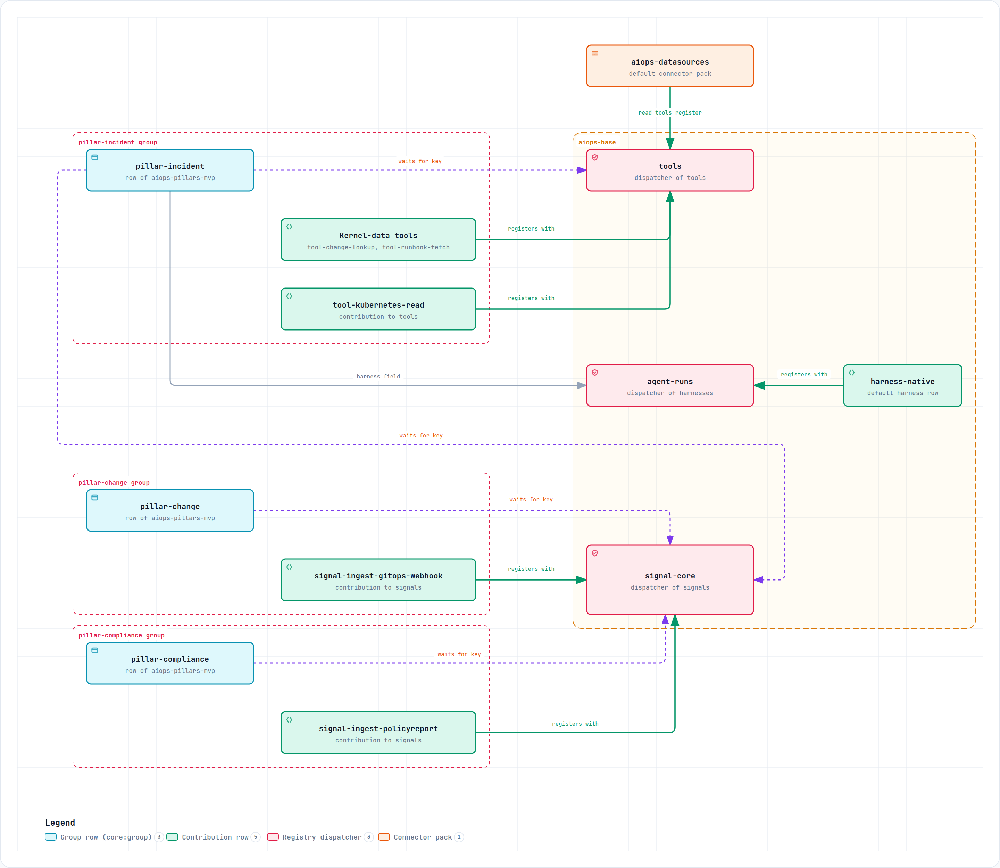
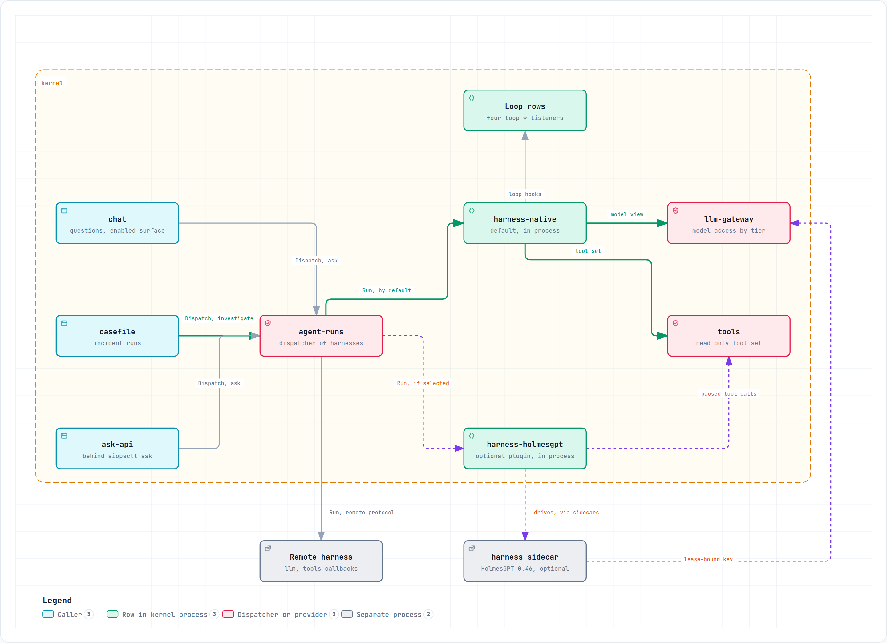
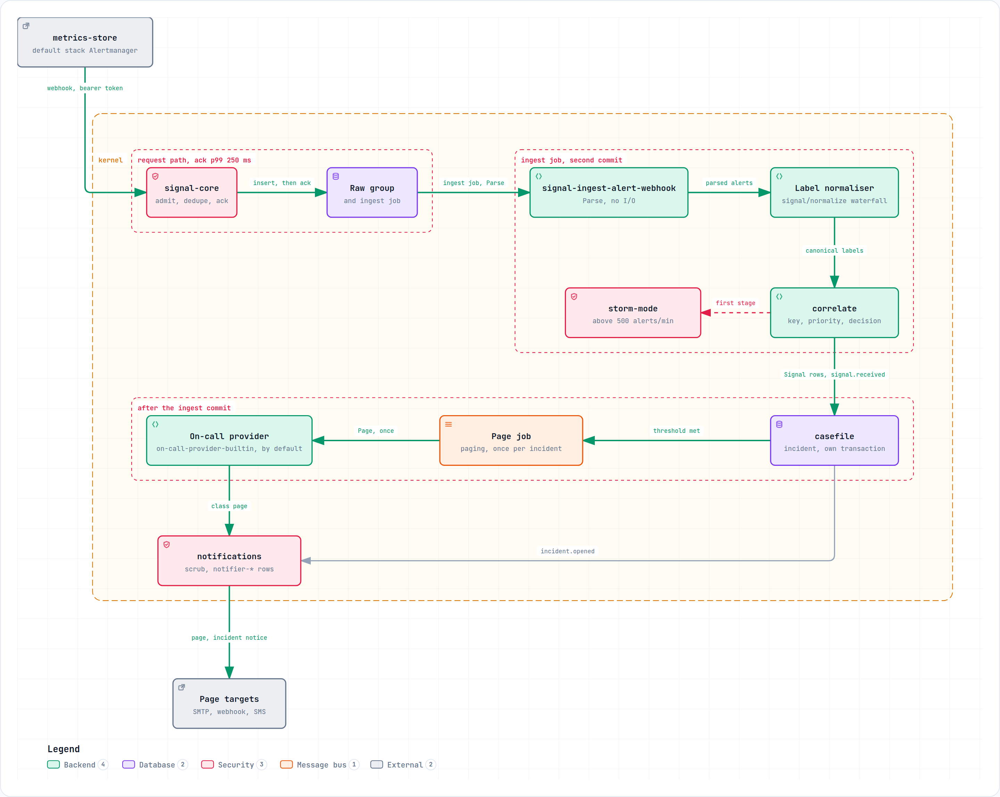
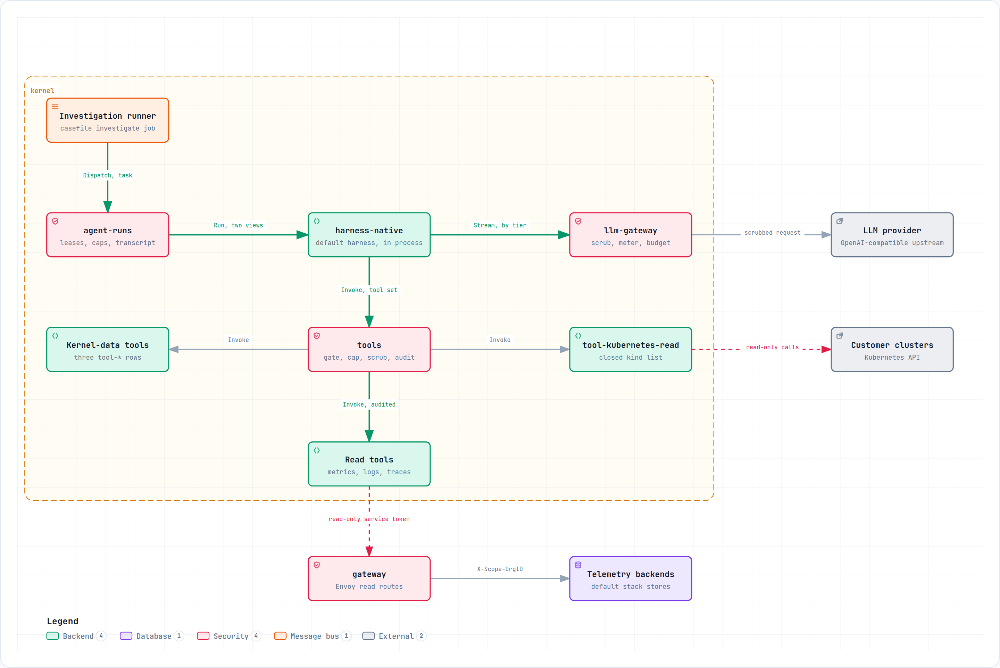
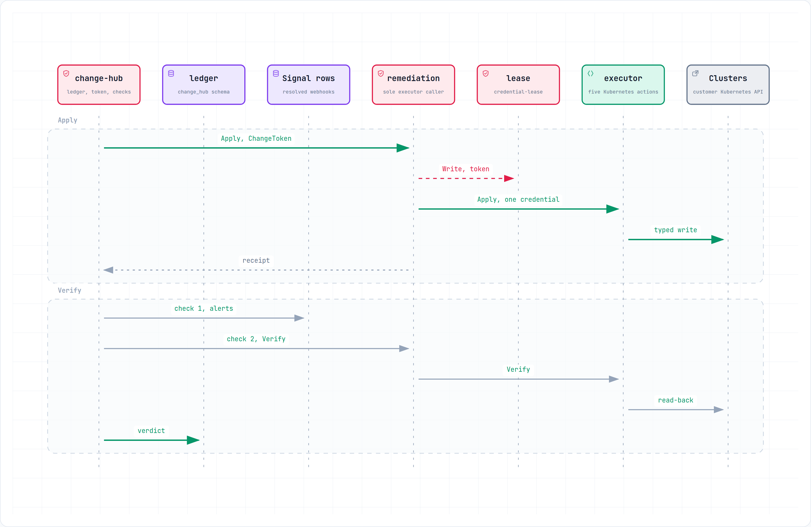
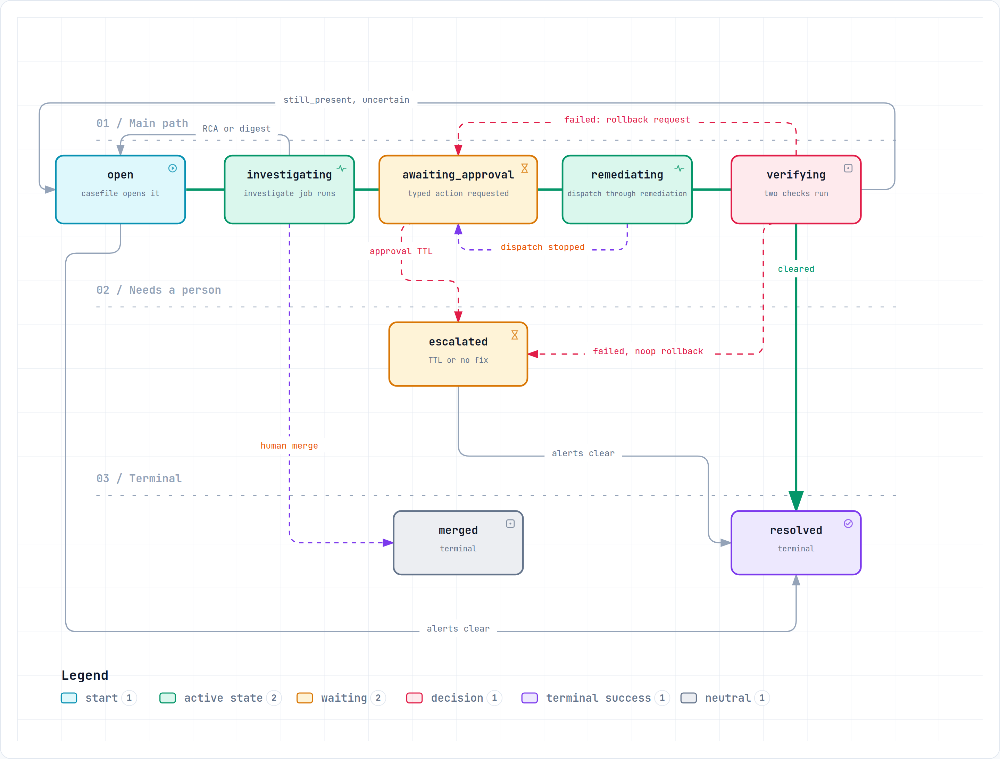

# 05. C3: pillar plugins

Status: draft, 2026-11-11. Obeys `00-decisions.md` as amended for the plugin system, for the community-first order of work, marketplace readiness and vendor-neutral connectors, and, by the second amendment of 2026-11-11, for the agent harness as a plugin point, upstreams as plugins and the licence record; where this file and 00 disagree, 00 wins. Four records hold the detail and are cited by section: the plugin record `docs/design/plugin-system-2026-11.md` ("plugin record §n"), the community record `docs/design/community-first-2026-11.md` ("community record §n"), the harness record `docs/design/harness-and-upstreams-2026-11.md` ("harness record §n") and the licence record `docs/design/licence-audit-2026-11.md` ("licence record §n"). Research citations use `<file> §n` under `docs/research/`, with the gap reports shortened as in 00 (`gap-kernel-hot-path`, `gap-slack`, `gap-ebpf`, `gap-tenant-gateway`); they are leads, not proof. Licence statements in this file are engineering analysis, not legal advice; a point that a lawyer must answer is marked LAWYER with its question number in licence record §6. The estate model and the troubleshooting method (00 §2.1 rows 15 and 16) have their own C3, 09-c3-estate-and-troubleshooting.md. This file states their rules where a pillar row meets them and points there for the detail.

## 1. Scope

This is the C3 view of the pillar rows and of the agent layer they run on, inside the `kernel` container (`aiops --role all`, profiles `self-host-full`, `aiops-only`, `dev`). A pillar is not a container, not a definition and not kernel code: it is one `core:group` row, `pillar-<name>`, that holds the rows serving one operational domain (00 §2.1 row 12). The figures therefore show pillar rows next to the first-party plugins they lean on (`casefile`, `agent-runs`, `tools`, `change-hub`, `approval`, `remediation`, `llm-gateway`), because the policy that makes a pillar safe is held by bound plugins and by the dispatcher of each registry, never by the pillar and never by the kernel (00 principle 5, §4.2). In `hosted`, which follows S9b and is not part of the first community release (00 §6.3), the same rows are mounted by `kernel-api` and `kernel-worker` according to each row's `roles` field; the one role-placement table is 03-c3-kernel.md §9. The kernel module, the loader and the providers of `sql`, `jobs` and `events` are in 03-c3-kernel.md, chat surfaces and on-call providers in 06-c3-chatops-oncall.md, the SDK and the Go interfaces of the definitions in 07-c4-plugin-sdk.md.

Terms are those of 00 §8.2. A definition is a key with an interface and a version. A plural key is a registry; a row that registers with it is a contribution, provided under no key and reachable only through the registry's dispatcher. A hook is named `<owner>/<event>` and only its owner dispatches it. A harness is a contribution to `harnesses` that turns one task into model calls and tool calls and returns an answer; a run is one call of it; a pillar agent is a pillar group's persona, tool set and harness selection.

**The agent layer is first-party and new** (owner decision A, 00 §2.4). Every pillar agent runs through one registry, `harnesses`, whose dispatcher is `agent-runs`. The default harness of every shipped profile is `harness-native`, a loop written for this repository (owner decision A; its scope at the first release is owner decision W7, 00 §2.4). The tools a harness is offered are first-party contributions to `tools`, which the kernel calls with its own read credential. An upstream agent is a plugin, never the product (00 principle 9): HolmesGPT appears in this file in one role only, the optional harness plugin `harness-holmesgpt` (§5.10), which a user may select as the harness of the incident, compliance or FinOps agent. Outside that optional bundle no row of this file names or needs it, and no row of a shipped profile names or needs an on-call engine or a chat service.

Depth follows the phase plan (00 §7.2): Incident (P1) in depth, Change and Compliance (P1) as shorter C3s, SecOps and FinOps (P2, in the community second wave S9a) and Continuous Improvement and Executive Reporting (P3) as one paragraph each. The order of work is community first (owner decision of 2026-11-11, 00 §2.4). The policy spine the pillars lean on (`audit-chain`, `pii-pseudonym`, `approval`, `change-hub`, `credential-lease`, `remediation`) is built in S5. The agent runtime is built in S8a: `llm-gateway`, `tools`, the query rows, the four read tools, `tool-mcp`, `harnesses`, `agent-runs`, `agentLoop`, `harness-native` and its four loop rows. The pillar rows and the incident loop are built in S8b, whose exit is the first community release (00 §7.1): `self-host-full` with the tenant `default` and one `aiops --role all` process, `dev`, and `aiops-only` for the connector scenario. What only an operator of many tenants or many replicas needs (tenant trees on first use, the tenant overlay, `composer` with canary generations, per-tenant remote plugin instances, the `hosted` profile) comes after that release, in S4b, S6b and S9b, behind the same definitions, so no pillar row changes when it arrives.

The first-party rows of this file read the default stack, and none of them is wired to it (00 principle 7). No row of `aiops-base` or of a pillar bundle holds a query string or calls a telemetry store's query API. A payload parser is a `signals` contribution, the agent's reads of metrics, logs and traces are `tools` contributions of a connector pack, and everything written in one store's dialect sits in a connector pack, by default `aiops-datasources`. §2.4 lists where a contributor's pack for another observability system meets a pillar.

The Incident pillar serves Kubernetes workloads and Linux hosts with the same rows (00 §1, target estate). On the host leg of the release test (00 §7.1) the incident is keyed on a `host:` reference (§5.1), the agent reads host change evidence itself with the bound logs tool (§6.3), and no action is offered, because P1 has no host executor (§6.2).

### 1.1 Assumptions where 00 is open or ambiguous

| # | Assumption | Reason | Settled by |
|---|---|---|---|
| A1 | Settled in 00 §2.1 row 12 and §4.4: a pillar is one `core:group` row `pillar-<name>`, with no definition and no conformance suite of its own. It holds its persona, tool set, signal sources, `harness` selection and executors, and it carries a row-level `inject` on `tools` or `signals`. Dashboards and the channel default are bundle content. Code a pillar needs lives in the rows it holds, such as `compliance` in `pillar-compliance` (§7). | 00 §2.1 row 12: pillars are groups of rows, "never kernel code", and a pillar with neither key stays PENDING and says what it waits for. | 00 §2.1 row 12, §4.4 |
| A2 | Settled in 00 §2.1 row 2 and §2.2: a run has no approval step. Every tool a harness is offered is a free read, a harness never writes, and anything that writes is a typed plan a person starts through `remediation`. | Harness record §2.2. | 00 §2.1 row 2; ADR-051 |
| A3 | Settled in 00 §2.1 row 2. Telemetry is read by first-party `tools` contributions that the kernel calls with its own read credential: `tool-metrics-query`, `tool-logs-query` and `tool-traces-query` in `aiops-datasources`, and `tool-kubernetes-read` in `pillar-incident`, beside the kernel-data tools `tool-change-lookup`, `tool-runbook-fetch` and `tool-oncall-who` (§5.5). The model writes the query and the tool bounds it. A harness holds no credential. The vendor-neutral read seam is `tools`; a pack with no code mounts allow-listed tools of an MCP server through rows of the instantiable `tool-mcp` (owner decision W9, 00 §2.4). | Owning the read tools gives every call the actor filter, the effects gate, the cap, the scrub and an audit row. | 00 §2.1 row 2; ADR-053, ADR-047 |
| A4 | Ingest is three commits linked by the outbox. (1) The request path of `signal-core` admits, dedupes and commits the raw group plus an `ingest` job, then acks. (2) The `ingest` job parses the group through the `signal-ingest-*` contribution, runs `signal/normalize`, takes the correlation key and the priority from `correlate`, and commits the `Signal` rows with `signal.received`. (3) `casefile` consumes that event with a handler that is idempotent on the signal id and, in its own transaction, refreshes, joins or opens the incident by an upsert on tenant and key among incidents that are not `resolved`, with `incident.opened`. Fold rules wait for their trigger (00 §7.3). | 00 §2.1 row 5 ("acks after one durable insert, then correlates") and separate ack (250 ms) and correlation (2 s) budgets in gap-kernel-hot-path §2.5. With one schema and one database role per plugin, and no `Tx` passed between domain plugins (00 §2.1 row 9, §4.3), one transaction for steps 2 and 3 is not available, so the upsert and the idempotent handler are what prevent twin incidents across replicas. | 03-c3-kernel.md §10 A1 |
| A5 | A `failed` verdict opens a rollback approval at the same tier. Nothing rolls back unattended. An action whose declared rollback is `noop` (§6.2) escalates instead, because its rollback writes nothing. | 00 §2.2: no unattended release in MVP. | ADR-019 |
| A6 | Feedback and skills reuse `casefile.incident_event` and `casefile.artifact`. No new tables. | 00 §5.2 has no memory schema. Add a `skill` table when label-matched lookup needs an index. | this file |
| A7 | Settled in 00 §4.4: dashboard annotations are written through the `annotations` key, provided by the `annotator` row for the single provisioned org in P1 and by `dashboard-sync` from P2, both in `aiops-dashboards`. A profile that does not compose that bundle gets none, and the RCA still reaches the incident through the API, `aiopsctl` and the notifier rows. | 00 §5.3 puts annotations in the tenant org; 00 §2.1 row 8. | 00 §4.4 |
| A8 | Settled in 00 §7.2 (S7): the gateway read routes are a closed list, written from the operations of the read tools (§5.5), the patterns operation of `tool-logs-query` among them, and from the calls of the provisioned dashboard data sources. | The routes exist for the kernel's own query clients, so the tools define them. | ADR-053; 04-c3-agent-fleet-gateway.md |
| A9 | In P1 the change candidates of an incident (§5.2) are looked up in a fixed lookback before its first alert; a change that arrives while the incident is open is matched on arrival (§6.1). The lookback length is a `change-hub` default. | 00 §2.1 row 16 gives the match rule and no time bound. The cause window that replaces the lookback is P2. | ADR-030; 09-c3-estate-and-troubleshooting.md |
| A10 | A dispatch that stops before the executor acts, because the plan digest changed or `remediation` refuses `Apply`, returns the incident from `remediating` to `awaiting_approval`, with the `ChangeRecord` back in `pending_approval` (§5.6). | Such a call gets no verdict and is not a failed change, so the state table needs an exit that is not `verifying`. The exit is not `open`, because the change is waiting for a fresh approval and the incident state has to say so; the approval TTL bounds the wait. | §5.6 here for the incident; 03-c3-kernel.md §10 A14 for the `ChangeRecord` |
| A11 | RCA contract v1 has no reach, impacted-services or fault-domain field, because nothing in P1 reads one. Reach and fault domain arrive in P2 with the `estate` plugin. | 00 §2.1 row 16 lists what v1 holds; a field with no P1 reader would be scaffolding. | ADR-030 |
| A12 | Settled in 00 §2.1 row 5 and §4.3: `storm-mode` has two listeners. On the `incident/investigate` gate, owned by `casefile`, it denies a run for a storm incident. On the `incident/correlate` waterfall, owned by `correlate`, it is the first stage: while a tenant is above the storm rate it answers the `storm:` key without calling `next`, so new signals join the one storm incident. | | ADR-043, for the stage vocabulary only |
| A13 | The config of a pillar group (persona, operating rules, signal kinds, the `harness` field, the builder and checker rows of each task kind, default tools, executors, per-pillar overrides of the loop rows, channel default, dashboards) is data. `router`, the provider of `routing`, reads it from the committed generation to answer pillar and target, and `agent-runs` reads it to build a request. A group's tool set is its defaults plus the enabled tool rows that name the pillar (`pillars`, §2.3), computed from the same generation, so a contributed tool needs no edit of a first-party group. The key names `operatingRules`, `kinds` and `loop` in §2.3 are this file's spelling. The mount of a `scope: tenant` child is settled in 00 §5.1: the group row is process scope and mounts its process-scope children only; `tenant-trees` mounts a `scope: tenant` child in each loaded tenant's group under the same composed id and adds the group's row-level `inject` to the child's own. Such a group sets no `isolate` and no `intercept`. No first-party default row of a pillar is `scope: tenant`, and no shipped or optional first-party bundle declares a harness as a child of a pillar group: an external harness is a top-level `scope: tenant` row of its own optional bundle, which a group selects through its `harness` field (§2.3). | 00 §2.1 row 12 says what a group holds and how its tool set is computed, 00 §4.1 that `routing` answers pillar and target, and harness record §2.1 and §4.2 that the pillar group names the operating rules, the builder, the checker and the loop overrides. None gives the YAML shape. | 07-c4-plugin-sdk.md (row format); 03-c3-kernel.md, for the readers of the group config |
| A14 | The three read tools of the default pack join a pillar through their own `pillars` field, as a tool from any connector pack does. The defaults a pillar group lists are rows of `aiops-base` and of its own bundle only. | 00 principle 7: a row of a pillar bundle must not need the default pack. `aiops-only` can then disable the default tools in favour of another pack's with no patch to a pillar group and no warning about a missing default. 00 does not say which of the two ways the default read tools use. | 07-c4-plugin-sdk.md |

### 1.2 Upstreams and content this file names, with their licence verdicts

Owner decision C asked whether each base is suitable under its licence and whether any must be rebuilt (00 §2.4). The licence record answers it, and `tools/upstream-components.yaml` is the register a release check reads (00 §3.2). This table restates the verdicts for what this file names, so that a reader of a pillar sees them beside the rows; the licence record wins where the two differ. The audits read every fact on 2026-11-11 at a primary source, and the URL with its tag or commit is in the source log that each group of the licence record names. Modes and verdicts are those of licence record §1. No software base in this file must be rebuilt for its licence: the first-party harness and the read tools are design choices. One content item must be built first-party, the compliance control catalogue (§7).

| Upstream or content | Where this file meets it | Mode | Licence as verified | Verdict | Condition this file follows | Licence record |
|---|---|---|---|---|---|---|
| HolmesGPT 0.46.0 | The optional harness plugin `harness-holmesgpt` and its process `harness-sidecar` (§5.10) | pull by digest; copy of cassettes and recorded tool lists | Apache-2.0 | `ok-with-conditions` | Pull, never ship. A copy keeps an attribution line, the licence text and a `NOTICE` entry. A release check on the pinned tag proves, from the lock file and an SBOM of the image, that the model library inside the image carries no enterprise package. The name in a plugin id is LAWYER Q4. While the owner of the mark is UNVERIFIED the register entry is `needs-approval` (licence record §7.5 rule 2), so the plugin id and the bundle name are working names until Q4 and the register clear them; the fallback is `harness-external` in `aiops-harness-external` (00 §8.1) | §2.2 |
| MCP specification and Go SDK | `tool-mcp`, `tools-mcp-facade` (§5.5) | implement; link, in those two plugins only | A composite file: Apache-2.0 and MIT, with CC-BY-4.0 for documentation | `ok-with-conditions` | Both texts shipped; a reviewed exception by name in the allow-list; no documentation text copied; never in `sdk/kernel`. Its dependencies at the tag we pin are UNVERIFIED. Use in a closed enterprise plugin is LAWYER Q7 | §2.1 |
| Recorded tool lists and cassettes of a third-party server | Rows of `tool-mcp` in a pack; the cassettes of a plugin that wraps an upstream | copy | The server's own licence | per server | A pack always carries the digest, and the recorded text only when the server's licence is on the allow-list, with attribution and the licence text. Whether recorded responses and tool lists may be published under Apache-2.0 is LAWYER Q15 | §7.4 |
| The Kubernetes client library (client-go) | `tool-kubernetes-read`, `remediation-executor-kubernetes` | link | Apache-2.0 | `ok` | Licence text and notices in `THIRD_PARTY_LICENSES/` | §2.1 |
| The telemetry stores and the dashboard server of the default stack | Read by the read tools of `aiops-datasources` and written by `annotator`, over HTTP | pull, unmodified, separate processes | AGPL-3.0-only | `ok-with-conditions` | No AGPL package is linked: the read tools use their own HTTP clients and types, and the logs tool links no query parser (§5.5) | §2.3, §7.3 |
| Alertmanager | The sender of §3 | network | Apache-2.0 | `ok` | None | §2.3 |
| The OpenAI-compatible API; a model server the customer runs | `llm-gateway` and `ext-llm-provider` (§4) | implement; network | No licence on an interface; vLLM Apache-2.0; Ollama MIT plus the vendor's terms of service | `ok-with-conditions` | Descriptive wording only. No model server is in an image, mirror or bundle of ours. The LiteLLM proxy is `optional-plugin-only`, because its image installs a proprietary package: no profile, chart or bundle of ours pulls it. Passing tenants' requests to a vendor under our key on hosted is UNVERIFIED and LAWYER Q10 | §2.2 |
| DeepSeek Harness 0.2.2-rc.1, the design reference of the first-party loop | `harness-native` and the loop rows (§5.4) | ideas; port only if a file is translated | MIT | `ok-with-conditions` | The loop is written from our own tables. A file translated from that source carries its MIT notice in the header and in `NOTICE`; the name stays out of our ids | §2.1 |
| Personas, operating rules, context blocks, tool descriptions, case files | Content of the pillar groups and of `lab/` | first-party | To be confirmed before use | gated | New content must be authored for this repository and confirmed in writing by the owner before S8a. The publication-rights gate remains open under 08-profiles-roadmap-adrs.md §5.1 L14: no repository content is disclosed outside the authorized audience until written confirmation of Apache-2.0 publication rights is recorded | §2.6 |
| Argo CD, Flux | Senders of `signal-ingest-gitops-webhook` (§6) | network | Apache-2.0 | `ok` | A copied schema keeps its notice | §2.5 |
| Kyverno, Kubescape, Trivy and Trivy Operator, Prowler | Scanners in the customer estate (§7, §8) | network | Apache-2.0 | `ok` for Kyverno and Trivy Operator; `ok-with-conditions` for Kubescape, Prowler and Trivy | The framework files of Kubescape and Prowler are never copied, and their control names pass the display allow-list; the vulnerability database is never mirrored or bundled | §2.5 |
| PolicyReport API | The wire shape of `signal-ingest-policyreport` (§7) | own parser or link | Apache-2.0; the repository is retired | `ok-with-conditions` | The row also accepts the OpenReports group | §2.5 |
| CIS Benchmarks and Controls; SOC 2 criteria; ISO/IEC 27001 | What a compliance score is usually named after (§7) | none | CC BY-NC-SA and BY-NC-ND with non-member terms; all rights reserved (ISO terms UNVERIFIED at source) | `replace-or-rebuild` | Nothing ships: no text, title or labelled score. The first-party catalogue replaces them. Numbers as references are LAWYER Q13 | §2.6, §3 |
| NIST SP 800-53 and OSCAL content; MITRE ATT&CK | Sources of the first-party catalogue (§7) | copy, with notice | Public domain and CC0-1.0; royalty-free with a designation | The catalogue is to build; ATT&CK is `ok-with-conditions` | Each designation or notice ships with the content | §2.6 |
| Tetragon 1.7 | The sensor of SecOps (§8) | pull, unmodified | Apache-2.0; its BPF tree is dual GPL-2.0-only or BSD-2-Clause, with three GPL-2.0-only headers | `ok-with-conditions` | We elect BSD-2-Clause and write no BPF program; a mirror would owe the GPL-2.0 source offer for the three headers | §2.3 |
| OpenCost | Cost metrics of FinOps (§8) | network | Apache-2.0 | `ok` | None | §2.3 |
| krr 1.31 | `rightsizing-runner` (§8) | pull, or ship if we build the job image | MIT | `ok-with-conditions` | Pull the vendor image by digest with the MIT text beside the chart, or build the image and carry the duties of a shipped one. A vendor image at the pinned tag is UNVERIFIED | §2.2 |
| Sloth, Pyrra | SLO specs of Continuous Improvement (§8) | network, link or own parser | Apache-2.0 | `ok` | None | §2.5 |
| The panel image renderer; a headless Chromium build | Report rendering (§8) | pull; ship in a plugin image | Apache-2.0; not read | `ok`; `unverified` | The Chromium build is read before P3, and its entry blocks the release that first ships the PDF row | §2.1, §2.3 |
| GoAlert; the Slack platform | The optional contributions `on-call-provider-goalert` and `chat-surface-slack` that §2.1 lists; detail in 06-c3-chatops-oncall.md | network, or pull by digest; network | Apache-2.0; API terms and developer policy | `ok-with-conditions`; `optional-plugin-only` | In no shipped profile and in no release gate | §2.4 |

UNVERIFIED, as licence record §9 lists it: the second-reader pass for the pillar bases, so the scanner, GitOps and SLO rows above stand as audited; the layer contents of every upstream image; the dependencies of the MCP Go SDK at a pinned tag; a vendor image of krr at the pinned tag; ISO's terms at source; the trademark pages of the single-vendor projects among these (Trivy, Prowler, krr) and the owner of the HolmesGPT mark. A register entry that is `unverified` blocks the release that first ships it (00 §3.2).

## 2. A pillar is a group of smaller plugins

Scope: how `aiops-pillars-mvp` composes three pillars out of rows from three bundles. Each pillar is one `core:group` row. It holds the rows only that pillar uses, names the rest by id, and declares the registry keys it waits for. The loader composes it with the 00 §6.1 patch semantics, and `aiopsctl profile render --dump` shows the result with its provenance. Swapping a part (another harness for the pillar's agent, no executor, customer endpoints, the tools of another connector pack) is a patch that sets one field or disables one row and enables another, not a code change. Where the row's code is already in the distribution it applies as a live recomposition: a new generation through the `reload` queue, with no restart (00 §6.1).


*Figure 05-pillar-composition. Source: [diagrams/src/05-pillar-composition.json](diagrams/src/05-pillar-composition.json).*

The figure shows the main relationships: three `core:group` rows from `aiops-pillars-mvp`, the child rows each holds, the dispatchers in `aiops-base` they depend on, and the default connector pack `aiops-datasources` as one box whose read tools register with `tools`. A solid arrow is a contribution registering with its registry; a dashed arrow is the group's row-level `inject`, which keeps the group PENDING until that key, `tools` or `signals`, has an ACTIVE provider; the arrow labelled harness field is the pillar's harness selection. It leaves out the `compliance` row (§7), `signal-ingest-alert-webhook`, `lease-kubernetes` with `credential-lease`, `tool-oncall-who`, the four loop rows, `context-pack` and `rca-contract`, `llm-gateway`, `approval`, `change-hub` with the `verify-*` rows, `storm-mode`, `correlate`, `casefile`, `router`, `content`, the query rows and the host runbook inside `aiops-datasources`, `remediation-executor-kubernetes` with `remediation` (figure 05-change-write-path), and the `harness` field of `pillar-compliance`, which points at `agent-runs` as the one of `pillar-incident` does. It draws no optional bundle, and it draws `aiops-pillars-mvp` as no region: the sublabel of each group row names the bundle.

The ids in the tables are the ids used in §3 to §7, and the figure's element ids are the same; the Name column gives the row id where the element is a row. The tables are complete. The figure draws `tool-change-lookup` and `tool-runbook-fetch` as one box, the kernel-data tools.

| Id | Name | Technology | Responsibility |
|---|---|---|---|
| `aiops-base` | Base bundle | data-only patch, 54 rows at P1 scope | The dispatchers and policy plugins every pillar leans on: `signal-core`, `storm-mode`, `correlate`, `casefile`, `agent-runs` with `harness-native` and its four loop rows, `context-pack`, `rca-contract`, `tools` with `tool-oncall-who`, `llm-gateway`, `approval` with its tier table, `change-hub` with the two `verify-*` rows, `credential-lease`, `remediation`, `notifications`, `paging`, `chat`, `router`, `content` (00 §4.4) |
| `aiops-datasources` | Default connector pack | data-only patch, 6 rows at P1 scope | The first-party rows and content that are specific to the dialects of the default stack (00 §6.2): `metrics-query-http`, `logs-query-http`, the read tools `tool-metrics-query`, `tool-logs-query` and `tool-traces-query`, and the host runbook as content. `aiops-only` points these rows at customer endpoints, or disables them in favour of another pack's tools. `signal-ingest-alert-webhook` parses the Alertmanager and dashboard-alerting payload families |
| `aiops-pillars-mvp` | MVP pillar bundle | data-only patch, 11 rows at P1 scope | The three group rows and their eight child rows; from P2 the playbook pack as content |
| `pillar-incident` | `pillar-incident` | `core:group` row (A1) | Persona, operating rules, default tools, alert signals, `harness` selection, executors; channel default and dashboards as bundle content. Holds `tool-change-lookup`, `tool-runbook-fetch`, `tool-kubernetes-read`, the executor and `lease-kubernetes` |
| `pillar-change` | `pillar-change` | `core:group` row | Change signals, the change feed; holds `signal-ingest-gitops-webhook` (§6) |
| `pillar-compliance` | `pillar-compliance` | `core:group` row | Finding signals, controls, score, the compliance persona; holds `signal-ingest-policyreport` and `compliance` (§7) |
| `ingest-guard` | `signal-core` | plugin in `aiops-base`; dispatcher of `signals` | Admits, dedupes, writes the raw group and acks; runs each contribution's `Parse` and then the normaliser (§3) |
| `ingest-alert` | `signal-ingest-alert-webhook` | contribution to `signals`, in `aiops-datasources` | Alertmanager and dashboard-alerting webhooks (§3) |
| `ingest-gitops` | `signal-ingest-gitops-webhook` | contribution to `signals`, child of `pillar-change` | Argo CD, Flux and generic change webhooks (§6) |
| `ingest-policyreport` | `signal-ingest-policyreport` | contribution to `signals`, child of `pillar-compliance` | PolicyReport and Kubescape snapshots pushed from the customer side (§7) |
| `agent-runs` | `agent-runs` | plugin in `aiops-base`; bound provider and dispatcher of `harnesses`; schema `agent_runs` | Sole caller of a harness. Selects the harness, takes the slot and budget leases, offers a read-only tool set and model access by tier, writes every step before forwarding it, owns the `run/*` hooks (§2.5, §5.4) |
| `harness-native` | `harness-native` | contribution to `harnesses`, in `aiops-base`; provides `agentLoop`; in process, worker role | The default harness of every shipped profile (owner decision A): the first-party loop, with four listener rows on its own hooks (§5.4) |
| `tool-dispatch` | `tools` | plugin in `aiops-base`; bound provider and dispatcher of `tools` | Filters the tool set by the actor's permissions, classifies effects, caps and scrubs output, audits each call (§5.5) |
| `read-tools` | `tool-metrics-query`, `tool-logs-query`, `tool-traces-query` | contributions to `tools`, in `aiops-datasources` | The telemetry reads every harness is offered: closed operations with bounds, called by the kernel with its own read credential (§5.5) |
| `kubernetes-read` | `tool-kubernetes-read` | contribution to `tools`, child of `pillar-incident` | Get and list for a closed kind list without `Secret`, events, a bounded log tail, rollout status (§5.5) |
| `change-lookup` | `tool-change-lookup` | contribution to `tools`, child of `pillar-incident` | Kernel-data tool: the change candidates of an incident, and changes by namespace and time (§5.5) |
| `runbook-fetch` | `tool-runbook-fetch` | contribution to `tools`, child of `pillar-incident` | Kernel-data tool: runbooks and active skills matched by canonical labels, the host runbook of the pack whose logs tool is offered among them (§5.5) |
| `query-rows` | `metrics-query-http`, `logs-query-http` | providers of `metricsQuery` and `logsQuery`, in `aiops-datasources` | The dialect clients the metrics and logs tools read through; their endpoints are row config, by default the gateway read routes with the service token (00 §5.4) |
| `content` | `content` | plugin in `aiops-base`; provides `content` | Serves runbooks, playbooks, rule files and pack content under the plugin id; all of it stays bundle or pack content |
| `host-runbook` | Host runbook | content of `aiops-datasources`, not a row | What to read on a host incident and the change-evidence query in the dialect of that pack's logs store (§6.3). A pack for another logs store ships its own |
| `approval` | `approval` | bound provider of `approval`, with its tier table in config | `approval.Decide` for every write; the tier table can only be raised per tenant (§4, §6.2) |
| `change-hub` | `change-hub` | bound provider of `changes`; dispatcher of `verifiers` | `ChangeRecord`, `ChangeToken`, the change candidates and the two verification checks (§4, §5.2, §5.6) |
| `remediation` | `remediation` | bound provider and dispatcher of `executors` | Sole caller of an executor; holds the guard of 00 §2.2 (§4, §6.2) |
| `executor` | `remediation-executor-kubernetes` | contribution to `executors`; in process in every profile | The five-action catalogue with fixed tiers (§6.2) |
| `lease` | `credential-lease` with `lease-kubernetes` | bound provider of `credentials`, in `aiops-base`; the Kubernetes lease row, child of `pillar-incident` | One write credential for the action a valid `ChangeToken` names (ADR-019) |
| `compliance-row` | `compliance` | plugin, child of `pillar-compliance`; provides `compliance` | The `compliance` schema, the finding normaliser and the control evaluator (§7) |

| From | To | Why it matters |
|---|---|---|
| `pillar-incident`, `pillar-change`, `pillar-compliance` | `tool-dispatch`, `ingest-guard` | Each group carries a row-level `inject` on `tools` or `signals` (00 §2.1 row 12). While the key has no ACTIVE provider the group is PENDING and the dump says which key it waits for. Each pillar also holds or names the ingest row that feeds it. |
| `ingest-alert`, `ingest-gitops`, `ingest-policyreport` | `ingest-guard` | A parser is registered with `signals` and provided under no key, so only `signal-core` calls it, after admission and dedupe (00 §4.2 M2). |
| `harness-native` | `agent-runs` | A harness is reachable only through its dispatcher, which holds the leases, the transcript, the read-only tool set and the selection rule. `harnesses` is provider-bound, so no composition can put a second dispatcher in front of a harness (00 §4.2). |
| `pillar-incident`, `pillar-compliance` | `agent-runs` | A pillar selects its harness with one field. An empty field means the default, and a selected harness that is not ACTIVE falls back to the default (§2.5). Another harness for a pillar's agent is therefore a patch, never a change of a pillar row. |
| `read-tools`, `kubernetes-read`, `change-lookup`, `runbook-fetch` | `tool-dispatch` | A tool returns raw output; the dispatcher filters by the actor, classifies effects, caps and scrubs the result and audits the call. Another observability system is a change of tool rows, never of a pillar row or of a harness. |
| `read-tools` | `query-rows` | The metrics and logs tools inject the dialect keys, which only rows of a connector pack or a stack bundle may do (00 §4.1). The traces tool has its own HTTP client and types. |
| `runbook-fetch` | `content`, `host-runbook` | Runbooks and playbooks ship and version with the bundle or pack that carries them. They need no row, schema or conformance suite of their own, and the model reaches them only through the tool. |
| `executor` | `remediation` | Only `remediation` calls an executor, and it injects `approval`, `changes` and `credentials`. Without one of them it is PENDING and no executor is reachable (00 §4.2 M1). |
| `remediation` | `approval` | The tier table can only be raised (00 §2.2), so a pillar can never ship a weaker floor than the base. |
| `remediation` | `lease` | `credentials` is consumer-bound to `remediation`, so no pillar row, tool or harness can ask for a write credential. |
| `executor` | `change-hub` | The $0 checks live in base as `verifiers` contributions, so every pillar that writes gets them. |

The detection rule files `kubernetes-workload` and `host-basics` (00 §2.1 row 17) are content of `aiops-stack`, so they are not in this figure. A pillar waits for the `signals` key, never for a rule file: in `aiops-only` the customer's own ruler loads the published files, and its alerts enter the same path (00 §6.3). A connector pack for a system with another rule format carries its own rule pack, proven on the alert it emits (community record §6.1).

### 2.1 Registries a pillar contributes to

A pillar adds behaviour in two ways only: a row that contributes to a registry, or a row that listens on a hook (§2.2). The dispatcher applies its invariant before or after every contribution it calls, so a contribution that ignored every rule still could not skip it. The Remote column is the one of 00 §4.1: `contrib` means a third party can contribute from another process, from the step or phase shown, and `no` means in process only.

| Registry key | Dispatcher (class of the key) | Contributions in this file | What the dispatcher does around a contribution | Remote |
|---|---|---|---|---|
| `signals` | `signal-core` (open) | `signal-ingest-alert-webhook`, `signal-ingest-generic-json`, `signal-ingest-gitops-webhook`, `signal-ingest-policyreport` | Admits, or answers the sender family's busy reply; dedupes, writes the raw group and acks before `Parse`; applies the family's default label map and the tenant maps after it (§3) | `contrib` P1, the parse half only |
| `harnesses` | `agent-runs` (provider-bound) | `harness-native`; with its optional bundle, `harness-holmesgpt` (§5.10) | Selection and fallback, slot and budget leases, a read-only tool set and model access by tier, every step written to `agent_runs` before it is forwarded, the `run/*` hooks, a breaker per (tenant, row) (§2.5, §5.4) | `contrib` P1 (S8a) |
| `tools` | `tools` (provider-bound) | `tool-metrics-query`, `tool-logs-query`, `tool-traces-query`, `tool-kubernetes-read`, `tool-change-lookup`, `tool-runbook-fetch`, `tool-oncall-who`; rows of the instantiable `tool-mcp` that a pack inserts; `tool-profiles-query` (S9a); `tool-estate-lookup` (P2) | Filters by the actor's permissions, classifies effects, caps and scrubs output, audits the call (§5.5) | `contrib` P1 (S8a); a remote harness reaches the offered set of its active run through the `tools` callback |
| `executors` | `remediation` (provider-bound) | `remediation-executor-kubernetes`; `remediation-executor-gitops-pr` (P2) | The contracts of 00 §2.2: token and digest check, one lease per `Apply`, a deadline, a concurrency cap and a breaker (§6.2) | `contrib` P2 |
| `verifiers` | `change-hub` (open; `changes` is provider-bound) | `verify-alert-cleared`, `verify-readback` | Order, retry window and the closed verdict list (§5.6) | no |
| `llmProviders` | `llm-gateway` (open; `llm` is provider-bound) | `llm-provider-openai-compatible`, `llm-provider-replay` | Scrub, per-run metering and caps, the daily budget, the `agents-paused` switch (§5.4) | `contrib` P1 |
| `notifiers` | `notifications` (provider-bound) | `notifier-email`, `notifier-webhook`; with the optional Slack bundle, `notifier-slack` | Scrub at egress, the `notify/pre-send` gate, digest window, pacing. A notification of class `page` is never gated, digested or paced | `contrib` P0 (S5) |
| `oncallProviders` | `paging` (open) | `on-call-provider-builtin` (the default, W11); with its optional bundle, `on-call-provider-goalert` | Page once per incident, reconcile, 60 s cache; no hook | `contrib` P1 |
| `chatSurfaces` | `chat` (open) | None in a shipped profile; with the optional Slack bundle, `chat-surface-slack` | Normalised envelopes, tenant resolution, dedupe | no |
| `fleetTemplates` | `fleet-composer` (open) | `fleet-template-<feature>` rows; the Tetragon template of `agent-security` (P2, §8) | Fragments by feature key, composed and parsed by the fleet composer (04-c3-agent-fleet-gateway.md) | no |
| `estateSources` (P2) | `estate` (open) | `estate-source-series`, a row of `aiops-datasources` | Liveness witness; advisory answers with a basis. `estate` holds no query string (09-c3-estate-and-troubleshooting.md) | `contrib` P2 |
| `evidenceSources` (P2) | `change-hub` (open; `changes` is provider-bound) | `evidence-source-logs`, a row of `aiops-datasources` | Asks with a typed scope (entities, time range) and gets typed lines plus what the source could not see; maps the lines to `external_change` rows, reports coverage and stores references only (§6.3) | `contrib` P2 |
| `reportRenderers` (P3) | `reports` (open) | Renderer rows (§8) | Report artifacts | `contrib` with the definition |

At the first community release a third party extends a pillar on a self-host in four ways through the plugin interfaces and distribution builds, without core changes or a kernel checkout (00 §6.1, §6.2):

| Way in | What it holds | How it enters | From |
|---|---|---|---|
| Data pack | Rows of the instantiable first-party plugins (`tool-mcp`, `signal-ingest-generic-json`, `notifier-webhook`) and content; no code | A signed artifact, installed with no rebuild; rows inserted disabled | S2a |
| Remote contribution | A contribution to a registry marked `contrib` (a harness and a tool among them), or a listener on a hook marked remote in §2.2, in any language | A signed artifact, installed with no rebuild; one shared `remote-plugin` instance per plugin (owner decision W5, 00 §2.4) | S2b |
| In-process plugin | Any plugin in Go, a new dispatcher included | A distribution the operator builds and signs (owner decision W3, 00 §2.4) | S2a |
| Contrib plugin | The same code under `contrib/`, with the id owner `contrib` | The `aiops-contrib` image, every row disabled, for a self-hoster with nothing to build | S6a |

In `hosted`, which comes after that release, a third party is a remote contribution only, in one instance per (tenant, plugin) from S4b; it can provide no key and add no registry (owner decision W4), and third-party plugins on hosted wait for the enterprise edition (00 §7.3). W3, W4 and W5 are owner decisions of 2026-11-11 (00 §2.4). A remote contribution joins no transaction: it returns a result, and its dispatcher commits state, event and audit together (00 §4.3).

A pillar itself needs no code. A contributed tool joins an existing pillar by naming it (§2.3), with no edit of the first-party group. A whole new pillar is one `core:group` row in a profile or site layer over rows that are already installed; an installed artifact cannot carry that row, because its bundle may only insert disabled rows of its own plugin or of an instantiable first-party plugin (00 §6.1).

From S4b, when the tenant overlay arrives (layer 5, 00 §6.1), it may switch a `scope: tenant` row, or a process-scope row whose manifest shows only registry contributions and hook listeners, which is the shape of the `tool-*` and `signal-ingest-*` rows. It can never switch a row that listens on a gate (`storm-mode`), a process-scope row that provides a key or owns jobs (`compliance`), or a row in a required set (00 §6.1). From the same step a tenant may select the harness of a pillar, among the rows an operator marked tenant-selectable (§2.5).

### 2.2 Hooks on the pillar paths

| Hook | Kind | Owner | Listeners | Remote listener |
|---|---|---|---|---|
| `signal/admit` | gate | `signal-core` | The admission bucket; from P2 per-row buckets and body limits. It runs before any write and admits process-scope listeners only, so the ack never waits for a tenant tree. A refusal is answered with the busy reply of the sender family (§3) | no |
| `signal/normalize` | waterfall | `signal-core` | The default label map of the sender family, then the tenant label maps and the `signal_type` lift (§5.1) | no: it runs before the scrub and near the ack path |
| `incident/correlate` | waterfall | `correlate` | `storm-mode` in the first stage (00 §2.1 row 5); fold rules when their trigger fires (§5.2) | no |
| `incident/investigate` | gate | `casefile` | `storm-mode`. The budget and the slots are leases taken by `agent-runs`, and the P2 per-incident run cap is a check `casefile` makes itself before the dispatch, so neither is a listener (00 §4.3; §5.3) | no |
| `run/first-message` | waterfall | `agent-runs`, dispatched with the pillar and the kind | The builder row the pillar group names for that kind: `context-pack` for kind `investigate` of the incident and compliance pillars at 0.1.0, block by block in stage order (§5.4) | yes: the subject key and the scrubbed summary; a returned block is scrubbed again at `llm-gateway` |
| `run/answer` | waterfall | `agent-runs`, dispatched with the pillar and the kind | The checker row the pillar group names: `rca-contract` for kind `investigate` (§5.7). A listener may return one follow-up message, at most one per kind; none does in P1 | no |
| `loop/pre-step`, `loop/tool-result` | waterfalls, signed | `harness-native`, under the definition `agentLoop` | `loop-budget`, `loop-repeat-guard`, `loop-tool-failures`, `loop-compaction`. A listener may only tighten tools and directives; the loop refuses one that adds a tool or moves a directive back (§5.4) | no |
| `llm/request` | gate, then waterfall | `llm-gateway` | Budget and rate; routing by tier (P2). The scrub, the per-run caps and the `agents-paused` check are the owner's own steps, not listeners | no |
| `tools/pre-execute`, `tools/post-execute` | gate, waterfall | `tools` | Effects class; output cap | no |
| `notify/pre-send` | gate (allow, delay, drop) | `notifications` | Digest, pacing, quiet hours. A listener cannot change the recipient or the content, and a notification of class `page` never passes this gate | yes: target, severity and incident key, never the body |
| `approval/gates`, `change/pre-dispatch` | gate (allow, raise, deny) | `approval`, `change-hub` | None in P1; change windows and freezes in P2 (§6.1) | yes: plan digest, action class, scrubbed target references, requester subject |

On a gate every listener runs, the strictest verdict wins and none may grant. A listener that the committed generation expects and that is absent, failed, unloading or unreachable counts as the strictest verdict (00 §4.2 M5). Every dispatch names its audience, so one tenant's incident never reaches a listener in another tenant's tree. Order is by declared stage, then plugin id; `aiopsctl profile render --dump-hooks` prints each chain, and ADR-043 fixes the stage vocabulary. Paging and the audit append have no hook, so nothing a pillar registers can withhold a page or an audit row. The `run/*` hooks belong to `agent-runs`, not to a harness, so the method rows wrap whichever harness runs, and a chat question gets them as an incident run does (00 §2.1 row 16).

### 2.3 The pillar row as written

The group row as written in the bundle patch (row semantics from 00 §6.1, config keys lowerCamelCase; the exact shape of a group row is 07-c4-plugin-sdk.md, A13):

```yaml
# bundles/aiops-pillars-mvp/aiops.patch.yml (excerpt)
insert:
  - id: pillar-incident
    plugin: core:group
    required: false
    roles: [api, worker]
    inject: [tools, signals]        # row-level: PENDING until both keys have an ACTIVE provider
    config:
      persona: personas/incident.md
      operatingRules: rules/incident.md   # content the group names, so the loop holds no prose
      harness: ""                   # empty: defaultHarness of agent-runs, which is harness-native in every shipped profile
      kinds:
        investigate: {firstMessage: context-pack, answer: rca-contract}
        ask: {}                     # free text with evidence references
      signalKinds: [alert]
      tools: [tool-change-lookup, tool-runbook-fetch, tool-kubernetes-read, tool-oncall-who]   # the defaults. Enabled tool rows that name this pillar join them, the read tools of a connector pack among them (A14)
      loop: {}                      # per-pillar overrides of the loop rows; empty keeps their defaults
      executors: [remediation-executor-kubernetes]
      defaultChannel: ""            # bound per tenant on an enabled chat surface
      dashboards: [dashboards/incident-overview.json]
    group:
      - {id: tool-change-lookup, plugin: aiops/tool-change-lookup, roles: [worker]}
      - {id: tool-runbook-fetch, plugin: aiops/tool-runbook-fetch, roles: [worker]}
      - {id: tool-kubernetes-read, plugin: aiops/tool-kubernetes-read, roles: [worker]}
      - {id: remediation-executor-kubernetes, plugin: aiops/remediation-executor-kubernetes, roles: [worker]}
      - {id: lease-kubernetes, plugin: aiops/lease-kubernetes, roles: [worker]}
```

`plugin` and `roles` are fixed at insert and no patch changes them; the `roles` values follow §9. The group names no harness row as a child: the default harness is a row of `aiops-base`, and another harness is selected by the `harness` field (§2.5). The per-run caps (steps, tool calls, tokens, deadline) are not row config. They are keyed by pillar and kind in `TenantLimits`, which only operators edit (00 §5.5). Operator values, set in chart configuration until the P2 probe, supply the model's context and output limits. A `tools` entry whose row is absent or not ACTIVE is left out of the tool set, and the grouped warning names it. `tool-oncall-who` states a prerequisite and is offered only where an on-call provider is registered for the tenant.

**A contributed tool.** A tool row may state the pillars it joins (`pillars: [incident]`; where the field sits in the row is 07-c4-plugin-sdk.md, A13). The group's tool set is its `tools` defaults plus the enabled tool rows that name it (00 §2.1 row 12). A tool from a connector pack, a remote plugin or `contrib/` therefore reaches the incident persona when an operator enables its row, with no patch to `pillar-incident`, and leaves it when the row is disabled. The three read tools of `aiops-datasources` join this way (A14).

**Testing a pillar alone.** Each row is tested alone on the real kernel (`kerneltest.New(t)`) with the fakes of the definitions it injects; there is no fake host (00 principle 2, §4.5). The generated cycle test mounts, disposes and remounts it three times, and every process-scope row also gets the generated two-tenant test, so the rows are proven tenant-correct although the first community release deploys one tenant. A row that keeps state needs PostgreSQL even alone, because the `sql` fake is the same engine (owner decision W2, 00 §2.4). Each contribution then passes the obligations half of its registry's conformance suite in every runtime it ships in: the `harnesses` suite for `harness-native` on scripted model turns and recording tools, the scripted loop driver of `agentLoop` for each loop row, the recording-sandbox diff for the executor. No fake and no suite names or imports an upstream; the cassettes of an upstream live in the plugin that wraps it (check U3, 00 §4.3). A third-party row in any language starts from a template (`aiopsctl plugin new <registry>`, or `plugin new connector` for a pack) and runs the same tiers with one command before a pull request, `aiopsctl plugin check ./`, with no kernel checkout; for a connector pack that command also replays the connector scenario (§2.4).

The pillar as a whole is tested by `loader-smoke` booting a test-only profile (`aiops-core`, `aiops-base`, `aiops-datasources` on replay fixtures, `aiops-pillars-mvp`, `llm-provider-replay`) from the built binary, replaying an Alertmanager fixture and asserting the outbox sequence `signal.received`, `incident.opened`, `investigation.completed`, `approval.requested`, `change.applied`, `change.verified`, `incident.resolved` under `AIOPS_SNAPSHOT=replay`. A second fixture replays the host leg: a `host-basics` alert opens one incident with a `host:` key, the first message carries the footer line about host change evidence (§5.4), the run completes, and no `approval.requested` follows. This T3 smoke (00 §4.5) covers the pillar part of leg A: steps 2 to 4 and the host leg, without the page and the annotation, because the test-only profile composes neither `aiops-oncall` nor `aiops-dashboards`. The same tier runs evaluation tier V0, the loop on recorded transcripts, which every change to a prompt-affecting path needs on its pull request: the loop, its rows, `context-pack`, `rca-contract`, personas, first-party tool descriptions and output shapes (harness record §9). Leg A itself is the six-step demo with its host leg on `self-host-full`, replayed from fixtures in CI and run live in `lab/` (00 §7.1; §2.1 row 18), which is not a profile. Leg B replays the connector scenario on `aiops-only` with the default pack, and CI replays it once more with the reference pack for a store outside the default stack (§2.4). Leg E grades the answers on a hand-written case set, run by a maintainer and never as a pull-request gate (owner decision W10, 00 §2.4).

### 2.4 Where another observability system meets a pillar

The default stack is first-party and the default, not a contract (00 §1). A contributor makes another system usable (for example VictoriaMetrics with VictoriaLogs, Elasticsearch or OpenSearch, a ClickHouse-based stack, Datadog, or a plain Prometheus with Alertmanager) by writing a connector pack and contributing it back: one signed artifact with rows, content and at most one plugin, composed after the bundles whose registries it feeds (00 §6.2; community record §6). The table lists every place where a pillar row of this file meets a telemetry system, and what a pack supplies there. No row of `aiops-base` or of `aiops-pillars-mvp` changes in any line of it.

| Where a pillar meets a telemetry system | Seam | First-party default | What a pack for system X supplies | Rows that stay as they are |
|---|---|---|---|---|
| Alert intake (§3) | `signals` | `signal-ingest-alert-webhook`, in `aiops-datasources`, and `signal-ingest-generic-json`, in `aiops-base` | Nothing if X sends through Alertmanager; else a row of `signal-ingest-generic-json`, or a `signals` contribution with its default label map and busy reply | `signal-core`, `correlate`, `storm-mode`, `casefile`, `paging` |
| The agent's reads of metrics, logs and traces (§5.5) | `tools` | `tool-metrics-query`, `tool-logs-query`, `tool-traces-query` | A data pack: rows of `tool-mcp` for X's MCP server over Streamable HTTP, each with an allow-list of read tools and the digest of the recorded tool list. A read connector: a `tools` contribution with its own client. Each tool names the pillars it joins (§2.3) and states its signal, dialect and scope note | `agent-runs`, `harness-native` and every other harness, `context-pack`, `rca-contract`, the pillar group |
| Host change evidence, P1 (§6.3) | The host runbook, read with the pack's logs tool | The host runbook in `aiops-datasources` | Its own host runbook, with the query in X's dialect | `tool-runbook-fetch`, `context-pack` |
| Host and cluster change evidence, P2 (§6.3) | `evidenceSources` | `evidence-source-logs` | An `evidenceSources` contribution with its own client | `change-hub` |
| Verification (§5.6) | `verifiers`, over stored signals | `verify-alert-cleared` | No row: a firing and resolved fixture pair in the suite of its `signals` contribution | `change-hub` |
| Estate sources, P2 | `estateSources` | `estate-source-series` | Nothing if X serves the same series behind the Prometheus query API; else a reader | `estate`, `correlate` |
| Detection content | The rule label contract (00 §2.1 row 17) | The rule files in `aiops-stack` | A rule pack in X's format, proven on the alert it emits | `correlate` and `casefile`, which read `signal_type` and `rule_id` |

A pack comes in three sizes (00 §6.2). A data pack has rows of the instantiable first-party plugins and content, and no code; it therefore reaches only a system that offers a Streamable HTTP MCP server with read tools (owner decision W9, 00 §2.4). A read connector adds one plugin that contributes to `signals`, to `tools`, and at P2 to `evidenceSources` and `estateSources`. A stack bundle, with agents, a gateway, limits and provisioning for a second stack, is not planned in this edition. Packs cover capabilities, not stacks, so several compose in one profile, and a pack never adds a second provider of a singular key.

**The connector scenario** is the release test of this table. It is one vendor-neutral script, replayed from the pack's fixtures on `aiops-only`, and it runs in `aiopsctl` with no container runtime: a recorded firing alert becomes one incident on the expected entity (§3, §5.1), the first message lists the bound signals (§5.4), the default harness, on replayed model turns, makes one successful call on each tool the pack offers (§5.5), and the recorded resolve yields `cleared` (§5.6). It asserts that the timeline says no on-call policy is bound, and it asserts no annotation. At the first community release it passes with the default pack against stores we do not deploy (leg B of 00 §7.1) and with the reference data pack for a logs store outside the default stack, which is rows of `tool-mcp` for that store's MCP server (leg C1), and a `signals` contribution for a sample sender family that retries only 5xx delivers one alert of it (leg C2). That `aiops-only` is supported for this scenario and that one reference pack stays green in CI is owner decision W6 (00 §2.4).

**What stays on the default stack in this edition.** The parts this file leans on and does not own: the agent and fleet templates, with the change-evidence stages of `host-logs` among them, the tenant gateway and its read routes, the shipped rule files, the dead-man rule and route, the provisioned dashboards with `annotator`, and the lab (00 §6.2). In `aiops-only` a pillar therefore has no agent host key (§5.1), an annotation only where `aiops-dashboards` is composed against the customer's own dashboard server (A7), and the rule files and the label contracts are published for the customer's own ruler and collector. A second stack bundle is not designed and waits for a contributor who proposes one (00 §7.3).

### 2.5 Pillar agents and the harness each one runs on

**The definition.** `harnesses` (`sdk/def/harnesses/v0`) is a registry, provider-bound to its dispatcher `agent-runs`. Its consumers are `casefile` (incident runs), `chat` (questions on an enabled surface) and `ask-api`, the API route behind `aiopsctl ask`. A harness takes one task and returns a stream of steps and one answer (00 §2.1 row 2; harness record §2). ADR-051 fixes the contract.

| Part | Content |
|---|---|
| Task | Kind (`investigate` or `ask` in `v0`), the pillar, the subject (an entity reference or an incident) and the trigger. A kind a harness does not list goes to the default harness |
| Request | A run id; the persona and the operating rules, both content the pillar group names; the first message as blocks built by code; a neutral history for a continued conversation, or the harness's own opaque history where it declares `opaque-history`; the answer spec (a JSON Schema, or empty for free text); the tool set; model access; the budget; the allowed tier range |
| Tool set | `Specs()` (name, description, parameters, signal, dialect, scope note) and `Invoke`. It holds tools of effects class `read` only, filtered to the actor's permissions. In another process the same set is reached through the `tools` callback |
| Model access | `Stream` with a tier (`fast`, `standard`, `deep`) inside the run's range, never a provider, a URL or a key. With one model entry configured, as at 0.1.0, every tier resolves to it |
| Budget | Steps, tool calls, input and output tokens, a deadline and a wrap-up time, keyed by (pillar, kind) in `TenantLimits` with one default |
| Result | Steps (`ModelCall`, `ToolCall`, `ToolResult`, `Message`, `Note`) and one terminal `Answer` with its `stoppedBy` reason |

A harness never writes, holds a credential, reaches the network except through a `sidecars` endpoint of its own row, derives the tenant, builds a reference, sets a flag, posts, pages or notifies. Its only output is the stream. Caps are enforced at the two views it holds, the tool set and the model view with `llm-gateway`, never from the stream it reports (§5.4). Departures from the contract are a closed list of ten that a harness declares in `Describe()`: `advisory-steps`, `best-effort-cancel`, `opaque-history`, `instance-key`, `no-model-steps`, `native-reads`, `wrapped-prompt`, `no-answer-schema`, `retains-run-data` and `opaque-context`. Boot prints them, the dump shows them, each has a fallback in `agent-runs`, and a harness in a shipped profile has none (harness record §2.4).


*Figure 05-harness-topologies. Source: [diagrams/src/05-harness-topologies.json](diagrams/src/05-harness-topologies.json).*

The figure shows the main path of each topology and the table under it is complete. Solid green is the path of the default harness: an incident run from `casefile` through `agent-runs` to `harness-native`, with its loop rows and its two views, the model view on `llm-gateway` and the tool set on `tools`. Dashed purple is the optional bundle: `harness-holmesgpt`, where it is selected, drives `harness-sidecar` through `sidecars`; the sidecar reaches the model through `llm-gateway` with a lease-bound key, and its paused tool calls are served by `tools`. Grey arrows are the two `ask` callers and the remote harness, whose `llm` and `tools` callbacks are named in its sublabel and not drawn as arrows. The legend shows the box kinds only, not these line styles. It leaves out the `sidecars` provider as a box, `tools-mcp-facade` as the second choice for the same tool set, the native mode of `harness-holmesgpt` with its own toolsets and read credential (§5.10), the proxy row of a remote instance, `context-pack` and `rca-contract` on the `run/*` hooks, the `agent_runs` transcript, the leases, the selection order, the tool rows behind `tools`, the LLM provider behind `llm-gateway`, and the fence of each topology, which the table lists.

| Topology | Example | Who starts the process | How model and tools are reached | Fence | From |
|---|---|---|---|---|---|
| The plugin is the harness, in process | `harness-native` | The kernel | The two views, in process | The plugin vet and the import boundary | S8a |
| The plugin is the harness, remote | The remote reference harness of the template; a third party's harness in any language | The orchestrator, as for any remote plugin | The `llm` and `tools` callbacks, each carrying the run handle | Deny-all egress; one instance per tenant in a multi-tenant profile | S8a |
| An in-process plugin drives another process | `harness-holmesgpt` with `harness-sidecar` (§5.10) | `sidecars` | The HTTP surface of `llm-gateway` with a lease-bound key; the run's tools sent with each request, or `tools-mcp-facade` | An internal compose network rendered by the plugin, a NetworkPolicy on Kubernetes; for a static unit boot says the fence is the operator's | S8b |

**Selection.** The harness of a run is chosen in this order. A selected harness that is not ACTIVE is waited for inside the cold budget of the definition; then the run goes to the default and the timeline names both. The run row records the harness id and version, the upstream version where there is one, and the model alias.

| Order | Source | Field | Limit |
|---|---|---|---|
| 1 | Tenant, from S4b | `harnessFor.<pillar>` on `agent-runs` | Only a row an operator layer marked tenant-selectable; never a row that declares `native-reads` unless so marked |
| 2 | Pillar | `harness` in the config of `pillar-<name>` | Bundle, profile and site layers |
| 3 | Default | `defaultHarness` on `agent-runs` | `harness-native` in every shipped profile (owner decision A) |

Swapping the harness of a pillar is a patch on one field, applied as a live recomposition. The S8b exit patches one pillar's `harness` field to the remote reference harness and back, and the run rows record which harness ran (00 §7.2).

**Pillar agents.** A pillar agent is not a row. It is what `agent-runs` assembles from the pillar group for a run: the persona, the operating rules, the tool set and the harness selection. The `run/*` hooks are dispatched with the pillar and the kind, so each group names its builder and its checker.

| Pillar agent | Kinds | First message built by | Answer set and checked by | Tools | When |
|---|---|---|---|---|---|
| Incident | `investigate`, `ask` | `context-pack` (§5.4) | `rca-contract` for `investigate` (§5.7); free text with evidence references for `ask` | The kernel-data tools, `tool-kubernetes-read` and the read tools of the enabled connector packs (§5.5) | 0.1.0 |
| Compliance | `ask`; `investigate` on a `control:` incident | `context-pack`, unchanged, at 0.1.0; its own block from `compliance` later | As the incident agent at 0.1.0; its own checker later | `tool-kubernetes-read`; later a findings lookup tool | 0.1.0 with the incident rows; S9a for its own rows (§7) |
| FinOps | `ask` | A row the pillar group names | A row the pillar group names | Metric reads, rightsizing findings | With the pillar, P2 (§8) |

**What stays outside every harness.** The decision to spend on an incident (`casefile` with `storm-mode`, §5.3), the kill switch and the leases, the context pack, the answer contract, the scrub (`llm-gateway`, `tools`), runbooks through `content`, verification, approval, the ledger, credential leases and evaluation. A harness change therefore moves none of them.

## 3. Incident pillar, part 1: signal to incident

Scope: the hot path from an alert webhook to an open incident whose on-call person has been paged and whose notice has been sent. It has no LLM in it, so it works in storm mode, with a dead LLM provider and in `dev`. None of its rows injects `approval`, so it keeps running while `approval` has failed and is being retried in place (00 §6.1). A workload alert and a host alert take the same path; only the kind of the correlation key differs (§5.1). The sender drawn is the Alertmanager of the default stack. In `aiops-only` it is the customer's own Alertmanager, or another sender family whose payload a `signals` contribution of a connector pack parses; from `signal-core` on, the path is the same (§2.4). Targets are D4 (gap-kernel-hot-path §2.5): ack p99 250 ms, correlation p99 2 s, first notification p95 5 s. Grey boxes are outside the kernel; the three groups inside it are the request path, the `ingest` job, and the work that follows its commit (A4).


*Figure 05-signal-to-incident. Source: [diagrams/src/05-signal-to-incident.json](diagrams/src/05-signal-to-incident.json).*

The figure shows the main path and the tables are complete. Paging is drawn by role: the page job of `paging`, the bound on-call provider, `notifications` and the page targets outside the kernel. `notifications` is drawn inside the kernel and in none of the three groups. It leaves out `dashboard-ui` as a second sender, the `chat` dispatcher and any enabled chat surface with its thread and ack click (06-c3-chatops-oncall.md), the storm incident, the escalation jobs of the provider, any optional on-call provider plugin with the external on-call engine behind it, and the two dead-man routes (the `Watchdog` beat through `signal-core` and the `platform-page-path` route to the platform-health receiver). The `Signal` rows and the events of `events-outbox` are drawn as arrow labels (`signal.received`, `incident.opened`), not as boxes.

| Id | Name | Technology | Responsibility |
|---|---|---|---|
| `metrics-store` | Metrics backend | Mimir 3.2 | Evaluates tenant rules, among them the shipped rule files `kubernetes-workload` and `host-basics`, and sends grouped alerts from the tenant Alertmanager. Every webhook configuration we render sets `max_alerts` |
| `dashboard-ui` | Dashboard server | Grafana OSS 13 | Sends dashboard-managed alerts through a webhook contact point |
| `ext-page-targets` | Page targets | An SMTP relay, a chat direct message, a webhook push target or SMS gateway | Where a page lands; targets of the notifier rows that receive pages (00 §3.3) |
| `platform-health` | Platform-health receiver | A static email or webhook receiver from operator config | Receives the `platform-page-path` alerts straight from the alert router, never through the kernel |
| `ingest-guard` | `signal-core`, request path | plugin; dispatcher of `signals`; its routes are effects on `http` | Tenant from the bearer token: it mints the tenant handle from the ingest token (00 §5.1). HMAC with a 5 min window. The `signal/admit` gate admits against the per-replica bucket before any write. An empty bucket answers the busy reply that the sender family states on its route entry and writes nothing: 429 with `Retry-After` by default, 503 for a family whose sender retries only 5xx; shed deliveries are counted per row for every family. Dedupe on `(tenant, row, sha256(body))` (200 for a duplicate). Commits the raw group plus an `ingest` job, then acks (A4) |
| `raw-group` | Raw group and `ingest` job | `signal_core.raw_group` (30 days); an `ingest` job through `jobs` (queue `<cohort>.ingest`), unique on raw group id, enqueued in the same transaction | The only write before the ack. The job later runs under the tenant its writing transaction stamped |
| `ingest-alert` | `signal-ingest-alert-webhook` | contribution to `signals` | Version-sniffs Alertmanager v4 and dashboard alerting v1; pure parse, no I/O; called by `signal-core` in the `ingest` job. Returns `Parsed{Signals, Truncated}`: each `Signal` names its `State` (`firing`, `resolved`) and the sender's `SourceID`, and `Truncated` is the count a capped payload reports. Its route entry states the family's busy reply (429) and its default label map |
| `normaliser` | Label normaliser | `signal-core`, on its `signal/normalize` waterfall | Applies the sender family's default label map and then the tenant maps, which gives the canonical labels (§5.1), in the `ingest` job before the `Signal` write. The dispatcher runs it after `Parse`, so a contribution cannot skip it |
| `signals` | Signal rows | `signal_core` schema | `signal` with its `correlation_key` and `signal_type`, plus the label, severity and criticality maps; committed with `signal.received` |
| `corr-sync` | `correlate` | plugin; provides `correlator`; owns `incident/correlate` | Fingerprint, the typed correlation key and the priority function, and the decision to refresh, join or open (§5.1, §5.2) |
| `storm` | `storm-mode` | row in `aiops-base`; listener on `incident/correlate` and on the `incident/investigate` gate (00 §2.1 row 5) | First rule. Above 500 alerts/min, counted in alert items in a per-tenant counter row across ingest workers, with the truncated count of each payload added: one storm incident, digest only, no run. A tenant overlay cannot disable it |
| `casefile` | `casefile` | plugin; provides `incidents`; schema `casefile` | Incident state machine (§5.3) with `correlation_key` and `investigate_policy`, timeline, artifacts. Applies the correlation decision in its own transaction, with `incident.opened` |
| `outbox` | `events-outbox` | provider of `events` | Events durable in the writer's transaction and stamped with its tenant, visible after commit, ordered per tenant |
| `page-job` | Page job | job of `paging` through `jobs`, unique on incident id | Enqueued when the incident first meets the paging threshold of the tenant's on-call binding (06-c3-chatops-oncall.md), at open or on a join. Calls `Page` once per incident even under retries. With no provider or no bound policy it pages no one and says so on the incident |
| `oncall-provider` | `on-call-provider-builtin` | contribution to `oncallProviders`, in `aiops-oncall`; process scope; schema `on_call_provider_builtin` (W11) | `WhoIsOnCall`, `Page`, `Ack`, `Resolve`, `Status`: the on-call responder of the bound policy, escalation steps as durable jobs, ack by chat button, API, CLI or a signed one-time link. Any other provider plugin takes its place by binding. Detail in 06-c3-chatops-oncall.md |
| `notifications` | `notifications` with the `notifier-*` rows | bound provider and dispatcher of `notifiers` | The incident notice goes to the notifier rows that receive incidents (`notifier-email`, `notifier-webhook`; `notifier-slack` with the optional Slack bundle), after the scrub, the `notify/pre-send` gate and the digest window per target. A page of the built-in provider is a notification of class `page` with a `Recipient`: scrubbed, and never gated, digested or paced |
| `chat` | `chat` with an enabled chat surface | dispatcher of `chatSurfaces`, in `aiops-base`; a surface row only from an optional bundle | Where a surface is enabled: one thread per incident in the channel bound to the pillar, and inbound clicks and commands mapped to tenant and verified user. No shipped profile lists a surface (W13) |

| From | To | Why it matters |
|---|---|---|
| `ingest-guard` | `raw-group` | The only work before the ack; parsing, normalising and correlating happen after it. Admission comes first, so a flood costs no database writes. Tenant never comes from the payload (00 §5.1): the handle is minted from the ingest token, and the `ingest` job runs under the tenant that `jobs` stamped from the writing transaction. |
| `ingest-guard` | `ingest-alert` | Only the dispatcher calls a parser, so a parser, first-party or remote, never sees a payload that was not admitted and cannot skip dedupe or the normaliser. |
| `signals` | `storm` | Storm mode counts alert items, not requests. A sender that caps a group at `max_alerts` reports how many it cut, the parser passes that count on as `Parsed.Truncated`, and it is added, so the largest outage still trips storm mode (00 §2.1 row 5). |
| `corr-sync` | `casefile` | The decision and the incident write belong to two plugins with two schemas, so they are two commits (A4). The upsert on tenant and key, with a handler idempotent on the signal id, is what leaves no twin incidents across replicas. |
| `outbox` | `page-job` | Paging is a job keyed on incident id, so the provider is asked once per incident and never receives raw alerts. The job fires when the incident first meets the threshold, so an incident that a later join raises still pages. Withholding a run (§5.3) never withholds a page, and `paging` has no hook, so no listener can withhold one either (00 §2.1 row 5). |
| `page-job` | `oncall-provider`, `notifications` | The built-in provider sends through `notifiers` with the class `page`, so a page shares fate with `notifications`, `pii` and `kernel-db` (W12). The platform-health route covers that, and an operator who needs an independent pager installs an external provider plugin (00 §2.1 row 3). |
| `metrics-store` | `ingest-guard`, `platform-health` | Two watchers in two failure domains (ADR-021). `Watchdog` enters ingest every minute and beats the bound provider's end-to-end monitor through `paging.Heartbeat`, which proves ingest, job and provider per tenant; where the bound provider returns a heartbeat target of its own, the route also posts straight to it. The rule group `platform-page-path`, on the kernel's own readiness series, is routed straight to the platform-health receiver. The exception list is closed, with these two entries in P1. An alert about the customer estate never bypasses ingest. |

The built-in provider is the default by owner decision W11 (00 §2.4). The lawyer's answer on schedule patents (LAWYER Q3) is still open, and no code is written before it. If that answer is missing at S8b start, the profiles compose `paging` with no provider, the incident notice still goes to the notifier rows that receive incidents, and nothing else in this file changes (00 §2.1 row 3).

## 4. Incident pillar, part 2: run to close

Scope: everything after `incident.opened`: the run of the incident pillar's agent, tool calls, the typed action, approval, the write, verification, RCA and feedback. Writes go through `change-hub` and `remediation` only; a harness never holds a credential, never writes and never writes a plan (00 §2.2). Neither the kernel nor any harness opens a shell on a target, and no tool starts a process on one (00 §2.1 row 19). Two figures cover the run and the apply and verify half of a write; one element table and one relationship table cover the whole section.

**The run.**


*Figure 05-investigation. Source: [diagrams/src/05-investigation.json](diagrams/src/05-investigation.json).*

The figure shows the main path of a run on the default harness, and the tables are complete. Everything the run needs is inside the kernel process: the runner, `agent-runs`, `harness-native`, the `tools` dispatcher with the read tools, `tool-kubernetes-read` and the kernel-data tools, and `llm-gateway`. Outside it are the model endpoint, the gateway with the telemetry stores behind it, and the customer clusters. It leaves out the notifier rows and any enabled chat surface (figure 05-signal-to-incident), `context-pack` and `rca-contract` on the `run/*` hooks and the four loop rows (§5.4), `metrics-query-http` and `logs-query-http` (the arrow from the read tools to the gateway stands for them), the annotation writer, `profiles-store`, the `aiops-only` case in which the read tools go straight to the customer's systems (§2.4), every optional harness (§2.5, §5.10), `casefile` with the `incident.opened` trigger that starts the runner, and the return of the answer and the run id to the runner (step 14 of §5.4). The steps, the caps on a run and the hooks are the tables of §5.4.

**Propose, approve, apply and verify.**


*Figure 05-change-write-path. Source: [diagrams/src/05-change-write-path.json](diagrams/src/05-change-write-path.json).*

The figure shows the main path of the second half of one platform write, from the approved digest on: apply and verify, where only `remediation` calls an executor and takes one credential from `credential-lease`. The first half, propose and approve with the rollback request that a failed verdict sends, is in no figure; the tables here and in §6 are complete. In that half the approval surface is the element `surfaces`: the API and `aiopsctl` through `approval-surface-api` in every profile, and the thread of a chat surface where one is enabled. The participant executor is the row `remediation-executor-kubernetes`, and the participant lease is `credential-lease` with `lease-kubernetes`. The figure leaves out the `change/pre-dispatch` gate, a dispatch that stops on a changed digest or a refused `Apply` (A10), the casefile and the incident states a verdict drives (figure 05-incident-lifecycle, §5.3), the checks in detail (§5.6), and the rollback policy inside `change-hub` that sends the rollback request (§6.2). The `Plan` call that `remediation` makes before the ChangeRecord is written and the `approval/gates` gate belong to the first half.

| Id | Name | Technology | Responsibility |
|---|---|---|---|
| `ext-llm-provider` | LLM provider | an OpenAI-compatible upstream, a customer-run model server such as vLLM or Ollama, or a proxy such as LiteLLM | Model calls; only `llm-gateway` talks to it |
| `gateway` | Tenant gateway | Envoy | Verifies the read-only service token of the kernel's query clients, injects `X-Scope-OrgID`. On the path of the default pack's read tools only; absent in `aiops-only` |
| `telemetry-stores` | Telemetry backends | `metrics-store`, `logs-store`, `traces-store`, `profiles-store`; in `aiops-only` the customer's own systems (`ext-customer-observability`) | Hold the evidence, host change evidence included; the kernel stores references, not copies (00 §5.3) |
| `ext-customer-estate` | Customer clusters | Kubernetes API | Target of `tool-kubernetes-read` (the Kubernetes read credential of 00 §5.4: the chart's read-only ServiceAccount where the kernel runs in the cluster it reads, else a read-only kubeconfig the customer supplies) and of the executor; hosted reach is ADR-016. A host is read only as series and logs |
| `signals` | Signal rows | `signal_core` schema, owned by `signal-core` | Read by check 1 through the `signals` key: the resolved webhooks for the incident's source alerts, already ingested by the §3 path |
| `inv-runner` | Investigation runner | `casefile`: an `investigate` job through `jobs` (queue `<cohort>.investigate`), incident runs ahead of chat turns and higher priority first | Starts a run by the incident's `investigate_policy` once the `incident/investigate` gate allows it (§5.3), dispatches the task through `harnesses`, keeps the run id on `casefile.investigation`, stores the RCA, snoozes when a lease is refused or the model server is overloaded, skips storm incidents |
| `agent-runs` | `agent-runs` | bound provider and dispatcher of `harnesses`; schema `agent_runs` (`run`, `run_step`, artifact references) | Sole caller of a harness. Reads `agents-paused`, selects the harness (§2.5), takes the slot lease (per-tenant concurrency the smaller of 2 and the model endpoint's parallelism, a `limiter` lease row, 03-c3-kernel.md §8.2) and the budget lease, dispatches `run/first-message`, builds the tool set and the model view, writes every step before it forwards it, dispatches `run/answer`, keeps a breaker per (tenant, row) |
| `harness-native` | `harness-native` with the four loop rows | contribution to `harnesses`; provides `agentLoop`; in process, worker role | The loop: assembles each request, calls the model through the model view, validates and executes tool calls through the tool set, up to four in parallel, holds the step ceiling, the wrap-up and cancellation. The loop rows tighten it on `loop/pre-step` and `loop/tool-result` (§5.4) |
| `method-rows` | `context-pack`, `rca-contract` | listeners on `run/first-message` and `run/answer`, in `aiops-base` | Build the first message and check the answer around whichever harness runs (§5.4, §5.7) |
| `tool-dispatch` | `tools` | bound provider and dispatcher of `tools` | The `tools/pre-execute` gate checks the read-only effects class and the actor's permissions, `tools/post-execute` caps the output, and the dispatcher scrubs it through `pii` and appends an audit row per call. The tenant is the handle of the call; no argument names one |
| `read-tools` | `tool-metrics-query`, `tool-logs-query`, `tool-traces-query` | contributions to `tools`, in `aiops-datasources` | Closed operations with a required time range and limit; read through the query rows or their own client, with a credential the kernel reads per call (§5.5) |
| `kubernetes-read` | `tool-kubernetes-read` | contribution to `tools`, child of `pillar-incident`; client-go | Read-only calls to the Kubernetes API for a closed kind list without `Secret` (§5.5) |
| `tool-rows` | Kernel-data tools | `tool-change-lookup`, `tool-runbook-fetch`, `tool-oncall-who`; contributions to `tools` | Read kernel data through the keys `changes`, `content` and `oncallProviders`; `tool-estate-lookup` joins them in P2 (§5.5) |
| `llm-gateway` | `llm-gateway` | bound provider of `llm`; dispatcher of `llmProviders` | MVP: PII scrub on the request path through the bound `pii` key, metering of every model call under its run id, the per-run caps, the `agents-paused` check, a daily budget in a typed unit; hosted adds per-tenant keys, rate limits and routing (00 §2.1 row 13) |
| `casefile` | `casefile` | plugin; provides `incidents`; schema `casefile` | `investigation` (with the run id), `artifact`, `incident_event`. The transcript is not here: it is `agent_runs.run_step` |
| `change-hub` | `change-hub` | bound provider of `changes`; dispatcher of `verifiers`; schema `change_hub` | Offers typed actions matched from canonical labels (none on a `host:` incident in P1), mints `ChangeRecord` and `ChangeToken`, dispatches through `remediation` once the `change/pre-dispatch` gate allows it, runs the two verification checks (§5.6) |
| `approval` | `approval` | bound provider of `approval`, with its tier table in config | Tier L0 to L3 from the catalogue (§6.2), the `approval/gates` gate, quorum re-checked at dispatch, first decision wins |
| `remediation` | `remediation` | bound provider and dispatcher of `executors` | Sole caller of an executor. Refuses `Apply` without a valid `ChangeToken` or with a changed digest, takes one lease for that action, and gives every call a deadline, a concurrency cap and a breaker per (tenant, row) |
| `lease` | `credential-lease` with `lease-kubernetes` | bound provider of `credentials`, consumer-bound to `remediation` | `credentials.Write(token)`: one write credential for the action the token names, for minutes. `Plan` and `Verify` get none |
| `executor` | `remediation-executor-kubernetes` | contribution to `executors`; in process in every profile | Plan, Apply, Rollback, Verify for the five-action catalogue |
| `surfaces` | Approval and notice surfaces | `approval-surface-api` with the API and `aiopsctl`; the notifier rows under `notifications`; with the optional Slack bundle, `chat-surface-slack` and `approval-surface-slack` under `chat` | Show the RCA and the offered actions; carry the request, the decision and the feedback of a verified platform user (06-c3-chatops-oncall.md) |
| `annotator` | `annotator` | provider of `annotations`, in `aiops-dashboards` (P1); `dashboard-sync` from P2 | Annotations for incident open, RCA and resolve in the tenant org (A7) |

| From | To | Why it matters |
|---|---|---|
| `casefile` | `inv-runner` | `incident.opened` starts a run only when the incident's `investigate_policy` is automatic. `unmapped:` and `control:` incidents wait for a person to ask (§5.3). |
| `inv-runner` | `agent-runs` | The runner calls `Dispatch` with a task, never a harness row. A selected harness that is not ready is waited for inside the cold budget, then the run goes to the default; a refused lease snoozes the job. |
| `agent-runs` | `harness-native` | The harness gets two views and nothing else: a tool set and model access. Every cap of the run is enforced inside those views, so a harness that misreported its steps would still be stopped (§5.4). |
| `agent-runs` | `method-rows` | The first message is built by code before the harness sees anything, and the answer is checked by code after it. The model reasons; code builds every reference and sets every flag (00 §2.1 row 16). |
| `harness-native` | `llm-gateway` | The only model route. The harness names a tier, never a provider, a URL or a key, and the provider key never leaves the gateway. The scrub is the dispatcher's inner step on the request path, and no hook can skip it: it is the only place that sees everything the model sees (00 §2.1 row 13). |
| `harness-native` | `tool-dispatch` | Every tool call, telemetry reads included, goes through the one dispatcher, so each call is filtered by the actor, checked for effects class `read`, capped, scrubbed and audited. |
| `read-tools` | `gateway` | With the default pack the kernel reads metrics, logs and traces through the gateway read routes with a read-only service token, so the gateway, not the caller, decides the tenant (00 §5.4). In P1 this is also how host change evidence is read (§6.3). With another pack the tool reads the customer's system with a customer credential kept under the pack's scope; the gate, the cap and the scrub are the same. |
| `kubernetes-read` | `ext-customer-estate` | Read-only calls to the Kubernetes API, nothing else. Host state reaches the model as series and logs; if those cannot give a reading, the remedy is a collector, not a tool that runs on the host. |
| `llm-gateway` | `ext-llm-provider` | One upstream key in MVP, held by the gateway. Another vendor's API is reached through an OpenAI-compatible proxy the customer runs. |
| `change-hub` | `surfaces` | Actions are offered from alert labels, never from model text. Each offer carries a plan digest that the approval binds to. |
| `surfaces` | `approval` | The decision needs a verified platform user; "verified" comes from the bound `identities` key. Quorum is counted by `approval`, never by a surface. |
| `change-hub` | `remediation` | Every dispatch goes through the one dispatcher of `executors`, after the ledger row and the token exist. |
| `remediation` | `lease`, `executor` | No `Apply` without a valid `ChangeToken`. The credential comes from `credential-lease` for one action and a few minutes, and only `remediation` can ask for it. |
| `change-hub` | `signals` | Check 1 reads the resolved signals that ingest already wrote, so it costs no query, never reaches a backend (backend pods accept ingress only from `gateway`, 00 §5.7) and works in `aiops-only`, which has no `metrics-store`. It holds no query string in any dialect (00 principle 7), so it works for the sender family of any connector pack: the suite of that family's `signals` contribution carries a firing and resolved fixture pair. |

## 5. Incident policy layer

These rules are pure functions or bounded flows in first-party plugins (`correlate`, `casefile`, `context-pack`, `rca-contract`, `change-hub`) around whichever harness the pillar selects, so they are tested without a model and every harness gets them (00 §2.1 row 16). The ordered procedure, with the estate inputs it gains in P2, is in 09-c3-estate-and-troubleshooting.md.

### 5.1 Canonical labels, correlation key and tenant maps

| Canonical label | Meaning | Rule |
|---|---|---|
| `service` | The service a signal belongs to | First non-empty value of the source list in the sender family's default label map (for example `service`, `service_name`, `app.kubernetes.io/name`), then the tenant `label_map`. `job` is in no source list and is never an identity |
| `component`, `resource` | What inside the service, which object (pod, node, instance) | Same mechanism; used by typed-action matching |
| `cluster`, `namespace`, `env` | Placement | Required before any Kubernetes action is offered. `env`, else `cluster`, is the scope part of a service key |
| `fleet_collector_id`, `host_name`, `host_id` | Host identity | Kept as the pipeline stamped them (label contract in 04-c3-agent-fleet-gateway.md). `fleet_collector_id` is the enrolled agent id; `host_id` keeps its OpenTelemetry meaning and is an alias (00 §2.1 row 11) |
| `rule_id`, `rule_pack`, `signal_type` | Which shipped rule fired and what kind of symptom it reports | Static labels on every shipped rule (00 §2.1 row 17). A foreign rule has none, and none is guessed |
| `severity` | `critical`, `high`, `warning`, `info` | Through the tenant `severity_map`; on join it only rises |
| `criticality` | Declared business tier of the keyed service or entity | From the tenant `criticality_map`; stamped at ingest, raise-only |
| `pillar` | Routing hint | Explicit label, else the pillar bound to the rule group, else `incident` |

Two maps apply, in this order: the default label map of the sender family, which its `signals` contribution states on its route entry, and then the tenant maps (00 §4.1). `signal-core` applies both on its `signal/normalize` waterfall, after a contribution's `Parse` and before the `Signal` write (§3). A sender family from a connector pack therefore arrives with canonical labels before a tenant has mapped anything.

**Correlation key.** `correlate` gives every alert signal one typed key, an entity reference `<kind>:<id>` (00 §8.1; ADR-025 fixes the grammar and the kind list), stored on the signal and on the incident it opens. The first rung that holds wins.

| Rung | Key | Holds when |
|---|---|---|
| 1, service | `service:<scope>/<namespace>/<name>`, for example `service:prod/shop/checkout` | The signal has a `service` after the maps. One name in two environments or clusters is two keys |
| 2, entity | The entity the alert names: `workload:`, `host:`, `namespace:` or `cluster:` | A shipped rule keeps the identity labels of exactly one entity (cluster, namespace and workload for a workload; cluster and node for a cluster node; one label for an agent host), and those labels name the entity (00 §2.1 row 17). A foreign rule reaches this rung through a `label_map` entry to a kind. `device:` joins in P2 with the network device slice |
| 3, unmapped | `unmapped:<alert fingerprint>` | Nothing names a service or an entity. A service is never guessed: an entity an alert names is its own failure domain, and a guessed service is worse than none |

A host key has one form per source, so no profile needs a row the others lack (00 §6.3):

| Where | What names the host | Key |
|---|---|---|
| A host agent, in a profile with `fleet` (`hosted`, `self-host-full`, `dev`) | `fleet_collector_id` | `host:agent/<fleet_collector_id>` |
| A cluster node with no host agent, in any profile | The cluster and node labels | `host:k8s/<cluster>/<node>` |
| `aiops-only`, and a foreign sender in any profile | `host_id`, else a label that the family's default label map or the tenant `label_map` maps to kind `host` | `host:ext/<value>` |

Until P2 one machine seen by our agent and by a foreign sender has two keys. From P2 `correlate` asks `estate` and uses the agent key when exactly one agent holds the alias; it also promotes an entity key to a service key when the entity declares exactly one service. Both apply to new signals only, and an open incident is never re-keyed (09-c3-estate-and-troubleshooting.md).

`unmapped`, `control` (§7) and `storm` (§5.2) are key-only kinds. They key an incident and are not entities: no change targets them and the estate never holds them.

**Label map rules.** A label map entry, in a family's default map or in the tenant `label_map`, maps a source label to a canonical label or to an entity kind. Neither map takes `job`, placement labels or the alert name as identity. A map takes `instance` only as an explicit per-source entry to kind `host`, with the port stripped, which gives a customer-run Prometheus in `aiops-only` a path that is not `unmapped`. The map is edited through the API and `aiopsctl`; a map-a-label action in chat waits for its trigger (00 §7.3).

Tenant maps are versioned rows in the `signal_core` schema; a family's default map ships with its contribution. A map change applies to new signals only; stored signals keep the version they were normalised with, and `raw_group` keeps the original payload for 30 days.

### 5.2 Correlation rules

Every decision is written to the incident timeline with the rule name, so "why was this grouped" always has an answer. The rules are decided in the `ingest` job, in the order below, and `casefile` applies the decision in its own transaction (A4).

| Order | Rule | Decided by | Matches | Effect |
|---|---|---|---|---|
| 0 | Storm mode | `storm-mode`, first stage of `incident/correlate` (00 §2.1 row 5) | Tenant ingest rate above 500 alerts/min, counted in alert items with each payload's truncated count added (00 §5.5) | All new signals join one storm incident keyed `storm:<start time>`, digest-only notifications, no run, until the rate falls back |
| 1 | Fingerprint | `correlate` | Same fingerprint as a signal in an open incident | Refresh the signal; nothing new |
| 2 | Key join | `correlate` | Same tenant and same correlation key as an incident that is not `resolved`. An `unmapped:` key is never joined | Join. No recency window: `resolved` is the only closed state. Severity, criticality and priority only rise. A join that first lifts the incident to the paging threshold pages (§3) |
| 3 | Open | `correlate` | No incident matched | Open an incident on the key. `investigate_policy` is automatic for a service or entity key and on demand for `unmapped:` and `control:` (§5.3) |
| 3a | Unmapped cap | `correlate` | The tenant already has 50 open `unmapped:` incidents (00 §5.5) | Further unmapped alerts join one digest incident keyed `storm:unmapped`, which pages once and is never investigated. This bounds `aiops-only`, where unmapped is the likely default |

**Priority.** P1 to P4, a pure function of the declared criticality and the `signal_type`, raise-only: a join can raise an incident's priority and never lowers it. The inputs that set it are written to the timeline as its basis. An alert from a foreign rule has no `signal_type`, and the function then falls back to the sender's severity. There is no reach input in P1, because nothing in P1 supplies one; it arrives in P2 with its `estate` reader and raises new incidents only. Priority is what the paging threshold tests, and it orders digests and the `investigate` queue. A shipped map from common alert names to `signal_type` waits for its trigger (00 §7.3).

**Change candidates.** `change-hub` builds a candidate list from the ledger in one query (§6.1). No single change is pinned as the suspect before the model has looked:

- A change is a candidate when one of its target references equals the incident's correlation key or an entity label on the incident's alerts (host, node, or cluster plus namespace).
- Order: same key, then same host, then same namespace, newest first, at most five. A change that matches by time only is not a candidate (00 §2.1 row 16).
- Every candidate states its match level, so the model and the reader can tell "changed this service" from "changed something on the same host or in the same namespace".

The list goes into the first message (§5.4), `tool-change-lookup` returns the same list through the `changes` key (§5.5), and the RCA may name a suspect change only from it (§5.7). The P2 cause window and ranked shortlist replace the fixed lookback (A9).

**Deferred.** Until duplicate incidents per storm are measured too high on real tenants (00 §7.3, with its measure): folding over dependency edges with a fold-trust ladder and hub and freshness guards, change-window folding, shared-alertname folding and automatic re-rooting. Each arrives as a listener row on `incident/correlate`, with no change to `correlate`. Recording edges is the `estate` plugin (P2) and has no trigger; folding over them keeps this one. With entity keys, shared-alertname folding is the fold most likely to fire first. A human merge, through the API, `aiopsctl` or an enabled chat surface, is the only merge in MVP. `correlator-llm-rerank` waits for its 00 §7.3 trigger.

### 5.3 Incident states


*Figure 05-incident-lifecycle. Source: [diagrams/src/05-incident-lifecycle.json](diagrams/src/05-incident-lifecycle.json).*

The figure shows the main path and the most common exits; the table is complete. Left out: `open` to `awaiting_approval` when a typed action is requested (the main-path line covers it), `awaiting_approval` to `open` on deny, `open` to `escalated` when no fix is left, the merges from states other than `investigating` (one arrow stands for every human merge), and a person resolving an incident directly.

| State | Entered when | Leaves to |
|---|---|---|
| `open` | `casefile` opens it on the decision of `correlate` | `investigating`; `awaiting_approval` when a typed action is requested (00 §7.1 step 4, also for storm incidents); `escalated` when no fix is left; `resolved`; `merged` |
| `investigating` | The `investigate` job claims it: by itself for a service or entity key, on a person's request for `unmapped:` and `control:`, never for a `storm:` incident | `open` with an RCA, or with a code-built digest when the run ended with no answer (§5.4); `awaiting_approval`; `merged` |
| `awaiting_approval` | A typed action is requested, or a dispatch stops before the executor acts (A10) | `remediating` on approve, when the quorum still holds at dispatch (03-c3-kernel.md §8.3); `open` on deny; `escalated` on TTL; `merged` |
| `remediating` | `change-hub` dispatches through `remediation` | `verifying` when the executor returns a receipt; `awaiting_approval` when the dispatch stops before the executor acts, because the plan digest changed or `Apply` is refused (A10) |
| `verifying` | The two checks run | `resolved` on `cleared`; `open` on `still_present` or `uncertain`; on `failed`, `awaiting_approval` for a rollback request (A5), or `escalated` when the declared rollback is `noop` (§6.2) |
| `escalated` | Approval TTL or no fix left | `resolved`, `merged` |
| `resolved` | All member alerts cleared, or a human resolves | terminal; a new signal opens a new incident |
| `merged` | A human merges it into another incident | terminal (`merged_into_id`) |

`merged` is reachable from every non-terminal state except `remediating` and `verifying`. A merge of an incident in those two states waits for the verdict, because the checks read that incident's own alerts. A merge cancels the incident's running run and pending approval; the surviving incident offers the typed actions again from its own labels.

**When a run starts.** Entity keys keep one incident open across several faults on the same entity, so an RCA can go stale while its incident lives. Code tracks that and never spends without a rule:

| Event | What happens |
|---|---|
| An incident opens on a service or entity key | One automatic run of kind `investigate`. A priority floor for automatic runs waits for its trigger (00 §7.3) |
| An incident opens on an `unmapped:` or `control:` key | No automatic run. A person starts one through the API, `aiopsctl` or an enabled chat surface; a run on a `control:` incident is a run of the compliance pillar's agent (§7). The page is not withheld |
| An alert joins whose `rule_id` the last finished run did not cover | The RCA is marked as not covering it (§5.7), and "investigate again" is offered through the API, `aiopsctl` and an enabled chat surface. No join starts a run by itself, also not one that lifts the incident to the paging threshold: that join pages (§3) and the offer stands. Bounded re-analysis is P2 (00 §2.1 row 16) |
| A signal arrives for a `resolved` incident's key | A new incident. `resolved` stays terminal. From P2 a re-fire inside the post-close window opens the new incident linked to the resolved one |

Before any run `casefile` reads the `agents-paused` switch from the `killSwitches` launch service, which no config can undo, and then dispatches the `incident/investigate` gate with the incident's tenant as its audience. `storm-mode` denies a `storm:` incident there. A listener that the committed generation expects and that is not ACTIVE also denies, so a failed `storm-mode` stops runs and never a page; what the operator sees then is ADR-046. The same switch is read again by `agent-runs` before every run and by `llm-gateway` on every model call, so a chat question and an external harness stop with it (00 §6.1 layer 6).

A periodic re-check of open incidents waits for its trigger (00 §7.3).

### 5.4 A run through a harness (dynamic view)

Scope: one run of kind `investigate` for an incident, on the default harness. A harness keeps nothing between runs: `agent-runs` owns the transcript in its own schema `agent_runs`, so a compliance or FinOps run needs no incident, and `casefile` keeps the run id (00 §2.1 row 2). Nothing in this section names a backend: which signals the run can read is what the enabled tool rows say (§5.5), so nothing here changes with the observability system behind them, and nothing changes when a pillar selects another harness, apart from the departures that harness declares (§5.10).

**First message (context pack v1).** `agent-runs` dispatches the `run/first-message` waterfall with the pillar and the kind, and `context-pack` adds its blocks in a fixed stage order. Every block is fenced as data and bounded, and a block is present only when it found something. ADR-030 fixes the order. A further block is another listener on the same waterfall; a remote listener receives the subject key and the scrubbed summary only (§2.2).

| Block | Content |
|---|---|
| Alert digest | The incident's alerts with start times and active flags, the newest cluster of alerts and the group size, with canonical labels |
| Change candidates | The §5.2 list, each candidate with its match level |
| Runbook titles | Titles of runbooks and active skills matched by canonical labels; bodies come from `tool-runbook-fetch` |
| Answer keys | Every required key of RCA contract v1 (§5.7); the schema is also the answer spec of the request |
| Footer | Each bound signal with its dialect and scope note, as the offered tools describe them, and the inputs the kernel did not have, named in one place. In P1 it always says that the kernel did not read host change evidence, and it names the host runbook of the pack whose logs tool is offered (§6.3) |

**The run** as an ordered table. Figure 05-investigation (§4) draws the same run without the method rows and the loop rows. Participants: the investigation runner (`inv-runner`, the `investigate` job of `casefile`), `agent-runs`, the method rows (`context-pack`, `rca-contract`), the loop (`harness-native`), the loop rows, the LLM gateway (`llm-gateway`), the tool dispatcher (`tool-dispatch`) and the tool rows.

| # | From | To | Message |
|---|---|---|---|
| 1 | Investigation runner | `agent-runs` | `Dispatch` with the task: kind `investigate`, pillar `incident`, the incident as subject, the trigger |
| 2 | `agent-runs` | itself | Reads `agents-paused`; selects the harness (§2.5); takes the slot lease and the budget lease; writes the `run` row with pillar, kind, harness id and version, model alias and caps |
| 3 | `agent-runs` | Method rows | `run/first-message`: `context-pack` loads the incident's alerts, the change candidates and the runbook titles and returns the blocks. The answer spec of the request is the schema of the checker the pillar group names for the kind, `rca-contract` |
| 4 | `agent-runs` | Loop | `Run` with the persona, the operating rules, the first message, the answer spec, the tool set, model access and the budget |
| 5 | Loop | Loop rows | `loop/pre-step`: a listener may remove a tool, shorten the history view, add one notice or set `answer-now`. The loop emits a `Note` for anything a listener changed |
| 6 | Loop | LLM gateway | `Stream` at a tier, through the model view. The gateway scrubs the request, meters the call under the run id and refuses it past a cap. The loop emits `ModelCall` |
| 7 | Loop | Tool dispatcher | For each tool call the model asks for: the loop validates the name and the arguments against the offered spec, emits `ToolCall`, and invokes through the tool set, up to four calls of one step in parallel |
| 8 | Tool dispatcher | Tool rows | The gate, then `Invoke`; the row reads kernel data, a telemetry store or the Kubernetes API with a credential the kernel holds |
| 9 | Tool dispatcher | Loop | The capped, scrubbed result with a reference. The loop emits `ToolResult` and runs `loop/tool-result` |
| 10 | `agent-runs` | `agent_runs`, Investigation runner | Each step is written as a row of `run_step` before it is forwarded. A `Message` step, an interim finding, goes on to the incident timeline |
| 11 | Loop | LLM gateway | Steps 5 to 9 repeat until the model answers without a tool call. At the step ceiling, or at the deadline minus the wrap-up time, the loop sends one last request without tools that says to answer now and to name what is missing |
| 12 | Loop | `agent-runs` | The terminal `Answer` with its `stoppedBy` reason |
| 13 | `agent-runs` | Method rows | `run/answer`: `rca-contract` parses the answer, builds the references and sets the flags (§5.7) |
| 14 | `agent-runs` | Investigation runner | The answer and the run id; the leases are released. The runner stores the RCA on `casefile.investigation` and as an artifact, with `investigation.completed` |
| alt, no answer | `agent-runs` | Investigation runner | The run was cancelled, or the harness returned nothing inside the grace: `agent-runs` builds a digest from the step rows, the investigation is `incomplete` with its step count, and the incident stays open |

**Steps.** The stream is the transcript, and it is complete at a crash because each step is a row before anything else happens to it (00 principle 8).

| Step | Carries | Then |
|---|---|---|
| `ModelCall` | Tier, model alias, tokens, duration | `llm-gateway` meters the same call under the run id from the provider's usage fields; the harness's own figure is a fallback meter (00 §2.1 row 13) |
| `ToolCall` | Call id, tool name, arguments | Written before the invoke |
| `ToolResult` | Call id, status, a reference to the output | Output above the inline cap is stored as an artifact reference |
| `Message` | Text meant for a person | An interim finding on the timeline |
| `Note` | A closed kind for anything that changed what the model sees: a compaction, a withdrawn tool, a reminder, the wrap-up | With it the model-visible history of any step can be rebuilt from the rows |
| `Answer` (terminal) | The text, the JSON form when an answer spec is set, `stoppedBy` | `run/answer`; exactly one per run, or none when the run was cancelled |

There is no approval step (A2). A harness error is retried by the job with backoff and then marks the investigation `failed`, with the error on the timeline. A worker crash restarts the run from the first message, which is safe because every tool is a read; resuming from the step rows waits for a measured cost (00 §7.3).

**The loop rows.** All are process scope, in process, on the worker role, in `aiops-base`. Each is tested alone with the scripted driver of `agentLoop`, and each reads per-pillar overrides from the pillar group's config. The numbers are initial values, set again from the first evaluation readings (ADR-052).

| Row | Does |
|---|---|
| `loop-budget` | A notice to the model at 80 % of the token and tool-call caps; answer-now at the cap |
| `loop-repeat-guard` | The same tool with the same arguments is reminded at 3 and withheld at 5; four steps with no new output hash get answer-now |
| `loop-tool-failures` | After two failures of one class a tool is withdrawn, the model is told once, and the answer lists it as unavailable |
| `loop-compaction` | A deterministic stage: old tool results become a reference and a one-line summary. The first message, the answer keys and the last two steps are never touched |

A listener may only tighten: the loop compares the plan before and after each listener and refuses one that adds a tool, removes another listener's notice or moves a directive back. A model-written compaction summary, a tier per step, a reminder before the answer and a second loop instance each wait for a trigger (00 §7.3). Whether a text-format fallback is needed for models with weak tool calling is decided by the S8a spike, not built on a guess (ADR-052).

**Caps on a run.** A cap is enforced where the harness has no say: in the tool set and in the model view with `llm-gateway`. The stream is transcript only.

| Cap | Where it is held | When it is reached |
|---|---|---|
| Steps, tool calls, tokens | The run's tool set refuses call N+1 and any tool outside the offered set. The model view and `llm-gateway` refuse a request after the step ceiling, a request with tools at the ceiling, tokens past the cap and a tier outside the run's range | The last request carries no tools and the answer is kept, flagged `incomplete` |
| Deadline and wrap-up | The context of the run, with a grace of 5 s (initial value) after a cancel | Before the deadline the default harness sends one last request without tools and answers with what it has. With no answer `agent-runs` builds the digest from the step rows, and the incident stays open |
| Per tool | Each read tool: a required time range and limit, a maximum of response bytes read, concurrent reads per run and per tenant from a `limiter` lease (§5.5) | The call is refused or the result is truncated, and the result says so |
| Daily budget | `llm-gateway`, as a `limiter` lease row that `agent-runs` takes before a run (03-c3-kernel.md §8.7) | In USD where the price table states a rate, in runs where the price is an explicit zero; an absent price is a configuration error. The job snoozes and the timeline says so |
| Concurrency | A `limiter` lease row per tenant, taken by `agent-runs` | The smaller of 2 and the model endpoint's parallelism, an operator value until the P2 probe. Waiting runs queue: incident runs before chat turns, higher priority first |
| Kill switch | `agents-paused`, read by `casefile`, `agent-runs` and `llm-gateway` | No run starts and no model call is served, whatever dispatched it |

| From | To | Why it matters |
|---|---|---|
| `agent-runs` | `agent_runs` | One transcript for every harness and every caller. A run row names the harness that ran, so an evaluation reading and a tenant run can be compared across harnesses. |
| Loop | LLM gateway, Tool dispatcher | The loop, the read tools and the kernel-data tools run in the kernel process, under the caps above, a deadline and a breaker (owner decision W12, 00 §2.4; 00 principle 6). Code or commands a model wrote never run in it: a tool call is a typed read with validated arguments. |
| Loop | Tool rows | Prompt injection is bounded by construction: alert text and tool output are fenced as data, no offered tool writes, and none sends data to an address the model chooses. The worst outcome of an injected instruction is a wrong answer, which the answer contract and a person read. A `tool-mcp` row is the one residual path in a default composition, and boot prints it (§5.5). |

### 5.5 Tools a harness is offered

Every tool is an ordinary contribution to `tools`: `Describe` returns its parameters, effects, prerequisites, signal, dialect and scope note, and `Invoke` returns raw output (00 §4.1). The tool set of a run is the pillar group's defaults plus the enabled tool rows that name the pillar, filtered to effects class `read` and to the actor's permissions. A first-party read tool is registered exactly as a tool from a connector pack is, so the default stack has no private path to the model.

| Row | Bundle | Closed operations | Reads through | From |
|---|---|---|---|---|
| `tool-metrics-query` | `aiops-datasources` | Instant and range query with a step floor and a point cap; label names and values; series by matcher | `metricsQuery` (`metrics-query-http`) | 0.1.0 |
| `tool-logs-query` | `aiops-datasources` | Range query with line and byte caps; label names and values; patterns | `logsQuery` (`logs-query-http`) | 0.1.0 |
| `tool-traces-query` | `aiops-datasources` | Search with a limit; one trace as a capped span tree; tag names and values | Its own HTTP client and types | 0.1.0 |
| `tool-kubernetes-read` | `aiops-pillars-mvp`, child of `pillar-incident` | Get and list for a closed kind list without `Secret`; events; a bounded log tail; rollout status | client-go, with the Kubernetes read credential of 00 §5.4 | 0.1.0 |
| `tool-profiles-query` | `aiops-datasources` | Top functions; the difference of two windows | Its own HTTP client and types | S9a |
| `tool-change-lookup` | `aiops-pillars-mvp`, child of `pillar-incident` | For an incident, the same candidate list the first message carried (§5.2), so the model and the kernel never disagree on what changed; changes by namespace and time for a question. Cites the last deployment (00 §7.1 step 3) | `changes` | 0.1.0 |
| `tool-runbook-fetch` | `aiops-pillars-mvp`, child of `pillar-incident` | Runbooks and active skills matched by canonical labels; titles in the first message, body on demand (§5.8). It serves the host runbook of a pack, and the playbook pack from P2. It never follows a `runbook_url` outside the tenant's configured sources, and any fetch goes through the `dialer` key (00 §5.7) | `content` | 0.1.0 |
| `tool-oncall-who` | `aiops-base` | Who is on call, with a 60 s cache in `paging`. Offered only where a provider is registered for the tenant | `oncallProviders` | 0.1.0 |
| `tool-estate-lookup` | `aiops-pillars-mvp` | One tool with a question enum over the `estate` key; answers are advisory and carry a basis (09-c3-estate-and-troubleshooting.md) | `estate` | P2 |

**Rules for a read tool.**

- **Bounds.** A tool refuses a call without a time range and a limit and returns a compact typed result with a reference (query, range, deep link). Its HTTP client enforces a maximum of response bytes read, and concurrent reads per run and per tenant come from a `limiter` lease. `tools/post-execute` still caps the output and `pii` still scrubs it. The operations and their bounds, the Kubernetes kind list and whether ConfigMap values are returned are ADR-053.
- **The model writes the query and the tool bounds it.** That is why the three telemetry tools sit in the default connector pack and not in `aiops-base`: a query in one store's dialect belongs to a pack (00 principle 7). Row ids name the signal, never a store. The Kubernetes API and MCP are protocols with several implementations, so naming one is not naming an upstream (00 §4.3).
- **Credentials.** The kernel reads the credential per call: the service token class through the gateway read routes with the default pack, or the customer credential kept under the pack's scope in `aiops-only` (00 §5.4). A harness holds none. The gateway read routes are the closed list written from these operations and from the calls of the provisioned dashboard data sources (A8).
- **No query parser of a store.** The logs tool parses no query client-side, because the query parser of the default logs store is AGPL-3.0-only, and relies on its bounds instead (licence record §7.3).
- **Patterns.** The patterns operation needs the pattern ingester of the default logs store, which is off by default and keeps about 3 h (grafana-stack §5). We enable it in the rendered `logs-store` config.
- **Host change evidence.** In P1 `tool-logs-query`, or the logs tool of another pack, is also the reader of host change evidence, with the query the host runbook of that pack gives (§6.3).
- **Kubernetes Events** are read live through `tool-kubernetes-read` and are never ledger rows.

**`tool-mcp`.** One instantiable first-party plugin, `aiops/tool-mcp`, with no row in any first-party bundle: a connector pack inserts rows of it (W9). A row is one MCP server over Streamable HTTP, reached through `dialer`, never over stdio, and each allow-listed tool of the server becomes a `tools` contribution that names the pillars it joins. Sampling, elicitation and roots are not offered.

| Point | Rule |
|---|---|
| Pinning | The pack carries a digest of the recorded tool list of its server, and the row fails when the live list hashes differently |
| Recorded text | Carried only for a server under an open licence, with an attribution line and the licence text; otherwise the publisher writes the descriptions in its own words (licence record §7.4) |
| Writes | A tool whose recorded name or annotations indicate a write is refused at pack check, and the index lint asks a reviewer to sign off the allow-list |
| Effects | The effects class of such a tool is asserted by the pack, not proven by the recording sandbox, and model-written arguments leave the kernel. Boot says so for every `tool-mcp` row |
| Credential | The MCP server credential is kept in tenant secrets under the pack's scope and read per call; the pack states that it is read-only (00 §5.4) |
| Library | The MCP Go SDK is linked only inside `tool-mcp` and `tools-mcp-facade`, under a reviewed exception by name, and never in `sdk/kernel` (§1.2) |

A tool returns raw output and never scrubs it itself; the `tools` dispatcher caps and scrubs it (00 §2.2). A new tool is a row, first-party, from a pack or remote: the S8b exit installs a Python tool as a remote plugin (00 §7.2). A harness in the kernel process calls `tools` in process. A remote harness reaches the offered set of its active run through the `tools` callback, and an external harness process gets the run's tools from the plugin that drives it (§5.10); no MCP facade is part of any default composition.

### 5.6 Verification checks

`change-hub` runs two $0 checks after `Apply` returns a receipt, cheapest first, retrying check 1 with exponential backoff until the window in the action's catalogue entry expires. Both are contributions to the `verifiers` registry (00 §2.2). No harness is involved. A paid agent turn waits for a measured `uncertain` rate (00 §7.3).

| Check | Row | Cost | What it reads | Verdicts |
|---|---|---|---|---|
| 1, alert cleared | `verify-alert-cleared` | $0, no query | The incident's source alerts have resolved (signals whose `State` is `resolved`, already in `signal_core`, read through the `signals` key). No backend is queried, so the check is the same for every sender family (§2.4) | `cleared`, or not yet |
| 2, typed read-back | `verify-readback` | $0, one API read | The executor's `Verify`, called through `remediation`, reads the written object back (rollout complete, replicas at target, node cordoned) | `failed` if the write did not take; `uncertain` if it cannot be read |

The verdict list is closed. Each word has one meaning and one effect:

| Verdict | Set when | Effect |
|---|---|---|
| `cleared` | The incident's alerts resolved after the write. An alert that had already cleared before the write counts only after a quiet period with no re-fire | Completes the `ChangeRecord`; the incident resolves when its alerts clear |
| `still_present` | The window expired with the write confirmed and the condition still there | Completes the change and keeps the incident open with the next actions offered |
| `failed` | The read-back shows that the write did not take | Hands over to the rollback policy (§6.2) |
| `uncertain`, with a reason | `unreadable`: the read-back could not be read. `executor_lost`: the executor missed its deadline. `no_data`: nothing says whether the condition remains | Marks the change `uncertain` and asks a person. It never triggers rollback |

An `Apply` that `remediation` refuses before the executor acts gets no verdict and is not a failed change. The `ChangeRecord` returns to `pending_approval` (03-c3-kernel.md §10 A14), the incident returns from `remediating` to `awaiting_approval` (A10), and the refusal with its reason goes on the timeline. A plan digest that changed at dispatch ends the same way. The approval TTL bounds the wait: on expiry the incident is `escalated` (§5.3). A fifth word is not added, because the `uncertain` rate is a trigger measure (00 §7.3) and must keep its meaning.

**P2, condition rounds.** One third check arrives with `remediation-executor-gitops-pr`: the metric condition the action declares is read in three rounds. A dirty round gives `still_present` and never a rollback request; a round with no data is neither dirty nor clean. Watching neighbours and probing reachability are advisory notes behind their own trigger, never verdict inputs (00 §7.3). A round reads a telemetry store, and neither `change-hub` nor the executor row may hold a query string (00 principle 7), so the typed seam the round goes through is settled with the row, in ADR-031.

### 5.7 RCA

**Contract v1.** The RCA schema is the answer spec of the request, and every required key is also named in the first message, so a model server that ignores a schema still sees them. `rca-contract`, the checker the incident pillar names for kind `investigate`, reads the JSON block from the answer on the `run/answer` waterfall with a tolerant parser. The keys are `summary`, `cause`, the root-cause entity, `evidence[]` (tool, query, time range, deep link), `suspectChangeId`, `actionsTaken[]`, `confidence` and `followUps[]`. ADR-030 fixes the schema (A11).

The model reasons; code builds every reference and sets every flag, whichever harness ran:

| Part of the answer | Rule | Flag |
|---|---|---|
| Root-cause entity | The model names it as a kind plus names, spelled as the labels spell them. Code builds the entity reference: a service from scope, namespace and name; a host by exactly one match among the labels of the incident's own alerts. With no single match the names are stored raw | `unresolved` |
| Suspect change | Only an id from the candidate list (§5.2) is shown as the suspect change. Any other id stays in the stored answer and is not shown | none |
| Parse | An answer that does not parse is stored as text. It never reads as "nothing to do", and no rewrite is requested. One bounded rewrite, as a follow-up message returned by a `run/answer` listener, waits for its trigger (00 §7.3) | `degraded` |
| Completion | The `stoppedBy` reason of the answer is the step ceiling, a cap or the deadline, or the run ended with no answer (§5.4) | `incomplete` |
| Coverage | When alerts or changes arrived after the run started, code adds one line: N alerts and M changes arrived after this analysis started and are not accounted for. The line is updated on every join and comes with "investigate again" (§5.3) | not-covered line |
| Confidence | Stored as the model stated it. It gates nothing: a numeric threshold waits for per-model calibration on the lab set (00 §7.3) | none |

The parsed RCA and its flags are stored on `casefile.investigation` and as an `artifact`; the transcript behind it is the run in `agent_runs`. Evidence holds references, never copies of telemetry (00 §5.3). The RCA is written to the incident, where the API and `aiopsctl` read it, goes to the notifier rows and to the thread of an enabled chat surface, shows on the provisioned incident dashboard, and is written through `annotations` (00 §7.1 step 3; A7). On the host leg the RCA cites a line from the change-evidence stream or states that none was found (00 §7.1). Postmortem drafts arrive with `pillar-improve` (§8).

### 5.8 Feedback to skill

| Step | Phase | Mechanism |
|---|---|---|
| Capture | P1 | A rating of the RCA (helpful, wrong) and a "what fixed it" close note, given through the API, `aiopsctl` or an enabled chat surface, become `feedback.recorded` timeline events from a verified user; the latest per user wins |
| Draft | P3 | A `casefile` job, on when `pillar-improve` is composed, runs on `incident.resolved` and on negative feedback and fills a skill draft from a template, with no model call: label selector, symptoms, checks and fix are taken from the stored RCA, the feedback and the close note. Stored as an `artifact` of kind `skill_proposal`. Corrections outrank text copied from the RCA |
| Promote | P3 | A human with the tenant role approves through `approval`; a new `artifact` of kind `skill` supersedes the draft. No auto-promotion |
| Use | P1 for runbooks, P2 for the playbook pack, P3 for skills | `tool-runbook-fetch` returns runbooks from Git, the host runbook of a pack and active skills matched by canonical labels; titles go into the first message, bodies are fetched on demand |
| Retire | P3 | An `artifact` of kind `skill_retired`; a `wrong` vote on an answer that used a skill flags it for review |

### 5.9 What P2 adds to this layer

These additions belong to S9a, the community second wave, which runs beside the hosted track and does not wait for it. Their order is proposed for the review of the first community release and re-baselined there (00 §7.2). Each addition arrives with its consumer as an expand migration; P1 stores no field whose only reader ships later. Detail is in 09-c3-estate-and-troubleshooting.md.

| P2 addition | Changes here |
|---|---|
| `tool-profiles-query`; the compliance agent's own rows | S9a starts with them: a fifth read tool in `aiops-datasources` (§5.5), and a builder, a checker and a findings lookup tool that `pillar-compliance` names in place of the incident rows (§2.5, §7) |
| Kernel read of change evidence, cause window, ranked shortlist | `change-hub` reads through the `evidenceSources` registry (§6.3). The candidate list (§5.2) gains host and cluster evidence rows and a window in place of the lookback; the footer (§5.4) reports what the read could not see |
| Finish gate | A `run/answer` listener returns one follow-up message that hands the model the alerts and changes that arrived after the run started (§5.4); what is still not covered after it is written on the RCA |
| `estate` first slice | Alias join and promotion of keys (§5.1), a reach input to priority (§5.2), a relationships block in the first message, a fault-domain field in the RCA, the blast radius on the approval card, `tool-estate-lookup` (§5.5) |
| Playbook pack | More content behind `tool-runbook-fetch` (§5.5); each playbook is listed to the model only with a lab case |
| `remediation-executor-gitops-pr` with condition rounds | A second contribution to `executors` (§6.2) and the third check (§5.6) |
| Resolution record, bounded re-analysis, known issues | A graded record per resolved incident; after a failed fix a new run with the previous attempts, capped per incident, and an action that just failed is not offered again unchanged (§5.3) |

A second independent pass, `run-second-pass`, is a dispatcher-level row so that it can use another harness; it waits for a measured accuracy gap on the default harness (00 §7.3).

### 5.10 An external harness: the optional plugin `harness-holmesgpt`

An external harness is a harness whose loop runs in an upstream process that a plugin drives (00 §8.2). It is an optional plugin with declared departures, and no harness container is in any default set. `harness-holmesgpt` is the one first-party example. A user who enables it may select it as the harness of the incident, compliance or FinOps agent with the `harness` field (§2.5); nothing else in this file changes, because the method rows, the tools, the caps and the transcript belong to `agent-runs`.

| Point | Decision |
|---|---|
| Id, bundle, home | `aiops/harness-holmesgpt` in the optional bundle `aiops-harness-holmesgpt`, with `tools-mcp-facade` and a sidecar spec; under `plugins/`, in the release image, listed by no shipped profile (owner decision W8, 00 §2.4). Enabled with `aiopsctl plugin install` and `plugin enable`, with no rebuild |
| Runtime | In-process Go, `scope: tenant`, because it needs `sidecars.Bound`. It links nothing of the upstream: it is an HTTP and SSE client of the upstream's chat endpoint |
| Process | `harness-sidecar`, the role id for the process of any external harness plugin: the unmodified HolmesGPT 0.46 image, pulled by digest from the upstream registry and rendered only when the operator sets its chart or compose value. One shared instance on a self-host, one per tenant in a multi-tenant profile |
| Model | The OpenAI-compatible HTTP surface of `llm-gateway`, which is off by default and enabled by whoever installs an external harness. The instance has one virtual key, and the gateway accepts it only while `agent-runs` holds a run lease for that instance (00 §5.4) |
| Licence | Apache-2.0, verdict `ok-with-conditions`: pull, never ship, so no image, mirror or bundle of ours contains it; cassettes and recorded tool lists are Apache-2.0 copies with an attribution line, the licence text and a `NOTICE` entry (licence record §2.2). Whether the upstream's name may sit in the plugin id and the bundle name is LAWYER Q4. Under licence record §7.5 rule 2 the register entry is `needs-approval` while the mark owner is unverified, so both are working names until Q4 and the register clear them (00 §8.1) |
| Proof | The `harnesses` suite at level `replay` on every pull request and at level `live` on a pin bump; the steps it serves are replayed from its own cassettes in leg F3 (00 §7.1) |
| When | S8b, after `harness-native` passes leg A. A time-boxed spike in S8a records its cassettes as an input to ADR-051 |

The plugin has two modes, set in its row config.

| Contract item | Default mode: every native toolset off | Native mode: toolsets named in the row config |
|---|---|---|
| Tools | The run's tool set, sent with each request in pause mode. The adapter resumes each paused iteration, so it counts steps, stops at a step boundary and reads usage per segment. `tools-mcp-facade` is the second choice for the same set (ADR-004) | The upstream's own toolsets and credentials |
| Persona and first message | Rendered settings switch the upstream's own user and instruction sections off per pillar and kind | The same |
| Departures declared | `instance-key`, `opaque-history`, `wrapped-prompt` | Those plus `native-reads`, `advisory-steps`, `no-model-steps`, `best-effort-cancel` |
| Tool fence | A positive check: after render the adapter requires the upstream to report zero enabled toolsets, and fails the row otherwise | The count must equal the recorded list; a `ToolCall` outside the offered set plus the recorded list ends the run, opens the breaker and quarantines the row |
| What is lost | Nothing | The actor filter, the effects gate, the output cap, the tool-side scrub and our audit of tool calls. `agent-runs` therefore refuses kind `ask` unless the actor holds the full read permission of the instance credential, prints the lost fences at boot and records on every run that tool calls were not gated |

In both modes the instance holds one LLM virtual key, the departure `instance-key`, which the gateway accepts only during a run lease. In native mode it also holds a read-only service JWT of its own (00 §5.4), which is the only case in which a harness holds a read credential. `wrapped-prompt` stays declared until a cassette shows that the first model request equals the blocks the kernel built. UNVERIFIED until the S8a cassettes at the pinned tag: the answer schema on a forced last step, whether closing the stream stops the upstream, whether its embedded model library honours one base URL for every model call, and a virtual key per slot (ADR-003). Until the last point is shown, concurrency is one run per instance key.

A third party that sells a wrapper of an upstream harness ships the upstream inside its own plugin instance and carries that image's duties, or calls an instance the customer runs (licence record §7.6).

## 6. Change pillar

Scope: `pillar-change` turns GitOps sync events into a change ledger that every dashboard, every run and the change candidates of §5.2 can see. The ledger and the rollback policy for the platform's own writes belong to `change-hub` in base; the pillar adds the GitOps parser and the change feed. MVP is the GitOps feed (00 §2.1 row 12); change windows and freezes are P2. On hosts, where no deployment event exists, change evidence is labelled in the log stream (§6.3). Elements already defined in §3 and §4 keep their ids. This section has no figure of its own. The apply and verify half of a platform write is figure 05-change-write-path (§4), and the `noop` escalation is in figure 05-incident-lifecycle (§5.3). GitOps events on their way to the ledger and the candidate list, the proposal and approval of a platform write with its rollback request, the change annotations and the change feed digest of the notifier rows are in no figure; the tables below are complete.

| Id | Name | Technology | Responsibility |
|---|---|---|---|
| `ingest-gitops` | `signal-ingest-gitops-webhook` | contribution to `signals`, child of `pillar-change` | Parses Argo CD notifications webhooks, Flux notification-controller generic webhooks and a generic JSON change; outcome `synced`, `degraded`, `failed`; fills the target references of the change (§6.1) |
| `ledger` | Change ledger | `change_hub` schema, owned by `change-hub` | `external_change` (harvested, `mode=external`, with a set of target entity references) and `change_record`, `change_plan`, `change_receipt`, `verification` for platform writes |
| `change-lookup` | `tool-change-lookup` | contribution to `tools` | The candidate list of an incident, and changes by namespace and time, for runs of either kind |
| `rollback-policy` | Rollback policy | part of `change-hub` | §6.2 |
| `annotator` | `annotator` | provider of `annotations`, in `aiops-dashboards` (P1); `dashboard-sync` from P2 | One annotation per change, tagged with canonical `service` and `cluster`, linked to the ledger id |

| From | To | Why it matters |
|---|---|---|
| `ext-customer-estate` | `ingest-guard` | Argo CD and Flux can write annotations themselves (oncall-and-aiops-oss §B.5). We take their webhooks instead, so the customer side needs no dashboard token and every annotation carries a ledger id that the candidate list and runs can use. |
| `normaliser` | `ledger` | A change row carries target references in the same entity reference grammar as an alert's correlation key. Equality of one reference is what makes a change a candidate, with no mapping table in between. A change signal becomes a ledger row in a transaction of `change-hub`, never by a write into another plugin's schema (00 §5.2). |
| `change-hub` | `ledger` | The candidate query of §5.2, run when the first message is built and again for `change-lookup`. |
| `change-hub` | `ledger` | Every platform write mints its `ChangeRecord` (plan digest, pre-state, rollback) before `Apply` (00 §2.2), so platform and GitOps changes share one feed. |
| `rollback-policy` | `approval` | A rollback is a write, so it needs a decision (A5). |

### 6.1 Change ledger rules

- **Sources.** Argo CD notifications (`webhook` service on sync and health triggers), Flux (`Provider` of type generic with an `Alert` on Kustomization and HelmRelease events, HMAC-signed where the provider supports it), and generic JSON for CI pipelines. Atlantis plan JSON and Renovate PR events are later rows (oncall-and-aiops-oss §B.5).
- **Targets.** A change row carries a set of target entity references (00 §5.2): the service when it is known, and the workload, namespace, cluster or host the change landed on. The Argo CD and Flux notification templates we ship carry the destination cluster and namespace, so an event names where it landed and not only which application synced.
- **Alias.** An Argo CD application name or a Flux kustomization name is not a service name. Mapping one to a service key is a tenant `label_map` entry (§5.1). The `signal-ingest-gitops-webhook` fixtures include one Argo CD and one Flux event in which the application and workload names differ, so the match is proven on target references and not on a shared name.
- **Identity.** Dedupe key is `(tenant, source, app or kustomization, revision, outcome)`; Argo CD and Flux both re-send on retries.
- **Late events.** A change that arrives while a matching incident is open is added to that incident's candidates and written to its timeline. If a run had already started, the not-covered line counts it (§5.7).
- **Freezes (P2).** `change_window` rows feed a listener row on the `approval/gates` and `change/pre-dispatch` gates. Inside a freeze it raises the tier or denies; a gate listener can never grant, so a freeze adds a check and never removes one.

### 6.2 Action tiers and rollback policy

| Action (00 §2.2 catalogue) | Tier (blast radius) | Declared rollback | On `failed` | On `uncertain` |
|---|---|---|---|---|
| Rollout restart | L1 (one workload, rolling, same spec; 00 §7.1) | `noop`: a restart can be repeated but not undone | Escalate; no rollback request, because the rollback writes nothing | Ask a human |
| Scale | L1 (one workload's replica count, inside the schema bounds) | Scale back to the pre-state replica count | Rollback request at the same tier | Ask a human |
| Rollback to previous ReplicaSet | L2 (changes the running version of one workload) | Roll forward to the pre-state ReplicaSet | Rollback request at the same tier | Ask a human |
| Delete pod | L1 (one pod, which its owner recreates) | `noop`: the owner has already recreated the pod | Escalate; no rollback request | Ask a human |
| Cordon node | L2 (every workload on the node loses it for new pods) | Uncordon | Rollback request at the same tier | Ask a human |

The tier is fixed in the catalogue entry. The `approval` tier table can only raise it per tenant (00 §2.2), up to L3 with its two-person quorum, and a rollback request keeps the action's tier. `noop` is a declared rollback, not a missing one, so all five actions meet the 00 §2.2 typed-plan contract. The catalogue entry, the `ChangeRecord` and the executor's `Rollback` all carry it; `Rollback` is deterministic because it does nothing, and the obligations half of the `executors` suite asserts that it makes no API call. On `failed` the `ChangeRecord` stays `failed` with no `rolling_back` step (03-c3-kernel.md §8.4). Recovery actions are never auto-reverted. A catalogue target is an entity reference, not assumed to be a Kubernetes object (ADR-019).

The executor holds none of these rules. Approval, the ledger, the lease and the timeout are held by `approval`, `change-hub`, `credential-lease` and the guard of `remediation`, and `test/policy-bypass/` proves on the built binary that an executor cannot be called from any other plugin (00 §2.1 row 14). The harness holds none either: an action is offered from alert labels, and the model never writes a plan.

**GitOps-owned targets.** On a workload whose GitOps controller self-heals, a ReplicaSet rollback or a scale is undone at the next reconcile. In P1 `change-hub` reads the GitOps owner labels on the target and shows that warning on the two offered actions. It does not hide them: hiding would remove two of five actions on most GitOps estates before their replacement exists. Rollout restart, delete pod and cordon are offered with no warning. When an RCA says "roll back first", that is advice in the text; it offers no extra action and changes no tier.

**P2, `remediation-executor-gitops-pr`.** The second contribution to `executors`. The write is a pull request that a person merges, the controller's sync is the receipt, and a revert pull request is the rollback. Per-field routing arrives with it: a field a GitOps controller owns goes to the pull request, the rest stays with `remediation-executor-kubernetes`. Its credential is decided per Git forge before the row is designed (ADR-031).

**Hosts.** P1 has no host executor, so a `host:` incident offers no action (00 §7.1). A host executor that drives the customer's own automation controller waits for its trigger and its own ADR (00 §7.3). No row gets SSH or a shell.

### 6.3 Host and cluster change evidence

On a host there is no deployment event, so the last-change check needs another source (00 §2.1 row 19). The evidence is labelled where it already lies, in the host's logs, and read from the logs store. Neither read is wired to one store: in P1 the reader is the agent, with whichever logs tool is offered to the run, and in P2 it is a contribution to the typed registry `evidenceSources`.

| | P1 | P2 |
|---|---|---|
| Who labels | The `host-logs` template labels package, privileged-command and unit lines as change evidence under one label contract (04-c3-agent-fleet-gateway.md). The stream carries the same identity labels as the host's alerts. No feature key and no server-side row | The same stages, plus the Kubernetes audit file under a `changeEvidence` feature key |
| Who reads | The agent, with `tool-logs-query` and the query the host runbook of the default pack gives, or with the logs tool and the host runbook of another pack. The kernel does not read the stream | `change-hub`, through the `evidenceSources` registry, at incident open and again when the answer arrives, for the hosts and clusters the incident's alerts name. It asks with a typed scope (entities, time range) and holds no query string; `evidence-source-logs` holds the query text and injects `logsQuery` |
| Ledger | No `external_change` row is written from the stream. A host change seen only there is not in the candidate list, the feed or the annotations | A contribution returns typed lines, and `change-hub` maps them to `external_change` rows with source, event id, actor kind and an evidence reference, so they are candidates like any GitOps change. The ledger stores the reference, never the line (00 §5.3) |
| What the incident says | The footer of the first message says that the kernel did not read host change evidence, and names the host runbook. The RCA cites a line from the stream or states that none was found | The first message reports what the read covered and what the source could not see |

In `aiops-only` the label contract is published so that a customer-run collector can meet it (00 §6.3). A connector pack for a logs store that does not speak the default dialect ships its own logs tool and host runbook for P1 and, for P2, an `evidenceSources` contribution with its own client; `change-hub`, the mapping and the coverage report stay as they are (§2.4). A continuous read with no open incident, a flag for changes nobody authorised and an audit webhook row each wait for their trigger (00 §7.3). The kernel read is ADR-028.

## 7. Compliance pillar

Scope: `pillar-compliance` and the `compliance` row it holds (00 §4.4) turn scanner results pushed from the customer side into findings, control results and a score, open one incident per failed control, and turn a fix into a change request. Fixes never execute inside this pillar. MVP inputs are PolicyReports and Kubescape (00 §7.1 step 5). Trivy Operator arrives with SecOps in P2 and needs its own parser or an adapter (see the note after the tables); Prowler comes after it. How results leave the cluster without a kernel-side watch holding cluster credentials is ADR-018.

**The control catalogue is first-party content.** Owner decision C asked which bases must be rebuilt for their licence, and the answer for this pillar is content, not software (licence record §3 item 1). CIS, SOC 2 and ISO/IEC 27001 text cannot ship in any edition, and the scanners' own framework files carry text derived from it. The rules this pillar follows (licence record §7.4):

| Point | Rule |
|---|---|
| Catalogue | Our own control ids and wording, built on NIST SP 800-53 and OSCAL content, ATT&CK with its notice and the scanners' own controls. It is content of `pillar-compliance`, loaded into `compliance.control` |
| Score | Passed over evaluated controls of our catalogue. It is named after that catalogue, never after a third-party framework, and makes no compliance claim |
| Display allow-list | Applied by the control evaluator before a scanner result reaches a screen, a first message or an answer: scanner-native ids and names, ATT&CK with its notice, our own catalogue. For anything else it shows our catalogue entry and the scanner's rule id |
| Fixtures and prompts | Fixtures carry scanner-native control ids and synthetic text. No CIS, SOC 2, ISO or PCI text, title or labelled score in a fixture, cassette, persona, tool description, context block, skill or evaluation case file; the release check fails on a content directory or fixture whose name matches one of those frameworks |
| Scanner files | The framework files of Kubescape and Prowler are never copied. An identifier of such a framework appears only as an opaque string that a customer's scanner emitted |
| Hosted | Whether the catalogue may cite CIS, SOC 2 and ISO numbers beside our own wording, whether a pass rate over scanner results tagged with such a framework is a compliance claim, and whether showing a customer's own scanner output back to it is redistribution are LAWYER Q13, which blocks this pillar on hosted |

| Id | Name | Technology | Responsibility |
|---|---|---|---|
| `ext-customer-estate` | Scanners | Kyverno, Kubescape; later Trivy Operator and Prowler | Produce results; a customer-side pusher sends them (ADR-018) |
| `dash` | Compliance dashboard | provisioned dashboards over read-only views (P1) | Finding list, control detail, score trend |
| `ingest-policyreport` | `signal-ingest-policyreport` | contribution to `signals`, child of `pillar-compliance` | Parses PolicyReport and ClusterPolicyReport of the `wgpolicyk8s.io` group, whose repository is retired, and the same kinds of the OpenReports group, plus Kubescape results. The pusher payload marks whether a push is a complete snapshot for `(cluster, scanner, scope)` (ADR-018). It does not read Trivy Operator's own CRDs |
| `ingest-generic` | `signal-ingest-generic-json` | contribution to `signals`, in `aiops-base` | Prowler output through a per-tenant mapping (P2+; assumption, no dedicated row yet) |
| `finding-norm` | Finding normaliser | part of the `compliance` plugin; consumes finding signals through `signals` | One `Finding` (scanner, rule id, control refs, resource, result, severity, fingerprint). Closes a finding with a reason: `fixed` when the resource now passes, `gone` when the resource is absent from a complete snapshot. A push that is not marked complete closes nothing by absence |
| `findings` | Findings store | `compliance` schema, owned by the `compliance` plugin | `control` (the first-party catalogue), `control_result`, `finding` (with `close_reason`), `risk_decision`, `posture_snapshot` |
| `control-eval` | Control evaluator | periodic job of the `compliance` plugin, registered through `jobs` | Maps scanner rule ids to controls of the first-party catalogue, writes results and a daily snapshot; the score is passed over evaluated controls, and only a `fixed` close counts toward it. It applies the display allow-list to every scanner result it hands on |
| `corr-sync` | `correlate` | plugin; provides `correlator` | Correlation key `control:<id>`, a key-only kind (§5.1), so one incident per failed control, not per resource. Its `investigate_policy` is on demand |
| `compliance-agent` | The compliance pillar's agent | The persona, tools and `harness` selection of `pillar-compliance`, run through `agent-runs` | Kind `ask` explains a control and drafts the fix text. Kind `investigate` is the on-demand run on a `control:` incident; at 0.1.0 it uses `context-pack` and `rca-contract` unchanged and `tool-kubernetes-read`, and from S9a its own builder, checker and findings lookup tool (§2.5) |
| `ask-surfaces` | Ask and decision surfaces | `ask-api` behind `aiopsctl ask`, the API; `chat` where a surface is enabled | Where a person reads the score, asks about a control, starts a run and records a risk decision |

| From | To | Why it matters |
|---|---|---|
| `finding-norm` | `findings` | Absence proves nothing unless the listing was complete. A result that now passes closes its finding as `fixed`. A result missing from a push closes its finding as `gone` only when the push is marked complete, so a truncated or failed push closes nothing. A control with no failing resource left resolves its incident. The reason keeps the score honest: a deleted resource is `gone`, not `fixed`. |
| `ask-surfaces` | `findings` | The score is a query over `posture_snapshot` through the `compliance` key, not a model call; the model is used only to explain. |
| `ask-surfaces` | `compliance-agent` | A `control:` incident is never investigated by itself (§5.3). A person asks, and the run goes through `agent-runs` under the compliance persona, inside the same budget, caps and queue as any run. A user may select another harness for this agent with the pillar's `harness` field. |
| `control-eval` | `compliance-agent` | A first message or an answer shows scanner results only after the display allow-list, so no framework text reaches a model or a screen through this pillar. |
| `approval` | `findings` | Risk decisions (accept, avoid, mitigate) are request then sign-off with an expiry, append-only. Accepted findings leave the score and are reported separately. |
| `casefile` | `change-hub` | A fix becomes a `ChangeRecord` draft with `source=finding` and the scanner's remediation text. The customer applies it through their own GitOps flow, and the next snapshot verifies it. No compliance fix is an executor action in MVP. |

Compliance categories, an allowance for automatic analyses of finding incidents and host findings each wait for their trigger (00 §7.3).

**Trivy Operator input (P2).** The research disagrees with itself: oncall-and-aiops-oss §B.4 says Trivy Operator reports have the `wgpolicyk8s.io` PolicyReport shape, while §B.10 speaks of Trivy `VulnerabilityReport`s. Trivy Operator's own CRDs are `VulnerabilityReport`, `ConfigAuditReport` and related kinds under `aquasecurity.github.io` (from the Trivy Operator documentation; the research does not check this, so ADR-018 confirms it). `signal-ingest-policyreport` cannot read those as they are. ADR-018 picks one of two paths: a customer-side adapter that converts them to PolicyReports before the push, so no new row is needed, or a P2 row `signal-ingest-trivy-report` that parses the native CRDs into the same `Finding`. That row is a deferred item of 00 §7.3; its trigger is ADR-018 picking the native report path. The vulnerability database of the scanner is never mirrored or bundled (licence record §2.5).

## 8. Second-wave pillars

SecOps and FinOps are part of S9a, the community second wave, and do not wait for hosted (00 §7.2). Where one of these pillars needs a rule or a query in the dialect of the default stack (the SecOps ruler rules, the SLO rules, the cost trend of a report), that part ships in a stack bundle or a connector pack and never in a row of a pillar bundle (00 principle 7); which bundle carries it is settled when the pillar is designed. Each of these pillars gets an agent the same way the first three do: a persona, tools and a `harness` field in its group, with the default harness unless a user selects another (§2.5). The licence verdict of each upstream these pillars name is in §1.2.

**SecOps (P2, `pillar-secops`).** Tetragon is the sensor. `agent-security` contributes the Tetragon template with its `runtimeSecurity` key to the `fleetTemplates` registry, the first `fleetTemplates` contribution from a bundle other than `agent-base` (00 §2.1 row 10, §6.2), and its JSON events reach `logs-store` through Alloy (gap-ebpf §3.2, §6.3). Detection is server-side: a starter TracingPolicy pack and `logs-store` ruler rules over those events (both authored by us, ADR-017) fire through the tenant Alertmanager into `signal-ingest-alert-webhook` with `pillar: secops`, so they reuse the whole §3 hot path. Kubescape vulnerability results enter through `signal-ingest-policyreport`, and Trivy Operator results through `signal-ingest-trivy-report` or a customer-side PolicyReport adapter (§7 note, ADR-018); both follow the §7 finding path with family `vulnerability`. Containment is the existing typed catalogue (delete pod, cordon node) under approval; in-kernel enforcement stays off. Falco is not built unless the gap-ebpf §3.2 flip condition holds.

**FinOps (P2, `pillar-finops`).** OpenCost runs in the customer cluster and the agent scrapes its allocation metrics into `metrics-store`, so a cost question is a run of kind `ask` of the FinOps agent, which reads through `tool-metrics-query` or the metrics tool of another pack; the pillar group names the rows that build its first message and check its answer. A weekly krr run reads the same history on the gateway query routes with a read-only service token. It is a third-party CLI, so it runs as its own container, `rightsizing-runner` (00 §3.2). It is not a row and not a remote plugin: it contributes to no registry and listens on no hook, and it posts its result like any sender. ADR-032 decides how it is modelled and where it runs in `aiops-only` (§10). Its JSON becomes `finding` signals with family `rightsizing` through `signal-ingest-generic-json`, and the weekly digest posts the top 10 over-provisioned workloads (oncall-and-aiops-oss §B.10). Request changes are change requests, as in §7, because the catalogue has no resources action.

**Continuous Improvement (P3, `pillar-improve`).** SLOs are Sloth or Pyrra specs rendered into recording and burn-rate rules on the tenant's `metrics-store` ruler, so burn alerts are ordinary §3 alerts. Profile regressions come from `tool-profiles-query`, which ships at S9a (§5.5), diffing the windows before and after each change in the §6 ledger. The pillar also turns on template-filled skill drafts, promotion and postmortem drafts, which are `casefile` jobs (§5.8), using only the platform's own rows plus metrics and profiles.

**Executive Reporting (P3, `pillar-report`).** A monthly periodic job fills per-pillar templates: availability from SLOs, incident count and MTTR from `casefile`, change failure rate from the ledger, score and open critical findings from `compliance`, and cost trend from OpenCost metrics. It renders through `reports`, the dispatcher of the `reportRenderers` registry, which arrives in P3 with its renderer rows (a PDF row, and Markdown and HTML rows whose names are set then), with panel PNGs from `image-renderer` and PDFs from `report-renderer-pdf` (headless Chromium over gRPC). Artifacts go to `object-store` under `aiops/<tenant>/` and are sent by `notifier-email` and the other notifier rows bound for reports. Dashboard reporting is Enterprise-only (oncall-and-aiops-oss §B.7), hence our own renderer.

## 9. Where the components run

Role placement is the one table in 03-c3-kernel.md §9: a process mounts only the rows whose `roles` field names its `--role` (00 §2.1 row 1). The first community release runs one `aiops --role all` process with the tenant `default`, so every row below is mounted in that process; the split into `kernel-api` and `kernel-worker` is the `hosted` profile, which follows S9b. Every row states its `roles` from the start, so the split is a deployment change and not a change to a row. Pillar-specific notes:

- The request path of `signal-core` runs on `kernel-api` and the `ingest` job on `kernel-worker`.
- `agent-runs`, `harness-native`, the four loop rows, the read tools and the kernel-data tools run in process on `kernel-worker` (00 §3.1). `ask-api` is a row of the api role.
- The executor runs in process on `kernel-worker`, where `remediation` calls it (00 §2.1 row 1).
- A first install runs no harness container and no on-call container (00 §6.3). Every first-party default row of this file is process scope: `harness-native`, the tool rows and `on-call-provider-builtin` serve every tenant from one fiber.
- With the optional bundle `aiops-harness-holmesgpt`, `harness-holmesgpt` is a `scope: tenant` row mounted in tenant trees, `harness-sidecar` is one shared instance on a self-host and one per tenant in a multi-tenant profile, and `tools-mcp-facade` serves on the internal listener of `kernel-api`. The `sidecars` provider the profile composes decides the instancing: `sidecars-static` on a self-host, `sidecars-kubernetes` in hosted.
- Until S4b there is one pinned tree per tenant of the directory, which at the first community release is the tree of `default`. From S4b a tree is a cache; rows on the ack or page path are pinned, so a page never waits for a cold tree, and a run on an external harness may wait for a cold instance inside the cold budget before it falls back to the default (§2.5).
- A remote contribution, a harness or a tool among them, runs in a `remote-plugin` instance: one shared instance per plugin on a self-host, from S2b, and one per (tenant, plugin) in hosted, from S4b (00 §3.1).
- The rows of a connector pack mount under one group named by the pack, disabled until an operator enables them; their secret scope is the pack's (00 §6.1).
- `aiops-only` and `dev` compose `aiops-oncall` like the other server profiles. With no policy bound the incident says that no one is paged, and `dev` pages a local webhook sink. `aiops-only` keys a host as `host:ext/` (§5.1), has an annotation writer only where `aiops-dashboards` is composed (A7), and points the default pack's query and tool rows at the customer's systems or enables another pack's tools (§2.4).

## 10. Open items

| Item | Owner |
|---|---|
| The harness definition as far as a pillar meets it: the contract, the ten departures and their fallbacks, hook dispatch by pillar and kind, the conformance levels `replay` and `live` (§2.5) | ADR-051 |
| The first-party loop: the two hooks and what a listener may change, the loop rows and their initial values, whether a text-format fallback for tool calls is needed (§5.4). The reading of principle 6 for a loop in the kernel process is decided (owner decision W12, 00 §2.4) | ADR-052 |
| Read tools: operations and bounds, the Kubernetes kind list and whether ConfigMap values are returned, credentials, the closed list of gateway read routes (§5.5, A8) | ADR-053; 04-c3-agent-fleet-gateway.md |
| Cassettes at HolmesGPT 0.46.0 for the open points of the optional plugin (§5.10), recorded by a time-boxed spike in S8a | ADR-003 |
| How an external harness reaches tools: the run's tools sent with each request in pause mode, or `tools-mcp-facade` with the virtual key in a static header (§5.10) | ADR-004 |
| Whether an upstream's name may sit in a plugin id and a bundle name (`harness-holmesgpt`, `aiops-harness-holmesgpt`, working names with the fallback `harness-external` and `aiops-harness-external` until the register entry is `suffix-ok`) | LAWYER Q4; licence record §7.5; 00 §8.1 |
| Licence questions this file meets beyond Q3, Q4 and Q13 (§1.2): the MCP composite licence in a closed enterprise plugin; tenants' requests passed to a model vendor under our key on hosted; recorded responses and tool lists published under Apache-2.0 | LAWYER Q7, Q10, Q15; licence record §6 |
| Register entries of §1.2 that are not yet verified: the dependencies of the MCP Go SDK at the pinned tag, before the release that ships `tool-mcp`; a vendor image of krr at the pinned tag, before the release that ships `rightsizing-runner`; the headless Chromium build, before P3 | licence record §9; 08-profiles-roadmap-adrs.md §5.1 |
| Hosted reach for `tool-kubernetes-read` and the executor into private clusters | ADR-016 |
| Starter TracingPolicy pack and SecOps ruler rules | ADR-017 |
| Customer-side push of PolicyReport, Kubescape and Trivy results, with the complete-snapshot flag in the payload; for Trivy Operator, a PolicyReport adapter on the customer side or the `signal-ingest-trivy-report` row (§7 note) | ADR-018 |
| The first-party control catalogue and its mappings (§7): who writes it and how it is versioned; the NSA and CISA guidance behind one scanner framework is unread at source, so its controls are section references and our own wording until it is read | 08-profiles-roadmap-adrs.md §5.1 L17; licence record §2.6 |
| Framework numbers beside our own wording, a pass rate as a compliance claim, a customer's own scanner output shown back to it (§7); blocks the compliance pillar on hosted | LAWYER Q13 |
| `rightsizing-runner`, the weekly krr run (§8): how a scheduled out-of-process CLI is modelled, where it runs in `aiops-only`, and its two credentials | ADR-032 |
| Credential lease for the Kubernetes executor (`lease-kubernetes`); a catalogue target as an entity reference | ADR-019 |
| Entity reference grammar and kind list, host identity per profile, target references on change rows, the change-evidence labels. Closes after the label sets the agent, the chart and the eBPF child emit are read on the dev stack | ADR-025 |
| Rule groups, the `rule_id`, `rule_pack` and `signal_type` labels that §5 reads, and their lint | ADR-026 |
| The case set, the grader and `aiopsctl eval` for leg E; written owner confirmation of newly authored personas, context blocks and case files before S8a (§2.3), and the open publication-rights gate before disclosure | ADR-027; 08-profiles-roadmap-adrs.md §5.1 L14 |
| Kernel read of change evidence through `evidenceSources` and its first contribution `evidence-source-logs`: the mapper, the coverage lines, the holder of the read credential (§6.3); where the query rows take endpoint and credential in `aiops-only` | ADR-028, re-scoped by ADR-047 |
| Context pack order, RCA schema and flags, the candidate lookback, the task kinds and the answer spec (A9, A11) | ADR-030 |
| `remediation-executor-gitops-pr` and its credential per Git forge (§6.2); the typed seam through which a condition round reads a telemetry store, since no base or pillar row may hold a query string (§5.6) | ADR-031 |
| Remote adapters of the registries of §2.1 (`signals` parse half, `harnesses`, `tools` with the callback for the offered set of the active run, `llmProviders` and `oncallProviders` in P1; `executors`, `evidenceSources` and `estateSources` in P2): the callback set, the deadline of a remote listener on a gate, the reconnect budget, and the instance identity on a single-tenant self-host | ADR-041 |
| Vendor-neutral connectors as far as a pillar meets them: `tools` as the read seam, `tool-mcp` with the digest of the recorded tool list, the `signals` fields and the busy reply, `evidenceSources`, the insert-only rule for a pack's bundle, what the context pack footer lists per tool and how it finds the host runbook of a pack; whether a `signals` contribution may supply its own signature verifier, where today a route is authenticated by bearer token or HMAC (§3) | ADR-047 |
| The built-in on-call provider that §3 draws as the default: the model, the `page` class, the ack token, the fence, and the answer on schedule patents before any code | ADR-055; LAWYER Q3; 06-c3-chatops-oncall.md |
| The dead-man contract by role (§3): the monitor timeout, the readiness series, whether the receiver may be a tenant webhook | ADR-021 |
| The key names of a pillar group's config and where the `pillars` field of a tool row sits; who computes a group's tool set; whether the default read tools join by `pillars` (A13, A14, §2.3) | 07-c4-plugin-sdk.md; 03-c3-kernel.md |
| Which bundle carries the dialect-specific parts of the second-wave pillars (§8) | the design of each pillar |
| Owner decisions of 2026-11-11 this file uses (00 §2.4), confirmed and no longer open; of these only the code of W11 still waits, for the lawyer's answer in the ADR-055 row above: W3 and W4 (§2.1), W5 (the remote runtime before the first community release, §2.1, §5.5), W6 (`aiops-only` supported for the connector scenario and one reference pack in CI, §2.4), W7 (the scope of `harness-native` at the first release, §2.5; that it is the default is owner decision A), W8 (the home of the optional adapters, §5.10), W9 (`tool-mcp` in 0.1.0, §2.4, §5.5), W10 (leg E as a release gate, §2.3), W11 (the built-in on-call provider as the default, §3), W12 (the loop and the read tools in the kernel process, §5.4), W13 (no chat surface in a shipped profile, §3) | ADR-033 |
| Stage vocabulary of `incident/correlate`, `incident/investigate`, `run/first-message` and `run/answer` | ADR-043 |
| What an operator sees and can do when a gate listener such as `storm-mode` is FAILED and runs are denied (§5.3) | ADR-046 |
| The ingest path as three commits (A4); who reads a pillar group's config (A13) | 03-c3-kernel.md; 07-c4-plugin-sdk.md |
| Figures removed in the figure pass, to redraw from the tables of this file; each section's tables are complete until then. `05-connector-seams` (§2.4): the default pack and a contributed pack registering with `signal-core`, with `tools` and, dashed from P2, with `change-hub`; `agent-runs` offering the tools; the kernel reading the default stores or the customer's system. `05-change-evidence` (§6.3): the P1 read by the harness of the run through `tool-logs-query`. `05-compliance-pillar` (§7): the elements `compliance-agent` and `ask-surfaces`. `05-change-proposal` (§4): its left participant is the approval surface (the API, `aiopsctl`, a chat thread), with the messages offered actions, action request and approve decision. Redrawn in that pass: `05-investigation` (§4), `05-pillar-composition` (§2), `05-signal-to-incident` (§3). New: `05-harness-topologies` (§2.5). Unaffected: `05-change-write-path` (§4) and `05-incident-lifecycle` (§5.3) | a later figure pass |

---

The Grafana Labs Marks are trademarks of Grafana Labs, and are used with Grafana Labs' permission. We are not affiliated with, endorsed or sponsored by Grafana Labs or its affiliates.
