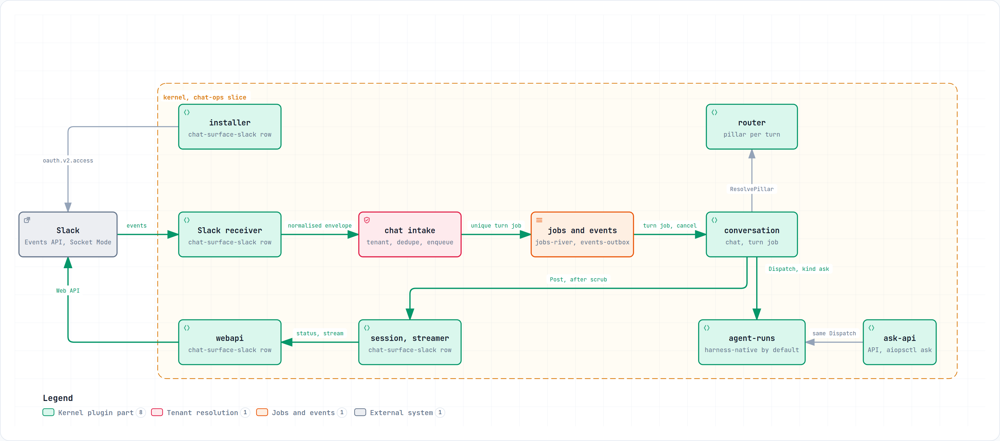
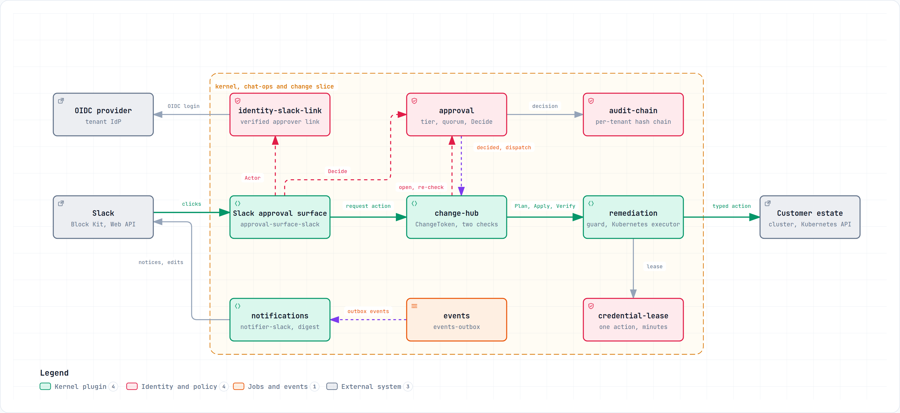
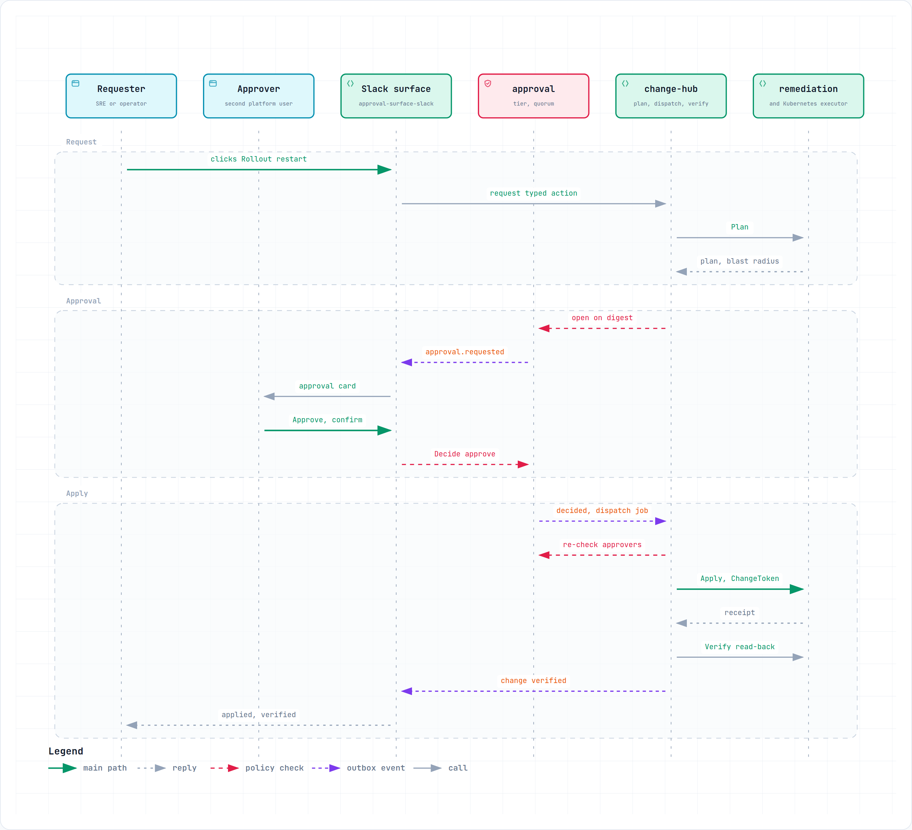
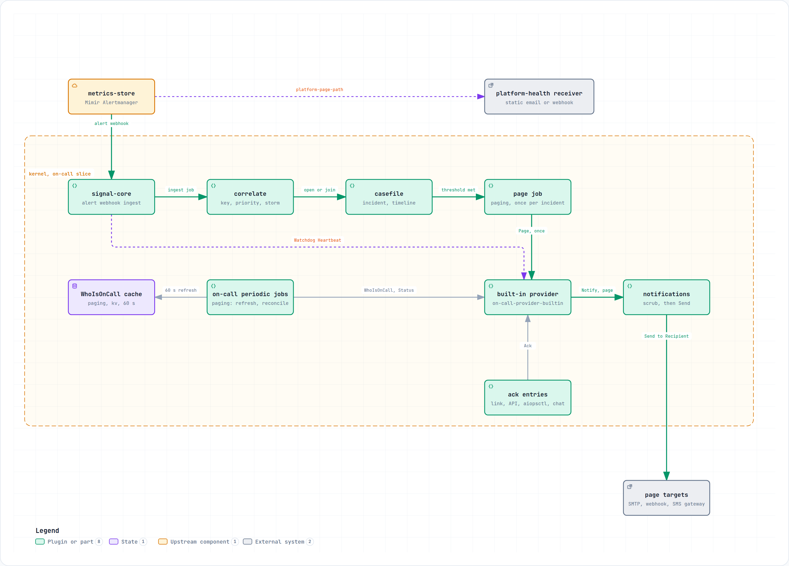
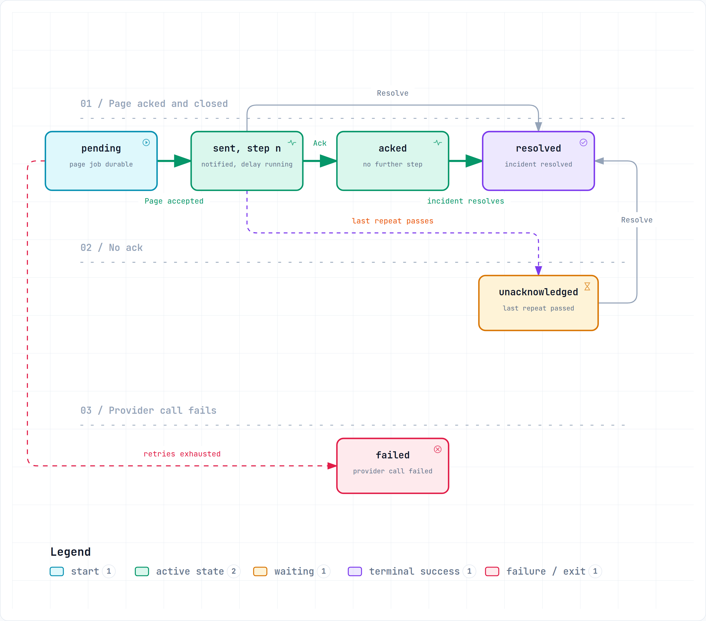
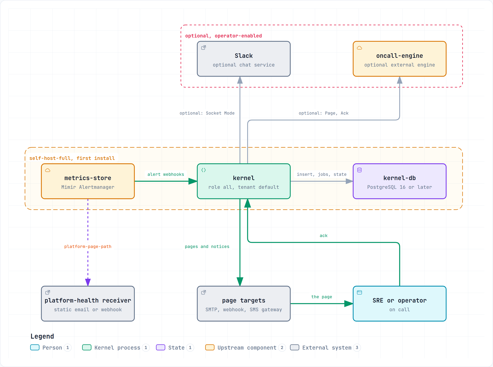

# 06. C3: chat-ops and on-call

Status: draft, 2026-11-11. Obeys `00-decisions.md` (rows 2 to 5, 12 to 14 and 16 of §2.1, §2.2, §2.4, §4, §5.1, §5.2, §5.4, §5.5, §6.1 to §6.3, §7.1, §7.2). The plugin detail behind those sections is the plugin record `docs/design/plugin-system-2026-11.md`, cited as "plugin record §n"; this document rests on its §5 to §10 and §13. The order of work and the connector rules are those of the community record `docs/design/community-first-2026-11.md`, cited as "community record §n". The harness contract, the upstream rule and the on-call design are those of the harness record `docs/design/harness-and-upstreams-2026-11.md`, cited as "harness record §n"; the licence verdicts are those of the licence record `docs/design/licence-audit-2026-11.md`, cited as "licence record §n". Licence statements here restate that record: they are engineering analysis, not legal advice, and the questions marked LAWYER (Q3, Q4 and Q14 of licence record §6) are for a lawyer. Related: `02-c2-containers.md` (where `kernel`, `kernel-api`, `kernel-worker` and the optional `oncall-engine` and `harness-sidecar` are placed), `03-c3-kernel.md` (the infrastructure definitions and the plugins `approval`, `change-hub`, `casefile`), `05-c3-pillars.md` (pillar groups, pillar agents, harness selection, tools), `07-c4-plugin-sdk.md` (the Go interfaces of the definitions named here), `08-profiles-roadmap-adrs.md` (ADR-010, ADR-021, ADR-055), `09-c3-estate-and-troubleshooting.md` (the entity reference, the typed correlation key, the priority function, the context pack and the RCA contract; this document draws only their chat and paging surfaces).

This document draws the components of one container, `kernel` (the `aiops` binary), restricted to two slices: the chat surface and the on-call path from alert webhook to page. Every component below is a row (one configured plugin), an internal part of one plugin, or a first-party row it reaches through a definition. None is a separate container and none is code outside the plugin tree. The first community release (00-decisions §7.1) runs them in one `aiops --role all` process with the single tenant `default`. In `hosted`, which follows S9b and is not part of that release, the same rows are mounted in the `api` and `worker` roles of that binary (`kernel-api`, `kernel-worker`); the one role-placement table is 03-c3-kernel.md §9, and §10 gives this slice's two deployment views.

A chat service, an external on-call engine and a paging carrier are optional bindings (00-decisions §1). Every step this document gives to a person has an API and `aiopsctl` path in the phase it ships, and §11 states what runs with none of them bound.

What a shipped profile composes in this slice is first-party and names no upstream (00-decisions §1 principle 9): the `chat` dispatcher with no surface, `notifications` with an email and a webhook notifier, `signal-core` with two payload families, and `paging` with the built-in on-call provider. Three things are optional and enabled by the operator:

| Optional part | What it is | Why it is optional |
|---|---|---|
| The Slack rows (§1.1), in the bundle `aiops-chatops-slack` | The one chat surface written in this edition | The Slack platform is rated `optional-plugin-only`: its API terms restrict commercial distribution, so no shipped profile, release gate or row outside the bundle needs it (00-decisions §2.4 W13; licence record §2.4; LAWYER Q14) |
| `on-call-provider-goalert`, in the bundle `aiops-oncall-goalert` | One provider plugin for an operator who runs GoAlert or wants an independent pager | Owner decision B: GoAlert is one on-call provider plugin, not the on-call engine of the product. Its licence did not force this: it is Apache-2.0 and rated `ok-with-conditions` (licence record §2.4) |
| A carrier for SMS or voice | A contributed `notifiers` row | Not first-party at the first release (00-decisions §2.1 row 3) |

Each sits behind a registry, and §1.5 states what a contributor can add for another system.

## 1. Rows and definitions in this slice

The slice is built from registries. Each registry has one dispatcher, the plugin that provides the registry's key and is the only caller of what is registered with it, and contribution rows, which register through the registry and are provided under no key (00-decisions §4.1). An invariant that every contribution must pass (the scrub, the page-once rule, the tenant of an envelope) is therefore code of the dispatcher, and a contribution cannot be reached around it.

### 1.1 Rows

Profile codes are those of 00-decisions §3. "Optional" in the bundle column means a first-party bundle in the release image that no shipped profile lists: the operator enables it with `aiopsctl plugin install` and `plugin enable`, with no rebuild (00-decisions §6.3).

| Row | What it is | Scope | Bundle | Profiles | Phase |
|---|---|---|---|---|---|
| `chat` | Dispatcher: provides `chatSurfaces` and `chatCommands`. For each inbound envelope it has the surface resolve the tenant, mints the tenant handle (a mint point, 00-decisions §5.1), makes the turn durable once, runs the turn job, which dispatches a task of kind `ask` on `harnesses`, and scrubs chat egress. It holds no schema and names no chat service. With no surface registered it is ACTIVE and idle | process | `aiops-base` | all server profiles | P1 (S8b) |
| `chat-surface-slack` | Contribution to `chatSurfaces`: the receiver, the installer, the tenant resolver, session, streamer and `webapi`. Owns the schema `chat_surface_slack` (§4). The operator sets `mode: events` or `mode: socket` | process; not tenant-toggleable, because it owns routes or a connection | `aiops-chatops-slack` (optional) | Where the operator enables the bundle: socket on S, A, D; events on H (P2) | P1 (S8b) |
| `chat-commands-slack` | Contribution to `chatCommands`: the `/aiops` verbs | process | `aiops-chatops-slack` (optional) | as the surface | P1 (S8b) |
| `identity-link-slack` | Contribution to `identities`, registered with `identity` and called only by it: maps a Slack user to a platform subject and says whether the link is verified. It decides no permission | process | `aiops-chatops-slack` (optional) | as the surface | P1 (S8b) |
| `approval-surface-slack` | Consumer of the signed key `approval`: turns clicks into requests and `Decision`s and authorises nothing. The surface every profile has is `approval-surface-api` in `aiops-base` | process | `aiops-chatops-slack` (optional) | as the surface | P1 (S8b) |
| `notifier-slack` | Contribution to `notifiers`: channel messages for notices, and a direct message as a contact method of a page | process | `aiops-chatops-slack` (optional) | as the surface | P1 (S8b) |
| `notifications` | Dispatcher: the bound provider of `notifiers`. For a notice: scrub, the `notify/pre-send` gate, the digest window and pacing, then `Send`. For a notification of class `page`: scrub, then `Send` to its `Recipient`, never gated, digested or paced. Its definition holds the `Notification` and `Capabilities` types (§1.4) | process | `aiops-base` | all server profiles | built at S5; in the product from P1 |
| `notifier-email`, `notifier-webhook` | Contributions to `notifiers`. They carry the notices in every shipped profile and are the first-party contact methods of a page. Each states the classes it receives in its own row config (§1.4). `notifier-webhook` is marked `instantiable`: a connector pack may insert further rows of it, each disabled and with its own URL (00-decisions §6.2). It dials that URL through `dialer`, whose refused ranges are the cell ranges in hosted and link-local only by default on self-host (00-decisions §5.7) | process; tenant-toggleable, because each registers one contribution and nothing else (the tenant overlay that toggles a row is layer 5, from S4b) | `aiops-base` | all server profiles | P1 |
| `signal-core` | Dispatcher: provides `signals`. Admits, dedupes, writes the raw group and acks; holds the ingest tokens; a tenant handle mint point (the ingest token) | process | `aiops-base` | all server profiles | P1 |
| `signal-ingest-alert-webhook` | Contribution to `signals`: parses the Alertmanager and dashboard-alerting payload families. Its route entries state each family's busy reply and default label map (§8) | process | `aiops-datasources` | H, S, A, D | P1 |
| `signal-ingest-generic-json` | Contribution to `signals`: parses a generic JSON payload. Marked `instantiable`: a data pack inserts a row of it, with a label map, for a sender that needs no parser of its own (§1.5) | process | `aiops-base` | H, S, A, D | P1 |
| `paging` | Dispatcher: provides `oncallProviders`. Pages once per incident, reconciles open pages, keeps the 60 s `WhoIsOnCall` cache and forwards the `Watchdog` beat as `Heartbeat`. Owns the `paging` schema (§8.2) | process | `aiops-base` | all server profiles | P1 (S8b) |
| `on-call-provider-builtin` | Contribution to `oncallProviders`, first-party and written new: responders with contact methods, one rotation shape with overrides, escalation steps as durable jobs, ack. It sends through `notifiers` with the class `page` and owns the schema `on_call_provider_builtin` (§9). The default by owner decision W11 (00-decisions §2.4); no code is written before the answer to LAWYER Q3 | process | `aiops-oncall` | H, S, A, D | P1 (S8b) |
| `on-call-provider-goalert` | Contribution to `oncallProviders`: connects to a GoAlert the operator runs, or to one shared `oncall-engine` that the chart or compose file renders behind a value that is off by default | `scope: tenant` (§8.4) | `aiops-oncall-goalert` (optional) | S, A, where the operator enables it | P1 (S8b; 00-decisions §2.4 W8) |
| `tool-oncall-who` | Contribution to `tools`: who is on call, from the cache in `paging`. Offered to a run only where a provider is registered for the tenant | process | `aiops-base` | all server profiles | P1 |

Three compositions page or notify less than the full slice, and none is a failure (§11):

- **No chat surface** (every shipped profile): `chat` is ACTIVE with nothing registered. Questions go through `ask-api` and `aiopsctl ask`, approvals through `approval-surface-api`, notices through `notifier-email` and `notifier-webhook`. The release gate runs its chat steps through the API and replays the Slack path from that bundle's cassettes (00-decisions §7.1 leg F3).
- **The Slack bundle enabled without an app token**: `chat-surface-slack` does not reach ACTIVE. It is an optional row, so boot continues with one grouped warning that names its state and what it waits for (00-decisions §6.1).
- **No provider registered, or no policy bound**: `paging` is ACTIVE, the page job records "no provider" or "no policy" on the timeline, nobody is paged, and the incident notice still goes to the notifier rows that receive incidents. `aiops-only` composes `aiops-oncall` like every server profile, and leg B asserts that the timeline says no policy is bound (00-decisions §7.1). `dev` composes `aiops-oncall` and pages a local webhook sink.

### 1.2 Definitions and hooks

| Definition | Dispatcher or provider | Class | Contributions in this slice | Contract | Remote |
|---|---|---|---|---|---|
| `chatSurfaces`, `chatCommands` | `chat` | open | `chat-surface-slack`; `chat-commands-slack` (both optional) | `Serve`, `Post`, `UpdateMessage` with a normalised inbound envelope. The surface resolves the tenant from its own installation record and `chat` mints the handle; dedupe and the turn are the dispatcher's. Commands are verbs registered by name | no |
| `identities` | `identity` | provider-bound, consumer signed | `identity-link-slack` (optional) | `Verify` returns (tenant, subject, verified). A caller injects the key and calls `identities.Verify`; `identity` dispatches to the contribution for the source, which no other row can call. "Verified" feeds the approval quorum | no |
| `approval` | `approval` | provider-bound, consumer signed | none: `approval-surface-api` and, where enabled, `approval-surface-slack` inject the key | `Request`, `Decide`, floor, quorum. A surface only produces a `Decision` through `approval.Decide`, which exists in every profile, and never counts quorum | no |
| `notifiers` | `notifications` | provider-bound | `notifier-email`, `notifier-webhook`; `notifier-slack` (optional) | `Send(ctx, notification) -> id` plus `Capabilities`, over the two types of §1.4. The dispatcher scrubs at egress and, for a notice, holds the digest window per target and the pacing. A notification of class `page` carries a `Recipient` and is never gated, digested or paced | `contrib`, from S5 |
| `signals` | `signal-core` | open | `signal-ingest-alert-webhook`, `signal-ingest-generic-json` | Parse one payload family into `Parsed{Signals, Truncated}`; a `Signal` names its `State` (`firing`, `resolved`) and the sender's `SourceID`. The route entry of a family states its busy reply (429, or 503 for a sender that retries only 5xx) and its default label map. The dispatcher admits, dedupes, writes the raw group and acks | `contrib` P1, parse half only |
| `oncallProviders` | `paging` | open | `on-call-provider-builtin`; `on-call-provider-goalert` (optional) | `WhoIsOnCall`, `Page`, `Ack`, `Resolve`, `Status`, optional `Heartbeat`. The dispatcher pages once per incident, reconciles and keeps the 60 s `WhoIsOnCall` cache. `Schedules` and `Overrides` are not in the contract: their only caller is the built-in provider's own API and commands (harness record §8.4) | `contrib` P1 |
| `tools` | `tools` | provider-bound | `tool-oncall-who` | `Describe`, `Invoke`. The dispatcher filters by the actor's permissions, classifies effects, caps and scrubs output | `contrib` P1 (S8a) |
| `harnesses` | `agent-runs` | provider-bound | none: `chat` is a consumer | `Dispatch(ctx, task)` is the only way to reach a harness. `chat` dispatches tasks of kind `ask`; the dispatcher selects the harness, takes the leases, writes every step to its schema `agent_runs` and enforces the caps (05-c3-pillars.md §2.5, §5.4) | `contrib` P1 (S8a) |

Every definition in this table is `v0` at the first community release (00-decisions §4.3). What a third party can contribute to these registries, in which runtime and by which path, is §1.5.

`identities` says who a chat user is and never what that subject may do. Every permission this document names (`chat.ask`, `incidents.act`, `approvals.decide`) is checked with `authz.Check(subject, tenant, permission)`, a provider-bound key of `tenant-directory` (00-decisions §4.1). The bindings behind it are rows of the `tenant_directory` schema, which only its owner reads (00-decisions §5.2).

| Hook | Kind and verdicts | Owner | What it does in this slice |
|---|---|---|---|
| `signal/admit` | gate | `signal-core` | Per-row buckets and body limits before any write. It is on the ack path, so it admits process-scope listeners only and never waits for a tenant tree |
| `incident/investigate` | gate | `casefile` | `storm-mode` is its one listener and denies an LLM run of a storm incident. The daily budget and the run slots are leases that `agent-runs` takes before a run, not listeners (00-decisions §4.3). The gate never decides a page |
| `notify/pre-send` | gate: allow, delay, drop | `notifications` | A listener may delay or drop a notice. It cannot change the recipient or the content. A remote listener receives the target, the severity and the incident key, never the body. It is not dispatched for a notification of class `page` |
| `approval/gates`, `change/pre-dispatch` | gate: allow, raise, deny | `approval`, `change-hub` | Change windows, freezes, a tenant policy engine. No listener may grant |
| none | | | Paging and the audit append have no hook, and a `page` notification passes no gate, digest or pacing, so nothing a plugin registers can withhold a page or an audit row (00-decisions §2.1 rows 3 and 5, §2.2) |

On every gate the strictest verdict wins, and a listener that the committed generation expects and that is not ACTIVE counts as the strictest verdict (§11).

### 1.3 Testing a row alone

Every row of this slice is tested alone on the real kernel (`kerneltest`) with the fakes of the definitions it injects, then by the conformance suite of the registry it contributes to (00-decisions §4.5). A registry suite has an obligations half for the contribution and a guard half for the dispatcher. No fake or suite names or imports an upstream (check U3, 00-decisions §4.3): the `chatSurfaces` suite runs on synthetic envelopes, and the recorded cassettes of the Slack platform and of GoAlert live in the plugin that wraps each and are replayed in leg F3. The guard halves this slice relies on:

| Dispatcher | What its guard half proves |
|---|---|
| `chat` | An envelope is run once; a handle is minted only for the tenant the surface resolved; no surface is called with text that has not passed the scrub; an approval click is idempotent on the approval id and the surface's envelope key and decides only through `approval.Decide`. The obligations half holds a surface to envelope normalisation, tenant resolution from its installation record, the ack after the durable insert and the refusal of external users, so both receiver modes of the Slack row pass the same cases |
| `notifications` | `Send` receives a scrubbed notification; a `notify/pre-send` listener cannot change recipient or content; a notifier disabled for a tenant gets zero calls for that tenant; a notifier gets no reply, update or action that its `Capabilities` does not report; a notification of class `page` is sent with no gate call, no digest window and no pacing, and only to a notifier that reports `Direct` |
| `paging` | One `Page` per incident; a reader of `WhoIsOnCall` gets the cache and never waits on a provider; with nothing registered or no policy bound the timeline says so; no hook sits on the page path |
| `signal-core` | Nothing is written before admission; a duplicate body answers 200; the ack follows one durable insert |

Each process-scope row also passes the generated two-tenant test: it acts as tenant A, and tenant B must see nothing. That covers `on-call-provider-builtin`, whose rows of every tenant sit in one schema under row-level security. A `scope: tenant` row, which in this slice is only an optional external provider such as `on-call-provider-goalert`, is mounted in two trees on the test-only profile (00-decisions §4.5), so it is proven tenant-correct although the first community release deploys one tenant. A row written outside this repository passes the same tiers with one command, `aiopsctl plugin check ./`, and needs no kernel checkout.

### 1.4 Notifications: the two types and the target binding

`notifiers` is the first product registry, built at S5 with its proto because it is marked `contrib` (00-decisions §7.2). Its two message types are the same in process and on the wire, so the in-process Go, remote Go and remote Python notifiers of the S5 exit pass one suite. The class `page`, `Recipient` and `Direct` are part of the first form of the types, not a later change (00-decisions §2.4 W11); the field layout is fixed before S5 ends under ADR-055.

| Type | Field | Meaning |
|---|---|---|
| `Notification` | `Class` | `incident`, `approval`, `digest` or `page`. It selects the notifier rows that may receive the notification (the target binding below) |
| | `Kind` | The outbox event it reports, such as `incident.opened` or `approval.decided`; for a page, the escalation step that fired |
| | `Target` | The name the receiving notifier registered under. `router` sets it for a notice, one `Notification` per target; for a page it is the notifier named by the responder's contact method. Neither a listener nor a notifier can change it |
| | `Recipient` | Class `page` only: one platform user and the address of one contact method (a mail address, a chat user id, a URL). Only the on-call provider sets it. The scrub applies to title and body, never to the recipient. It is personal data and is never sent to a model |
| | `Pillar`, `IncidentKey`, `Severity` | The pillar, the incident and its priority. `Target`, `Severity` and `IncidentKey` are all that a remote listener on `notify/pre-send` receives |
| | `DedupeKey` | One value per (incident, target, kind), and for a page per (page, step, repeat, notification rule). A `Send` repeated with the same key delivers once and returns the same id, so a step job that fires twice sends once |
| | `ReplyTo`, `Update` | The id that `Send` returned for the incident's first message on this target, kept by the dispatcher in `kv`. With `Update` the notifier edits that message; without it the new message goes under it |
| | `Title`, `Body`, `Fields`, `Actions` | The content, built by first-party plugins (§3.1, §9.4) and scrubbed by the dispatcher before `Send`. An action is a typed reference (ack, investigate, a catalogue action), never a link the notifier builds |
| `Capabilities` | `Threads` | The notifier can place a message under `ReplyTo`. Without it every message stands alone and names its incident |
| | `Updates` | The notifier can edit a message it sent. Without it the dispatcher sends an update as a new message |
| | `Actions` | The notifier can render actions whose clicks come back through a chat surface or an approval surface. Without it the dispatcher leaves them out, and the person step is the API or `aiopsctl` path of §3.1 |
| | `Direct` | The notifier can deliver to one `Recipient`. A notifier without it cannot be a contact method |

`notifier-email` and `notifier-webhook` report `Direct` and nothing else; `notifier-slack` reports all four. The suite holds a notifier to what it reports.

| Class | What it carries |
|---|---|
| `incident` | The root message of an incident, interim findings, the RCA with its flags, page and change notices, ack and resolve |
| `approval` | An approval was requested, decided or expired. On a chat surface the request itself is the card of the approval surface, which is a surface and not a notification |
| `digest` | A notification that is a summary from the start: the storm incident, the overflow digest incident for unmapped alerts and, from P2, the weekly digests |
| `page` | One person's notification for one escalation step of one page, built by code from the incident key, the priority, the signal type, a link to the incident and the ack link (§9.4). Sent by the on-call provider, never by `router` |

**The target binding.** Which notifier receives which class is row config of the notifier row itself: the field `receives`, a list drawn from `incidents`, `approvals`, `digests` and `pages`. The first-party rows ship with all four. For the three notice classes `router` reads the bindings from the committed generation and, in its `notify` job, calls `Notify` once per notifier row that names the class of the event (03-c3-kernel.md §10 A16). For a page the built-in on-call provider, the second consumer of the key, calls `Notify` with the notifier that the responder's contact method names, and the dispatcher refuses a row that does not receive `pages` or does not report `Direct`. In both cases the dispatcher sends only to a registration that is ACTIVE and enabled for the tenant of the handle. The destination inside a notifier is the notifier's own for a notice (the recipients of `notifier-email`, the URL of a `notifier-webhook` row, the channel a chat notifier binds to the pillar) and the `Recipient` for a page. The first-party rows register under the names `email`, `webhook` and, where enabled, `slack`. A row that a connector pack inserts, a second `notifier-webhook` or a contributed notifier, registers under its composed row id and carries its own `receives`, so enabling it is enough and no first-party row is edited, as with a tool row that names the pillars it joins (00-decisions §2.1 row 12). Where no enabled row names a class, nothing is sent for it, and the loop still runs through the API and `aiopsctl` (§11). The digest window folds later notices of any notice class and never moves a notification to another target.

### 1.5 What a contributor can add in this slice

A contributor adds another system through the published plugin interfaces, with a row or a contribution and no core changes (00-decisions §1, §6.2; community record §7.3).

| To add | What is written | Runtime | Enters a self-hosted site by |
|---|---|---|---|
| Alerts from a system that sends through an Alertmanager | Nothing: `signal-ingest-alert-webhook` receives them | | |
| Alerts from a sender whose JSON a label map can place | A row of the instantiable `signal-ingest-generic-json` with its label map, in a data pack | No code | `aiopsctl plugin install` and `plugin enable`, no rebuild |
| Alerts from a sender with a payload of its own | A `signals` contribution: `Parse`, the route entry with the busy reply and the default label map, and a firing and resolved fixture pair | In-process Go, or remote in any language (the parse half) | Remote: an install with no rebuild. In-process Go: a distribution the operator builds and signs, or `contrib/` |
| Notices to a system that takes a webhook | A row of the instantiable `notifier-webhook` with its URL and `receives`, in a data pack | No code | Install and enable, no rebuild |
| A notifier with an API of its own | A `notifiers` contribution: `Send` and `Capabilities` | In-process Go or remote | As for a `signals` contribution |
| A page channel: SMS, voice or push | A `notifiers` contribution that reports `Direct` and receives `pages`. The built-in provider then accepts it as a contact method; it holds no carrier client itself | In-process Go or remote | As for a `signals` contribution |
| Another on-call system | An `oncallProviders` contribution. The page-once rule, the reconcile and the cache stay in `paging` | In-process Go or remote | As for a `signals` contribution |
| A kernel-data tool | A `tools` contribution with a read effect | In-process Go or remote | As for a `signals` contribution |
| Another chat product | A `chatSurfaces` contribution | In-process Go only: the definition has no remote adapter | A distribution the operator builds and signs, or `contrib/` |

On self-host a remote plugin runs as one shared instance per plugin (S2b; 00-decisions §2.4 W5). Per-tenant instances arrive with S4b, and third-party plugins on hosted, which are remote contributions only (00-decisions §2.4 W4), wait for the enterprise edition (00-decisions §7.3). An in-process plugin merged under `contrib/` ships in the `aiops-contrib` image with its row disabled; any other enters through a distribution the operator builds and signs (00-decisions §2.4 W3). W3 to W5 are owner decisions of 2026-11-11.

Three rules bound a contribution in this slice:

- **No chat token.** A third-party plugin never receives a chat service token or raw access to a chat API. `webapi` and the installation store are private to the surface row; a contribution reaches a chat service only as typed commands and messages that `chat` dispatches and scrubs (licence record §2.4, §7.6).
- **Names.** A contributed plugin is named `<publisher>/<contribution noun>-<system>` (00-decisions §8.1). The system's name appears once, as the lowercase suffix, and only where the upstream register allows it; an owner whose policy asks for approval keeps a generic id until cleared (licence record §7.5; LAWYER Q4).
- **Versions.** While the definitions of this slice are `v0`, a plugin is attested on the exact minor it was checked against (00-decisions §4.3).

The one part of this slice that stays specific to the default stack in this edition is the dead-man sender (§8.3).

## 2. C3a: chat conversation path (the Slack surface)

Scope: inbound chat traffic (mentions, DMs, `/aiops` commands, stop clicks) from either receiver to an answer written back into a thread, inside the `kernel` container. It exists where the operator enabled `aiops-chatops-slack`. Both receiver modes emit the same normalised envelope, so everything after the receiver is transport-agnostic and belongs to `chat`, not to the Slack row. One `chat-surface-slack` row runs in one mode, so the figure draws one receiver. With no chat surface the same question enters through `ask-api` (`aiopsctl ask`) and reaches the same `Dispatch`. Approvals and outbound notifications are in C3b.

*Figure 06-slack-conversation. Source: [diagrams/src/06-slack-conversation.json](diagrams/src/06-slack-conversation.json).*

The figure shows the main path of one turn in green: the chat service delivers an event, the receiver hands the envelope to `chat`, which makes the turn job durable, `conversation` dispatches one task of kind `ask` to `agent-runs`, which runs the harness the pillar selects, and the answer goes back through the streamer and `webapi`. The installer sits above the path. The box `ask-api` at the lower right is the entry used where no chat surface is enabled; it reaches `agent-runs` with the same `Dispatch` and is described in 03-c3-kernel.md. The tables below are complete and the figure is not. It leaves out `kernel-db`, the interaction log, `commands` and `paging` (§3.1 and §8), `casefile`, `identity` with its contribution `identity-link-slack`, `tenant-directory` and `ext-idp` (§3), the chat user, what a run reaches behind `agent-runs`: `tools`, `llm-gateway` and `pii-pseudonym`, and any optional harness plugin with its sidecar. It draws the intake and its call to the surface's tenant resolver as one box, `session` and the streamer as one box, the dispatcher `agent-runs` and the selected harness as one box, and the two receiver modes as one. The tables name each component by the short id in their first column and give the row it belongs to.

| Id | Name | Row | Technology | Responsibility |
|---|---|---|---|---|
| `rx`, events mode (a multi-tenant deployment, P2) | Slack receiver, `mode: events` | `chat-surface-slack` | Go, routes registered as effects on `http` (public listener), slack-go signature check | `POST /slack/events`, `/slack/interactive`, `/slack/commands`. Verifies `X-Slack-Signature` (HMAC-SHA256, 5 min timestamp window, constant-time compare), normalises the envelope and passes it to `intake`. Returns 200 within 3 s, and only after `intake` reports the durable insert. Returns 200 with `x-slack-no-retry: 1` for events it drops by policy, including envelopes from unknown or deleted installations, and 503 only when that insert fails because the database is down (§5.1, §11). |
| `rx`, socket mode (self-host, aiops-only, dev) | Slack receiver, `mode: socket` | `chat-surface-slack` | Go, slack-go `socketmode` | Opens the WSS connection with the `xapp-` token, one per replica, at most 10 per app. The connection is an effect of the row's fiber: it closes when the row unloads and reopens when the row is ACTIVE again. Acks `envelope_id` after the same durable insert. Reconnects with backoff on refresh. Without an app token the row does not reach ACTIVE (§1.1). |
| `inst` | installer | `chat-surface-slack` | Go, OAuth v2 | Events mode: `GET /slack/install` with `state` bound to tenant and platform user, `/slack/oauth/redirect`, `oauth.v2.access`. A first install into a workspace creates a platform `installation` owned by that tenant, with the bot token stored under a platform DEK, never a tenant DEK. An install into a workspace that already has an installation creates a pending `installation_grant` for the second tenant, which the owner's tenant admin approves; it never changes the owner or the token. `auth.teams.list` for org installs. `app_uninstalled` and `tokens_revoked` revoke the installation for every grantee and notify each of them. Socket mode: imports the tokens of the app the customer built from `aiopsctl slack manifest`: the `xoxb-` bot token into an `installation` owned by tenant `default`, under a platform DEK as in events mode, and the `xapp-` app-level token into tenant `default` secrets (§5.1). |
| `tres` | tenant resolver | `chat-surface-slack` | Go, `sql` | `ResolveTenant`, called by `intake`: `authorizations[0]` to installation, then the channel binding, which must belong to the owner or an approved grantee. The installation, grants and workspaces are platform tables of the `chat_surface_slack` schema; the binding is read under each candidate tenant's handle and RLS context (owner and approved grantees). Drops externally shared channels unless bound. |
| `intake` | envelope intake | `chat` | Go, `sql`, `jobs` | For each normalised envelope: has `tres` resolve the tenant, mints the tenant handle for it, and writes the turn job with `jobs.EnqueueTx`, unique on the surface row and the envelope key, so a retried envelope enqueues nothing (§12 item 10). The job carries the tenant of that transaction, stamped by the `jobs` provider, so the worker runs it under the same tenant and never reads a tenant from job arguments (00-decisions §5.1). It runs before the ack, so in hosted it sits on `kernel-api` with the receiver (03-c3-kernel.md §9). |
| `router` | router | `router` (`aiops-base`), provides `routing` | Go | `ResolvePillar` on every turn: explicit verb or mention, thread stickiness, channel default, DM last choice, installation default (§5.3). It never resolves the tenant; it runs in the turn job, so in hosted it sits on `kernel-worker` (03-c3-kernel.md §9). |
| `ident` | Slack identity link | `identity-link-slack`, a contribution to `identities`, behind its dispatcher `identity` (`aiops-base`) | Go | `(installation, slack_user_id)` to `(tenant, subject, verified)`, stored in `user_link`, which it reads and writes through `chat`, which dispatches to the surface that owns the table. Email link through `users.info` for read and ask; Sign in with Slack link for approvals; external users never linked (§5.4). It is provided under no key: a row reaches it only as `identities.Verify`, which `identity` dispatches to it. It answers who the user is, not what the user may do: permissions are checked with `authz.Check`, provided by `tenant-directory`. |
| `cmds` | commands | `chat-commands-slack`, a contribution to `chatCommands` | Go, job | Parses `/aiops <verb>`; MVP verbs `ask`, `incident`, `change`, `compliance`, `investigate <incident>`, `oncall who\|ack\|page`, `tenant`, `link`, `status`, `help`. A verb whose pillar group is not composed or not ACTIVE answers "not enabled in this profile". `investigate` shares one handler with the Investigate and Investigate again buttons (§3.1). The on-call verbs are detailed in C3c. |
| `conv` | conversation | `chat` | Go, job on the `investigate` queue | Turns one chat turn into one task of kind `ask` and calls `harnesses.Dispatch(ctx, task)`: the pillar from `router`, the subject (the incident when the thread is an incident thread), the actor and the trigger `chat`. It forwards the steps it gets back to the surface. A chat turn has the lowest job priority on `investigate`: incident runs go first, higher incident priority first, so with one slot an incident never waits behind a question. It never calls a model, a tool or a harness row itself. |
| `sess` | session | `chat-surface-slack` | Go | `agents.sessions.setStatus` (`processing`, `suspended`, `active`) and `rename` to `[<pillar>] 
`; handles `agent_session_stopped` (cancel the turn) and `app_context_changed`; re-arms `processing` before the one-hour timeout. Manifest uses `agent_view`. |
| `strm` | streamer | `chat-surface-slack` | Go | Posts each intermediate finding as a `task_update` reply; writes only the final answer with `chat.startStream`, `appendStream`, `stopStream` (`thread_ts`, `recipient_user_id`, `recipient_team_id` always set); restarts a stream before the 10 min or 12,000 character cap; falls back to `postMessage` plus `chat.update` every 2 s when streaming is unavailable. The harness contract has no token delta in `v0`, so the answer arrives as one terminal step and is appended in a few chunks (§12 item 19). |
| `webapi` | webapi | `chat-surface-slack`; called only through `chat` | Go, internal `slackapi` interface over slack-go v0.31.0 | One client per installation; injects `team_id` or `client_context_team_id` for org tokens; paces 1 message/s per channel, with the pacer state in `kv` keyed by installation and channel; honours 429 `Retry-After`; per-tenant metrics. Every text reaches it already scrubbed: `chat` applies the bound `pii` key before `Post` and `UpdateMessage`. No other plugin, first-party or contributed, holds the token or calls the Web API (§1.5). |
| `ilog` | interaction log | `chat-surface-slack` | Go, `sql` | Writes `chat_surface_slack.interaction_log` from the turn job: every envelope key, actor, verb, decision and outcome, question as SHA-256 only. Its unique key makes that write idempotent. |
| `runs` | agent runs | `agent-runs` (`aiops-base`), the bound provider of `harnesses` | Go | Selects the harness of the run (the tenant's choice from S4b, then the pillar group's `harness` field, then `defaultHarness`), takes the slot lease and the budget lease, and builds the request: the persona, the tool set filtered by the actor's permissions, model access by tier and the per-run caps keyed by pillar and kind (00-decisions §2.1 rows 2 and 13). It writes every step to `agent_runs.run_step` before it forwards it, and builds the neutral history of a follow-up turn from those rows. |
| `harness` | the selected harness | by default `harness-native` (`aiops-base`), in process on the worker role | Go | Runs the loop for one task: it reaches a model only through `llm` and a tool only through `tools`, holds no credential and writes nothing. Another harness, where the operator installed one and the pillar selects it, runs behind `agent-runs` in the same way; the optional `harness-holmesgpt` is described in 05-c3-pillars.md §5.10. |
| `casefile` | casefile | `casefile` (`aiops-base`), provides `incidents` (03-c3-kernel.md) | Go | Starts an incident run for the `investigate` verb and the two buttons of §3.1 and keeps the run id on `casefile.investigation`. A question needs no incident: its transcript is the run in `agent_runs`. |
| `jobs` | jobs and events | the bound providers of `jobs` and `events` (default: `jobs-river`, `events-outbox`) | jobs on `kernel-db`, outbox | Durable hand-off from receiver to worker, the cancel path for a stopped turn, and the tenant stamp on every job and event. |
| `oncall` | on-call | `paging` | Go | Dispatcher of `oncallProviders`, detailed in C3c. |

| From | To | Interface | Why it matters |
|---|---|---|---|
| `rx` | `intake` | normalised envelope (`Serve`) | The Slack row knows Slack and `chat` knows tenants and turns. Both modes hand over the same envelope, so dedupe and the turn are tested once, without a chat service. |
| `intake` | `tres` | `ResolveTenant`, then the handle mint | Tenant comes from the surface's installation record, its grants and the channel binding, never from the payload (00-decisions §5.1). `chat` is one of the listed mint points, so no other row of this slice can make a handle. An unknown or deleted installation is answered 200 with `x-slack-no-retry: 1` and logged, so it never counts towards Slack's app-wide failure rule (§11). |
| `intake` | `jobs` | one SQL transaction | The ack is sent only after the unique turn job is durable, so a retry by the chat service or a process crash never double-runs or loses a turn. The only synchronous Web API call a receiver may make is `views.open`, because `trigger_id` expires in 3 s. |
| `jobs` | `conv` | turn job, cancel | A stop click (`agent_session_stopped`) is enqueued like any other envelope and cancels the running turn job through the database, so it works when receiver and worker run in different roles (hosted). Turn jobs share the `investigate` queue and the run slots with incident runs and are taken after them (job priority). |
| `conv` | `router`; `identity`, which dispatches to `ident`; `tenant-directory` | `ResolvePillar`; `identities.Verify`; `authz.Check` | `conv` calls the keys, never the contribution: `identities.Verify` returns the subject through `identity`, and `authz.Check` answers `chat.ask`. `ident` is drawn in the §3 figure, not in the one above. Pillar, subject and permissions are resolved on every turn, so a revoked role applies from the next turn. |
| `conv` | `runs` | `harnesses.Dispatch(ctx, task)`, kind `ask` | The tenant travels in the handle of `ctx`, never as an argument. `harnesses` is provider-bound to `agent-runs`, so no row can reach a harness around the leases, the caps and the transcript. A chat turn, an `aiopsctl ask` and an incident run get the same method, caps and transcript. |
| `runs` | `harness` | `Run(ctx, request, sink)` | The tool set is read-only and permission-filtered: a denied tool is absent, not refused. Caps are enforced at the tool set and the model view, never from the stream the harness reports. A worker crash mid-turn restarts the run from its first message, which is safe because every tool is a read (00-decisions §2.1 row 2). |
| `runs` | `kernel-db` | one `run_step` row per step, before forwarding | The server, not the chat service, holds the transcript, so no turn needs a `conversations.replies` call. For an app that is not listed in the Marketplace that method is capped at 1 request per minute and 15 messages, and a Socket Mode app cannot be listed (licence record §2.4). |
| `conv` | `sess`, `strm`, `webapi` | `Post`, `UpdateMessage`, after the scrub | Chat egress is one of the places where 00-decisions §2.2 applies the PII scrub. A surface is called only by `chat`, so no row can post to a chat service past it. |
| `cmds` | `casefile` | start an incident run | The `investigate` verb and the two buttons of §3.1 call the same `casefile` entry as the API and `aiopsctl`. It enqueues an incident run on `investigate`, ahead of chat turns. |
| `cmds` | `oncall` | `WhoIsOnCall`, `Ack`, `Page` | Slash commands fire only for members of the installing team, so `oncall page` is never reachable from a Slack Connect guest. |

## 3. C3b: approvals, notifications and audit

Scope: how a typed remediation is requested and approved from a chat surface, how outbox events become notices under digest and rate limits, and what is audited. This section draws the Slack surface, which exists only where the operator enabled `aiops-chatops-slack`; the same request and the same `Decide` are reached through `approval-surface-api` (`aiops-base`) by the API and `aiopsctl` in every profile, and the notice side runs with `notifier-email` and `notifier-webhook` alone. Authorisation is in neither the chat service nor the surface rows: `approval-surface-slack` turns clicks into requests and `Decision`s through `approval.Decide` and authorises nothing; `change-hub` owns the plan; `approval`, the bound provider of its key, applies policy, tier and quorum; `remediation` is the only caller of an executor (00-decisions §2.2). One figure draws both sides: the chat side (clicks, cards, notices) and the policy side (approval, dispatch, audit).

*Figure 06-approvals-notifications. Source: [diagrams/src/06-approvals-notifications.json](diagrams/src/06-approvals-notifications.json).*

The figure shows the main path in green: a click becomes a typed-action request, `change-hub` drives `Plan`, `Apply` and `Verify` through `remediation`, and the executor acts on the customer cluster. Red dashed arrows are identity and policy checks; purple dashed arrows are outbox events. The tables below are complete and the figure is not. Its node labelled "identity-slack-link" is the row `identity-link-slack`, renamed so that the upstream name is the suffix (00-decisions §2.3, §8.1); the label changes when the figure is redrawn. It draws `remediation` and `remediation-executor-kubernetes` as one box, with the lease arrow leaving that box, and `notifications` and `notifier-slack` as one box. It leaves out `chat` and the Slack receiver and `webapi` behind it, which carry every click in and every card, edit and notice out (§2), and `session`, `pii-pseudonym`, `casefile`, `router` (whose `notify` job turns the events into `Notify` calls), the `notify/pre-send` gate and the page class of §1.4. It draws the decision as one arrow from `approval` to `change-hub`; in the tables that arrow is the `approval.decided` event and the dispatch job it starts, both through `events`. The box "Slack" is `ext-chat-service` and the box "OIDC provider" is `ext-idp`. The arrow "Actor" from the approval surface to the identity link is the call `identities.Verify`: the figure draws the contribution `identity-link-slack` and leaves out its dispatcher `identity`, the only row that calls it, and `tenant-directory`, which answers `authz.Check`. The L3 quorum, the TTL sweep, Deny and the `uncertain` outcome are in the tables and in §7.

| Id | Name | Row | Technology | Responsibility |
|---|---|---|---|---|
| `rx` | Slack receiver and intake | `chat-surface-slack`, `chat` | as C3a | Same ack discipline for `block_actions` and `view_submission`; an approval click is idempotent on the approval id and the surface's envelope key, which `chat` treats as opaque (the Slack surface builds its key in §4). |
| `ans` | Slack approval surface | `approval-surface-slack` | Go, thin handler | Turns an action-button click into a typed-action request to `change-hub` (the buttons are the typed catalogue actions the alert labels allow; a `host:` incident offers none in P1, §3.1), and an Approve or Deny click into `approval.Decide(approval_id, subject, verdict, source)` (03-c3-kernel.md §5), where `subject` is the verified platform user and `source` is the id of this surface row. The call carries no field of the surface: the click is idempotent on the approval id and the surface's envelope key, an opaque key the surface supplies, and `installation_id`, `slack_user_id` and `action_ts` stay in `chat_surface_slack.interaction_log` only (§4). Builds the Block Kit card: `visible_to_user_ids` set to the linked, verified approvers minus the requester, a `confirm` dialog on Approve, `value` holding only `approval_id` plus a nonce. Uses `response_url` for the immediate ephemeral reply and `chat.update` on the stored `channel` and `message_ts` for the authoritative edit, both through `chat`. Records click, actor, verdict and outcome in the interaction log (C3a). |
| `ident` | Slack identity link | `identity-link-slack`, behind `identity`, the bound provider of `identities` | Go | Answers `identities.Verify` for its dispatcher and for no other caller. Returns `verified=true` only for an `oidc` link (Sign in with Slack). External users are refused with an ephemeral message and logged. |
| `sess` | session | `chat-surface-slack` | Go | Sets the thread session `suspended` while an approval is open, `processing` on resume, `active` when done. |
| `disp` | notification dispatcher | `notifications` (`aiops-base`), the bound provider of `notifiers` | Go | `Notify`: takes one `Notification` for one target (§1.4) and scrubs it through the bound `pii` key. For a notice it then drops what the target's `Capabilities` does not report, runs the `notify/pre-send` gate, applies the per-target digest (one message per interval, P1 first, interval from `TenantLimits`, window state in `kv` so two workers never both send the first message, 03-c3-kernel.md §8.2) and the pacing, then calls `Send` on the contribution for the target. Digest-only in storm mode. For a notification of class `page` it calls `Send` straight after the scrub. Every `Send` has a deadline, a concurrency cap and a breaker per (tenant, row). A notifier is registered with it and provided under no key, so nothing else can call one. |
| `notif` | Slack notifier | `notifier-slack`, a contribution to `notifiers` | Go | `Send` and `Capabilities`: it reports threads, updates, actions and `Direct`, and receives the four classes of §1.4. Renders an already scrubbed notification for Slack. Opens the incident root message, with the Ack button, in the bound channel and writes the thread session; on an incident that is investigated on demand the root message also carries the reason and the Investigate button (§3.1). Posts interim findings and the RCA message of an incident run, with its flags, the not-covered line and the Investigate again button, and edits that line in place on a join. Posts page, approval-outcome and change notices; edits the root message on ack and resolve. As a contact method it delivers a page to its `Recipient` as a direct message. It posts and edits through `chat`, so it uses the installation store and `webapi` of §2 without importing the Slack row. |
| `webapi` | webapi | `chat-surface-slack` | as C3a | All Slack egress. |
| `appr` | approval | `approval` (`aiops-base`), the bound provider of `approval`; a required key in every server profile | Go | `approval.Decide` is the one entry for every surface and exists in every profile. First decision wins; requester never approves; approver must hold `approvals.decide` (`authz.Check`) and a verified link ("verified" from `identities`); L3 needs two distinct platform users, neither the requester; TTL sweep denies and escalates. The tier table in its config gives `require(tier, approvers)` and can only be raised per tenant. Policy is extended only through the `approval/gates` gate, where a listener may raise or deny and never grant. |
| `hub` | change-hub | `change-hub` (`aiops-base`), the bound provider of `changes` and the dispatcher of `verifiers` | Go | On the proposal calls `Plan`, writes the `ChangeRecord` in state `planned` with its `change_plan`, and opens the approval on the plan digest; at dispatch, once approved, runs the `change/pre-dispatch` gate, re-checks approvers, captures pre-state, signs the `ChangeToken` (00-decisions §7.1 step 4; 03-c3-kernel.md §5) and drives `Apply`, then runs the two $0 checks, the `verifiers` contributions `verify-alert-cleared` (it reads the resolved signal and queries no backend) and `verify-readback` (a typed read-back through `Verify`); a missed executor deadline marks the change `uncertain`. Every executor call goes through `rem`. |
| `rem` | remediation dispatcher | `remediation` (`aiops-base`), the bound provider of `executors` | Go | The only caller of an executor. Its guard refuses `Apply` without a valid `ChangeToken` or with a changed digest, takes the write credential from `credentials.Write(token)` for `Apply` only, and gives every call a deadline, a concurrency cap and a breaker per (tenant, row). |
| `lease` | credential-lease | `credential-lease` with `lease-kubernetes`; the bound provider of `credentials`, a key only `remediation` may inject | Go | Write credential scoped to one action, minutes long (ADR-019). `Plan` and `Verify` get none. |
| `exec` | Kubernetes executor | `remediation-executor-kubernetes`, a contribution to `executors`, in the `pillar-incident` group | Go, in process in every profile | The five-action catalogue with fixed tiers and JSON-schema parameters. |
| `audit` | audit | `audit-chain`, the bound provider of `audit` | Go | `AppendTx` in the caller's transaction: every request and decision into the tenant hash chain. The append has no hook. |
| `ev` | events | the bound provider of `events` (default: `events-outbox`) | outbox | `approval.requested`, `approval.decided`, `incident.*`, `investigation.*`, `change.*`, each emitted in the transaction that changed the state. |
| `pii` | scrub | `pii-pseudonym`, the bound provider of `pii` | Go | Salted, correlation-preserving pseudonyms, applied by `chat` and `notifications` before anything reaches a chat service or a notice target. |

| From | To | Interface | Why it matters |
|---|---|---|---|
| `ans` | `identity`, which dispatches to `ident` | `identities.Verify` | The surface learns the platform user and whether the link is verified from the key. `identities` is a signed key, and the contribution is provided under no key, so no row calls `identity-link-slack` itself. The surface checks the requester's `incidents.act` with `authz.Check`; the approver's `approvals.decide` is checked by `approval`. |
| `ans` | `appr` | `approval.Decide` | Quorum is counted on `subject`, the platform user, inside `approval`, so two Slack identities of one person cannot form a quorum and `visible_to_user_ids` is a convenience, not the control. `approval` is a signed key: only a first-party row, or an in-process row whose signer the site trusts for it, can inject it. |
| `ans` | `hub` | typed-action request | The buttons are derived from alert labels; the model never writes a plan. |
| `hub` | `rem` | `Plan`, then `Apply`, then `Verify`, on the `executors` registry | The plan is typed and side-effect free; approval binds to a digest over plan, target and inputs, so an edited plan needs a new approval. The `remediation` guard refuses `Apply` without the `ChangeToken`. |
| `rem` | `exec` | the guarded call | An executor is registered with `remediation` and provided under no key, so neither a chat row nor another plugin can call it. |
| `rem` | `lease` | `credentials.Write(token)` | `credentials` is consumer-bound to `remediation`: no other plugin, the executor included, can ask for a write credential. |
| `hub` | `appr` | open, re-check | The vote of an approver whose role was removed between click and dispatch no longer counts. A quorum that no longer holds returns the change to pending approval, and the card is edited back to open (03-c3-kernel.md §8.3). |
| `ev` | `disp` | outbox events, turned into `Notify` calls by the `notify` job of `router`, one per notifier row whose `receives` names the class of the event (§1.4) | Notices are visible after commit and ordered per `(tenant, seq)`; a chat service or a mail relay being down delays messages, it never loses them. |
| `disp` | `pii`, then `notif` | scrub, gate, digest, pacing, then `Send` | The order is fixed in the dispatcher. A contribution returns raw output and never pre-scrubs (00-decisions §2.2). |
| `casefile` | `notif` | `investigation.*` events, through `disp` | The flags are set by `rca-contract` on the `run/answer` hook, the not-covered line by `casefile`, and the digest of a run that ended with no answer is built by `agent-runs` from its step rows; a notifier only renders them (§3.1). |
| `notif`, `ans` | `webapi` | `Post`, `UpdateMessage` on `chat` | One egress path to Slack for answers, cards and notices, with the pacer and the scrub in front of it. |

### 3.1 Incident thread: what a person sees and can start

A notifier renders every message below from outbox events. The content is built by first-party plugins, never by the notifier or the model: the correlation key and the priority by `correlate`, the RCA contract check and its flags by `rca-contract`, the incident state and the not-covered marker by `casefile`. They are specified in 09-c3-estate-and-troubleshooting.md and only shown here. Each person step reaches the same `casefile` entry from an enabled chat surface, from the `/v1/incidents` API family and from `aiopsctl` in P1 (03-c3-kernel.md §8.8), so none depends on a chat service. The table describes the thread of the Slack surface; `notifier-email` and `notifier-webhook`, which report no threads, updates or actions, send each message alone, naming its incident, with the person step left to the other paths.

| Surface | Shown when | What it shows | Person step | Other paths in P1 |
|---|---|---|---|---|
| Root message | An incident opens | The correlation key, the priority and the Ack button | Ack (C3c) | The ack link in the page, the API, `aiopsctl`; with an external provider, also that provider's own means |
| Investigate button, on the root message | The incident is investigated on demand: an `unmapped:` or a `control:` incident (00-decisions §2.1 row 12) | One line with the reason no run started: no label placed the alert on a service or an entity, or the incident is a compliance control. An `unmapped:` message names the label map as the fix | Start the run; needs `incidents.act` | API, `aiopsctl` |
| RCA message, in the thread | A run answered or ended with no answer | The RCA, the flags code set on it (next table) and the not-covered line when it applies | Feedback (05-c3-pillars.md §5.8) | Read through the API, `aiopsctl` and the provisioned dashboards |
| Investigate again button, on the RCA message | The RCA carries the not-covered marker: alerts or changes arrived after the run started | One line written by code, "N alerts and M changes arrived after this analysis started and are not accounted for", edited in place on each join | Start a new run; needs `incidents.act` | API, `aiopsctl` |
| Action buttons, in the thread | The alert labels allow a typed catalogue action (§7) | The actions. Where a GitOps controller owns the target, scale and ReplicaSet rollback carry the warning of 05-c3-pillars.md §6.2 and are not hidden. A `host:` incident offers none in P1, because P1 has no host executor (00-decisions §7.1) | Request the action (§7) | Approvals through the API and `aiopsctl` |
| Map a label | Never in P1 | Nothing: the chat action is deferred (§12) | None in chat | The label map API and `aiopsctl` take the mapping |

Both buttons enqueue an incident run on `investigate`, which is taken ahead of chat turns. For a `control:` incident the run is a run of kind `investigate` of the compliance pillar's agent (05-c3-pillars.md §7). A storm incident and the overflow digest incident for unmapped alerts (00-decisions §5.5) are never investigated and carry no Investigate button.

| Flag on the RCA | Code sets it when | The RCA message says |
|---|---|---|
| `degraded` | The answer does not parse against the RCA contract | The stored text as written, marked as not a structured RCA. It never reads as "nothing to do" |
| `incomplete` | A cap stopped the run: the step ceiling or the deadline | Which of the two, with the step count. Before its deadline the default harness sends one last request without tools and answers with what it has. A run that ends with no answer has no model text: the body is a digest that code builds from the step rows, and the incident stays open |
| `unresolved` | Code could not build an entity reference from the root-cause entity the model named | The entity as the model spelled it, marked unresolved |

The two tables below give the main path of both buttons in time order, in three bands: the incident opens with no run, a person clicks Investigate, and a person clicks Investigate again after alerts or changes arrived. This section has no figure: the lane table names the rows behind each element and the step table gives the messages. The step table shows the main path only; the tables above and the text of this section are complete. Before it starts a run, `chat-commands-slack` resolves the actor with `identities.Verify`, which `identity` dispatches to the `identity-link-slack` contribution, and checks `incidents.act` for that subject with `authz.Check`. The start is the same `casefile` entry the API and `aiopsctl` call. The run waits on the `investigate` queue ahead of chat turns, and `casefile` dispatches it through `agent-runs` to the harness the pillar selects. The second click takes the same receiver, job and actor-check path as the first; the step table lists only its first and last message. Not in the step table: the `investigate` queue, `identity` with `identity-link-slack`, `tenant-directory`, the selected harness with `tools` and `llm-gateway` behind it, the `control:` path through the compliance pillar's agent, the storm and overflow incidents, the digest of a run with no answer, and the API and `aiopsctl` paths.

| Lane | Element | Rows behind it |
|---|---|---|
| 1 | Slack, with the SRE in the thread | `ext-chat-service` |
| 2 | Slack notifier | `notifications` and `notifier-slack` |
| 3 | Slack receiver | `chat-surface-slack` and the `chat` intake: verify, dedupe, ack |
| 4 | commands | `chat-commands-slack`: checks `incidents.act` with `authz.Check` |
| 5 | casefile | `casefile`: incident run, RCA |
| 6 | Agent run | `agent-runs` and the harness the pillar selects, by default `harness-native` |

| Band | Step | From | To | Message |
|---|---|---|---|---|
| Incident opens, no run | 1 | Slack notifier | Slack | root message with the Investigate button |
| Investigate on demand | 2 | Slack | Slack receiver | Investigate click |
| Investigate on demand | 3 | Slack receiver | Slack | ack after the durable enqueue |
| Investigate on demand | 4 | Slack receiver | commands | click job |
| Investigate on demand | 5 | commands | casefile | start incident run |
| Investigate on demand | 6 | casefile | Agent run | queued incident run, `Dispatch` |
| Investigate on demand | 7 | Agent run | casefile | answer and run id |
| Investigate on demand | 8 | casefile | Slack notifier | `investigation.*` events |
| Investigate on demand | 9 | Slack notifier | Slack | RCA with its flags |
| Investigate again | 10 | casefile | Slack notifier | not-covered marker |
| Investigate again | 11 | Slack notifier | Slack | edit of the not-covered line |
| Investigate again | 12 | Slack | Slack receiver | Investigate again click |
| Investigate again | 13 | commands | casefile | start a new run |

## 4. Slack surface data model (`chat_surface_slack` schema)

The schema belongs to the `chat-surface-slack` plugin and exists only where the Slack bundle is enabled: one schema and one no-login database role per plugin id, migrated by the `durable` leader (00-decisions §5.2). It is owned by the surface so that the `chat` dispatcher holds no schema named for a service; `chat` itself has none. The other rows of `aiops-chatops-slack` reach these tables only through `chat`'s definitions, which `chat` dispatches to the surface, never with SQL of their own. The platform tables outside RLS are exactly those of 00-decisions §5.2: `installation`, `installation_grant`, `installation_workspace` and `user_link`, because the surface's `ResolveTenant` and `identity-link-slack` read them before the tenant is known. Every other table carries `tenant_id` under RLS; `ResolveTenant` reads `channel_binding` under each candidate tenant's handle and RLS context (the owner and the approved grantees).

| Table | Key | Main columns | Notes |
|---|---|---|---|
| `installation` | `installation_id`; unique `(app_id, coalesce(enterprise_id,''), coalesce(team_id,''))` | `owner_tenant_id`, `enterprise_id`, `team_id`, `is_enterprise_install`, `bot_user_id`, `installed_by_slack_user_id`, `bot_token` (encrypted under a platform DEK, never a tenant DEK, in every profile), `default_pillar`, `revoked_at` | Platform table. The owner comes from the first install's OAuth `state` and never changes through an upsert. If the owner tenant is deleted while other grants exist, ownership passes to the oldest approved grantee. Org installs have `team_id` null. |
| `installation_grant` | `(installation_id, tenant_id)` | `status` (`pending`, `approved`, `revoked`), `requested_by`, `approved_by`, `approved_at` | Platform table. A second tenant's install into an owned workspace creates a `pending` grant that the owner's tenant admin approves. Tenant delete removes that tenant's grants and bindings in the `domain` stage of the delete saga, and calls `apps.uninstall` only when the tenant is the sole grantee (00-decisions §5.6). |
| `installation_workspace` | `(installation_id, team_id)` | `granted_at`, `revoked_at` | Platform table. Workspaces of an org install, from `auth.teams.list` and `team_access_granted` or `team_access_revoked`. |
| `channel_binding` | `(installation_id, channel_id)` | `tenant_id`, `default_pillar`, `allow_external` | One workspace to several tenants; the tenant must be the owner or hold an approved grant. Opt-in for externally shared channels. |
| `user_link` | unique `(installation_id, slack_user_id)` and `(installation_id, platform_user_id)` | `platform_user_id` (OIDC subject), `link_method` (`email` or `oidc`), `verified_for_approvals`, `dm_tenant_id`, `last_pillar`, `linked_at` | Platform table, keyed on the platform user rather than a tenant. Per installation because non-Grid user ids are per workspace. `dm_tenant_id` must be the owner or an approved grantee. The Slack user id is also the address of a direct-message contact method (§9.1). |
| `thread_session` | `(installation_id, channel_id, thread_ts)` | `tenant_id`, `pillar`, `session_state`, `incident_id`, `run_id`, `stream_ts`, `rca_ts`, `rearm_at` | Thread stickiness and session state. `run_id` is the last run of the thread in `agent_runs`, from which a follow-up turn continues. `rca_ts` is the latest RCA message, so its not-covered line can be edited in place (§3.1). |
| `interaction_log` | unique `(installation_id, envelope_key)` | `kind`, `slack_user_id`, `platform_user_id`, `verb`, `question_sha256`, `approval_id`, `verdict`, `outcome`, `received_at` | `envelope_key` is `event_id`, `envelope_id` or `approval_id:action_ts`. |

## 5. Slack runtime rules

These rules apply to the optional Slack bundle. The bundle is operator-enabled because the platform is a revocable contract: a Marketplace listing is a discretionary review and excludes Socket Mode, and whether a free community edition beside a paid one makes the manifest route commercial distribution, whether approval buttons fall under the remote-execution exclusion and whether the server-side transcript is within "minimum necessary" are LAWYER Q14 (licence record §2.4, §6).

### 5.1 Receivers per mode

| Concern | `mode: events` (a multi-tenant deployment, P2) | `mode: socket` (self-host, aiops-only, dev) |
|---|---|---|
| App | One distributed app owned by the operator of the service, OAuth v2 install per workspace or org | Customer's internal app from `aiopsctl slack manifest` |
| Inbound | HTTPS from Slack through the public ingress to `kernel-api` | None; outbound WSS from the kernel process |
| Secrets (the chat service credentials of 00-decisions §5.4) | Signing secret and client secret are platform secrets; the bot token of each installation is stored in its `installation` record under a platform DEK, never a tenant DEK, so deleting one tenant never deletes a token that other grantees use | The `xoxb-` bot token in its `installation` record under a platform DEK, as in events mode; the client secret and the `xapp-` app-level token in tenant `default` secrets |
| Retries | Slack retries three times (immediately, 1 min, 5 min) and then drops the event, so a turn received more than about 6 min before the receiver can persist again is lost. It disables the subscription above 95 % failures in 60 min (apps under 1,000 events/h exempt). So the receiver does nothing before the ack except the hand-over to the intake's transactional insert, and returns 503 only when that insert fails (§11) | Reconnect on refresh; at most 10 connections per app caps self-host replicas at 10 |
| Why not the other | Socket Mode apps cannot be listed in the Marketplace, and an unlisted commercial app is throttled on `conversations.history` and `replies` | Events API needs a public HTTPS URL most on-prem sites refuse |

Facts in this table: gap-slack-chatops-tenancy-and-runtime.md §2.1, §2.6, §3, and licence record §2.4 for the listing and the throttle. Token rotation, the 10-install Marketplace gate and bring-your-own-app for hosted tenants are ADR-010.

### 5.2 Manifest essentials (`aiopsctl slack manifest`)

The command is a `commands` contribution of `command-slack`, the command row of the Slack module. It sits in `aiops-chatops-slack-cli`, an optional companion bundle of `aiops-chatops-slack` that holds command rows needing only what the `cli` profile serves (ADR-061 decision 40). It exists only where that bundle is enabled in the profile `cli`; without it `aiopsctl` has no `slack` command group (00-decisions §3.1).

| Field | Value |
|---|---|
| Agent | `features.agent_view` (declaring the agent adds `assistant:write`) |
| Bot scopes | `app_mentions:read`, `chat:write`, `chat:write.customize`, `commands`, `im:history`, `im:write`, `users:read`, `users:read.email`; `channels:history` and `groups:history` only if the tenant enables alert-thread reading |
| Events | `app_mention`, `message.im`, `app_home_opened`, `agent_session_stopped`, `agent_session_title_changed`, `app_context_changed`, `app_uninstalled`, `tokens_revoked`, `team_access_granted`, `team_access_revoked` |
| Command | one `/aiops`, because slash commands are not namespaced |
| Transport | `socket_mode_enabled: true` for socket mode; request URLs for events mode |

### 5.3 Pillar routing

One app, one bot; the pillar is a routing dimension (00-decisions §2.1 row 4). First match wins: (1) explicit pillar in `/aiops <pillar>` or `@aiops <pillar>`; (2) the pillar already stored on `thread_session`; (3) `channel_binding.default_pillar`; (4) the user's `last_pillar` in DMs; (5) `installation.default_pillar` (default `incident`). The chosen pillar is echoed in the reply header and as the persona `username` (`chat:write.customize`) so a user can correct it. The pillar also selects the agent: its persona, tool set and harness are those of the pillar group (05-c3-pillars.md §2.5). Assumption: the research's step 5 LLM intent classifier (gap-slack-chatops-tenancy-and-runtime.md §6) is not built in MVP, because only three pillars ship; it would call `llm`, never a model directly. Trigger (00-decisions §7.3): users correct the chosen pillar on more than 10 % of a tenant's chat turns in a month.

### 5.4 Identity levels

| Role exercised from Slack | Link required | How |
|---|---|---|
| `chat.ask`, `incidents.view`, `report.view`, `incidents.act` (includes page ack, investigate and investigate again) | `email` | First contact: `users.info` email matched against the tenant's bound subjects, inside one installation |
| `approvals.decide` (any tier) | `oidc`, `verified_for_approvals=true` | "Link my Slack account" opens `/slack/link`: the user signs in to the kernel API with the tenant's OIDC IdP, then Sign in with Slack; the link row checks the ID token's `https://slack.com/team_id` against the installation and `sub` against the clicking user |
| External Slack Connect member | never linked | Ephemeral "not permitted for external members" on every interactive click |

The link decides which subject `identities.Verify` returns and whether it is verified. Whether that subject holds the role is a separate check, `authz.Check`.

Assumption: the research's `portal-confirm` link method is dropped, because there is no portal and 00-decisions row 4 requires a Sign in with Slack link. In socket-mode sites the link page only needs to be reachable over HTTPS from the user's browser, not from Slack.

### 5.5 Rate limits and digesting

| Slack limit (gap-slack-chatops-tenancy-and-runtime.md §2) | Design response |
|---|---|
| Interaction ack within 3 s; `trigger_id` single use within 3 s | Durable enqueue then ack; `views.open` (parameter modal, for example `scale` replicas) is the only synchronous call |
| Posting about 1 message/s per channel; 429 with `Retry-After` | `webapi` pacer per `(installation, channel)`; the job retry honours `Retry-After` |
| `chat.startStream` Tier 2; stream 10 min and 12,000 characters | Write only the final answer through the stream; findings as separate replies; no investigations on storm incidents |
| `agents.sessions.setStatus` Tier 3; `processing` times out after 1 h | One status call per state change; re-arm from the turn's keep-alive |
| 30,000 event deliveries per workspace per app per hour | Per workspace, so one tenant's storm throttles only that tenant; `app_rate_limited` is logged |
| An app that is not listed: thread reads capped at 1 request per minute and 15 messages (licence record §2.4) | The server keeps its own transcript in `agent_runs`, so no turn reads a thread back; alert-thread reading is opt-in and best effort until a Marketplace listing (ADR-010) |

Digest rule, applied by `notifications` to every notice of every notifier: per tenant and per target (for a chat notifier, the channel bound to the pillar), the first message of an incident is immediate (p95 5 s after open, gap-kernel-hot-path-and-grafana-ui-integration.md §2.5), later ones are folded into one message per digest interval, highest priority first. Storm mode (above 500 alert items/min) makes every target digest-only, and so is the overflow digest incident for unmapped alerts (00-decisions §5.5). A listener on `notify/pre-send` can add to this by delaying or dropping a notice (quiet hours, a tenant's own rule); it can never make a message go out sooner, to another recipient or with other content. The digest and the gate act on notices only: a notification of class `page` passes neither, and the page path has no hook (§8.1).

## 6. Sequence: "@aiops incident why is checkout slow"

Mention in a channel, new thread, no open incident, the Slack bundle enabled. The harness of the incident pillar reads telemetry through first-party `tools` contributions that the kernel calls with its own read credential (00-decisions §2.1 row 2); it holds no credential itself. Each step is one `run_step` row in `agent_runs`.

This turn is the main path of the §2 figure (Figure 06-slack-conversation), and the §3.1 step table gives the same receive, ack, job and run order for a button click. The turn has no figure of its own. Its steps, in order:

1. Slack sends the `app_mention` envelope to the receiver. The receiver verifies and normalises it; `chat` has the surface resolve the tenant from `authorizations`, the grants and the channel binding, mints the handle and inserts the unique turn job, and the receiver answers 200 or acks the envelope within 3 s.
2. The turn job runs under the tenant stamped on it. `conversation` resolves the pillar (here `incident`, named in the message) and the actor, with `identities.Verify`, then checks `chat.ask` with `authz.Check`. If the Slack user has no link yet, the `identity-link-slack` contribution behind that key reads the email with `users.info` and writes an `email` link.
3. `session` sets the thread to `processing` and titles it. `conversation` calls `Dispatch` with a task of kind `ask`. `agent-runs` selects the harness, takes the slot lease and the budget lease and writes the run row with the harness id and version and the model alias.
4. For each step the harness asks the model through `llm`, where the gateway scrubs PII from the request, meters the call under the run id and enforces the caps, and calls tools through `tools`, which filters by the actor's permissions, caps and scrubs each result. `agent-runs` writes each `ModelCall`, `ToolCall`, `ToolResult` and `Message` step before it forwards it, and the streamer posts a `task_update` reply in the thread. No figure draws this loop.
5. On the terminal `Answer` step the streamer writes the answer with `chat.startStream`, `appendStream` and `stopStream`, and the session goes `active`. If streaming is unavailable for the workspace, it posts with `postMessage` and edits with `chat.update`.
6. If the user presses stop, Slack sends `agent_session_stopped`. The intake cancels the turn job through the database, the context of the run is cancelled, which is the only cancel of the harness contract, and the streamer stops the stream with status `active`.

If the tenant budget is exhausted or the model server is overloaded, the job snoozes, the reply says when it will resume and, in an incident thread, the incident timeline records it (00-decisions §2.1 row 13). A turn that finds every run slot held by incident runs snoozes the same way and says that it is queued behind them. While `agents-paused` is set no run starts and the reply says so. A turn whose pillar selects a harness that is not ACTIVE waits inside the cold budget of the `harnesses` definition, then runs on the default harness, and the reply names both. From S4b a tenant tree mounts on first use, and a turn that finds the tenant's tree not yet mounted snoozes until it is. A turn that ends with no answer gets a digest that code builds from its step rows, marked `incomplete`; no model text is invented.

## 7. Sequence: approve remediation from Slack

Incident thread after the RCA, the Slack bundle enabled; the card offers the typed actions the alert labels allow (for example rollout restart of `deploy/checkout`, tier L1). A `host:` incident offers no action button in P1, because P1 has no host executor (§3.1). An SRE or operator requests the action and a second person, the approver, approves it. Without a chat surface the same request and decision are API and `aiopsctl` calls on `approval-surface-api`, and the steps below are unchanged from `change-hub` onwards.

*Figure 06-approve-remediation. Source: [diagrams/src/06-approve-remediation.json](diagrams/src/06-approve-remediation.json).*

The figure shows the main path, the approve case, in three bands: Request (request and plan), Approval, and Apply (apply and verify). The two tables below are the figure; the tables in §3 are complete and the figure is not. Each click reaches `approval-surface-slack` through the Slack receiver and the `chat` intake, which acks after the durable enqueue and dedupes an approval click on the approval id and the surface's envelope key (§2). Before the request the surface resolves the requester with `identities.Verify`, provided by `identity`, which dispatches to the `identity-link-slack` contribution, and checks that the requester holds `incidents.act` with `authz.Check`. Before `Decide` it resolves the approver the same way; an approver without a verified link gets an ephemeral "link your Slack account first" and no decision is made. `approval` reads the tier table (here L1: one approver, not the requester), and on `Decide` checks the nonce, that this is the first decision, that the approver is not the requester and, with `authz.Check`, that the approver holds `approvals.decide`. L3 needs two distinct verified users, neither the requester. `remediation` passes `Apply` the `ChangeToken` and a leased credential. After the `Verify` read-back, `change-hub` runs the alert-cleared check. The thread session is `suspended` while the approval is open and `active` at the end. The figure leaves out `credential-lease`, `audit-chain`, `chat`, `webapi`, `session`, `identity` with `identity-link-slack`, `tenant-directory` and the two gates.

| Lane | Element | Rows behind it |
|---|---|---|
| 1 | Requester | `person-sre`, an SRE or operator |
| 2 | Approver | a second platform user with `approvals.decide` and a verified link |
| 3 | Slack surface | `approval-surface-slack`, the Slack approval surface of §3 |
| 4 | approval | `approval` |
| 5 | change-hub | `change-hub` |
| 6 | remediation | `remediation`, calling `remediation-executor-kubernetes` |

| Band | Step | From | To | Message |
|---|---|---|---|---|
| Request | 1 | Requester | Slack surface | clicks Rollout restart |
| Request | 2 | Slack surface | change-hub | request typed action |
| Request | 3 | change-hub | remediation | `Plan` |
| Request | 4 | remediation | change-hub | plan, blast radius |
| Approval | 5 | change-hub | approval | open on digest |
| Approval | 6 | approval | Slack surface | `approval.requested` |
| Approval | 7 | Slack surface | Approver | approval card |
| Approval | 8 | Approver | Slack surface | Approve, confirm |
| Approval | 9 | Slack surface | approval | `Decide` approve |
| Apply | 10 | approval | change-hub | decided, dispatch job |
| Apply | 11 | change-hub | approval | re-check approvers |
| Apply | 12 | change-hub | remediation | `Apply` with the `ChangeToken` |
| Apply | 13 | remediation | change-hub | receipt |
| Apply | 14 | change-hub | remediation | `Verify` read-back |
| Apply | 15 | change-hub | Slack surface | change verified |
| Apply | 16 | Slack surface | Requester | applied, verified |

The `ChangeRecord` exists from the proposal, in state `planned`; the steps from "decided, dispatch job" onwards are the dispatch, which captures pre-state and signs the `ChangeToken` (00-decisions §7.1 step 4).

Deny, TTL expiry and a missed executor deadline end the same way: `chat.update` with the outcome, session `active`, and an audit event. A missed deadline marks the change `uncertain`, never `applied`. If the dispatch re-check finds that the quorum no longer holds, the change returns to pending approval and the card is edited back to open. A listener on `approval/gates` or `change/pre-dispatch` (a freeze, a change window) can turn step 9 or step 12 into a raise or a deny; the card then shows that outcome, and no listener can turn a deny into an approval.

## 8. C3c: on-call, from alert webhook to page

Scope: alert webhooks entering `signal-core`, incident open or join, paging through `paging` and the bound provider row, the pages of the default provider leaving through `notifications`, and acks, inside the `kernel` container. Providers never receive alert webhooks; the exceptions are a closed list with two P1 entries, `Watchdog` and the rule group `platform-page-path` (§8.3, 00-decisions §2.1 row 5). The page job fires when an incident first meets the binding threshold, at open or on a join, once per incident, and whether the incident is investigated plays no part in it (§8.1). One figure draws both halves: the first row inside the kernel region runs from webhook to the page job, the lower rows cover the provider, acks, who-is-on-call and the `Watchdog` path, and the `platform-page-path` route runs along the top, outside the kernel region. The incident notice that goes out beside the page is drawn in the §3 figure.

*Figure 06-oncall-components. Source: [diagrams/src/06-oncall-components.json](diagrams/src/06-oncall-components.json).*

The figure shows the main path in green: an alert webhook enters `signal-core`, the ingest job correlates it, `casefile` opens or joins the incident, the page job calls `Page` once on the bound provider, and the built-in provider sends a notification of class `page` through `notifications` to a page target. The purple dashed arrows are the two dead-man paths: the `Watchdog` beat that the ingest job hands to `paging`, and the `platform-page-path` route from the alert router to the platform-health receiver, which bypasses the kernel process. The tables below are complete and the figure is not. The boxes page job, WhoIsOnCall cache and on-call periodic jobs are parts of `paging`, and every arrow that reaches a provider row passes through `paging`. To stay within twelve boxes, the figure does not draw `paging` as a box of its own, nor `commands` (`chat-commands-slack`, whose `Ack` is one of the ack entries) with the chat receiver and `chat` in front of it, nor `tool-oncall-who`, a reader of the WhoIsOnCall cache, with the `tools` dispatcher and the harness in front of it. It also leaves out an optional external provider with its engine (`xp`, `oncall-engine`, `ext-oncall-service`); the `identities.Verify` and `authz.Check` calls behind every ack (§8.1); `dashboard-ui` and `ext-customer-observability` as further senders into `signal-core`; the direct `Watchdog` route to a provider that returns a heartbeat target of its own (§8.3); and `kernel-db`.

| Id | Name | Row | Technology | Responsibility |
|---|---|---|---|---|
| `am`, `dui`, `cam` | alert senders | none: the `metrics-store` Alertmanager, `dashboard-ui` alerting, and `ext-customer-observability` | upstream | Send alert webhooks with the tenant's bearer token. In `aiops-only` the senders are the customer's own: an Alertmanager or a dashboard server through this row's two families, any other system through a row or a contribution of a connector pack (§1.5). |
| `ing` | alert ingest | `signal-core` with the `signal-ingest-alert-webhook` row | Go, route on `http` | `POST /v1/ingest/alerts` with the tenant token in `Authorization: Bearer` (the path form only for senders that cannot set headers). The row parses its payload families into `Parsed{Signals, Truncated}`: it version-sniffs Alertmanager v4 and dashboard-alerting v1, and each `Signal` names its `State` (`firing` or `resolved`) and the sender's `SourceID`. Its route entries state each family's busy reply and default label map. `signal-core` does the rest: it mints the tenant handle from the ingest token; verifies the `X-Grafana-Alerting-Signature` HMAC with a 5 min window; admits against the per-replica bucket (50/s, 1,000 burst, divided by the replica count, counted in requests and bytes) on the `signal/admit` gate before any write, answering the family's busy reply and writing nothing when it is empty: 429 with `Retry-After` by default, or 503 for a family whose route entry says the sender retries only 5xx. Shed deliveries are counted per row for every family (03-c3-kernel.md §10 A11). It answers a duplicate body with 200; one durable insert of the raw group plus the ingest job, then ack (p99 250 ms). The `Watchdog` signal, which arrives here every minute, opens no incident: its job calls `Heartbeat` through `paging` (§8.3). |
| `cor` | correlate and storm mode | `correlate` and `storm-mode` (`aiops-base`), in the ingest job | Go | Signals arrive normalised to `Signal{kind: alert}`: on `signal/normalize`, `signal-core` applies the family's default label map and then the tenant's maps. Idempotency on `(tenant, source, fingerprint, startsAt)`. Fingerprint, then a join on the typed correlation key (the ladder service, entity, `unmapped`; `job` is never an identity), and the priority function (declared criticality and `signal_type`, raise-only); both are specified in 09-c3-estate-and-troubleshooting.md. Storm mode above 500 alert items/min, counting the truncated count a payload reports (one storm incident, digest-only, no LLM); `storm-mode` is the first stage of the `incident/correlate` waterfall and the one listener on the `incident/investigate` gate (00-decisions §2.1 row 5). At most 50 open `unmapped:` incidents; further unmapped alerts join one overflow digest incident (00-decisions §5.5). |
| `cf` | casefile | `casefile`, provides `incidents` | Go | Incident state machine and timeline; holds the incident's `correlation_key`, its raise-only priority and its `investigate_policy`; emits `incident.opened`, `incident.resolved`. |
| `pj` | page job | a job of `paging`, unique on incident id | job | Made durable in the transaction that first brings the incident to the binding threshold (`page_min_priority`, §8.2): at open, or on the join that raises its priority to it. Priority only rises, so an incident crosses the threshold once; the unique `paging.page` row is the second guard. The job retries with backoff. It never reads `investigate_policy`: withholding an investigation never withholds a page (§8.1). No hook sits on this path. |
| `pg` | paging dispatcher | `paging` (`aiops-base`), provides `oncallProviders` | Go, `sql`, `kv`, `jobs` | `Page`: writes `paging.page`, finds the tenant's binding in `provider_binding` (a provider row and a policy) and calls that row's `Page` with the policy. `Ack`, `Resolve` and `Heartbeat` go the same way. Every provider call has a deadline, a concurrency cap and a breaker per (tenant, row). Where no provider is registered for the tenant, or no policy is bound, it makes no call and records "no provider" or "no policy" on the timeline; the incident notice still goes out. A provider is registered with it and provided under no key, so commands, the tool, the ack entries and the page job reach a provider only through it. |
| `bi` | built-in provider | `on-call-provider-builtin` (`aiops-oncall`), a contribution to `oncallProviders`, process scope | Go, `sql`, `jobs` | The default provider (§9). `Page` is idempotent on the incident id: it writes the page state and one delayed job per escalation step. A step job resolves who is on call when it fires and hands `notifications` one notification of class `page` per notification rule of that responder. `Ack` and `Resolve` stop the pending steps. `Status` and `WhoIsOnCall` are local reads. `Heartbeat` feeds its end-to-end monitor (§8.3). It holds no carrier client and starts no process. |
| `disp` | notification dispatcher | `notifications` (`aiops-base`) | Go | For a notification of class `page`: scrub, then `Send` on the notifier that the contact method names, to the `Recipient`. No gate, digest window or pacing applies (§1.4). |
| `pt` | page targets | none: `ext-page-targets` | external | Where a page lands: an SMTP relay, a webhook push target or an SMS gateway, and a chat direct message where a chat surface is enabled. |
| `ack` | ack entries | the page ack link (a route of `on-call-provider-builtin` on the public listener), the incidents API with `aiopsctl`, and, where a chat surface is enabled, `chat-commands-slack` | Go, routes on `http` | Every entry ends in `Ack` on `paging`. The link in a page carries a signed one-time token, valid until the page closes (00-decisions §5.4). The API, `aiopsctl` and the chat button need `incidents.act`: the actor is resolved with `identities.Verify` and checked with `authz.Check`. |
| `cmds` | commands | `chat-commands-slack` (optional) | Go, job | `oncall who`, `oncall ack`, `oncall page` (opens a manual incident and pages it), and the Ack button on the incident root message, which shares the `oncall ack` handler. All four call `paging`. Clicks and commands take the same durable-enqueue path as any turn (§2). The built-in provider registers its own verb `oncall override` with `chatCommands` (§9.5). |
| `who` | WhoIsOnCall cache | part of `paging` | `kv` | One entry per `provider_binding`, written only by the 60 s refresh in `rec`. Commands and `tool-oncall-who` get this entry when they ask `paging` who is on call, so neither waits on a provider. An entry that is missing or older than two refresh periods answers "on-call unknown" with its age. |
| `rec` | on-call periodic jobs | part of `paging` | periodic jobs on the worker role | Who refresh every 60 s: calls `WhoIsOnCall` once per `provider_binding` and writes the `who` cache. Page reconcile every 30 s, open pages only: calls `Status` on the bound provider, so an ack made at an external provider reaches the incident timeline. For the built-in provider every ack already passes through `paging` and `Status` is a local read; whether `paging` keeps the poll when the only bound provider is local is open (§12 item 18). |
| `tool` | on-call tool | `tool-oncall-who` (`aiops-base`), a contribution to `tools` | Go, read effect | Lets a harness name the on-call engineer in an RCA; asks `paging`, which answers from the `who` cache. It is offered only where a provider is registered for the tenant. The harness calls it through the tool set of its run like any other tool; the `tools` dispatcher classifies its effect as read and scrubs its output. The tool holds no provider credential. |
| `xp` | external provider (optional) | an `on-call-provider-<system>` row of an optional bundle; `on-call-provider-goalert` is the one first-party plugin of this kind | Go adapter to an engine or a service | Maps the six methods onto an engine the operator runs or subscribes to (`ext-oncall-service`), or onto one shared `oncall-engine` that the chart or compose file renders behind a value that is off by default. The engine keeps its own schedules, escalation, contact methods and carriers. The mapping, the credentials and the setup step are the plugin's own: they are in its README and in the `capabilities.secrets` of its manifest, not in this document (§8.2). |
| `phr` | platform-health receiver | none: a static email or webhook receiver from operator config, one of `ext-page-targets` | external | Receives the `platform-page-path` alerts straight from the alert router (§8.3). |

| From | To | Interface | Why it matters |
|---|---|---|---|
| `am`, `dui`, `cam` | `ing` | webhook with bearer token | One idempotency key, quota, audit row and PII scrub before anyone is paged. Alertmanager retries forever on failure, so a fast dumb ack plus idempotency is what absorbs a storm (gap-kernel-hot-path-and-grafana-ui-integration.md §2.5). Every Alertmanager webhook configuration we render sets `max_alerts`, and the truncated count a payload reports is added to the storm counter, so a cut group still counts towards storm mode (§8.3). |
| `ing` | `cor` | ingest job | Correlation runs after the ack, off the 250 ms path. |
| `cor` | `cf` | open or join on the typed correlation key | An alert that names an entity is keyed on that entity, so a host alert never joins a guessed service, and an alert that names nothing opens its own `unmapped:` incident instead of joining another (09-c3-estate-and-troubleshooting.md). |
| `cf` | `pj` | page job, in the same transaction as the open or the join | The job exists only when the incident first meets the binding threshold, at open or on a join, so an incident that a later alert raises still pages, and pages once (00-decisions §2.1 row 5). |
| `pj` | `pg` | `Page` | The page path has no gate and no listener, so nothing a tenant or a third party composes can withhold a page (00-decisions §2.1 row 5). |
| `pg` | `bi` | `Page`, `Ack`, `Resolve`, `Status`, `WhoIsOnCall`, `Heartbeat` | The provider owns escalation timing and contact methods; `casefile` owns grouping, because a provider is not assumed to group. Swapping the provider is disabling one row, enabling another and rebinding the policy. |
| `bi` | `disp` | `Notify` with a notification of class `page` | A page channel is an ordinary `notifiers` contribution, so the provider needs no carrier client and a third party can add a channel (§1.5). The class keeps the rule of the row above: no gate, digest or pacing can withhold or delay a page. |
| `disp` | `pt` | `Send` to the `Recipient` | The scrub applies to the title and body, which code builds from the incident key, the priority and links. The recipient is never scrubbed and never sent to a model. |
| `ack` | `pg` | `Ack` | `paging` writes `paging.page.acked_by` and `acked_via` itself, whichever entry the ack came through, and the provider stops the pending steps. |
| `cmds` | `pg` | `Ack`, `Page`, `WhoIsOnCall` | The chat entries are one more path into the same dispatcher, present only with a chat surface. |
| `rec` | `bi` or `xp`, `who` | `WhoIsOnCall`, `Status`, cache write | The `who` cache is filled only by this job on the worker role, so a reader never calls a provider. |
| `tool` | `pg` | `WhoIsOnCall` | A read of the cache. The model can name who is on call without any path from a harness to a provider. |
| `ing` | `pg` | `Heartbeat`, from the `Watchdog` job | The beat crosses ingest, the job queue and the provider row, so a dead alerting path, a stuck queue or a provider that is not ACTIVE stops it (§8.3). |
| `am` | `phr` | the `platform-page-path` route | A watcher must not depend on the process it is watching. This route never crosses the kernel, so it still reaches a person when the kernel or its page path is down (§8.3, ADR-021). |
| `pg` | `xp` | the same six methods | An external provider is one more contribution. Nothing in `paging`, in the suite or in this document's tables depends on which system it wraps (00-decisions §1 principle 9). |

### 8.1 Sequence: alert to page to ack

The sequence below is the case where the incident opens at or above the binding threshold, with the built-in provider and no chat surface. In order: the webhook is admitted and durably inserted before the ack; the ingest job computes the typed correlation key and the priority and opens or joins the incident; the incident notice and the page job start in parallel; the page job exists because the incident met the threshold in that transaction; the provider gets one `Page` for the incident and notifies the on-call person on their first contact method; an ack by the link, the API or `aiopsctl` is written by `paging`. The other cases:

| Case | Page |
|---|---|
| The incident opens at or above the threshold | One page job, in the opening transaction (the sequence below) |
| The incident opens below the threshold and a later join raises its priority to it | One page job, in the transaction of that join |
| A join after the incident has paged | None. Escalation and repeat notifications are the provider's |
| Nobody acks | The provider walks the steps of the bound policy and its repeat count. After the last repeat the page is `unacknowledged`, which the timeline shows (§9.3). The acceptance demo runs the sequence a second time, lets the first step time out and asserts that the page reaches the second step (00-decisions §7.1 step 2) |
| An `unmapped:` or `control:` incident, investigated on demand | By priority, as in the rows above. The investigation is withheld, the page is not |
| The overflow digest incident for unmapped alerts (00-decisions §5.5) | Once, when it opens |
| A storm incident | By priority, as in the first rows; it is one incident, so at most one page |
| `Watchdog` | Never: it opens no incident and beats the end-to-end monitor (§8.3) |
| No provider registered, or no policy bound | None; the timeline records "no provider" or "no policy", and the incident notice still goes out |

The two tables below give the main path, the first row of the table above, in three bands: ingest, the incident notice and the page in parallel, and the ack. The sequence has no figure of its own: Figure 06-oncall-components (§8) draws the components on the path from alert to page, and Figure 06-page-escalation-lifecycle (§9.3) draws the states of the page, the ack among them. The step table shows the main path only; the tables of §8 and the case table above are complete. The lane table names the rows behind each lane. There is no lane for `kernel-db` or `casefile`: the ingest job opens the incident and the page job is made durable in that transaction, which the step table gives as messages from `correlate`. There is no lane for the page targets or the routes behind the ack: the messages to and from the on-call engineer pass through them. The step table also leaves out the escalation to a second step, the chat surface, which adds a thread and an Ack button where enabled, and the busy reply for an empty admission bucket, where nothing is written (§8, `ing`).

| Lane | Element | Rows behind it |
|---|---|---|
| 1 | metrics-store | the Mimir Alertmanager of `metrics-store` |
| 2 | alert ingest | `signal-core` with `signal-ingest-alert-webhook` |
| 3 | correlate | `correlate` and `casefile`, in the ingest job |
| 4 | paging | `paging` with the page job |
| 5 | on-call provider | `on-call-provider-builtin`: the page state and the escalation step jobs |
| 6 | notifications | `notifications` and the notifier rows: the incident notice, and the page on one contact method |
| 7 | SRE or operator | `person-sre`, on call |

| Band | Step | From | To | Message |
|---|---|---|---|---|
| Ingest | 1 | metrics-store | alert ingest | webhook v4 |
| Ingest | 2 | alert ingest | metrics-store | 200 after insert |
| Ingest | 3 | alert ingest | correlate | ingest job |
| Parallel | 4 | correlate | notifications | `incident.opened` |
| Parallel | 5 | notifications | SRE or operator | incident notice |
| Parallel | 6 | correlate | paging | page job |
| Parallel | 7 | paging | on-call provider | `Page`, once, with the bound policy |
| Parallel | 8 | on-call provider | notifications | page, step 1 |
| Parallel | 9 | notifications | SRE or operator | page with the ack link |
| Ack | 10 | SRE or operator | paging | ack by the link, the API or `aiopsctl` |
| Ack | 11 | paging | on-call provider | `Ack`: pending steps stop |
| Ack | 12 | paging | notifications | page acked |
| Ack | 13 | notifications | SRE or operator | acked by engineer |

### 8.2 `paging` schema and the provider binding

The schema belongs to the `paging` plugin (00-decisions §5.2). A provider row keeps nothing in it: the built-in provider has its own schema (§9.2), and an external engine keeps its own data.

| Table | Key | Main columns |
|---|---|---|
| `provider_binding` | `(tenant_id, match)` | `provider` (the id of the provider row; no binding means no paging), `policy` (the provider's own reference: an escalation policy of §9 for the built-in provider, the service or policy an external provider names), `match` (`*`, or a selector on the service of the incident's correlation key), `page_min_priority` (the paging threshold, default priority P2) |
| `page` | unique `(tenant_id, incident_id, provider)` | `provider_page_ref`, `status` (`pending`, `sent`, `acked`, `unacknowledged`, `resolved`, `failed`), `sent_at`, `acked_by`, `acked_via` (`link`, `api`, `chat`, `provider`) |

An incident whose correlation key is not a service (`host:`, `workload:`, `unmapped:`, `control:` and the other kinds of 00-decisions §8.1) matches only the `*` binding. Routing by an owning `team` waits for the first tenant that binds a second on-call service or channel (00-decisions §7.3).

**One page per incident.** `paging` calls `Page` once per incident, with the incident id as the provider's dedup key; the unique `page` row and the job's uniqueness on incident id are the once-per-incident guard, and the `oncallProviders` suite proves it in the dispatcher's guard half. No P1 behaviour rests on what a provider does when a key repeats. The only case that can repeat one is a job retry after a lost response: the built-in provider is idempotent on the incident id, and with another provider the worst outcome is a second notification for the same incident. Paging many incidents under one shared key, the shared triage page for `unmapped:` incidents, is deferred (00-decisions §7.3).

**Where schedules and channels live.** Schedules and escalation are data of the bound provider: the schema `on_call_provider_builtin` by default, or an external engine's own store (00-decisions §5.3). With the built-in provider a page channel is a `notifiers` contribution that reports `Direct`: email, a webhook to a push service or an SMS gateway, and a chat direct message where a chat surface is enabled. SMS and voice are `notifiers` contributions and are not first-party at the first release; a paging carrier is an optional binding (00-decisions §1, §2.1 row 3).

**External providers.** What an external provider plugin maps the six methods to, which credentials it needs and what its setup step creates are that plugin's own documentation: its README and the `capabilities.secrets` of its manifest, which `plugin inspect` prints. That is where the mapping, the API keys and the setup step of `on-call-provider-goalert` are written. Its credentials are the one class "external on-call provider credentials" of 00-decisions §5.4: tenant secrets under the provider plugin's scope, rotated at the provider. A step of its own on the `tenant/create` hook, where it has one, is run by `tenant-lifecycle`; the built-in provider has none (00-decisions §5.6). An engine database or account that the plugin creates is an `external` durable namespace, so the delete saga clears it in its `external` stage even when the row is disabled (ADR-042). Moving schedules from one provider to another is manual in this edition.

### 8.3 Provider exceptions and the dead-man contract

On-call providers never receive alert webhooks. The exceptions are a closed list, stated by class: platform health may bypass ingest, estate alerts never do (00-decisions §2.1 row 5). An estate alert that bypassed ingest would page twice and escape dedupe, quota and audit.

| Phase | Exception | Route |
|---|---|---|
| P1 | `Watchdog`, the always-firing alert | To ingest every minute, like any alert, where it opens no incident and beats the bound provider's end-to-end monitor through `paging.Heartbeat`. Where the bound provider returns a heartbeat target of its own, the route also posts straight to it |
| P1 | The rule group `platform-page-path`, on the kernel's own readiness series | Straight from the alert router to the platform-health receiver, never through the kernel |

The list has no further entry. The dead-man contract is two watchers in two failure domains that watch each other, and it names no upstream (harness record §8.5; ADR-021):

| Watches | Watcher | Mechanism | Pages through | What it detects |
|---|---|---|---|---|
| The alerting path: ruler, alert router, the webhook to ingest | The kernel | `Watchdog` reaches ingest every minute and its job calls `paging.Heartbeat`. A beat missed for 10 minutes pages the tenant's platform policy | The bound provider | A dead ruler or alert router, a broken path from them to ingest, a stuck ingest queue, a provider row that is not ACTIVE |
| The kernel's page path: process up, ingest ready, `notifications` and its policy providers ACTIVE, `kernel-db` reachable | The alerting stack | The rule group `platform-page-path` fires on the kernel's readiness series and is routed to the platform-health receiver | The alert router's own notifier | A dead or stalled kernel, a lost `kernel-db`, a lost `pii` or `audit` provider (§11) |
| Both at once, for example one lost machine that runs both | Nobody inside the product | The self-host notes say so | | |

A real-composition test (T3, 00-decisions §4.5) renders the alert router configuration of a tenant and asserts three things: the only routes whose receiver is not `signal-core` are the entries of the exception list for the phase; the `Watchdog` route carries the timings below and, where the bound provider returns a heartbeat target of its own, follows the direct route with `continue: true`; and every webhook configuration sets `max_alerts`. `max_alerts` bounds the body of one delivery; the truncated count that the payload then reports is added to the storm counter, so the largest outage stays visible to storm mode.

| Part | Value | Why |
|---|---|---|
| Rules | One always-firing `Watchdog` rule (`vector(1)`) per tenant and the rule group `platform-page-path`, both written to the `metrics-store` ruler with their routes by the tenant create saga (00-decisions §5.6) | Host-only tenants have no kube-prometheus rules, so nothing else would send the beat |
| `Watchdog` route | A child of the tenant's route tree with the matcher `alertname="Watchdog"`, `group_wait: 0s`, `group_interval: 1m`, `repeat_interval: 1m`, whose receiver is the kernel ingest webhook. Where the bound provider returns a heartbeat target of its own, a first child with the same matcher and timings posts to that target with `continue: true`, so the next route still delivers the alert to ingest | The Alertmanager default `repeat_interval` is 4h (gap-kernel-hot-path-and-grafana-ui-integration.md §2.5); with it the monitor would either false-page or need a timeout over 4h |
| End-to-end monitor | Kept by the bound provider behind `Heartbeat`. The built-in provider keeps it in process, per tenant, with a timeout of 10 minutes, and pages the tenant's platform policy when a beat is missed | 10 minutes rides out a rolling restart of the alert router replicas or of the kernel for a new binary, and bounds detection at 10 minutes. The timeout under a long `group_interval` is for ADR-021 |
| `platform-page-path` route | A child route whose receiver is the platform-health receiver: a static email or webhook receiver from operator config. In hosted that receiver is a fixed peer of the alert router's egress policy (00-decisions §5.7) | The built-in provider runs in the kernel process and cannot report that process's own death. Which readiness series the group reads, and whether the receiver may be one of the tenant's own notifier webhooks, are for ADR-021 |
| External provider | A provider that implements `Heartbeat` with a target of its own keeps the stronger form: its own monitor is schedule-aware and survives a dead kernel | The documented reason to install an external provider is an independent pager (00-decisions §2.1 row 3) |
| `aiops-only` | `aiopsctl` prints the rules and the routes as a snippet the customer applies to their own ruler and alert router; the printed webhook configuration sets `max_alerts` like every one we render | We never write to a customer's ruler |
| No provider or no policy bound | The kernel-side watcher has nobody to page. The `platform-page-path` route still reaches the platform-health receiver | The second watcher does not depend on the on-call binding |

The dead-man sender is specific to the default stack in this edition: the rules are Prometheus rules and the routes are Alertmanager routes (00-decisions §6.2). No sender is shipped for another alerting system. The receiving side is not specific: `Heartbeat` is a method of `oncallProviders`.

### 8.4 Where a provider row lives

`paging` is process scope: one fiber serves every tenant and reads the tenant from the handle of each call. What follows depends on the provider.

| Aspect | The built-in provider (default) | An external provider plugin |
|---|---|---|
| Scope | Process. One fiber serves every tenant; its rows sit in one schema under row-level security, like every other first-party plugin | `scope: tenant` where it keeps a tenant's client or credential, by the rule of 00-decisions §5.1. `on-call-provider-goalert` is such a row |
| Tenant tree | None. There is no row to mount per tenant, nothing to pin and no cold start on the page path | `tenant-trees` mounts the row in the tenant's tree, where it reaches data only through bound views that take no tenant argument: `secrets.Bound` for its credentials, `sidecars.Bound` for an endpoint. Until S4b every tree is mounted at boot. From S4b a tree is a cache, and a row on the ack or page path is pinned, so a page never waits for a cold tree (00-decisions §5.1) |
| Process | None beyond the kernel. No engine, database, proxy or carrier account per tenant, in hosted included (00-decisions §2.1 row 3) | The engine the operator runs or subscribes to, or one shared `oncall-engine` named by `sidecars-static` behind a chart or compose value that is off by default. An engine per tenant run by us in hosted is not offered: it waits for a hosted tenant's request and an ADR of its own (00-decisions §7.3) |
| Readiness | ACTIVE with `sql`, `jobs` and `notifiers` | PENDING, never FAILED, while its endpoint is not ready, and it returns by itself: readiness of an upstream process is availability, not an error (plugin record §10) |
| Lookup | `paging` reads `provider_binding` and calls the registered row | `paging` finds the tenant's provider through the shared tenant lookup, which never falls through to another tenant's or a process-scope contribution. "No provider" on the timeline always means none is registered, never that a tree was not loaded |
| Test | The generated two-tenant test and the `oncallProviders` suite | Mounted in two trees on the test-only profile, and the suite there (§1.3); cassettes at the pinned version live with the plugin |

No shipped profile composes a pinned tenant row or an always-on process for on-call, which keeps the standing target of no always-on pod per tenant by default (00-decisions §7.2). The cost of a pinned row is part of the tenancy budget of ADR-036 only where an operator enables a tenant-scope provider.

## 9. The built-in on-call provider (`on-call-provider-builtin`)

**Status.** The default of every shipped profile by owner decision of 2026-11-11 (00-decisions §2.4 W11). The owner's yes is given; the lawyer's answer to the freedom-to-operate question on schedule patents (LAWYER Q3, licence record §6) is still open, and no code of the provider is written before it. If that answer is missing when S8b starts, providers only ships: the bundle `aiops-oncall` leaves the profiles, the page step of the acceptance demo asserts the no-provider path instead (the incident says that no provider is bound and the incident notice reaches the notifier rows, while the page, ack and escalation assertions run in the `oncallProviders` suite on the definition fake), GoAlert is exercised only in the replay of leg F3, the class `page` of `notifiers` stays unused, and nothing else in this document changes (00-decisions §2.1 row 3, §7.1). The model below is the one ADR-055 has to fix.

**Written new.** The provider is first-party code under Apache-2.0. Nothing is ported: no code, schema, test, identifier or text comes from any on-call product, from a commercial product's documentation, or from the archived on-call project of the default stack (00-decisions §2.3; licence record §2.4).

### 9.1 Model: v1 and what is outside it

| Part | v1 | Outside v1, behind a trigger of 00-decisions §7.3 and the answer to LAWYER Q3 |
|---|---|---|
| Responder | A platform user with contact methods and ordered notification rules. A contact method is the name of a notifier target and an address; a notification rule is a delay and a contact method | |
| Rotation and schedule | One rotation shape: ordered responders, a shift length, a handoff time and an IANA time zone. A schedule is one rotation plus overrides, where an override replaces a responder for an interval and wins. "Who is on call at t" is a pure function on the standard library's time arithmetic, with a property test over every instant of a year in three zones | Time-of-week restrictions and layered rotations: the first tenant that needs follow-the-sun. Calendar export: on request |
| Escalation policy | Ordered steps. A step has targets (a schedule or a responder) and a delay to the next step; the policy has a repeat count | Per-priority policies: the owner-routing trigger |
| Ack and resolve | The signed one-time link in the page, the API, `aiopsctl`, and a chat button where a chat surface is enabled | Ack by SMS reply or voice key: with a first-party carrier notifier, for the first design partner that cannot use email, chat or a push webhook |
| Administration | One applied file, the API, and two verbs in the CLI and in chat (§9.5). No calendar grid and no roster panel | A schedule editor or calendar view: when `aiops-app` ships and a tenant asks |

### 9.2 Schema (`on_call_provider_builtin`)

Owned by the provider, under row-level security, purged in the `domain` stage of tenant delete after `paging` (00-decisions §5.2, §5.6). The table names are those of 00-decisions §5.2; the columns are for ADR-055.

| Table | Holds |
|---|---|
| `responder` | A platform user who can be paged in this tenant |
| `contact_method` | One way to reach a responder: a notifier target name and an address |
| `notification_rule` | Per responder, in order: a delay and a contact method |
| `rotation` | Ordered responders, shift length, handoff time, time zone |
| `override` | A responder replaced for an interval on one rotation |
| `policy`, `policy_step` | An escalation policy with its repeat count; its ordered steps with targets and delays |
| `page_state` | Per page: the step and repeat reached, and the ack and resolve marks that a step job reads before it sends |

Contact addresses are personal data. They are purged with the schema and are never sent to a model: `tool-oncall-who` returns who is on call, not how to reach them.

### 9.3 The six methods and the life of a page

| Method | What the provider does |
|---|---|
| `Page` | Idempotent on the incident id. Writes the page state and one delayed job per step through `jobs`, unique on (page, step, repeat). A step job resolves its targets when it fires and sends one notification of class `page` per notification rule of each responder, after that rule's delay |
| `Ack`, `Resolve` | Mark the page; pending steps stop |
| `Status`, `WhoIsOnCall` | Local reads of its own schema |
| `Heartbeat` | Records the beat for the tenant's end-to-end monitor (§8.3) |

*Figure 06-page-escalation-lifecycle. Source: [diagrams/src/06-page-escalation-lifecycle.json](diagrams/src/06-page-escalation-lifecycle.json).*

The figure shows the main path in green: the provider accepts `Page`, a responder acks, and the incident resolves. The purple dashed arrow is the last repeat passing with no ack, the red dashed arrow is the page job exhausting its retries, and the grey arrows are `Resolve` reaching a page in `sent` or in `unacknowledged`. The two tables below are complete and the figure is not. It leaves out the move from `sent` at step n to the next step or the next repeat, which the sublabel "notified, delay running" stands for; the notification rules inside a step and the repeat counter; the escalation an external provider runs in its own engine; and the no-provider and no-policy cases, where no page exists (§8.1). Neither the figure nor the tables say whether a page in `unacknowledged` or `failed` can still be acked; ADR-055 fixes the model (§12 item 20).

| State | Meaning |
|---|---|
| `pending` | The page job is durable; the provider has not yet accepted `Page` |
| `sent`, at step n | The provider accepted the page, step n has notified and its delay is running |
| `acked` | A responder acked; no further step fires |
| `unacknowledged` | The last repeat of the last step passed with no ack. The timeline shows it, and the thread where a chat surface is enabled |
| `resolved` | The incident resolved and `paging` called `Resolve` |
| `failed` | The provider call failed after the job's retries; the timeline shows it |

| From | Event | To |
|---|---|---|
| `pending` | The provider accepts `Page` and step 1 fires | `sent`, at step 1 |
| `pending` | The page job exhausts its retries | `failed` |
| `sent`, at step n | The delay of step n passes and a later step or a repeat remains | `sent`, at the next step, or at step 1 of the next repeat |
| `sent`, at step n | `Ack` through any ack entry | `acked` |
| `sent`, at step n | The delay of the last step of the last repeat passes | `unacknowledged` |
| `sent`, `acked` or `unacknowledged` | The incident resolves | `resolved` |

Step jobs are durable, so an escalation survives a restart of the kernel: steps that came due while the process was down fire after it returns (§11). A step job that fires twice sends once, because the notifier's `DedupeKey` is per (page, step, repeat, notification rule).

### 9.4 The page and the ack link

A page is a `Notification` of class `page` (§1.4). Its title and body are built by code from the incident key, the priority, the signal type, a link to the incident and the ack link; no model text is in it. Its `Recipient` is one responder and the address of one contact method, and its target is the notifier that contact method names. The dispatcher scrubs the title and body and sends; it runs no gate, digest or pacing.

The ack link is a route of the provider on the public listener (`kernel-api` in hosted). It carries a signed one-time token, the page ack token of 00-decisions §5.4: held in the page message, valid until the page closes, revoked by ack or resolve, and good for the ack of one page and nothing else. The route calls `Ack` through `paging`, like every other ack entry, so `paging.page` records who acked and by which path. How the route verifies the token, and its security review, are part of ADR-055.

### 9.5 Administration

| Path | What it does |
|---|---|
| `aiopsctl oncall apply -f <file>` | Applies responders, rotations, policies and bindings as one file, so they can live in Git |
| The API | The same model, and overrides |
| `aiopsctl oncall who`, `oncall override` | Who is on call; replace a responder for an interval |
| `/aiops oncall who`, `oncall override`, where a chat surface is enabled | The same two verbs. `oncall who` asks `paging`; `oncall override` is a verb the provider itself registers with `chatCommands`, as it registers its CLI commands with `commands`, because overrides are not in `oncallProviders` (§12 item 15) |

There is no calendar grid, roster panel or schedule editor in v1. The on-call limits (schedules, policies, steps, pages per hour) are fields of `TenantLimits` (00-decisions §5.5).

### 9.6 What it shares fate with, and the fence

The provider runs in the kernel process (00-decisions §2.4 W12). Three consequences are stated plainly:

- **Paging depends on `kernel-db`.** Page state and step jobs are rows of the kernel database.
- **Paging depends on `notifications` and `pii`.** A page leaves through the notification dispatcher, which injects the scrub. While `pii` is not ACTIVE pages wait (§11).
- **It is not the pager of last resort for its own process.** The `platform-page-path` route covers a dead kernel and both dependencies above (§8.3). An operator who needs an independent pager installs an external provider, and that is the documented reason to do so.

The fence that keeps v1 small, so that a later request is a visible scope change: one process-scope plugin; no upstream code and no port; the standard library's time arithmetic and no recurrence-rule library; notification only through `notifiers`, with no carrier client; no time restrictions, no layers and no calendar view; a file, the API and two verbs for administration. Every extension is a row of §12 with its trigger, and each also waits for the answer to LAWYER Q3. Schedule arithmetic is a standing maintenance cost that this fence bounds and does not remove (00-decisions §2.1 row 3).

## 10. Deployment views

Where the components of C3a to C3c run. Each row states its `roles`, fixed when the row is inserted, and a process started with `--role` mounts only the rows of that role; self-host runs `--role all`, hosted runs three roles (00-decisions §2.1 row 1). Container ids follow 00-decisions §3. Role placement for the whole kernel is the one table in 03-c3-kernel.md §9.

### 10.1 Self-host: the first community release

*Figure 06-deployment-selfhost. Source: [diagrams/src/06-deployment-selfhost.json](diagrams/src/06-deployment-selfhost.json).*

The figure draws `self-host-full` and shows the main path in green: an alert webhook reaches the kernel, the kernel pages through its built-in provider, and the page leaves to a page target and reaches the on-call person, who acks at the kernel. The purple dashed arrow is the `platform-page-path` route, which does not pass through the kernel. One kernel process runs every row of this slice, and a first install runs no on-call container and no harness container. The two optional elements sit in the dashed region at the top, with grey arrows from the kernel: the chat service, reached over outbound WSS and HTTPS only, and the engine of an external provider. The figure shows the main path and the two tables below name every element and interface; the component tables of §2, §3 and §8 are complete and the figure is not. It leaves out the parts of the profile this slice does not own (`gateway`, `dashboard-ui`, which is also an alert sender (§8), `logs-store`, `traces-store`, `profiles-store`, `object-store` and `agent`), the external systems `ext-llm-provider`, `ext-idp` and `ext-customer-estate`, `remote-plugin` instances and the optional `harness-sidecar`. The `aiops-only` variant is described under the tables and `hosted` is described in §10.2, which has no figure.

| Element | What runs there, for this slice |
|---|---|
| `metrics-store` | The Mimir Alertmanager: alert webhooks, the `Watchdog` route and the `platform-page-path` route |
| `kernel` | One `aiops --role all` process, tenant `default`: every row of §1.1 that the profile composes. `chat` with no surface, `signal-core`, `paging` with `on-call-provider-builtin`, `notifications` with `notifier-email` and `notifier-webhook`, and the ack link route |
| `kernel-db` | PostgreSQL 16 or later: the kernel schemas of this slice, `paging` and `on_call_provider_builtin` among them |
| `ext-page-targets` | An SMTP relay, a webhook push target or an SMS gateway: where pages and notices land |
| platform-health receiver | A static email or webhook receiver from operator config, one of `ext-page-targets` |
| `person-sre` | The on-call person: receives the page and acks by the link, the API or `aiopsctl` |
| `ext-chat-service` (optional) | Slack, only where the operator enabled `aiops-chatops-slack`: Socket Mode in, Web API out, both opened by the kernel |
| `oncall-engine` (optional) | The engine of an external provider plugin, only where the operator enabled the plugin and set the chart or compose value |

| From | To | Interface |
|---|---|---|
| `metrics-store` | `kernel` | alert webhooks; `Watchdog` every minute |
| `kernel` | `kernel-db` | durable insert before every ack; jobs; page state |
| `kernel` | `ext-page-targets` | pages and notices: SMTP, webhook |
| `ext-page-targets` | `person-sre` | the page, on the first contact method |
| `person-sre` | `kernel` | ack by the link, the API or `aiopsctl` |
| `metrics-store` | platform-health receiver | `platform-page-path` alerts, not through the kernel |
| `kernel` | `ext-chat-service` | optional: Socket Mode (outbound WSS) and Web API |
| `kernel` | `oncall-engine` | optional: `Page`, `Ack`, `Status` through an external provider plugin |

`aiops-only` runs the same process without `metrics-store`: the alert senders are the customer's own systems (§8), and `aiopsctl` prints the two dead-man rules and routes as a snippet for the customer's ruler and alert router. It composes `aiops-oncall` like every server profile; the connector scenario runs on it with no policy bound and asserts that the timeline says so (00-decisions §6.2, §7.1).

### 10.2 Hosted: the role split (S9b)

`hosted` follows S9b and is not part of the first community release. This section has no figure: the two tables below give its elements and its interfaces for this slice, and the component tables of §2, §3 and §8 are complete. The `platform-page-path` route does not pass through the kernel, and the chat service is present only where the bundle is enabled. The two tables leave out the public ingress in front of `kernel-api` (alert webhooks, the ack link and, where enabled, chat events all enter through it) and `ext-idp`. No row of this slice starts a process per tenant: hosted has no on-call engine, harness process, second database, subdomain proxy or carrier subaccount per tenant (00-decisions §2.1 rows 2 and 3).

| Element | What runs there, for this slice |
|---|---|
| `metrics-store` | The Mimir Alertmanager: alert webhooks, the `Watchdog` route and the `platform-page-path` route |
| `kernel-api` | The parts that must answer before a job exists: `signal-core` with `signal-ingest-alert-webhook`, the `chat` intake, the page ack link route of `on-call-provider-builtin`, the incidents and approvals API and, where the Slack bundle is enabled, the receiver and the installer of `chat-surface-slack` |
| `kernel-db` | PostgreSQL 16 or later, HA: the `paging`, `on_call_provider_builtin`, `casefile`, `agent_runs`, `signal_core`, `jobs_river` and `events_outbox` schemas among others, and `chat_surface_slack` where the Slack bundle is enabled |
| `kernel-worker` | Everything that runs as a job: the `chat` turn job, `agent-runs` with the agent loop and `tool-oncall-who`, `notifications` with its notifiers, the `paging` jobs, the step jobs of `on-call-provider-builtin`, `remediation` with its executors and, where the Slack bundle is enabled, session, streamer, `webapi`, `chat-commands-slack` and `approval-surface-slack` |
| `ext-page-targets` | An SMTP relay, a webhook push target or an SMS gateway |
| platform-health receiver | A static email or webhook receiver from operator config, a fixed peer of the alert router's egress policy |
| `person-sre` | The on-call person of a tenant |
| `ext-chat-service` (optional) | Slack: Events API in, Web API out |

| From | To | Interface |
|---|---|---|
| `metrics-store` | `kernel-api` | alert webhooks; `Watchdog` every minute |
| `kernel-api` | `kernel-db` | durable insert before every ack |
| `kernel-worker` | `kernel-db` | takes jobs; page state |
| `kernel-worker` | `ext-page-targets` | pages and notices: SMTP, webhook |
| `ext-page-targets` | `person-sre` | the page |
| `person-sre` | `kernel-api` | ack by the link or the API |
| `metrics-store` | platform-health receiver | `platform-page-path` alerts, not through the kernel |
| `ext-chat-service` | `kernel-api` | optional: Events API |
| `kernel-worker` | `ext-chat-service` | optional: Web API |

## 11. Failure behaviour

The first table is what a person or an operator sees when something outside the composition is missing or down. The second is what the plugin runtime does when a row of this slice is not ACTIVE; its rows are the cells of the failure matrix (00-decisions §6.1, plugin record §13) that this slice can reach.

| Failure | Effect | Why |
|---|---|---|
| No chat surface enabled | Not a failure, and the shipped default. The loop runs through the API and `aiopsctl`: incidents, RCAs with their flags and the not-covered line are read there, and questions, investigate, investigate again and approvals are API and `aiopsctl` calls. Pages go out through the on-call provider and are acked by the link, the API or `aiopsctl`. `notifier-email` and `notifier-webhook` carry the notices | A chat service is an optional binding (00-decisions §1, §2.4 W13); every person step has an API and `aiopsctl` path in the phase it ships (§3.1) |
| No provider registered, or no policy bound | Not a failure. Nobody is paged and the incident timeline says so; the incident notice still goes to the notifier rows that receive incidents | 00-decisions §2.1 row 3 |
| No paging carrier | Not a failure. The built-in provider pages by email, by a webhook to a push service or an SMS gateway, and by a chat direct message where a chat surface is enabled. SMS and voice need a contributed carrier notifier or an external provider | A paging carrier is an optional binding; 00-decisions §2.1 row 3 |
| Chat service unreachable (where the bundle is enabled) | Turns and notices wait as jobs and retry; incidents, pages and approvals through the API continue. A page whose contact method is a chat direct message fails its `Send` and retries; the responder's other notification rules and the next escalation step run on their own delays | Outbox and jobs are durable; a chat service is one surface of several |
| A page target is down or refuses (the mail relay, a webhook) | The `Send` retries with backoff under the breaker for that (tenant, row), and the timeline shows the failed delivery. The other notification rules of the responder and the next step of the policy fire on their own delays | Each step and each rule is its own durable job; one target never blocks another |
| `kernel-db` down | Receivers return 503 and send no ack without a durable insert. Alertmanager keeps retrying until the database is back. Slack retries only three times (immediately, 1 min, 5 min), so a chat turn received more than about 6 min before recovery is lost and the user has to ask again. With the built-in provider paging stops too, because page state and step jobs are in this database; the `platform-page-path` route fires and reaches the platform-health receiver. An external provider keeps escalating the pages it already holds | Ack-after-insert rule; Slack retry schedule from gap-slack-chatops-tenancy-and-runtime.md §2.1; shared fate of the built-in provider (§9.6) |
| Slack Events subscription disabled (events mode) | Slack disables an app's Events subscription above 95 % failed deliveries in 60 min (apps under 1,000 events/h are exempt). Events mode runs one distributed app, so a database outage of about an hour turns off inbound Slack for every tenant at once, until the subscription is re-enabled. MVP mitigation: an alert on the receiver's 5xx ratio for the app after 10 min, a runbook step to re-enable the subscription after recovery, and 200 with `x-slack-no-retry: 1` for unknown installations so they never count as failures | The subscription belongs to the app, not to a tenant (gap-slack-chatops-tenancy-and-runtime.md §2.1). Trigger for a spill-to-local-disk ack (write the envelope to a local file, ack 200, replay on recovery; 00-decisions §7.3): the app's Events subscription is disabled once in production |
| The engine of an external provider is down or not ready (where one is installed) | The page job retries with backoff; the timeline shows "page pending"; the incident notice still goes out. While its endpoint is not ready the provider row is PENDING and returns by itself; an engine that hangs or errors opens the breaker for that (tenant, row) only | Paging is a job, not part of ingest; one tenant's provider never slows another's page |
| Kernel down | No new pages from new alerts; Alertmanager keeps retrying and re-sending groups, ingested idempotently on recovery. Escalation steps that come due do not fire until the process returns, then fire. The `platform-page-path` route reaches the platform-health receiver. A bound external provider with a heartbeat target of its own pages when its monitor times out | Ack-after-insert plus idempotency key; ADR-021 |
| A worker out of memory or stalled during a run | The run restarts from its first message. Pages already scheduled fire after the restart, and the `platform-page-path` route fires | The agent loop, the read tools and the built-in provider share the kernel process (00-decisions §2.4 W12; harness record §4.3). The failure matrix carries this cell with a test |
| The alerting path is down while the kernel is up | The `Watchdog` beat stops. After 10 minutes the end-to-end monitor pages the tenant's platform policy through the bound provider | §8.3 |
| The selected harness is not ACTIVE, the model server is overloaded or the budget is exhausted | A run on a harness that is not ACTIVE waits inside the cold budget and then goes to the default harness, and the timeline names both. Otherwise the turn or run snoozes; the reply and the timeline say so; no partial answer is invented. The page has already gone out: it never waits for an investigation | 00-decisions §2.1 rows 2, 5 and 13 |
| A run ends with no answer | The investigation is `incomplete` with its step count, the incident gets a digest built by code from the step rows, and the incident stays open | 00-decisions §2.1 row 16 |

| Row state | Effect in this slice | Why |
|---|---|---|
| An optional row of the slice is not ACTIVE at boot (`chat-surface-slack` without a token, a notifier with a bad config, an external provider whose endpoint is missing) | Boot continues with one grouped warning that names the row, its state and what it waits for. `restart-policy` retries a FAILED row in place. The rest of the slice runs | Only the required set stops boot (00-decisions §6.1). Of the rows named in this document it covers the providers of the policy keys (`approval`, `audit-chain`, `pii-pseudonym`, and with an executor row `change-hub`, `credential-lease` and `remediation`) and, in hosted, `signal-core` and `signal-ingest-alert-webhook`. No chat, notification or paging row is in it |
| A row restarts in place (a config change, or a provider it depends on restarted) | Its effects are reverted and registered again. In events mode `http-server` answers 503 on the Slack routes while `chat-surface-slack` or `chat` is not ACTIVE, and Slack's retries cover a restart of seconds; in socket mode the WSS connection closes and reopens. The ack link answers 503 while `on-call-provider-builtin` is not ACTIVE. Turn jobs, page jobs, step jobs and outbox events are durable and wait | Reload is per row and in place in every profile; a route whose owner is not ACTIVE answers 503 instead of disappearing (00-decisions §4.3, §6.1) |
| An infrastructure provider restarts (`sql`, `jobs`, `events`, `http`) | The replica fails readiness, quiesces, and every row of the slice returns by epoch. The first community release runs one process, so senders see the outage of the first table for the settle time. Where several replicas run (from S4b), a process-scope generation goes to one replica at a time and another replica keeps acking | 00-decisions §6.1 |
| A policy provider is not ACTIVE at run time | `approval`, `change-hub` or `credential-lease`: the approval surfaces, `change-hub` and `remediation` unload, cards and API decisions cannot be made, no executor is reachable and write readiness fails; ingest, correlation and paging inject none of the three and keep running. Runs keep running without `approval` or `credential-lease`; without `change-hub` a run of the incident pillar waits, because its first-message builder, its answer checker and `tool-change-lookup` inject `changes`, and the timeline says so (00-decisions §6.1). `pii-pseudonym`: `chat`, `notifications`, `tools` and `llm-gateway` unload, so no chat message, notice, tool result or model call leaves; turn jobs, runs and outbox events wait and are delivered when it returns. Pages of the built-in provider leave through `notifications`, so they wait too, and the `platform-page-path` route fires; an external provider keeps paging. `audit-chain`: this case is the widest, because every state-changing row of the slice unloads on that replica, so nothing that writes runs there until the provider returns. Alert ingest and the chat routes answer 503 and the senders retry (Alertmanager without limit, Slack on the schedule of the first table); no incident is opened, no new page job is written and no approval is decided; jobs and outbox events already queued wait. The `platform-page-path` route, which does not cross the kernel, still reaches the platform-health receiver. In every case the provider is retried in place and the process stays up | Absence is closed: a dispatcher injects the policy services, so without them the capability does not exist (00-decisions §4.2, §6.1). Every state-changing provider injects `audit` (plugin record §7), which is why its loss also stops ingest and new pages (00-decisions §2.1 row 5, §6.1) |
| A listener that the committed generation expects on `notify/pre-send` is absent, FAILED, PENDING or unloading | The gate returns its strictest verdict, drop, for the notices of that scope until the listener is ACTIVE or an operator disables the row, which is audited. Pages are not affected: a notification of class `page` passes no gate | A gate counts the listeners that should be there, not the ones present. Whether operators need more than disabling the row is ADR-046 |
| A listener expected on `approval/gates` or `change/pre-dispatch` is not ACTIVE | Approval and dispatch checks deny for that scope; the card or the API answer shows it | Same rule; no listener can grant |
| A remote contribution of this slice (a contributed alert parser, notifier, tool or on-call provider) is unreachable | Its breaker opens and calls fail fast for that (tenant, row); the notice, the page step or the page job retries and the timeline says so. After the reconnect budget its proxy unloads and its registrations are removed | A remote plugin provides no key, so losing it never restarts another row (plugin record §11) |
| A tenant's tree cannot be mounted (from S4b, when a tree mounts on first use) | Jobs for that tenant snooze and a synchronous path answers 503 with `Retry-After`. The built-in provider is process scope and has no tree, so the default page path never meets this case; a tenant-scope external provider row is pinned and keeps its tree mounted. Until S4b every tree is mounted at boot and the case does not exist | One tenant only (00-decisions §5.1) |

## 12. Assumptions and open items

Readings of 00-decisions taken in this document:

1. Receivers do signature check, normalisation and the hand-over to `chat` only; every other step runs as a job. This is the thin shim of gap-slack-chatops-tenancy-and-runtime.md §7 with one change: it returns 503 instead of 200 when the insert fails, so Slack's retries recover the turns of the last 6 min or so of a database outage instead of losing every turn (cost and mitigation in §11).
2. Pillar fallback is the installation default pillar, not an LLM classifier (§5.3).
3. Only a Sign in with Slack link sets `verified_for_approvals`; no portal-confirm path (§5.4).
4. 00-decisions §2.1 row 5 names a paging threshold without a value. Here it is `provider_binding.page_min_priority`, default priority P2. A storm incident pages by that same rule (§8.1); 00-decisions says only that it is digest-only and not investigated.
5. The `Watchdog` timing of §8.3 (1 min repeat, 10 min monitor timeout) is our choice. ADR-021 settles the timeout under a long `group_interval`.
6. `who` entries are refreshed ahead every 60 s rather than filled on a miss, so no reader calls a provider (§8).
7. Starting a run from chat (Investigate, Investigate again) needs `incidents.act` with an `email` link, like a page ack from chat (§5.4). 00-decisions does not name the permission.
8. An incident whose correlation key is not a service matches only the `*` on-call binding (§8.2).
9. 00-decisions fixes that every rendered Alertmanager webhook configuration sets `max_alerts`, not its number; the number is an operator chart value.
10. `chat` holds no schema (00-decisions §5.2), and the interaction log is a table of the surface. The dedupe of an envelope is therefore the uniqueness of the turn job on the surface row and the envelope key, which the `jobs` contract offers, written by `chat` in one transaction before the ack. The surface writes its interaction log from the job, idempotently on its own unique key. If 03-c3-kernel.md or 07-c4-plugin-sdk.md fixes another carrier of the dedupe key, such as a `kv` entry in the same transaction, the two rules this document rests on stay: the ack follows one durable insert, and an envelope runs once.
11. Tenant resolution is split. The surface's `ResolveTenant` reads the surface's own installation record, grants and channel binding; `chat`, the mint point, mints the handle for the tenant the surface returns and for the candidate tenants under which the binding is read. Both rows are first-party and in process, and `chatSurfaces` has no remote adapter, so no third-party code sits on this path.
12. `notifier-slack`, `approval-surface-slack`, `chat-commands-slack` and `identity-link-slack` reach Slack and the `chat_surface_slack` tables only through `chat`'s definitions, which `chat` dispatches to the surface, because a plugin never imports another plugin and a schema has one owner. Which method of `chatSurfaces` carries a user-link read, a thread-session write or an interactive click from `chat` to a surface row is not fixed here.
13. The columns of `provider_binding` and `page` in §8.2. 00-decisions §5.2 says "the provider row id and a policy" and lists no column. `policy`, the status `unacknowledged` and the values of `acked_via` are this document's reading of what §8 and §9 need.
14. The ack link is a route of `on-call-provider-builtin` on the api role and calls `Ack` through `paging` (§9.4). 00-decisions §3.1 places the link on `kernel-api` and §5.4 gives the token class; which row owns the route and how the token is verified are ADR-055.
15. `oncall override` is registered by the built-in provider itself, with `chatCommands` for chat and with `commands` for the CLI. Harness record §8.4 keeps `Overrides` out of `oncallProviders` and names the CLI and chat as its paths, so the verb cannot live in a row that knows only the registry.
16. The first-party notifiers report `Direct` and receive `pages` (§1.4). 00-decisions names email, a chat direct message and a webhook as the first-party page channels and lists no capability per row.
17. `on-call-provider-goalert` is `scope: tenant`, by the rule of 00-decisions §5.1 for a plugin that keeps a tenant's client or credential, and its row is pinned from S4b as a row on the page path. Its manifest states the scope; if the plugin is written as process scope with per-tenant secrets, §8.4 loses its tenant-tree column and nothing else changes.
18. Open (harness record §12): whether `paging` keeps its 30 s reconcile poll when the only bound provider is local. Until it is settled the poll runs for every bound provider and is a local read for the built-in one. If an external engine can push status changes reliably, a push path can replace the poll for it; not verified.
19. The harness contract has no token delta in `v0`, so a chat answer is written to the thread from one terminal step (§2). Token-by-token streaming as a later `Delta` step is an open item of harness record §12. How a follow-up turn continues is also a reading: `agent-runs` builds the neutral history from the step rows of the thread's earlier runs, found through `thread_session.run_id` (§4); the request's history field is harness record §2.1, and continuation is fixed by ADR-051.
20. The page states and transitions of §9.3 are this document's reading of harness record §8.4 ("after the last repeat the page is `unacknowledged`"); ADR-055 fixes the model.

Readings of the plugin record taken in this document. The record gives each of these rows one line; where it is silent the split below is ours and 07-c4-plugin-sdk.md may restate it.

21. The split between `chat` and the Slack rows. This document places the intake, the handle mint and the turn job in `chat`, and the receiver, the installer, the tenant resolver, the interaction log, session, streamer and `webapi` in `chat-surface-slack`, which owns the schema (item 10, item 11).
22. The page job is a job of `paging` (05-c3-pillars.md §3) and is durable in the `casefile` transaction that opens the incident or raises it to the threshold. The transaction contract lets only `jobs`, `events`, `audit` and `kv` take a caller's transaction, and has domain plugins coordinate through the outbox. So that durability is either an enqueue of the `paging` job through `jobs.EnqueueTx` in that transaction, or an event emitted in it that `paging` turns into its unique job; 03-c3-kernel.md states which. Both keep the two rules this document rests on: the page is durable with the incident, and `paging` is idempotent on the incident id. The same holds between `paging` and a provider: the built-in provider writes its page state in its own transaction and is idempotent on the incident id.
23. A row whose parts run in two roles (`chat`, `chat-surface-slack`, `signal-core`, `paging`, `on-call-provider-builtin`) states both roles. The record fixes roles per row, not per effect; how such a row keeps its job handlers to the worker role is for 03-c3-kernel.md §9 to state.
24. The P1 digest and pacing are steps of the `notifications` dispatcher. The record names digest, pacing and quiet hours as uses of `notify/pre-send` and also names the digest window and pacing in the dispatcher's contract, and its row inventory has no listener row for this gate. So P1 ships no listener on `notify/pre-send`, and the gate is where a later row or a third party delays or drops a notice.
25. A `chat-surface-slack` row without an app token is described only as "not ACTIVE, with one grouped warning". Whether it is FAILED (a reference that does not resolve) or PENDING (a presence gate) is the manifest's choice and changes nothing a person sees.
26. Who calls `identities.Verify` for a chat actor. The record lists `http-server`, `approval` and `chat` as consumers of `identities` and is silent on the command and surface rows. Here `chat` (the turn job), `chat-commands-slack` and `approval-surface-slack` each inject `identities` and `authz`: all three are first-party, which the signed class of `identities` admits (00-decisions §4.2), and the first-contact link needs a `users.info` call that cannot run before the ack. None of them calls `identity-link-slack`, which only `identity` can reach.

Readings of the community record taken in this document:

27. The fields of `Notification` and `Capabilities`, the four classes and the form of the target binding (§1.4). 00-decisions §7.2 says that S5 adds the two types, the class `page`, `Recipient`, `Direct` and the target binding, and lists no field. §1.4 is this document's reading of what the rows of §3 and §9 need; 07-c4-plugin-sdk.md sketches the Go form, the layout is fixed before S5 ends under ADR-055, and the definition is `v0` until a release review promotes it. The binding is the field `receives` of the notifier's own row config, the shape 00-decisions §2.1 row 12 gives a tool row that names its pillars, so that a row a pack inserts needs no edit of a first-party row.
28. Who calls `Notify`. For notices this document follows 03-c3-kernel.md §10 A16: only `router` injects the bound key, in its `notify` job, so `casefile` and `approval` keep working while `notifications` is not ACTIVE. For pages the built-in on-call provider is the second consumer (harness record §8.4). The key is provider-bound, not consumer-bound, so the binding maps do not change.
29. A row of an instantiable notifier that a pack inserts registers under its composed row id. 07-c4-plugin-sdk.md registers the first-party webhook notifier under the name `webhook`, and two rows of one plugin cannot share a name.
30. The dead-man sender (the two rules and their routes) is specific to the default stack in this edition (settled in 00-decisions §6.2). A sender for another alerting system is not designed.

Surfaces deferred from this slice, each with its trigger (00-decisions §7.3):

| Deferred | Trigger | Until then |
|---|---|---|
| Built-in provider: time-of-week restrictions and layers | The first tenant that needs follow-the-sun, and the answer to LAWYER Q3 | One rotation shape with overrides |
| Built-in provider: a schedule editor or calendar view | `aiops-app` ships and a tenant asks, and the answer to LAWYER Q3 | The applied file, the API and two verbs (§9.5) |
| A first-party carrier notifier for SMS or voice, and ack by reply | The first design partner that cannot use email, chat or a push webhook, and the answer to LAWYER Q3 | Email, a webhook to a push service or an SMS gateway, a chat direct message; a contributed carrier notifier (§1.5) |
| A provider plugin for an external on-call service | A contribution, or a first customer request. A first-party plugin for a service whose developer terms ask for consent is not written or announced without it (licence record §2.4) | `on-call-provider-goalert`, or a contribution to `oncallProviders` |
| An external engine per tenant, run by us in hosted | A hosted tenant asks; its own ADR | The built-in provider, or a provider plugin pointed at an endpoint the tenant runs |
| Shared triage page for `unmapped:` incidents | More than 5 pages in one day from `unmapped:` incidents on any tenant | Each `unmapped:` incident pages by its own priority, once; above 50 open ones the overflow digest incident pages once |
| Map-a-label action in chat | `unmapped:` incidents reach 20 % of a tenant's incidents over 7 days | The label map API and `aiopsctl` take the mapping |
| On-call routing by an owning `team` | The first tenant that binds a second on-call service or channel | The `*` binding, or a selector on the service key (§8.2) |
| A needs-you queue: one list of the decisions waiting on people | A tenant asks for it | Each decision is asked on its incident |
| `busy: wait`, holding a request until the admission bucket refills | A shipped or contributed sender family retries neither a 429 nor a 5xx, or a non-zero shed count on a change row over 7 days | The busy reply of the family, 429 or 503 (§8) |
| A chat surface for another chat product, as a first-party row | First customer request. An id that names a product whose owner asks for approval waits for that approval (licence record §2.4) | A contributor may write one as in-process Go (§1.5) |

Open ADRs this slice rests on. ADR-055 (the provider is the default by owner decision W11, 00-decisions §2.4; still open are the following): the built-in provider's model, the time arithmetic and how the lookup is computed, the class `page`, the ack token, the limits, the fence and the lawyer's answer before any code; the `notifiers` types before S5 ends, the rest before S8b. ADR-021: the dead-man contract by role is recorded in §8.3; still to settle are the monitor timeout under a long `group_interval`, which readiness series the rule group reads, and whether the platform-health receiver may be one of the tenant's own notifier webhooks. ADR-010: the hosted Slack app (token rotation, the Marketplace gate, shared secrets, bring-your-own app). ADR-051: the harness definition that the chat turn dispatches on. ADR-019: the credential lease per target. ADR-008, the ceiling of on-call engines per operator, is withdrawn: no engine runs per tenant.

Open items owned elsewhere. From the plugin system: ADR-036 (the cost of tenant trees, which includes a pinned on-call row only where an operator enables a tenant-scope provider), ADR-041 (the deadline of a remote listener on a gate such as `notify/pre-send`, and the identity of a remote notifier or provider instance on a single-tenant self-host, where no cell certificate authority exists), ADR-042 (how the `external` namespace of a detached provider plugin is cleared at tenant delete), ADR-045 (the unique job and the audit append in one transaction under per-plugin roles, which the ack rule of §2 and §8 rests on) and ADR-046 (a failed gate listener). From the community-first amendment: ADR-047 (the `signals` fields and the busy reply, and whether a `signals` contribution may supply its own signature verifier; today a route authenticates by bearer token or HMAC), ADR-049 (the boundary between the community and the enterprise edition, which decides whether events mode and the other hosted parts of this slice stay in this repository). Owner decisions of 2026-11-11 (00-decisions §2.4) that parts of this document rest on, each of which changes only through an ADR that edits 00-decisions: W5 (S2b ships before the first community release, so the remote forms of §1.5 are part of it), W8 (the home and the step of `on-call-provider-goalert`), W11 (§9 and the default of §8; the fallback of §9 holds while LAWYER Q3 is unanswered), W12 (the shared fate of §9.6) and W13 (the Slack bundle outside the shipped profiles). Questions for a lawyer (licence record §6): Q3 (schedule patents, before any code of §9), Q4 (an upstream's name in a plugin id, row id or bundle name), Q14 (the Slack platform in a paid edition, approval buttons, the server-side transcript). From the research: Slack Connect channels shared between two of our tenants are refused unless bound (gap-slack-chatops-tenancy-and-runtime.md §10 Q3); the streaming budget under many simultaneous questions (§10 Q6) needs a load test in P2.

---

The Grafana Labs Marks are trademarks of Grafana Labs, and are used with Grafana Labs' permission. We are not affiliated with, endorsed or sponsored by Grafana Labs or its affiliates.
