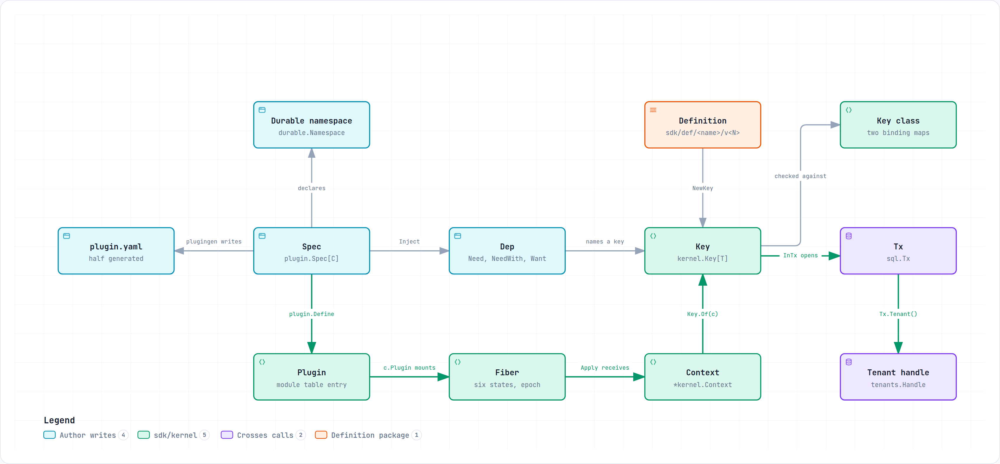
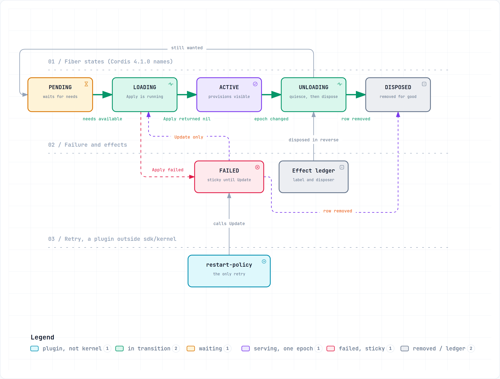
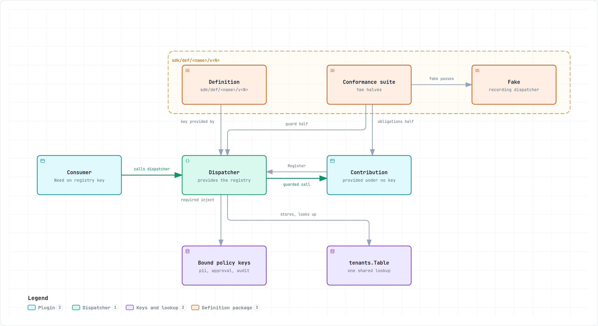
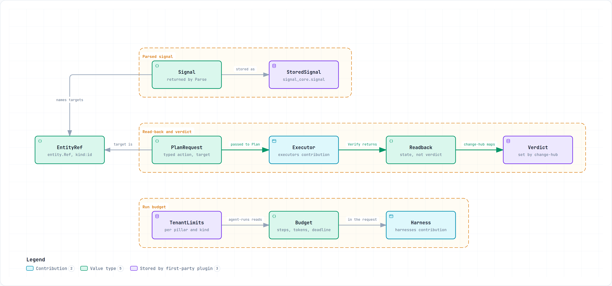
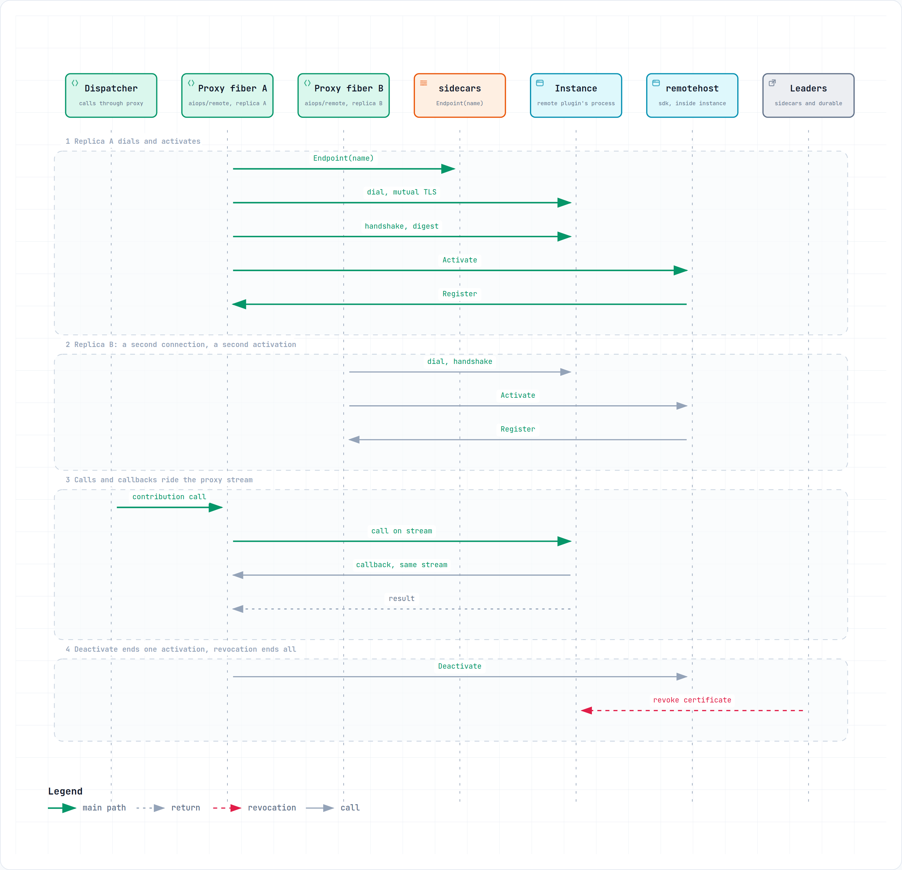
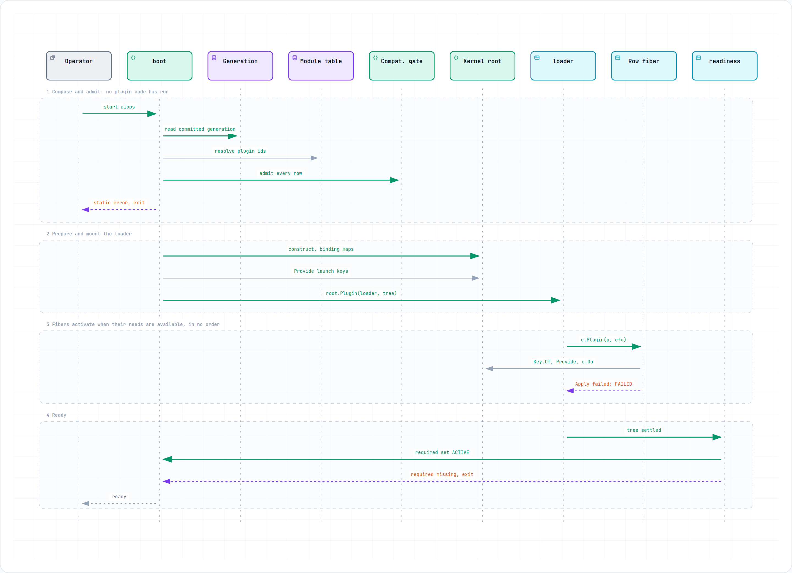
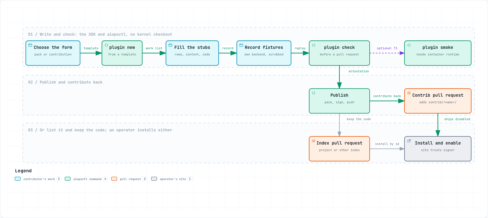
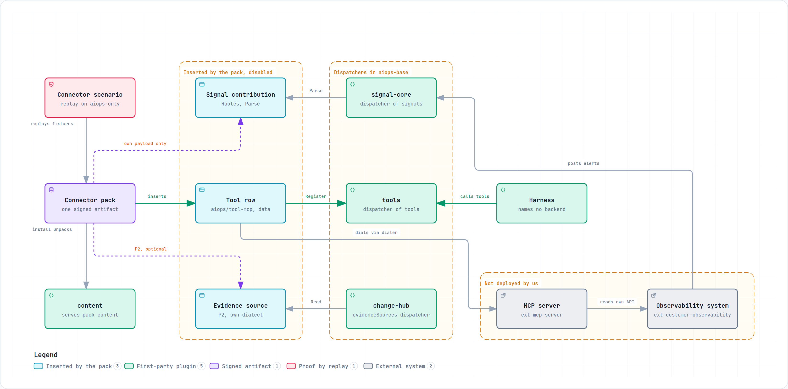
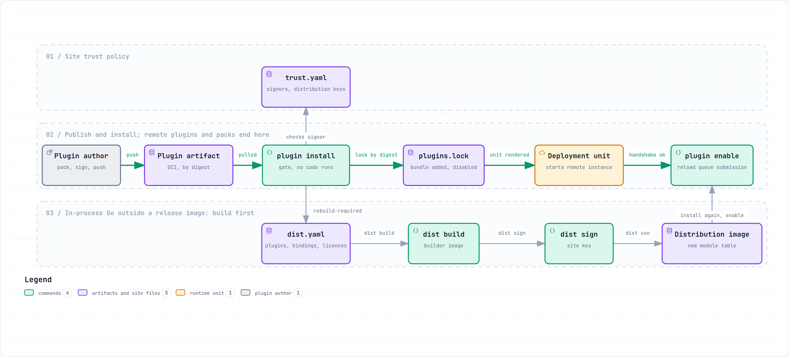

# 07. C4 code level: plugin SDK

Status: draft, 2026-11-11. Obeys `00-decisions.md` as amended on 2026-11-10 for the plugin system (ADR-033), on 2026-11-11 for the community-first order of work, marketplace readiness and vendor-neutral connectors (ADR-040, ADR-047, ADR-048), and on 2026-11-11 a second time for the agent harness as a plugin point, upstreams as plugins and the licence record (owner decisions A, B and C of §2.4; ADR-051 to ADR-055), mainly §1 principles 2, 3 and 5 to 9, §2.1 rows 1 to 3, 5, 9, 12 to 16 and 19, §2.2, §2.4, §4, §5.1, §5.2, §6.1, §6.2, §7.1, §7.2 and §8. Where this file and `00-decisions.md` differ, `00-decisions.md` wins. W2 to W13 (§2.4) were confirmed by the owner on 2026-11-11 and are owner decisions from that date; the labels stay as their ids. The detail restated here comes from the plugin record `docs/design/plugin-system-2026-11.md`, sections 3 to 5, 8 and 11 to 14, from the community record `docs/design/community-first-2026-11.md`, sections 3, 4, 6 and 7, from the harness record `docs/design/harness-and-upstreams-2026-11.md`, sections 2 to 7 and 9, and from the licence record `docs/design/licence-audit-2026-11.md`, sections 2, 5 and 7. Research: dsh-architecture, with the epoch corrected under ADR-035.

Licence statements in this file are engineering analysis, not legal advice. The questions a lawyer must answer are licence record §6; where one touches the SDK path it is marked LAWYER with its number.

A bare `§n` refers to `00-decisions.md`, "plugin record §n" to the plugin record, "community record §n" to the community record, "harness record §n" to the harness record, "licence record §n" to the licence record, and `<file> §n` to `docs/research/<file>.md`. References to this document say "section n".

## 1. Scope

This document is the C4 code level of the plugin system: the code that the kernel module, the launcher and every plugin author share. It covers the SDK modules (section 1.1), the `plugin.yaml` manifest in schema 1.0 for Go, Python and packs with no code (section 2), the context API with fibers, effects, disposal and hooks (section 3), definitions with their versions, key classes, the transaction contract and the value types that contributions and their dispatchers must agree on (section 4), the remote protocol with its handshake (section 5), the Python SDK (section 6), the row format and what a plugin sees at boot and at reload (section 7), the test tiers, the contributor path and a worked connector pack for another observability system (section 8), and install and distribution (section 9).

What each plugin does is covered in 04-c3-agent-fleet-gateway.md, 05-c3-pillars.md and 06-c3-chatops-oncall.md. The estate model and the troubleshooting method are in 09-c3-estate-and-troubleshooting.md; this document gives only the Go types they put on the SDK surface. The components that carry composition (`boot`, `loader`, `reload`, `composer`, `tenant-trees`) are in 03-c3-kernel.md, the failure matrix and the reload sequence in 08-profiles-roadmap-adrs.md, and where processes run in 02-c2-containers.md.

"Kernel" has two senses (§8.2). In this file "the kernel module" is `sdk/kernel`, the Go port of the Cordis model pinned to Cordis 4.1.0 as dsh publishes it (§2.1 row 1), and "the server" is the `aiops` binary: the launcher `boot`, the kernel module, the `loader` plugin and the plugins of one distribution. `sdk/kernel` and `loader/` are ports, so both carry two MIT notices, upstream's and the harness repository's (licence record §2.1; LAWYER Q1 confirms which notice governs the modifications).

No upstream is part of the SDK surface (principle 9). Every upstream enters through one provider or contribution behind a definition whose fake and suite name no upstream. The default agent harness, the read tools and the default on-call provider are first-party rows; HolmesGPT and GoAlert are each one optional plugin behind `harnesses` and `oncallProviders`, in optional bundles that no shipped profile lists (§2.1 rows 2 and 3).

The contract a plugin author sees is complete at the first community release, version `0.1.0`, the exit of S8b; the machinery an operator of many tenants or many replicas needs arrives later behind the same definitions (the owner decision of 2026-11-11, §2.4; §7.2). The SDK is built in phase P0, steps S0, S1, S2a, S2b, S3, S4a and S5. The ecosystem path of this document is proven on two toy registries, `sdk/def/echoers/v0` and `sdk/def/stampers/v0`, whose toy plugins live under `examples/` (ADR-060 decision 39): in-process Go, the builder, signing, the gate and a pack with no code at S2a, the remote runtime in its single-tenant form and the Python SDK at S2b (owner decision W5, §2.4). A product definition lands with its first consumer: `notifiers` at S5, the agent runtime (`tools`, `harnesses`, `agentLoop` and the two query dialect keys) at S8a, the registries of the incident loop at S8b. Some of what this document describes serves many tenants or many replicas and is built after that release, at S4b and S6b: tenant trees mounted on first use, the tenant overlay (layer 5), `composer` with canary generations, per-tenant remote instances with activations across replicas, cohort update and quarantine. Each such passage says so. None of it changes an interface a plugin compiles against.

### 1.1 Modules and code layout

The approved root module prefix is `github.com/mutex-solutions/aiops-platform` (ADR-057, superseding the initial namespace of ADR-056). The three nested SDK modules are `github.com/mutex-solutions/aiops-platform/sdk/kernel`, `github.com/mutex-solutions/aiops-platform/sdk`, rooted at `sdk/` (ADR-060 decision 54), and `github.com/mutex-solutions/aiops-platform/sdk/testkit`; the table uses their repository-relative shorthand. The owner authorized development pushes to the private repository; public disclosure remains subject to the open gate in 08 §5.1 L14.

| Path (§8.1) | Go module | Holds | May import |
|---|---|---|---|
| `sdk/kernel` | `sdk/kernel`, no `require` line | The context tree (`Extend`, `Isolate`, `Intercept`), the service store with typed keys and their classes, fibers with six states and epochs, `Event` and `Waterfall` hooks, the plugin registry and a `log/slog` front. Four built-in services: `reflect`, `registry`, `hooks`, `logger`. No product word, no policy, no tunable except three deadlines (load, drain, dispose) | The standard library |
| `sdk/def/<name>/v<N>` | `sdk` | One definition: `definition.yaml` with its own `major.minor` version (section 4.1), its key or keys, its interface and message types, the hooks it declares, `fake/` and `conformance/`. A definition marked `contrib` also holds its proto and the generated remote adapter | `sdk/kernel`, other definitions, pgx v5 (row and tag types of `sql.Tx`) |
| `sdk/plugin` | `sdk` (R1) | `Spec[C]`, `Define`, `FromManifest`, `Volatile[T]`, schema derivation behind a validator interface | `sdk/kernel`, `sdk/def/...` |
| `sdk/gate` | `sdk` (R1) | `Gate[A, V]`, the owner-side helper for monotonic policy hooks | `sdk/kernel`, `sdk/def/...` |
| `sdk/entity` | `sdk` (R1) | `Ref`, `Kind`, `New`, `Parse`: the entity reference of §8.1. A library: no lifecycle, state or registration (§4.4) | The standard library |
| `sdk/remote`, `sdk/remotehost` | R2 | The remote protocol; the plugin-side host, which is the kernel module with definitions provided by gRPC callback clients (section 5) | `sdk/kernel`, `sdk/def/...` |
| `sdk/testkit` | `sdk/testkit`, a test-only dependency | `kerneltest` (the only constructor of a kernel with both binding maps off), `sqlfake`, goleak | Anything; only `_test.go` files and the `aiopsctl` check runner import it |
| `plugins/<id>/` | the repository, or a third party's own module | One plugin: `plugin.go` with the exported `Plugin` value, `plugin.yaml`, everything else under `internal/`. A first-party plugin that wraps an optional upstream lives here too, with that upstream's cassettes, and sits in an optional bundle (§2.4 W8) | The SDK and its own dependencies; never `plugins/<other>`. An upstream library only inside the plugin that wraps it or where its register entry lists it by an accepted decision |
| `contrib/<name>/` | a Go module of its own, or no module for a pack with no code | One community plugin or connector pack kept in this repository, with the id owner `contrib`; built into `aiops-contrib` from `dist/contrib.yaml` with its rows disabled (section 8.3) | The SDK and its own dependencies; never `plugins/` or the root module |
| `templates/`, `examples/` | the repository | The templates that `aiopsctl plugin new` writes, compiled into `aiopsctl`; the toy plugins of the two toy registries, whose definitions are `sdk/def/echoers/v0` and `sdk/def/stampers/v0` (ADR-060 decision 39), the reference pack and the sample sender of §7.1 | The SDK |
| `boot/` | the repository | The launcher library: flags, layers and dumps, the module table, admission and the gate, the required audit, launch services, signals | `sdk/kernel`, `sdk/def/launch`, `sdk/def/loader`, `sdk/def/composition`; nothing else from `sdk/def/` or `plugins/`. An upstream library only where its register entry lists `boot/` by an accepted decision |
| `loader/` | the repository | The `loader` plugin with the builtins `core:group` and `core:include` | The same four as `boot/` |
| `dist/` | the repository | The release `dist.yaml`, `dist/contrib.yaml` and the module table the builder generates from each (section 9; 08 §4) | Every plugin of the distribution |
| `test/` | the repository | `failure-matrix/`, `policy-bypass/`, `cell-network/`, the recomposition suite, the `loader-smoke` profile (section 8) | The built binary |

Three tools sit beside the modules. `plugingen` reads a Go `Spec` and writes the generated half of `plugin.yaml`, `requires` included, and two test files. `aiopsctl` is the CLI and the check runner: it carries the kernel module, the host side of `sdk/remotehost`, the definition fakes, the suites and the templates. `aiops-sdk` is the Python package generated from the protos (section 6).

Boundary rules, all checked in CI and by the builder, never by review (§4.3; plugin record §3, §5):

- A plugin imports definitions and never a provider. An analyzer refuses an import of `plugins/B` from `plugins/A` and any exported package of a plugin other than `plugin.go`.
- No `fake` package and no `sdk/testkit` package may appear in the package graph of a server binary. The builder and gate check 7 read the graph.
- `sdk/kernel`, `boot/` and `loader/` grow past the line budget fixed at the S0 exit, or gain a package, only by ADR.
- No plugin outside a connector pack or a stack bundle holds a query string or calls a telemetry store's query API. CI reads the static graph and fails when a plugin of `aiops-base` or of a pillar bundle declares a need on `metricsQuery` or `logsQuery` (principle 7; section 4.3).
- No upstream name and no upstream module appears in `sdk/`, `boot/` or `loader/`, in a definition, hook, proto, fake or suite, in a dispatcher, a policy row or a row of `aiops-core`, outside the places that follow. An upstream library is imported only inside the plugin that wraps it or where its register entry lists it by an accepted decision, and its name may appear there as well, so River only under `plugins/jobs-river/`; such a list never holds `sdk/kernel`, `loader/` or a definition with its fake and suite. pgx in `sdk/def/sql` and in the four participants of `sqlDriver` (`jobs-river`, `events-outbox`, `audit-chain`, `kv-postgres`) is the one stated exception (§2.4 W2; ADR-054). The name lint (U1), the import boundary (U2) and suite neutrality (U3) run at T0 against the upstream register `tools/upstream-components.yaml` (§4.3 "Upstreams"; ADR-054).
- A third party needs the `sdk` module (which brings `sdk/kernel`), `sdk/testkit` for its tests and `aiopsctl`. A Python author needs `aiops-sdk` and `aiopsctl`. The author of a pack with no code needs `aiopsctl` alone: the connector scenario runs in `aiopsctl` and needs no container runtime (§6.2). None needs a kernel checkout.

### 1.2 Readings where 00-decisions and the two records leave detail open

Contract changes live in `00-decisions.md`. The readings below only settle detail that neither it nor the records state; each names where it is fixed.

| # | Open detail | Reading taken here |
|---|---|---|
| R1 | The record names three Go modules and puts `sdk/plugin` and `sdk/gate` in `sdk` | The `sdk` module is rooted at `sdk/` (ADR-060 decision 54), so that it holds every SDK package except the nested modules `sdk/kernel` and `sdk/testkit`. `sdk/entity` is one of its packages. 08 §4 owns the layout |
| R2 | The record names `sdk/remote` and `sdk/remotehost` and says `sdk` requires only `sdk/kernel` and pgx v5 | The two remote packages do not widen the require list of `sdk`. Where they live is fixed at S2b with the protocol (ADR-041) |
| R3 | The record gives each product definition a one-line contract, and a full Go sketch only for `notifiers` | The Go sketches of section 4.3 are those contracts with the tenant argument removed, because the tenant travels in the call's context (§5.1). Each interface is fixed when its definition lands with its first consumer, at major 0, and stays `0.y` until a release review promotes it (§4.3). Every sketch in this file therefore shows major 0: the package path `sdk/def/<name>/v0` and the key major 0. Promotion changes the import path to `v1` and nothing else |
| R4 | `credentials` is consumer-bound to `remediation`, and the contribution obligation is "take credentials only through the lease" (§2.2) | An executor never injects `credentials`. `remediation` calls `credentials.Write(token)` and the request of `Apply` and `Rollback` carries the lease accessor; for a remote executor the same accessor is the `credentials` callback, answered through `remediation` (section 5). `Plan` and `Verify` carry no token and get no write credential. What read access they use is not stated: it is open under ADR-019, which also fixes the form of a lease per target type |
| R5 | §2.1 row 15 says every estate answer is advisory; the record lists `estate` as an open key | `casefile` and `change-hub` declare `Want(estate)` and carry on with "not known" while it has no provider. `tool-estate-lookup` declares `Need(estate)`, so without an ACTIVE `estate` row the tool is PENDING, says what it waits for, and is in no tool set |
| R6 | ADR-019 makes a catalogue target an entity reference, not assumed to be a Kubernetes object | `PlanRequest.Target` is an entity reference and each catalogue action declares the kinds it accepts. Anything narrower than an entity, such as a pod name, is a typed parameter. ADR-019 confirms |
| R7 | §2.1 row 13 keys the per-run caps by pillar and kind (steps, tool calls, tokens, a deadline) and §5.5 puts them in `TenantLimits`; harness record §2.1 lists the parts of the budget; none gives Go fields | `Budget` carries steps, tool calls, input and output tokens, a deadline and a wrap-up time, each in its own unit, and `USD` as information only. The run slot is not a field: it is a lease that `agent-runs` takes before the run. The field names and the shape of the (pillar, kind) key in `TenantLimits` are sketches, fixed at S8a start under ADR-051 and ADR-012 |
| R8 | §4.1 and community record §4.4 list the manifest fields, and the plugin record the Python decorators; none gives a file layout | The YAML, TOML and Python of sections 2, 6 and 8 show the named fields in a plausible layout. The inner shape of `uses`, `registers`, `hooks`, `requires` and `integrates` (its `license` entry included), every `plugin.toml` key other than `entrypoint`, and the method names of the Python base classes and of the test fixture are fixed with manifest schema 1.0 at S2a (ADR-048), the Python parts at S2b |
| R9 | §4.3 decides the protocol major and the frozen handshake message; the record names the protocol messages `Activate`, `Register` and `Deactivate` | The field names of the handshake sketch and the other message names in section 5 are descriptive. The protocol is provisional at S2b and ratified at S5 (policy callbacks) and S4b (one tenant per connection, activations across replicas) (ADR-041) |
| R10 | The record names `gate.Gate[A, V]`, `kernel.HookUse`, `OwnedBy` and `plugin.Volatile[T]`, not their constructors or accessors | The constructor, option and accessor names in section 3.4, and the accessor names of the fakes in section 8.1, are sketches. The hook names are fixed at S5 with the stage vocabulary (ADR-043), a fake's with its definition |
| R11 | The record says the kernel module has six fiber states and names five in passing | The sixth is `LOADING`, as in `fiber.ts` of the pinned Cordis 4.1.0. The differential test holds the port to those names |
| R12 | §4.1 gives `harnesses`, `agentLoop`, `evidenceSources`, `metricsQuery`, `logsQuery` and `annotations` a one-line contract, and harness record §2 and §4.2 a table of parts; none gives a Go signature | The Go of section 4.3 is each contract as a sketch. `harnesses` is fixed at S8a start under ADR-051 and `agentLoop` under ADR-052; the display fields of `tools` and the two query keys under ADR-047 and ADR-053; `evidenceSources` at P2 start under ADR-028. The neutrality of every sketch was rechecked while writing it: none names an upstream, `annotations` carries no dashboard, organisation or panel id, and the two query keys are dialect contracts on purpose and say which dialect |
| R13 | §4.1 names `definition.yaml`, and community record §4.1 its fields | The YAML of section 4.1 shows them in a plausible layout, fixed at S2a |
| R14 | §6.2 and community record §6.4 give the parts and the directory layout of a connector pack, and harness record §5.3 the rules of a `tool-mcp` row; none gives the schema of a file or the config keys of a row | ADR-047 fixes the artifact form, its local layout, the layer forms of the content and the fixtures, and the path of a pack's conformance case per obligation (its decisions 1, 3 and 12). A `bundle.yaml` is a bundle layer (08 §1.2) with the installed-artifact clause of gate check 8 (ADR-047 decision 11). The rest of the fixture directory is fixed with the scenario that reads it, the echo scenario at S2a (ADR-060 decision 49) and the connector scenario at S8a start; the config keys of a `tool-mcp` row and of the rows of the default pack are sketches, fixed under ADR-047 at S8a start (the definitions). The tool names in the worked pack are the ones the candidate server's README listed on 2026-11-11 (section 8.4) |
| R15 | §4.1 puts the busy reply and the default label map on the route entry that `Routes` returns | The type, field and constant names of that entry (`Route`, `Busy`, `DefaultLabelMap`, `Busy503`) are sketches, fixed at S8a start under ADR-047, which also decides whether a `signals` contribution may supply its own signature verifier |
| R16 | §4.1 gives `notifiers` the class `page`, a `Recipient` and `Capabilities.Direct`, and gives `tools` a callback for the offered set of the active run; neither has a field layout | The type and field names in sections 3.2, 4.3 and 5 are sketches. The `notifiers` types are fixed before S5 ends under ADR-055, the `tools` callback and its run handle under ADR-041 (provisional at S2b, ratified at S5) and ADR-051 |
| R17 | ADR-020 makes cosign a signing tool of the release pipeline that is never baked into an image of ours, and puts verification in `aiopsctl` and on the `plugin-manager` side, linking sigstore-go; `boot/` imports neither. It does not say what `aiopsctl plugin sign` and `dist sign` run on a contributor's or a site's machine, nor how the gate in `boot/` learns that a signature was verified | Fixed by ADR-020. The two commands call one signing and verification package inside the operations plugin, which links sigstore-go v1.3.0 without its `pkg/sign`, and write a Sigstore bundle in key mode with no log entry and no timestamp, the format the release pipeline writes with cosign. A verified install or `dist use` records the signer, and install the attestation, in `$AIOPS_HOME/verified/sha256-<hex>/`, written only by `aiopsctl` under the profile write lock and mounted read-only into a kernel that runs as a container; gate check 5 compares the recorded signer with `trust.yaml` at every boot (ADR-020 decisions 1, 2, 10, 11 and 20) |

## 2. Manifest: `plugin.yaml`

Every plugin and every connector pack ships one manifest in manifest schema 1.0 (§4.1; ADR-048). It holds what the launcher, the index and the gate read without running code. Half of it is written by hand and half is generated from the plugin's own declarations, and CI fails when the generated half differs from the file. The generator is `plugingen` for Go, which reads the `Spec` (section 3), `aiops-sdk manifest` for Python, which reads `plugin.toml` and the decorators (section 6), and `aiopsctl plugin check --write` for a pack with no code, which derives the generated half from the registries its rows feed (section 8.4).

```yaml
# plugins/notifier-webhook/plugin.yaml
# --- written by hand ---
manifestVersion: "1.0"            # required; an unknown major is denied by gate check 1
id: aiops/notifier-webhook        # <owner>/<name>, equal to Spec.ID; first-party owner is aiops
version: 0.1.0
title: Webhook notifier
description: Sends a notification to a webhook URL the tenant sets.   # optional
license: Apache-2.0               # SPDX expression, required
publisher: {id: aiops}            # id equals the owner segment of the plugin id; name and url may stay empty
source: https://git.example/aiops/aiops-platform                      # optional; a placeholder URL
support: {url: https://git.example/aiops/aiops-platform/issues}       # optional; a placeholder URL
stability: preview                # experimental | preview | ga
scope: [process]                  # a set of process and tenant (section 3.5)
runtimes: [inproc]                # a list of inproc, remote, wasm; [] is a pack with no code
                                  # remote is not listed: this plugin needs dialer, which has no callback
                                  # wasm is a reserved value: it validates and the gate denies it
capabilities:
  network: ["config:/url"]        # a host, or config: and a JSON Pointer into the config, for an endpoint set there; dialled through the dialer key (§5.7)
  secrets: ["webhook-url"]        # names read in this plugin's own secret scope
instantiable: true                # first-party only: a pack may insert rows of this plugin (section 8.4)
# --- generated by plugingen from the Spec; CI fails on a difference ---
uses:                             # each set sorted, as plugingen writes it
  - {key: dialer, major: 0, as: need}
  - {key: notifiers, major: 0, as: need}
  - {key: tenants, major: 0, as: need}
provides: []
registers:
  - {key: notifiers, major: 0}    # the registry's key, as uses and provides name keys
hooks: []
configSchema:                     # JSON Schema 2020-12, derived from the config type, inline
  $schema: https://json-schema.org/draft/2020-12/schema
  additionalProperties: false
  properties:
    url: {type: string}
  type: object
durable: []
requires:                         # placeholder values
  pluginApi: "0.1"                # the author API this in-process code was built against
  definitions: {dialer: ["0.1"], notifiers: ["0.1"], tenants: ["0.1"]}   # the major.minor of every definition used, one per major
```

| Field | Written | Rule | Read by |
|---|---|---|---|
| `manifestVersion` | by hand | Required; `"1.0"` at the first community release. A reader ignores unknown fields of a higher minor; `plugin check` is strict and fails on one. The schema is frozen-additive from the release that first ships it | gate check 1 |
| `id` | by hand | `<owner>/<name>`, kebab-case, equal to `Spec.ID`. No Grafana, Loki, Tempo, Mimir, Pyroscope, Alloy, Beyla or derived marks (§8.1). The owners `aiops` and `contrib` are reserved to artifacts built by the release pipeline: the builder refuses another module that declares them. A third party uses its own publisher id as owner. Its plugin that names an external system takes the name `<contribution noun>-<system>` or `connector-<system>` (section 8.4); any other third-party plugin, for example one that only listens on hooks, takes a kebab-case name of its own under the same deny-list (§8.1). A first-party plugin that wraps an upstream outside the default stack is named `<contribution noun>-<system>`, with the upstream's lowercase technical name once, as the suffix, and only when its entry in the upstream register is marked `suffix-ok`; otherwise the id stays generic (§8.1; LAWYER Q4) | `plugin check`, the builder, the name lint (U1) |
| `version` | by hand | The plugin's own semver. A quarantine or an exemption names an exact `id@version` | `plugin-manager`, `plugins.lock` |
| `title`, `description` | by hand | English metadata; `description` is optional. A third party's title for another vendor's system reads `<own name> connector for <System>` (community record §6.7) | the index, `plugin inspect` |
| `license` | by hand | A valid SPDX expression, required; SPDX list ids only in `aiops`, `aiops-contrib` and the project index, so a `LicenseRef-` id of a closed plugin appears only outside them. The in-process allow-list (licence record §7.1; 08 §5.1 L7) applies to code linked into a binary: the builder scans the detected licences of the build list (section 9). A remote plugin is a separate program and is not restricted (08 §5.1 L16) | `plugin check` (SPDX); the builder and gate check 6 (allow-list) |
| `publisher` | by hand | `{id, name, url}`. `id` is required and equals the owner segment of `id`; `trust.yaml` limits each signer to id patterns, so a signer cannot publish under another owner. `name` and `url` are optional and may stay empty until the enterprise edition uses them | `plugin check`, install, the index |
| `source`, `support` | by hand | Optional: a source URL, and `support {url, email}`. The project index requires both | the index |
| `stability` | by hand | Compared with the profile's `minStability` | gate check 4 |
| `scope` | by hand | `process`, `tenant` or both. A remote row in a multi-tenant profile must be `scope: tenant`. A `scope: tenant` plugin may not inject the process form of a key that has a bound form | gate checks 8 and 9 |
| `runtimes` | by hand | A list of `inproc`, `remote`, `wasm`. An empty list is valid and means a pack with no code. `wasm` validates and the gate denies it (§7.3). `plugin check` runs T1 and T2 in every runtime listed | `plugin check`, `plugin install`, the trust policy |
| `capabilities` | by hand | `network`: each entry is a host, optionally with `:<port>`, or `config:` and a JSON Pointer into the config, such as `config:/url`, for an endpoint that config sets; rendered as the network policy of a remote instance, reviewed for an in-process plugin, which dials such an endpoint only through `dialer`. `secrets`: the names the plugin reads. The `secrets` view is scoped (tenant, calling plugin, name) whatever the list says, so no plugin reads another plugin's secret (§5.4). A plugin that registers with `harnesses` declares no `network` entry on a remote manifest and has no `dialer` in its `uses`: it reaches the network only through a `sidecars` endpoint of its own row, and its `secrets` list must be explained by the departures it declares (section 4.3) | install, review; for a harness also `plugin check`, the index lint and admission |
| `integrates` | by hand | Optional: `[{system, versions, tested, credential, license}]`. The external system, the versions the fixtures were recorded against, and whether the read credential is `read-only` or `broader`. `broader` is refused in the project index and in `contrib/`, and boot warns on an enabled row that declares it (§5.4). `license` names, apart from the plugin's own `license`, the licence of a process the plugin drives and the user installs; the project index does not list a plugin whose driven process is not under an open licence (licence record §7.6) | the index, the attestation, `plugin inspect` |
| `instantiable` | by hand | `true` only on a first-party generic plugin whose rows an installed artifact may insert; such a plugin registers contributions and nothing else. Three plugins at the first community release: `aiops/tool-mcp`, `aiops/signal-ingest-generic-json` and `aiops/notifier-webhook` (§6.2) | gate check 8 |
| `uses` | generated from `Spec.Inject` | Every key the plugin injects, with its major and whether it is a `Need` or a `Want` | gate check 7; the static graph of `profile render` |
| `provides` | generated from `Spec.Provides` | Every key the plugin provides. `Provide` of an undeclared key fails | gate check 7; the static graph |
| `registers` | generated | Every registry the plugin contributes to | gate check 9; the tenant-toggleable test of section 3.5 |
| `hooks` | generated from `Spec.Hooks` | Every hook the plugin may listen on, with its stage. An `On` that is not declared fails | `--dump-hooks`; the expected listener set of a gate |
| `configSchema` | generated | JSON Schema draft 2020-12 derived from the config type. Tenant-writable fields are marked, and every tenant-writable field is volatile | composition, the overlay write, `plugin check` |
| `durable` | generated from `Spec.Durable` | The namespaces the plugin owns: schema and version, key prefix, job kinds, secret scope, sidecar instances, external steps (§5.2) | the `durable` leader, the tenant delete saga |
| `requires` | generated | What the plugin needs from a distribution: `pluginApi`, the author API version, for in-process code; `remoteProtocol`, the protocol majors its SDK speaks, for remote code; `definitions`, each a list of `major.minor`, one per major (section 4.1). A pack with no code has no `pluginApi`, and its `definitions` are the registries its rows feed. An absent `requires` denies | gate checks 1 and 2, against the `serves` of the signed distribution manifest |

Five things are deliberately not manifest fields. The reload class of a provider swap belongs to the definition, not to a plugin (§6.1). The row id is set by the loader. Whether a process-scope plugin is tenant-toggleable is derived from the generated half: `registers` and `hooks` and nothing else. There is no single SDK range: `engines.aiops` is removed, because one range would make every publisher release again at every SDK major, and the gate reads the generated `requires` instead (§4.3). And schema 1.0 has no edition, entitlement, price or publisher-verification field: the enterprise edition adds what it needs with a manifest major, which a community kernel refuses by gate check 1 (§4.1).

A Python plugin writes `plugin.toml` by hand and never writes `plugin.yaml`; `aiops-sdk manifest` produces it, with `requires` holding `remoteProtocol` and the definitions the decorators name. The `entrypoint` is what `aiopsctl plugin check` and the deployment unit start (R8).

```toml
# plugin.toml: the hand-written half, for a remote Python tool
manifestVersion = "1.0"
id = "acme/tool-ticket-lookup"
version = "0.1.0"
title = "Ticket lookup"
license = "Apache-2.0"
stability = "experimental"
scope = ["tenant"]                     # a remote row in a multi-tenant profile is scope: tenant (gate check 9)
runtimes = ["remote"]
entrypoint = "python -m acme_ticket"

[publisher]
id = "acme"                            # equals the owner segment of id

[capabilities]
network = ["tickets.example.com:443"]  # rendered as the instance's egress policy
secrets = ["api-token"]
```

## 3. The context API

### 3.1 Types on the SDK surface

**Scope.** The types a plugin author touches, whatever the plugin does: the key, its class, the declared need, the `Spec`, the `Plugin` value, the context and the fiber, plus the two values that cross every stateful call, `Tx` and the tenant handle. The Go below is the whole author-facing surface of `sdk/kernel` and `sdk/plugin` (plugin record §4). The tables under the figure are complete.


*Figure 07-sdk-value-types. Source: [diagrams/src/07-sdk-value-types.json](diagrams/src/07-sdk-value-types.json).*

```go
package kernel // module sdk/kernel

type Key[T any] struct{ /* name, major, provider class, consumer class, intercept config type */ }

func NewKey[T any](name string, major int, opts ...KeyOption) Key[T] // declared only in definition packages
func (k Key[T]) Of(c *Context) T                                     // needs a declared Need or a When on k; panics *InjectError otherwise (recovered at the fiber boundary)
func (k Key[T]) Provide(c *Context, v T, o ...ProvideOption) error   // an effect; ProvideOption: Available(fn(caller *Context) bool)

// ProvideFor hands each consumer a view bound to the consumer's context: the view reads the caller's
// entry, scope values and intercept chain from the kernel, never from an argument.
func (k Key[T]) ProvideFor(c *Context, view func(caller *Context) T, o ...ProvideOption) error

func Need[T any](k Key[T]) Dep               // required: gates activation and joins the epoch
func NeedWith[T, C any](k Key[T], cfg C) Dep // Need plus per-consumer intercept config
func Want[T any](k Key[T]) Dep               // declares a When on k; never gates the plugin itself
func Intercepts[C any](caller *Context, k AnyKey) []C // the merged chain, ancestors first; read inside a ProvideFor view

type Plugin struct{ /* ID, Inject, Provides, Hooks, Decode, Apply: plain data plus two functions; a value in the module table */ }

func (c *Context) Extend() *Context
func (c *Context) Isolate(k AnyKey, label ...Label) *Context         // refused for a provider-bound key, except by its bound provider
func (c *Context) Intercept(k AnyKey, cfg any) *Context              // per-subtree config of one service
func (c *Context) Plugin(p Plugin, cfg any) *Fiber                   // mount a child fiber; an effect of c; inherits c's entry
func (c *Context) When(deps []Dep, body func(*Context) error) *Fiber // the only optional form
func (c *Context) Effect(label string, setup func() (Disposer, error)) error // ErrInactiveEffect on an unloading fiber
func (c *Context) Defer(label string, d Disposer)
func (c *Context) Go(label string, run func(context.Context) error) // tracked: cancelled and awaited at unload
func (c *Context) Std() context.Context                             // cancelled when the unload starts
func (c *Context) Enter() (leave func(), ok bool)                   // in-flight lease, taken by dispatchers

type Fiber struct{ /* State, Await, Update, Dispose, Effects */ }
type Scope[V any] struct{ /* From(c) (V, bool) for anyone; With(c, v) only from the fiber providing the owning key */ }
type Audience struct{ /* a predicate over a listener's context, built by the owner of a scope; Unscoped is the zero value */ }
type Event[A any] struct{ /* On; Bind(c) returns the dispatcher, for the fiber that provides the owning key only: Emit, Parallel, Serial, Bail, each takes (ctx, Audience, a) */ }
type Waterfall[A, R any] struct{ /* On(c, stage, fn(ctx, a, next)); Bind(c) returns the dispatcher with Run(ctx, Audience, a); no next vetoes, next twice is an error */ }
```

```go
package plugin // module sdk, rooted at sdk/ (ADR-060 decision 54): what an author writes

type Spec[C any] struct {
	ID        string              // "<owner>/<name>", equal to the manifest id
	Inject    []kernel.Dep        // data: profile render and the gate read it without running code
	Provides  []kernel.AnyKey     // Provide of an undeclared key fails
	Registers []kernel.AnyKey     // every registry Apply contributes to; the generated cycle test fails on an unlisted one
	Hooks     []kernel.HookUse    // every hook Apply may listen on, with its stage; an undeclared On fails
	Durable   []durable.Namespace // schema and version, key prefix, job kinds, secret scope, sidecar instance, external steps
	Validate  func(cfg *C) error  // pure
	Apply     func(c *kernel.Context, cfg *C) error // the only entry point; everything it registers is an effect
}

func Define[C any](s Spec[C]) kernel.Plugin // JSON Schema 2020-12 from C behind a validator interface; Volatile[T] fields
func FromManifest(m Manifest, apply func(*kernel.Context, Manifest, any) error) kernel.Plugin // declarations as data (section 5)
```

| Id | Name | Technology | Responsibility |
|---|---|---|---|
| `Definition` | Definition package | Go package `sdk/def/<name>/v<N>` | Declares keys, the interface behind each, the hooks, its own version in `definition.yaml`, a fake and a conformance suite (section 4.1) |
| `Key` | Typed key | `kernel.Key[T]` | Names one service with its major, its provider class and its consumer class. Singular for an engine or a policy, plural for a registry, `<key>.Bound` for a tenant-tree view |
| `KeyClass` | Key class | Two binding maps from the signed distribution manifest, checked in `sdk/kernel` | Says whether anyone may provide or inject the key (open) or only listed module-table entries (provider-bound, consumer-bound, signed). Section 4.2 |
| `Dep` | Declared need | `kernel.Dep` from `Need`, `NeedWith`, `Want` | Data in `Spec.Inject`. A `Need` gates activation and joins the epoch; a `Want` declares a `When` and never gates |
| `Spec` | Plugin spec | `plugin.Spec[C]` | What an author writes: id, needs, provisions, contributions, hooks, durable namespaces, `Validate` and one `Apply` |
| `Plugin` | Plugin value | `kernel.Plugin`, returned by `plugin.Define` | One entry of the module table. The entry, not an id string, is what a binding names |
| `Manifest` | `plugin.yaml` | YAML, half generated by `plugingen` | The same declarations as data, for the launcher, the index and the gate (section 2) |
| `Context` | Context | `*kernel.Context` | The one mediator: resolves keys, records every registration as an effect of its fiber, carries scope values and the intercept chain |
| `Fiber` | Fiber | `kernel.Fiber` | The running instance of a plugin: six states and an epoch (section 3.3) |
| `Durable` | Durable namespace | `durable.Namespace` in `Spec.Durable` | State that outlives the fiber and is reconciled by the `durable` leader, never dropped by an unload |
| `Tx` | Transaction | `sql.Tx`, `sdk/def/sql/v0` | One transaction under forced row-level security, the caller's database role and the tenant of the handle (section 4.4) |
| `Handle` | Tenant handle | `tenants.Handle`, opaque, no exported constructor | Carries the tenant in a call's `context.Context`; minted only through `tenantMint` (section 4.5) |

| From | To | Relationship worth explaining |
|---|---|---|
| `Definition` | `Key` | `NewKey` is called only in a definition package, so a plugin cannot invent a key or change its class. |
| `Key` | `KeyClass` | `Provide` on a provider-bound key and resolution of a consumer-bound key succeed only for a module-table entry the binding map lists. `kerneltest` is the only constructor with both maps off. |
| `Spec` | `Dep` | `Inject` is data. `profile render` finds cycles, missing providers and duplicate providers from it before boot. |
| `Dep` | `Key` | A `Need` on a key with no ACTIVE provider leaves the plugin PENDING, and the dump says what it waits for. `Key.Of(c)` without a declared `Need` or `When` panics with `*InjectError`. |
| `Spec` | `Durable` | Declares what the plugin owns outside the process. Disable keeps it, `plugin remove` detaches it and `plugin purge` drops it (§5.2). |
| `Spec` | `Plugin` | `plugin.Define` derives the config schema from `C` and returns the value the module table holds. |
| `Spec` | `Manifest` | `plugingen` writes `uses`, `provides`, `registers`, `hooks`, `configSchema`, `durable` and `requires`; CI fails on a difference. |
| `Plugin` | `Fiber` | The loader mounts one fiber per row with `c.Plugin(p, cfg)`. A child mounted from `Apply` inherits the entry and the classes of the row that mounted it, so a child spec that names itself `aiops/approval` gains nothing. |
| `Fiber` | `Context` | `Apply` receives the fiber's context. Every registration made through it is an effect, reverted in strict reverse order after a quiesce step. |
| `Context` | `Key` | `Key.Of(c)` returns the bound provision, or a view bound to the caller when the provider used `ProvideFor`. |
| `Key` | `Tx` | `sql.Key.Of(c).InTx(ctx, fn)` opens the transaction. Only `jobs`, `events`, `audit` and `kv` take a caller's `Tx`. |
| `Tx` | `Handle` | `Tx.Tenant()` returns the handle the transaction was opened with. `EnqueueTx` and `EmitTx` stamp the tenant from it, never from an argument. |

### 3.2 A worked example: one registry, one contribution

A definition is a key, an interface and a version. A registration method takes the caller's context first and is implemented as an effect. The example is the one of plugin record §4: the `notifiers` definition, the provider side of `Register` inside the `notifications` dispatcher, and a process-scope contribution. Its test is in section 8.1.

```go
package notifiers // sdk/def/notifiers/v0: a registry (plural key), provider-bound to plugins/notifications

var Key = kernel.NewKey[Registry]("notifiers", 0, kernel.ProviderBound()) // major 0 until a release review promotes it (R3)

type Notifier interface {
	Send(ctx context.Context, n Notification) (id string, err error) // ctx carries the tenant handle; n is already scrubbed
	Capabilities() Capabilities
}

type Notification struct { // field names: R16
	Class     Class      // Notice or Page
	Target    string     // the notifier row the target binding chose
	Recipient *Recipient // class Page only
	// plus severity, incident key, title and body
}

type Recipient struct{ Subject, Address string } // a platform user and the address of one contact method: personal data, never sent to a model

type Capabilities struct {
	Direct bool // can deliver to one Recipient, which a page needs
	// plus thread reply and resend
}

type Registry interface {
	Register(c *kernel.Context, name string, n Notifier) error // gone when the caller's fiber unloads
	Notify(ctx context.Context, n Notification) error          // the dispatcher: scrub; for a Notice the pre-send gate, digest and pacing; then Send
	Inventory() []Entry                                        // registrations by owning fiber; tests and the manager read it
}
```

```go
// plugins/notifications/internal: the disposer is recorded on the caller's fiber; tenants.Table is the one shared lookup.
func (r *registry) Register(c *kernel.Context, name string, n Notifier) error {
	return c.Effect("notifier "+name, func() (kernel.Disposer, error) { return r.table.Add(c, name, n) })
}
```

```go
package webhook // plugins/notifier-webhook: process scope; tenant-toggleable because it only registers a contribution

type Config struct { // URL is tenant-writable: a literal, or ${secret:name} resolved in that tenant's scope
	Timeout time.Duration
	URL     plugin.Volatile[string] `aiops:"tenant"`
}

var Plugin = plugin.Define(plugin.Spec[Config]{
	ID:        "aiops/notifier-webhook",
	Inject:    []kernel.Dep{kernel.Need(notifiers.Key), kernel.Need(tenants.Key), kernel.Need(dialer.Key)},
	Registers: []kernel.AnyKey{notifiers.Key},
	Apply: func(c *kernel.Context, cfg *Config) error {
		s := &sender{cfg: tenants.ConfigFor[Config](c), dial: dialer.Key.Of(c)} // cfg: func(context.Context) (*Config, error)
		return notifiers.Key.Of(c).Register(c, "webhook", s)                    // Send calls s.cfg(ctx): this tenant's config, from the handle
	},
})
```

What the example shows:

- The contribution is registered with the registry and provided under no key, so nothing but the `notifications` dispatcher can call it. The dispatcher scrubs, runs the `notify/pre-send` gate and applies the digest window before `Send` (§2.2). A notification of class `page` is scrubbed and sent to its `Recipient`: it is never gated, digested or paced, so nothing a plugin registers can withhold a page. That class is how the first-party on-call provider sends, which makes a page channel an ordinary `notifiers` contribution (§2.1 row 3; §2.4 W11).
- The plugin has no lifecycle interface. `Register` is an effect of the plugin's fiber: when the fiber unloads, for any reason, the registration is gone.
- There is no tenant argument. `tenants.ConfigFor` returns a function that reads this tenant's fields from the handle in the call's context.
- The plugin imports three definitions and no provider, so it mounts alone on the kernel module with three fakes (section 8.1).
- Because it registers a contribution and nothing else, the plugin can be marked `instantiable`: a connector pack may then insert further rows of it, as data (section 8.4).

### 3.3 Fibers, effects and disposal

**Scope.** One fiber of one plugin in one process: its six states, what moves it between them, and what happens to its effects. There is no boot order and no lifecycle interface: a fiber activates when what it needs is available and restarts in place when a provider changes, in every profile (§2.1 row 1). The state names follow Cordis 4.1.0 (R11). The failure outcomes per state are the one failure matrix of the set, `test/failure-matrix/matrix.yaml` (08 §1.6; plugin record §13). The figure shows the main path; the tables under it are complete.


*Figure 07-plugin-lifecycle-host. Source: [diagrams/src/07-plugin-lifecycle-host.json](diagrams/src/07-plugin-lifecycle-host.json).*

| Id | Name | Technology | Responsibility |
|---|---|---|---|
| `PENDING` | Pending | Fiber state | Waiting for every `Need` to have an ACTIVE provider that is available to this consumer. The dump and the inventory say what it waits for |
| `LOADING` | Loading | Fiber state | The config is validated and `Apply` is running on the fiber's goroutine, under the load deadline |
| `ACTIVE` | Active | Fiber state | `Apply` returned; what the fiber provides is visible to consumers |
| `FAILED` | Failed | Fiber state | The config or `Apply` failed. Sticky: the kernel module never retries |
| `UNLOADING` | Unloading | Fiber state | Quiesce, then dispose: in-flight calls drain, then effects are reverted in strict reverse order |
| `DISPOSED` | Disposed | Fiber state | Removed for good. The loader creates no entry for an id whose previous fiber is not DISPOSED |
| `Epoch` | Epoch | Value on a fiber | Derived from the fiber's revision and the uid of the provision bound to each `Need`. A different epoch means the fiber must restart |
| `Effects` | Effect ledger | Per-fiber list in `sdk/kernel` | Every registration made through the fiber's context, with its label and disposer; printed by `aiopsctl tree --effects` |
| `Provider` | Provider fiber | Any fiber that provides a key this one needs | Its state and its provision uid drive this fiber's availability and epoch |
| `restart-policy` | `restart-policy` | Plugin, `aiops-core` | The only retry: watches status events and calls `Update` on a FAILED fiber, with its own backoff and give-up rule |

| From | To | Relationship worth explaining |
|---|---|---|
| `PENDING` | `LOADING` | Every `Need` has an ACTIVE provider whose availability check admits this consumer. The availability check carries schema versions and instance readiness, so "not ready yet" is PENDING, never FAILED. |
| `LOADING` | `ACTIVE` | `Apply` returned nil. The fiber's provisions become visible and its consumers get an epoch. |
| `LOADING` | `FAILED` | The config failed its schema or `Validate`, or `Apply` returned an error, panicked or passed the load deadline. Partial effects are unwound first. A goroutine cannot be killed: an `Apply` past its deadline runs until it returns, and anything it registers later gets `ErrInactiveEffect`. |
| `ACTIVE` | `UNLOADING` | The epoch changed (a provider went away or was swapped), the row's config, `inject`, `intercept` or `isolate` changed, the row was disabled or removed, the parent unloaded, or the fiber disposed itself. Changes that arrive during a transition are coalesced: there is one transition per fiber at a time. |
| `UNLOADING` | `PENDING` | The fiber is still wanted: it waits for its needs again and loads with the new provision when one is ACTIVE. |
| `UNLOADING` | `DISPOSED` | The row was removed or its parent is gone. |
| `FAILED` | `LOADING` | Only through `Update`. A dependency change does not retry a failure. |
| `FAILED` | `DISPOSED` | The row was removed. |
| `Provider` | `Epoch` | A provider swap changes the provision uid, so every consumer restarts. A provider keeps its implementation until its dependants have finished unloading. |
| `Epoch` | `ACTIVE` | A fiber is ACTIVE only for the epoch it loaded with. A superseded load cannot fail the new target. |
| `Effects` | `UNLOADING` | Disposers run last in, first out, one at a time, each under the dispose deadline. A process-scope disposer past its deadline, or a drain past its deadline with a lease or a tracked goroutine still open, marks the fiber leaked (`kernel.ErrLeaked`, and `Leaked` in its snapshot), and the process is replaced after the drain window. |
| `restart-policy` | `FAILED` | Calls `Update`. When it gives up, the fiber stays FAILED until an operator updates it; for an infrastructure provider the process then exits non-zero. |

**What is an effect.** Everything a plugin starts or registers, so that unloading is total.

| Effect | How it is made | Reverted by |
|---|---|---|
| A provision | `Key.Provide`, `Key.ProvideFor` | The key loses its provider; consumers unload first, by epoch |
| A child fiber | `c.Plugin`, `c.When` | The child unloads before the parent's earlier effects |
| A registration with a definition | The definition's method, which takes the caller's context first: a contribution (`Register`), a route, a job handler, a subscription, a metric series, a health probe | The owner removes the entry; a later call finds nothing |
| A hook listener | `On(c, stage, fn)` on a declared hook | The listener leaves the chain |
| A goroutine | `c.Go(label, run)` | Its context is cancelled and it is awaited |
| A resource of the plugin's own | `c.Effect(label, setup)`, `c.Defer(label, d)` | The disposer that `setup` returned |

**Unload is quiesce, then dispose.** The kernel module cancels `Std()`, refuses new leases and new effects, waits for open `Enter` leases and tracked goroutines up to the drain deadline, then runs the disposers in strict reverse. A lease or a goroutine still open when the drain deadline passes marks the fiber leaked, as a disposer past its deadline does. A dispatcher takes an `Enter` lease on a contribution's fiber around each call, so a call in flight finishes before the contribution is disposed. Go cannot revoke an interface value, so every definition's suite asserts that a call after the provider is disposed returns `ErrInactive`, and a registration on an unloading or disposed fiber returns `ErrInactiveEffect`.

**Runtime effects and durable effects.** A runtime effect lives in one replica and is reverted when that replica's fiber unloads. State that must outlive a fiber (a schema, a key prefix, job kinds, a secret scope, a sidecar instance, an external step) is not an effect: it is declared in `Spec.Durable` and reconciled by the `durable` leader from committed generations, so one replica that unloads a fiber never drops a schema or a tenant's pod (§5.2).

**Health is not state.** A plugin reports `ok`, `degraded` or `failed` through `health.For(c)`. Health never unloads a dependant. `metrics.For(c)`, `tracer.For(c)` and `health.For(c)` are never a `Need`: each returns a handle that is a no-op until a `When` sub-fiber binds the provider, and their series and probes leave with the fiber.

### 3.4 Hooks, audience and gates

A hook is declared by a definition, named `<owner noun>/<event>`, and has one of three kinds (§4.3; plugin record §8).

| Kind | Type | Semantics |
|---|---|---|
| Event | `kernel.Event[A]` | Four dispatch modes: `Emit`, `Parallel`, `Serial`, `Bail`. Observers cannot change an outcome; a listener that errors or times out is skipped and logged |
| Waterfall | `kernel.Waterfall[A, R]` | Listeners run outermost first. A listener that does not call `next` vetoes the rest of the chain and the built-in behaviour; calling `next` twice is an error. `next` takes no argument: a listener transforms what `next` returns, and the listeners inward of it see the argument as dispatched. A decision that grants is never a waterfall |
| Gate | `gate.Gate[A, V]` in `sdk/gate`, built on `Event` | Monotonic. The definition declares an order over its verdicts (approval: allow, raise, deny; send: allow, delay, drop). Every listener runs, the strictest verdict wins and none may grant. An error, a panic or a timeout is the strictest verdict |

```go
package approval // sdk/def/approval/v0: a definition declares its hooks beside its key (constructor names: R10)

var Gates = gate.New[GateRequest, Verdict]("approval/gates",
	gate.OwnedBy(Key),                // only the fiber that provides approval.Key may dispatch
	gate.Order(Allow, Raise, Deny),   // the strictest wins
	gate.Stages("window", "policy"))  // chain order: declared stage, then plugin id
```

```go
// A third-party gate listener. Its per-tenant behaviour comes from the tenant-writable Windows field:
// an empty list restricts nothing. A row that listens on a gate is enabled or disabled in layers 1 to 4
// only, never by a tenant overlay (section 7.1). The overlay arrives at S4b; until then ConfigFor returns the row config of layers 1 to 4.
package freeze

type Config struct {
	Windows plugin.Volatile[[]Window] `aiops:"tenant"`
}

var Plugin = plugin.Define(plugin.Spec[Config]{
	ID:     "acme/change-freeze",
	Inject: []kernel.Dep{kernel.Need(tenants.Key)},
	Hooks:  []kernel.HookUse{approval.Gates.Use("window")}, // an On that is not declared here fails
	Apply: func(c *kernel.Context, cfg *Config) error {
		conf := tenants.ConfigFor[Config](c)
		return approval.Gates.On(c, "window", func(ctx context.Context, r approval.GateRequest) (approval.Verdict, error) {
			cf, err := conf(ctx) // this tenant's windows, from the handle
			if err != nil {
				return approval.Deny, err // an error is the strictest verdict in any case
			}
			if frozen(cf.Windows.Get(), r.At) {
				return approval.Deny, nil
			}
			return approval.Allow, nil // "allow" grants nothing: it only declines to restrict
		})
	},
})
```

```go
// plugins/approval/internal: the owner side. The audience comes from the handle, never from an argument.
if err := tenantTrees.Key.Of(c).Ensure(ctx); err != nil {
	return approval.Deny, err // the tenant's tree cannot be mounted: the check denies
}
verdict, err := approval.Gates.Check(ctx, tenants.Key.Of(c).Audience(ctx), req)
```

Rules, each deliberate and each different from Cordis:

- **Order.** By declared stage, then plugin id, never by registration, which is not deterministic under parallel activation. `aiopsctl profile render --dump-hooks` prints every chain, kept as a golden file per shipped profile and role.
- **Ownership.** Only the fiber that provides the owning key dispatches. A plugin declares the hooks it listens on in `Spec.Hooks`, and the kernel module refuses an undeclared `On`. Each hook has an access class the gate checks: `open`, `signed`, or `sealed` to the distribution.
- **Audience.** Every dispatch names its audience. A listener registered under a scope value receives only dispatches whose audience admits it. A dispatch with `kernel.Unscoped` reaches unscoped listeners only, and there is no global dispatch. The kernel module only evaluates the predicate: `tenants.Audience(ctx)` builds it from the handle and admits that tenant's tree plus the process-scope rows enabled for that tenant. A hook its definition marks as carrying tenant data cannot be dispatched with `Unscoped`: a definition lint and a kernel check both refuse it. This is why one tenant's payload never reaches another tenant's listener.
- **Expected listeners.** The owner of a gate injects `composition` to know the rows of the committed generation that declare the hook in that scope. If one of them is not ACTIVE, is unloading or is unreachable, the check denies. A plugin can add a freeze window; it cannot approve, and it cannot be made to disappear (ADR-046).
- **The ack path.** A gate on the ack path (`http/request`, `signal/admit`) admits process-scope listeners only, so it never waits for a tenant tree.
- **Remote listeners.** Allowed only on the hooks marked remote below, under a deadline, and they receive the scrubbed form of the payload. A field the definition marks raw forces the `signed` class.
- **No hook at all.** Paging and the audit append are hook-free: nothing a plugin registers can withhold a page or an audit row, and `notify/pre-send` is not dispatched for a notification of class `page`. Kill switches are not listeners: `agents-paused` is read from the `killSwitches` launch service by `casefile` before it dispatches `incident/investigate`, by `agent-runs` before every run and by `llm-gateway` on every model call.
- **Kernel hooks and the outbox are different things.** A hook is an in-process chain. `events` is the durable outbox (section 4.4).

| Hook | Kind | Owner | Access | Remote: what crosses the process boundary | Used for |
|---|---|---|---|---|---|
| `http/request`, `signal/admit` | gate | `http-server`, `signal-core` | signed | no | Tenant resolution and rate limits; per-row buckets and body limits, before any write |
| `signal/normalize` | waterfall | `signal-core` | signed | no: it runs before the scrub and near the ack path | The default label map of the sender family, then the tenant's label maps; the `signal_type` lift |
| `incident/correlate` | waterfall | `correlate` | signed | no | The storm join by `storm-mode`, the first stage (§2.1 row 5); fold rules when their trigger fires (§7.3) |
| `incident/investigate` | gate | `casefile` | signed | no | Storm mode (`storm-mode`), its one listener. The daily budget and the run slot are leases taken by `agent-runs`, and the P2 run cap is a check `casefile` makes itself before the dispatch (§4.3) |
| `run/first-message` | waterfall | `agent-runs` | open | yes: the incident key and the scrubbed summary; returned blocks are scrubbed again at `llm-gateway` | Dispatched with the pillar and the kind, so a pillar group names its builder. For (incident, `investigate`): context pack blocks in stage order (`context-pack`) |
| `run/answer` | waterfall | `agent-runs` | signed | no | Dispatched with the pillar and the kind. For (incident, `investigate`): the RCA contract check and its flags (`rca-contract`). A listener may return one follow-up message, and `agent-runs` allows at most one per kind |
| `loop/pre-step`, `loop/tool-result` | waterfall | `harness-native` | signed | no | The loop rows `loop-budget`, `loop-repeat-guard`, `loop-tool-failures` and `loop-compaction`. A listener may only tighten the next request, or replace what the model sees of one result (section 4.3) |
| `llm/request` | gate, then waterfall | `llm-gateway` | signed | no | Budget and rate; routing by tier. The scrub is the owner's inner step |
| `tools/pre-execute`, `tools/post-execute` | gate, waterfall | `tools` | open, signed | no | Effects class; output cap |
| `notify/pre-send` | gate (allow, delay, drop) | `notifications` | open | yes: target, severity and incident key, never the body | Digest, pacing, quiet hours. A listener cannot change the recipient or the content. Not dispatched for class `page` |
| `approval/gates`, `change/pre-dispatch` | gate (allow, raise, deny) | `approval`, `change-hub` | open | yes: plan digest, action class, scrubbed target references, requester subject | Change windows, freezes, a tenant policy engine |
| `tenant/create`, `tenant/purge` | event (`serial`), with compensation | `tenant-lifecycle` | signed | no | How a loaded plugin performs its own step. The participant set comes from the `durable` registry, not from the listeners |
| `composition/applied` | event | `reload` | open | no | Drift detection, inventory, audit |
| `reload/operation` | event | `reload` | open | no | Dispatched once when an operation begins to apply a generation and once when it is final. `restart-policy` holds its give-ups, and the retries of the rows the plan lists, in between, while the generation is not yet judged. A final event whose `Err` holds `ErrStateUnknown` makes `readiness` keep the latch dropped (S1 addition; ADR-059 decisions 19 and 23) |

The kernel module's own hooks (`internal/plugin`, `internal/status`, `internal/service`, `internal/config`, `internal/update`, `internal/commit`) and the loader's (`loader/patch-context`, `loader/entry-init`, `loader/volatile-update`) are sealed to the distribution. The complete list is plugin record §8.

### 3.5 Rules an author must know

- A provided service is called from many goroutines.
- `Apply` can run again in the same process, so package-level mutable state is a bug. Plugin vet refuses it, with `init`, a bare `go`, the default Prometheus registry, `http.DefaultServeMux`, `signal.Notify` and `os.Setenv` (T0, section 8).
- A goroutine starts with `c.Go`. An untracked goroutine that panics is fatal for every tenant on the replica.
- An optional dependency is a `When` body and nothing else. There is no optional read: in Go a provider can be disposed between the read and the call.
- Tenant identity is never a string argument (section 4.5). A process-scope plugin keys every in-memory table, cache and pacing window by the handle's tenant.
- Configuration that may change without a restart is a `plugin.Volatile[T]` field. Every tenant-writable field is volatile, holds a literal or `${secret:name}`, and is read through `tenants.ConfigFor`.

| Choose | When | Examples |
|---|---|---|
| `scope: process` (default) | The plugin holds nothing per tenant between calls. Per-tenant config comes from `tenants.ConfigFor`, credentials from `secrets` per call. It is tenant-toggleable only if it registers contributions and hook listeners and nothing else: no route, job handler, subscription or `Provides` | `notifier-webhook`, `notifier-email`, every `tool-*` row, `signal-ingest-*`. `harness-native` and `on-call-provider-builtin` are process scope too, and are not tenant-toggleable, because each owns more than a contribution |
| `scope: tenant` | It keeps a tenant's client, connection, process or remote instance; or a tenant may toggle it and it owns routes, jobs or subscriptions; or it is a remote plugin in a multi-tenant profile | The optional `harness-holmesgpt` (it needs `sidecars.Bound`) and `on-call-provider-goalert`, every third-party remote row in hosted |

A `scope: tenant` plugin is mounted by `tenant-trees` once per loaded tenant and reaches data only through bound views. Its `Apply` does no network I/O and starts no goroutine unless its manifest declares one, so that a tenant tree can be a cache. Until S4b `tenant-trees` mounts one pinned tree per tenant of the directory: one at the first community release, two on the test-only profile. From S4b a tree mounts on first use and unloads when idle, and rows on the ack or page path are pinned (§5.1). A plugin is written the same way for both, and its tests already run it in two trees (section 8.1).

## 4. Definitions and key classes

### 4.1 The shape of a definition

A definition is a key, an interface and a version, in `sdk/def/<name>/v<N>` with `definition.yaml`, `fake/` and `conformance/` (§4.1). It exists when a consumer does (principle 3): three roles must all exist, the definition, a provider and a consumer, and the fake is the second implementation from the first day. The catalogue of keys, with each one-line contract, class, tenant column and first-party provider rows, is §4.1; consumers and fakes are in plugin record §5.


*Figure 07-registry-dispatch. Source: [diagrams/src/07-registry-dispatch.json](diagrams/src/07-registry-dispatch.json).*

| Id | Name | Technology | Responsibility |
|---|---|---|---|
| `Definition` | Definition package | `sdk/def/<name>/v<N>` | The key, the registry interface, the contribution interface, message types, declared hooks, and `definition.yaml` with the definition's own version |
| `Fake` | Fake | `sdk/def/<name>/v<N>/fake`, a `kernel.Plugin` | A recording dispatcher or an in-memory engine that passes the suite and records its calls; exposes `Inventory()` |
| `Suite` | Conformance suite | `sdk/def/<name>/v<N>/conformance` | The obligations half for a contribution and the guard half for the dispatcher (section 8.2) |
| `Dispatcher` | Dispatcher | A first-party plugin, such as `notifications`, `tools`, `remediation`, `llm-gateway`, `agent-runs`, `paging` | Provides the registry key, is the only caller of a contribution, and applies the invariants before and after each call |
| `Contribution` | Contribution | A plugin, in process or remote, such as `notifier-webhook` | Implements the contribution interface and registers it; provided under no key |
| `Consumer` | Consumer | Any plugin with a `Need` on the registry key | Calls the dispatcher's method, never a contribution |
| `PolicyKeys` | Bound policy keys | `pii`, `approval`, `changes`, `credentials`, `audit` | Injected by the dispatcher of every effectful operation, so without them the capability does not exist |
| `Table` | `tenants.Table` | The one shared lookup of `sdk/def/tenants` | Stores contributions by owning fiber and scope; consults `tenants.Enabled(ctx, row)`; never confuses "no contribution" with "tree not mounted" |

| From | To | Relationship worth explaining |
|---|---|---|
| `Definition` | `Dispatcher` | The registry key is provided by one plugin. Where the key is provider-bound (`notifiers`, `tools`, `executors`, `harnesses`), only the entry the distribution manifest allows can provide it. |
| `Contribution` | `Dispatcher` | `Register(c, name, impl)` with the contribution's own context, so the registration is an effect of the contribution's fiber. |
| `Dispatcher` | `Table` | Every registry stores contributions in `tenants.Table`. A tenant lookup first calls `tenantTrees.Ensure(ctx)` and never falls through to a process-scope contribution of the same name for a (tenant, row) pair present in that tenant's generation. |
| `Consumer` | `Dispatcher` | The consumer declares `Need` on the registry key and calls the dispatcher. Without an ACTIVE dispatcher the consumer is PENDING. |
| `Dispatcher` | `PolicyKeys` | Required inject (M1): a dispatcher that injects `pii` or `approval` does not exist without them, so absence is closed (§4.2). |
| `Dispatcher` | `Contribution` | The owner-side guard (M2): a deadline, a concurrency cap and a breaker per (tenant, row), an `Enter` lease on the contribution's fiber, the invariant, then the call. |
| `Suite` | `Fake` | The fake passes the same suite as every real provider, in every commit. |
| `Suite` | `Contribution` | `conformance.Run(t, mount)` runs the obligations half against a contribution in each runtime its manifest lists. |
| `Suite` | `Dispatcher` | The guard half runs against the real dispatcher and against the recording fake (section 8.2). |

Definition rules, enforced by a definition lint and by every suite (§4.3):

- **No side door.** The method set of a provided value is a subset of the definition's interface.
- **Caller context first.** Every registration method takes the caller's `*kernel.Context` first and is an effect of it.
- **No use after release.** A call after the provider is disposed returns `ErrInactive`.
- **Inventory.** Every registry exposes `Inventory()`: registrations by owning fiber, read by tests, by `plugin-inventory` and by the generated cycle test.
- **No upstream.** A definition, its hooks, its proto, its fake and its suite name no upstream and import no upstream module (U3). The stated exceptions are contracts, not defaults: the PostgreSQL dialect behind `sql`, the two query dialect keys, protocols with several implementations (the S3 API, the OpenAI-compatible API, OIDC, SMTP, OCI, OTLP, the Kubernetes API and MCP), and the Go language, in which definitions are declared, with SPDX identifiers (§4.3 "Upstreams"). The cassettes of an upstream live in the plugin that wraps it, never beside the definition.
- **Go traps are provider rules.** River has no worker removal, so `jobs-river` registers kinds once and dispatches through a revocable handler table, and a job of an unowned kind snoozes. `http.ServeMux` cannot unregister, so `http-server` keeps a copy-on-write route table and answers 503 for a route the committed generation declares whose owner is not ACTIVE. The default Prometheus registry panics on a second activation, so `metrics` gives each fiber its own registerer.

**Versions.** Every definition carries its own `major.minor`, declared in `definition.yaml`; there is no single SDK range (§4.3; ADR-040, decided 2026-11-11; community record §4.1). This is done before the first plugin is published, because adding it later would be a migration for every publisher.

```yaml
# sdk/def/notifiers/v0/definition.yaml (layout: R13)
key: notifiers
version: "0.1"            # major.minor; the major is also in the import path, the key and the proto package
stability: preview
class: {provider: bound, consumer: open}
remote: contrib           # contrib | callback | no
# compatibleFrom: "0.1"   # optional, at major 0 only: the oldest minor whose plugins this minor still admits
# deprecated: {since: <release>, removeNotBefore: <date>, successor: v1}   # set on an old major inside its support window
```

| Rule | Detail |
|---|---|
| Generated, then compared | A manifest carries a generated `requires` (section 2) and a signed distribution manifest a generated `serves` of the same shape. Gate check 2 compares them. The versions of the Go modules and of the Python package are packaging numbers that no gate reads |
| Major | Any change after which a plugin that passed the suite could fail it, fail to compile or be refused at the wire |
| Minor | Additive. For a consumer, a new method. For a provider or a contribution, a new optional capability, never a new required method. On the wire, new optional fields. A suite revision inside a minor adds tests for new optional capabilities only |
| Major 0 | Every minor may break. The gate, the attestation and a remote registration need the exact minor, unless `definition.yaml` carries `compatibleFrom: 0.x`, in which case a plugin that needs a minor from `0.x` up to the served one is admitted. A plugin built for one release is rebuilt or re-attested for the next while its definitions are `0.y`. A break is in the release notes with a migration note |
| Stable major | A plugin attested on `1.3` runs where `1.y` with `y >= 3` is served |
| Support window | When `v<N+1>` of a stable definition ships, `v<N>` stays served through an adapter row, proven in CI by the old suite, for at least 12 months and two further minor releases, and leaves only in a platform major release. At most two majors of a definition are in service. The frozen package stays in `sdk/def`, so no import path changes at removal. The two numbers are initial values, reviewed after the first community release (ADR-040) |
| What the window covers | Consumers and contributions. A third-party provider of an open singular key moves with the major, and its row carries a deprecation warning from the release that ships the new one |
| Promotion to `v1` | A release review decision, once three conditions hold: a release has shipped with the definition; a `contrib` definition has passed its suite through the remote adapter; and, for the four vendor-neutral read seams (`signals`, `tools`, `evidenceSources`, `estateSources`), a second contribution or pack for a different backend family has passed. The review may waive the third with a recorded reason. `v1.0` is contract-identical to the last `0.y`, which stays served beside it through an identity adapter for the window, so the import path is the only source change |
| Other contracts | The manifest schema, the index format and the handshake message are frozen-additive from their first release, and the plugin artifact layout from its first publication (ADR-047). The author API (`pluginApi`) is `0.y`. The remote protocol is major 0 until platform 1.0, after which the kernel serves the current and the previous protocol major (section 5) |

At the first community release almost every definition is `0.y` and the platform is `0.1.0`: what exists from S2a is the mechanism, so that the support window and the index read fields that are already there. Two standing rules apply from S2a (§7.2): no definition merges without its fake, its suite, its `definition.yaml`, a provider and a consumer; and whoever changes a `0.y` definition fixes every plugin under `plugins/` and `contrib/` in the same pull request, as far as replay can prove.

### 4.2 Key classes

Each key has a provider class and a consumer class (§4.2). The kernel module checks the class against two binding maps that the launcher passes at construction, read from the signed distribution manifest. It knows nothing of what a key means.

| Class | Mark in §4.1 | What the SDK does | Count |
|---|---|---|---|
| Provider-bound | `P` | `Provide` succeeds only for a module-table entry in the allowed set. One provider; `Isolate` is refused except by the bound provider; `Want` is refused | 37 keys: 6 launch keys, 24 named keys (`harnesses` among them, bound to `agent-runs`), 7 `.Bound` keys |
| Consumer-bound | `C` | The key resolves only for the entries the manifest lists | 12 keys: `platformSql`, `sqlDriver`, `tokens`, `kek`, `loader`, `reload`, `pluginManager`, `tenantMint`, `credentials`, `durablePurge`, `profileContext`, `appExit` |
| Signed | `s` | Injected only by first-party plugins, or by an in-process plugin whose signer `trust.yaml` trusts for that key | 3 keys: `identities`, `approval`, `gateway` |
| Open | `-` | Any plugin may provide it, isolate it in a subtree or inject it | every other key |

What an author sees:

- A community or site plugin that writes `Need(platformSql)` is refused three times: by the builder, by gate check 7 (read from the generated `uses`) and at resolve in the kernel module.
- An entry is the registered `Plugin` value, never the id a plugin declares about itself.
- `kerneltest.New(t)` constructs the kernel module with both maps off, so a plugin mounts alone with a fake of any key. It requires a `testing.TB` and is the only constructor that can; the fakes it mounts can never reach a server binary (section 1.1).
- A bound key is still pluggable, in two ways. Where the allowed set has more than one entry (`kek`, `events`), layers 1 to 4 choose by the row they enable. Beyond the set, a self-hoster may build and sign a distribution that adds a provider or a consumer (owner decision W3, §2.4). Hosted runs the release distribution only.
- The honest limit: in-process Go shares the address space. The bindings, the per-plugin database role and the import boundary stop a missing, failed, mis-composed or mistaken plugin, not hostile code. Hosted therefore runs every third-party plugin out of process (owner decision W4, §2.4), and third-party plugins on hosted are not offered before the enterprise edition (§7.3).

### 4.3 Product registries: the contribution interfaces

**Scope.** The contribution interface of each product registry, as Go (R3). The registry interface around each follows the `notifiers` pattern of section 3.2: `Register(c, name, impl)`, the dispatcher's own methods, `Inventory()`. Message types live in the definition's package; for a definition marked `contrib` they are generated from its proto, which is written with the definition (§2.1 row 1). The `ctx` of every call carries the tenant handle.

```go
// sdk/def/signals/v0: registry of signal-core. Open key. Remote: the parse half only, P1.
type Ingest interface {
	Routes(ctx context.Context) (*RouteList, error)            // one Route per payload family: path suffix, auth (bearer token or HMAC), busy reply, default label map (section 4.6)
	Parse(ctx context.Context, raw *RawGroup) (*Parsed, error) // Signal{kind: alert|change|finding} with its state and source id; no correlation key (section 4.6)
}

// sdk/def/harnesses/v0: registry of agent-runs. Provider-bound. Remote: P1 (S8a). Names: R12.
type Harness interface {
	Describe() *Descriptor                                 // read without a run: boot prints it and the dump shows it
	Run(ctx context.Context, req *Request, out Sink) error // one task; cancelling ctx is the only cancel
}
type Descriptor struct {
	ID, Version string
	Upstream    string      // the upstream it drives, with its version; empty for a harness that is its own loop
	Kinds       []Kind      // investigate | ask in v0; a kind it does not list goes to the default harness
	Departures  []Departure // from the closed list of ten below; a harness in a shipped profile declares none
}
type Task struct { // what a consumer hands to Dispatch
	Kind    Kind
	Agent   string // the pillar id
	Subject string // an entity reference or an incident
	Trigger string
}
type Request struct {
	Run          RunHandle       // the run id and an opaque handle; the callbacks of a remote harness carry it
	Task         Task
	Persona      string          // content the pillar group names
	Rules        string          // the operating rules, also content, so a loop holds no prose
	FirstMessage []Block         // built by code on run/first-message; sent on unchanged
	History      History         // a neutral history, or the harness's own opaque blob
	Answer       json.RawMessage // the answer spec, a JSON Schema; empty for free text
	Tools        ToolSet
	Model        Model
	Budget       Budget    // section 4.6
	Tiers        TierRange // the tiers this run may use
}
type ToolSet interface { // read tools only, filtered to the actor's permissions; refuses a tool outside the set and the call after the cap
	Specs() []tools.ToolSpec
	Invoke(ctx context.Context, call *tools.InvokeRequest) (*tools.InvokeResult, error)
}
type Model interface { // access by tier, never a provider, a URL or a key
	Stream(ctx context.Context, tier Tier, req *ModelRequest, out ChunkSink) error // Tier: fast | standard | deep, inside the run's range
	Limits(tier Tier) ModelLimits
}
type Sink interface{ Send(*Step) error } // ModelCall, ToolCall, ToolResult, Message, Note, and one terminal Answer with StoppedBy

type Registry interface {
	Register(c *kernel.Context, name string, h Harness) error
	Dispatch(ctx context.Context, t *Task) (*Result, error) // the only way to reach a harness: selection, leases, the run row, the hooks, then Run
	Inventory() []Entry
}

// sdk/def/agentloop/v0: a singular open key, provided by harness-native, which owns both hooks. Remote: no. Names: R10, R12.
var (
	PreStep    = kernel.NewWaterfall[*Plan, *Plan]("loop/pre-step", kernel.OwnedBy(Key))          // before each model request; signed
	ToolResult = kernel.NewWaterfall[*Outcome, *Outcome]("loop/tool-result", kernel.OwnedBy(Key)) // after each tool call; signed
)
type Plan struct { // what the next request will carry, with the pillar and the kind; a listener may only tighten it
	Tools     []string       // remove, never add
	History   HistoryView    // shorten, or pin a block; the first message, the answer keys and the last two steps are never touched
	Notices   []Notice       // add one; never remove another listener's
	Directive Directive      // Continue, AnswerNow, Stop: it only moves forward
	Tier      harnesses.Tier // inside the run's range
}
type Outcome struct {
	Stored *tools.InvokeResult // what agent-runs stored: read-only
	Seen   *tools.InvokeResult // what the model sees of it: a listener may replace this
}
type Loop interface {
	// One fast-tier call through the run's model view, on behalf of a listener: it emits a ModelCall step and spends the run's budget.
	FastCall(ctx context.Context, req *harnesses.ModelRequest) (*harnesses.ModelResponse, error)
}

// sdk/def/tools/v0: registry of tools, the vendor-neutral read seam of every harness. Provider-bound. Remote: P1 (S8a).
type Tool interface {
	Describe(ctx context.Context) (*ToolSpec, error)
	Invoke(ctx context.Context, req *InvokeRequest) (*InvokeResult, error) // called by the kernel, with the kernel's own read credential
}
type ToolSpec struct {
	Name, Description string
	Params            json.RawMessage // JSON Schema
	Effects           string          // read | write
	Prerequisites     []string
	Signal            string // metrics | logs | traces | profiles | platform: an attribute, not a key, so several tools may share one
	Dialect           string // the query dialect the model writes on this tool: display text for the first-message footer, never parsed
	ScopeNote         string // one line on what the tool covers: display text for the same footer
}

// sdk/def/executors/v0: registry of remediation. Provider-bound. Remote: P2.
type Executor interface {
	Describe(ctx context.Context) (*ExecutorSpec, error)                    // action catalogue: tier, params schema, target kinds, effects, rollback
	Plan(ctx context.Context, req *PlanRequest) (*Plan, error)              // side-effect free; no token, so no write credential (R4); req.Target is an entity reference (R6); reports blast radius and pre-state
	Apply(ctx context.Context, req *ApplyRequest) (*Receipt, error)         // carries the ChangeToken and the lease accessor (R4); idempotent on the token
	Rollback(ctx context.Context, req *RollbackRequest) (*Receipt, error)   // carries the ChangeToken and the lease accessor
	Verify(ctx context.Context, req *ReadbackRequest) (*Readback, error)    // no token; a state, never a verdict word (section 4.6)
}

// sdk/def/credentials/v0: consumer-bound to remediation, so no executor can inject it.
type Leases interface {
	// Write returns the write credential for the one action that a valid ChangeToken names: one target,
	// minutes long, never stored, logged or echoed (§2.2). Any other token fails.
	Write(ctx context.Context, token changes.ChangeToken) (Lease, error) // Lease: the credential and its expiry; its form per target type is ADR-019
}

// sdk/def/oncallproviders/v0: registry of paging. Open key. Remote: P1.
type Provider interface {
	WhoIsOnCall(ctx context.Context, req *WhoRequest) (*OnCall, error) // paging caches 60 s
	Page(ctx context.Context, req *PageRequest) (*PageRef, error)      // idempotent on incident id
	Ack(ctx context.Context, req *PageAction) error
	Resolve(ctx context.Context, req *PageAction) error
	Status(ctx context.Context, ref *PageRef) (*PageStatus, error) // open, acked or resolved; read by the page reconcile job
}
type Heartbeater interface { // optional
	// Beats the provider's end-to-end monitor; paging calls it from the Watchdog alert. Where the provider returns
	// a target of its own, the alert router also posts Watchdog straight to it (ADR-021).
	Heartbeat(ctx context.Context) (*HeartbeatTarget, error)
}
// Schedules and Overrides do not enter this registry: a provider administers its own, the first-party one
// through an applied file, the API and aiopsctl oncall (harness record §8.4).

// sdk/def/chatsurfaces/v0: registry of chat. Open key. No remote form.
type Surface interface {
	Serve(ctx context.Context, in EnvelopeSink) error // started by chat with c.Go on the contributing fiber, so it ends when that fiber unloads
	Post(ctx context.Context, m *OutboundMessage) (*MessageRef, error)
	UpdateMessage(ctx context.Context, ref *MessageRef, m *OutboundMessage) error // edits a posted message in place
}
type EnvelopeSink interface{ Send(*InboundEnvelope) error }

// sdk/def/llmproviders/v0: registry of llm-gateway. Open key. Remote: P1.
type Provider interface {
	Complete(ctx context.Context, req *CompletionRequest) (*CompletionResponse, error)
	Stream(ctx context.Context, req *CompletionRequest, out ChunkSink) error
	Embed(ctx context.Context, req *EmbedRequest) (*EmbedResponse, error)
	Models(ctx context.Context) ([]Model, error)
}

// sdk/def/limitsrenderers/v0 (P2): registry of limits. Open key. Remote with the definition.
type Renderer interface {
	Backend() string                                                 // metrics | logs | traces | profiles
	Render(ctx context.Context, all []tenants.Limits) ([]byte, error) // complete tenant blocks, validated (§5.5)
	Drift(ctx context.Context, rendered []byte) ([]DriftItem, error)  // reads the backend's merged view back
}

// sdk/def/kek/v0: a singular key, provider-bound and consumer-bound. kek-local-file; kek-kms from P2.
type KEK interface {
	Wrap(ctx context.Context, dek []byte) ([]byte, error) // the tenant comes from the handle
	Unwrap(ctx context.Context, wrapped []byte) ([]byte, error)
}

// sdk/def/identities/v0: registry of identity. Provider-bound, consumer signed.
type Verifier interface {
	Verify(ctx context.Context, r *http.Request) (Caller, error) // Caller{Tenant, Subject, Verified}; the tenant is never taken from the payload
}
```

**The read seams a connector pack feeds, and the dialect keys under them.** The default stack is a choice of bundles, not of contracts (principle 7). A first-party plugin outside a connector pack or a stack bundle never holds a query string in any dialect: it calls a registry whose request is typed (`signals`, `evidenceSources`, `estateSources`, `verifiers`), and a vendor implements a contribution with its own client. A harness reads telemetry through `tools`: the model writes the query in the dialect the tool's spec names, and the tool bounds it, which is why the telemetry read tools are rows of the default connector pack and not of `aiops-base`. Query strings that first-party code sends exist only behind the two dialect keys, which are injected only by dialect-specific rows. There is no binding registry: a pack with no code mounts allow-listed tools of an MCP server through rows of the instantiable `tool-mcp` (§2.4 W9). The Go below is a sketch (R12).

```go
// sdk/def/evidencesources/v0 (P2): registry of change-hub. Open key. Remote: P2.
type Source interface {
	Read(ctx context.Context, s Scope) (*Run, error) // writes nothing; honours the window and the deadline
}
type Scope struct {
	Entities []entity.Ref // the hosts and clusters the incident's alerts name
	From, To time.Time
}
type Run struct {
	Lines  []Line   // typed lines: the query text stays inside the contribution
	Unseen []string // what the source could not see in this scope; change-hub reports it and never guesses
}
type Line struct {
	At     time.Time
	Entity entity.Ref
	Class  string // the class of the change-evidence label contract, for example package, privileged-command, unit
	Actor  string
	Ref    string // a reference to the line in its store; change-hub stores the reference, not the line
}

// sdk/def/metricsquery/v0: a singular open key and a dialect contract, like sql: the Prometheus HTTP query API with PromQL. Remote: no.
type Querier interface {
	Instant(ctx context.Context, q string, at time.Time) (*Result, error)
	Range(ctx context.Context, q string, r Range) (*Result, error) // Range{From, To, Step}
}

// sdk/def/logsquery/v0 (P1, S8a): the same for the Loki HTTP query API with LogQL. Remote: no.
type Querier interface {
	Range(ctx context.Context, q string, r Range) (*Streams, error) // Range{From, To, Limit}; on-demand reads only
}
// Both keys also carry the label and series reads the two read tools offer (harness record §5.1); their methods are fixed
// with the tools under ADR-053. ponytail: no tail and no other API on either key until a first-party reader calls one.

// sdk/def/annotations/v0: a singular open key, optional, in no required set. Remote: no.
type Annotations interface {
	Write(ctx context.Context, a Annotation) (ref string, err error) // Annotation{At, Until, Text, Tags, Entities []entity.Ref, Link}
}
```

- **`tools` as the read seam.** Which tool serves which signal is a `tools` contribution with a `Signal`, a `Dialect` and a `ScopeNote`, the same for a first-party read tool, a tool from a connector pack and a `tool-mcp` row. `context-pack` reads the inventory to list each bound signal in the footer of the first message. The product owns its read tools, so every call gets the actor filter, the effects gate, the cap, the scrub and an audit row whichever harness runs (§2.1 row 2). A harness that reads with toolsets of its own declares the departure `native-reads` and loses those fences, which boot prints.
- **`evidenceSources` (P2).** `change-hub` reads change evidence at incident open and again when the answer arrives. The first contribution, `evidence-source-logs` in `aiops-datasources`, holds the query text and injects `logsQuery`; `change-hub` itself holds none (§2.1 row 19; ADR-028).
- **`metricsQuery`, `logsQuery`.** Dialect contracts with fixture-response fakes, both at P1 (S8a), injected only by dialect-specific rows of a connector pack or a stack bundle: `tool-metrics-query` and `tool-logs-query` in `aiops-datasources` and `fleet-sweeper` in `aiops-stack` at P1, `estate-source-series` and `evidence-source-logs` in `aiops-datasources` at P2. A store that speaks the dialect is reached by repointing the endpoint of `metrics-query-http` or `logs-query-http`. A store that does not provides nothing under the key, and the rows that need it stay PENDING. There is no dialect negotiation, no translating provider and no remote adapter. The conformance corpus is limited to the queries first-party readers send. The logs tool parses no query on its side, because the query parser of the default logs store is AGPL-3.0-only; it relies on its bounds (harness record §5.2). A harness never holds these keys: it is offered the tools that do.
- **`annotations`.** Provided by `annotator` in `aiops-dashboards` at P1 and by `dashboard-sync` from P2. No row needs it, so a profile with no provider, such as `aiops-only` composed without that bundle, writes no annotation and loses nothing else. An annotation names a time or a range, text, tags, entity references and a link back to the incident or the ledger row. It carries no dashboard, organisation or panel id, so a provider for another dashboard server is an in-process plugin that provides the same key.

**What the dispatcher does around a contribution.** This is the guard half of each suite (section 8.2). Common to all: a deadline, a concurrency cap and a breaker per (tenant, row); the lookup through `tenants.Table`; for a remote contribution, the dispatcher commits state, event and audit, because a remote contribution joins no transaction.

| Registry | Dispatcher | Before and after the contribution call |
|---|---|---|
| `signals` | `signal-core` | Bearer token (the path form only for senders that cannot set headers) and the dashboard-alerting HMAC with a 5 min window. The `signal/admit` gate: the per-replica bucket, counted in requests and bytes, before any write. An empty bucket answers the busy reply of the sender family and writes nothing: `429` with `Retry-After` by default, `503` for a family whose route entry says its sender retries only 5xx. Shed deliveries are counted per row for every family. Dedupe on `(tenant, row, sha256(body))`; the raw-group insert before the ack; `signal.received` in the same transaction. After `Parse`, a change target that is key-only is refused, `Truncated` is added to the storm counter, the `signal/normalize` waterfall applies the family's default label map and then the tenant's maps and lifts `signal_type`, and `correlate` computes the correlation key (section 4.6) |
| `harnesses` | `agent-runs` | Selection: the tenant's `harnessFor.<pillar>` (from S4b, only a row an operator marked tenant-selectable), then the pillar group's `harness` field, then `defaultHarness`; a selected harness that is not ACTIVE falls back to the default, and the timeline names both. `agents-paused` is read before every run. A slot lease and a budget lease are taken before the run, and the job snoozes when one is refused. The first message is built on `run/first-message` and the answer checked on `run/answer`. Caps are enforced at the two views the harness holds, never from the stream it reports: the tool set holds read tools only, filtered to the actor's permissions, and refuses a tool outside the offered set and the call after the cap; the model view refuses a request after the step ceiling, a request with tools at the ceiling, tokens past the cap and a tier outside the range. Every step is written to `agent_runs.run_step` before it is forwarded, so a compliance or FinOps run needs no incident and `casefile` keeps a run id. With no answer at the deadline the dispatcher builds the digest from the step rows. A crash restarts the run from the first message, which is safe because every tool is a read. For each departure a harness declares, the fallback of the table below |
| `tools` | `tools` | A tool is offered only where the actor holds its permission. The `tools/pre-execute` gate classifies effects from `Describe`; write tools are never offered to a harness or chat. The output cap on `tools/post-execute`, then the scrub through `pii`, and an audit row per call. Concurrent reads per run and per tenant come from a `limiter` lease. A `tool-mcp` row fails when the live tool list of its server hashes differently from the digest the pack recorded |
| `executors` | `remediation` | `Apply` and `Rollback` are refused without a valid `ChangeToken` or with a changed digest. The target must be an entity reference of a kind the action declares. The lease comes from `credentials.Write(token)` and from nowhere else (R4). A lost call marks the change `uncertain` with the reason `executor_lost` |
| `notifiers` | `notifications` | The scrub; for a notice the `notify/pre-send` gate, the digest window and pacing; then `Send`. A notification of class `page` is scrubbed and sent to its `Recipient` through a contribution whose `Capabilities` state `Direct`, and is never gated, digested or paced. Tenant-supplied webhook URLs go through `dialer` (§5.7) |
| `oncallProviders` | `paging` | Page once per incident, reconcile, the 60 s `WhoIsOnCall` cache; `Heartbeat` on the bound provider from the `Watchdog` alert. A tenant with no provider or no bound policy pages no one, and the incident says so. No hook: nothing a plugin registers can withhold a page |
| `llmProviders` | `llm-gateway` | The `llm/request` gate (budget and rate), then its waterfall (routing by tier). The scrub is the dispatcher's inner step through `pii`, which no hook can skip. Every model call is metered under its run id from the provider's usage fields. Every call is refused while `agents-paused` is set, and the instance key of an external harness is accepted only while `agent-runs` holds a run lease for that instance |
| `chatSurfaces` | `chat` | Envelope normalisation, tenant resolution from the installation record, retry dedupe, the 3 s ack; the scrub at egress; approval decisions only through `approval.Decide` |
| `evidenceSources` (P2) | `change-hub` | Calls each enabled source, under a deadline, for the entities the incident's alerts name. Maps the lines to `external_change` rows and stores references, not lines. Reports `Unseen`, and a source that is absent or fails, as what it could not see |

**What a harness may not do.** A harness turns one task into model calls and tool calls and returns steps and one answer. It never writes or starts anything on a target, holds a credential, calls a model outside `llm-gateway`, derives or carries the tenant, builds references or flags, posts, pages, notifies or keeps tenant data after the run. One rule covers the network: a `harnesses` contributor reaches it only through a `sidecars` endpoint of its own row (section 2). The harness builds no reference and sets no flag: listeners on `run/answer` do (section 4.6). There is no approval step, because every offered tool is a free read (harness record §2.2, §2.3).

**Departures.** A harness that cannot meet a point of the contract declares it in `Describe()`, from a closed list of ten, each with a fallback in `agent-runs` that is built with the first harness that declares it. Boot prints the departures and the dump shows them. A harness in a shipped profile has none; `harness-native` has none (harness record §2.4).

| Departure | The harness says | Fallback in `agent-runs` |
|---|---|---|
| `advisory-steps` | Its step ceiling is a rendered setting of the upstream | The views still refuse at the ceiling; the run is `incomplete` |
| `best-effort-cancel` | Closing the stream may not stop the upstream | Grace, abandon, breaker; the lease ends, so its key stops working |
| `opaque-history` | A continued run needs the upstream's own history | Stored once per turn; a follow-up stays on that harness and version |
| `instance-key` | The process holds a long-lived virtual key | The key is lease-bound; concurrency 1 per key |
| `no-model-steps` | It emits no step per model call | The gateway's rows stand in |
| `native-reads` | It reads with its own toolsets and holds read credentials | The lost fences are printed at boot and recorded on every run; kind `ask` is refused unless the actor holds the full read permission of the instance credential |
| `wrapped-prompt` | Persona or first message cannot be sent unchanged | The gateway's digest of the first model request is recorded and the run is marked |
| `no-answer-schema` | It returns no structured answer | The schema is appended as a last text block and the one repair turn applies |
| `retains-run-data` | The process keeps session data | One instance per tenant, an ephemeral volume, an `external` durable namespace that blocks tenant delete until wiped |
| `opaque-context` | It cannot emit `Note` | The gateway stores a digest of every model request under the run id |

A harness that calls a vendor-hosted model itself is not admitted in this edition (§7.3).

**The first-party loop and its rows.** `harness-native` is the default harness of every shipped profile (owner decision A, §2.4): one contribution to `harnesses` that also provides `agentLoop`, in process on the worker role, in `aiops-base`. It reaches a model only through the request's `Model` and a tool only through its `ToolSet`, holds the step ceiling, the wrap-up and cancellation, and validates and executes tool calls. Everything else the loop does is a listener row on its two hooks, so a contributor changes loop behaviour through the hook interfaces by adding a row, without changing the loop implementation. P1 ships four: `loop-budget`, `loop-repeat-guard`, `loop-tool-failures` and `loop-compaction`. A listener may only tighten: the loop refuses one that adds a tool, removes another listener's notice or moves the directive back. Each row reads per-pillar overrides from the pillar group's config. Where a file of the loop is translated from dsh source it carries the DeepSeek MIT notice; the loop is written from the tables of the harness record (harness record §4; licence record §2.1).

**How a harness reaches `tools` contributions.** The contribution side above is the same for every harness, and a tool author writes `Describe` and `Invoke` and nothing else. On the harness side there is one path per topology of section 5. An in-process harness calls the `ToolSet` of its request. A remote harness calls the `tools` callback of the remote protocol, which carries the run handle and answers only for the offered set of the active run. An in-process plugin that drives an upstream process sends the run's tools with each request; the second choice is `tools-mcp-facade`, which serves the run's read tools as one MCP streamable-HTTP endpoint on `/v1/tools`, on the internal listener, with the tenant taken from the instance's virtual key and never from tool arguments (ADR-004). The facade ships only in the optional bundle `aiops-harness-holmesgpt`, and it is not the remote protocol of section 5.

**Tool rows.** P1 ships seven. The kernel-data tools are `tool-change-lookup` and `tool-runbook-fetch` in `pillar-incident`, and `tool-oncall-who` in `aiops-base`, offered only where a provider is registered for the tenant. The telemetry read tools are `tool-metrics-query`, `tool-logs-query` and `tool-traces-query` in `aiops-datasources`, and `tool-kubernetes-read` in `pillar-incident`. `tool-profiles-query` joins at S9a, and `tool-estate-lookup` in P2: one read tool over the `estate` key, with a `question` parameter (section 4.7). A read tool has closed operations, refuses a call without a time range and a limit, bounds the response bytes it reads and returns a compact typed result with a reference (query, range, deep link). The kernel calls it with its own read credential, so no harness holds one. A row id names the signal, never a store; the Kubernetes API and MCP are protocols, and naming a protocol is not naming an upstream (harness record §5; ADR-053). A tool is a typed free read. Anything that creates an object or starts a process on a target is a typed plan that a person starts through `remediation`, so there is no host-read tool and no tool that opens a shell (§1 out of scope, §2.1 row 19). Host state reaches a harness as series and logs, through the read tools. A tool row may state the pillars it joins (`pillars: [incident]`). A pillar group's tool set is its defaults plus the enabled tool rows that name it, so a contributed tool needs no edit of a first-party group (§2.1 row 12).

**`tool-mcp`.** One instantiable first-party plugin, `aiops/tool-mcp`, in the module table with no row in any first-party bundle: a pack inserts rows of it (section 8.4). A row is one MCP server over Streamable HTTP, dialled through `dialer` and never over stdio, and each allow-listed tool of that server becomes a `tools` contribution whose display fields come from the row config. Sampling, elicitation and roots are not offered. The row carries a digest of the recorded tool list and fails when the live list hashes differently. Its effects class is asserted by the pack, not proven by the recording sandbox, and model-written arguments leave the kernel, so boot prints every enabled `tool-mcp` row (§6.2; harness record §2.3, §5.3). The MCP Go SDK is linked only inside this plugin and `tools-mcp-facade`, never in `sdk/kernel`, under an exception recorded by name in the in-process allow-list: its licence file is a composite of Apache-2.0, MIT and CC-BY-4.0, and its dependencies at the tag we pin are UNVERIFIED (licence record §2.1; section 9; LAWYER Q7).

**Executor rows.** `remediation-executor-kubernetes` (P1) is the five-action catalogue of §2.2, with `lease-kubernetes` as the lease row. Its actions accept `workload` targets and, for cordon, a `host:k8s/` target (R6). P1 has no executor for a `host:agent/` target, so a host incident offers no action button (§7.1, host leg). `remediation-executor-gitops-pr` (P2) is the registry's second contribution: its write is a pull request that a person merges (§2.1 row 19). It is designed only after ADR-031 fixes the credential per Git forge. A host executor waits for its §7.3 trigger and its own ADR.

**First-party plugins that are not contributions.** `correlate` (fingerprint, the typed correlation key, the priority function), `storm-mode` (a listener on `incident/correlate` and on `incident/investigate`), the two verification checks (`verify-alert-cleared` and `verify-readback`, contributions to `verifiers` under `change-hub`), the tier table in the `approval` row's config, and `approval.Decide`, which every approval surface calls. The troubleshooting method is `context-pack` and `rca-contract`, listeners on the `run/*` hooks of `agent-runs` around whichever harness the pillar selects; it has no registry of its own (§2.1 row 16). The four loop rows are listeners on the hooks of `agentLoop`. `ask-api` is the route behind `aiopsctl ask` and, with `casefile` and `chat`, a consumer of `harnesses`.

### 4.4 The transaction contract

One `Tx` type sits behind `sql`, `sql.Bound` and `platformSql`, and its home is the `sql` definition. `sql` is a PostgreSQL 16 dialect contract with one allowed provider, `sql-postgres`, so a second SQL engine is out of scope (owner decision W2, §2.4).

```go
package sql // sdk/def/sql/v0; imports pgx v5 for row and tag types: the SDK takes this one dependency

type Tx interface {
	// No SQL-string methods (ADR-045, owner decision 2026-11-19). A plugin reads and writes through the typed
	// operations of its own reviewed catalog; the provider generates and binds the statements. API ratified at S3.
	AfterCommit(fn func())
	OnRollback(fn func())   // participant hooks: how an in-memory fake of jobs, events or audit joins
	Tenant() tenants.Handle // what the transaction was opened with; EnqueueTx and EmitTx stamp from it, never from an argument
}

// The key sqlDriver (Pgx(tx) pgx.Tx; As(tx, fn), a role switch) is consumer-bound to the providers of jobs, events, audit and kv.
```

```go
// A state change, its event, its job and its audit row commit together or not at all (principle 8).
err := sql.Key.Of(c).InTx(ctx, func(tx sql.Tx) error {
	if err := pageOps.MarkSent(ctx, tx, id); err != nil { // a typed operation of this plugin's catalog; no SQL text crosses the boundary
		return err
	}
	if err := events.Key.Of(c).EmitTx(tx, "page.sent", data); err != nil { // outbox row, stamped with tx.Tenant()
		return err
	}
	if _, err := jobs.Key.Of(c).EnqueueTx(tx, reconcile); err != nil { // River job in the same commit
		return err
	}
	return audit.Key.Of(c).AppendTx(tx, rec) // the only way a plugin writes audit (§2.2)
})
```

| # | Rule |
|---|---|
| 1 | Only the infrastructure definitions `jobs`, `events`, `audit` and `kv` take a caller's `Tx`. Each suite asserts that a rollback leaves nothing enqueued, emitted or appended. Domain plugins never pass a `Tx` to each other: they coordinate through the outbox with idempotent handlers |
| 2 | A plugin holds no SQL-string capability: its `Tx` runs only the typed operations of its reviewed catalog, and a free-form query needs a catalog extension or a separately scoped privileged provider (ADR-045, 2026-11-19). Every plugin has its own PostgreSQL role, limited to its schema and applied by the `sql` view with `SET LOCAL ROLE`; that role switch is an implementation mechanism, not the authority boundary. `events` and `audit` write through `SECURITY DEFINER` functions their providers own, and `jobs-river` switches to its own role around River's unmodified `InsertTx`. A plugin therefore cannot write approval, change, audit, outbox or River rows through `sql` (§5.2; ADR-045) |
| 3 | `events` is durable in the caller's transaction. Every provider writes the same outbox table and differs only in the relay, which is what replacing the `events` provider means |
| 4 | A cross-tenant or tenant-less enqueue, emit or fan-out needs the platform transaction, `platformSql`, which is consumer-bound |
| 5 | A remote contribution joins no transaction. It returns a result and its dispatcher commits state, event and audit in one transaction. A remote plugin's own `kv` write and audit append are separate commits |
| 6 | Schema migration is a durable effect run by the `durable` leader under the owner role. The `sql` view is available to a caller only when that plugin's declared schema version is applied, so a consumer whose schema is behind is PENDING. Anything applied before a generation commits is expand-only |

The `sql` fake is the same engine: `sdk/testkit/sqlfake` gives a throwaway schema on embedded or containerised PostgreSQL. A stateful plugin therefore needs PostgreSQL even for its solo test (§2.1 row 9).

### 4.5 The tenant in the API

Tenant identity is never a string argument of a plugin API (§5.1).

| Construct | What the author uses | Rule |
|---|---|---|
| Tenant handle | `tenants.Handle` in the call's `context.Context` | Opaque, no exported constructor. Minted only through the consumer-bound key `tenantMint`, by the entry dispatchers: the providers of `http` (after identity), `jobs` and `events` (from the tenant column their own `EnqueueTx` and `EmitTx` stamped), `signal-core`, `fleet-agentapi`, `chat`, `remote`, `tenant-trees`, `tenant-lifecycle` and platform fan-out jobs. `sql`, `secrets` and `audit` read it; no handle means zero rows |
| Per-tenant config | `tenants.ConfigFor[C](c)`, which returns `func(context.Context) (*C, error)` | Returns the row config with that tenant's tenant-writable fields, from the handle |
| Per-tenant enablement | `tenants.Enabled(ctx, row)`, consulted by the hook audience and by `tenants.Table` | A process-scope plugin never checks it itself. Conformance asserts that disabled for tenant T means zero calls of any kind for T |
| Bound views | `sql.Bound`, `kv.Bound`, `blob.Bound`, `secrets.Bound`, `audit.Bound`, `sidecars.Bound`, `tenants.Bound` | Provided only by `tenant-trees` inside a tenant tree, with no tenant argument. A `scope: tenant` plugin must use the bound form of a key that has one; a process-scope row that injects a bound key never starts |
| Keys without a bound form | `tenants.Bound.Of(c).Ctx()` | A tenant-scope plugin calls a process key such as `jobs` or `llm` with the context that carries its tree's handle |
| Tests | `tenantsfake.As(ctx, id)` | The only way a test mints a handle |

### 4.6 Value types

**Scope.** Four value types sit on the SDK surface because a contribution and its dispatcher, or two definitions, must agree on them: the entity reference, the parsed signal, the run budget and the executor read-back. What the first-party plugins do with them (the correlation ladder, the priority function, the first message, the answer check, the estate) is in 09-c3-estate-and-troubleshooting.md. The figure shows the main path of each type, from where it is produced to the contribution or the first-party plugin that receives it; the Go blocks hold every field, and the two tables at the end of this section are complete.


*Figure 07-shared-value-types. Source: [diagrams/src/07-shared-value-types.json](diagrams/src/07-shared-value-types.json).*

**Entity reference.** One identity, `<kind>:<id>`, is the correlation key, the change target and the plan target, and from P2 the estate key and the export IRI suffix (§2.1 row 15, §8.1). "EntityRef" in this set means the Go type `entity.Ref`.

```go
// sdk/entity
type Kind string

const (
	Service   Kind = "service" // the first seven name an estate entity
	Host      Kind = "host"
	Cluster   Kind = "cluster"
	Namespace Kind = "namespace"
	Workload  Kind = "workload"
	Datastore Kind = "datastore"
	Device    Kind = "device"
	Unmapped  Kind = "unmapped" // the last three are key-only: a correlation key, never an entity or a target
	Control   Kind = "control"
	Storm     Kind = "storm"
)

// Ref is comparable and always canonical. Its only constructors are New and Parse
// (UnmarshalText calls Parse); the zero value means "no reference".
type Ref struct{ s string }

func New(kind Kind, parts ...string) (Ref, error) // percent-encodes each part, joins with "/", checks the kind's part rules
func Parse(s string) (Ref, error)                 // splits at the first ":", decodes, rebuilds with New; refuses s unless it equals the result
func (r Ref) String() string
func (r Ref) Kind() Kind
func (r Ref) Parts() []string // decoded
func (r Ref) KeyOnly() bool   // unmapped, control, storm
func (r Ref) MarshalText() ([]byte, error)
func (r *Ref) UnmarshalText(b []byte) error
```

| Rule | Detail |
|---|---|
| Grammar | `<kind>:<id>`. The kind ends at the first `:`. The id is the identifying parts joined by `/`, each percent-encoded with `url.PathEscape`, so a `/` inside a part cannot split it |
| Closed kinds | The ten kinds of §8.1 (ADR-025). An unknown kind is refused, never kept as a string |
| Host forms | `agent/<fleet_collector_id>`, `k8s/<cluster>/<node>` or `ext/<value>`. Any other first part or part count is refused |
| Parts per kind | One table inside `sdk/entity`, fixed by ADR-025. `New` and `Parse` check a reference against it |
| Canonical form | `Parse` accepts only what `String` prints. One entity therefore has one string, `==` in Go and `=` in SQL are identity, and no caller normalises |
| Spelling | Parts are kept as the labels spell them: no case folding and no trimming |
| Key-only kinds | `unmapped`, `control` and `storm` key an incident and name no entity. `signal-core` and `remediation` refuse one as a change target or a plan target, and `estate` answers "not known" for one |
| Storage and wire | The canonical string: a text column, a JSON string and a proto string field, so it crosses the remote boundary with no shared message |

| Test in `sdk/entity` | Input | Expected |
|---|---|---|
| Round trip | `service:prod/shop/checkout`, `host:agent/7f3c` | `Parse` then `String` returns the input; `Kind` and `Parts` match |
| Host forms | `host:k8s/prod-east/node-1`, `host:ext/db01` | Accepted. `host:vm/x` and `host:agent/a/b` are refused |
| Escaping | `New(Host, "ext", "rack 4/u12")` | `host:ext/rack%204%2Fu12`, and `Parts` returns `rack 4/u12` |
| Canonical only | `Host:agent/7f3c`, `host:ext/a%2fb`, `host:ext/a%62` | Refused |
| Closed kinds | `pod:prod/shop/web-1`, `:x`, `service` | Refused |
| Key-only | `control:<id>`, `unmapped:<fingerprint>` | Accepted; `KeyOnly` is true |
| Fuzz | Any kind and parts that `New` accepts | `Parse(New(...).String())` equals the `New` result |

**Parsed signal and route entry.** `Parse` returns the signals of one payload. The correlation key and `signal_type` are not among their fields, so no contribution can set them. What differs between sender families is named, so that no first-party plugin reads a vendor's payload: the state of an alert, the sender's own id for it, the count a payload left out, and, on the route entry that `Routes` returns, the reply the sender retries and the family's default label map (§4.1).

```go
// sdk/def/signals/v0
type Parsed struct {
	Signals          []Signal
	Truncated        int  // the number of alerts the sender says it left out of this payload
	CompleteSnapshot bool // signal-ingest-policyreport: the payload lists every current finding of its source and scope
}

type Signal struct {
	Kind     string            // alert | change | finding
	State    string            // firing | resolved
	SourceID string            // the sender's own id of this alert instance
	Labels   map[string]string // as the sender spelled them; a shipped rule's signal_type arrives here as a label
	Targets  []entity.Ref      // change only: the entities the payload names
	// plus the payload family's own fields: annotations, times, idempotency key
}

type Route struct { // one entry of the RouteList that Routes returns (names: R15)
	Suffix          string   // path suffix under /v1/ingest/<row-id>
	Family          string   // the payload family
	Auth            string   // bearer token or HMAC
	Busy            int      // what an empty admission bucket answers: 429 (default), or 503 for a sender that retries only 5xx
	DefaultLabelMap LabelMap // the family's labels or tags to canonical labels: the shape of a tenant's label map (05-c3-pillars.md §5.1)
}
```

| Field | Set by | Rule |
|---|---|---|
| `Kind`, `Labels` and the payload fields | The contribution, in `Parse` | As the sender spelled them. The family's default label map and then the tenant's maps map them afterwards, on `signal/normalize` (05-c3-pillars.md §5.1) |
| `State`, `SourceID` | The contribution, in `Parse` | `firing` or `resolved`, and the sender's id of the alert instance, which pairs a resolved signal with its firing one. `verify-alert-cleared` reads resolved signals, so verification needs no backend query whichever system sent the alert. The `signals` suite carries a firing and resolved fixture pair for every family |
| `Truncated` | The contribution, from the payload | `signal-core` adds it to the storm counter, so a sender that caps a payload still drives storm mode (§2.1 row 5) |
| `Busy`, on the route entry | The contribution, in `Routes` | The status this family's sender retries. `signal-core` answers it from an empty admission bucket and writes nothing; shed deliveries are counted per row for every family. Holding the request until the bucket refills waits for its trigger (§7.3) |
| `DefaultLabelMap`, on the route entry | The contribution, in `Routes` | Data shipped with the family, applied before the tenant's map, so a tenant overrides it and a contribution never rewrites labels in `Parse` |
| `Targets` | The contribution, on a change signal | A set of entity references built with `entity.New` from what the payload names: workload, namespace, cluster, host, and the service when the payload names it. `signal-core` adds the service when the tenant's label map resolves one, and the set is stored on `change_hub.external_change` (§5.2). A change is a candidate cause when one of its targets equals the incident key or an entity label on the incident's alerts (§2.1 row 16) |
| `CompleteSnapshot` | The contribution, from the payload | `signal-ingest-policyreport` only. A finding that a payload omits is closed only when that payload is a complete snapshot (ADR-018; 05-c3-pillars.md §7) |
| `signal_type`, a column of `signal_core.signal` | `signal-core`, on `signal/normalize` | Lifted from the `signal_type` label that every shipped rule carries (§2.1 row 17). Empty for a rule we did not ship |
| `correlation_key`, a column of `signal_core.signal` | `correlate` | An entity reference, by the ladder service, entity, `unmapped`; `job` is never an identity (§2.1 row 16) |

**Run budget.** The request to a harness carries the first message that the pillar's builder made on `run/first-message` (for an incident run, `context-pack`) and the answer spec its checker set (`rca-contract`; §2.1 row 16), the `ToolSet`, the `Model` and this `Budget`. A harness sends the message and the spec on unchanged and returns the answer as text, and as JSON when a spec is set. `rca-contract` parses the answer on `run/answer`, builds every entity reference from the names the model gave and sets the flags `degraded`, `incomplete` and `unresolved`. No harness builds a reference or sets a flag (ADR-030).

The budget is keyed by pillar and kind: `TenantLimits` holds one `Budget` per (pillar, kind) and one default, and `agent-runs` puts the one for the task into the request (§5.5). An incident investigation and a chat question therefore run under different caps on the same harness.

```go
// sdk/def/harnesses/v0 (field names and the key shape: R7)
type Budget struct {
	Steps        int           // model requests in the run
	ToolCalls    int           // tool calls in the run, those of child agents included
	InputTokens  int
	OutputTokens int
	Deadline     time.Duration // the wall-clock limit of the run
	WrapUp       time.Duration // at Deadline minus WrapUp a conforming harness sends one last request without tools
	USD          *float64      // information only; nil where the model's price is an explicit zero
}

type BudgetKey struct { // the key under which TenantLimits holds a Budget; the zero value is the default
	Pillar string
	Kind   Kind
}
```

| Field | Unit | Enforced by |
|---|---|---|
| `Steps` | model requests | The model view of the run and `llm-gateway`: a request after the ceiling, or a request with tools at the ceiling, is refused. `harness-native` also holds the ceiling itself and sends its last request without tools |
| `ToolCalls` | tool calls | The tool set of the run, which refuses the call after the cap and any tool outside the offered set |
| `InputTokens`, `OutputTokens` | tokens | The model view and `llm-gateway`, from the provider's usage fields; a harness's reported usage and a static price table are the fallback meters (§2.1 row 13) |
| `Deadline`, `WrapUp` | seconds | `agent-runs` cancels the run's context at the deadline, with a short grace. Steps already sent stay. With no answer the dispatcher builds a digest from the step rows, the run is flagged `incomplete` and an incident stays open |
| `USD` | money | Not enforced at this boundary. It is present only where the price table states a rate. `llm-gateway` enforces the daily budget, in USD or, where the price is an explicit zero, in runs; an absent price is a configuration error (§2.1 row 13) |

None of these is enforced from the stream a harness reports: the stream is transcript only (harness record §2.3). Run slots are not a field. `agent-runs` takes a slot lease and a budget lease from `limiter` before the run and releases them after it (03 §8.2); the tenant total is the smaller of 2 and the model endpoint's parallelism, and incident runs are taken before chat turns (§5.5).

**Read-back and verdict.** An executor reports what it read, and `change-hub` chooses the verdict word, so `uncertain` means the same for every executor (05-c3-pillars.md §5.6).

```go
// sdk/def/executors/v0
type Readback struct {
	State  string // applied | not_applied | unreadable
	Detail string // what was read, for the timeline
}
```

| What `change-hub` sees | Verdict | Then |
|---|---|---|
| The incident's alerts resolved after the write (`verify-alert-cleared`) | `cleared` | The change completes |
| `Verify` returns `applied` (`verify-readback`), and the alert still fires when the window ends | `still_present` | The change completes and the incident stays open |
| `Verify` returns `not_applied` | `failed` | The rollback policy starts |
| `Verify` returns `unreadable` | `uncertain`, reason `unreadable` | A person is asked; nothing rolls back |
| The executor call is lost or misses its deadline | `uncertain`, reason `executor_lost`, set by the `remediation` dispatcher | The same |
| `remediation` refuses `Apply` before it acts | No verdict | Not a failed change |

The reason list on `uncertain` is closed and defined in 05-c3-pillars.md §5.6; the two reasons above are the ones this boundary produces. The share of `uncertain` verdicts, by reason, is the measure behind the paid verification turn (§7.3).

| Id | Name | Technology | Responsibility |
|---|---|---|---|
| `EntityRef` | Entity reference | Go type `entity.Ref`, `sdk/entity` | One canonical `<kind>:<id>` string for correlation keys, change targets, plan targets and, from P2, estate keys |
| `Signal` | Parsed signal | Go struct, `sdk/def/signals/v0` | What `Parse` returns: kind, state, the sender's id, labels and, on a change, the target references |
| `StoredSignal` | Signal row | Table `signal_core.signal` | The parsed signal plus `signal_type` and `correlation_key`, neither set by a contribution |
| `Budget` | Run budget | Go struct, `sdk/def/harnesses/v0` | Steps, tool calls, tokens, deadline and wrap-up time in their own units; USD as information |
| `TenantLimits` | Tenant limits | Versioned document, `tenant_directory.tenant_limits` | Holds one `Budget` per (pillar, kind) and one default |
| `Harness` | Harness | Contribution to `harnesses` (section 4.3) | Runs one task inside the budget of its request |
| `PlanRequest` | Plan request | Go struct, `sdk/def/executors/v0` | A typed action, its parameters and a target that is an entity reference |
| `Readback` | Read-back | Go struct, `sdk/def/executors/v0` | `applied`, `not_applied` or `unreadable` |
| `Verdict` | Verification verdict | `change-hub`, table `change_hub.verification` | `cleared`, `still_present`, `failed`, or `uncertain` with a reason |

| From | To | Relationship worth explaining |
|---|---|---|
| `Signal` | `EntityRef` | A change signal names its targets as a set of references. |
| `Signal` | `StoredSignal` | `signal-core` stores each parsed signal and fills `signal_type`; `correlate` fills the correlation key, which is itself an `EntityRef`. |
| `TenantLimits` | `Budget` | Keyed by pillar and kind. `agent-runs` reads the one for the task and puts it into the request. |
| `Budget` | `Harness` | The harness receives the budget, and the caps are enforced at the two views it holds (the tool set, the model view with `llm-gateway`), never from the stream it reports. |
| `PlanRequest` | `EntityRef` | The target is a reference, not a Kubernetes object. The executor resolves it, and `Plan` holds no write credential while it does (R4). |
| `PlanRequest` | `Executor` (section 4.3) | The request is the argument of `Plan`, which is side-effect free and reports blast radius and pre-state. |
| `Executor` (section 4.3) | `Readback` | `Verify` returns a state and never a verdict word. |
| `Readback` | `Verdict` | `change-hub` maps the state to one of four words. |

### 4.7 The `estate` definition (P2)

The `estate` plugin (`aiops-base`, P2) owns a projection of the customer estate that can be dropped and rebuilt from its sources (§2.1 row 15). Another plugin reaches it only through the `estate` key, never through the `estate` schema. Its readers are contributions to `estateSources`. The first, `estate-source-series`, is a row of `aiops-datasources` over `metricsQuery`; `estate` itself holds no query string, so a reader for a store that does not speak that dialect is one more contribution.

```go
// sdk/def/estate/v0, P2. An open key; the tenant comes from the handle.
type Estate interface {
	// Read-only. "Not known" is an answer (Known is false), not an error.
	Ask(ctx context.Context, q Question, ref entity.Ref) (Answer, error)
}

type Question string // lookup | neighbours | dependents | owner | hosting_chain

type Answer struct {
	Known     bool
	Entities  []Entity   // reference, class, attributes, aliases, stale mark
	Relations []Relation // subject, verb, object, origin: declared | read | traced | flow
	Basis     string     // estimated | runtime | computed (§8.2)
	Gaps      []string   // what the answer could not see
}
```

| Question | Answers |
|---|---|
| `lookup` | The entity behind the reference: class, attributes and aliases |
| `neighbours` | Its asserted relations one hop out, each with its origin |
| `dependents` | What depends on it, from the dependency closure |
| `owner` | The team that owns it |
| `hosting_chain` | What it runs on, down to the host, from the hosting closure |

- **One call, one enum.** The five questions share a request and an answer shape, so `tool-estate-lookup` and the fake are one method each. `estate` is not in the callback set of section 5, so a remote plugin never calls it. `ponytail:` give a question its own method when its answer needs a field the others lack.
- **A basis on every answer.** A consumer that shows an estate fact shows its basis with it.
- **Advisory.** A caller treats an error or a timeout as "not known". No dispatcher fails a call on an estate answer, and no gate listens on one.
- **Optional for its consumers.** `estate` is in no required set. `casefile` and `change-hub` declare `Want(estate)`; `tool-estate-lookup` declares `Need(estate)` and is PENDING without it (R5).
- **Read-only.** The interface has no write. No entity or relation is created or edited through the kernel API or chat, so none is created through the SDK either.
- **Key-only references** (`unmapped`, `control`, `storm`; section 4.6) name no entity and are answered "not known".

How the projection is read, derived and bounded, and what each consumer asks, is in 09-c3-estate-and-troubleshooting.md.

## 5. Remote plugins: the protocol

There are two runtimes, both proven before the first community release: in-process Go through the builder at S2a, and remote over gRPC at S2b, in its single-tenant form (§2.1 row 1; owner decision W5, §2.4). `wasm` is a reserved value of the manifest's `runtimes` and is not built; by owner decision it does not arrive before the enterprise edition (§7.3). A pack with no code has no runtime at all: its rows are rows of first-party plugins (section 8.4).

| Runtime | For | Isolation | Enters a profile by | Live |
|---|---|---|---|---|
| In-process Go | First-party rows, infrastructure providers, anything in a transaction or on the ack path, reviewed community plugins under `contrib/` | None: trusted code, not a sandbox | The distribution builder, into the module table | No: a new binary |
| Remote over gRPC, any language | Third parties, Python, any third-party harness, code or commands a model wrote (principle 6) | Process, and a network policy from `capabilities`; deny-all egress for a harness. One shared instance per plugin on a self-host; one instance per (tenant, plugin) in hosted, from S4b | `aiopsctl plugin install` | Yes |

**A remote plugin is a set of contributions, not a full plugin.** It is a first-class fiber only on its own side of the connection.

| A remote plugin can | A remote plugin cannot |
|---|---|
| Register with registries marked `contrib` in §4.1 | Provide a key, or isolate one |
| Listen on the hooks marked remote in section 3.4 | Listen on any other hook |
| Call the callbacks below | Mount children; register a route, a job handler or SQL |
| Keep its own `kv` and `blob` state and append audit, each as its own commit | Join a transaction |

In hosted every third-party plugin runs remote, so in hosted a third party can never add a provider, a definition or a registry (owner decision W4, §2.4). That is the price of the isolation of §4.2. Third-party plugins on hosted are themselves deferred to the enterprise edition (§7.3); what the community edition builds, at S4b, is the mechanism.

**Protocol version and handshake.** Decided (§4.3; community record §4.3), so that a later change is not a migration for every published plugin.

| # | Rule |
|---|---|
| 1 | The protocol major is the proto package, `aiops.remote.v<N>`. It is major 0 (`aiops.remote.v0`, exact match) until platform 1.0; after that the kernel serves the current and the previous major. Inside a major, changes are additive, and both sides ignore unknown fields, calls and feature names |
| 2 | One handshake message, in its own package `aiops.remote.handshake`, opens every connection and is frozen-additive from its first release. The kernel dials, both sides send the list of majors they speak, and the kernel picks the highest common one. With none, both sides log the two lists and the kernel closes the stream. This is gate check 3 |
| 3 | The first message of the chosen major carries the plugin id, version and manifest digest, which must equal `plugins.lock`; the activation id; the definitions the plugin registers with, each as `name@major.minor`; and feature names. The tenant and the row come from the connection certificate, never from a field. One optional field is reserved for a record the kernel passes to the plugin; nothing reads it in the community edition |
| 4 | A dispatcher accepts a registration when it serves that definition major and the minor rule of section 4.1 holds: at major 0, the exact minor |

```proto
// package aiops.remote.handshake: the one message whose shape does not depend on the protocol major (field names: R9)
message Hello {
  repeated uint32 majors = 1;          // the protocol majors the sender speaks
  Kind kind = 2;                       // KERNEL | PLUGIN
  map<string, string> diagnostics = 3; // SDK name and version, release; logged, never read for a decision
}
```

**The proxy fiber.** `aiops/remote` is an in-process plugin with one row per remote instance, built with `plugin.FromManifest` from the remote's `plugin.yaml` at install. Its `Inject`, `Hooks` and registrations are that row's own, the hook dump and the static graph read them, and the kernel module learns nothing about "remote". A remote plugin therefore activates and unloads by the rules of section 3.3.

The figure shows the main path of one instance served by two replicas, the form built at S4b. At the first community release there is one process, so one proxy fiber (`ProxyA`) and one activation per instance, over the same protocol. The tables and the rules under it are complete.


*Figure 07-remote-activation. Source: [diagrams/src/07-remote-activation.json](diagrams/src/07-remote-activation.json).*

| Id | Name | Technology | Responsibility |
|---|---|---|---|
| `ProxyA`, `ProxyB` | Proxy fibers | `aiops/remote` rows, one per replica that mounts the row; a second replica exists from S4b | Dial the instance, handshake, register its contributions with the dispatchers on its behalf, serve its callbacks |
| `Sidecars` | `sidecars` | Definition; `sidecars-static`, or `sidecars-kubernetes` in hosted | `Endpoint(name)` of the instance, available only while the instance is ready, so the proxy is PENDING until then |
| `Instance` | Remote plugin instance | The plugin's own process, any language | Serves the contribution services of its definitions on one stream per connection |
| `RemoteHost` | `sdk/remotehost` | The kernel module inside a Go plugin process; `aiops-sdk` in Python | Runs one fiber per activation, with that activation's config |
| `Dispatcher` | Dispatcher | `tools`, `notifications`, `agent-runs` and the others | Calls the contribution through the proxy, under its deadline, cap and breaker |
| `Leaders` | `sidecars` and `durable` leaders | Leaders on the worker role | Create the instance, its certificate, its virtual key and its secret scope as durable effects; revoke them |

| From | To | Relationship worth explaining |
|---|---|---|
| `ProxyA` | `Sidecars` | The kernel dials the plugin, never the reverse. The endpoint comes from `sidecars`. The external orchestrator launches the plugin process; the kernel connects to it and never launches it. |
| `ProxyA` | `Instance` | Mutual TLS: the instance presents a certificate issued for (tenant, plugin instance), the replica presents the cell's kernel certificate. Row and tenant come from the connection, never from a request field. On a single-tenant self-host no cell certificate authority exists, and the instance identity there is open (ADR-041). |
| `ProxyA` | `Instance` | The frozen handshake, then the first message of the chosen major: plugin id, version, manifest digest, activation id and the definition versions it registers with. No common major, a digest that differs from `plugins.lock` or a definition version that is not served denies (gate check 3). |
| `ProxyA` | `RemoteHost` | `Activate{activation, generation, config}`. An activation id is (replica id, epoch). |
| `RemoteHost` | `ProxyA` | `Register{activation, effect_id, definition, spec}`, where the definition is named `name@major.minor`. A registration from a superseded activation is refused, which is `ErrInactiveEffect` across the process boundary. |
| `ProxyB` | `RemoteHost` | From S4b. A second replica is a second connection and a second activation, so replicas on different generations are each served their own config. |
| `Dispatcher` | `ProxyA` | A contribution call. The dispatcher has already applied its invariants; the payload a remote listener receives is scrubbed. |
| `Instance` | `ProxyA` | Callbacks ride the proxy's own stream, never a load-balanced listener, and are accepted only by the replica that holds that ACTIVE activation. |
| `ProxyA` | `RemoteHost` | `Deactivate{activation}` ends that connection's registrations only. One replica's idle unload does not touch another's contributions. |
| `Leaders` | `Instance` | On disable, remove and quarantine the leader revokes the certificate and the virtual key first, then deletes the pod. From that moment every replica refuses the stream. |

**Callbacks.** The whole set; a remote plugin has no other way into the server (ADR-041: provisional at S2b, the policy callbacks ratified at S5).

| Callback | Scope |
|---|---|
| Telemetry | Logs, metrics and traces over OTLP |
| `secrets` | Read-only, the instance's own (tenant, plugin, name) scope |
| `kv`, `blob` | The plugin's own prefix; each write is its own commit |
| `audit` | Append, as its own commit |
| `llm` | Through `llm-gateway`, with the instance's virtual key. For a harness: by tier, each call carrying the run handle, so it is metered and capped under that run |
| `tools` | For a harness only: `Specs` and `Invoke` on the offered tool set of the active run, each call carrying the run handle. A call for another run, for a run that ended or for a tool outside the set is refused (R16) |
| `tenants` | The tenant record, read-only |
| `credentials` | For an executor only, answered through `remediation` with the `ChangeToken` of the call in flight (R4) |

**Three ways a harness runs** (harness record §2.5). The contract of section 4.3 is the same in all three. S8a builds the first two, with a remote reference harness on the callbacks as the proof of the second; the third arrives with `harness-holmesgpt` at S8b, because the gateway's HTTP surface, the facade and the key lease have no earlier consumer.

| Topology | Who starts the process | Model and tools reached by | Fence |
|---|---|---|---|
| The plugin is the harness, in process (`harness-native`) | The kernel | The `Model` and `ToolSet` of the request | The plugin vet and the import boundary |
| The plugin is the harness, remote | The orchestrator, as for any remote plugin | The `llm` and `tools` callbacks, each carrying the run handle | Deny-all egress; one instance per tenant in a multi-tenant profile |
| An in-process plugin drives another process (an external harness) | `sidecars` | The HTTP surface of `llm-gateway`, off by default, with a lease-bound key; tools sent per request or through `tools-mcp-facade` | An internal compose network rendered by the plugin, a NetworkPolicy on Kubernetes; for a static unit boot says the fence is the operator's |

A remote plugin that wraps a third process needs loopback shims in the SDKs; they wait for the first third-party remote harness that wraps an upstream process (§7.3).

Rules of the boundary:

- **One tenant per instance, where there are many tenants.** In a multi-tenant profile a remote row must be `scope: tenant`, and a remote manifest that declares anything outside the contribution set is refused. This is gate check 9. Hosted runs one pod per (tenant, remote plugin), from S4b; the cost model is ADR-036. The first community release runs one shared instance per plugin on a self-host, for the tenant `default`.
- **Lifetime.** The instance, its certificate (one day, rotated), its virtual key and its secret scope are durable effects of the leaders, never of a fiber (§5.4). On one VM the leader can revoke but cannot stop a unit, so `aiopsctl plugin disable` run on the host also stops it, and the inventory flags an instance that still answers after revocation.
- **Loss.** A remote plugin provides no key, so its loss never changes another fiber's epoch. A short disconnect marks its contributions unavailable and calls fail fast behind the breaker; the dispatcher falls back and the timeline says so. An exhausted reconnect budget unloads the proxy and every registration is unwound. A proxy disposer never waits on the remote beyond a bound shorter than the dispose deadline.
- **Runs.** A harness contribution is a server stream of steps that ends in one `Answer`. There is no approval step. A follow-up is a new call that carries the neutral history, or the harness's own opaque blob where it declares `opaque-history`. A remote harness declares no network capability and reaches a model and tools only through the two callbacks.
- **One plugin, either runtime.** `sdk/remotehost` is the kernel module with definitions provided by gRPC callback clients. A Go plugin whose `Inject` is within the callback set and that registers only `contrib` registries and remote-capable hooks is one `Plugin` value that passes the same suite in both runtimes.
- **Adapters ship with definitions.** The proto and the remote adapter of a `contrib` definition are generated and tested with it, from the step or phase §4.1 shows: the two toy registries at S2b, `notifiers` at S5, `tools` (the second product registry with one) and `harnesses` at S8a, `signals` (the parse half), `oncallProviders` and `llmProviders` in P1, `executors`, `estateSources`, `evidenceSources` and `auditSinks` in P2, and `limitsRenderers` and `reportRenderers` with their definitions. The dialect keys `metricsQuery` and `logsQuery` and the keys `annotations` and `agentLoop` have no remote form: a loop row is in-process and signed. A `contrib` definition is promoted to `v1` only after its suite has passed through the remote adapter (section 4.1).

## 6. Python SDK

A non-Go plugin has no kernel in its language, said plainly. `aiops-sdk` is generated from the protos of the `contrib` definitions and ships at S2b with the remote protocol, before the first community release (§2.3; §2.4 W5; ADR-041 fixes its scope). A Python plugin is always remote, so it is a set of contributions (section 5); a harness written in Python is one, on the `llm` and `tools` callbacks. The optional `harness-holmesgpt` needs no Python SDK and links nothing of its upstream: it is an in-process Go client of the upstream's own HTTP API (harness record §6.1).

| Part | What it is |
|---|---|
| Base classes and message types | One module per `contrib` definition and major, generated from its proto |
| `@contributes(definition)` | Marks a class as a contribution; becomes `registers` in the generated manifest |
| `@listens(hook, stage)` | Marks a function as a listener on a remote-capable hook; becomes `hooks` |
| `aiops-sdk manifest` | Writes `plugin.yaml` from `plugin.toml` and the decorators, with `requires` holding `remoteProtocol` and the definition versions; CI fails on a difference |
| `serve()` | Runs the plugin side of the protocol: the handshake, then one activation per connection |
| `aiops_sdk.testing.host()` | A pytest fixture that wraps the `aiopsctl` binary, which carries the kernel module, the host side of the protocol, the definition fakes and the suites |
| The template | `aiopsctl plugin new <registry> --lang python` writes a plugin skeleton with its `plugin.toml`, a test and a row snippet; it fails conformance until its obligations are written (section 8.3) |

```python
# acme_ticket/__main__.py: a remote tool (layout: R8). A Python tool installed as a remote plugin is part of the S8b exit (§7.2).
from aiops_sdk import contributes, serve
from aiops_sdk.defs import tools_v0 as tools


@contributes(tools)
class TicketLookup(tools.Tool):
    def describe(self, ctx):
        return tools.ToolSpec(name="ticket-lookup", effects="read", params=PARAMS_SCHEMA)

    def invoke(self, ctx, req):
        token = ctx.secrets.get("api-token")   # callback: this tenant, this plugin, read-only
        return tools.InvokeResult(body=fetch(req.args["id"], token))   # raw output: the dispatcher scrubs


if __name__ == "__main__":
    serve()
```

```python
# tests/test_ticket.py: T1 and T2 with no Go toolchain and no container runtime
from aiops_sdk.testing import host


def test_conformance():
    with host(plugin=".", tenant="acme", secrets={"api-token": "x"}) as h:
        h.run_conformance()                    # the Go suite of tools, driven over a Unix socket
        assert h.calls("secrets") == [("acme", "api-token")]
```

Its conformance is the Go suite run through the adapter, so there is one suite per definition, not one per language.

## 7. Rows, boot and reload as a plugin sees them

### 7.1 Row format and patch semantics

The layer order and the per-layer rules are §6.1. A row is `{id, plugin, config, enabled, required, roles, inject, intercept, isolate, group}`. Every layer file is a YAML list. An item with `id` patches a row. An item with `insert` adds rows. The nesting of a group's children follows cordis-plugin-loader 1.1.0 and is fixed by the golden dumps of S1; the example shows the intent.

```yaml
# bundle aiops-pillars-mvp (layer 1, embedded in the binary)
- insert:
    - id: pillar-incident
      plugin: core:group
      roles: [api, worker]
      inject: [tools]                  # row-level inject: with no tools provider the pillar is PENDING and says so
      group: true
      config:
        - id: remediation-executor-kubernetes   # composed id: pillar-incident:remediation-executor-kubernetes
          plugin: aiops/remediation-executor-kubernetes
          roles: [worker]
          config:
            actions: [rollout-restart, scale, rollback-replicaset, delete-pod, cordon-node]
---
# bundle aiops-datasources (layer 1): the default connector pack; one dialect provider and the read tool over it (config keys: R14)
- insert:
    - id: logs-query-http
      plugin: aiops/logs-query-http    # provides logsQuery; the endpoint is row config, by default a gateway query route
      roles: [api, worker]
      config: {endpoint: "${flag:gateway-read-url}", auth: {secret: "${secret:service-token}"}}
    - id: tool-logs-query
      plugin: aiops/tool-logs-query    # a tools contribution that injects logsQuery; every harness is offered it
      roles: [api, worker]
      config: {maxLines: 500, maxBytes: 262144}   # the bounds of one read; placeholder values
---
# bundle aiops-hosted (layer 1, later in the bundle order): hosted
- id: kek-local-file
  enabled: false                       # a choice within the allowed set of the provider-bound key kek
- id: kek-kms
  enabled: true
---
# profile layer of self-host-full (layer 2), after the operator installed and enabled the optional bundle aiops-chatops-slack
- id: chat-surface-slack
  enabled: true                        # the departure that plugin enable wrote; no shipped profile lists the bundle (§2.4 W13)
  config: {mode: socket}               # set by the operator; replaces the whole config. Without an app token the row is FAILED and listed in the grouped warning
---
# profile layer of aiops-only (layer 2)
- id: metrics-query-http
  config:                              # replaces the whole config; restate every kept field
    endpoint: "https://prometheus.acme.internal"
    auth: {secret: "${secret:metrics-token}"}
- id: logs-query-http
  enabled: false                       # this site has no store that speaks the dialect of logsQuery
- id: tool-logs-query
  enabled: false                       # logs are read through another pack's tools
- id: connector-victorialogs:logs      # a row an installed pack inserted, disabled, under the group named by the pack
  enabled: true
---
# tenants/acme/aiops.patch.yml (layer 5, from S4b): enabled and tenant-writable fields only, literal values
- id: approval
  config:
    raise: {delete-pod: L2}            # the tier table can only be raised (§2.2)
- id: notifier-webhook
  config:
    url: "${secret:webhook-url}"       # the one reference form layer 5 accepts; resolved in (acme, notifier-webhook)
```

| Field | In `insert` | In a patch, layers 1 to 4 | In layer 5 (from S4b) |
|---|---|---|---|
| `id` | Required and new: an existing id fails in every layer | Required; selects the row. An unknown id prints a warning | Selects the row |
| `plugin` | Required: the manifest id, or `core:group`, `core:include` | Fixed at insert. Swapping an implementation means disabling one row and enabling another | Never |
| `roles` | Required for every row of a server bundle (lint): `edge`, `api`, `worker` | Fixed at insert | Never |
| `config` | Default `{}` | Replaces the whole block; there is no deep merge | Only fields the schema marks tenant-writable; validated when written; a value containing `${` is refused, except `${secret:name}` |
| `enabled` | Default `true` | Replaces, except on the last enabled provider of a provider-bound key | Only on a `scope: tenant` row or a tenant-toggleable process-scope row; never a required row, a gate listener or a provider of a bound key |
| `required` | Default `false` | May be raised, never lowered | Never |
| `inject`, `isolate`, `group` | Optional | Yes, never on a required row, a provider of a bound key, or a group that holds one | Never |
| `intercept` | Optional | Yes; for a provider-bound key, bundle layers only | Never |

An empty patch file fails boot; use `[]` to disable a layer. Rows carry no expressions: a platform gate is `roles`, a presence gate is a row-level `inject`, and a path or secret is a closed reference `${env|file|secret|flag:value}` resolved by `config-refs`, legal in layers 1 to 4 (§6.1). `config-refs` provides `configRefsReady` and the dry run `configRefsDryRun` (`sdk/def/configrefs/v0`), both provider-bound to `aiops/config-refs`, and the launcher gives every row whose config holds a reference a row-level `inject` of `configRefsReady`, so such a row is applied only while its references can resolve (ADR-059, "configRefsReady"). When a required row holds a reference, the launcher adds `config-refs` and `configRefsReady` to that process's required set (ADR-059 decision 18), and so it does when an active provider of a required key in the root realm holds one (ADR-059 decision 24). `aiopsctl profile render --profile self-host-full --tenant default --dump` prints the composed tree, each row headed by its provenance, with the required set and the static closure of its needs. `--dump-config-schema` prints the merged schema, `--dump-hooks` every hook chain. The dump also shows which capability is covered by which row (contributions in `signals`, tools by signal, the provider of each dialect key), derived from the composition.

**The bundle of an installed artifact** is narrower than a first-party bundle. It may only insert rows, each disabled, whose `plugin` is the artifact's own id or a first-party plugin marked `instantiable`; it cannot patch an existing row. Its rows mount under one group named by the artifact, so a row id is `<pack name>:<row>`, and their secret scope and purge key are the artifact's (§6.1; gate check 8, section 9). Such a bundle has no name of its own and is addressed by the plugin id (§8.1).

**Bundle content.** A bundle can also carry content: files that ship with it and that a row or an upstream component reads. Content is not a row. It has no plugin, manifest or conformance suite, and patch layers and tenant overlays cannot address it. The `content` plugin serves it, and serves the content of an installed pack under the plugin id.

| Content | Bundle (§4.4) | Phase | Read by |
|---|---|---|---|
| Rule files `kubernetes-workload` and `host-basics` | `aiops-stack` | P1 | The backend ruler. They are plain Prometheus rule files, also published for a customer-run ruler in `aiops-only`. CI lints that every rule keeps the identity labels of exactly one entity and carries `rule_id`, `rule_pack`, `signal_type` and the source annotation (ADR-026). From P2, in hosted, the tenant create saga loads them into each tenant's ruler; self-host keeps loading them from the chart or compose (§5.6) |
| Host runbook | `aiops-datasources` | P1 | `tool-runbook-fetch`. It holds the change-evidence query text in the dialect of the default logs store, which is why it lives in the default connector pack; the first message names the runbook of the pack whose logs tool is enabled |
| Dashboard provisioning files | `aiops-dashboards` | P1 | The dashboard server, ours or the customer's own (§4.4) |
| Playbook pack | `aiops-pillars-mvp` | P2 | `tool-runbook-fetch` |
| Content of an installed pack: a label map, a rule pack, a host runbook, a webhook template | The pack's artifact, unpacked under `$AIOPS_HOME/content/<plugin id>/` | From S2a | The rows the pack inserts, and `tool-runbook-fetch` for its runbook. The content digest is part of the generation digest |

A `rules` plugin and `rule-pack-<name>` rows wait for their §7.3 trigger; until then a rule file is content. The lab (§2.1 row 18) is neither a bundle nor a profile: `lab/` deploys `self-host-full` unchanged and adds no row.

### 7.2 Boot (supplementary dynamic view)

**Scope.** A supplementary dynamic view at component level: 03-c3-kernel.md and 08-profiles-roadmap-adrs.md §1.6 specify the same boot, and this view adds the SDK calls on each path. One server process booting a profile. There is no activation order: `boot` composes, admits and mounts the `loader`, and each fiber activates when what it needs is available. `boot` mounts no tenant tree: `tenant-trees` does, one pinned tree per tenant of the directory until S4b and on first use from then on. The figure shows the main path and the failure exits; the tables under it are complete.


*Figure 07-boot-sdk-calls. Green solid arrows are the main path, grey solid arrows are calls, the grey dashed arrow is the return, and purple dashed arrows are failure paths. The box "Compat. gate" is the compatibility gate (`Gate`). The launch services (`Launch`) have no lifeline; they are the call "Provide launch keys" on the kernel root. Source: [diagrams/src/07-boot-sdk-calls.json](diagrams/src/07-boot-sdk-calls.json).*

| Id | Name | Technology | Responsibility |
|---|---|---|---|
| `Operator` | Operator | systemd, compose or Kubernetes | Starts the binary with a profile and a role |
| `boot` | Launcher | Go library `boot/`, called from `aiops` main | Parses flags, composes layers, runs admission and the required audit, owns signals, bounded shutdown and exit codes |
| `Generation` | Committed process-scope generation | Layer files on disk in self-host; the mounted generation object in hosted, from S4b | What `boot` composes from. It is readable before any row starts, so it is never in a table a row of the same generation serves |
| `ModuleTable` | Module table | Generated Go in `dist/`, built by the distribution builder | Maps each plugin id to its `kernel.Plugin` value and manifest. There is no `init()` registry |
| `Gate` | Compatibility gate | `boot` library code | Ten checks that read manifests and the distribution manifest only (section 9) |
| `Launch` | Launch services | `sdk/def/launch/v0`, provided in the `prepare` step | `profileContext`, `catalog`, `cmdline`, `ready`, `killSwitches`, `appExit` |
| `Root` | Kernel root | `sdk/kernel` root context | Holds the four built-in services and the two binding maps |
| `loader` | `loader` | Plugin, mounted by `boot` | Owns the entry tree: one fiber per row, with the row's `inject`, `intercept` and `isolate` applied to its context |
| `Row` | Row fiber | Any plugin of the module table | Runs `Apply` when its needs are available |
| `readiness` | `readiness` | Plugin, `aiops-core` | Flips the `ready` latch when the required set is ACTIVE |

| From | To | Relationship worth explaining |
|---|---|---|
| `Operator` | `boot` | Starts the binary, for example `aiops --profile self-host-full --role all`. |
| `boot` | `Generation` | Reads the committed generation and composes layers 0 to 4 into the tree. From S4b a restarted hosted replica boots the committed generation, or the candidate if the composer named it in the promoting set, so it never starts, reads a difference and restarts. Layer 5, which arrives at S4b, is not composed at boot. |
| `boot` | `ModuleTable` | Resolves every row's `plugin` id. An id that is not in the table and not remote is a warning for an optional row and a stop for a required one. |
| `boot` | `Gate` | Admits every row from its manifest: no plugin code has run yet. A denied optional row is detached as disabled and the dump names the unmet check; a denied required row stops boot. |
| `boot` | `Operator` | A missing or malformed layer, a static graph error (a cycle, two providers in a realm, a broken binding, `isolate` on a bound key) or a refused required row ends boot before any row starts. |
| `boot` | `Root` | Constructs the kernel module with the two binding maps from the signed distribution manifest. |
| `boot` | `Launch` | `prepare`: `Provide` on the six launch keys, which are provider-bound to the launcher. Layer 6 is read here into `killSwitches`; config cannot reach it. |
| `boot` | `loader` | `root.Plugin(loader, tree)`. With `--role`, rows of another role are never mounted, so the role split is a property of the golden dump. |
| `loader` | `Row` | `c.Plugin(p, cfg)` per row, in no particular order. The config is validated against the derived schema and by `Validate` before `Apply` runs. |
| `Row` | `Root` | `Key.Of(c)`, `Provide`, registrations and `c.Go`, all as effects. A row whose `Need` has no ACTIVE provider stays PENDING. |
| `Row` | `loader` | An `Apply` that errors, panics or passes the load deadline leaves the row FAILED after its partial effects unwind; `restart-policy` retries it. |
| `loader` | `readiness` | `readiness` reads the rows the loader serves as `composition` and waits for the tree to settle. |
| `readiness` | `boot` | Ready when every required key has an ACTIVE provider and every required row is ACTIVE. A required key or row that is absent, disabled or not ACTIVE once settled stops boot. |
| `boot` | `Operator` | Reports ready, with one grouped diagnostic for the optional rows that are not active: state, error and what each waits for. Boot also prints every departure from the release bindings, the departures a composed harness declares, and every enabled `tool-mcp` row. |

### 7.3 What reaches a running plugin

The unit of reload is the row and the unit of change is a generation (§6.1). Every change goes through the one queue of the `reload` plugin and is judged before it is committed. On one process, which is every profile of the first community release, `reload` is the single committer: it holds one PostgreSQL advisory lock, applies a generation, judges it and commits or restores it. From S4b `composer` commits, with a canary replica per role, in every profile that runs more than one process; 08-profiles-roadmap-adrs.md draws that sequence. This table is what a plugin sees, and it is the same under either committer.

| Change | What the plugin sees |
|---|---|
| Only `Volatile` fields, which include every tenant-writable field | No call and no restart. The loader commits the value in place, unless the old or new value holds a reference, which restarts the row (ADR-059 decision 17); the next read of the `Volatile` field, or the next `tenants.ConfigFor` call, returns it |
| Other `config`, or the row's `inject`, `intercept` or `isolate` | The fiber restarts: disposers in reverse, then `Apply` with the new config. Its dependants restart only if it provides something, through their epochs |
| The row is enabled, disabled, inserted or removed, and its code is present | Live: the fiber is created, or unloaded and disposed |
| A pack with no code is installed, and one of its rows enabled | Install inserts the rows disabled and starts nothing. Enabling one creates a fiber of the first-party plugin the row names, under the group named by the pack; no other fiber restarts |
| A tenant overlay sets `enabled` (from S4b) | On a `scope: tenant` row: a real unload or mount in that tenant's tree only. On a tenant-toggleable process-scope row: no fiber changes; `tenants.Enabled` answers false, so the hook audience and `tenants.Table` skip it and the plugin gets zero calls for that tenant |
| A provider it needs restarts or is swapped | Its epoch changes: calls in flight finish under their leases within the drain deadline, the fiber unloads, waits PENDING, and runs `Apply` again when the provider is ACTIVE. This holds for `sql`, `jobs`, `events` and `http` too, in every profile: the replica fails readiness while they restart and does not exit |
| A provider swap of a definition marked `durable` (`events`, `jobs`, `kek`, `blob`, `kv`) | Admitted only when the old provider reports `Drained()`, or with an audited `--accept-loss <definition>` |
| New code, in process | A new binary and a rolling restart. Code never reloads in process; the manager answers `rebuild-required` |
| New code, remote | Live. The new instance is handshaken before the old contributions are removed |
| The `harness` field of a pillar group is patched | No harness restarts for it. The patch is applied as a live recomposition; `agent-runs` selects a harness per run, and the run row records which one ran (the S8b exit, §7.2) |
| A kill switch | Nothing through config, and no listener. The readers ask the `killSwitches` launch service: `casefile`, `agent-runs` and `llm-gateway` read `agents-paused`, so no run starts and every model call is refused; `telemetry` reads `telemetry-disabled`, stays ACTIVE and exports nothing |
| A tenant overlay that inserts a row, sets `plugin`, `roles` or `required`, or sets a field that is not tenant-writable; an installed artifact's bundle that changes an existing row | Never reaches a plugin: refused when written, or at install |

The process is replaced, not restarted in place, in three cases only: a process-scope fiber leaked past its drain or dispose deadline, a restore failed, or `restart-policy` gave up on an infrastructure provider. `reload` publishes `composition/applied` with the digest, the generation and the report, so replicas that disagree show up as drift.

## 8. Tests

### 8.1 Tiers, `kerneltest` and fakes

No fake host exists. The kernel module ships in the SDK, so a Go plugin is tested on the real runtime with fakes of the definitions around it (principle 2). The tiers are §4.5; the second column says what a plugin author meets.

| Tier | For a plugin author | Runs |
|---|---|---|
| T0 Static | The import analyzer, plugin vet (which also refuses a dial or an HTTP client outside `dialer`; harness record §2.3), manifest parity (Go and Python), schema examples under `testdata/config/`. In this repository also the upstream name lint, the import boundary and suite neutrality (U1 to U3, section 1.1) | Every commit |
| T1 Alone | The plugin on `kerneltest.New(t)` with fakes. Two tests generated by `plugingen`. A `scope: tenant` plugin is also mounted in two trees on the test-only profile, so it is proven tenant-correct although the first community release deploys one tenant. Always `-race` | Every commit |
| T2 Conformance | `conformance.Run(t, mount)` of every definition the plugin provides or contributes to, in every runtime its manifest lists | Every commit |
| T3 Real composition | `loader-smoke` on a test-only profile of the built artifact; only the model (replay), outbound HTTP (strict fixtures) and the clock are mocked. In this repository also the leave-one-out render of every shipped profile (U4) and evaluation tier V0, the first-party loop on recorded transcripts | Every pull request |
| T4 Record and replay; T5 Live | Cassettes with `AIOPS_SNAPSHOT=replay` enforced, each upstream's cassettes kept in the plugin that wraps it, and for a connector pack the connector scenario (section 8.4); real backends and model, with the evaluation case set (tier V1) | Every pull request; release |

**The worked example, continued.** The test of the webhook notifier of section 3.2:

```go
func TestWebhook(t *testing.T) { // T1 and T2: the real kernel module, bindings off, fakes around the plugin
	root := kerneltest.New(t)
	kerneltest.Mount(root, notifiersfake.Plugin, tenantsfake.Plugin, dialerfake.Plugin)
	root.Plugin(webhook.Plugin, cfg)
	conformance.Run(t, root) // sdk/def/notifiers/v0/conformance: the obligations of a contribution
}

func TestWebhookUsesTheTenantsURL(t *testing.T) { // accessor names of a fake are fixed when its definition lands
	root := kerneltest.New(t)
	kerneltest.Mount(root, notifiersfake.Plugin, tenantsfake.Plugin, dialerfake.Plugin)
	tenantsfake.Config(root, "acme", `{"url":"https://hooks.example.com/acme"}`)
	root.Plugin(webhook.Plugin, cfg)

	ctx := tenantsfake.As(context.Background(), "acme") // the only way a test mints a handle
	if err := notifiersfake.Of(root).Notify(ctx, notifiers.Notification{Target: "webhook"}); err != nil {
		t.Fatal(err)
	}
	if got := dialerfake.Of(root).Calls(); len(got) != 1 || got[0].Host != "hooks.example.com:443" {
		t.Fatalf("dials = %v", got)
	}
}
```

`plugingen` writes two more tests beside every Go plugin. It reads `Spec.Inject`, emits the imports of each definition's `fake` package and mounts them, so `kerneltest` itself imports no definition.

| Generated test | Asserts |
|---|---|
| `zz_cycle_test.go` | Mount, dispose and remount three times. Every fake's `Inventory()` is back to its baseline, the effect ledger is empty, `goleak` finds no goroutine, and a late registration returns `ErrInactiveEffect`. No fake's `Inventory()` holds a registration of the plugin's fiber in a registry that `Spec.Registers` does not list |
| `zz_tenants_test.go`, for every process-scope plugin | Act as tenant A, then assert that tenant B sees nothing and that no fake was called under B |

Every fake is `sdk/def/<name>/v<N>/fake` unless stated, passes the suite of its definition and records its calls (plugin record §5).

| Definition | Fake |
|---|---|
| `launch` | Fixed values |
| `logger`, `metrics`, `tracer`, `health` | A recording handler and a readable registry |
| `clock`, `limiter` | A manual clock; in memory |
| `sql` | `sdk/testkit/sqlfake`: a throwaway schema on embedded or containerised PostgreSQL, with the plugin's migrations and row-level security on. The same engine, because the contract is a PostgreSQL dialect (owner decision W2, §2.4) |
| `kv`, `blob`, `kek`, `secrets` | In memory |
| `jobs` | In memory; joins a `Tx` through `AfterCommit`; manual clock |
| `events`, `audit` | In memory; join a `Tx` |
| `http`, `dialer` | An `httptest` router; a recording dialer |
| `sidecars` | A static table |
| `tenants` | Fixed tenants; `tenantsfake.As(ctx, id)` mints |
| `identities`, `tokens` | Fixed subjects, a static key |
| `approval`, `changes`, `credentials` | Scripted decisions; in memory; scripted leases bound to a token |
| `pii` | A fixed map; refused by the gate outside `dev` |
| `llm` | `llm-provider-replay`: scripted or cassette replay, an unmatched request fails |
| `notifiers`, `signals`, `tools`, `executors`, `oncallProviders`, `chatSurfaces`, `evidenceSources` (P2), renderers | A recording dispatcher |
| `harnesses`; `agentLoop` | A harness that replays scripted steps, behind a recording dispatcher; a scripted driver that runs loop listeners over a recorded transcript |
| `estate` (P2); `metricsQuery`, `logsQuery`; `annotations` | A fixed graph, where an unseeded reference answers "not known"; fixture responses in the key's dialect; a recording writer |

Outbound HTTP replays `testdata/fixtures/` in strict mode: an unmatched request fails the test. `AIOPS_ACC=1` records against real backends.

### 8.2 Conformance per definition

A suite lives beside its definition, in `sdk/def/<name>/v<N>/conformance`, and every provider, every contribution and the fake pass it. A registry suite has two halves. The obligations half is what a contribution owes; it is what `aiopsctl plugin check` runs, in each runtime the manifest lists. The guard half is what the dispatcher owes; it runs against the real dispatcher and against the recording fake. Both halves carry the dispose test, the `ErrInactive` test, the two-tenant hook and lookup test and the disabled-for-tenant test.

| Registry | Obligations half (the contribution) | Guard half (the dispatcher) |
|---|---|---|
| `signals` | Fixture payloads parse to identical signals; version sniffing; stable idempotency keys across retries; a firing and resolved fixture pair yields the two states under one `SourceID`; the route entry states a busy reply and a default label map that validates; a truncated payload reports its count in `Truncated`; a change fixture yields the expected target references, including one Argo CD and one Flux event whose application and workload names differ; a `policyreport` fixture carries the complete-snapshot flag through to `Parsed` | `signal-core`: bearer token and HMAC window; admission, counted in requests and bytes, before any write; an empty bucket answers the busy reply of the route entry and the shed delivery is counted per row; a duplicate body answers 200; the raw-group insert before the ack; a key-only change target is refused; the default label map runs before the tenant's map; `signal_type` and the correlation key on the stored signal never come from a contribution |
| `harnesses` | The first message and the answer spec reach the model unchanged; only offered tools are called; every model call goes through the model view; the steps are complete and ordered and end in exactly one terminal `Answer`; the run stays inside its budget and, at the deadline minus the wrap-up time, sends one last request without tools; cancelling the context ends the run with no `Answer`; a call that carries the history of earlier turns continues from it; nothing is written or started on a target; nothing is kept between two tenants or after dispose; the departures that `Describe` declares are truthful | `agent-runs`: the tool set holds read tools only, filtered to the actor's permissions; a slot lease and a budget lease are held for the run; every step is a row of `agent_runs.run_step` before it is forwarded; `run/first-message` and `run/answer` are dispatched with the pillar and the kind; no run starts while `agents-paused` is set; the selection order, and the fall back to the default harness with both named on the timeline; the fallback of every declared departure |
| `tools` | Recorded effects in the sandbox never exceed declared effects; prerequisites decide enablement | `tools`: a tool is offered only where the actor holds its permission; write tools are never offered to a harness or chat; the output cap, the scrub and an audit row per call; the callback answers only for the offered set of the active run and refuses a call for another run or for a run that ended; a `tool-mcp` row fails when the live tool list of its server hashes differently from the recorded digest |
| `executors` | `Plan` is side-effect free and refuses a target kind the action does not declare; `Apply` twice is a no-op; `Rollback` after a partial `Apply`; `Verify` returns `applied`, `not_applied` or `unreadable`; cancellation honoured. From P2 the same suite runs against `remediation-executor-gitops-pr` | `remediation`: `Apply` without a valid token or with a changed digest is refused; a key-only target is refused before `Plan`; `Plan` and `Verify` get no write credential; a lost call ends `uncertain` with the reason `executor_lost` |
| `notifiers` | Idempotent resend, thread reply, `Capabilities` truthful, `Direct` included: a contribution that states it delivers to one `Recipient` | `notifications`: a seeded identifier never leaves unscrubbed; the digest window; a `notify/pre-send` listener cannot change the recipient or the content; a notification of class `page` leaves with no gate dispatch, digest or pacing, and only through a contribution whose `Capabilities` state `Direct` |
| `oncallProviders` | Page, ack, resolve and status round trip, with `Status` reporting an ack made outside the server; optional `Heartbeat` | `paging`: one page per incident; the 60 s `WhoIsOnCall` cache; no hook on the page path; a tenant with no provider or no bound policy pages no one and the incident says so |
| `llmProviders` | `Complete`, `Stream`, `Embed` and `Models` against a recorded OpenAI-compatible upstream; every completion reports token usage; a cancelled context ends the stream | `llm-gateway`: the scrub runs on every request and no hook skips it; every model call is metered under its run id; the budget in its typed unit; an absent price is a configuration error; every call is refused while `agents-paused` is set; the instance key of an external harness is refused outside a run lease |
| `chatSurfaces` | Envelope normalisation, the 3 s ack, retry dedupe, external-user rejection | `chat`: approval idempotency on `(approval_id, action_ts)`; the scrub at egress; decisions only through `approval.Decide` |
| `evidenceSources` (P2) | `Read` returns a run and writes nothing; it honours the window and the deadline; a scope it cannot see is in `Unseen`, never an empty success | `change-hub`: references are stored, not lines; an absent or failed source is reported as not seen |

**Levels `replay` and `live`.** The `harnesses` suite runs at two levels, named in the attestation and shown by the index (ADR-051). `replay` runs the adapter against cassettes, in `aiopsctl`, on every pull request. `live` runs the real upstream at its pinned digest against `llm-provider-replay` and recording tools, with egress denied, on a pin bump and before a release that ships the plugin. Departures are proven truthful only at `live`. At S8a the suite passes for `harness-native`, for the fake and for a remote reference harness on the `llm` and `tools` callbacks (§7.2).

**Cassettes of an optional upstream plugin.** They live in the plugin that wraps the upstream, never beside the definition (U3). For `harness-holmesgpt` a time-boxed spike in S8a records them at the pinned tag 0.46.0 for the open points of ADR-003: several paused tool calls in one iteration, `response_format` on a forced last step, whether closing the stream stops the upstream, one base URL for every model call, a virtual key per slot, and whether the upstream's own prompt sections can be switched off. Each point is UNVERIFIED until its cassette exists, and the result is an input to ADR-051. The plugin is built in S8b, passes the suite at `replay` on every pull request and at `live` on a pin bump, and leg F3 replays the steps it serves with its provider map (§7.1). The image pin (§3.2) and the cassettes move together: a pin bump is a change that re-records them, and under `AIOPS_SNAPSHOT=replay` a request that drifted from its cassette fails CI. Cassettes and recorded tool lists are Apache-2.0 copies of upstream output, so each carries an attribution line, the licence text and a `NOTICE` entry (licence record §2.2). `tools-mcp-facade` is tested in the same optional bundle: it lists only the read tools of the run's tool set and refuses a call with no virtual key or for another tenant's run.

Suites of the singular keys and of the first-party plugins. A phase or step in brackets is when the suite first runs; a suite without one starts with the code it tests.

| Suite | Proves |
|---|---|
| `sdk/entity` | The parse and format table and the round-trip fuzz test of section 4.6 |
| `sql` on PostgreSQL (S3) | `FORCE ROW LEVEL SECURITY`; a transaction with no handle sees zero rows; a plugin's role cannot write another plugin's schema; the `sql` view is unavailable while the declared schema version is not applied |
| `jobs` (S3) | Unique, delayed and periodic jobs, cancel, snooze, leader hand-over; a delivery carries the handle of the writing transaction; a rollback leaves nothing enqueued; a job of an unowned kind snoozes |
| `events` (S3) | A state change and its outbox event commit together or not at all; delivery is at-least-once and a redelivery keeps its event id; `seq` order equals commit order within a tenant; a delivery carries the handle of the writing transaction; `Drained()` is true only with an empty backlog |
| `kv`, `blob` (S3) | TTL; the tenant prefix; the uninstall residue test: a purge of one plugin leaves every other namespace untouched |
| `kek`, `secrets` (S3; `kek-kms` from P2) | `Wrap` then `Unwrap` returns the DEK for the same tenant; a tampered or truncated blob is refused; with the KMS provider, one tenant's key cannot unwrap another tenant's DEK; a plugin cannot read another plugin's secret |
| `tenants`, `tenantTrees` (S4a; the cold lookup at S4b) | On two seeded tenants: disabled for tenant T means zero calls of any kind for T; a lookup never falls through to a process-scope contribution; a hook dispatched for tenant A is not observed from tenant B's tree. From S4b: a cold lookup mounts the tree or snoozes |
| `identities` (S5; `identity-dashboard-token` from P2) | Each verifier returns `(tenant, subject, verified)` for a valid credential and refuses an expired or wrongly signed one; the tenant is never taken from the request payload, and a missing or ambiguous tenant is a hard reject (§5.1); `identity-service-token` rejects every token where no issuer is composed (03 A13) |
| `audit` (S5) | Append in the caller's `Tx`; a rollback appends nothing; update and delete blocked by a database trigger |
| `approval` (S5) | The result is never below the floor; L3 needs two distinct verified users; the requester cannot approve; an invalid stored raise denies |
| `changes`, `credentials` (S5) | `Apply` without a valid token or with a changed digest is refused; a lease is returned only for a valid token |
| `pii` (S5) | A seeded identifier never leaves unscrubbed, to a model, a channel or a remote listener; pseudonyms keep correlation |
| `gateway` against Envoy (S7) | Strip and inject `X-Scope-OrgID`, scope per route, no pipe on writes, fail closed, body limits, gateway-generated 401 and 403 answered as 503 on write routes, `Retry-After` passthrough |
| `fleetTemplates` (S7) | Every feature, tier A, B and C, and pinned agent version composes to a config that `alloy validate` accepts; every host pipeline output carries `fleet_collector_id` and `host_name` (ADR-025) |
| `correlator` (S8b) | Label fixtures give the expected correlation key by the ladder service, entity, `unmapped`; `job` is never an identity; the priority only rises |
| Sender retry, in the `signals` suite (P1) | Runs each shipped sender family's real sender against an endpoint that answers the family's busy reply, `429` with `Retry-After` or `503`, and records whether it redelivers. Shed deliveries are counted per row for every family. A family that retries neither reply is named in the release notes and fires the trigger for `busy: wait` (§2.1 row 5, §7.3; 03 A11) |
| `metricsQuery`, `logsQuery` (S8a) | A conformance corpus limited to the queries first-party readers send, replayed against the provider; a query outside the dialect is an error, never a translation |
| `agentLoop` (S8a) | On the scripted driver: a listener may only tighten, so one that adds a tool, removes another listener's notice or moves the directive back is refused; a listener replaces what the model sees of a tool result and never the stored result; the first message, the answer keys and the last two steps survive every listener; a `FastCall` emits a `ModelCall` step and spends the run's budget |
| The connector scenario, in CI (P1) | `aiops-only` boots without `aiops-stack` and replays the scenario with the default pack, from fixtures recorded against stores we do not deploy, and again with the reference pack for a store outside the default stack (§6.3, §7.1 legs B and C1) |
| Alert routing render, under `test/` (P1) | Renders the Alertmanager configuration and asserts that every webhook configuration sets `max_alerts`, that every one aimed at ingest carries the bearer token, and that the only routes that bypass ingest are the two of the closed list: `Watchdog`, which enters ingest and, only where the bound on-call provider returns a heartbeat target of its own, is also posted straight to that target with `continue: true`; and the rule group `platform-page-path`, routed straight to the platform-health receiver. No estate alert takes such a route (§2.1 row 5; ADR-021) |
| Upstream independence, in CI (before the first community release) | U1: no upstream name in `sdk/`, `boot/`, `loader/`, a definition, a dispatcher, a policy row, a row of `aiops-core` or the golden dumps of the shipped profiles. U2: no module of an upstream register entry imported outside that entry's plugin directories and the places it lists by an accepted decision. U3: no fake or suite names or imports an upstream. U4: every shipped profile renders without each upstream bundle it lists, loses no required key and leaves no row PENDING that its golden file does not list (§4.3; ADR-054) |
| `limitsRenderers` (P2) | Complete and validated blocks, the blast-radius guard |
| `auditSinks` (P2) | An export carries events, checkpoints and the head in `seq` order, so the receiver can recompute the chain; a retried delivery leaves no gap in `seq` |
| `estate`, `estateSources` (P2) | A fixture per rule id for the two closure queries and the grouped count; a reader run with no liveness witness removes nothing (09-c3-estate-and-troubleshooting.md) |

Every definition of §4.1 has a suite, because a definition does not merge without its fake, its suite, its `definition.yaml`, a provider and a consumer (the standing rule from S2a, §7.2). `reportRenderers` gets its suite in P3, with the definition.

**The attestation.** `aiopsctl plugin pack` records what passed as a typed conformance attestation, which `plugin sign` signs with the artifact: the subject digest, and per definition the version and the suite revision that passed. For a pack it also names the scenario version, and for a harness the level, `replay` or `live`. The gate reads it (check 10) and never re-runs a third party's suite at install; for an id that `allowUnsigned` lists, check 10 reads the statement that `plugin pack` recorded, unsigned, and every other clause of check 10 applies. `aiopsctl plugin verify <spec>` is the explicit, optional re-run against a pulled image. The attestation is an in-toto Statement v1 of predicate type `https://github.com/mutex-solutions/aiops-platform/attestation/conformance/v1`, an OCI referrer of the artifact; only `aiopsctl` writes it, since `cosign attest` writes a Statement v0.1 for a type it does not know (ADR-020).

**Beyond one plugin.** The kernel module has tests of its own: a differential test against Cordis 4.1.0 and loader 1.1.0, a property test under `-race`, and a 100 percent per-file coverage gate on `sdk/kernel`, `boot/` and `loader/` (§4.5). The oracle of the differential test is vendored from the harness repository at a pinned commit, with `cosmokit`, `schemastery` and both MIT notices; it is test-only and enters no artifact (licence record §2.1). On the built binary, `test/failure-matrix/` runs the matrix of 08-profiles-roadmap-adrs.md §1.6 with fault plugins and stub remote images, `test/policy-bypass/` runs the bypass attempts of plugin record §7 and, from S8a, the eight of harness record §2.5 (a tool outside the offered set, a harness that declares a network capability, a run while `agents-paused` is set, a step for another run, a loop row that loosens a plan, an MCP server that changes a recorded schema, an external harness that calls the gateway after its run ended, a chat actor with narrow rights on a `native-reads` harness), and the recomposition suite restarts a spine provider in place under load.

### 8.3 The contributor path: `plugin new`, `check` and `smoke`

Writing a plugin is meant to be easy: an SDK, a solo test kit, a template and one command to run before a pull request (owner decision of 2026-11-11, §2.4; §4.5). A contributor needs the SDK module, or `aiops-sdk` for Python, and `aiopsctl`; the author of a pack with no code needs `aiopsctl` alone, because the connector scenario runs in `aiopsctl` and needs no container runtime (§6.2). Nobody needs a kernel checkout. The steps are those of community record §7.2. The figure shows the main path, from the choice of form to an enabled row; the tables under it are complete, and the path by which an in-process plugin enters a binary is the figure of section 9.


*Figure 07-contributor-path. Source: [diagrams/src/07-contributor-path.json](diagrams/src/07-contributor-path.json).*

| Id | Step | Command or artifact | What it needs |
|---|---|---|---|
| `Fit` | Choose the form | A connector to another observability system is a pack (section 8.4). Anything else contributes to an existing registry, `harnesses` included. A new definition is a core change with its own design note | Nothing |
| `Scaffold` | Start from a template | `aiopsctl plugin new connector`, or `aiopsctl plugin new <registry> --lang go\|python`; `--contrib` writes the `contrib` id owner | `aiopsctl` |
| `Write` | Fill in the stubs | Rows and content for a pack. For code, a client on the injected dialer and the methods of the definition, with standard-library HTTP by default. A harness dials nothing: it uses the tool set and the model view of its request | The SDK for code |
| `Record` | Record fixtures | From a backend the contributor runs: the pack's own compose file for an open-source system, a trial organisation for a hosted one. The testkit recorder sits between the kernel's tools and the backend and scrubs credentials | That backend, with its MCP server where the pack uses `tool-mcp`; a model endpoint for the model turns of the connector scenario |
| `Check` | The one command before a pull request | `aiopsctl plugin check ./` | A toolchain for code; PostgreSQL only for a plugin with its own schema |
| `Smoke` | Optional: T3 on the built release | `aiopsctl plugin smoke ./ --against <release>` | A container runtime |
| `Publish` | Make it installable | `plugin pack`, `plugin sign`, `plugin push` | A signing key; an OCI registry |
| `IndexPR` | List it, keeping the code | A pull request to the project index, or to any index a third party runs | The pushed artifact |
| `ContribPR` | Contribute it back | A pull request that adds `contrib/<name>/` to this repository | The contributor agreement, once the owner has set it (ADR-050) |
| `Use` | An operator installs and enables | `trust add`, `plugin install`, `plugin enable` (section 9). The template README carries the row snippet to paste | A site that trusts the signer |

| From | To | Relationship worth explaining |
|---|---|---|
| `Fit` | `Scaffold` | The form decides the template: one per registry, and one for a connector pack. |
| `Scaffold` | `Write` | A new plugin compiles and passes T0 and the generated tests at once. Its conformance run fails with one line per obligation of the definition, and that list is the work list. |
| `Write` | `Record` | Tests replay by default, so a contributor records once and CI needs no vendor credential. |
| `Record` | `Check` | `plugin check` replays the fixtures; with `--write` it regenerates the generated half of the manifest, `requires` included. |
| `Check` | `Smoke` | Smoke is not part of the check, because it needs a container runtime. Our CI runs it for `contrib/`. |
| `Check` | `Publish` | `plugin pack` records what passed as the attestation that `plugin sign` signs (section 8.2). |
| `Publish` | `IndexPR` | The author keeps the code and the release rhythm. The index checks the entry, the signature, the attestation and the gate against the current and the previous minor release (section 9). |
| `Publish` | `ContribPR` | The plugin lives in this repository under the id owner `contrib`. Maintainers review it against a fixed list and CI runs its suites on every commit. |
| `IndexPR` | `Use` | Install by `<id>@<version>` through a configured index, or by digest. A remote plugin or a pack with no code needs no rebuild. |
| `ContribPR` | `Use` | The row ships disabled in the next `aiops-contrib` image; a data pack is published by release CI as a signed artifact. |

**The templates.** `aiopsctl plugin new <registry> --lang go|python` writes a plugin skeleton for one registry, and `aiopsctl plugin new connector` writes a pack skeleton with no code; each fails conformance until its obligations are written (`Scaffold` above). The templates are compiled into `aiopsctl`; their source is `templates/`. The Python template arrives with the Python SDK at S2b.

| File of the Go template | Content |
|---|---|
| `plugin.go` | The `Spec`: the id, `Inject` of the registry and, where the contribution calls out, of `secrets` and `dialer`, `Registers` with the registry, a config struct with schema tags, and `Apply` with the registration |
| `internal/` | One stub per method of the definition, each returning "not implemented"; a client for the external API built on the injected dialer |
| `plugin_test.go` | `conformance.Run` for the definition, and one solo test on `kerneltest` with fakes |
| `zz_cycle_test.go`, `zz_tenants_test.go` | Generated: the cycle test and the two-tenant test (section 8.1) |
| `fixtures/` | Recorded responses; tests replay them by default |
| `plugin.yaml`, `bundle.yaml` | The hand-written manifest half with `publisher`, `license`, `source` and `support` to fill in; one row, disabled |
| `README.md`, `LICENSE`, `go.mod`, a CI workflow | What it connects to, its config, the permissions it needs on the vendor side and the row snippet; Apache-2.0; the SDK and the test kit only; one job that runs the check |

CI of this repository generates a plugin from the template for every registry, and a pack from the connector template, and asserts exactly the state described above: it compiles, passes T0 and the generated tests, and fails conformance on the stubs. A template therefore cannot fall behind a definition.

**The check.** `aiopsctl plugin check ./` runs the steps below, for Go, Python and packs. It prints one line per failed obligation with the obligation id, a deprecation warning for a definition major inside its support window, and the attestation it would sign; it exits non-zero on the first failing step and writes a report with `--json`. Steps 1 to 6 and step 8 need no container runtime in any language; a stateful plugin then uses embedded PostgreSQL. Step 7 needs one when it packs an image.

| # | Step | Fails when |
|---|---|---|
| 1 | Manifest | Schema 1.0 or the id rules: an unknown `manifestVersion` major or an unknown field, a `publisher.id` that differs from the owner segment of `id`, a reserved owner outside the release pipeline, a missing or non-SPDX `license`, an unknown key, hook or stage. The name lint: a deny-listed mark in an id, a title or a content path (§8.1), or, for a third-party plugin that names an external system, a name outside the forms of section 8.4. For a plugin that registers with `harnesses`: `dialer` in its `uses`, a `network` capability on a remote manifest, or a `secrets` entry that its declared departures do not explain (section 2) |
| 2 | Manifest parity | The generated half, `requires` included, differs from what `plugingen`, `aiops-sdk manifest` or, for a pack with no code, `plugin check --write` produces now |
| 3 | T0 static | An import of another plugin or of a `fake` outside tests; a plugin vet finding; a config example in `testdata/config/*.json` that does not validate against the derived schema. For a pack, the content lint: a rule in a rule pack that lacks `rule_id`, `rule_pack`, `signal_type` or the identity labels of exactly one entity; a `tool-mcp` row with no digest of the recorded tool list, or one that allow-lists a tool whose recorded name or annotations indicate a write; recorded tool text from a server whose licence is not open (licence record §7.4); an artifact that contains a plugin for the dashboard server (licence record §7.6) |
| 4 | T1 alone | The generated cycle test or two-tenant test fails, or any test of the plugin under `-race`. For a non-Go plugin the runner starts the `entrypoint` as a local process and drives it over a Unix socket. A pack with no code has no T1 of its own: its rows are rows of first-party plugins |
| 5 | T2 conformance | The suite of a definition the plugin provides or contributes to, or for a pack of a registry its rows feed, fails in any runtime the manifest lists |
| 6 | Effects | A `tools` or `executors` contribution performs an undeclared write in the recording sandbox (§2.2). The effects class of a `tool-mcp` row is asserted by the pack and is not proven by this step (§6.2) |
| 7 | Pack and verify | `plugin pack` with a throwaway key, then signature verification and the gate on the result: signature, attestation and manifest digest must agree |
| 8 | Connector scenario, for a pack | The scenario fails. It runs in `aiopsctl`, replayed from the pack's fixtures (section 8.4) |

`aiopsctl plugin smoke ./ --against <release>` runs T3 per runtime. For `remote` it attaches the plugin's image to the released image. For `inproc` it builds a throwaway distribution from the release `dist.yaml` plus `./` with the builder image, then boots the test-only profile. At S2a that profile is the release's `aiops-core` bundle plus the plugin's bundle with its rows enabled, and smoke passes when every row is ACTIVE or says what it waits for, the boot rule of `dev` (08 §2.2; ADR-060 decision 58). Smoke needs a container runtime and a module proxy or cache. `aiopsctl plugin gate <spec> --against <dist.yaml>` runs the gate alone against the `serves` table a release publishes, with no kernel, so an author or a third-party index can ask whether a plugin is admitted by a release it does not run. Inside the repository `make check` does the same as `plugin check` for changed plugins and runs the matrix when `sdk/kernel`, `boot/` or `loader/` changed. No plugin merges without `plugin check` and a T3 test.

**Where a contribution lives.** The tier is chosen at scaffold time. Changing it later is a rename: the row's `plugin`, the secret scope and the schema name change, and the index records `renamedTo` (community record §7.1).

| Tier | Source | Id owner | Enters by | Who checks it |
|---|---|---|---|---|
| First-party | `plugins/<name>/` | `aiops` | The release distribution. A plugin that wraps an optional upstream is in the release module table and in an optional bundle that no shipped profile lists, so an operator turns it on with `plugin install` and `plugin enable` and no rebuild (owner decision W8, §2.4) | Maintainers |
| Contrib | `contrib/<name>/` in this repository: a Go module of its own, or no module for a pack with no code | `contrib` | Code: the `aiops-contrib` image, built from `dist/contrib.yaml`, rows disabled. A pack with no code: a signed artifact published by release CI and listed in the index | Maintainers review; CI runs its suites on every commit |
| Indexed | The author's repository | The author's publisher id | A distribution the site builds, a remote install, or a pack install | The index checks only |
| Unlisted | Anywhere | Any | An OCI reference the site trusts | The site |

A pull request under `contrib/` is reviewed against a fixed list: imports and licence; every outbound call on the injected dialer, with `capabilities.network` filled; credentials only from `secrets`, never in a log or a fixture; no write to the vendor unless the definition is `executors`; fixtures that hold no customer data, and tests that pass with the network off; a README that states the vendor-side permissions and the recorded versions; the name rules of section 8.4; the licence of any process the plugin drives, stated in `integrates`; a named code owner; `stability: experimental`. For a `tool-mcp` row, a maintainer reads the recorded tool list and signs off the allow-list. A contrib row is disabled by default, is never in a required set and is never needed by a first-party row. Whoever changes a `0.y` definition fixes every plugin under `plugins/` and `contrib/` in the same pull request, as far as replay can prove (§7.2). No review time is promised, because the maintainer group and the contributor agreement are open owner decisions (ADR-050).

### 8.4 A worked connector pack for another observability system

The default stack is first-party and the default; it is not a contract (§1). A contributor makes another observability system usable by writing a connector pack and can contribute it back through the published plugin interfaces, without core changes and without a customer as a trigger (§6.2, §7.3). A connector pack is a bundle published as one signed artifact: a `plugin.yaml`, rows, content and at most one plugin. It is not a manifest kind and not a runtime. It covers capabilities, not a whole stack, so several packs compose in one profile, for example metrics in one system and logs in another. `aiops-datasources` is the default connector pack. It is a first-party bundle of the distribution, not an installed artifact: its rows belong to several first-party plugins, are on by default, and are the read tools every harness is offered together with `metrics-query-http` and `logs-query-http`, the providers of the dialect keys `metricsQuery` and `logsQuery`. A contributed pack can hold the same kinds of tool rows, registry contributions and content, inserted disabled, but never a provider of those two keys: it ships a profile-layer snippet that repoints the existing row (see the rules at the end of this section). The figure shows the main path of one pack: a tool row for an MCP server, a signal contribution, an evidence source and content. The tables and the rules under it are complete; they add the rows of the other instantiable first-party plugins, the `tools` and `estateSources` contributions of a read connector and the profile-layer snippet.


*Figure 07-connector-pack. Source: [diagrams/src/07-connector-pack.json](diagrams/src/07-connector-pack.json).*

| Id | Name | Technology | Responsibility |
|---|---|---|---|
| `Pack` | Connector pack | One signed OCI artifact: `plugin.yaml`, `bundle.yaml`, `content/`, `fixtures/`, at most one plugin | Makes one external observability system usable for one or more capabilities |
| `ToolRow` | Tool row | A row of the instantiable first-party plugin `aiops/tool-mcp`, inserted by the pack | One MCP server over Streamable HTTP. Registers each allow-listed tool of that server as a `tools` contribution, from its row config: data, no code |
| `Tools` | `tools` | Dispatcher of `tools`, `aiops-base` | Offers a tool only where the actor holds its permission; classifies effects, caps, scrubs and audits every call; keeps the inventory |
| `Harness` | Harness | A contribution to `harnesses`; by default `harness-native` | Calls the pack's tools through the tool set of its run, as it calls any tool; names no backend |
| `McpServer` | MCP server | `ext-mcp-server`, run by the customer or a vendor | Serves the system's read tools over Streamable HTTP |
| `Ingest` | Signal contribution | The pack's one plugin, in process or remote; or a row of `aiops/signal-ingest-generic-json` | Parses the system's alert payload; declares its busy reply and its default label map |
| `SignalCore` | `signal-core` | Dispatcher of `signals`, `aiops-base` | Admits, dedupes, acks, normalises and stores |
| `EvidenceSrc` | Evidence source (P2) | A contribution of the pack's plugin to `evidenceSources` | Reads change evidence with the system's own client and dialect |
| `ChangeHub` | `change-hub` | Dispatcher of `evidenceSources` (P2), `aiops-base` | Maps lines to ledger rows and reports what was not seen |
| `Content` | `content` | Plugin, `aiops-base` | Serves the pack's label map, rule pack and host runbook under the plugin id |
| `System` | External observability system | `ext-customer-observability` | The stores and the alert sender the pack covers; never deployed by us |
| `Scenario` | Connector scenario | One vendor-neutral script on `aiops-only`, run in `aiopsctl` and replayed from the pack's fixtures | Proves the pack: alert, incident, one call on each offered tool, `cleared` |

| From | To | Relationship worth explaining |
|---|---|---|
| `Pack` | `ToolRow` | The pack's bundle may only insert rows, each disabled, of its own plugin or of an instantiable first-party plugin. They mount under one group named by the pack. |
| `ToolRow` | `Tools` | `Register(c, name, tool)` once per allow-listed tool: an effect of the row's fiber, so disabling the row removes the tools. `Signal`, `Dialect` and `ScopeNote` come from the row config. |
| `ToolRow` | `McpServer` | Dials the server through `dialer`, never over stdio, with a credential read per call from the pack's secret scope. The row fails when the live tool list hashes differently from the digest the pack recorded. |
| `Harness` | `Tools` | A harness reaches the pack's tools through the tool set of its run, behind the same actor filter, effects gate, cap, scrub and audit row as any tool. The model writes the system's own dialect as tool arguments; the kernel never parses it. |
| `McpServer` | `System` | The server reads the system through the system's own API. No harness and no first-party row dials the system. |
| `Pack` | `Ingest` | Only where the system has an alert payload of its own. A system that sends through Alertmanager needs no code: the existing row receives it. |
| `System` | `SignalCore` | The system's sender posts to `/v1/ingest/<row-id>` with the tenant's ingest token. |
| `SignalCore` | `Ingest` | `Parse`, after admission, dedupe and the raw-group insert. The reply to a busy bucket is the one the route entry states. |
| `Pack` | `EvidenceSrc` | P2, optional. Without it the evidence read reports the scope as not seen. |
| `ChangeHub` | `EvidenceSrc` | `Read(ctx, Scope)`. `change-hub` holds no query string in any dialect. |
| `Pack` | `Content` | Install unpacks `content/` under `$AIOPS_HOME/content/<plugin id>/`; its digest is part of the generation digest. |
| `Scenario` | `Pack` | Replays the pack's fixtures: no vendor credential in CI, no live backend and no container runtime. |

**Three sizes** (§6.2), by what the contributor has to write.

| Size | When | Contains | Code |
|---|---|---|---|
| Data pack | The system speaks an API the platform has a row for: alerts through Alertmanager, the Prometheus query API, an MCP server over Streamable HTTP with read tools | Rows of the instantiable first-party plugins `aiops/tool-mcp`, `aiops/signal-ingest-generic-json` and `aiops/notifier-webhook`; a label map, a rule pack, a host runbook, fixtures. `runtimes: []` | None. Installed with no rebuild |
| Read connector | The system has its own alert payload or its own query API, or offers no MCP server with read tools | The above plus one plugin that contributes to `signals`, to `tools`, and at P2 to `evidenceSources` and `estateSources` | In-process Go, or remote in any language (§2.4 W5) |
| Stack bundle | Agents, a gateway, limits and provisioning for a second self-hosted stack | Not designed | Not planned in this edition; it waits for a contributor who proposes one (§7.3) |

**What a contributor supplies, per capability** (community record §6.1).

| Capability | Definition and first-party row | A pack for system X supplies |
|---|---|---|
| Alert intake | `signals`; `signal-ingest-alert-webhook`, `signal-ingest-generic-json` | A `signals` contribution with its default label map and busy reply; nothing if X sends through Alertmanager |
| Metric, log and trace reads by a harness | `tools`; the read tools of `aiops-datasources`; rows of `aiops/tool-mcp` | A `tool-mcp` row where X offers a Streamable HTTP MCP server with read tools: data. Otherwise a `tools` contribution: code. Nothing for metrics if X speaks the Prometheus query API: `tool-metrics-query` reads through the repointed `metrics-query-http` |
| Metric read by the kernel | `metricsQuery`, a dialect contract; `metrics-query-http` | A profile-layer snippet that repoints the endpoint, if X speaks the Prometheus query API; otherwise nothing under this key |
| Change evidence | P1: the harness, with the logs tool and the pack's host runbook. P2: `evidenceSources` under `change-hub` | The runbook text; at P2 an `evidenceSources` contribution |
| Estate source (P2) | `estateSources` under `estate`; `estate-source-series` | Nothing if X holds the same exporter series behind the Prometheus query API; else a reader |
| Verification | `verifiers`; reads resolved signals, no backend query | A firing and resolved fixture pair in the `signals` suite |
| Rule content | The label contract of §2.1 row 17 | A rule pack in X's own format, proven on the alert it emits |
| Annotation write | `annotations`, singular and optional; `annotator` in `aiops-dashboards` | Optional: an in-process provider |
| Agent and fleet, tenant gateway, limits, backend provisioning, the dead-man rule and route, provisioned dashboards, the shipped rule files, the lab | `aiops-stack`, `aiops-dashboards`, `agent-base` | Nothing in this edition: these stay specific to the default stack, and the release notes say so (§6.2) |

**The worked example: a data pack for a logs store outside the default stack.** This is the reference pack of §7.1 leg C1, kept green in CI (§2.4 W6): rows of `tool-mcp` for the store's own MCP server (§2.4 W9). The system proposed for it is VictoriaLogs; which system the reference pack targets is still open for the owner, and the store's licence is checked under 08 §5.1 L13 first (community record §9 O3; W6 decides that the pack exists, not its target). The candidate server is `mcp-victorialogs`. Read on 2026-11-11 at `https://github.com/VictoriaMetrics/mcp-victorialogs`, branch `main`, commit `b2d6cb663a`: the GitHub licence API reports Apache-2.0 for its `LICENSE` file (blob `ab88bcce6d`), and its README lists 13 tools, each described as a query, a list or a search, and a Streamable HTTP mode on `/mcp`. The project has no pinned release in this plan yet, so the tool list at the version the fixtures record is UNVERIFIED, and so is the trademark page of the store's owner (licence record §9). If the tools do not fit at that version, C1 becomes a read connector and needs the SDK. The pack is written here as a third party would publish it, under the publisher id `acme`. File names and field layout are sketches (R14).

```
connector-victorialogs/
  plugin.yaml                        manifest schema 1.0, runtimes: []
  bundle.yaml                        the rows, all disabled
  content/runbooks/host.md           the change-evidence query text in the store's own dialect
  content/label-map.yml              optional: the store's field names to canonical labels
  fixtures/victorialogs-<version>/   firing and resolved payloads, tool responses, the model cassette, and the recorded tool list
                                     with its attribution line and the server's licence text
  testenv/compose.yml                the store and its MCP server, as the fixtures were recorded against them
  README.md, LICENSE
  artifact/                          written by plugin pack, an OCI image layout of one image manifest (ADR-047 decisions 1 and 3):
                                     plugin.yaml and bundle.yaml byte for byte, content/ and fixtures/ each as one canonical
                                     uncompressed tar, an SBOM and the attestation; testenv/, README.md and LICENSE stay out
```

```yaml
# plugin.yaml
manifestVersion: "1.0"
id: acme/connector-victorialogs          # <publisher>/connector-<system>: the system's lowercase technical name once, after the noun
version: 0.1.0
title: Acme connector for VictoriaLogs   # the other vendor's mark comes after "for"
license: Apache-2.0                      # the pack's own licence
publisher: {id: acme}
source: https://git.example/acme/connector-victorialogs
support: {url: https://git.example/acme/connector-victorialogs/issues}
stability: experimental
scope: [process]
runtimes: []                             # a pack with no code
capabilities:
  network: ["config:/endpoint"]          # the URL of the MCP server: the site sets it, the manifest names the field
  secrets: ["logs-token"]
integrates:
  - system: victorialogs
    versions: "<range the fixtures cover>"
    tested: ["<recorded version>"]
    credential: read-only
    license: Apache-2.0                  # of the MCP server the row dials and the user runs, stated apart from the pack's own
# --- generated by aiopsctl plugin check --write ---
requires:
  definitions: {tools: ["0.1"]}          # the registries its rows feed; no pluginApi, because there is no code
```

```yaml
# bundle.yaml: insert only, every row disabled, each row of the pack's own plugin or of an instantiable first-party plugin
- insert:
    - id: logs                           # mounted as connector-victorialogs:logs, under the group named by the pack
      plugin: aiops/tool-mcp
      roles: [api, worker]
      enabled: false
      config:
        # no endpoint: the server's Streamable HTTP URL, ending in /mcp, is the site's, and the bundle of an installed artifact
        # holds no ${env:} or ${file:} reference (check 8). The operator sets it in a profile-layer patch, which restates this
        # whole block (a patch replaces it, section 7.1); the pack's README gives that patch (ADR-047 decision 12)
        auth: {secret: "${secret:logs-token}"}   # read per call, in the pack's secret scope
        signal: logs
        dialect: LogsQL                  # display text for the first-message footer; never parsed
        scopeNote: "Logs in VictoriaLogs, read through its MCP server"
        allow:                           # 7 of the 13 tools the server lists; anything else it lists is ignored
          [query, hits, field_names, field_values, stream_field_names, stream_field_values, streams]
        toolListDigest: "sha256:<digest of the recorded tool list>"   # the row fails when the live list hashes differently
        effects: read                    # asserted by the pack, not proven by the recording sandbox; boot prints the row
        runbook: runbooks/host.md        # named in the first message as the runbook of the enabled logs tool
```

**Its solo test.** A pack with no code has no Go test and needs no toolchain: its solo test is the check, which runs the obligations of every registry its rows feed and the connector scenario.

```
$ aiopsctl plugin new connector
$ aiopsctl plugin check ./ --write          # the output below is illustrative
1 manifest            ok       schema 1.0; name lint
2 parity              written  requires.definitions: tools 0.1
3 static              ok       content lint; tool list digest present; no allow-listed tool indicates a write; recorded text allowed (Apache-2.0)
5 conformance         ok       tools: every allow-listed tool is in the recorded list and its spec validates; no literal credential
7 pack and verify     ok       throwaway key; the attestation names the suite revision and the scenario version
8 connector scenario  ok       one incident on the expected entity; logs listed as bound; one call on each of 7 tools; cleared
```

| Step of the connector scenario | Asserts |
|---|---|
| Alert | A recorded firing alert becomes one incident keyed on the expected entity. The timeline says that no policy is bound, so nobody is paged |
| First message | It lists the bound signals |
| Tools | The default harness, on model turns replayed by `llm-provider-replay` and with the tool endpoints repointed to a fixture server that replays the recorded responses, makes one successful call on each tool the pack offers |
| Resolve | The recorded resolve yields `cleared`. No annotation is asserted |

The scenario is one script. It runs in `aiopsctl` with `AIOPS_SNAPSHOT=replay` enforced and needs no container runtime, so `plugin check`, `contrib/` and the project index all run the whole of it, and the attestation records the scenario version. Only recording needs more: a model endpoint, and the store with its MCP server from `testenv/compose.yml`.

**Installing it.** No rebuild and no third-party code runs (section 9).

```
$ aiopsctl trust add <signer> --ids 'acme/*'
$ aiopsctl plugin install oci://<registry>/acme/connector-victorialogs@sha256:<digest> --profile aiops-only
$ aiopsctl plugin enable connector-victorialogs:logs
```

The operator supplies the endpoint and the token the row refers to, disables the default logs rows in the profile layer (section 7.1), and `aiopsctl profile render --dump` prints which capability is covered by which row, derived from the composition. There is no coverage descriptor to keep in step. Boot prints the enabled `tool-mcp` row, because its effects class is asserted and model-written arguments leave the kernel (§6.2).

**When the system needs code: a read connector.** A system with an alert payload of its own adds one plugin to the pack. The example is the sample sender of §7.1 leg C2: a sender family that retries only 5xx, so a `429` from an empty bucket would lose the delivery. The template comes from `aiopsctl plugin new signals --lang go`.

```go
package sample // a read connector's one plugin: process scope, registers one contribution and nothing else

var Plugin = plugin.Define(plugin.Spec[Config]{
	ID:        "acme/signal-ingest-sample",
	Inject:    []kernel.Dep{kernel.Need(signals.Key)},
	Registers: []kernel.AnyKey{signals.Key},
	Apply: func(c *kernel.Context, cfg *Config) error {
		return signals.Key.Of(c).Register(c, "sample", ingest{}) // an effect of this fiber; provided under no key
	},
})

func (ingest) Routes(ctx context.Context) (*signals.RouteList, error) {
	return &signals.RouteList{Routes: []signals.Route{{
		Suffix: "sample", Family: "sample-webhook", Auth: signals.Bearer,
		Busy:            signals.Busy503, // what this family's sender retries (names: R15)
		DefaultLabelMap: defaultLabels,   // the sender's tags to canonical labels; the tenant's map still applies after it
	}}}, nil
}

func (ingest) Parse(ctx context.Context, raw *signals.RawGroup) (*signals.Parsed, error) {
	var p payload
	if err := json.Unmarshal(raw.Body, &p); err != nil {
		return nil, err
	}
	out := &signals.Parsed{Truncated: p.Omitted}
	for _, a := range p.Alerts {
		out.Signals = append(out.Signals, signals.Signal{
			Kind: "alert", State: state(a.Status), SourceID: a.ID, Labels: a.Tags, // labels as the sender spelled them
		})
	}
	return out, nil // no correlation key and no signal_type: a contribution cannot set either
}
```

```go
func TestSample(t *testing.T) { // T1 and T2: the real kernel module, bindings off, a recording signals dispatcher
	root := kerneltest.New(t)
	kerneltest.Mount(root, signalsfake.Plugin, tenantsfake.Plugin)
	root.Plugin(sample.Plugin, cfg)
	conformance.Run(t, root) // sdk/def/signals/v0/conformance: replays fixtures/, the firing and resolved pair, the busy reply
}

func TestSampleKeepsTheSendersID(t *testing.T) { // accessor names of a fake are fixed when its definition lands
	root := kerneltest.New(t)
	kerneltest.Mount(root, signalsfake.Plugin, tenantsfake.Plugin)
	root.Plugin(sample.Plugin, cfg)

	ctx := tenantsfake.As(context.Background(), "acme")
	got, err := signalsfake.Of(root).Deliver(ctx, "sample", fixture(t, "resolved.json"))
	if err != nil {
		t.Fatal(err)
	}
	if s := got.Signals[0]; s.State != "resolved" || s.SourceID != "evt-17" {
		t.Fatalf("signal = %+v", s)
	}
}
```

The plugin imports one definition and no provider, needs no kernel checkout, and passes the generated cycle and two-tenant tests like any other. As in-process Go it enters a self-host through `dist build`, `dist sign` and `dist use`, or through a pull request under `contrib/`, after which it ships disabled in the next `aiops-contrib` image. Written against the remote adapter of `signals` (the parse half, P1), in Go or Python, it installs with no rebuild.

**Which size for which system.** The facts in this table were read on 2026-11-11 for the community record (§6.5, §10), on the vendors' current documentation pages; this document re-read only the MCP server of the worked example. Whether a system offers a Streamable HTTP MCP server with read tools decides between a data pack and a read connector for its reads. Outside the worked example that is UNVERIFIED for every system below, and it is settled by the first pack of each kind.

| System | Expected size | Why |
|---|---|---|
| A Prometheus-compatible store with Alertmanager, and a Loki-compatible logs store | No pack to write: the default pack, repointed in the profile layer of `aiops-only` (§7.1 leg B) | The same dialects as the default stack |
| VictoriaMetrics with VictoriaLogs | A data pack at the first community release; one small `evidenceSources` plugin at P2 | `vmalert` loads the Prometheus rule format and notifies Alertmanager, so alert intake needs no code. `metrics-query-http` is repointed and `tool-metrics-query` reads through it; MetricsQL differences per corpus query are UNVERIFIED. The logs store has no Loki-compatible read API, so logs are read by rows of `tool-mcp` for its MCP server, as worked above |
| Elasticsearch or OpenSearch | A data pack if a Streamable HTTP MCP server with read tools exists for it; otherwise a read connector with a `tools` contribution | Whether such a server exists, and under which licence, is UNVERIFIED. The proof travels with the pack as the digest of the recorded tool list |
| Datadog | A read connector: one `signals` contribution, and `tools` contributions for its reads | Its own webhook payload. Its webhooks retry only on an internal error or a 5xx response, so the route entry states the `503` busy reply; the number and spacing of those retries are UNVERIFIED. Whether the vendor offers an MCP server that fits a `tool-mcp` row is UNVERIFIED. Kernel metric reads are not offered through `metricsQuery`, by decision |
| SigNoz, or another ClickHouse-based stack | A read connector with `tools` contributions, unless an MCP server with read tools exists for it | UNVERIFIED either way |

**Rules a pack obeys** (§6.1, §6.2; community record §6.4, §6.7; licence record §7.4 to §7.6).

- **Insert only.** The bundle of an installed artifact may only insert rows. Every inserted row is disabled, and its `plugin` is the artifact's own id or a first-party plugin marked `instantiable`. A pack that changes an existing row is refused by gate check 8.
- **One group, one scope.** The rows mount under one group named by the pack, so a row id is `<pack name>:<row>`, and two artifacts of one name never compose together: the second install is refused (ADR-047). The secret scope and the purge key of every row, an instantiated first-party row included, are the artifact's, so one pack cannot read another pack's credential.
- **No second provider of a singular key.** A pack never adds a provider of a key such as `metricsQuery`. It ships a profile-layer snippet that repoints the existing row, and a store that does not speak the dialect provides nothing under the key.
- **Read-only credentials.** A pack states the class of its vendor's read credential in `integrates`. `broader` is refused in the project index and in `contrib/`, and boot warns on any enabled row that declares it, so §2.2 takes no exception.
- **Tool proof as data.** A `tool-mcp` row carries its allow-list and a digest of the recorded tool list of its server, and it fails when the live list hashes differently. The recorded text travels in the pack only where the server's licence is on the allow-list of licence record §7.1, with an attribution line and the licence text; otherwise the publisher writes the descriptions in its own words, and `plugin check` and the index lint refuse recorded text from a server with no open licence. A tool whose recorded name or annotations indicate a write is refused by `plugin check`, and the index lint asks a reviewer to sign off the allow-list. The effects class is asserted by the pack, not proven by the recording sandbox, and model-written arguments leave the kernel, so boot prints every enabled `tool-mcp` row (§6.2). Whether recorded tool lists and recorded API responses of an upstream may be published under Apache-2.0 in a marketplace is LAWYER Q15.
- **Dialling.** The kernel makes every read: a `tool-mcp` row and a read connector's own plugin reach their endpoint through the `dialer` key, whose refused ranges are row config of `dialer-guarded`: the cell ranges in hosted, and link-local only by default in the self-host profiles, where the operator's own stores sit on private addresses (§5.7). No harness dials a store or holds its credential.
- **Replay only.** Our CI holds no vendor credential. A pack is tested by replay, and the index flags fixtures older than two releases of the external system.
- **Names.** The id is `<publisher>/<name>` with the publisher's own namespace; `aiops` and `contrib` are reserved. For a plugin that names an external system the name is `<contribution noun>-<system>` or `connector-<system>`; any other plugin, for example one that only listens on hooks, takes a kebab-case name of its own. A name never says "official", "certified" or a product tier, and the title of a connector reads `<own name> connector for <System>`. No vendor logo, icon or colour scheme. The README states that the publisher is not affiliated with the mark owner. The deny-list of §8.1 applies to every id, title and content path in the project index and in `aiops-contrib`, whoever the publisher is. The index renames an entry on a credible objection from a mark owner, and `renamedTo` keeps installed sites working. These are a lint of `plugin check` and of the index, not of the runtime gate; counsel has not reviewed the reading that a plugin id is a technical identifier (community record §9 O12; LAWYER Q4).
- **No dashboard-server plugin.** No index or marketplace of ours lists a plugin for the dashboard server, and `plugin check` refuses an artifact that contains one. A pack carries dashboards as declarative content (licence record §3, §7.6; LAWYER Q5).

**What is portable.** Through the plugin interfaces without core changes, a contributor can cover for another vendor: alert intake, every harness read (with no code only where the system offers an MCP server with read tools), the harness itself, page channels as `notifiers` contributions, kernel metric reads for stores that speak the Prometheus query API, change evidence and estate sources at P2, tools, notifiers, on-call providers, chat surfaces, executors, rule packs and runbooks. Not portable in this edition: the agent and fleet, the tenant gateway, limits rendering, backend provisioning, the dead-man rule and route, provisioned dashboards with the annotator, the shipped rule files as written, and the lab. The edition reads from other systems through connector packs in `aiops-only`; it collects, stores, isolates and limits only on the default stack. A pack for another vendor waits for nothing but a contributor who ships one that passes conformance and the connector scenario; we maintain a non-default pack ourselves only when a maintainer and a recorded fixture set exist, the reference pack being the one exception (§7.3).

## 9. Install and distribution

Install is not enable and runs no third-party code. The detail of each command is plugin record §11 and §12; this section gives the path an author's artifact takes. There are three paths: a remote plugin and a pack with no code are locked by digest and installed with no rebuild, and an in-process Go plugin enters a binary through the builder. The figure shows the main path of each runtime and leaves out the content directory, the upstream processes of the optional bundles, the gate checks and the index; the tables and the paragraphs under it are complete. It draws the steps in order, so `Lock` leads to `Unit` and `Image` leads to `Enable`, where the relationship table names `Install` as the command that acts.


*Figure 07-install-distribution. Source: [diagrams/src/07-install-distribution.json](diagrams/src/07-install-distribution.json).*

| Id | Name | Technology | Responsibility |
|---|---|---|---|
| `Publisher` | Plugin author | `aiopsctl plugin pack`, `sign`, `push` | Builds, signs and pushes one OCI artifact |
| `Artifact` | Plugin artifact | One OCI artifact in `ext-artifact-registry`, addressed by digest, with its signature and attestation as referrers | The image digest (remote), the module path, version and sum (in-process), or neither for a pack with no code; `plugin.yaml`; a bundle of one or more rows, all disabled; an optional `content/` layer; an SBOM. Its referrers: the signature and the conformance attestation, whose subject is the digest of the artifact's OCI manifest (ADR-020) |
| `Install` | `aiopsctl plugin install <spec>` | CLI and, from S6a, `plugin-manager`; one operations library, which links sigstore-go to sign and verify | Verifies the signature, then checks the trust policy, the gate and the attestation; records the verified signer and the attestation in `$AIOPS_HOME/verified/sha256-<hex>/` (ADR-020); writes nothing on a denial |
| `Trust` | `trust.yaml` | Site file; in hosted, from S4b, platform tables of the `composer` schema | Signers, each limited to id patterns and runtimes and holding a `signed` list of the signed keys and hooks it is trusted for; the distribution keys, `release` among them by default; indexes, each limited to the id patterns it may list; `allowUnsigned`, empty in hosted (ADR-020) |
| `Lock` | `plugins.lock` | Profile file, by digest | Pins every remote plugin and every pack with no code; its digests are part of a generation's digest. Whether it also holds an entry for in-process code is open. ADR-020 decision 10 gives that code an entry that pins nothing, since the signed distribution manifest pins the module, and that lets boot find its record; ADR-047 decisions 8 and 18 give it none. The verified signer and the attestation of each digest are recorded in `$AIOPS_HOME/verified/`, as strong as `trust.yaml` (ADR-020) |
| `Unit` | Deployment unit | A compose fragment and a `sidecars-static` line, a systemd unit, or a Helm `plugins.remote[]` entry | The external orchestrator launches the remote instance; the kernel connects to it and never launches it |
| `Content` | Content directory | `$AIOPS_HOME/content/<plugin id>/`, a volume on Helm | Holds the unpacked content of an installed artifact, served by the `content` row under the plugin id; its digest is part of a generation's digest |
| `DistYaml` | `dist.yaml` | Four fields: `release`, `plugins`, `bindings`, `acceptLicenses` | What a self-built distribution adds to the release |
| `Builder` | `aiopsctl dist build` | The builder image with the pinned toolchain | Generates the module table and `go.mod`, builds with the release's pins, scans licences, runs the import boundary and conformance, writes notices and an SBOM. For a site it also writes the site's `aiopsctl` for the host's platform, the `cli` profile of the same module table, embedding the same manifest (ADR-020). The image itself carries the licence texts of its toolchain and of every tool in it, and a source offer for the copyleft packages of its base layer (§3.1) |
| `DistSign` | `aiopsctl dist sign` | The site's key; a Sigstore bundle in key mode over the manifest's bytes, the format the release pipeline writes with `cosign sign-blob` (R17; ADR-020) | Signs the distribution manifest: module table with sums, both binding maps, the required set, accepted licences and the generated `serves` table |
| `Image` | Distribution image | `aiops`, `aiops-contrib` or a self-built image | The server binary whose module table holds the in-process plugins; rolled with `aiopsctl dist use` |
| `Enable` | `aiopsctl plugin enable <row>` | A submission to the `reload` queue | One generation forward: the row's fiber is created and judged |

| From | To | Relationship worth explaining |
|---|---|---|
| `Publisher` | `Artifact` | `plugin pack` runs the suites and records the attestation; `plugin sign` writes, in key mode, the signature format the release pipeline writes with cosign, and signs the attestation; both are OCI referrers of the artifact. Keyless signing is not offered at S2a, and whether keyless verification works at an air-gapped site stays unconfirmed (ADR-020; R17); `plugin push <registry>`. A spec is `oci://<registry>/<repo>@sha256:<digest>`, `<id>@<version>` through a configured index (from S6a), or a local path. |
| `Install` | `Artifact` | Pulls by digest. `plugin inspect <spec>` shows what a spec names, every row config and content path included; it fetches only the artifact's manifest and bundle, never its content, module or image, and runs nothing (ADR-060 decision 58). |
| `Install` | `Trust` | The signer must be listed for this id and runtime (`aiopsctl trust add <signer> --ids <pattern> --runtimes remote`). A pattern is an exact id `<owner>/<name>` or `<owner>/*`; an entry covers an artifact when its id matches a pattern and every runtime its manifest lists is in the entry's runtimes, so an entry with no runtimes covers packs only (ADR-020). An index may list only ids inside its patterns, so it cannot shadow `aiops/*` or `contrib/*`. |
| `Install` | `Lock` | A remote plugin, or a pack with no code: writes the digest and appends the artifact's bundle as a direct bundle at the end of the profile's bundle list, with its rows disabled. No rebuild. Whether install also writes the digest of in-process code, on the run after `dist use` (ADR-020 decision 10), is open, as the row `Lock` states. |
| `Install` | `Unit` | A remote plugin only: renders a deployment unit. A pack with no code starts nothing. |
| `Install` | `Content` | Unpacks the artifact's `content/` layer, where it has one. |
| `Unit` | `Enable` | `plugin enable` refuses, printing the exact command, while the endpoint is missing from the `sidecars` table or does not answer the handshake. |
| `Install` | `DistYaml` | In-process Go: answers `rebuild-required` and prints the `dist.yaml` lines. |
| `DistYaml` | `Builder` | The builder fails when version selection changes a version the release pins, unless `--allow-bump <module>` names it; when a module outside the release declares an id under `aiops/` or `contrib/`; when a `fake` is in the graph; when a transitive `init` registers a `database/sql` driver, a default-mux handler, a default-registry collector or a global codec, except the codec registration of `google.golang.org/grpc/encoding/proto`, exempted by package and pinned version, in a build with the tag `grpcnotrace` (ADR-020); or when a licence detected on the package graph of the built binary, per directory, is outside the in-process allow-list (licence record §7.1; 08 §5.1 L7), unknown, or not in `acceptLicenses` (ADR-044). |
| `Builder` | `DistSign` | The manifest is signed by a key the site lists under `distributions` in `trust.yaml`. For a Go module, gate check 5 is: path, version and sum, where the toolchain records one, equal an entry of a distribution manifest whose signer `dist use` verified and `trust.yaml` lists under `distributions`. The release binary carries the release key as a default distribution root and its own signed manifest as recorded with that key; boot prints it at every boot, and a site removes it in `trust.yaml` (ADR-060 decision 50). Boot trusts the manifest a binary embeds when it is that built-in record and `release` is trusted, or, for a binary with no built-in record, the distribution that `dist use` made current (ADR-020). |
| `DistSign` | `Image` | `aiopsctl dist use <image>` verifies the signature of the distribution manifest with each key of `distributions`, records its signer and digest and makes that digest `current` (ADR-020), then rewrites the compose file or sets `image.tag` for `helm upgrade`. |
| `Image` | `Install` | Run again, `plugin install <spec>` now appends the bundle with its disabled rows. |
| `Install` | `Enable` | Every path ends the same way: `plugin enable <row>`, which writes only a departure from the bundle layers into the profile layer or, from S4b, a tenant overlay. |

**The bundle of an installed artifact** is narrower than a first-party bundle (§6.1). It may only insert rows; every inserted row is disabled; its `plugin` is the artifact's own id or a first-party plugin marked `instantiable`; a row sets only `id`, `plugin`, `roles`, `enabled: false` and `config` (ADR-047 decision 19), and holds no `${env:}` or `${file:}` reference, since the operator sets a credential reference in the profile or site layer (ADR-060 decision 57). The rows mount under one group named by the artifact, and their secret scope and purge key are the artifact's. Gate check 8 refuses anything else, and check 5 every row of an artifact whose kept files differ from its digest (ADR-047 decision 18). Section 8.4 works one such artifact through.

**Who can add what.**

| Where | In-process plugins | Remote plugins and packs with no code | Bound keys |
|---|---|---|---|
| Hosted (follows S9b; not part of the first community release) | The release distribution only | Third-party plugins on hosted are deferred to the enterprise edition (§7.3). The mechanism, built at S4b, is one instance per tenant, as contributions only (owner decision W4, §2.4) | The release bindings; exemptions denied; `allowUnsigned` empty |
| Self-host, nothing to build | The `aiops` image, whose module table also holds the first-party plugins of the optional bundles (`aiops-chatops-slack`, `aiops-harness-holmesgpt`, `aiops-oncall-goalert` and, from P2, `aiops-dashboard-app`), turned on with `plugin install` and `plugin enable`; or `aiops-contrib`, with the in-process plugins under `contrib/`, whose suites run in our CI and whose rows are disabled by default. Neither takes a licence acceptance | Any signer the site trusts; one shared instance per remote plugin | The release bindings |
| Self-host, self-built distribution | Any module the operator lists in `dist.yaml` | The same | The operator may add entries to either binding map and may raise, never lower, the required set (owner decision W3, §2.4), and may add listeners on a sealed hook; the site lists its listeners and its raise in `bindings` (ADR-044 decision 22). Boot prints every departure from the release bindings, each site entry and each module raised by `--allow-bump` beside the release's version among them (ADR-044 decisions 10 and 13), `aiopsctl profile verify` reports them, and each generation's digest and signer set is written to the audit chain |

W3 and W4 (§2.4) are owner decisions of 2026-11-11 under ADR-033; an ADR that changes either one reopens this table.

**Optional bundles and the processes they drive.** A first-party plugin that wraps an optional upstream is compiled into the release image and sits in a bundle that no shipped profile lists, so `plugin install` appends that bundle with its rows disabled and `plugin enable` turns a row on, with no rebuild (§6.3; owner decision W8, §2.4). `harness-holmesgpt` links nothing of its upstream: it is a client of the upstream's own HTTP API. `on-call-provider-goalert` calls an engine over the network. The chart or compose file renders the upstream process (`harness-sidecar`, `oncall-engine`) only when the operator sets its value, and names the upstream image by digest, so the site pulls it from the upstream registry. No image, mirror or offline bundle of ours contains it; an air-gapped site copies the pinned digests itself, with a script we ship (licence record §5; whether a chart that pins a digest is outside conveying is LAWYER Q12). The leave-one-out render (U4) proves that every shipped profile renders without each upstream bundle it lists.

**The compatibility gate.** It is `boot` library code that reads manifests only, with what install recorded beside each digest. It verifies no signature itself: `boot/` imports neither cosign nor sigstore-go (ADR-020; R17). It runs at build, at `plugin check`, at install, at boot, at every recomposition and at every remote handshake, and `aiopsctl plugin gate <spec> --against <dist.yaml>` runs it against a published release with no kernel.

The ten checks are the one gate text of `08-profiles-roadmap-adrs.md` §1.6 (ADR-060 decision 16), which also says which clauses each entry point evaluates.

A denied row is detached as disabled in the launcher's copy; no file is rewritten, and the dump names the unmet check. An allowed row that uses a deprecated major gets a warning, never a denial. Exemptions name an exact `id@version` against exact served versions and cover only the minor comparison of checks 1 and 2, and check 4; an unserved major cannot be exempted, because there is no provider to call. Hosted denies exemptions. The gate has ten checks and no edition or entitlement check: a manifest of a later major is refused by check 1. Admission also refuses a `harnesses` contributor that declares `dialer` or a network capability (section 2); which of the ten checks carries that refusal is fixed with the definition, under ADR-051.

**After install.** `plugin-manager` is a plugin: every operation is a submission to the reload queue, is audited, and writes only a departure from the bundle layers. It ships at S6a working on the profile files, with list, inspect, install, enable, disable, remove and purge. `remove` detaches a row and keeps its durable state; `purge` drops its durable namespaces through `durable` (ADR-042). S6b adds methods, so the binding maps do not change: `update --cohort` applies a remote version to a cohort, judges, then promotes or restores; `quarantine <id>@<version>` denies one exact version everywhere and revokes its instances; exemptions by version; `profile rollback --scope`. The manager cannot disable itself, a required row or the last provider of a bound key, and it is not an agent tool. The hosted journey, enabling a remote plugin for one tenant and rolling it back, is plugin record §12 and follows S4b and S6b.

**Index.** From S6a. A Git repository with one file per plugin, written by pull request and composed by CI into one document with a detached signature that is checked before the document is parsed (`ext-plugin-index`). It is trusted for discovery only: install still checks each artifact's own signature, locks it by digest and runs the gate. No index is configured by default, and a private index never falls through to a public one.

| Part of index format 1.0 | Rule |
|---|---|
| The document | `indexVersion`, `name`, `serial` and `expires`. A client refuses a serial lower than one it has seen, and `expires` bounds how long a document is used. The format is frozen-additive |
| A plugin entry | `id`, `publisher {id, name, keys}`, `renamedTo`. A rename keeps installed sites working |
| A version entry | The artifact reference by digest, `manifestDigest`, `runtimes`, `license`, `requires`, `integrates`, `attestations`, `yanked` and `compat` |
| `compat`, per release | `suite-passed`, `gate-passed`, `incompatible` or `failed`. A plugin on a changed `0.y` definition shows `incompatible` until it is re-attested. The word "certified" is not used |
| A pull request to the project index | The entry schema, the name lint, the artifact signature against the publisher's recorded key, the attestation subject, and the gate on the manifest against the `serves` of the current and the previous minor release. For a pack with no code, also the connector scenario; for a `tool-mcp` row, a reviewer signs off the allow-list |
| What the project index does not list | A plugin whose driven process, named in `integrates[].license`, is not under an open licence; a plugin for the dashboard server; a pack that carries recorded tool text from a server with no open licence; a credential class `broader` (licence record §7.4, §7.6) |
| A harness entry | Shows the conformance level of its attestation, `replay` or `live` (section 8.2) |
| Every release | The gate on the latest version of every listed plugin against the release's `serves`; `compat` is written |

We publish the format and the commands that compose and sign it (`aiopsctl index compose`, `sign` and `verify`, the ones our own CI uses), with the artifact layout, the attestation type and each release's `dist.yaml` with its `serves` table, so a third party can run an index or a marketplace of its own. `ponytail:` a serial and an expiry, not a full update framework; adopt one when an index becomes a source of trust for install and not only for discovery. A release-candidate job that runs third-party suites in an isolated runner waits for the first listed plugin with code outside `contrib/` that uses a stable definition (§7.3).

**What the marketplace attaches to.** The marketplace with billing, entitlement for paid plugins, publisher verification, review and the marketplace UI belong to the enterprise edition and are not built (§7.3; the boundary between the editions is open, ADR-049). Each attaches to a seam that exists here: a manifest major, the reserved field of the remote first message, `trust.yaml`, typed attestations, the index document, the outbox and the builder (community record §4.7). A community plugin does not change for any of them. What a marketplace plugin may wrap is licence record §7.6: any upstream whose verdict is `ok` or `ok-with-conditions`, under the same conditions, with the seller as the distributor of what its image contains. The marketplace terms themselves are LAWYER Q15.

---

The Grafana Labs Marks are trademarks of Grafana Labs, and are used with Grafana Labs' permission. We are not affiliated with, endorsed or sponsored by Grafana Labs or its affiliates.
