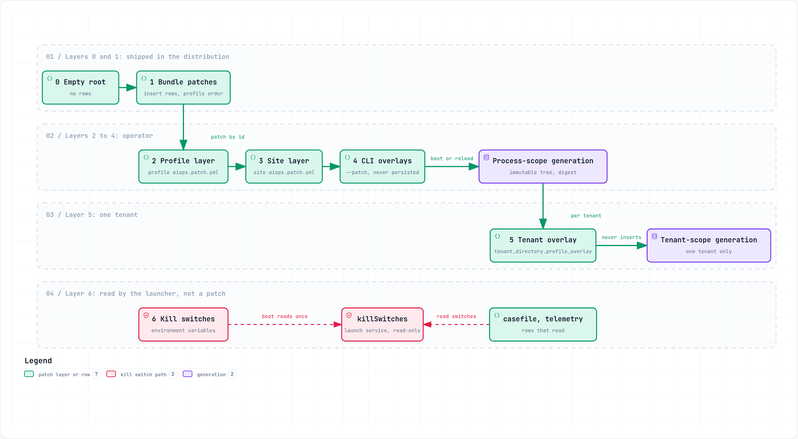
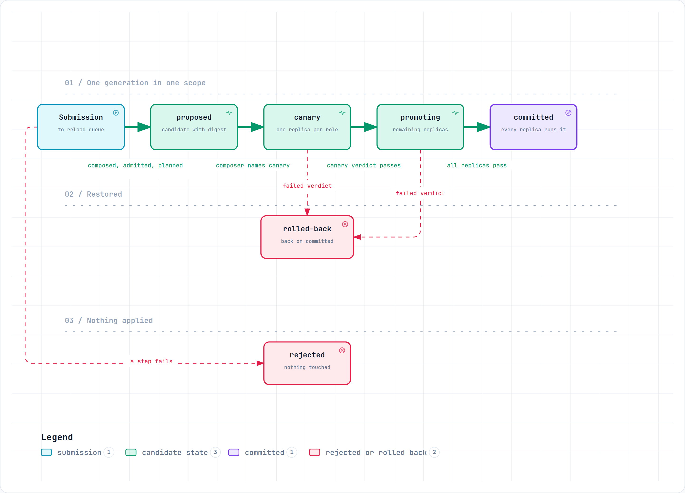
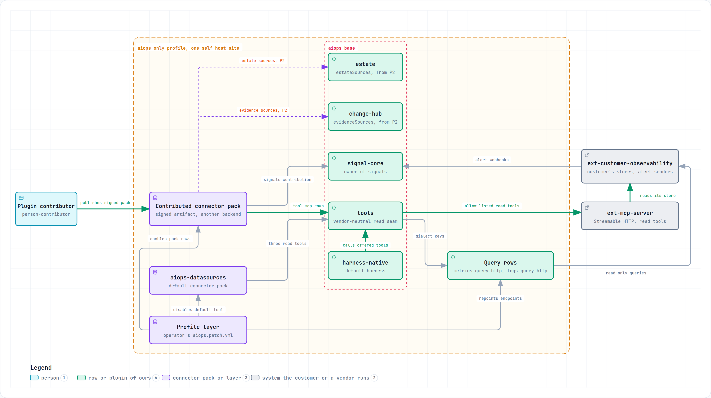
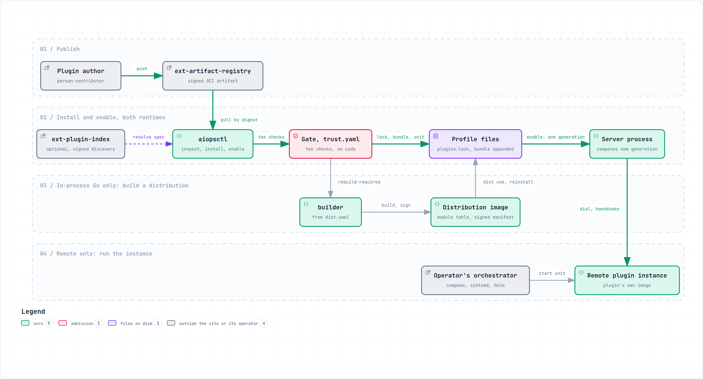
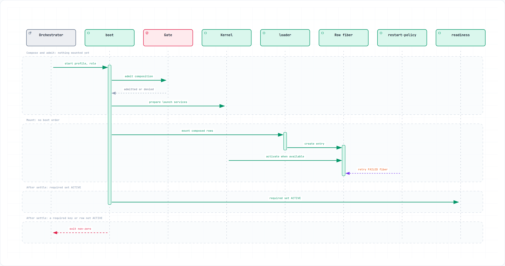
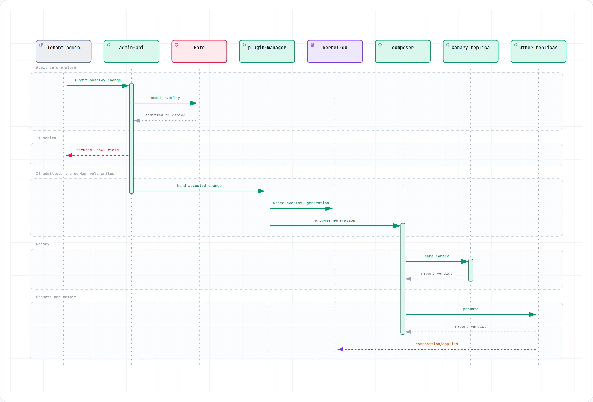
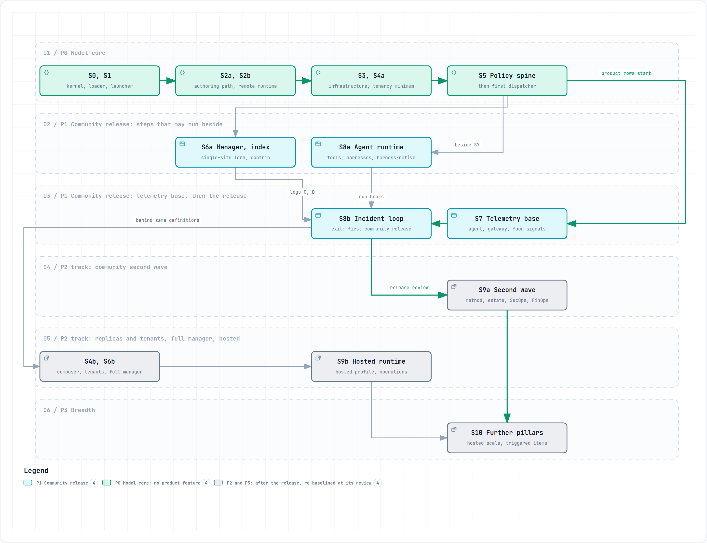
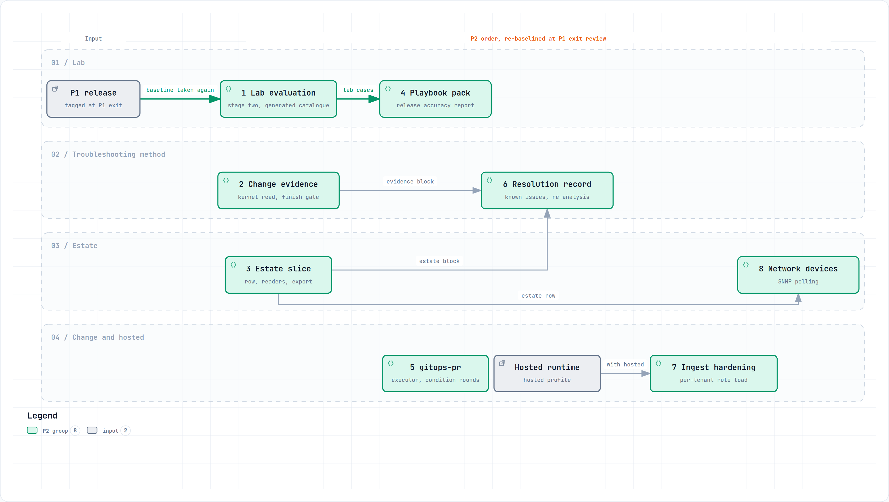
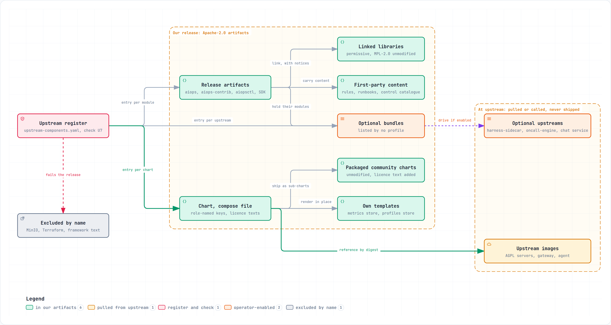

# 08. Profiles, roadmap and decision records

Status: draft, 2026-11-11. Obeys `00-decisions.md` as amended three times on 2026-11-11: for the community-first order of work, marketplace readiness and vendor-neutral connectors, for the agent harness as a plugin point, upstreams as plugins and the licence record, and for the owner's confirmation of W2 to W13 (§2.4), which are owner decisions from that date and no longer working assumptions. Where this file and `00-decisions.md` differ, `00-decisions.md` wins.

This document covers five things: how a running process is composed from profiles, bundles, layers and generations, checked property by property against the DeepSeek Harness (dsh) model (§1); the delivery roadmap by phase and step in the community-first order, with the first community release as its first exit, the deliverable ids the rest of the set uses, the versioning policy, what is built now for a later plugin marketplace and the proposed boundary between the community and the enterprise edition (§2); the decision records for the nineteen topics in `00-decisions.md` §2.1 and for object storage, plus the index of open ADRs (§3); the monorepo layout (§4); and the licensing and trademark checklist, written from the licence record, with the verdicts in short, the must-rebuild and optional-only lists, the questions for a lawyer and the build-time and lab-only tools (§5). The plugin system is the one decided in `docs/design/plugin-system-2026-11.md`, cited as "plugin record §n". The order of work, the marketplace-readiness items and the connector packs are those of `docs/design/community-first-2026-11.md`, cited as "community record §n". The agent harness, the upstream rule and the on-call provider are those of `docs/design/harness-and-upstreams-2026-11.md`, cited as "harness record §n", and the licence verdicts are those of `docs/design/licence-audit-2026-11.md`, cited as "licence record §n". This file states what an operator and a planner need; the context API, the hook list and the SDK are in 03-c3-kernel.md and 07-c4-plugin-sdk.md. Research citations use `<file> §n` under `docs/research/`, with the short names used in `00-decisions.md`: gap-tenant-gateway, gap-remotecfg, gap-slack, gap-ebpf and gap-kernel-hot-path stand for the five `gap-*.md` files. Rows 15 to 19 of `00-decisions.md` §2.1 are stated on their own technical merits and cited by their canonical requirements. The publication-rights gate of §5.1 L14 remains open (ADR-056). The component detail of the estate model and the troubleshooting method is in `09-c3-estate-and-troubleshooting.md` and is not repeated here.

Assumptions taken where `00-decisions.md` is silent are marked **Assumption** in the text. Twelve statements, W2 to W13, were written as working assumptions under ADR-033. The owner confirmed each of them in words on 2026-11-11, so they are owner decisions from that date; the labels stay as their ids, and this file cites them as "`00-decisions.md` §2.4 Wn". W1 ("product features start after the model phase") was withdrawn on 2026-11-11 and replaced by the owner decision of that date, which §2 follows. W7 to W13 settle what the owner decisions A, B and C of the second round left open:

| Id | Owner decision of 2026-11-11 | Used in this file |
|---|---|---|
| W2 | `sql` is a PostgreSQL dialect contract, so a second SQL engine is out of scope | §1.3, DR-09 |
| W3 | A self-hoster may rebind bound keys by building and signing a distribution | §1.1, §1.5, §2.1 (S3 exit), DR-01, ADR-039 in §3.1 |
| W4 | Hosted third parties are remote contributions only | §1.1, §1.5, §1.6, DR-01 |
| W5 | The remote runtime in its single-tenant form and the Python SDK (S2b) ship before the first community release (community record §9 O1 is answered: before) | §1.5, §2, §2.1, §2.2, DR-01 |
| W6 | `aiops-only` is a supported profile of the first community release for the connector scenario, and one reference pack for a store outside the default stack is kept green in CI | §1.4, §2.2, §5.1 L13 |
| W7 | `harness-native`, first-party and new (owner decision A), is the default harness of every shipped profile and no release composes an external harness in its place. Its scope at `0.1.0` is the loop, its four loop rows and the initial caps of harness record §4, and `0.1.0` waits for it | §1.4, §2.2, DR-02, DR-17 |
| W8 | One home rule: a first-party plugin that wraps an optional upstream lives under `plugins/`, ships in the release image and sits in an optional bundle that no shipped profile lists; `harness-holmesgpt` and `on-call-provider-goalert` are built in S8b | §1.4, §1.5, §2.2, §4.1 |
| W9 | `tool-mcp` ships in `0.1.0` and `toolsetBindings` is withdrawn, so a pack with no code reaches only systems that offer a Streamable HTTP MCP server with read tools | §1.4, §1.5, §2.2 (leg C1), DR-02 |
| W10 | Evaluation leg E, a smoke baseline on a hand-written case set, is a gate of `0.1.0` | §2.2, DR-19 |
| W11 | On-call option (b): the first-party `on-call-provider-builtin` is the default. The owner's yes is given; no code is written before the lawyer's answer on schedule patents (licence record Q3), which is still open, and if that answer is missing at S8b start, providers only ships | §1.4, §2.2, DR-03, §5.4 |
| W12 | The first-party loop, the read tools and the built-in on-call provider run in the kernel process under stated bounds | §1.6, DR-02, DR-03 |
| W13 | `aiops-chatops-slack` is operator-enabled and listed by no shipped profile; the release gate runs chat steps through the API and replays the Slack path | §1.4, §2.2, DR-04 |

---

## 1. Profiles and composition

### 1.1 dsh property checklist

The founding requirement is the dsh architecture: everything is a plugin behind a service definition, pluggable, and testable alone before it is attached. The kernel is a Go port of Cordis, the kernel of dsh, and the composition model is the one of dsh's loader and launcher. This table is how the owner checks that the plan follows dsh: every dsh or Cordis property has a row, numbered as in plugin record §15, with one of four statuses. The reference is the installed package: dsh 0.2.2-rc.1, Cordis 4.1.0 and cordis-plugin-loader 1.1.0, all MIT. Those two versions exist only as the `@deepseek-ai` packages published from the harness repository (upstream Cordis 4.0.0-rc.11 and plugin-loader 1.0.0-rc.8 plus the dsh modifications), so the pin is a commit of that repository and the port carries two MIT notices (§5.1 L12).

| Status | Rows | Meaning |
|---|---|---|
| carried | 19 | The semantics are unchanged |
| adapted | 25 | The property holds in another form; the row says how and what is lost |
| not carried | 11 | The property is absent; the row says why |
| added | 9 | Not a dsh property; the row says what forces it |

No adaptation is argued from schedule. Each one is forced by a Go server with several tenants and several replicas.

| # | dsh or Cordis property | Status | How, or why not |
|---|---|---|---|
| 1 | One `Context` mediates everything; no privileged core | carried | Four built-in services, no product |
| 2 | `ctx.<service>` through a `Proxy` and declaration merging; the proxy rebinds `this.ctx` to the caller | adapted | Typed keys (`Key.Of(c)`); `ProvideFor` views and a caller context as the first argument of registration methods |
| 3 | `ctx.extend`; `ctx.isolate(name, label)` with joining labels. `ctx.intercept(name, config)`: the `inject` map form, the entry field, ancestors first, read by the provider through the caller-bound proxy | carried | For open keys; bound keys have their own row (44). `NeedWith`, the row field `intercept`, `kernel.Intercepts` inside a `ProvideFor` view |
| 4 | Root installs `reflect`, `registry`, `events`, `logger`; root fiber uid 0 | adapted | `events` is named `hooks`, because `events` is our outbox |
| 5 | `provide`, owned by the fiber, with an availability check bound to the consumer; one provider per name per realm | carried | `Available(fn(caller))`: used for schema versions and instance readiness |
| 6 | `provide` metadata optional; a plugin is a function, a class or an object | adapted | `Provides` is mandatory so the composer analyses the graph without running code; contributions are declared in `Spec.Registers`, so the gate and the tenant-toggleable test read them without running code; one value shape, `kernel.Plugin` |
| 7 | `ctx.set`, accessors, mixins, callable services, class plugins | not carried | Proxy sugar; an in-place overwrite is unsafe across goroutines |
| 8 | `inject` as a list or a map; `ctx.inject(deps, callback)` as a child fiber. Access without inject is an error; children inherit within a realm | carried | `Need`, `NeedWith`, `c.When` |
| 9 | `ctx.get(name)`: optional read without a declaration | not carried | In Go a provider can dispose between the read and the call, and a registration made through the value is lost when the provider is replaced. `When` is the only optional form: a real dependant |
| 10 | A released injection cannot be used | adapted | Go cannot revoke an interface value: `ErrInactive` in every conformance suite, plus leases |
| 11 | Six fiber states; a provision is visible only while its provider is ACTIVE. Epoch from the revision and the provision uids, so a swap restarts consumers; changes during a transition are coalesced (`inertia`) | carried | Pinned to 4.1.0 |
| 12 | Consumers unload when a provider goes and return when it returns, in the running process | adapted | In place in every profile, the spine included. What a server adds: the replica is not ready while a spine provider restarts, so generations go one replica at a time; a swap of a `durable` definition needs `Drained()`; the process is replaced on a leaked process-scope fiber, a failed restore or a `restart-policy` give-up on infrastructure (§1.3) |
| 13 | Providers keep implementations until dependants finish unloading. A failed fiber recovers only through `update()`; a superseded load cannot fail the new target; a fiber may dispose itself from its own load | carried | Plus a quiesce step for in-flight calls. Retry is the `restart-policy` plugin; self-dispose must pass at S0 |
| 14 | `ctx.effect` returns a disposer, a promise or an iterable; disposers run in reverse and top-level asynchronous ones may overlap. Long stack traces that splice the loader entry | adapted | `Effect(label, setup)`; strict last in, first out, one at a time. Errors wrapped with the row id chain and the defining layer |
| 15 | Effect on a disposed fiber throws `INACTIVE_EFFECT`; `getEffects()` tree | carried | `ErrInactiveEffect`; `aiopsctl tree --effects` |
| 16 | `fiber.update`, `internal/config`, `internal/update`, `internal/commit`; raw and effective config. Volatile config committed without a restart, by the loader | adapted | `plugin.Volatile[T]`; `loader/volatile-update`. The loader decides and commits a volatile-only change, and the kernel stores the committed values in the running activation's `Volatile` fields at that commit (ADR-034 G13). Lost: Cordis stores every volatile value of a commit in one JavaScript turn; here each `Volatile` field is stored on its own, so two reads may return values of two commits, or of one commit partly stored, and fields that must change together go in one `Volatile` of a struct type. Lost too: a field outside the `Volatile` fields whose reference resolves to a new value at a commit keeps its value until the next activation, where Cordis restarts the fiber |
| 17 | Config validated through Standard Schema, an external validator | adapted | JSON Schema 2020-12 derived in `sdk/plugin` behind a validator interface, plus `Validate` |
| 18 | `emit`, `parallel`, `serial`, `bail`, `waterfall`; a waterfall runs outermost first, no `next` vetoes, twice throws. `internal/plugin`, `internal/status`, `internal/service` events | carried | `Event` carries four modes, `Waterfall` the fifth |
| 19 | Listener order by registration, with `prepend`; any plugin may dispatch or listen on any event. `internal/get`, `set`, `listener`, `dispatch` | not carried | Registration order is not deterministic under parallel activation: order is by declared stage, then plugin id; ownership and declared listeners are an added row (61). The four internal events hook the proxy and the untyped bus |
| 20 | `Context.filter` supplied by the dispatcher; a dispatch without one reaches every listener; `global` bypasses it | adapted | An explicit audience on every dispatch; unscoped reaches unscoped listeners only; no `global`. Reason: one tenant's payload must not reach another tenant's listener |
| 21 | `reflect.notify` walks every fiber | adapted | An index by key and realm |
| 22 | Run to completion on one thread | not carried | Five concurrency rules, G1 to G5 (plugin record §3); the implementation behind them is chosen at S0 (ADR-034) |
| 23 | One process: every effect lives in it | not carried | Replicas: runtime effects revert per replica, durable effects are declared and reconciled by a leader |
| 24 | Logger as a service with exporter plugins | adapted | `log/slog` front; exporters are plugins |
| 25 | The loader is a plugin that owns an entry tree; row order carries no load semantics; `Entry.update` diffs and restarts or commits volatile values. `cordis:group` (`a:b` ids, group `isolate`); `cordis:include` (a file-backed tree with patches) | carried | `core:group`, `core:include` |
| 26 | Entry fields `id`, `name`, `config`, `group`, `disabled`, `inject`, `intercept`, `isolate` | adapted | `name` is `plugin`, `disabled` is `enabled`; `roles` and `required` added; the per-layer rules of §1.2 |
| 27 | `!!js` expressions in rows. Entries move between groups | not carried | It is `eval`; `roles`, a row-level `inject` and closed references cover its four uses (§1.3). Moving an entry has no consumer; remove and insert |
| 28 | Include writes updates back and reconciles a journal; a self-disposed plugin is persisted as disabled | adapted | Only the manager writes, and only the profile layer or an overlay; self-disposal is reported, not written |
| 29 | `loader.await()`; `Intercept{await}` keeps dependants pending | carried | The `readiness` row |
| 30 | Profile: ordered bundles plus a user patch over an empty root, only direct bundles; layer order bundles, profile, home, `--patch`, launcher switch; a patch by id replaces the whole config, `insert`, an unknown id warns, an empty file fails. `--dump-default-config` with provenance; `--dump-config-schema`; profile templates, `sanitizeProfile`, bundle `platforms` | carried | §1.2 to §1.5, plus the tenant layer from S4b. Plus `--dump-hooks`; `aiopsctl profile init` and `sanitize` |
| 31 | Apps are profiles, one launcher; `prepare` provides typed launch services (`profileContext`, `pluginPackages`) before any row mounts | adapted | `sdk/def/launch/v0`, with fakes, so their consumers mount alone. One launcher library, `boot`, in two binaries. `aiopsctl` alone carries the toolbox (the builder, `plugingen`, the analyzer, the templates, the suites and the scenarios), which its command rows reach through `profileContext`, and its `main` turns off the server rule and the status file, keeps stdout for commands and maps exit codes. What is lost: one binary for every app. Reason: Go links statically (row 35), and what the builder links enters no server binary (ADR-044, Consequences), so a server image cannot carry the CLI's tools as dsh's one launcher reaches pnpm (ADR-061) |
| 32 | A startup plugin provides a service that rows inject (role markers). Ready when the root is ACTIVE; five-second shutdown | adapted | Kept for `cmdline`; a role is a compose-time `roles` field, so other-role rows are never mounted. Ready when the required set is ACTIVE; a longer drain. In `aiopsctl` the startup row is `cli`, which parses the leftover argv once boot has finished (ADR-061) |
| 33 | First-party packages in lockstep with exact pins | carried | Within one distribution |
| 34 | `engines.dsh`, else peer ranges; exemptions for exact pairs; admission at composition boundaries reading manifests only; denied rows detached. Install with pnpm into the profile, as a bundle appended to the bundle list; build-script approval; snapshot and restore | adapted | Same shape at a finer grain. One `engines.aiops` range is not carried, because it would make every publisher release again at every SDK major: a manifest carries a generated `requires` (the author API, the remote protocol majors, each definition as `major.minor`), the signed distribution manifest a generated `serves`, and an absent `requires` denies (§1.6, §2.5). Exemptions never cover trust, licence or bindings. OCI artifacts carrying a bundle; the builder never runs build scripts (§1.5). One write lock per home, not per profile: a site holds one digest per plugin id and the site files that an install writes (ADR-047 decision 7), since a remote plugin has one shared instance per site (§1.5). It is the system's advisory lock, held only through bounded steps and released when its holder exits, so it has no idle timeout; what is lost is that a waiter cannot break the lock of a live holder that hangs. The snapshot also covers the verified records and stays on disk, so the next writer restores a killed write (ADR-061) |
| 35 | Modules imported by specifier at run time; run-time install of in-process code; module hot replacement (`dsh-hmr`) | not carried | Go links statically and cannot replace code in a running process: a generated module table, remote plugins, `rebuild-required` |
| 36 | A third-party plugin is a first-class fiber: it may provide, listen and mount children | adapted | In process through the builder only. A remote plugin is a set of contributions; hosted third parties are always remote (owner decision, `00-decisions.md` §2.4 W4) |
| 37 | One queue serialises reloads and manager writes; an invalid live patch is rejected and the running tree kept. Reconciliation: a new inactive entry or a changed fiber fails; explicit enablement targets must activate; unchanged inactive entries are diagnostics | carried | The `reload` plugin and its judge rule (§1.3) |
| 38 | A live reload does not repeat the required audit or roll back | not carried | A server repeats the audit and restores the committed generation |
| 39 | The manager is a plugin; cannot disable itself; records only departures | carried | `plugin-manager` (§1.5) |
| 40 | `plugin_manager` as an agent tool | not carried | A model must not change a multi-tenant composition |
| 41 | Market index, unsigned | adapted | Signed, checked before parsing; format 1.0 with a serial and an expiry, trusted for discovery only, and published so that a third party can run its own (§1.5, §2.5) |
| 42 | A global required list of consumer entries; providers arrive through the inject closure; a disabled required entry is ignored | adapted | Keys that must have an ACTIVE provider plus named rows; absent or disabled stops boot (§1.6) |
| 43 | Definition, provider, consumer; depend on definitions only, with a constraints check; singular keys for engines, plural for registries | carried | The Go import graph |
| 44 | Any provider can be swapped by composition and any service isolated in a subtree | adapted | Carried for open keys. For the 37 provider-bound keys (6 launch keys, 24 named keys, `harnesses` among them, and 7 `.Bound` realm keys): layers 1 to 4 choose within the allowed set, isolate is refused, and a new provider enters by distribution manifest, built and signed by a self-host operator (owner decision, `00-decisions.md` §2.4 W3). Hosted never allows that |
| 45 | Any plugin may inject any service | adapted | 14 consumer-bound keys resolve only for listed entries, the fourteenth from S2b (ADR-063 decision 57); 3 are `signed` |
| 46 | Monotonic guards after the extensible hook, as an owner-side service | adapted | `sdk/gate`, owner-side as in dsh; adds the static expected set, so an absent listener denies |
| 47 | Approval answerers are waterfall listeners that may answer without `next` | not carried | A decision that grants is never a waterfall |
| 48 | Approval fails closed when absent | carried, stronger | Consumers inject it, so they do not exist without it |
| 49 | `dsh-scope`: scoped contributions, nearest wins; the registration context decides visibility and ownership | adapted | Carried for `scope: tenant` plugins. For a process-scope row, per-tenant enablement is one shared predicate; the loss: its revertible effects hold per process, not per tenant, so only contribution-and-listener plugins are tenant-toggleable (§1.7) |
| 50 | Agent presets: a nested tree per preset | carried | Tenant trees and pillar groups |
| 51 | "Not a sandbox"; in-process plugins are trusted | carried | Third-party code runs remote in hosted (owner decision, `00-decisions.md` §2.4 W4) |
| 52 | Bare-context mount; the dispose test for every registry; product-visible plugins need a real-composition test that mocks only the non-deterministic boundary | adapted | The real kernel in the SDK and a generated cycle test. Costs stated: a stateful plugin needs PostgreSQL at T1; a non-Go plugin is driven by the kernel inside `aiopsctl` |
| 53 | Test kits (agent-loop testkit, loader smoke, replay); per-file 100 percent coverage gate | adapted | Fakes beside definitions, `loader-smoke`, a replay provider; the gate covers kernel, `boot` and loader only. The kits are not in the installed tree: taken from the older research note, unverified |
| 54 | Localised metadata, a browser-side tree, an agent sandbox | not carried | English metadata; the UI is dashboards, the API, `aiopsctl` and an optional chat surface; there is no shell tool |
| 55 | "Model-visible means logged" | carried | Principle 8: operator-visible means logged |
| 56 | Three deadlines: load, drain, dispose | added | A goroutine cannot be killed and a server cannot wait for ever |
| 57 | `Enter` leases and quiesce before dispose | added | In-flight calls on other goroutines; JavaScript has none |
| 58 | Tracked goroutines (`c.Go`) | added | The Go form of "everything a plugin starts is an effect" |
| 59 | `Batch` and `Settle` | added | One recomposition observed as one change |
| 60 | Key classes with provider and consumer bindings to module-table entries | added | Policy and tenancy as plugins in a multi-tenant server |
| 61 | Hook ownership, declared listeners and stages, access classes | added | Deterministic chains and third-party rows |
| 62 | Typed scope values written only by the provider of the owning key | added | Tenancy without the word tenant in the kernel |
| 63 | Generations with a composer state machine, canary replica, `module-missing`, quarantine, a breaker per (tenant, row), the durable namespace registry | added | Multiple replicas and unattended operation. On one process `reload` is the committer; the composer, the canary and quarantine arrive at S4b and S6b behind the same definitions (§1.3) |
| 64 | A host-local path for `aiopsctl`: the row `reload-socket` serves the `reload` queue on a Unix socket in `run/`, checked by the directory, the socket mode and the peer's uid | added | A live enable at S2a, before `admin-api` carries plugin operations (ADR-060 decision 48). From S2a to S6a, when the commands move to `plugin-manager` (ADR-062 decision 26) |

**How the checklist stays true.** "Faithful" is a tested property, not a claim. A differential test runs the same scripted scenarios on Cordis 4.1.0 with loader 1.1.0, vendored from the harness repository at a pinned commit as a test-only oracle with `cosmokit`, `schemastery` and both MIT notices, and on the Go kernel, and compares settled states and status traces. It covers the carried rows of the kernel and excludes the properties this table marks adapted or not carried: dispatch without a filter, `global`, registration order and `ctx.get`. The adapted and added rows are proven by the conformance suites, the recomposition suite, the failure matrix (§1.6) and `test/policy-bypass/`. The pin moves only by ADR, with the differential test re-run (ADR-035). The research note `dsh-architecture.md` describes Cordis 4.0.5 and is wrong on the epoch (row 11); it is corrected under the same ADR.

### 1.2 Layer precedence

Scope: how the composed tree of one process is built, and how one tenant's part of it is patched. Higher layers win per row. Layers 0 to 4 compose the process-scope tree. A change to them is a new generation, applied to the running process through the `reload` queue (§1.3); a restart is needed only for new in-process code. Layer 5 patches one tenant's scope and takes effect as a tenant-scope generation (§1.7); it arrives at S4b, so the first community release composes layers 0 to 4 and 6 only. Layer 6 is not a patch: the launcher reads the kill switches from the environment into the `killSwitches` launch service, which no layer and no row can reach, so configuration can never undo a kill switch.


*Figure 08-layer-precedence. Source: [diagrams/src/08-layer-precedence.json](diagrams/src/08-layer-precedence.json).*

The figure shows the main path: the order of composition, the two generations it ends in, and the kill switch path. The tables below are complete: only they carry the per-field rules, the hosted form of the profile layer and the names of the two environment variables.

| Id | Layer | Source | dsh equivalent | Responsibility |
|---|---|---|---|---|
| L0 | Empty root | built in | `cordis.yml` `[]` | Anchor; contains no rows |
| L1 | Bundle patches | `bundles/<name>/bundle.yaml`, in `profile.yaml` order; the bundle of an installed artifact, a plugin or a connector pack, is `$AIOPS_HOME/bundles/<plugin id>/bundle.yaml`, is appended at the end of the list and may only insert rows (§1.5; ADR-047) | `dsh.profile.bundles` | All rows a profile ships with; first choice among the allowed providers of a bound key |
| L2 | Profile layer | `$AIOPS_HOME/profiles/<name>/aiops.patch.yml`; in hosted a platform table of the `composer` schema, written only through `plugin-manager` | profile user layer | Operator choices for this profile, for example the endpoints of the default pack's query rows in `aiops-only`; where `plugin-manager` records a departure from the bundles |
| L3 | Site layer | `$AIOPS_HOME/aiops.patch.yml` | home user layer | Machine or cluster preferences that apply to every profile |
| L4 | CLI overlays | `--patch <file>`, argv order | same | Launcher and test overrides; never written back |
| L5 | Tenant overlay | `tenant_directory.profile_overlay`, rendered as `tenants/<id>/aiops.patch.yml` | ours | From S4b. Per-tenant `enabled` and the tenant-writable fields of the rows a tenant may touch (§1.7) |
| L6 | Kill switches | `AIOPS_AGENTS_PAUSED`, `AIOPS_TELEMETRY_DISABLED`; a non-empty value means on | `DSH_TELEMETRY_DISABLED` | Read by `boot` into the `killSwitches` launch service as `agents-paused` and `telemetry-disabled`; read-only |

| From | To | Relationship |
|---|---|---|
| L1 Bundle patches | L0 Empty root | Insert rows, in the profile's bundle order; only bundles the profile names contribute, never transitive ones |
| L2 Profile layer | L1 | Patches rows by id; may insert; chooses within the allowed set of a provider-bound key |
| L3 Site layer | L2 | Same rules as L2, for every profile on the machine or cluster |
| L4 CLI overlays | L3 | Same rules, in argv order; never persisted |
| L0 to L4 | Process-scope generation | Composed by `boot` at start and by the `reload` queue afterwards into one immutable tree with a digest (§1.3) |
| L5 Tenant overlay | Tenant-scope generation | From S4b. Patches one tenant's scope and tree only; never inserts, never touches a required row, a gate listener or a provider of a bound key |
| L6 Kill switches | `killSwitches` launch service | Read once from the environment by `boot`; provider-bound to the launcher, so no row can provide it |
| `casefile`, `agent-runs`, `llm-gateway`, `telemetry` | `killSwitches` launch service | The first three read `agents-paused`: `casefile` before it dispatches `incident/investigate`, `agent-runs` before it starts a run of any kind, and `llm-gateway` on every model call. `telemetry` reads `telemetry-disabled` and exports nothing while its row stays ACTIVE |

What each layer may do to a row (`00-decisions.md` §6.1). Gate check 8 enforces this table at every composition boundary (§1.6).

| Field or action | Layers 1 to 4 (bundle, profile, site, `--patch`) | Layer 5 (tenant overlay) |
|---|---|---|
| `insert` | A new id only; an existing id fails in every layer. `plugin` and `roles` are fixed at insert and no patch changes them. The bundle of an installed artifact may do nothing else: each row it inserts is disabled, is a row of its own plugin or of a first-party plugin marked `instantiable` (§1.5) and sets no field but `id`, `plugin`, `roles`, `enabled` and `config`, and the bundle holds no `${env:}` or `${file:}` reference (§1.6, check 8) | Never |
| `config` | Replaces the whole config; there is no deep merge | Only fields the schema marks tenant-writable, validated when written, volatile by rule, literal values |
| `enabled` | Yes, except the last enabled provider of a provider-bound key | Only on a `scope: tenant` row or a tenant-toggleable process-scope row; never a row in a required set, a row that listens on a gate, or a provider of a bound key |
| `required` | May be raised, never lowered. A required row binds its id to its plugin | Never |
| `inject`, `isolate`, `group` | Yes, never on a required row, a provider of a bound key, or a group that holds one | Never |
| `intercept` | Yes; for a provider-bound key, bundle layers only | Never |

**Kill switches.** With `agents-paused` set, no agent run starts and no model call leaves: `casefile` checks the switch before it dispatches the `incident/investigate` gate, `agent-runs` starts no run, an `ask` turn included, and `llm-gateway` refuses every call, so a harness that is already running stops at its next model request. Ingest, paging and human-approved changes keep working, because none of them passes that gate and paging has no hook. With `telemetry-disabled` set, the `telemetry` row stays ACTIVE and exports nothing. The switches are neither listeners nor rows, and `test/policy-bypass/` sets `agents-paused`, tries to undo it by config and tries to start a run.

### 1.3 Rows, generations and reload

**Rows and patches.**

- A row is `{id, plugin, config, enabled, required, roles, inject, intercept, isolate, group}`. `plugin` is the manifest id `<owner>/<name>`. `inject`, `intercept`, `isolate` and `group` are the Cordis loader's entry fields. `roles` is ours: a closed vocabulary (`edge`, `api`, `worker`) that every row of a server bundle must state, enforced by lint, so no row lands in the internet-facing role by omission. Row order carries no load semantics: a fiber activates when what it needs is available.
- A patch targets a row by `id`. In layers 1 to 4 a patch that sets `config` replaces the whole `config`; a patch that omits `config` leaves it untouched, so a toggle is `{id, enabled}`. Layer 5 writes single tenant-writable fields (§1.7).
- `insert` adds a row with a new id. A patch cannot change `plugin` or `roles`; swapping an implementation means disabling one row and enabling another, within the allowed set for a provider-bound key.
- `core:group` nests rows: a pillar is one group row `pillar-<name>`, and a child of a group has the id `<group>:<id>`. `core:include` mounts a file-backed tree.
- An unknown id prints a warning. `profile.yaml`, every bundle it names and every `--patch` file must exist. The optional layer files (L2, L3, L5) are skipped when absent. A layer file that exists but is empty fails; disable a layer with `[]`.

**No expressions, closed references.** Rows carry no expressions. dsh uses `!!js` for four things, and each has a closed replacement: a platform gate is `roles` (or a bundle's `platforms`); a presence gate is a row-level `inject`, which leaves the row PENDING and says what it waits for; a value from a launch service is read by the plugin through an inject; a path or secret is a reference `${env|file|secret|flag:value}`, resolved by the `config-refs` row. References are legal in layers 1 to 4 only. `env:` reads only names with the prefix `AIOPS_REF_`, and `file:` only one directory named by flag. A layer 5 value that contains `${` is refused at write, except `${secret:name}`, which resolves in the scope of that tenant and the row's plugin. Dumps print references unresolved. A reference that fails to resolve is an error on the row, never "disabled".

Illustrative `aiops-only` profile (row ids and config keys are examples; each plugin's schema is the authority). The two query rows and the three read tools are rows of the default connector pack `aiops-datasources`; a store outside the default stack is reached by installing its connector pack, enabling the pack's tool rows and disabling the default tool for the same signal (§1.4):

```yaml
# $AIOPS_HOME/profiles/aiops-only/profile.yaml
bundles: [aiops-core, aiops-base, aiops-datasources, aiops-oncall, aiops-pillars-mvp, aiops-selfhost]
```

```yaml
# $AIOPS_HOME/profiles/aiops-only/aiops.patch.yml
# the two query rows are dialect contracts: a store that speaks the dialect is reached by endpoint config,
# and one that does not provides nothing under the key. Where a row takes its credential in aiops-only is ADR-028
- id: metrics-query-http
  config: {endpoint: "https://prometheus.example.internal"}
- id: logs-query-http
  config: {endpoint: "https://logs.example.internal"}
# every harness is offered the read tools of the enabled rows (00-decisions.md §2.1 row 2); this site has no traces store
- {id: tool-traces-query, enabled: false}
# on-call-provider-builtin is composed; until `aiopsctl oncall apply` binds a policy, an incident says that no policy is bound
```

**Reload.** The unit of reload is the row. The unit of change is a generation: one immutable composed tree with a digest over the tree, the module table and the lock digests of every remote plugin and of every pack with no code, so a generation also pins plugin and pack versions.

| Change | Applies |
|---|---|
| Only `Volatile` fields, which include every tenant-writable field | Committed in place by the loader; no restart, unless the old or new value holds a reference, which restarts the row (ADR-059 decision 17) |
| Other `config`, `inject`, `intercept`, `isolate` | That fiber restarts; its dependants restart only if it provides something, through their epochs |
| Enable, disable, insert or remove a row whose code is present, which includes every row of a pack with no code, because the plugins it instantiates are already in the binary; from S4b a tenant overlay | Live; an overlay touches that tenant's scope and tree only |
| The restart closure contains a provider the replica cannot serve without (`sql`, `jobs`, `events`, `http`, and whatever needs them) | In place, in every profile: the replica fails readiness, quiesces under the drain deadline, the fibers restart and consumers return by epoch. No exit. A process-scope generation therefore goes to one replica at a time; a single replica is not ready for the settle time |
| A provider swap of a definition marked `durable` (`events`, `jobs`, `kek`, `blob`, `kv`) | In place, but admitted only when the old provider reports `Drained()` (an empty backlog, no wrapped key it alone can unwrap), checked by `profile render` and again at apply, or when the operator passes `--accept-loss <definition>`, which is audited. `sql` has one allowed provider and no swap (owner decision, `00-decisions.md` §2.4 W2) |
| New code | In process: a new binary and a restart, rolling where there are several replicas; the manager answers `rebuild-required` and prints the `dist.yaml` lines (§1.5). Remote: live; from S6b, with `plugin update`, the new instance is handshaken before the old contributions are removed, and before S6b a new version arrives by `remove` and `install` (ADR-063 decision 69) |

The process is replaced, not restarted in place, in three cases only: a process-scope fiber leaked past its dispose deadline (a goroutine cannot be killed); a restore failed; `restart-policy` gave up on an infrastructure provider. A failed fiber is sticky in the kernel, and retry is the `restart-policy` plugin.

**One queue.** The `reload` plugin owns one goroutine and one queue. File watches, the generation follower, the manager and `aiopsctl` all submit to it; a nested reload is rejected. `Submit` returns an operation id at once, and the result is polled or streamed from `plugin-inventory`. Without the `reload` row every change answers `restart-required`. A submission runs seven steps:

1. Compose layers 0 to 4 into a candidate. Pure.
2. Admit: the gate, signatures, bindings, every changed config, the static graph, the `Drained()` precondition. Pure.
3. Plan: diff by row id, then compute and print the restart closure. A failure in steps 1 to 3 rejects the generation with nothing touched.
4. Apply in one batch: remove, update, create. The loader never creates an entry for an id whose previous fiber is not DISPOSED. An entry the plan creates, enables or replaces whose id, or a key it provides in the same realm, still has a previous fiber is mounted in a second batch once that fiber is DISPOSED. There is no planned wave; per-fiber transitions do the rest.
5. Settle, then judge: every row this generation created, changed or explicitly enabled must be ACTIVE, and so must every required row; a row that was ACTIVE must still be; rows that were inactive before and are untouched are warnings. A fiber still UNLOADING at the settle deadline means wait, not judge.
6. Report the verdict to the committer, which commits or restores: `reload` itself on one process, `composer` from S4b. A failed restore ends readiness and the process is replaced.
7. Publish `composition/applied` with digest, generation and report, into the audit chain.

**Generations.** Who commits a generation depends on how many processes run (`00-decisions.md` §6.1). On one process, which is every profile of the first community release, the `reload` row is the committer: it holds one PostgreSQL advisory lock, applies a generation, judges it and commits or restores it. A second process that cannot take the lock fails readiness and names `composer`. From S4b the `composer` plugin, a leader on the worker role and a base row of every profile that runs more than one process, owns one state machine per scope (the process, or one tenant). Replicas report (replica, scope, generation, digest, verdict) and never select a generation themselves: a replica runs the committed generation, or a candidate when the composer names it in the canary or promoting set. The seven steps, the judge rule and `composition/applied` are the same in both forms, so nothing a plugin sees changes when the committer does.


*Figure 08-generation-lifecycle. Source: [diagrams/src/08-generation-lifecycle.json](diagrams/src/08-generation-lifecycle.json).*

The figure shows the composer's state machine, in service from S4b: the main path and the two failure outcomes. The tables below are complete: the pause inside `promoting` (ADR-038) and the one-process form, in which a `proposed` generation is committed or restored with no canary and no promotion, are only in the transition table.

| State | Meaning |
|---|---|
| rejected | Not a generation: compose, admit or plan failed and nothing was touched |
| `proposed` | Composed, admitted and planned; a candidate with a digest |
| `canary` | Applied on one canary replica per role that mounts a row the generation creates, changes or enables (`00-decisions.md` §6.1). For a tenant-scope generation the canary force-mounts that tenant's tree before it judges, because an unmounted tree has nothing to observe |
| `promoting` | Applied on the remaining replicas; a process-scope generation goes one replica at a time |
| `committed` | The generation every replica runs and a restarted replica boots |
| `rolled-back` | A candidate that failed a verdict; every replica is back on the committed generation |

| From | To | When |
|---|---|---|
| a submission | rejected | Compose, admit or plan fails |
| a submission | `proposed` | Steps 1 to 3 pass |
| `proposed` | `committed`, or restored | One process, the form of the first community release: `reload` applies, judges and commits, or restores the committed generation and audits it (ADR-038, its S4a part) |
| `proposed` | `canary` | From S4b. The composer names the canary replica of each role concerned; the `durable` leader first creates what the candidate adds (schemas, instances, certificates) |
| `canary` | `promoting` | The canary's verdict passes |
| `promoting` | `committed` | Every replica reports a passing verdict; the `durable` leader then deletes what the generation dropped |
| `canary`, `promoting` | `rolled-back` | Any failed verdict; the scope is restored on every replica |
| `promoting` | `promoting` (paused) | A breaker opens inside the bake window: promotion pauses and alerts (ADR-038) |

**Assumption:** the plugin record names the five states and these events; which state a submission holds while it is composed, admitted and planned is this file's reading. With one process there is no canary: commit or restore follows the judge at once. A replica whose image lacks a module of the candidate reports `module-missing` and keeps the last generation it can serve. What a rollback does not revert (durable writes and expand-only migrations made under a candidate) is ADR-038.

**Where a generation is read from.** The process-scope generation must be readable before any row mounts, so it is never in a table that a row of the same generation serves.

| Profile family | Process-scope generation | Tenant-scope generations and replica reports |
|---|---|---|
| Self-host on one process (`self-host-full`, `aiops-only`, `dev`): the first community release | The layer files on disk. `reload-watch-files` is on in `dev` and off in server profiles, where `aiopsctl` submits | None: there is no tenant overlay and no replica report before S4b |
| Self-host with several processes, from S4b | The layer files on disk; how they and a new generation reach several replicas one at a time is ADR-038 | Platform tables of the `composer` schema |
| `hosted`, from S9b | The generation object: an immutable object the composer writes, mounted into every replica and named by flag, holding the committed generation and at most one candidate with its target replica set. `reload-generation` follows the mount. The profile layer, `plugins.lock` and the trust policy are platform tables of the `composer` schema | Platform tables of the `composer` schema, written only through `plugin-manager` on the worker role |

A restarted process boots the committed generation, never an unjudged candidate. From S4b, if a replica is in the promoting set it boots the candidate directly, so it never starts, reads a difference and restarts again.

### 1.4 Bundles per profile

Numbers give the bundle's position in the profile's `bundles` list; a dash means absent, a number in brackets means listed on a condition, and "optional" means that no shipped profile lists the bundle and an operator enables it. Row counts are at P1 scope, the scope of the first community release, and are those of `00-decisions.md` §4.4, recounted after the harness, on-call, chat and dashboard moves; `self-host-full` composes about 100 rows, and 105 with the Slack bundle enabled. Bundle contents are in `00-decisions.md` §4.4 and §6.2, and what each profile proves is in §6.3. The first community release ships every profile of the table except `hosted`, which follows S9b. The bundle of an artifact installed with `aiopsctl plugin install`, a plugin or a connector pack, is appended after the last position shown (§1.5; `00-decisions.md` §6.1, §6.3). `aiops-pillars-ext` enters the server profiles from P2, and the positions after it count it. `aiops-only` lists `aiops-dashboards` only against a dashboard server the customer runs; the positions after it then move by one.

| Bundle | Rows at P1 scope | `hosted` | `self-host-full` | `aiops-only` | `dev` | `cli` |
|---|---|---|---|---|---|---|
| `aiops-core` | 10 | 1 | 1 | 1 | 1 | 1 |
| `aiops-cli` | command rows | - | - | - | - | 2 |
| `aiops-base` | 54 | 2 | 2 | 2 | 2 | - |
| `aiops-datasources`, the default connector pack | 6 | 3 | 3 | 3 | 3 | - |
| `aiops-stack` | 8 | 4 | 4 | - | 4 | - |
| `aiops-dashboards` | 1 | 5 | 5 | (4) | 5 | - |
| `agent-base` | 7 | 6 | 6 | - | 6 | - |
| `aiops-oncall` | 1 | 7 | 7 | 4 | 7 | - |
| `aiops-pillars-mvp` | 11 | 8 | 8 | 5 | 8 | - |
| `aiops-pillars-ext` (P2+) | later | 9 | 9 | 6 | - | - |
| `aiops-hosted` | 2 to 6 | 10 | - | - | - | - |
| `aiops-selfhost` | 2 to 6 | - | 10 | 7 | 9 | - |
| `aiops-dev` | 2 to 6 | - | - | - | 10 | - |
| `aiops-chatops-slack` | 5 | optional | optional | optional | optional | - |
| `aiops-chatops-slack-cli` | 1 | - | - | - | - | optional |
| `aiops-harness-holmesgpt` | 2 | optional | optional | optional | optional | - |
| `aiops-oncall-goalert` | 1 | optional | optional | optional | optional | - |
| `aiops-dashboard-app` (P2) | later | optional | optional | optional | optional | - |
| Bundles of installed artifacts (connector packs, plugins) | per artifact | last | last | last | last | last |

`aiops-core` holds the process basics shared by the server, the CLI and tests, so it is first in every server profile and, with `aiops-cli`, forms the `cli` profile: `aiopsctl` is a profile of the same launcher, and a plugin contributes its own subcommands through `commands`. A bundle that holds a command ships it in a companion bundle of command rows that need only what the `cli` profile serves, such as `aiops-chatops-slack-cli`, and install into the profile `cli` takes in-process code only, after `dist use`, refusing a pack and remote code (ADR-061 decision 40). Two of its ten rows arrive on the way to the release: `plugin-manager` and `plugin-index` at S6a. `reload-socket` serves from S2a to S6a (ADR-062), so it is not among the ten. The proxy `aiops/remote` arrives at S2b as a plugin of the release module table and holds no row of this bundle: its rows are the proxy rows of installed remote artifacts, each under the artifact's own id (ADR-063 decision 41). `composer` is a row of `aiops-base` from S4b, composed only by a profile that runs more than one process, and is not among the 54; no profile of the first community release composes it (§1.3). A server profile that carries `aiops-stack` also lists `agent-base`, because the agent config templates are `fleet-template-<feature>` rows, contributions to the `fleetTemplates` registry, which `fleet-composer`, the seventh row of `agent-base`, provides and `fleet` injects. From P2 the same profiles also list `agent-security`, after `agent-base`, for its one template row (`00-decisions.md` §6.2, §6.3). The `loader` row is mounted by `boot` and belongs to no bundle.

Agent profiles: `agent-host` is `agent-base`, `agent-host`; `agent-k8s` is `agent-base`, `agent-k8s`. From P2, `agent-security` and the `agent-windows` variant are appended.

**Defaults and optional bundles.** Three choices of the second amendment show in the table.

- **The agent runtime is rows of `aiops-base`:** `agent-runs`, `ask-api`, the default harness `harness-native` with its four loop rows, `tools` and `tool-oncall-who` (owner decision A, `00-decisions.md` §2.4). Every server profile therefore has a harness with no extra bundle and no extra container.
- **`aiops-oncall` holds the default on-call provider,** `on-call-provider-builtin` (W11; no code before the lawyer's answer on the patent question of licence record Q3). If that answer is missing at S8b start, providers only ships: the bundle leaves the profiles and nothing else in the table changes. `aiops-dashboards` holds `annotator` and the dashboard provisioning files apart from `aiops-stack`, so `aiops-only` may list it.
- **An optional bundle wraps one upstream that the core never needs** (`00-decisions.md` principle 9): `aiops-chatops-slack` (the five Slack rows; W13), `aiops-harness-holmesgpt` (`harness-holmesgpt` and `tools-mcp-facade`), `aiops-oncall-goalert` (`on-call-provider-goalert`) and, from P2, `aiops-dashboard-app` (`approval-surface-app` and `identity-dashboard-token`, the rows that need `aiops-app`). No shipped profile lists one. Their plugins live under `plugins/` and their modules are in the release table (W8), so an operator turns one on with `aiopsctl plugin install` and `plugin enable`, with no rebuild and no second image (§1.5). The chart or compose file renders an upstream process (`harness-sidecar`, `oncall-engine`) only when the operator sets its value (§4.1), and `oncall-engine` is offered on self-host only.

The leave-one-out render (U4) proves in CI that every shipped profile renders, keeps its required keys and leaves no unexpected row PENDING without each upstream bundle it lists (`00-decisions.md` §4.3, §6.3).

**Connector packs.** The default stack is a choice of bundles, not of contracts (`00-decisions.md` principle 7). `aiops-datasources` is the default connector pack: it holds every first-party row and content file that is specific to the default stack's dialects. At the first community release that is the two query rows `metrics-query-http` and `logs-query-http`, the three read tools every harness is offered (`tool-metrics-query`, `tool-logs-query`, `tool-traces-query`), `signal-ingest-alert-webhook`, the `signals` contribution that parses the Alertmanager and dashboard-alerting payload families (ADR-054), and the host runbook; S9a adds `tool-profiles-query`, and P2 adds `estate-source-series` and `evidence-source-logs`. A connector pack for another system is written by a contributor through supported plugin interfaces and composes beside the default pack or in its place: for example a VictoriaMetrics and VictoriaLogs pair, Elasticsearch or OpenSearch, a ClickHouse-based stack, Datadog, or a plain Prometheus with Alertmanager. A pack is one signed artifact (`plugin.yaml`, a bundle of rows, content and at most one plugin), not a manifest kind and not a runtime. It covers capabilities, not a stack, so several packs compose in one profile for a mixed estate (`00-decisions.md` §6.2; community record §6). The vendor-neutral read seam is the `tools` registry: `toolsetBindings` is withdrawn, so a pack with no code reaches only a system that offers a Streamable HTTP MCP server with read tools (owner decision, `00-decisions.md` §2.4 W9).

| Size | When | Contains | Code | Enters a profile by |
|---|---|---|---|---|
| Data pack | The system offers a Streamable HTTP MCP server with read tools, or sends alerts through an API the platform already has a row for (Alertmanager, generic JSON) | Rows of the instantiable first-party plugins `tool-mcp`, `signal-ingest-generic-json` and `notifier-webhook`; a label map, a rule pack, a host runbook, fixtures | None (`runtimes: []`) | `aiopsctl plugin install`, no rebuild |
| Read connector | The system has its own alert payload, or a query API with no MCP server in front of it | The above plus one plugin that contributes to `signals`, to `tools`, and at P2 to `evidenceSources` and `estateSources` | In-process Go, or remote in any language | Remote: `plugin install`, no rebuild. In process: a distribution the operator builds and signs, or the `aiops-contrib` image (§1.5) |
| Stack bundle | Agents, a gateway, limits and provisioning for a second self-hosted stack | Not designed | In-process Go | Not planned in this edition; waits for a contributor who proposes one (`00-decisions.md` §7.3) |

- **No hard wiring.** No row outside a connector pack or a stack bundle holds a query string or calls a telemetry store's query API. Base and pillar rows call typed registries (`signals`, `tools`, `evidenceSources`, `estateSources`, `verifiers`). `metricsQuery` and `logsQuery` are dialect contracts, like `sql`, injected only by dialect-specific rows: a store that speaks the dialect is reached by endpoint config, and one that does not provides nothing under the key. CI checks the static graph: no plugin of `aiops-base` or of a pillar bundle declares a need on either key.
- **One provider stays one.** A pack never adds a second provider of a singular key such as `metricsQuery`; it ships a profile-layer snippet that repoints the existing row.
- **A mounted tool list is pinned, and its effects are asserted.** A harness names no backend: it is offered the tools of the enabled rows and nothing else. A `tool-mcp` row allow-lists read tools of one MCP server by name and carries a digest of the recorded tool list of that server; the row fails when the live list hashes differently. The pack carries the recorded text only where the server's licence is open, with an attribution line and the licence text; otherwise the publisher writes the descriptions in its own words (licence record §7.4). The effects class of a mounted tool is asserted by the pack, not proven, and model-written arguments leave the kernel, so boot prints every enabled `tool-mcp` row (DR-02).
- **A pack proves itself** with the suites of the registries it feeds and with the connector scenario, one vendor-neutral script replayed from the pack's fixtures on `aiops-only`: a firing alert becomes one incident on the expected entity, the first message lists the bound signals, the default harness, on replayed model turns, makes one successful call on each tool the pack offers, and the resolve yields `cleared`. The scenario has one half: it runs in `aiopsctl` and needs no container runtime. Our CI holds no vendor credential.
- **No trigger but the contributor.** A pack for another vendor needs no customer and no decision of ours: it is accepted when it passes conformance and the connector scenario. We maintain a pack outside the default stack ourselves only when a maintainer and a recorded fixture set exist; the reference pack of the release test is the one exception (owner decision, `00-decisions.md` §2.4 W6).
- **What stays specific to the default stack in this edition,** and is stated in the release notes: the agent and fleet, the tenant gateway, limits rendering, backend provisioning, the dead-man rule and route, provisioned dashboards with the annotator, the shipped rule files and the lab. This edition reads from other systems through connector packs; it collects, stores, isolates and limits only on the default stack.


*Figure 08-connector-packs-aiops-only. Source: [diagrams/src/08-connector-packs-aiops-only.json](diagrams/src/08-connector-packs-aiops-only.json).*

Scope of the figure: the `aiops-only` profile of one self-host site, with the default pack and one contributed pack installed. The figure shows the main path, from the contributor's pack to the registries of `aiops-base` and to the read a harness makes through `tools`, and leaves out the S9a and P2 rows of the default pack with their P2 edges, the edge of its `signals` contribution to `signal-core`, the install path (§1.5), the HTTP client that `tool-traces-query` keeps, the `dialer` hop of a `tool-mcp` row and the optional bundles, an external harness among them; the two tables are complete.

| Element | Responsibility |
|---|---|
| Plugin contributor (`person-contributor`) | Writes the pack from the template, records fixtures against a backend the author runs, and publishes one signed artifact |
| `aiops-datasources`, the default connector pack | `metrics-query-http`, `logs-query-http`, the three read tools, `signal-ingest-alert-webhook` and the host runbook; at S9a `tool-profiles-query`; at P2 `estate-source-series` and `evidence-source-logs` |
| Contributed connector pack | Rows of `tool-mcp`, a label map, a runbook and fixtures; for a read connector also one plugin with a `signals` contribution, `tools` contributions and, at P2, `evidenceSources` and `estateSources` contributions |
| Profile layer | Enables a pack's rows, points the default pack's query rows at customer endpoints, and disables a default tool where a pack's tool serves the same signal |
| `tools` (`aiops-base`) | Dispatcher of the `tools` registry and the vendor-neutral read seam: filters by the actor's permissions, classifies effects, caps and scrubs the output and writes an audit row for every call |
| `signal-core` (`aiops-base`) | Owner of `signals`: admits, dedupes, writes and acks; a contribution only parses one payload family |
| `change-hub` (`aiops-base`) | From P2, dispatcher of `evidenceSources`: maps typed change-evidence lines and reports what a source could not see |
| `estate` (`aiops-base`) | From P2, dispatcher of `estateSources`; holds no query string |
| `metrics-query-http`, `logs-query-http` | The one provider of `metricsQuery` and the one provider of `logsQuery`, two dialect contracts |
| `harness-native` (`aiops-base`) | The default harness: reaches a tool only through `tools` and a model only through `llm`; names no backend and holds no credential |
| `ext-mcp-server` | An MCP server the customer or a vendor runs over Streamable HTTP, in front of a store the default dialects do not reach |
| `ext-customer-observability` | The customer's own stores and alert senders that a composed pack covers |

| From | To | Relationship |
|---|---|---|
| Plugin contributor | Contributed connector pack | Creates it with `aiopsctl plugin new connector`, checks it with `plugin check`, signs and publishes it (§1.5) |
| `aiops-datasources` | `tools`, `signal-core` | Its three read tools register as `tools` contributions; the model writes the query and the tool bounds it. `signal-ingest-alert-webhook` is a `signals` contribution that parses the Alertmanager and dashboard-alerting payload families |
| Contributed connector pack | `tools` | Each `tool-mcp` row registers the allow-listed tools of one MCP server, with the digest of the recorded tool list; a read connector registers `tools` contributions of its own |
| Contributed connector pack | `signal-core` | A `signals` contribution with its busy reply and default label map, or a row of `signal-ingest-generic-json` with a label map |
| `aiops-datasources`, contributed connector pack | `change-hub`, `estate` | From P2: `evidence-source-*` and `estate-source-*` contributions |
| Profile layer | Tool rows, `metrics-query-http`, `logs-query-http` | Chooses which tools are enabled per signal; repoints the two query rows |
| `harness-native` | `tools` | Calls only the tools offered to the run; the dispatcher applies the actor filter, the effects gate, the cap, the scrub and the audit row |
| `tools` | `metrics-query-http`, `logs-query-http` | `tool-metrics-query` and `tool-logs-query` read through the two dialect keys; `tool-traces-query` keeps an HTTP client of its own |
| `metrics-query-http`, `logs-query-http` | `ext-customer-observability` | Query the customer's stores at the configured endpoints with a read-only credential that the kernel reads per call; no harness holds it |
| `tools` | `ext-mcp-server` | A `tool-mcp` row calls the allow-listed read tools of the server through `dialer` |
| `ext-mcp-server` | `ext-customer-observability` | Reads the store it fronts |
| `ext-customer-observability` | `signal-core` | Sends alert webhooks to the ingest row of its payload family |

**`dev` and paging.** `dev` composes `aiops-oncall`, and `aiops-dev` points pages at a local webhook sink. The fixture replay of leg A therefore passes on `dev` with its page and its ack; no profile of the release needs a paging carrier, a chat service or an external on-call engine (`00-decisions.md` §1, §7.1).

`aiops-pillars-ext` composes from P2 in `hosted`, in `self-host-full` and, for its rows that need no key of `aiops-stack`, in `aiops-only` (`00-decisions.md` §6.3): SecOps and FinOps are the community second wave, S9a, and do not wait for hosted. `dev` does not list it.

**Content a bundle carries.** A bundle contributes rows and content files. Rule files, runbooks and playbooks are bundle content, not rows: they are versioned with the bundle, have no plugin of their own and no conformance suite, CI lints them, and the `content` row serves them. The table lists what the bundles carry for the on-prem estate, on top of the rows in `00-decisions.md` §4.4.

| Bundle | Carries | Kind | Phase | Server or agent profiles that get it |
|---|---|---|---|---|
| `agent-base` | The identity stamps `fleet_collector_id` and `host_name` on every host pipeline | template | S7 | `agent-host`, `agent-k8s` |
| `agent-base` | The change-evidence stages of the `host-logs` template (package, privileged command, unit), always on, with no feature key | template | P1 | wherever the `host-logs` template is served (`agent-host` in P1) |
| `agent-base` | The `changeEvidence` (Kubernetes audit file) and `networkDevices` (SNMP) templates, each a `fleet-template-<feature>` row whose feature key enters with its first consumer | template row | P2 | `agent-k8s`, `agent-host` |
| `agent-base` | The `service`, `team` and `env` declaration in the features document, and the agent info series that publishes it, with the `estate` first slice (`00-decisions.md` §2.1 row 11) | template | P2 | wherever the self-monitoring template is served |
| `aiops-stack` | The detection rule files `kubernetes-workload` and `host-basics` | content | P1 | `hosted`, `self-host-full`, `dev` |
| `aiops-datasources` | The host runbook of the default pack, served by `tool-runbook-fetch`. A pack that brings another logs tool brings its own runbook | content | P1 | every server profile |
| `aiops-pillars-mvp` | The playbook pack | content | P2 | every server profile |
| `aiops-base` | The `estate` plugin, which holds the closure queries and no query string | row | P2 | every server profile |
| `aiops-datasources` | `tool-profiles-query` | row | S9a | every server profile |
| `aiops-datasources` | `estate-source-series` over `metricsQuery`; `evidence-source-logs`, which holds the change-evidence query text and injects `logsQuery` | rows | P2 | every server profile |
| `aiops-dashboards` | The dashboard provisioning files for incidents, changes, findings and fleet | content | P1 | `hosted`, `self-host-full`, `dev`; `aiops-only` against the customer's own dashboard server |

**Host identity and storage in `aiops-only`.** The profile composes no `aiops-stack`, so it has no `fleet`, no agent of ours and no rule file loaded by us. A host is keyed `host:ext/<value>` from `host_id` or from a label the tenant maps to kind `host` (`00-decisions.md` §6.3, §8.1); the other two host forms, `host:agent/` and `host:k8s/`, need a fleet agent or a cluster node label. The rule files and the agent label contract (04-c3-agent-fleet-gateway.md) are published so that the customer's own ruler and collector can meet them. A store that loads another rule format gets a rule pack as content of its connector pack, proven on the alert it emits. An alert that names neither a service nor an entity is keyed `unmapped:` and is investigated on demand. This is the one behaviour of the on-prem rows that differs by profile, and it is written as this profile row (principle 1). The profile also deploys no object store by default, and `blob-s3` still needs an S3-compatible endpoint, the customer's own or the bundled store as an option; `blob-postgres` waits for its trigger (`00-decisions.md` §6.3, §7.3).

**No lab profile.** The lab (`00-decisions.md` §2.1 row 18) is neither a bundle nor a profile. `lab/` deploys `self-host-full` unchanged, so no profile runs a fault engine and the container inventory gains nothing (§5.3).

### 1.5 Dumps, plugin manager and installation

**Dumps.** `aiopsctl` is the `cli` profile of the same launcher and module table as `aiops`, so `aiopsctl profile render` composes with the same `boot` code and a dump is exactly what the server would compose.

- `--dump` prints the composed tree grouped by the bundle that introduced each row, with a comment naming every later layer that patched it. It also prints the required set with the static closure of its needs, and for a row the gate detached, the unmet check. References are printed unresolved.
- The dump also shows capability coverage, derived from the composition: which signals have an enabled read tool and which artifact each row came from. There is no coverage descriptor.
- `--tenant <id>` adds layer 5 for that tenant, from S4b.
- `--dump-config-schema` emits one JSON Schema for the composition, merged from each plugin's `configSchema`. It feeds the docs and, from P2, the admin pages of `aiops-app` where the optional bundle `aiops-dashboard-app` is enabled.
- `--dump-hooks` prints every hook chain in dispatch order: declared stage, then plugin id.
- `aiopsctl profile verify` reports every departure of a distribution from the release bindings.
- CI stores the dump and the hook dump of every shipped profile and role as golden files, so a bundle change that alters a profile, a role split or a hook chain shows up in review.

**Plugin manager.** `plugin-manager` is a plugin that provides `pluginManager`; `plugin-inventory` is the read-only view and `plugin-index` the reader of a signed index. The CLI and the service share one operations library and one profile write lock, so the `aiopsctl plugin` commands of the authoring path work on the profile files from S2a, before the row exists. The library is the plugin `aiops/operations` under the consumer-bound key `operations`, and the lock is `$AIOPS_HOME/write.lock`, one per home (ADR-061 decisions 14 to 19). The row ships at S6a in its single-site form: it works on the profile files and is reached through `admin-api`. Cohort update, quarantine, exemptions by version and scope rollback are methods added at S6b with the manager's platform tables, so neither binding map changes between the two (`00-decisions.md` §6.1). Every operation is a submission to the reload queue, is audited and emits `plugin-manager/changed`. On self-host the files on disk are the source; in hosted the platform tables of §1.3 are. The manager cannot disable itself, a required row, the last provider of a bound key or another profile. It is not exposed as an agent tool, and `pluginManager` is consumer-bound, so no contributed tool can wrap it.

| Operation | Does | From |
|---|---|---|
| `list`, `inspect` | Rows with plugin, version, runtime, scope, state, epoch, what each waits for, health, effects, signer and origin artifact; what a spec names, with every row config and content path of a pack, fetching only the artifact's manifest and bundle, never its content, module or image, and running nothing (ADR-060 decision 58). Per tenant with `--tenant` from S4b | S6a |
| `install`, `remove`, `purge` | Install as below; a failure restores a snapshot of the profile definition, `plugins.lock` and the profile patch. `remove` detaches the row and keeps durable state; `purge` drops the plugin's durable namespaces through `durable` (ADR-042), for one tenant with `--tenant <id>` from S4b | S6a |
| `enable`, `disable` | Writes only a departure from the bundle layers into the profile layer; one generation, forward; a result that refuses or fails the generation restores the snapshot of the profile definition, `plugins.lock` and the profile patch, as for `install` (ADR-062 decision 11). With `--tenant <id>` it writes a tenant overlay | S6a; `--tenant` from S4b |
| `search`; `index add`, `compose`, `sign`, `verify` | Resolve an `<id>@<version>` spec in a configured index after verifying its signature; compose, sign and verify an index document, the commands our own index CI uses | S6a |
| `update --cohort` | Check, apply to a cohort or tenant, judge, promote or restore (`00-decisions.md` §6.4) | S6b |
| `profile rollback --scope process\|tenant/<id> --to <generation>` | Returns the whole scope, lock digests included, to an earlier committed generation | S6b |
| `rollback <id>`, `quarantine <id>@<version>`; `allow-version`, `revoke-version` | An `update` to the previous locked version; deny one exact version everywhere and revoke its instances; write or remove an exemption (§1.6) | S6b |

**Runtimes.** A plugin reaches a profile in one of two runtimes, both proven before the first community release: in-process Go at S2a, and remote at S2b in its single-tenant form (owner decision, `00-decisions.md` §2.4 W5). `wasm` is a reserved value of the manifest's `runtimes`: it validates, the gate denies it, and it is not built before the enterprise edition (§2.5). A pack with no code lists no runtime.

| Runtime | For | Isolation | Enters a profile by | Live |
|---|---|---|---|---|
| In-process Go | First-party rows, infrastructure providers, anything in a transaction or on the ack path, reviewed plugins under `contrib/` | None: trusted code, not a sandbox | The distribution builder, into the module table | No: a new binary |
| Remote over gRPC, any language | Third parties, Python, model-chosen actions; every third-party plugin in hosted (owner decision, `00-decisions.md` §2.4 W4) | Process, and network policy from the manifest `capabilities` (the deny side from S2b, the allow-list by S5 at the latest; ADR-063 decision 56). Self-host: one shared instance per plugin. Hosted, from S4b: one instance per (tenant, plugin) | `aiopsctl plugin install` | Yes |
| None: a pack with no code (`runtimes: []`) | Rows of instantiable first-party plugins, plus content | No code of its own runs. Its rows run first-party code under the pack's own secret scope and purge key | `aiopsctl plugin install` | Yes |

A remote plugin is a set of contributions, not a full plugin: it registers with registries marked `contrib`, listens on hooks marked remote and calls a fixed callback set. It cannot provide a key, isolate, mount children, register a route, a job handler or SQL, or join a transaction. So in hosted a third party can never add a provider, a definition or a registry; that is the price of the isolation.

**Installing without changing the core source.** A plugin or a pack is published with `aiopsctl plugin pack`, `sign` and `push` as one OCI artifact with its signature and attestation as referrers: the image digest (remote), the module path, version and sum (in-process), or neither for a pack with no code; `plugin.yaml` in manifest schema 1.0; a bundle of one or more rows, disabled by default, and for remote code exactly one row at S2b (ADR-063 decision 67); for a pack its content and fixtures; an SBOM (ADR-020). Install is not enable and runs no third-party code. The bundle of an installed artifact may only insert rows, each disabled, of its own plugin or of a first-party plugin marked `instantiable` (`tool-mcp`, `signal-ingest-generic-json`, `notifier-webhook`), setting no field but `id`, `plugin`, `roles`, `enabled` and `config` and holding no `${env:}` or `${file:}` reference (§1.6, check 8). The rows mount under one group named by the artifact, so a row id is `<pack name>:<row>`, and two artifacts of one name never compose together: the second install is refused (ADR-047). The secret scope and the purge key of an instantiated row are the artifact's, so one pack cannot read another pack's credential. A pack states its credential class in `integrates`: a credential that is not read-only is refused in the project index and under `contrib/`, and boot warns on any enabled row that declares one (`00-decisions.md` §5.4, §6.1). `plugin check` and the index pull-request checks also refuse an artifact that carries a dashboard-server `plugin.json`, recorded tool text from a server with no open licence, and a mounted tool whose recorded name or annotations indicate a write (licence record §7.4, §7.6; harness record §5.3).

| The plugin is | The self-hoster runs | Result |
|---|---|---|
| A pack with no code | `aiopsctl trust add <signer> --ids <pattern>`; `plugin inspect <spec>`; `plugin install <spec> --profile <p>`; `plugin enable <row>` for each row wanted | Install checks the signature, the trust policy, the gate and the attestation. It writes `plugins.lock` by digest, unpacks the content under `$AIOPS_HOME/content/<plugin id>/` and appends the artifact's bundle. No rebuild and no instance to start. The content digest is part of the generation digest |
| Remote | `aiopsctl trust add <signer> --ids <pattern> --runtimes remote`; `plugin inspect <spec>`; `plugin install <spec> --profile <p>`; start the instance; `plugin enable <row>` | Install checks the signature, the trust policy, the gate and the attestation. It writes `plugins.lock` by digest, appends the artifact's bundle at the end of the profile's bundle list and renders a deployment unit (§4.1). No rebuild. `plugin enable` refuses, printing the exact command, while the endpoint is missing from the `sidecars` table or does not answer the handshake |
| In-process Go | `plugin install <spec>`, which answers `rebuild-required` and prints the `dist.yaml` lines; `aiopsctl dist build`; `dist sign`; `dist use <image>`; `plugin install <spec>` again; `plugin enable <row>` | A new image whose module table holds the plugin, signed by a key the site lists under `distributions` in `trust.yaml` |
| Nothing to build | The `aiops` image (first-party rows) or, from S6a, the `aiops-contrib` image (plus the in-process plugins under `contrib/`, whose suites run in our CI, each row disabled by default) | No licence acceptance and no build |
| An optional bundle of the release: `aiops-chatops-slack`, `aiops-harness-holmesgpt`, `aiops-oncall-goalert`; from P2 `aiops-dashboard-app` | `aiopsctl plugin install <bundle>`; where the plugin drives an upstream process, set its chart or compose value or give the row the endpoint of one the operator already runs; `plugin enable <row>` | No rebuild and no second image, because the modules are in the release table (W8). The upstream process is pulled by digest from its own registry and is in no image of ours (§4.1) |

- **`dist.yaml`** has four fields: `release` (an OCI reference by digest to the release's own `dist.yaml`, which carries the module table, the pins, both binding maps and the required set; the OCI manifest of that artifact names the release's builder image by digest in an annotation, ADR-044 decision 1); `plugins`, a list of `{module, version, sum}`; `bindings: {providers, consumers, sealedHooks, required}`, needed only to add a provider or a consumer of a bound key, a listener on a sealed hook (`sealedHooks`, per hook) or keys and rows to the required set (`required`) (ADR-044 decision 22); and `acceptLicenses` (§5.1 L16).
- **The builder** (`aiopsctl dist build`, or the builder image with no local toolchain; `--modcache <dir>` for an air-gapped site, a directory in the download layout of the Go module proxy protocol, ADR-044 decision 7) generates the module table and `go.mod` in a scratch directory and builds with `-mod=readonly`, `-trimpath`, cgo off and no `go generate`. It fails when version selection changes a version pinned by the release, unless `--allow-bump <module>` names it; when a module outside the release declares an id under `aiops/` or `contrib/`, the two owners reserved to artifacts the release pipeline builds; when a `fake` package is in the graph; when the deny-list scan, as ADR-044 lists it, finds a transitive `init` that registers a `database/sql` driver, a default-mux handler, a default-registry collector or a global codec, except the codec registration of `google.golang.org/grpc/encoding/proto`, exempted by package and pinned version, in a build with the tag `grpcnotrace` (ADR-020); or on the licence scan of L16. `dist build --mirror <prefix>=<site prefix>` rewrites the registry and repository prefix of each by-digest reference it pulls and keeps the digest (ADR-044 decision 9). It runs the import boundary and conformance on the source, and writes `THIRD_PARTY_LICENSES/`, the aggregated NOTICE texts and an SBOM into the image (§5.1 L7). For a site it also writes the site's `aiopsctl` for the host's platform, the `cli` profile of the same module table, embedding the same manifest, so that after `dist use` it boots on the current distribution (ADR-020). The builder image itself carries the Go licence and PATENTS text, the licence text of every tool in it, an image SBOM and a source offer for the copyleft packages of its base layer; it has no base layer, so the offer states that it holds no GPL, LGPL or AGPL package, and it holds no SBOM tool, since `aiopsctl` writes the SBOM (ADR-044 decisions 15 and 17). The builder for one VM and an air-gapped site is ADR-044.
- **Rebinding a bound key on self-host** is an owner decision (`00-decisions.md` §2.4 W3): a distribution the operator builds and signs may add entries to either binding map and may raise, never lower, the required set. It may also add listeners on a sealed hook, which is sealed to the distribution (`07-c4-plugin-sdk.md` §3.4), and never removes one; the site lists its listeners and its raise in `bindings` (ADR-044 decision 22). Boot prints every departure from the release bindings, each site entry and each module raised by `--allow-bump` beside the release's version among them (ADR-044 decisions 10 and 13), the dump and `aiopsctl profile verify` report them, and each generation's digest and signer set is written to the audit chain. Hosted runs the release distribution only.
- **`trust.yaml`** lists signers, each limited to id patterns and runtimes and to the signed keys and hooks it is trusted for, the distribution keys, indexes, each limited to the id patterns it may list, and `allowUnsigned: [ids]`, which is empty in hosted and printed at every boot elsewhere. An index cannot list an id outside its patterns, so it cannot shadow `aiops/*` or `contrib/*`, and from S6a a signer or an index may require named attestations (community record §4.6). The release binary carries the release key as a default distribution root and its own signed manifest as recorded with that key; boot prints it at every boot, and a site removes it in `trust.yaml` (ADR-060 decision 50). Boot trusts the manifest a binary embeds when it is that built-in record and `release` is trusted, or, for a binary with no built-in record, the distribution that `dist use` made current. Signing is in key mode, a Sigstore bundle with no transparency-log entry and no timestamp: cosign writes it as a tool of the release pipeline that is never baked into an image of ours, and `aiopsctl` writes the same format. Verification runs in `aiopsctl`, and from S6a on the `plugin-manager` side, and links sigstore-go; `boot/` imports neither, and no signature verification is written by hand. Keyless signing is not offered at S2a, and whether keyless verification works at an air-gapped site stays unconfirmed (ADR-020; licence record §2.1).
- **The index** (`ext-plugin-index`, `00-decisions.md` §3.3) is a Git repository with one file per plugin, written by pull request and composed by CI into one document with a detached signature that is checked before the document is parsed. It is read from S6a, in format 1.0, which carries a serial (a client refuses a lower one than it has seen) and an expiry. It is trusted for discovery only: an artifact is still verified by its own signature against `trust.yaml`, locked by digest and admitted by the gate. No index is configured by default, so the default spec is an OCI reference, and a private index never falls through to a public one. The format and the commands that compose, sign and verify it are published, so a third party can run an index or a marketplace of its own (§2.5). The project index lists kernel plugins, remote plugins and packs only: never a dashboard-server plugin, and never a plugin that drives a process which is not under an open licence (licence record §7.6).

**Where a contributed plugin lives.** The tier is chosen when the plugin is created: `aiopsctl plugin new ... --contrib` writes the `contrib` id. Changing tier later is a rename of the row's `plugin`, the secret scope and the schema name, which the index records as `renamedTo` (community record §7.1).

| Tier | Source | Id owner | Enters a profile by | Who checks it |
|---|---|---|---|---|
| First-party | `plugins/<name>/`; a first-party plugin that wraps an optional upstream lives here too (W8) | `aiops` | The release distribution; a plugin that wraps an optional upstream sits in an optional bundle that no shipped profile lists | Maintainers |
| Contrib | `contrib/<name>/` in this repository: a Go module of its own, or no module for a data pack | `contrib` | Code: the `aiops-contrib` image, built from `dist/contrib.yaml`, rows disabled. Data packs: a signed artifact published by release CI and listed in the index | Maintainers review; CI runs its suites on every commit |
| Indexed | The author's repository | The author's publisher id | A distribution the site builds, a remote install or a pack install | The index checks only |
| Unlisted | Anywhere | Any | An OCI reference the site trusts | The site |

A contributor needs the SDK module, or `aiops-sdk` for Python, and `aiopsctl`, and never a kernel checkout. `aiopsctl plugin new <registry>` or `plugin new connector` writes a plugin or pack skeleton from a template that CI regenerates for every registry (it compiles, passes T0 and the generated tests, and fails conformance with one line per obligation left to write). One command before a pull request, `aiopsctl plugin check ./`, runs T0 to T2 in every runtime the manifest lists, manifest parity and, for a pack, the connector scenario (`00-decisions.md` §4.5). The owners `aiops` and `contrib` are reserved to artifacts built by the release pipeline. No review time is promised for `contrib/` until the maintainers are named (ADR-050).


*Figure 08-install-distribution-path. Source: [diagrams/src/08-install-distribution-path.json](diagrams/src/08-install-distribution-path.json).*

The figure shows the main path of each runtime, drawn as one chain in the order the steps happen: `aiopsctl` runs every step from the gate to `plugin enable`. The tables below are complete.

| Element | Responsibility |
|---|---|
| Plugin author (`person-contributor`) | Runs `plugin new`, `check`, `pack`, `sign` and `push`; needs the SDK and `aiopsctl`, no kernel checkout |
| `ext-artifact-registry` | Holds the signed artifact and distribution images, addressed by digest |
| `ext-plugin-index` | Optional discovery of `<id>@<version>` specs, from S6a; signed, with a serial and an expiry |
| `aiopsctl` | `plugin inspect`, `install`, `enable`; `dist build`, `sign`, `use`; `trust add` |
| Gate and `trust.yaml` | Admit or deny the artifact by its manifest, signature, licence and attestation, without running its code |
| Profile files | `plugins.lock` by digest; the artifact's bundle, kept as `$AIOPS_HOME/bundles/<plugin id>/bundle.yaml`, appended to the bundle list with its rows disabled; the content of a pack under `content/<plugin id>/` |
| `builder` | Builds a distribution image from `dist.yaml` with the release's pins |
| Distribution image | The `aiops` binary with a generated module table and a signed manifest |
| Operator's orchestrator | compose, systemd or Helm; starts the rendered deployment unit of a remote plugin |
| Remote plugin instance | The plugin's own image, started by the operator's orchestrator and listed in the `sidecars` table |
| Server process | Composes the new generation; a proxy row, a row of the artifact's own plugin (ADR-063 decision 41), dials the instance |

| From | To | Relationship |
|---|---|---|
| Plugin author | `ext-artifact-registry` | Pushes one signed OCI artifact; optionally a pull request to the index repository |
| `aiopsctl` | `ext-artifact-registry`, `ext-plugin-index` | Resolves the spec and pulls by digest |
| `aiopsctl` | Gate and `trust.yaml` | Runs the ten checks at install; a denial stops here |
| `aiopsctl` | Profile files | Remote, or a pack with no code: writes the lock and appends the bundle; for a remote plugin it also renders a deployment unit. In-process: only after the distribution holds the module |
| `aiopsctl` | `builder` | In-process only: `dist build` from `dist.yaml`, then `dist sign` with the site's key |
| `builder` | Distribution image | Writes the image with its module table, notices and SBOM; `dist use` rolls it |
| Operator's orchestrator | Remote plugin instance | Starts the unit (compose, systemd or Helm); the kernel never launches a plugin process |
| `aiopsctl` | Server process | `plugin enable <row>` submits one generation to the reload queue, over `<home>/run/reload.sock` until S6a (ADR-062) |
| Server process | Remote plugin instance | The proxy row dials it over mutual TLS and handshakes before the row is ACTIVE |

### 1.6 Failure policy and compatibility gate

**Required set.** `required` is one concept with two sources: the signed distribution manifest, which no layer can remove, and `required: true` on a row, which a layer may add and never remove. The set is written by what must work, not by who provides it: keys that must have an ACTIVE provider, plus a few rows named by id. Replacing `events-outbox` with another allowed provider therefore still satisfies it.

| Profiles | Keys that must have an ACTIVE provider | Rows named by id |
|---|---|---|
| Every server profile | `sql`, `jobs`, `events`, `http`, `secrets`, `kek`, `tenants`, `identities`, `audit`, `approval`, `pii`, `durable` | `loader`, `restart-policy`, `reload`, `readiness`; `composer` in every profile that composes it, which no profile of the first community release does |
| With any executor row | also `changes`, `credentials`, `executors` | none |
| `hosted` adds | `tokens`, `gateway`, `signals`, `sidecars` | `fleet-agentapi`, `signal-ingest-alert-webhook`, `kek-kms` |

A required key or row that is absent, disabled or not ACTIVE stops boot. The dump shows the set plus the static closure of its needs; observability keys are never in a closure. With `--role`, the set applies to the rows that role runs (03-c3-kernel.md §9). When a row required by row or by key holds a reference (a required row of that role, or an active provider of a required key in the root realm), the launcher adds the `config-refs` row and its key `configRefsReady` to the set, and gate check 7 does not count that need against it (ADR-059 decision 18; by key, decision 24). Such a provider is held to the no-provider rule of a required row: a need of it with no provider in its realm refuses the profile at admission (ADR-059 decision 27). A tenant has its own required set: if a tenant-required row, such as a stored approval raise, is not ACTIVE, write-capable dispatchers refuse that tenant.

**Failure policy.** This is the only failure matrix in the set; 03-c3-kernel.md and 07-c4-plugin-sdk.md link here. The matrix is one file, `test/failure-matrix/matrix.yaml`, which is this table and the input of the test that boots the built binary through every cell with fault plugins (`fail-apply`, `panic-apply`, `slow-apply`, `bad-config`, `rogue-provider`, `leaky-goroutine`, `slow-dispose`) and stub remote plugins (one hangs a call, one ignores `Deactivate`; programs that the harness builds and starts as its own processes, ADR-063 decision 64). Cells name fiber states in capitals: PENDING, ACTIVE, FAILED, UNLOADING, DISPOSED (07-c4-plugin-sdk.md). The process-scope columns pass from S1 on one process; the tenant-tree column, with its overlay cells, joins at S4b (community record §2.2). Each cell of `matrix.yaml` carries `since`, the roadmap step from which it must pass (ADR-059 decision 3). S1 passes every cell marked S1 and a cell of a later step reports "not yet". A cell marked n/a has nothing to run. Where a cell names the composer, the committer is meant: `reload` on one process, `composer` from S4b (§1.3).

| Failure | Optional row at boot | Required at boot | Live recomposition | While running | Tenant tree |
|---|---|---|---|---|---|
| Profile, bundle or `--patch` file missing; a layer malformed or empty | Stop | Stop | Rejected whole | n/a | Overlay refused at the API |
| Plugin id not in the module table and not remote | Warn; inactive | Stop | Rejected; an older image reports `module-missing` | n/a | Overlay refused |
| Gate or signature denies | Detached as disabled; listed | Stop | Rejected | n/a | Overlay refused |
| Config fails schema or `Validate`; a reference does not resolve | Warn; FAILED | Stop | Rejected; the row keeps its instance | n/a | Same, that tenant |
| Static graph error: cycle, two providers in a realm, a binding broken, `isolate` on a bound key | Stop | Stop | Rejected | n/a | n/a |
| `Apply` errors, panics or passes the load deadline | FAILED after partial effects unwind; `restart-policy` retries | Stop | Failed verdict: the composer rolls the scope back | n/a | FAILED for that tenant |
| An injected service has no ACTIVE provider | PENDING; one grouped warning | Stop once settled | Failed verdict if the row was created, changed or enabled by this generation | Consumers unload; they return with the provider | PENDING |
| A policy provider fails (`approval`, `changes`, `credentials`, `audit`, `pii`) | n/a | Stop | Rolled back | Consumers unload; their routes answer 503; write readiness fails; retried in place; the process stays up | Per-tenant required: writes refused for that tenant |
| An infrastructure provider fails (`sql`, `jobs`, `events`, `http`) | n/a | Stop | Rolled back | Everything unloads; readiness fails; retried in place; exit non-zero only when `restart-policy` gives up | n/a |
| A gate listener in the expected set is absent, FAILED, PENDING, unloading or unreachable | Checks on that gate deny | Stop | Failed verdict | Checks deny for that scope until it is ACTIVE or an operator disables the row (audited) | Denied for that tenant only |
| Remote unreachable or handshake mismatch | PENDING or FAILED; reconnect | Stop | Failed verdict | Breaker opens; calls fail fast; dispatcher falls back; unload after the budget | One tenant |
| A remote instance is disabled, removed or quarantined | n/a | n/a | Identity and virtual key revoked before the pod is deleted | Its stream and callbacks are refused on every replica | One tenant |
| A contribution hangs or errors | n/a | n/a | n/a | Deadline, concurrency cap and breaker per (tenant, row); fallback; timeline says so | One tenant |
| The harness a pillar or a tenant selected is not ACTIVE | PENDING or FAILED; listed | n/a: no harness is in a required set | Failed verdict if this generation created, changed or enabled the row | The run waits inside the cold budget, then goes to the default harness, and the timeline names both | One tenant |
| The worker runs out of memory or stalls during an agent run (the loop and the read tools run in the kernel process, W12) | n/a | n/a | n/a | The process is replaced and the run restarts, which is safe because every tool is a read. Pages already scheduled fire after the restart, and the `platform-page-path` route reaches the platform-health receiver meanwhile | Every tenant with a run on that replica |
| A hook listener errors or times out | Gate: the strictest verdict. Event: skipped and logged | Same | Same | Same | Same |
| A tracked goroutine errors or panics | FAILED; not fatal | Stop | Readiness fails | Readiness fails | FAILED for that tenant |
| An untracked goroutine panics | Fatal | Fatal | Fatal | Fatal: every tenant on that replica | Fatal |
| A process-scope drain or disposer passes its deadline | Logged with its label; the fiber is marked leaked; readiness ends after the drain window and the process is replaced | Stop | Reported; the fiber is marked leaked; readiness ends after the drain window and the process is replaced | The fiber is marked leaked; readiness ends after the drain window and the process is replaced | n/a |
| A tenant-scope disposer passes its deadline (a remote that ignores `Deactivate`, a slow client close) | n/a | n/a | Reported | That (tenant, row) is quarantined on the replica and counted; the replica is recycled only above the leak budget | One tenant |
| `restart-policy` gives up (more than N failures in a window) | FAILED until `Update`; `fiber.gave-up` | Stop | Readiness fails | Readiness fails | Same |

A Go limit, stated in the matrix: a goroutine cannot be killed. An `Apply` past its deadline is FAILED, its goroutine runs until it returns, and anything it registers later gets `ErrInactiveEffect`. Optional failures print once as one grouped diagnostic with state, error and what each row waits for. Health (`ok`, `degraded`, `failed`) is separate from state and never unloads a dependant.

**Policy fails closed without a privileged core.** `approval` is the bound provider of its key in every profile, and `change-hub`, `remediation` and the approval surfaces inject it, so without an ACTIVE `approval` no executor is reachable and no write bypasses it. Losing a policy provider at run time is not a reason to exit: writes are already impossible, and the routes of its consumers answer 503. What keeps running depends on the provider (`00-decisions.md` §6.1). Without `approval`, `changes` or `credentials`, ingest, correlation and paging, which never inject them, keep running. Runs keep running without `approval` or `credentials`. Without `changes` a run of the incident pillar waits: `context-pack`, `rca-contract` and `tool-change-lookup` inject it and are PENDING, `agent-runs` starts no run while the first-message builder or the answer checker that the pillar group names is not ACTIVE, so the `investigate` job snoozes and the timeline says what it waits for. Without `pii` the four dispatchers that inject it unload (`llm-gateway`, `notifications`, `chat`, `tools`), so no model call, tool result, chat message or notice leaves and runs wait, while ingest and correlation keep running. Pages of the built-in on-call provider leave through `notifications`, so they wait too and the `platform-page-path` route fires; an external provider keeps paging. Without `audit` every state-changing provider unloads, so nothing that writes runs on that replica until the provider returns; ingest answers 503 and senders retry, and the `platform-page-path` route, which does not cross the kernel, still reaches the platform-health receiver. `test/policy-bypass/` tries to break this on the built binary (plugin record §7).

**Advisory services degrade, they do not gate.** The `estate` plugin (P2) is never in a required set. A profile without the row, or a row that failed, degrades every consumer to "not known": `correlate` keeps the entity's own key, the context pack names the absent input in its footer, the approval card shows the catalogue's fixed tier with no dependents, and `tool-estate-lookup` is not offered. A scope whose source is not reporting is a weaker case: its rows stay and answers about it carry the basis `estimated`. Every estate answer is advisory and never blocks ingest, paging, approval or `Apply` (`00-decisions.md` §2.1 row 15). From P2 `test/failure-matrix/` boots one profile with the row disabled and asserts those four outcomes. **Assumption:** `correlate`, `casefile` and `change-hub` declare `Want(estate)` and read it inside a `When` sub-fiber, so they are never PENDING for it; only `tool-estate-lookup` declares `Need(estate)` and follows the line "an injected service has no ACTIVE provider" above.

**Compatibility gate.** This is the one gate text of the set; `07-c4-plugin-sdk.md` §9 and plugin record §12 link here (ADR-060 decision 16). The gate is `boot` library code that `plugin-manager` and the launcher call. It reads manifests, the signed distribution manifest, `trust.yaml`, `plugins.lock` and what install and `dist use` recorded beside each digest, runs no plugin code and verifies no signature itself: `boot/` imports neither cosign nor sigstore-go (ADR-020). It runs at build, at `aiopsctl plugin check`, at install, at boot, at every recomposition and at every remote handshake. It also runs offline, with no kernel, as `aiopsctl plugin gate <spec> --against <dist.yaml>`, which is how a third-party index checks compatibility against a release. Each entry point evaluates the clauses its inputs decide and reports every other clause as "not evaluated", with the reason; boot and every live generation evaluate every clause on every row, but the digest and registration clauses of check 3 on a disabled remote row, which mounts no proxy: they are reported "not evaluated: no connection" and are evaluated inside the generation that enables the row; `aiopsctl profile render` evaluates what boot evaluates, on the same signed manifest and home, but the module tie of checks 5 and 10, which needs the binary that runs the module table, and the same two clauses of check 3 on every remote row, since `aiopsctl` dials no instance (ADR-063 decision 59); and ADR-060 decision 17 lists what each other entry point evaluates and why it leaves the rest. A clause marked with a later step is "not evaluated" until that step. Every check runs on every row of every kind, and a kind is exempt from a clause only where the clause says so ("for in-process code", "for a pack"). A denial names the check that denied. Conformance is a signed, typed attestation the gate reads, or, for an id that `allowUnsigned` lists, the unsigned statement that `plugin pack` recorded, to which every other clause of check 10 applies (ADR-020); it does not re-run a third party's suite. Checks 1 and 2 read versions as data: a manifest's generated `requires` against the generated `serves` of the signed distribution manifest (§2.5).

| # | Gate check | Denies when |
|---|---|---|
| 1 | Manifest schema and author API | `manifestVersion` is absent or of an unknown major; `requires` is absent; for in-process code, `requires.pluginApi` is not the author API in the `serves` of the signed distribution manifest, the binary's own or the release's that `--against` names, which at `0.y` means the same minor (ADR-060 decisions 8 and 16); `runtimes` lists `wasm`, a runtime this schema version does not serve (ADR-060 decision 58); from S2b, `runtimes` lists `inproc` and `remote` together, a pair that no step serves yet (ADR-048 decision 45); the manifest is malformed: a required field is absent, a known field has the wrong type or value, a rule of the schema is broken (ADR-048 decision 3), or a field is unknown at a minor the reader knows, while the unknown fields of a higher minor are ignored (ADR-048 decision 24) |
| 2 | Definition versions | A definition in `requires.definitions` is not in `serves`: its major is not served, or the minor rule fails (on a stable major the served minor is lower than the one needed; at major 0 the minor differs, unless the served definition's `compatibleFrom` admits it; `07-c4-plugin-sdk.md` §4.1) |
| 3 | Remote protocol | From S2b: no common protocol major in the frozen handshake message; the manifest digest differs from the digest of the manifest that `plugins.lock` pins (ADR-063 decision 58); a registration names a definition version that is not served |
| 4 | Stability | Below the profile's `minStability`, where stabilities order `experimental < preview < ga`; a profile with no `minStability` sets no minimum (ADR-060 decision 14) |
| 5 | Trust | The signature is missing, no verified signer is recorded beside the digest, or that signer is outside `trust.yaml` for this id and runtime, while an id that `allowUnsigned` lists passes this clause with its signer recorded as `unsigned` (ADR-020 decisions 8 and 10); an artifact with no module, a pack or remote code, whose id is under `aiops/` or `contrib/` and whose verified signer is not a key of the release pipeline that the binary carries (ADR-048 decision 14); a file that install kept does not match: `bundles/<plugin id>/artifact.json` hashes to another digest than `plugins.lock` names, or `plugin.yaml`, `bundle.yaml` or the content tree to another than its descriptor in that image manifest; for in-process code, which has no lock entry, the check starts from the digest that install recorded, and a mismatch detaches every row of the artifact (ADR-047 decision 18); a Go module absent from a trusted distribution manifest (§1.5): its path, version and sum, where the toolchain records one, differ from the manifest's entry, and when the manifest the binary embeds is not trusted every Go module is absent (ADR-020 decisions 12 and 28); from S6a, an id resolved through an index that may not list it |
| 6 | Licence | An in-process module whose detected licence is outside the L7 allow-list (licence record §7.1) and not in the manifest's recorded `acceptLicenses`; any acceptance in `aiops` or `aiops-contrib` (§5.1 L7, L16) |
| 7 | Key and hook classes | A provider or consumer outside a binding, read from the generated `provides` and `uses`, or a listener on a sealed hook that the distribution does not list for it, against the release's bindings with the site's `bindings` added (ADR-044 decisions 13 and 22); a `signed` key or hook used by an untrusted signer: a first-party row passes, and a row of an installed artifact passes only when a `trust.yaml` entry that covers its recorded signer names the hook, or for in-process code the key, in its `signed` list; a signer recorded `unsigned` is never trusted for one (ADR-020 decision 7); a `fake` or `sdk/testkit` package in the package graph of a server binary, which the signed distribution manifest lists (ADR-060 decisions 20 and 58); a required key or row whose static need closure contains a provider outside the required set |
| 8 | Layer rules | Any violation of the per-layer table in §1.2; the bundle of an installed artifact, which boot reads from `$AIOPS_HOME/bundles/<plugin id>/` only, holds anything but `insert` items, such as a change of an existing row; it holds an `${env:}` or `${file:}` reference (ADR-060 decision 57); it inserts a row that is not disabled, a row whose `plugin` is neither the artifact's own id nor a first-party plugin whose manifest in the module table says `instantiable: true` (so never a `core:group` or `core:include` row), or a row that sets a field other than `id`, `plugin`, `roles`, `enabled` and `config` (ADR-047 decisions 5, 11 and 19); from S2b, the bundle of a remote artifact, which holds exactly one row, inserts another (ADR-063 decision 67); the group of an installed artifact takes the id of a row composed before it, and then none of that artifact's rows is inserted and the rest of the profile composes (ADR-047 decision 6); the group takes the id of a row of the release's required set, which no artifact stands in for, except that an artifact under `aiops/` whose manifest is byte for byte the one that the release's signed manifest records for that plugin stands in for nothing and is not denied for its group (owner, 2026-11-26; ADR-060 decision 16); from S4b, a tenant overlay enabling a row that is not installed, or that is neither `scope: tenant` nor tenant-toggleable; from S4a, a `scope: tenant` plugin injecting the process form of a bound key |
| 9 | Remote scope | From S2b: a remote row at process scope in a multi-tenant profile; a remote manifest that declares anything outside the contribution set |
| 10 | Attestation | The typed conformance attestation is missing or names another subject digest, as it does for a row of in-process code whose artifact pins another module path, version or sum than the binary runs (ADR-020 decision 12); it omits the version of a definition of `requires`, or names one that differs from `requires`; it lacks the suite revision of a definition the plugin provides, contributes to or, for a pack, feeds (ADR-060 decision 56); for a pack, it does not name the scenario version |

A denied row is detached as disabled in the launcher's copy; no file is rewritten, and the dump names the unmet check. That is a denial at admission; a denial at the remote handshake fails the proxy with check 3 named, and the row follows the row "Remote unreachable or handshake mismatch" of the failure policy above (ADR-063 decision 66). An admitted row that uses a deprecated major gets a warning, never a denial. Exemptions live in `$AIOPS_HOME/profiles/<name>/compatibility.yaml`, written only by `aiopsctl plugin allow-version ... --accept-risk` (S6b): an exact `id@version` against the exact versions served, inherited by neither upgrade. They cover only the minor comparison of checks 1 and 2, and check 4, never an unknown or unserved major, for which there is no provider to call, nor trust, licence or bindings, and hosted denies them. From S8a admission also refuses a `harnesses` contributor that declares `dialer` in its `uses` or a network capability (`07-c4-plugin-sdk.md` §2); which of the ten checks carries that refusal is fixed with the definition, under ADR-051. **Assumption:** the plugin record pins an exemption to exact SDK versions; with a version per definition this file reads that as the exact served versions. The manifest schema has no edition, entitlement, price or verification field, and the gate keeps ten checks: the enterprise edition adds what it needs with a manifest major, which a community kernel refuses by check 1 (§2.5). On self-host a gate check is an honest refusal and not a lock, because the operator may build and sign a distribution. The gate is not a sandbox: in-process Go shares the address space, so the gate, the bindings and the per-plugin database role stop a missing, failed, mis-composed or mistaken plugin, not hostile code. Third-party code runs out of process for that (principle 6); in hosted it always does (owner decision, `00-decisions.md` §2.4 W4).

Scope of the next figure: one `aiops` process starting a composed profile in one role. It shows where the failure policy acts; the per-tenant layer is in §1.7.


*Figure 08-boot-failure-policy. Source: [diagrams/src/08-boot-failure-policy.json](diagrams/src/08-boot-failure-policy.json).*

The figure shows the main path. `boot` reads the committed process-scope generation, composes layers 0 to 4, reads the kill switches, admits the composition and provides the launch services before any row mounts. It then mounts `loader`, which creates an entry for each enabled row of this role. There is no boot order: each fiber activates when what it needs is available. Once the tree settles, `boot` audits the required set, and the outcome splits on whether a required key or row is not ACTIVE. The matrix above is complete; the figure leaves out its other lines. The figure labels each participant by name only; the two tables below are complete.

| Participant | Responsibility |
|---|---|
| Orchestrator | systemd, compose or Kubernetes; starts `aiops --role <r>` and restarts a process that exits |
| `boot` | The launcher library: flags, layers and dumps, the module table, admission, the `prepare` step that provides the launch services, the required audit, signals and bounded shutdown; exits non-zero when the required set is not met |
| Gate | `boot` library code; the ten checks, reading manifests only |
| Kernel (`sdk/kernel`) | The context tree, the service store and the fibers; holds no product word and no policy |
| `loader` | A plugin mounted by `boot`; owns the entry tree and provides `composition` |
| Row fiber | One configured plugin instance: in process, or the `aiops/remote` proxy of a remote instance |
| `restart-policy` | Retries a FAILED fiber in place; gives up after N failures in a window |
| `readiness` | Reports ready when the required set is ACTIVE |

| From | To | Relationship |
|---|---|---|
| Orchestrator | `boot` | Starts the process with a profile and a role |
| `boot` | Gate | Admits the composed generation; a denied optional row is detached, a denied required row stops boot |
| `boot` | Kernel | Constructs it with the two binding maps of the distribution manifest, then provides the launch services (`prepare`) |
| `boot` | `loader` | Mounts it with the composed rows of this role |
| `loader` | Row fiber | Creates one entry per enabled row; rows of another role are never mounted |
| Kernel | Row fiber | Activates the fiber when every `Need` has an ACTIVE provider; otherwise it stays PENDING and says what it waits for |
| `restart-policy` | Row fiber | Retries a FAILED fiber; a give-up on a required or infrastructure provider ends readiness |
| `boot` | `readiness` | After settle: the required set is ACTIVE, so the process is ready |
| `boot` | Orchestrator | Stop path: a required key or row is absent, disabled or not ACTIVE once settled, so the process exits non-zero |

### 1.7 Tenancy in the composition and the per-tenant layer

`Isolate` separates names, never memory, goroutines or data. Tenant data isolation stays where `00-decisions.md` §5 put it: row-level security, the gateway, per-tenant keys, per-tenant remote plugin instances and, where an optional plugin brings a single-tenant upstream process, one instance of it per tenant. What this section adds is how a tenant appears in the composed tree and what its overlay may change.

**What exists when.** The first community release runs the tenancy minimum of S4a: `tenant-directory` holding the tenant `default`, made by the create saga at first boot; `tenant-handle` and the handle on every call; forced row-level security and per-plugin roles; `tenant-trees` mounting one pinned tree per tenant of the directory, which is one in the release and two on the test-only profile; the seven bound views; `sidecars-static`. A plugin is therefore tenant-correct from its first line although one tenant is deployed, and the generated two-tenant test, the two trees of the test-only profile and the bypass attempts on two seeded tenants prove it. What an operator of many tenants needs arrives at S4b behind the same definitions: the tenant overlay (layer 5), tenant-scope generations with their canary, trees mounted on first use, tenant create, suspend and delete as operator actions, and per-tenant remote plugin instances. Whether the tenant lifecycle API on a self-host is part of the community edition is an open owner decision (ADR-049, §2.6). The bullets below describe the whole model and say which part is S4b.

- **Two scopes.** A row is process scope by default: one fiber serves every tenant, reads tenant fields with `tenants.ConfigFor` and takes the tenant from the call's handle. A plugin whose manifest says `scope: tenant` keeps a tenant's client, credential, process or remote instance, or may be toggled by a tenant while it owns routes, jobs or subscriptions; `tenant-trees` mounts one group of such rows per loaded tenant, where data is reached only through bound views that take no tenant argument (`sql.Bound`, `kv.Bound`, `blob.Bound`, `secrets.Bound`, `audit.Bound`, `sidecars.Bound`, `tenants.Bound`). In a multi-tenant profile every remote row is `scope: tenant` (gate check 9).
- **Who can be patched (from S4b).** A tenant overlay may set `enabled` on a `scope: tenant` row, or on a process-scope row that is tenant-toggleable: one whose generated manifest shows registry contributions and hook listeners and nothing else. It may set the fields a config schema marks tenant-writable, which are volatile by rule and hold literal values. It cannot insert a row, change `required`, `inject`, `isolate`, `group` or `intercept`, disable a row of a required set, a row that listens on a gate or a provider of a bound key, or touch budget and limit keys, which live in `TenantLimits` and only operators edit (§1.2). The approval tier table can only be raised per tenant (`00-decisions.md` §2.2), and a stored raise is a tenant-required row.
- **Where it lives.** The source of truth is the `tenant_directory.profile_overlay` table (`00-decisions.md` §5.2). `tenants/<id>/aiops.patch.yml` is its file rendering, used by `aiopsctl profile render --tenant` and by self-hosters editing files. Self-host runs the single tenant `default`, so layer 5 is usually absent there, which §1.3 allows.
- **Validated before it is stored.** The overlay is composed and admitted at write time (gate check 8 and the config schemas), so a bad overlay is refused at the API with the row and the field, and is never stored. If a stored overlay stops validating after an upgrade, the failure is that tenant's alone (§1.6): a tenant event is recorded, an invalid stored approval raise denies every write for that tenant, because falling back would drop the tenant's extra gates (principle 5), and any other row is FAILED for that tenant while its siblings continue.
- **How it takes effect (from S4b).** Live, as a tenant-scope generation with its canary (§1.3). A tenant-writable field is committed in place and read per call through `tenants.ConfigFor`. Disabling a tenant-toggleable process-scope row flips one predicate, `tenants.Enabled(ctx, row)`, which the hook audience and every registry lookup consult, so disabled for a tenant means zero calls of any kind for that tenant. Disabling a `scope: tenant` row is a real unload in that tenant's tree.
- **A tenant tree is a cache, from S4b.** Until then `tenant-trees` mounts one pinned tree per tenant of the directory, so no lookup is cold. From S4b a tree mounts on first use, unloads when idle and loads under a concurrency cap. A cold lookup waits for the mount: a job snoozes, a synchronous path answers 503 with `Retry-After`, and a lookup never falls through to a process-scope contribution of the same name. A `scope: tenant` row on the ack or page path, such as an external on-call provider that keeps a client per tenant, is pinned, so a page never waits for a cold start; the built-in provider is process scope and has no tree to mount. The tenancy budget of plugin record §10 is benched on the kernel alone at S0, because a failed threshold after community plugins exist would be a migration, and its cost model is settled at S4b (ADR-036).

Example, from S4b: withdraw one tool from the agents of one tenant.

```yaml
# tenants/acme-prod/aiops.patch.yml
- {id: "pillar-incident:tool-runbook-fetch", enabled: false}
```

From S4b a tenant may also select a harness per pillar with `harnessFor.<pillar>` on `agent-runs`, among the rows an operator layer marked tenant-selectable; a selected harness that is not ACTIVE falls back to the default and the timeline says so (`00-decisions.md` §2.1 row 2).

**The hosted journey (S4b and S6b): enable a remote plugin for one tenant and roll it back.**

1. A platform admin runs `plugin install <spec>`: gate, lock, bundle appended with its rows disabled at process scope. That is one process-scope generation: canary replica, promotion, commit. It is what makes the row offered to tenants, because an overlay can never insert.
2. `plugin enable <row> --tenant <id>` writes an overlay, a tenant-scope generation. The `sidecars` and `durable` leaders first create the instance, its certificate and its virtual key; the canary replica mounts the tenant's tree and the proxy row must reach ACTIVE; then promotion and commit.
3. To undo, `plugin disable <row> --tenant <id>` reverts that one row by a new generation, and `profile rollback --scope tenant/<id> --to <generation>` reverts everything in the tenant's scope since that generation. Either way the leader revokes the certificate and the virtual key and deletes the instance after commit. The plugin's durable namespaces for that tenant are kept, so enabling again finds its state, until `plugin purge <id> --tenant <id>`.
4. Automatic restore is neither of these: it is the composer returning a scope to its committed generation when a candidate fails its judge.

Scope of the next figure: a tenant's overlay changing in hosted, as a tenant-scope generation with a canary replica, from S4b.


*Figure 08-tenant-overlay-change. Source: [diagrams/src/08-tenant-overlay-change.json](diagrams/src/08-tenant-overlay-change.json).*

The figure shows the main path and the refusal at the API; the durable and sidecars leaders, which act only when the overlay enables or disables a `scope: tenant` row, are in the tables below and not in the figure. The figure labels each participant by name only; the participant table says where each one runs. The bullets above and the tables below are complete. **Assumption:** the plugin record says that overlays and tenant-scope generations are written only through `plugin-manager` on the worker role and that `/v1/admin` on kernel-api enqueues kernel-worker jobs (`00-decisions.md` §3.1); the split of the write between `admin-api` and `plugin-manager` drawn here is this file's reading of the two.

| Participant | Responsibility |
|---|---|
| Tenant admin or platform admin | Changes one tenant's overlay through the API or `aiopsctl plugin enable\|disable --tenant` |
| `admin-api` (kernel-api) | Admits the overlay and refuses a bad one with the row and the field; enqueues the write for the worker role |
| Gate | Check 8: the layer 5 limits; the config schemas of the touched rows |
| `plugin-manager` (kernel-worker) | Writes the overlay and submits the change; every operation is audited |
| `composer` (kernel-worker leader) | Owns the tenant-scope state machine: names the canary replica, promotes, commits or rolls back |
| `kernel-db` (PostgreSQL) | `tenant_directory.profile_overlay`; the `composer` tables with tenant-scope generations and replica reports |
| `durable` and `sidecars` leaders | Create what the candidate adds before the canary (instance, certificate, virtual key); delete what it drops after commit |
| Canary replica | Its `reload` queue applies the candidate; `tenant-trees` force-mounts the tenant's tree; it judges and reports |
| Other replicas | Apply the generation when the composer names them in the promoting set; report their verdict |

| From | To | Relationship |
|---|---|---|
| Tenant admin | `admin-api` | Submits the overlay change; a bad overlay is refused here, so it is never stored and never fails a boot |
| `admin-api` | Gate | The same admission code that composes a profile checks the overlay, so an accepted overlay always composes |
| `admin-api` | `plugin-manager` | Hands the accepted change to the worker role, the only writer |
| `plugin-manager` | `kernel-db` | Writes the overlay and the proposed tenant-scope generation through the definitions of their owners; each state change is audited (principle 8) |
| `plugin-manager` | `composer` | Proposes the tenant-scope generation |
| `composer` | `durable` and `sidecars` leaders | Durable state a candidate adds exists before its canary |
| `composer` | Canary replica | Names it for the candidate; the replica never selects a generation itself |
| Canary replica | `composer` | Reports (replica, scope, generation, digest, verdict) after it mounted the tenant's tree and judged |
| `composer` | Other replicas | Promotion after a passing canary; any failed verdict rolls the scope back on every replica |
| Replica | `kernel-db` | `composition/applied` with digest, generation and report goes into the audit chain |

---

## 2. Roadmap

No phase date is a commitment. The owner decided on 2026-11-10 that the project is in its planning phase, and on 2026-11-11 that there is no schedule pressure and that dates are planning targets. The decision of 2026-11-11 also set the order of work (`00-decisions.md` §2.4, §7.2): the dsh plugin architecture is kept whole, and a usable community release comes early. One rule makes the cut. The contract a plugin author sees is complete at the first community release; the machinery an operator of many tenants or many replicas needs arrives later behind the same definitions, as a provider row, a new row, a new layer or a wider test, never as a change to an interface a plugin compiles against (community record §2.1). Nothing is cut from the kernel, the policy spine or the tests that prove a plugin tenant-correct.

The order is S0, S1, S2a, S2b, S3, S4a, S5, then S6a (which may run beside S3 to S8b), S7, S8a (which needs S5 and may run beside S7) and S8b, whose exit is the first community release, version `0.1.0`. Two tracks follow: the community second wave (S9a) beside the runtime for many replicas and tenants, the full manager and hosted (S4b, S6b, S9b). S10 closes. No step has a date and each ends in a test. The windows drawn for the round-1 scope are not carried onto these phases, and no new window is set. P2 and P3 are re-baselined at the review of the first community release. One placement is an owner decision of 2026-11-11: the remote runtime and the Python SDK (S2b) stay before the release (`00-decisions.md` §2.4 W5).

"Before or after the first community release" is an order of work. "Community or enterprise" is an edition (§2.6). A part that comes after the release is not thereby enterprise.


*Figure 08-roadmap-steps. Source: [diagrams/src/08-roadmap-steps.json](diagrams/src/08-roadmap-steps.json).*

The figure shows the main path: the sixteen steps in order in twelve boxes (S0 with S1, S2a with S2b, S3 with S4a, and S4b with S6b share a box), the phase of each, the first community release as the exit of S8b and the two tracks of P2. It draws S6a after S5, although S6a may start as early as S3, and leaves out the enterprise edition row, which has no step, and ADR-049 before S4b and S9b. The tables below are complete: they add the exit test of each step and the reason for each order.

| Phase | Step | Builds (short) | Exit test (short) | Detail |
|---|---|---|---|---|
| P0 Model core | S0 | Spike, `sdk/kernel`, `kerneltest` | The differential scenarios match Cordis 4.1.0 | §2.1 |
| P0 Model core | S1 | Loader and launcher, layers 0 to 4 and 6 | The failure matrix (process-scope columns) and the recomposition suite pass on the built binary | §2.1 |
| P0 Model core | S2a | The authoring path on two toy registries: manifest schema 1.0, definition versions, the builder, the gate, the templates | A repository with no kernel checkout creates an in-process Go echoer from the template, passes `plugin check`, packs and signs it. A clean machine builds and signs a distribution that holds it, installs a pack with no code with no rebuild, and calls both through the toy caller. The gate denies a copy that needs a definition version the release does not serve and a copy whose attestation names another digest. No policy service and no tenant data are involved | §2.1 |
| P0 Model core | S2b | The remote runtime in its single-tenant form, the Python SDK | The same repository publishes a remote Go echoer and a remote Python stamper. A clean machine installs them into `dev` from signed artifacts with no rebuild and calls each through the toy caller. A plugin that offers only an unknown protocol major is refused at the handshake, with the reason logged on both sides. No policy service and no tenant data are involved. | §2.1 |
| P0 Model core | S3 | Infrastructure definitions | Every infrastructure provider restarts in place under load on one process; `events-outbox` is replaced twice | §2.1 |
| P0 Model core | S4a | Tenancy minimum and generations on one process | The tenant `default` is made at first boot; a failed generation is restored and audited; a second process fails readiness | §2.1 |
| P0 Model core | S5 | Policy spine, then the first real dispatcher | `test/policy-bypass/` passes with a real egress dispatcher and two seeded tenants | §2.1 |
| P1 Community release | S6a | Manager and index in their single-site form; `contrib/` and `aiops-contrib` | `aiops-contrib` boots `self-host-full` with every contrib row disabled; the index document verifies before it is parsed | §2.2 |
| P1 Community release | S7 | Telemetry base (the round-1 P0) | A VM install ships four signals through the gateway | §2.2 |
| P1 Community release | S8a | Agent runtime: the model gateway, `tools` with the read tools and `tool-mcp`, the `harnesses` definition, `agent-runs`, the first-party harness | The `harnesses` suite passes for the default harness, the fake and a remote reference harness; a scripted question is answered from a plain metrics store and logs store | §2.2 |
| P1 Community release | S8b | Incident loop, the built-in on-call provider, the optional upstream plugins, the evaluation case set, the reference pack | **The first community release:** the six legs of `00-decisions.md` §7.1, a Python tool installed as a remote plugin, and one pillar's harness swapped live and back | §2.2 |
| P2 Second wave and hosted | S9a | Community second wave: method and estate, SecOps and FinOps, the Windows agent | Re-baselined at the review of the first community release | §2.3 |
| P2 Second wave and hosted | S4b | `composer` with canary and promotion, tenant trees on first use, layer 5, per-tenant remote plugin instances | A remote plugin is enabled for one of 500 tenants on three replicas with no restart, then rolled back | §2.3 |
| P2 Second wave and hosted | S6b | Cohort update, quarantine, exemptions by version, scope rollback | Two faulty remote versions are each contained to one tenant and rolled back | §2.3 |
| P2 Second wave and hosted | S9b | Hosted runtime and operations | First hosted tenants on the canary cohort | §2.3 |
| P3 Breadth | S10 | Further pillars, hosted scale, triggered items | The 100-tenant load test | §2.4 |
| Enterprise edition | not planned | The marketplace service with billing, entitlement, publisher verification, review and its UI | Not set | §2.5, §2.6 |

P0 and P1 are the planned order of work.

| From | To | Why this order |
|---|---|---|
| S0 | S1 | The loader and the launcher are built on the kernel and tested with `kerneltest` |
| S1 | S2a | The authoring path needs the module table, the layers and the failure matrix harness |
| S2a | S2b | The remote runtime reuses the manifest, the gate, the lock and the attestation; its handshake message is frozen at S2a |
| S2b | S3 | From S2a no definition merges without its fake, suite, `definition.yaml`, a provider and a consumer, and a `contrib` definition is written with its remote adapter; the S3 exit builds a third-party provider into a distribution with the S2a builder |
| S3 | S4a | The tenant directory and the bound views need `sql`, `secrets` and `durable` (`sidecars-static`, which injects nothing, is built at S2b; ADR-063 decision 39); the single committer takes its lock on PostgreSQL |
| S4a | S5 | The policy spine needs the tenant handle and per-plugin roles; the first real egress dispatcher (`notifications`) comes after the invariants it must apply |
| S5 | S6a | Every manager operation is audited and admitted by the gate with both bindings. The index repository, `contrib/` and the `aiops-contrib` build need only S2a, so S6a may run beside S3 to S8b |
| S5 | S7 | Product rows are written on the tenant handle, the per-plugin roles and the policy spine, so none is rewritten when a second tenant arrives |
| S5 | S8a | The agent runtime needs the policy spine: `tools` and `llm-gateway` inject `pii`, and every step and tool call is audited. It reads a plain metrics store and logs store, so it may run beside S7 |
| S7 | S8b | The incident loop reads the signals the telemetry base ships |
| S8a | S8b | `casefile`, `context-pack` and `rca-contract` run on `agent-runs` and its `run/*` hooks; the optional harness plugin is built after the default harness passes leg A |
| S6a | S8b | Legs C and D of the release test need the index, `contrib/` and `aiops-contrib` |
| S8b | S9a | The second wave is re-baselined at the review of the first community release; lab stage two takes its baseline on the tagged release |
| S8b | S4b | The runtime for many replicas and tenants attaches behind the definitions the release shipped; ADR-049 settles the tenant lifecycle case first |
| S4b | S6b | Cohort update, quarantine and scope rollback act on tenant-scope generations and per-tenant instances |
| S6b | S9b | Hosted needs the full manager; ADR-049 is decided before S9b is planned |
| S9a, S9b | S10 | P3 is re-baselined at the review of the first community release |

**What the order of work moves.** Each step of the plugin record is either whole before the release or split by what an operator of many tenants or replicas needs (community record §2.2).

| Step | Before the first community release | After it | Who needs the later part |
|---|---|---|---|
| S0 | Whole. The 500-tree and cold-mount measurements stay as a kernel-only bench | Nothing | |
| S1 | Whole except layer 5. The row format keeps all ten fields, and every server row states `roles` | Layer 5, golden dumps per role, the tenant-tree column of the failure matrix | Hosted |
| S2 | S2a, the authoring path, and S2b, the remote runtime with one shared instance per plugin (W5) | Per-tenant instances and activations across replicas (S4b) | Hosted (W4) |
| S3 | Whole, on one process | Nothing; `events-nats` and `kek-kms` keep their triggers | |
| S4 | S4a: the tenant `default`, the handle, bound views, one pinned tree per tenant, `reload` as the single committer | S4b: `composer` with canary and promotion, the generation object, trees on first use, layer 5, tenant create, suspend and delete as operator actions | Hosted; a self-host with several replicas |
| S5 | Whole, with the remote notifier forms and the class `page`, `Recipient` and `Direct` of the `notifiers` types (W11) | Bypass attempts that attack an idle tree (S4b) | |
| S6 | S6a: inventory, the manager on the profile files, the index in format 1.0, `contrib/` and `aiops-contrib` | S6b: cohort update, quarantine, exemptions by version, scope rollback, the manager's platform tables | Hosted and the marketplace |
| S7, S8a, S8b | Whole. The 300 req/s token figure is measured and recorded | The 300 req/s pass threshold, a gate of S9b | Hosted (50,000 agents) |
| S9, S10 | Nothing | S9a, S9b, S10 | S9a self-hosters; S9b hosted |

What holds at the release so that nothing written for it is rewritten (the complete kernel port, the full row format, tenant-correct plugins on one deployed tenant, bound policy, versions as data, the builder as the only door for in-process third-party code) is listed with its proof in community record §3.2.

**Planning rules for P0 and P1.**

- **Standing rules from S2a.** No definition merges without its fake, its suite, its `definition.yaml`, a provider and a consumer. No plugin merges without `aiopsctl plugin check` and a T3 test. Nothing outside the closed vocabularies of `00-decisions.md` §4.3 merges into `sdk/kernel`, `boot/` or `loader/`. Whoever changes a `v0` definition fixes every plugin under `plugins/` and `contrib/` in the same pull request, as far as replay can prove.
- **Identity, detection content and host change evidence add nothing structural.** These topics (`00-decisions.md` §2.1 rows 15, 17 and 19, and the parts of rows 5, 6, 11 and 12 that serve them) add no container, no schema, no agent feature key and no definition of their own in S7, S8a or S8b. Their S7 share is the identity contract (§2.2). The method and the evaluation are no longer in that class: the method listens on the `run/*` hooks of `agent-runs`, which S8a builds with the `harnesses` definition and the schema `agent_runs`, and the evaluation ships a case set, a grader and `aiopsctl eval` before the release (W10). What S8a and S8b deliver for all five topics, with the agent runtime, the on-call provider and the upstream rule, is the table of §2.2: 36 rows, pending the owner.
- **No scaffolding.** No P1 row reads a table or series that P1 does not write, and P1 stores no field whose only reader ships later: reach, fault domain, investigation profile, `team`, doubt signals. Each later input arrives with its consumer as an expand migration (`00-decisions.md` §2.1 row 9). The same holds for definitions: one lands with its first consumer. The marketplace-readiness items of §2.5 are the stated exception, each because a later change would be a migration for every published plugin.
- **The host path is a floor.** The rule file `host-basics`, the host change-evidence labels, the host runbook and the host leg of the exit test never leave P1, because without them the product is not on-prem first.
- **Ids.** Deliverables carry the ids used across the set: ID identity, TM troubleshooting method, BM budget and model, DC detection content, CH change, LB lab, ES estate, FK feature key, CO compliance, IN ingest, AH agent harness and read tools, OC on-call, UP the upstream rule, K a rule that completes an existing contract, R a refusal. §2.2 and §2.3 define the adopted ids. A deferred id names a row of `00-decisions.md` §7.3.

### 2.1 P0 Model core (S0, S1, S2a, S2b, S3, S4a and S5)

P0 proves the model on one process before anything is built on it: the kernel, the loader and launcher, the path by which a third party arrives without changing the core source in both runtimes, the infrastructure definitions, the tenancy minimum with generations on one process, and the policy spine. It ships no product feature.

- **Pillars.** None.
- **Profiles.** Test-only profiles for `loader-smoke`, the failure matrix and the recomposition suite, one of which mounts two tenant trees; `cli`; `dev` as far as its rows exist (the S2a and S2b exits install into it).
- **Containers.** `kernel`, `aiopsctl`, `kernel-db`; `builder` at S2a; `remote-plugin` at S2b, one shared instance per plugin; `object-store` with `blob-s3` at S3 (SeaweedFS in dev compose, DR-15).

| Step | Builds | Exit test | ADRs due |
|---|---|---|---|
| S0 Spike and kernel | A spike with pass criteria stated before measuring: River `InsertTx` in the caller's transaction under forced row-level security and a per-plugin role, with the cost of `SET LOCAL ROLE`; a pgx pool, a River client and the HTTP listeners stopped and started in one process under load, with open transactions and no lost acknowledged work; both concurrency cores on the differential scenarios and a 10,000-fiber bench; 500 tenant trees; a cold mount on the ack path. Then `sdk/kernel` and `sdk/testkit/kerneltest` | The differential scenarios match Cordis 4.1.0; the property test and `-race` are clean; `sdk/kernel` has no `require` line; the line budget is fixed. A missed threshold is a design change by ADR, not a note | ADR-033 before S0; ADR-034, ADR-035, ADR-036 (the bench), ADR-045 (spike) |
| S1 Loader and launcher | `loader`, `composition`, `boot`, `sdk/def/launch`, layers 0 to 4 and 6 and their rules (layer 5 is S4b), dumps, references, the module table, `restart-policy`, `reload`, `readiness`, the matrix harness, toy plugins including a heavy spine provider | The failure matrix (process-scope columns) and the recomposition suite pass on the built binary; golden dumps | none |
| S2a The authoring path on two toy registries | `sdk/def/echoers/v0` and `sdk/def/stampers/v0` with fakes and suites, and their toy plugins under `examples/` (ADR-060 decision 39); `plugin.Define` and the manifest generator; manifest schema 1.0; definition versions (`definition.yaml`, generated `requires` and `serves`); the builder (`dist build`, `dist sign`, `dist use`, strict versions, licence scan, notices); the gate and `plugin gate --against`; `plugin new`, `check`, `smoke`, `pack`, `sign`, `push`, `inspect`, `install`, `verify`; the templates, kept true by a CI job; `trust add`, `plugins.lock`, the typed attestation; the artifact form with no code, with gate checks 8 and 10 and the instantiable list worded for `tool-mcp` (W9); the frozen handshake message | A repository with no kernel checkout creates an in-process Go echoer from the template, passes `plugin check`, packs and signs it. A clean machine builds and signs a distribution that holds it, installs a pack with no code with no rebuild, and calls both through the toy caller. The gate denies a copy that needs a definition version the release does not serve and a copy whose attestation names another digest. No policy service and no tenant data are involved | ADR-020, ADR-044, ADR-047 (artifact form and gate rule), ADR-048 (manifest), ADR-054 (the upstream register and its checks) |
| S2b The remote runtime, single-tenant form (W5) | The adapter generator; the remote protocol at major 0 (`sdk/remote`) and `sdk/remotehost`; the proxy plugin `aiops/remote`, whose rows are the proxy rows of installed remote artifacts; `sidecars` in its process form with `sidecars-static`, in the bundle `aiops-selfhost` (ADR-063 decisions 39 and 41); the Python SDK `aiops-sdk` and its template; one shared instance per plugin | The same repository publishes a remote Go echoer and a remote Python stamper. A clean machine installs them into `dev` from signed artifacts with no rebuild and calls each through the toy caller. A plugin that offers only an unknown protocol major is refused at the handshake, with the reason logged on both sides. No policy service and no tenant data are involved. | ADR-041 (provisional), with the instance identity on a single-tenant self-host and the `tools` callback in the callback set |
| S3 Infrastructure definitions | `sql`, `kv`, `blob`, `jobs`, `events`, `limiter`, `http`, `secrets`, `kek`, telemetry, `durable`; the transaction contract; per-plugin roles; migrations by the `durable` leader | Every provider and fake passes its suite; a third-party `blob` provider runs in a distribution built without changing the core source; `events-outbox` is replaced in a `self-host-full` shape twice, by a second allowed provider through the profile layer and by a third-party provider through a self-built distribution (owner decision, `00-decisions.md` §2.4 W3), each with the `Drained()` procedure; each infrastructure provider restarts in place under load, on one process; the uninstall residue test; a purge of one plugin leaves every other schema untouched | ADR-042, ADR-045 |
| S4a Tenancy minimum and generations on one process | `tenant-directory` holding the tenant `default`, `tenant-handle`, the handle and `tenantMint`, `authz`, `tenants.Table`, `tenant-trees` mounting one pinned tree per tenant of the directory, the seven bound views, that of `sidecars` among them (the definition and `sidecars-static` are S2b), `tenant-lifecycle` with the create saga and the hooks `tenant/create` and `tenant/purge`, `admin-api` for bindings and platform users; `reload` as the single committer under one PostgreSQL advisory lock | The create saga makes `default` at first boot and a toy listener on `tenant/create` runs once. A `scope: tenant` toy plugin mounts with bound views only, in two trees on the test-only profile. A transaction with no handle sees zero rows. A failed generation is restored and audited. A second process fails readiness | ADR-038 (restore on one process) |
| S5 Policy spine, then the first real dispatcher | `identity`, `audit-chain`, `pii-pseudonym`, `approval`, `change-hub`, `credential-lease`, `remediation` with a no-op executor; both bindings; `sdk/gate`. Then `notifiers`, `notifications` with the `Notification` and `Capabilities` types (the class `page`, `Recipient` and `Direct` included, W11) and the target binding, and a notifier as in-process Go, remote Go and remote Python | `test/policy-bypass/` passes with a real egress dispatcher in the composition and two seeded tenants | ADR-043, ADR-046; ADR-041 ratified for the policy callbacks; ADR-055 for the `notifiers` types (W11), before S5 ends |

- **Why this order.** The authoring path is proven at S2a and the remote runtime at S2b on two toy registries that need no policy and hold no tenant data, so a third party can arrive before any product feature exists. The first real egress dispatcher, `notifications`, arrives at S5 after the policy spine, because no dispatcher may exist before the invariant it must apply.
- **What moved here.** The compatibility gate, the builder, the SDK modules, the Python SDK and plugin signing were round-1 P3 items. The round-1 P3 ecosystem exit, a third party publishing a plugin with no kernel checkout, is passed at S2a and S2b.
- **What is not here.** `composer`, canary generations, the generation object, tenant trees on first use, layer 5 and the 500-tenant exit are S4b. The plugin manager and the index are S6a, in P1, and the manager's cohort update and quarantine are S6b.
- **Exit.** Each step's exit test. P0 is done when S5 passes.

### 2.2 P1 Community release (S6a, S7, S8a and S8b)

S6a is the manager and the index in their single-site form. S7 is the round-1 P0, the telemetry base. S8a is the agent runtime: the model gateway, the read seam `tools` with the first-party read tools, the `harnesses` definition with its dispatcher `agent-runs`, and the first-party harness. S8b is the incident loop with the vendor-neutral definitions, the default on-call provider, the optional upstream plugins and the evaluation case set. S8a needs S5 and may run beside S7; S8b needs both. The definitions these steps need for infrastructure, tenancy and policy, the policy spine itself and the first dispatcher exist since P0. The exit of S8b is the first community release. **Assumption:** a row of the P1 scope (`00-decisions.md` §4.4) that no step names is built in S8b.

| Item | The first community release |
|---|---|
| Version | `0.1.0`. A `0.y` platform version says that no definition is stable yet (§2.5) |
| Profiles | `self-host-full` on compose or Helm with the tenant `default` and one `aiops --role all` process; `dev`; `cli`; `agent-host`; `agent-k8s`; `aiops-only` for the connector scenario (W6). `hosted` is absent |
| Artifacts | The images `aiops` and `aiops-contrib`, the builder image, `aiopsctl`, the Go SDK modules, `aiops-sdk` for Python (W5), the release `dist.yaml` with its `serves` table, the charts and compose files, and the script that copies the pinned upstream digests into a site registry (§4.1). The release image holds the modules of the optional upstream plugins (W8); no artifact of ours contains an upstream process |
| Bundles | §1.4 at P1 scope, with no `composer` row; the optional bundles are installable and off |
| Required set | §1.6, without `composer` |
| Containers by default | No harness container and no on-call container: the agent loop, the read tools and the default on-call provider run in the `kernel` process (W12) |

With it an operator can install the agent on a VM and a cluster, see four signals, receive alerts, get one incident per entity through the API and `aiopsctl`, with one page to the on-call person of the bound policy and an escalation step when nobody acks, read an RCA written by the incident agent, approve and apply one of five Kubernetes actions, ask the agent a question with `aiopsctl ask`, ask for the compliance score, export the audit chain, and run it all on a local open-weight model. An operator can also enable a row of `aiops-contrib`, install a data pack or a remote plugin with no rebuild, enable an optional bundle of the release (the chat surface for Slack, the harness plugin for HolmesGPT, the on-call provider plugin for GoAlert), select another harness for one pillar, or build and sign a distribution that adds an in-process plugin, all through supported plugin interfaces. Nobody can yet run several kernel replicas, create a second tenant through an API, or run the `hosted` profile.

- **Pillars.** S6a, S7 and S8a: none. S8b: Incident, Change (GitOps feed), Compliance (findings and score), plus chat-ops and on-call.
- **Profiles.** S7: `dev` with the telemetry stack, `agent-host`. S8a: no new profile; its exit runs the agent runtime rows against a plain metrics store and logs store started by a compose file. S8b: `self-host-full`, `agent-k8s`, and `aiops-only` with the connector scenario.
- **Containers.** S6a: the `aiops-contrib` image; the external `ext-plugin-index` is first read. S7: `agent` on hosts, `gateway`, the four backends, `dashboard-ui`. S8a: none; the loop and the read tools are rows of `kernel`, and the remote reference harness is a `remote-plugin` instance of the test. S8b: `agent` on Kubernetes (umbrella chart); provisioned dashboards on `dashboard-ui`. Optional and in no default set: `harness-sidecar` with `harness-holmesgpt`, and `oncall-engine` with `on-call-provider-goalert`, on self-host only and off by default in the chart and the compose file (`00-decisions.md` §3.2).
- **Rows, S6a.** `plugin-inventory`; `plugin-manager` behind `pluginManager` in its file-backed form (list, inspect, install, enable, disable, remove, purge), audited, the bound consumer of `reload` and `durablePurge`, reached through `admin-api`; `plugin-index`. Beside the rows: the index repository in format 1.0 with its pull-request checks, `contrib/`, and `aiops-contrib` built from `dist/contrib.yaml` (§1.5).
- **Rows, S7.** `auth` with Enrol and token (SHA-256 secrets), `auth-endpoints` and `auth-keys`; `gateway-renderer` (the Envoy render, proven by the suite of the `gateway` definition), whose read routes are the closed list of ADR-053, written from the operations of the read tools and the calls of the provisioned dashboard data sources; `fleet` (three RPCs, no caches) with `fleet-agentapi`, and `fleet-composer` with the `fleet-template-<feature>` rows of `agent-base`; the `agent-host` installer; the `dev` compose.
- **Identity contract, S7 (ID-1, ADR-025).** Host pipelines stamp `fleet_collector_id` and `host_name`. Enrol records the machine id as an alias on `fleet.agent`, so a bootstrap-token enrol keeps the agent id when its machine id and host name match exactly one active agent of the tenant. The entity reference grammar and the kind list are fixed (`00-decisions.md` §8.1). A compose test asserts the stamp on every host pipeline output. It is trimmed to what a host template or a key would otherwise have to migrate: no vocabulary file is published before P2.
- **Spikes, S8a (ADR-051, ADR-052, ADR-003).** Two spikes, each with pass criteria written before measuring. The first measures tool calling and answer-schema adherence on two model servers and two open-weight models, and decides whether the loop needs a text-format fallback for tool calls. The second records cassettes at HolmesGPT 0.46.0 for the open points of the optional adapter: several paused tool calls in one iteration, `response_format` on a forced last step, whether closing the stream stops the upstream, one base URL for every model call, a virtual key per slot, and whether the upstream's own prompt sections can be switched off. It is time-boxed, because the departure list of the harness contract was shaped by behaviour that is still UNVERIFIED. The upstream image runs in the test harness only.
- **Rows, S8a.** `llm-gateway` (pass-through, a daily budget in a typed unit, per-run metering and caps) with `llm-provider-openai-compatible` and `llm-provider-replay`; `tools` with its remote adapter, the second product registry with one; the query rows `metrics-query-http` and `logs-query-http`; the four read tools `tool-metrics-query`, `tool-logs-query`, `tool-traces-query` and `tool-kubernetes-read`; the instantiable `tool-mcp`; the `harnesses` definition and `agent-runs` with its schema `agent_runs` and `ask-api`; `agentLoop`, `harness-native` and the four loop rows `loop-budget`, `loop-repeat-guard`, `loop-tool-failures` and `loop-compaction`; evaluation tier V0, the loop on recorded transcripts; the remote reference harness, which reaches the model and the tools through the `llm` and `tools` callbacks.
- **Rows, S8b.** `signal-core` with admission, dedupe and the ingest tokens, and its rows `signal-ingest-alert-webhook`, `signal-ingest-generic-json`, `signal-ingest-gitops-webhook` and `signal-ingest-policyreport`; `correlate` (fingerprint, typed correlation key, priority function) and `storm-mode`; `casefile` with `context-pack` (context pack v1) and `rca-contract` (RCA contract v1), listeners on the `run/*` hooks of `agent-runs`; the kernel-data tools `tool-change-lookup`, `tool-runbook-fetch` and `tool-oncall-who`; `remediation-executor-kubernetes` (five actions) with `lease-kubernetes`, the verification checks `verify-alert-cleared` and `verify-readback`, and target references on change rows; `approval-surface-api`; `notifier-email` and `notifier-webhook`; `chat` and `router`; `paging` with `on-call-provider-builtin` (W11); `compliance`, `annotator` and `content`; the group rows `pillar-incident`, `pillar-change` and `pillar-compliance`. The dead-man: the `Watchdog` route and the rule group `platform-page-path` with the platform-health receiver (DR-05). Backend limits are static chart values.
- **Optional bundles, S8b (W8, W13).** `aiops-chatops-slack` with `chat-surface-slack` (`mode: socket`), `chat-commands-slack`, `notifier-slack`, `approval-surface-slack` and `identity-link-slack`; `aiops-harness-holmesgpt` with `harness-holmesgpt` in its two modes and `tools-mcp-facade`, built after `harness-native` passes leg A; `aiops-oncall-goalert` with `on-call-provider-goalert` in its self-host form. Each is in the release image, is listed by no shipped profile and is proven by replay from its own cassettes (leg F3).
- **Vendor-neutral definitions, S8a and S8b (ADR-047).** The read seam is the `tools` registry, and a pack with no code mounts allow-listed read tools of an MCP server through rows of `tool-mcp`; a harness names no backend. `signals` gains the fields a second sender family needs: `State` and `SourceID` on a signal, `Truncated` on the parse result, and on the route entry the family's busy reply and default label map. A tool row may state the pillars it joins. The context pack footer lists each bound signal and names the runbook of the enabled logs tool. The connector scenario is the test of all of it (§1.4).
- **Evaluation, S8b (W10; ADR-027).** A hand-written case set of at least 24 cases in the case format the P2 catalogue will use, a pure grader that reads the stored answer only, `aiopsctl eval`, and the smoke baseline of leg E on the default model binding and on an open-weight model with public egress denied (tier V1). A maintainer runs it on release candidates and on a schedule on `main`; it is never a pull-request gate.
- **Content, lab and examples.** The rule files `kubernetes-workload` and `host-basics` with their lint; the change-evidence labels in the `host-logs` template; one host runbook, content of the default pack; the first-party control catalogue of `compliance` (§5.1 L17); `lab/` (§4); under `examples/`, the reference data pack for a logs store outside the default stack, rows of `tool-mcp` for that store's MCP server, and the sample sender family that retries only 5xx, both kept green in CI (W6).
- **Verify at S8b start.** The flags and configuration that our own templates for the metrics store and the profiles store render, read at the pinned tags (§4.1). Mimir's per-tenant receiver firewall and notification rate limit key names (`00-decisions.md` §5.5, §5.7). Which system the reference pack targets, and how much more of the demo `aiops-only` must replay at the release (the owner; community record §9 O3); the candidate is VictoriaLogs with its MCP server, both Apache-2.0 (§5.1 L13). The mark owner and mark policy of HolmesGPT, of GoAlert and of MCP, none of them read yet (§5.1 L13): until the register entry of HolmesGPT or of GoAlert says `suffix-ok`, the plugin id and the bundle id that carry its name become generic ids (§5.2 T9; Q4 in §5.4). MCP sits in ids as a protocol with several implementations (`00-decisions.md` §4.3).
- **ADRs and owner answers due.** S6a: ADR-048 (index); ADR-050 before the first external pull request is merged. S7: ADR-001 and ADR-053 (the read routes) at start, ADR-002, ADR-025. S8a at start: ADR-012, ADR-027 (layout, leak rule, tool licences, case file format, grader, sizing, the rule for model weights), ADR-028 (endpoint and credential of the query rows), ADR-030, ADR-047 (definitions), ADR-051 and ADR-052, each after its spike, and ADR-053; the written confirmation of §5.1 L14, which precedes any method, prompt or evaluation content. S8b at start: ADR-005, ADR-018, ADR-019 (the Kubernetes lease and a catalogue target that is an entity reference, nothing else), ADR-026; before S8b: ADR-055 with the lawyer's answer on Q3 (§5.4). During S8b: ADR-003, ADR-004, ADR-021. At the review of the release: the window numbers of ADR-040.
- **Exit, S6a.** `aiops-contrib` is built by the builder from `dist/contrib.yaml`, boots `self-host-full` with every contrib row disabled and passes the T3 of `aiops`. The index document verifies before it is parsed.
- **Exit, S7.** A VM install ships four signals through the gateway with `X-Scope-OrgID` and appears in inventory. The token endpoint is measured at 300 req/s and the figure recorded (`00-decisions.md` §5.5); its pass threshold is a gate of S9b. The suite of the `gateway` definition is green against Envoy.
- **Exit, S8a.** The `harnesses` suite passes for `harness-native`, the fake and the remote reference harness. A scripted question is answered through `ask-api` from a plain metrics store and logs store started by a compose file, on a replayed model and on a local model. The eight new policy-bypass attempts are refused (harness record §2.5).
- **Exit, S8b: the first community release.** It is accepted when the six legs below pass (`00-decisions.md` §7.1). The release also requires `aiops-only` to boot in CI without `aiops-stack`, and `dev` to boot every row, so that every row activates or says what it waits for. A Python tool is installed as a remote plugin (W5). One pillar's `harness` field is patched to the remote reference harness and back as a live recomposition, and the run row records which harness ran.

| Leg | What must pass | Where |
|---|---|---|
| A. Operator | The six-step demo of `00-decisions.md` §7.1 with its host leg, replayed from fixtures in CI and run live in `lab/`, with latencies measured against the hot-path envelope (gap-kernel-hot-path §2.5). The scripts under `test/acceptance/` name roles and take a provider map, so no script names an upstream. Step 2 pages the on-call person of the bound escalation policy once on the first contact method (a webhook sink in CI, email or a chat direct message live), acked by the link, the API or `aiopsctl`; a second run lets the first step time out and asserts that the page reaches the second step. Step 3 is written by the harness of the incident pillar, with log evidence read through the bound logs tool. Step 5 uses findings with scanner-native control ids and synthetic text, and the score is named after our own catalogue. Approvals go through `aiopsctl`, the API or an enabled chat surface. The live run is recorded once more on an open-weight model served locally with public egress denied; that run has no pass threshold, and the release notes name both models and what passed on each. The fixture replay also passes on `dev`, which composes `aiops-oncall` and pages a local webhook sink | `self-host-full`; `dev`; `lab/` |
| B. Own stores | The connector scenario (§1.4) with the default pack, from fixtures recorded against a Prometheus-compatible store, an Alertmanager and a Loki-compatible store that we do not deploy. It asserts that the timeline says no policy is bound, and asserts no annotation | `aiops-only`; CI replay |
| C1. Contributor, a data pack | With `aiopsctl` and no SDK, toolchain or container runtime: the reference data pack for a logs store outside the default stack, rows of `tool-mcp` for that store's MCP server, is created from the template, passes `plugin check`, is packed and signed; an operator runs `trust add`, `plugin install` with no rebuild and `plugin enable`; the script of leg B passes with the pack's fixtures (W9) | A scratch repository; `aiops-only` |
| C2. Contributor, code | With the SDK, `aiopsctl` and a Go toolchain, and no kernel checkout: a `signals` contribution for a sample sender family that retries only 5xx is created from the template, passes `plugin check`, enters a distribution through `dist build`, `dist sign` and `dist use`, and delivers one alert of the scenario. The same code under the `contrib` id is green as a pull request under `contrib/` and ships disabled in the next `aiops-contrib` image | A scratch repository; CI |
| D. Index and gate | The index lists the reference pack, and `plugin search` verifies its signature before parsing. The gate makes four refusals: a plugin that needs a definition version the release does not serve; a missing or foreign attestation; a manifest with an unknown major; a pack whose bundle changes an existing row or inserts a row of a plugin that is not instantiable | CI |
| E. Evaluation (W10) | On the hand-written case set (at least 24 cases, 3 runs per arm) every case-run ends without a harness error and inside its caps, the leg A case passes 3 of 3 on the default model binding, and a smoke baseline is recorded for both models. The release notes say that it is a smoke baseline; a numeric floor is an owner decision at the first reading (harness record §9) | `lab/`; run by a maintainer |
| F. Upstream independence | F1: the leave-one-out render (U4) is green for every shipped profile. F2: legs A and B pass with the default provider map, which names no optional upstream plugin. F3: for each optional upstream plugin in the release (`harness-holmesgpt`, `on-call-provider-goalert`, the Slack bundle), the steps it serves are replayed from that plugin's cassettes with its provider map | CI |

Legs B and C are the release test of the owner's wish that a contributor can add another observability vendor: B shows the kernel working against stores it did not deploy, C1 that a new store is added as data with no rebuild, and C2 that a new sender family is added as code through supported plugin interfaces and can be contributed back. Leg F is the release test of owner decisions A and B: nothing the release needs names HolmesGPT or GoAlert, and each still works when an operator turns it on. Leg E exists because, with a first-party loop, every prompt, tool output and loop row can move accuracy.

**P1 deliverables.** One deliverable per row. "Serves" names the step of `00-decisions.md` §7.1 or the leg the row is needed for, or the migration it avoids. Kind: C new row or definition, R rule or enum inside a plugin P1 writes anyway, F content or configuration, L lab, T test, check or spike. The list has 36 rows and is **pending the owner**: rows 1 to 23 are the list the owner accepted on 2026-11-10, restated on the harness contract with their ids unchanged; rows 24 to 35 are the twelve deliverables that harness record §10 totals; row 36 is the one item the licence record says must be first-party for a licence reason (§5.4).

| # | Id | Deliverable | Step | Serves | Kind | Decided in `00-decisions.md` |
|---|---|---|---|---|---|---|
| 1 | ID-2a | Typed correlation key in `correlate`: the ladder service, entity, `unmapped`; `job` is never an identity | S8b | Step 2; `correlation_key` would be a migration | R | §2.1 row 16 |
| 2 | ID-2b | Change-side identity: target references on change rows, the fields the GitOps notification templates carry, and the candidate match (a target equals the incident key or an entity label on its alerts) | S8b | Step 3 | R | §2.1 row 16, §5.2 |
| 3 | ID-2c | The page job fires when an incident first meets the paging threshold, at open or on a join | S8b | Step 2 | R | §2.1 row 5 |
| 4 | ID-2d | `investigate_policy`: `unmapped:` and `control:` incidents are investigated on demand; above 50 open `unmapped:` incidents, further ones join one digest incident | S8b | Step 5; the policy field would be a migration | R | §2.1 row 12, §5.5 |
| 5 | ID-2e | Not-covered marker: code marks an RCA that does not cover alerts or changes that arrived later, and offers "investigate again" through the API, `aiopsctl` and an enabled chat surface | S8b | Follows from row 1: an entity key keeps one incident open across faults | R | §2.1 row 16 |
| 6 | DC-1a | Rule file `kubernetes-workload` | S8b | Step 2 | F | §2.1 row 17 |
| 7 | DC-1b | Rule file `host-basics` | S8b | Host leg of step 2 | F | §2.1 row 17 |
| 8 | DC-1c | Rule labels (`rule_id`, `rule_pack`, `signal_type` and the identity labels of exactly one entity), the source annotation and the CI lint | S8b | A label added later changes alert identity | F | §2.1 row 17, §8.1 |
| 9 | TM-2 | Priority as a pure function of declared criticality and `signal_type`, raise-only; a rule we did not ship falls back to the sender's severity | S8b | Step 2 | R | §2.1 row 16 |
| 10 | TM-3 | RCA contract v1 in `rca-contract`, a listener on `run/answer` for the incident pillar and the kind `investigate`: the answer schema, a parser that tolerates a wrapped answer, references built by code, the flags `degraded`, `incomplete` and `unresolved` | S8b | Step 3 | C | §2.1 row 16; ADR-030 |
| 11 | TM-4 | Context pack v1 in `context-pack`, a listener on `run/first-message`: alert digest, change candidates with their match level, a footer that lists the bound signals and names absent inputs; `tool-change-lookup` returns the same candidates | S8b | Step 3 | C | §2.1 row 16; ADR-030 |
| 12 | BM-1a | Budgets in native units: per-run caps keyed by pillar and kind (steps, tool calls, tokens, a deadline), run slots (the smaller of 2 and the endpoint's parallelism), a daily budget in USD or in runs with three price states. Budget and slot are leases that `agent-runs` takes before a run; model-server overload snoozes the job | S8a | Step 3; the budget unit is a schema decision | R | §2.1 row 13, §5.5 |
| 13 | BM-1b | Model limits from operator values: context and output limits per tier on the gateway's model entry, read by a harness through its model view, so a local model with an unknown alias gets explicit limits | S8a | Step 3 on a local model | F | §2.1 row 2; harness record §2.1 |
| 14 | BM-1c | Deadline outcome: before the deadline the default harness sends one last request without tools and answers with what it has; a run with no answer is `incomplete`, leaves a digest built by code from the step rows, and the incident stays open | S8a, S8b | Step 3: a capped run has a defined result | R | §2.1 row 16 |
| 15 | BM-1d | Queue order on runs: incident runs before chat turns, higher priority first | S8b | Step 3 with one slot | R | §5.5 (kernel-side defaults): on the job priority the `jobs` provider already has |
| 16 | CH-1a | Host change-evidence label contract in the `host-logs` template: package, privileged-command and unit lines, with identity labels equal to the alert's | S8b | Host leg of step 3; a label contract is fixed before data exists | F | §2.1 rows 11 and 19 |
| 17 | CH-1c | One host runbook, content of the default connector pack and served by `tool-runbook-fetch`: the change-evidence query per source for `tool-logs-query`, and what to read on a host incident | S8b | Host leg of step 3 | F | §2.1 row 19, §4.4, §6.2 |
| 18 | LB-1a | `lab/` with the leak rule: kind, one enrolled VM, a demo application under a GitOps controller, and the demo with its host leg as a live case | S8b | "Run live in the lab" | L | §2.1 row 18; ADR-027 |
| 19 | LB-1b | The live demo recorded once more on an open-weight model served locally with public egress denied | S8b | Exit evidence on a model the customer can run | L | §2.1 row 18, §7.1 |
| 20 | CO-1 | Finding close reason; the pusher payload marks a complete snapshot, and absence closes a finding only then | S8b | Step 5; an enum and a payload field would be migrations | R | §5.2; ADR-018 |
| 21 | IN-1 | `max_alerts` on every rendered Alertmanager webhook configuration; the truncated count is added to the storm counter | S8b | Step 2: the burst becomes one incident | R | §2.1 row 5 |
| 22 | K1 | A closed verdict list for the two verification checks (05-c3-pillars.md §5.6), with a reason on `uncertain` | S8b | Step 4 | R | §2.2, unchanged |
| 23 | K2 | A quorum that no longer holds at dispatch returns the change to pending approval | S8b | Step 4: the dispatch re-check has a defined outcome | R | §2.2, unchanged |
| 24 | AH-1 | The `harnesses` definition with its fake and suite, the dispatcher `agent-runs` with its schema `agent_runs`, the `run/*` hooks, the selection order and `ask-api` | S8a | Steps 3 and 5; every pillar agent and a chat turn | C | §2.1 row 2; ADR-051 |
| 25 | AH-2 | `agentLoop` with its scripted driver, `harness-native` and the four loop rows | S8a | Step 3: the default harness (owner decision A) | C | §2.1 row 2; ADR-052 |
| 26 | AH-3 | In `llm-gateway`: metering of every model call under its run id, the per-run caps at the tool set, the model view and the gateway, and the lease-bound key of an external harness | S8a | Step 3; caps are never read from the stream a harness reports | R | §2.1 row 13; ADR-012 |
| 27 | AH-4 | The four read tools `tool-metrics-query`, `tool-logs-query`, `tool-traces-query` and `tool-kubernetes-read`, with `logs-query-http` brought forward from P2 | S8a | Step 3: log evidence through the bound logs tool | C | §2.1 row 2; ADR-053 |
| 28 | AH-5 | `tool-mcp`, instantiable, with the digest of the recorded tool list | S8a | Leg C1 (W9) | C | §6.2; ADR-047 |
| 29 | AH-6 | The remote adapter of `tools`, the `tools` callback of the remote protocol and the remote reference harness | S8a | The S8a and S8b exits | C | §4.1; ADR-041 |
| 30 | AH-7 | The two spikes of S8a and the eight policy-bypass attempts | S8a | ADR-051 and ADR-052; the S8a exit | T | §7.2; ADR-003 |
| 31 | LB-1c | Evaluation: the hand-written case set of at least 24 cases, the pure grader, `aiopsctl eval`, tier V0 on every pull request and tier V1 for a maintainer, and the smoke baseline on two models | S8a (V0), S8b | Leg E (W10) | L | §2.1 row 18; ADR-027 |
| 32 | AH-8 | `harness-holmesgpt` with its two modes and `tools-mcp-facade`, in the optional bundle `aiops-harness-holmesgpt` | S8b | Leg F3; owner decision A | C | §2.1 row 2; ADR-003, ADR-004 (W8) |
| 33 | OC-1 | `on-call-provider-builtin` v1 in `aiops-oncall`: responders, one rotation shape with overrides, escalation steps, ack by link, API, CLI or chat button; the class `page`, `Recipient` and `Direct` of `notifiers`; the page ack token; the dead-man contract by role. No code before the lawyer's answer on Q3 (§5.4) | S5 (the types), S8b | Step 2 (W11) | C | §2.1 rows 3 and 5; ADR-055, ADR-021 |
| 34 | OC-2 | `on-call-provider-goalert` in its self-host form, in the optional bundle `aiops-oncall-goalert` | S8b | Leg F3; owner decision B | C | §2.1 row 3 (W8) |
| 35 | UP-1 | The upstream register `tools/upstream-components.yaml`, the checks U1 to U4 and U7, the bundle moves (`aiops-oncall`, `aiops-dashboards`, `chat` in `aiops-base`, the optional bundles) and role ids for every container, compose service, chart key and image key | S2a (the register), S8b | Leg F; owner decision C | T | §4.3; ADR-054 |
| 36 | CO-3 | The first-party control catalogue of `compliance`: our own ids and wording, a display allow-list applied to scanner results, fixtures with scanner-native ids and synthetic text; no CIS, SOC 2, ISO or PCI text, title or labelled score | S8b | Step 5 | F | §7.1; §5.1 L17 |

**What the 36 rows cost.** Harness record §10 estimates rows 24 to 35 at about 45.5 engineer-weeks added and 7 removed on the path to `0.1.0`, a net of about 38; the built-in on-call provider is 11 of them. The figures are estimates, not measurements, and ADR-051 to ADR-055 set them again. The S7 spike of the earlier list (TM-1) is not built.

**If P1 is shortened.** There is no dated cut rule, and the 36-row list waits for the owner's word. One outcome shortens it by itself: if the lawyer's answer on Q3 is missing at S8b start, providers only ships for on-call (the fallback of W11), the built-in provider leaves the list, and leg A step 2 then asserts the no-provider path, so no release gate needs an upstream plugin or a container. Composing the HolmesGPT plugin as the harness of the release is not an alternative: the default harness is first-party by owner decision A, and W7 fixes the scope of the loop. Harness record §10 gave one figure for providers only together with the HolmesGPT plugin as the composed harness, roughly 25 engineer-weeks, and gives none for the on-call fallback alone. **Assumption** (`00-decisions.md` states no cut order): beyond that, rows leave in this order, none of them on the host path: BM-1d, the open-unmapped cap of ID-2d, K2, TM-2 (the sender's severity then sets priority), CO-1 (the close reason then costs a migration). A cut that removes something `00-decisions.md` §7.2 lists edits it in the same change.

**Local model.** In P1 a local open-weight model is a documented configuration that is shown to run, not one that is qualified. LB-1b has no pass threshold and leg E records a smoke baseline on it, published whatever it shows. Its weights are under Apache-2.0 or MIT at a pinned revision, and the release notes name the model, the revision and the licence (§5.1 L20).

### 2.3 P2 Second wave and hosted, two tracks (S9a; S4b, S6b and S9b)

After the first community release the work runs on two tracks, and neither waits for the other. Both are re-baselined at the review of the release. The second track is an order of work, not an edition: which of its parts belong to the enterprise edition is the owner's open decision (§2.6, ADR-049), due before S9b is planned and, for the tenant lifecycle on a self-host, before S4b.

| Track | Step | Builds | Who needs it | Exit |
|---|---|---|---|---|
| Community second wave | S9a | `tool-profiles-query` and the compliance agent's own first-message and answer rows, which open the step; the Windows agent; change windows and freezes; `aiops-only` GA; the method and estate groups 1 to 6 and 8 below; SecOps and FinOps | Self-hosters | Re-baselined at the review of the first community release |
| Runtime for many replicas and tenants | S4b | `composer` with canary and promotion, the generation object and `reload-generation`, tenant trees on first use with the cold lookup, layer 5, tenant create, suspend and delete as operator actions, per-tenant remote plugin instances and activations across replicas, proven on a test provider of `sidecars` (`sidecars-kubernetes` is S9b) | Hosted; a self-host with several replicas | A remote plugin is enabled for one of 500 synthetic tenants on three replicas with no restart, then rolled back; a cold lookup; two replicas where one idles; disable, then a callback refused on every replica; the tenancy budget measured |
| Full manager | S6b | `update --cohort`, `quarantine`, exemptions by version, `profile rollback --scope`, the manager's platform tables; added as methods, so the binding maps do not change | Hosted and the marketplace | The 03:00 drill as a test: a remote version that hangs a call, and one that ignores `Deactivate`, are each contained to one tenant and rolled back |
| Hosted | S9b | The hosted runtime and hosted operations below, the fleet canary, method group 7 | Hosted | First hosted tenants on the canary cohort; the rest of the P2 exit below |

- **Pillars (S9a).** SecOps (Tetragon enabled, starter TracingPolicy pack, ruler rules, Trivy and Kubescape findings) and FinOps (OpenCost scrape, weekly krr). The SecOps row names are fixed in 05-c3-pillars.md. The weekly krr run is not a row: it is the container `rightsizing-runner` (`00-decisions.md` §3.2), and ADR-032 decides how that scheduled out-of-process job is modelled.
- **Profiles.** S9a: `aiops-only` GA with the full demo on it; the `agent-security` and `agent-windows` bundles; `aiops-pillars-ext` in `self-host-full` and `aiops-only`. S9b: `hosted`.
- **Containers.** S9a: `sensor`, `rightsizing-runner` on ADR-032, `assistant-mcp` on request. S4b: `remote-plugin` instances per tenant; the `generation-object`. S9b: `kernel-edge`, `kernel-api`, `kernel-worker`; `aiops-app` with its optional bundle; `ingest-log` on ADR-011, `events-bus` on ADR-007. No harness process and no on-call engine runs per tenant, and there is no second database: the agent loop runs in `kernel-worker`, and only an external harness that an operator installs in a multi-tenant profile runs one `harness-sidecar` per tenant (`00-decisions.md` principle 6, §3.2). Executors stay in process (`00-decisions.md` §2.1 row 1).
- **Rows, S9a.** `tool-profiles-query` and the compliance agent's own first-message and answer rows, which open the step; the `estate` plugin, which holds the closure queries, with `tool-estate-lookup`; in the default connector pack `estate-source-series` and `evidence-source-logs`; `remediation-executor-gitops-pr`, the second contribution to `executors`; the Tetragon template with its `runtimeSecurity` key, the first `fleetTemplates` contribution from a bundle other than `agent-base` (`agent-security`); `audit-sink-object-store` and `audit-sink-webhook`.
- **Rows, S9b.** The hosted runtime rows of `aiops-hosted`: `reload-generation` (built at S4b, enabled here), `sidecars-kubernetes` (remote plugin instances, one per tenant), `kek-kms` with a key per tenant, `cohorts` and `billing-meter`. `limits` with four renderer rows, contributions to `limitsRenderers`; `dashboard-sync` with pools. Where the operator enables them: `chat-surface-slack` with `mode: events`, and the optional bundle `aiops-dashboard-app` with `approval-surface-app` and `identity-dashboard-token`. **Assumption:** `00-decisions.md` §7.2 assigns groups of work to the tracks, not every row. A P2 row that no group names follows its need: a row of `aiops-hosted`, or one that needs the role split, the dashboard pools or `aiops-app`, is S9b; every other row is S9a.
- **Definitions, templates and CLI (S9a).** `evidenceSources`, a typed registry dispatched by `change-hub`, whose first contribution `evidence-source-logs` holds the query text and injects `logsQuery`, which `logs-query-http` provides since S8a; `estateSources`, whose first reader `estate-source-series` works over `metricsQuery`; the agent templates `changeEvidence` and `networkDevices`, and the `service`, `team` and `env` declaration with the agent info series; `aiopsctl estate export` and `llm probe`. `aiopsctl app install` follows `aiops-app`.
- **Hosted operations (S9b).** Dashboard pools, per-tenant KMS keys, verified delete saga, `limits` with drift and the blast-radius guard, cell network rules, cohorts, billing meters, LLM per-tenant limits, fair share, routing and key rotation, fleet serve and outage caches, LISTEN/NOTIFY load test, fleet canary for revisions and fleet composer versions. The 300 req/s token endpoint threshold is a gate of this step.
- **Credentials.** Two classes enter the credential table of `00-decisions.md` §5.4 before their rows are built: the repository credential of `remediation-executor-gitops-pr` (ADR-031) and the SNMP credential held by a polling agent. The read credential of `logs-query-http`, the read tools, the `evidenceSources` contributions and the `estate` readers is the service token class, which exists since S7; ADR-028 names its holder in `aiops-only` at S8a start. The credential of a connector pack is scoped to the pack; one that is not read-only is refused in the project index and under `contrib/`.
- **ADRs due.** S9a at start: ADR-027 (the fault engine, the generated catalogue and the release report), ADR-028 (the kernel read of change evidence), ADR-029, ADR-031, ADR-032; during: ADR-017. S4b: ADR-036 (the cost model), ADR-038, ADR-041 ratified for one tenant per connection and activations across replicas; ADR-049, its tenant case, before S4b. S9b: ADR-049 before the step is planned; at start ADR-010, ADR-016, ADR-023, ADR-024; during ADR-006, ADR-007, ADR-009, ADR-011, ADR-013, ADR-015.
- **Exit.** S9a is re-baselined at the review of the first community release; weekly SecOps and FinOps digests run from real data. S4b and S6b pass the two tests of the table. S9b is the P2 exit of `00-decisions.md` §7.2: first hosted tenants run on the canary cohort (`00-decisions.md` §6.4); tenant delete is verified on four stores, with the profiles caveat (ADR-009); the trademark gate T4 is met before any hosted launch, pricing page or marketing copy (§5.2). From the P2 exit on, accuracy is a maintainer-run report on each release (`00-decisions.md` §2.1 row 18).

**Method and estate, in order.** This is the order proposed for the review of the first community release (`00-decisions.md` §7.2); like the rest of P2 it is re-baselined there. Groups 1 to 6 and 8 are S9a and group 7 is S9b. "Leans on" names what must exist before a group starts.

| # | Group | Ids | Leans on | ADR |
|---|---|---|---|---|
| 1 | Lab stage two: one fault engine, a generated case catalogue and a noise floor computed over case-runs, with the baseline taken again on the tagged P1 release; the grader and `aiopsctl eval` exist since S8b. The model endpoint probe, `aiopsctl llm probe` | LB-2, BM-2 | The tagged P1 release | ADR-027 (P2 part) |
| 2 | Kernel read of change evidence at incident open and again when the answer arrives, through the `evidenceSources` registry with `evidence-source-logs` as its first contribution; cause window and ranked shortlist; finish gate; the Kubernetes audit file under the `changeEvidence` key | CH-1b, TM-5, TM-6, CH-2 | The P1 change-evidence labels, read on a running stack | ADR-028 |
| 3 | The `estate` first slice: row and schema, reader tables with the liveness witness, vocabulary v1 and Turtle export, the rule table run as two recursive queries and one grouped count, the CI parse check, the consumers (promotion of an entity to its declared service, blast radius on the approval card, `tool-estate-lookup`), stale marking and caps | ES-1 to ES-7, ID-3 | The S7 identity contract | ADR-029 |
| 4 | The playbook pack, each playbook tied to a lab case; the release accuracy report | TM-10, LB-3 | Group 1 | ADR-027 (P2 part) |
| 5 | `remediation-executor-gitops-pr`: the write is a pull request that a person merges. Condition rounds, the one third verification check | CH-3, TM-11 | The credential per Git forge, decided first | ADR-031 |
| 6 | Resolution record, known issues and context pack v2; bounded re-analysis after a failed fix | TM-8, TM-9 | Groups 2 and 3, whose blocks context pack v2 carries | none |
| 7 | With hosted: ingest hardening (a body limit and a bucket per `signal-ingest-*` row) and the rule files loaded per tenant by the tenant create saga (`00-decisions.md` §5.6) | IN-3, DC-4 | The hosted runtime | none |
| 8 | The network device slice: the `networkDevices` key with SNMP polling, one interface-down rule, the `device` kind and its reader table | FK-2 | Group 3; the SNMP credential class entered in `00-decisions.md` §5.4 | none |


*Figure 08-p2-method-estate-order. Source: [diagrams/src/08-p2-method-estate-order.json](diagrams/src/08-p2-method-estate-order.json).*

The figure shows the eight groups by number, the two inputs, and each "leans on" link that runs from an input or from another group; the green arrows are the lab path. The table above is complete: it carries the deliverable ids, the ADRs, and the prerequisites that are decisions or exist before P2 starts (groups 2, 3, 5 and 8).

| From | To | Relationship |
|---|---|---|
| The tagged P1 release | Group 1 | The baseline is taken again on it, with the generated catalogue |
| Group 1 | Group 4 | Each playbook is tied to a lab case, and the accuracy report needs the grader |
| Group 2 | Group 6 | Context pack v2 carries the change-evidence blocks |
| Group 3 | Group 6 | Context pack v2 carries the estate blocks |
| Group 3 | Group 8 | The `device` kind and its reader need the `estate` first slice |
| The hosted runtime | Group 7 | Ingest hardening and per-tenant rule load ship with hosted |

**Deferred ids.** A deferred id names an item in a row of `00-decisions.md` §7.3, which holds the trigger. Items in one cell are in the order of the ids.

| Ids | Items, as `00-decisions.md` §7.3 groups them |
|---|---|
| TM-7 | `run-second-pass`: a second independent run, on another tier or another harness, gated on code-computed doubt |
| ID-7, ID-6, ID-8 | Shared triage page for `unmapped:` incidents; map-a-label action in chat; duplicate cluster name event |
| ID-4, ID-5 | Owner routing by `team`; alert placement by an owner walk over `estate` |
| TM-16, BM-3, TM-17 | Shipped alert-name map for `signal_type`; priority floor for automatic investigations; periodic re-check of open incidents |
| TM-12 | One bounded rewrite of an unparsed answer; process nudges (`loop-nudges`) |
| TM-15, TM-14 | A second investigation profile; a needs-you queue |
| DC-2, DC-3 | `rules` plugin and `rule-pack-<name>` rows; full authoring lint |
| FK-1, ES-10 | Feature keys `hypervisor`, `hardwareHealth`, `dbState`, `probes` and `networkFlows`, one at a time; flow edges |
| ES-9, ES-8, ES-18, ES-15 | `estate-source-*` rows that read an inventory or firewall policy API; catalog file reader; SHACL shapes; an edge a person confirms |
| ES-17, ES-12, ES-11, ES-13 | Rule engine that executes the published table, with an optional outside parity witness; exposure and reachability rule families; impact as a diff of derived facts; as-of reads |
| CH-4, CH-6, CH-10 | Host executor on the customer's automation controller; standard-change lane; sole-approver rule |
| CH-7, CH-8, CH-9, CH-11 | Continuous change-evidence cursor and unauthorized-change flag; `signal-ingest-kube-audit`; named payload mappings; neighbour watch and reachability probes |
| IN-2 | `busy: wait` per sender family; the busy reply of 429 or 503 ships with `signals` in P1 |
| LB-4 | Lab judge model, model comparison, bands and a compatibility matrix |
| CO-2 | Compliance categories; allowance on automatic finding analyses; host findings |
| AH-9 | Stage two of `loop-compaction`; `loop-tiering`; resume of a run from its step rows after a crash; a second instance of the loop with other listeners |
| OC-3 | Built-in on-call provider: time-of-week restrictions and layers; a schedule editor or calendar view; a first-party carrier notifier for SMS or voice, and ack by reply. Each also waits for the lawyer's answer on schedule patents (§5.4 Q3) |
| UP-2 | A test-only `minimal` profile with `dist/minimal.yaml` (U5), the required-set lint (U6), the deployment lint (U8), a black-box suite for `gateway`, `blob-postgres` |

Two refusals carry ids used elsewhere in the set: R-17, fields stored in P1 for a P2 reader (the planning rule above), and R-18, hiding action buttons on GitOps-owned targets in P1 (DR-20).

### 2.4 P3 Breadth (S10)

- **Pillars.** Continuous Improvement (Sloth or Pyrra SLOs, profile regressions) and Executive Reporting.
- **Containers and rows.** `reports` with its renderer rows, contributions to `reportRenderers` (the definition lands with them, and the names of the Markdown and HTML renderer rows are set then); the containers `image-renderer` and `report-renderer-pdf`.
- **Hosted scale.** Instance-per-tenant dashboard tier, 100-tenant load test, cell directory, second region.
- **Ecosystem.** `aiops-app` signing per ADR-023, and any item from `00-decisions.md` §7.3 whose trigger fired. The compatibility gate, the builder, the SDK modules and plugin signing are P0 work (§2.1); the plugin manager is S6a and S6b.
- **Exit.** The 100-tenant load test passes. The round-1 ecosystem exit, a third party publishing a plugin with no kernel checkout, is passed at S2a and S2b.

From P2, two standing tables are reviewed each quarter: "what breaks at 100 tenants" and the per-tenant idle fixed cost, with the target of no always-on pod per tenant by default (`00-decisions.md` §7.2).

### 2.5 Marketplace readiness

The end goal is a plugin marketplace where users contribute and sell plugins to each other and the project earns from it; third parties may run marketplaces of their own. That is why the design follows dsh. The marketplace with billing is a later enterprise edition and is not built now (owner decisions of 2026-11-11; `00-decisions.md` §1, §2.4). What is built now is the part whose later change would be a migration for every published plugin.

**Built now.**

| Item | What exists at the first community release | Step | Proven by |
|---|---|---|---|
| A version per service definition, with a support window for old majors | `definition.yaml`, a generated `requires` in every manifest, a generated `serves` in every signed distribution manifest, gate checks 1 and 2, the window rule below | S2a | The S2a exit; leg D |
| A versioned remote protocol with a handshake | The major in the proto package, `aiops.remote.v<N>`, at major 0 for the release; one frozen handshake message in a package of its own; gate check 3 | S2a (the handshake), S2b (the protocol) | The S2b exit |
| Manifest fields for publisher and licence | Manifest schema 1.0: `publisher {id, name, url}`, where `id` equals the owner segment of the plugin id and `name` and `url` may stay empty until the enterprise edition uses them; `license`, a required SPDX expression; `source`, `support`, `integrates` | S2a | Manifest parity; `plugin check` |
| The compatibility gate | Ten checks that read manifests only (§1.6), also offline as `plugin gate --against` | S2a | The S2a exit; leg D |
| The conformance attestation | A signed, typed statement, unsigned only for an id that `allowUnsigned` lists (ADR-020), that names the version of every definition of `requires`, the suite revision that passed for each definition the plugin provides, contributes to or, for a pack, feeds (ADR-060 decision 56), and for a pack the scenario version | S2a | Gate check 10; leg D |
| The plugin index as a signed public repository | Format 1.0 with a serial and an expiry, pull-request checks, a `compat` status per release | S6a | The S6a exit; leg D |
| Writing a plugin is easy | The SDK modules and `aiops-sdk` for Python, the solo test kit, a template per registry and one for a connector pack, one check command before a pull request | S2a, S2b | Legs C1 and C2; the template CI job |

**Versioning policy (ADR-040, decided 2026-11-11; `00-decisions.md` §4.3).**

- **What carries a version.** Every definition has its own `major.minor` in `sdk/def/<name>/v<N>/definition.yaml`. The major is in the import path, the key and the proto package. There is no single SDK range.
- **Generated, never hand-written.** A manifest carries `requires`: the author API version for in-process code, the remote protocol majors for remote code, and each definition as `major.minor`; for a pack with no code, the definitions its rows feed. A signed distribution manifest carries `serves` in the same shape, and the gate compares the two. Go module versions are packaging numbers that no gate reads.
- **Major and minor.** A major is any change that could fail a plugin that passed the suite. A minor is additive: for a provider or a contribution a new optional capability, never a new required method.
- **Compatibility.** On a stable major, a plugin attested on `1.3` runs where `1.y` with `y >= 3` is served. At major 0 every minor may break, so the exact minor is needed unless `definition.yaml` carries `compatibleFrom`. A plugin built for `0.1.0` is therefore rebuilt or re-attested at each release while its definitions are `v0`, and the index reports it `incompatible` until then.
- **Support window.** When `v<N+1>` of a stable definition ships, `v<N>` stays served through an adapter row, proven in CI by the old suite, for at least 12 months and two further minor releases, and leaves only in a platform major release. At most two majors of a definition are in service.
- **What the window covers.** Consumers and contributions. A third-party provider of an open singular key moves with the major.
- **`v0`.** No window. A break is in the release notes with a migration note, and whoever makes it fixes every plugin under `plugins/` and `contrib/` in the same pull request (§2).
- **Promotion to `v1`** is a release review decision once a release has shipped with the definition, a `contrib` definition has passed its suite through the remote adapter and, for the four vendor-neutral read seams (`signals`, `tools`, `evidenceSources`, `estateSources`), a second contribution or pack for a different backend family has passed. The review may waive the third condition with a recorded reason.
- **Promotion is not a break.** `v1.0` is contract-identical to the last `0.y`, which stays served beside it through an identity adapter for the window.
- **Open.** The window numbers, 12 months and two minor releases, are initial values, set at the review of the first community release.

| Versioned thing | At the first community release | At platform 1.0 |
|---|---|---|
| Definitions | All `0.y`; the mechanism exists | Promoted one by one |
| Manifest schema | `1.0`, frozen-additive from the release that first ships it: a reader ignores unknown fields of a higher minor, and `plugin check` is strict | Unchanged |
| Index format | `1.0`, frozen-additive | Unchanged |
| Handshake message | Frozen | Unchanged |
| Author API | `0.y`; may break at a minor release with a migration note | `1.0`, declared at a release review |
| Remote protocol | Major 0, exact match | Major 1; the current and the previous major are served |
| Attestation | A typed statement whose type carries its version | Unchanged |
| Artifact layout | Frozen-additive from its first publication, after L14 (§5.1): a release may add a layer type, a media type or an annotation, and changes the layout otherwise only under a new `artifactType`, which a reader of `v1` refuses (ADR-047) | Unchanged |

**The index.** Checks run at three moments (community record §4.5). The status values are `suite-passed`, `gate-passed`, `incompatible` and `failed`; the word "certified" is not used.

| When | What runs | From |
|---|---|---|
| A pull request to the index | The entry schema, the name lint (§5.2 T7), the artifact signature against the publisher's recorded key, the attestation subject, and the gate on manifests against the `serves` of the current and the previous minor release. For a pack with no code, also the connector scenario, which runs in `aiopsctl` and runs no third-party code. An entry is refused when its artifact carries a dashboard-server `plugin.json` or recorded tool text from a server with no open licence, or when the plugin drives a process that is not under an open licence (§5.1 L22) | S6a |
| Every release | The gate on manifests for the latest version of every listed plugin against the release's `serves`; `compat` is written | S6a |
| Every release candidate | Third-party suites in an isolated runner; a regression of a `suite-passed` plugin on stable definitions blocks our release | On its trigger: the first listed plugin with code outside `contrib/` that uses a stable definition (`00-decisions.md` §7.3) |

**What a third-party index or marketplace gets.** A third party does not get our signing keys, a place in our index without a pull request, or a code path in the kernel that calls its service; the kernel contacts an index only on an operator's manager command.

| Need | What we publish | From |
|---|---|---|
| The index format | The format 1.0 schema and `aiopsctl index compose`, `sign` and `verify`, the commands our own CI uses | S6a |
| The artifact and attestation formats | The OCI layout of `plugin pack`, with the signature and the attestation as OCI referrers, and the attestation type: an in-toto Statement v1 of predicate type `https://github.com/mutex-solutions/aiops-platform/attestation/conformance/v1`, which `aiopsctl` writes; `cosign attest` writes a Statement v0.1 for a type it does not know (ADR-020) | S2a |
| Compatibility offline | Each release publishes its `dist.yaml` with `serves`; `aiopsctl plugin gate <spec> --against <dist.yaml>` runs the gate with no kernel | S2a |
| A way to prove conformance | The suites inside `aiopsctl`, and `plugin verify` | S2a, S2b |
| Trust roots | `trust.yaml` with `signers`, `distributions`, `indexes` and `allowUnsigned`; with two indexes listing one id, `install` needs `--index` | S2a, S6a |
| A name to use | Open: the project's own mark policy (§5.2 T8) | |

**Deferred to the enterprise edition.** Each item attaches to a seam that exists at the first community release, so none changes a community plugin (`00-decisions.md` §7.3; community record §4.7).

| Deferred item | Seam that exists at the first community release | Change to community plugins |
|---|---|---|
| Entitlement for paid plugins | `manifestVersion`: a new manifest major carries the fields, and a community kernel denies it by gate check 1; one reserved field in the first message of the remote protocol; `trust.yaml` as the place for issuer keys | None |
| Billing for plugin sales | None in the kernel: a sale is a marketplace record keyed by plugin id and publisher id | None |
| Usage metering | State-change events in the outbox with tenant and row; the metric labels `plugin` and `tenant`. Durable per-call usage records arrive with a meter row | None |
| Publisher verification | `publisher.id` equal to the id owner; signers limited to id patterns; the index document as the place for a verification statement | None |
| Review and curation | Typed attestations; required attestations per signer or index | None |
| The marketplace UI, ratings, featured lists | Index format 1.0; `plugin search` and `plugin inspect` | None |
| WebAssembly | `wasm` as a reserved value of `runtimes`; the proxy-row pattern of `remote` | None |
| Third-party plugins on hosted | Gate check 9; `sidecars`; owner decision W4; S4b and S6b | None |
| First-party enterprise plugins | The builder and `dist.yaml`: an enterprise edition is one more distribution (§5.1 L19) | None |
| Takedown of a published version | `yanked` in the index; the lock by digest; `quarantine` at S6b | None |

### 2.6 Community and enterprise: a proposal awaiting the owner

Decided by the owner: phase 1 is the community edition, and the marketplace with billing is a later enterprise edition that is not built now. **Not decided:** where the boundary between the two editions runs. This section records a proposal (ADR-049; community record §5); nothing in the plan depends on it before S4b.

**Proposed principle.** Everything a single organisation needs to self-host is community. What serves selling to and operating for many organisations is enterprise. The test question: would one platform team, running the product for its own company, miss it?

| Feature | Proposed side | Note |
|---|---|---|
| Kernel, loader, SDK, definitions with fakes and suites, the builder, the gate, signing, `aiopsctl`, the index format and the project index | Community | The contract every plugin and every third-party marketplace builds on |
| Agent, telemetry base, the agent harness contract with the first-party harness and the read tools, incident loop, chat-ops, on-call with the built-in provider, approvals, the ledger, the audit chain and its export, the lab, and the optional plugins for upstream harnesses, on-call engines and chat services | Community | Owner decision |
| OIDC sign-on, permission checks, audit export; the pillars of P2 and P3 | Community | One organisation needs them |
| Several replicas with canary generations (S4b); the remote runtime and the Python SDK; a private index | Community | High availability and contribution |
| Connector packs for self-host, for any vendor | Community | Owner decision |
| More than one tenant on a self-host | The mechanism is community; the tenant lifecycle API is open | Isolation code must be in the core to be tested by every plugin |
| The `hosted` profile and the rows of `aiops-hosted` | Enterprise by the principle; open | `00-decisions.md` ships them in the Apache-2.0 repository today |
| A key-management provider such as `kek-kms` | Community; open | One organisation with a KMS needs it |
| The marketplace service, the entitlement issuer, plugins we sell, third-party plugins and SaaS bindings on hosted, paid packs, paid support | Enterprise | Owner decision |

| Open question | Who | Decide by | Where |
|---|---|---|---|
| Accept the principle; settle three cases: tenant create and delete on a self-host, whether the `hosted` profile and the `aiops-hosted` rows stay in this repository, key-management providers | Owner | Before S9b is planned; the tenant case before S4b | ADR-049 |
| Where enterprise plugins live (proposed: a separate private repository, built into an enterprise distribution by the builder), and whether a written promise is published that nothing moves from community to enterprise | Owner | Before any enterprise code exists | ADR-049; §5.1 L19 |
| The contributor agreement, whether plugins under `contrib/` are promised free in every edition, and who the maintainers are | Owner | Before the first external pull request is merged | ADR-050; §5.1 L18 |
| The project's own mark policy for third-party marketplaces and for the word "certified" | Owner | Before a third-party index is announced | §5.2 T8 |

During the community phase the project index lists open licences only.

---

## 3. Decision records

**Numbering.** `00-decisions.md` §9 numbers the open questions ADR-001 to ADR-055. ADR-008, ADR-014 and ADR-022 are withdrawn, ADR-037 and ADR-039 are decided in the plugin record and are not open, ADR-033 was decided on 2026-11-11 with the owner's confirmation of W2 to W13, and ADR-040 was decided on 2026-11-11 with only its window numbers left open. To avoid renumbering, the accepted topics use ids DR-01 to DR-20 ("decision record"; `02-c2-containers.md` already uses D-1 to D-5 for deployment views).

| Record | Topic in `00-decisions.md` | Accepted |
|---|---|---|
| DR-01, DR-04 to DR-14 | §2.1 rows of the same number | 2026-10-27. DR-05, DR-06, DR-11, DR-12 and DR-13 read as amended on 2026-11-10 for the on-prem rows. DR-01, DR-09, DR-12, DR-13 and DR-14 read as the plugin-system amendment of 2026-11-10 states them; the others are restated in its vocabulary with their decisions unchanged. DR-01, DR-05 and DR-12 read as amended on 2026-11-11 for the community-first order of work and the vendor-neutral connectors, and DR-01, DR-04, DR-05, DR-07, DR-09, DR-12 and DR-13 as edited by the second amendment of that date |
| DR-02, DR-03 | §2.1 rows 2 and 3 | 2026-11-11, second amendment: the agent-harness decision and the on-call decision, from owner decisions A and B. The default harness is owner decision A, with its scope at the release under W7; the default on-call provider is owner decision W11, and its code waits for the lawyer's answer on Q3 (§5.4) |
| DR-15 | Object storage (§3.2 `object-store`); not a row of §2.1 | 2026-10-28; read with the licence record of 2026-11-11 |
| DR-16 to DR-20 | §2.1 rows 15 to 19, so row n is DR-(n+1) | 2026-11-10. DR-16 and DR-20 read as amended on 2026-11-11; DR-17, DR-19 and DR-20 as edited by the second amendment of that date |

New ADRs take the next free number from ADR-064, live in `docs/adr/ADR-NNN-<slug>.md` with the sections Context, Decision, Consequences and Status, and any ADR that changes a decision edits `00-decisions.md` in the same change.

### DR-01 Kernel language and plugin mechanism

- **Context.** The founding requirement is the dsh architecture: everything is a plugin, pluggable, and testable alone before it is attached. The kernel is a long-running server with several tenants and several replicas that must host first-party Go plugins and third-party plugins in any language. The Cordis semantics are small (2,811 lines of TypeScript), and the Go port must prove the carried semantics with S0 differential, property and race tests (plugin record §2, §3). TypeScript on Cordis would keep only run-time import and module replacement, which hosted switches off, at the cost of one event loop per replica. go-plugin assumes the host launches the plugin process; this kernel connects to externally started plugin processes instead.
- **Decision.** A complete Go port of the Cordis model, published as the module `sdk/kernel` (standard library only, no `require` line) and pinned to Cordis 4.1.0 as dsh publishes it (§1.1): one context tree, typed keys with a provider class and a consumer class, fibers driven by service availability with six states and epochs, and `Event` and `Waterfall` hooks with an explicit audience. It holds no product word and no policy. The loader is a plugin, and `boot` is a launcher library beside the tree. A plugin has one author shape, `plugin.Define(Spec[C])`, with needs, provisions, contributions, hooks and durable namespaces declared as data. There is no boot order: a fiber activates when what it needs is available and restarts in place when a provider changes. Plugins enter a binary through a module table generated by the distribution builder; there is no `init()` registry. Two runtimes are built and proven before the first community release: in-process Go through the builder (S2a), and out-of-process gRPC in any language, dialled by the kernel over mutual TLS (S2b, in its single-tenant form; owner decision, `00-decisions.md` §2.4 W5). The remote protocol carries its major in the proto package and opens with one frozen handshake message. A remote plugin is a set of contributions, not a full plugin. The proto and adapter of a contribution definition are written with the definition. `wasm` is a reserved value of the manifest's `runtimes` and is not built. Every first-party row runs in process in every profile; an optional plugin may drive an upstream process over that process's own API. One launcher: a row states its `roles` (`edge`, `api`, `worker`), fixed at insert, and a process started with `--role` mounts only the rows of that role.
- **Consequences.** One artifact per distribution serves every profile. A third party arrives without changing the core source before any product feature exists: a pack with no code or a remote plugin by `aiopsctl plugin install`, in process through a distribution the operator builds and signs (§1.5). Every definition carries its own version from the first plugin, so a published plugin is not rewritten when the marketplace arrives (§2.5). Three points are owner decisions of 2026-11-11 (`00-decisions.md` §2.4): hosted third parties are remote contributions only (W4), so in hosted a third party can never add a provider, a definition or a registry; a self-hoster may rebind bound keys by building and signing a distribution (W3); and the remote runtime ships before the first community release (W5). In-process Go is trusted code, not a sandbox. The role split is a property of a golden dump and a security boundary: the internet-facing `api` role holds no cross-tenant credential. A non-Go plugin has no kernel in its language and is tested by the kernel inside `aiopsctl`. go-plugin appears only inside the `aiops-app` backend, where the dashboard server is the host. The comparison with dsh, property by property, is §1.1. Related: ADR-020, ADR-033, ADR-034, ADR-035, ADR-040 (decided), ADR-041, ADR-048.

### DR-02 Agent harness

- **Context.** The owner builds the agent layer new and treats HolmesGPT as one plugin only: an agent-harness plugin that a user may pick as the harness of the incident, compliance or FinOps agent (owner decision A, `00-decisions.md` §2.4). Nothing in the core may name or need it. One contract gives any harness, and a chat turn, the same method, caps and transcript, and owning the read tools gives every call the actor filter, the effects gate, the cap, the scrub and an audit row. No licence forced this: HolmesGPT is Apache-2.0 and suitable as an optional plugin (§5.4).
- **Decision.** Every pillar agent runs through one registry, `harnesses`, provider-bound to its dispatcher `agent-runs`. A harness takes one task (kind `investigate` or `ask`, a pillar, a subject), the persona, a first message built by code, an offered tool set, model access by tier and a budget in steps, tool calls, tokens and time, and returns a stream of steps and one answer. `agent-runs` writes every step to its own schema `agent_runs` before it forwards it, so a compliance or FinOps run needs no incident. Caps are enforced at the two views a harness holds, the tool set and the model view with `llm-gateway`, never from the stream it reports. A harness never writes, holds a credential, reaches the network except through a `sidecars` endpoint of its own row, derives the tenant or builds references. Departures from the contract are a closed list of ten that a harness declares, each with a dispatcher fallback; a harness in a shipped profile has none. The default is `harness-native`, first-party and new (owner decision A, `00-decisions.md` §2.4): a loop that provides `agentLoop`, with four listener rows, in process on the worker role, in `aiops-base` (W12). A harness is selected by the tenant (`harnessFor.<pillar>`, from S4b), then by the pillar group's `harness` field, then by `defaultHarness`; a selected harness that is not ACTIVE falls back to the default and the timeline says so. Telemetry is read by first-party `tools` contributions that the kernel calls with its own read credential: `tool-metrics-query`, `tool-logs-query`, `tool-traces-query` and `tool-kubernetes-read` at P1 and `tool-profiles-query` at S9a, beside the kernel-data tools. The model writes the query and the tool bounds it. The `toolsetBindings` registry is withdrawn: the vendor-neutral read seam is `tools`, and a pack with no code mounts allow-listed tools of an MCP server through rows of the instantiable `tool-mcp` (W9). The only model route is `llm-gateway`. An external harness is an optional plugin with declared departures: `harness-holmesgpt`, with `tools-mcp-facade` in the bundle `aiops-harness-holmesgpt` that no shipped profile lists (W8), drives the unmodified image and sends the run's tools with each request; its native toolsets are an opt-in mode that loses the tool fences and says so. `context-pack` and `rca-contract` listen on the `run/*` hooks of `agent-runs`, around whichever harness runs (DR-17).
- **Consequences.** No harness container is in any default set: a first install runs none, and hosted runs none per tenant. A worker crash restarts the run, which is safe because every tool is a read. The loop and the read tools share the kernel process under the per-run caps, a deadline and a breaker, and the failure matrix has the cell (§1.6). With a first-party loop every prompt, tool output and loop row can move accuracy, so an evaluation leg gates the release (DR-19). A store of another vendor is reached by a contributed tool or by rows of `tool-mcp`, with no edit of a pillar row (§1.4); the effects class of a mounted tool is asserted, not proven, and boot prints it. The path to `0.1.0` grows by the loop, the read tools and the case set (§2.2); W7 fixes the scope of the loop at the release, and no release composes an external harness in its place (owner decision A). Open: ADR-051, ADR-052, ADR-053; ADR-003 and ADR-004 for the optional plugin; ADR-047.

### DR-03 On-call

- **Context.** The owner treats GoAlert as one plugin, an on-call provider plugin, not the on-call engine of the product (owner decision B), and the founding goal lists an on-call module of the product. An engine per tenant put an upstream, a second database and an always-on pod per tenant into the core. GoAlert is Apache-2.0 and suitable as an optional plugin; the archived on-call project of the default stack is AGPL-3.0 and is never a source (§5.4).
- **Decision.** `paging` dispatches the `oncallProviders` registry (`WhoIsOnCall`, `Page`, `Ack`, `Resolve`, `Status`, optional `Heartbeat`). A profile or tenant with no provider or no bound policy pages no one and says so on the incident, and the incident notice still goes to the notifier rows that receive incidents. The default is `on-call-provider-builtin` in `aiops-oncall`, first-party and written new (owner decision, `00-decisions.md` §2.4 W11; no code before the lawyer's answer on schedule patents, §5.4 Q3): responders with contact methods and notification rules, one rotation shape with overrides, escalation steps with a repeat count as durable jobs, and ack by chat button, API, CLI or a signed one-time link. It keeps its state in schema `on_call_provider_builtin` and sends through `notifiers` with the class `page`, which no hook can withhold, digest or pace. It has no time restrictions, no layers, no calendar view and no carrier client; SMS and voice are `notifiers` contributions and are not first-party at the first release. Any other provider is a plugin: `on-call-provider-goalert`, in the bundle `aiops-oncall-goalert` that no shipped profile lists, connects to a GoAlert the operator runs, or to one shared `oncall-engine` that the chart or compose file renders behind a value that is off by default. Hosted has no engine per tenant, no second database, no subdomain proxy and no carrier subaccount. The dead-man is two watchers in two failure domains (DR-05; ADR-021).
- **Consequences.** With the built-in provider, paging shares fate with `kernel-db`, `notifications` and `pii`; the platform-health route covers that, and an operator who needs an independent pager installs an external provider. Schedule arithmetic is a standing maintenance cost, bounded by the fence of harness record §8.4, and nothing is ported from GoAlert or from any other on-call product (§5.1 L12). The owner's yes is given (W11); no code is written before the lawyer's answer on schedule patents (§5.4 Q3). If that answer is missing at S8b start, providers only ships: the bundle leaves the profiles, leg A step 2 asserts the no-provider path (`00-decisions.md` §2.1 row 3, §7.1), no optional provider plugin enters a shipped profile or the release gate, and nothing else changes. Open: ADR-055, ADR-021.

### DR-04 Chat surface for Slack

- **Context.** Socket Mode cannot be listed in the Marketplace, and an unlisted commercially distributed app is throttled (1 request/min, 15 objects on `conversations.history` and `conversations.replies`), so hosted needs a Marketplace-listed OAuth v2 Events API app. Self-host apps, created by the customer from a manifest, are internal and exempt (gap-slack §3). slack-go already parses `authorizations` and Agent Sessions, while Bolt's Assistant helpers wrap a deprecated method (gap-slack §0, §8). The Slack API terms restrict commercial distribution and are a revocable contract, so the platform is rated `optional-plugin-only` (§5.4).
- **Decision.** The bundle `aiops-chatops-slack` is operator-enabled and listed by no shipped profile (owner decision, `00-decisions.md` §2.4 W13): no release gate and no row outside the bundle needs it, and the `chat` dispatcher is a row of `aiops-base`. One `chat-surface-slack` row, a contribution to `chatSurfaces` under `chat`, on slack-go v0.31.0 behind a thin `slackapi` interface, with `mode: events` for hosted and `mode: socket` for self-host, where the customer creates the app from `aiopsctl slack manifest`. A Slack installation is a platform object with one owner tenant and owner-approved grants for others (06-c3-chatops-oncall.md §4). One app and one bot; the pillar is a routing dimension. Routing uses `authorizations[0]`; quorum counts platform users; approving needs a Sign in with Slack link.
- **Consequences.** No Bolt sidecar and no second language at runtime. With no chat service the loop runs through the API and `aiopsctl`, and the release test replays the Slack path from synthetic cassettes (leg F3). Approvals depend on linked identities, so an unlinked user can read but not approve. Until the hosted app is listed, thread reads are capped, so the server keeps the transcript, and a third-party plugin never receives a chat token (§5.1 L22). Token rotation and the Marketplace install gate are open (ADR-010).

### DR-05 Who receives alert webhooks

- **Context.** Paging must follow one idempotency key, quota, audit row and PII scrub. An on-call provider is not assumed to group (gap-kernel-hot-path §2.5). The canonical requirements are `00-decisions.md` §2.1 row 5.
- **Decision.** `signal-core`, through its `signal-ingest-*` rows, receives every Alertmanager, dashboard-alerting and vendor webhook, authenticated by a per-tenant bearer token (HMAC with a 5 min window for dashboard alerting). Correlation identity is the typed correlation key (DR-17). A per-replica bucket, counted in requests and bytes, admits a request before anything is written. An empty bucket answers the busy reply of the sender family and writes nothing: 429 with `Retry-After` by default, or 503 for a family whose route entry says the sender retries only 5xx. A duplicate body answers 200. It acks after one durable insert. A job keyed on incident id calls `Page` through `paging` when the incident first meets the paging threshold, at open or on a join, and withholding an investigation never withholds a page: paging has no hook, so nothing a plugin registers can withhold one. On-call providers never receive alert webhooks. The exception list is closed and stated by class: platform health may bypass ingest, estate alerts never do. P1 has two entries. `Watchdog` enters ingest every minute and beats the bound provider's end-to-end monitor through `paging.Heartbeat`, which proves ingest, job and provider per tenant; where the bound provider returns a heartbeat target of its own, the route also posts straight to it. The rule group `platform-page-path`, on the kernel's own readiness series, is routed by the alert router straight to the platform-health receiver, a static email or webhook receiver from operator config, never through the kernel. Above 500 alerts/min a tenant enters storm mode: the `storm-mode` row answers one `storm:` key as the first stage of the `incident/correlate` waterfall and denies an LLM investigation on the `incident/investigate` gate. Every Alertmanager webhook configuration we render sets `max_alerts`, and the truncated count a payload reports is added to the storm counter.
- **Consequences.** The kernel is on the paging path, so `signal-ingest-alert-webhook` is a required row in hosted. The dead-man is two watchers in two failure domains: the `Watchdog` beat detects a dead alert router or `metrics-store`, a dead kernel-api, a stuck ingest queue or a provider that stopped answering, and the `platform-page-path` route detects a kernel that cannot page, without crossing it (ADR-021). Both watchers on one lost machine page nobody, and the self-host notes say so. Storm mode trades detail for survival: one incident, digests only, no LLM; a group from our own senders cannot outgrow one request, and the truncated count keeps the largest outage visible to it. An incident that a later join raises to the threshold pages once (ID-2c). The busy reply is a property of the sender family, stated on its route entry, so a contributed family that retries only 5xx is not shed for good by a 429. Shed deliveries are counted per row for every family (03-c3-kernel.md A11). `busy: wait`, which holds the request until the bucket refills, waits for its trigger: a family that retries neither a 429 nor a 5xx, or a non-zero shed count on a change row over 7 days (`00-decisions.md` §7.3).

### DR-06 Remote config and fleet

- **Context.** The Alloy wire contract is three Connect RPCs. The three community servers are single-maintainer projects. A failed `RegisterCollector` at agent startup stops polling until restart (gap-remotecfg §0, §1.3, §3).
- **Decision.** Build `fleet` on connect-go implementing `collector.v1.CollectorService`. In S7 and S8b `GetConfig` is one indexed read plus a hash compare, and config sources are `fleetTemplates` contributions, one `fleet-template-<feature>` row per feature key, dispatched by the stateless row `fleet-composer`. `RegisterCollector` succeeds for any valid fleet JWT while `fleet-agentapi` is ACTIVE on the replica. A self-monitoring pipeline with `fleet_collector_id` is injected into every served config, and the same label is the host identity on every host pipeline (DR-11). A feature key enters with its first consumer. Revisions in P1. The serve cache, DB-outage cache, batched heartbeats and the canary (for revisions and fleet composer versions) arrive with hosted in P2. shepherd is a conformance oracle, not a dependency.
- **Consequences.** We own the data model, tenancy and auth, which have to live in the kernel anyway. `fleet-agentapi` is an `edge` row, so the agent API runs in `kernel-edge` in hosted, and it is a mint point of the tenant handle. The MVP input space stays five feature keys, three tiers, two operating systems and one pinned agent version, validated whole in CI: P1 adds no key, because the change-evidence stages are always on in the existing `host-logs` template, and `changeEvidence`, `networkDevices` and `runtimeSecurity` enter in P2 with their consumers. Runtime validation gates wait for raw fragments, a second agent version, or the whole-space CI job passing ten minutes. OpAMP and a host helper wait for their triggers (`00-decisions.md` §7.3).

### DR-07 Tenant gateway and enrolment

- **Context.** None of the four backends authenticates; the tenant is a header (grafana-stack §12.1). Unmodified Alloy can fetch and refresh OAuth2 tokens from a secret file (gap-tenant-gateway §1.1). 50,000 agents refreshing five auth blocks every 15 min is about 278 token requests per second (`00-decisions.md` §2.1 row 7).
- **Decision.** The tenant gateway proxy, by default Envoy (JWT verify, `X-Scope-OrgID` from the signed `orgid` claim, fail closed), in every profile that composes the stack bundle, dev included, rendered by the `gateway-renderer` row and proven against Envoy by the conformance suite of the `gateway` definition. Write routes map gateway-generated 401 and 403 to 503 with `Retry-After`. A signing key signs only once every gateway replica has its JWKS. `POST /v1/enrol` turns a bootstrap token into one OAuth2 client per agent; access JWTs live 15 min; the client secret is 256 random bits stored as a SHA-256 hash.
- **Consequences.** Ingest never waits on the kernel except for token issuance, and an auth mistake becomes a retry from the agent's WAL rather than data loss. Revocation takes effect within one token lifetime, and rotation means re-enrol. Replacing Argon2id departs from gap-tenant-gateway §1.4 and needs ADR-001; the TTL is ADR-002. Related: ADR-009, ADR-013.

### DR-08 Hosted dashboard tenancy

- **Context.** Orgs are cheaper than instances; `externalServiceAccounts` supports only single-org setups, and OSS cannot bind custom roles to users (gap-kernel-hot-path §3.1 to §3.4; grafana-stack §10.2, §10.6).
- **Decision.** In P1 the single-tenant profiles use dashboard-server provisioning files rendered by the chart and compose. From P2, one org per tenant on shared Grafana OSS instances in dashboard pools of 25. `dashboard-sync` provisions orgs, read-only data sources (bearer service JWT through the gateway), app settings and membership, with tenant admins on the Editor role. `aiops-app` is a Scenes frontend plus a three-handler Go backend; its signature level is ADR-023, and the private signature is used on our own pools only. Callers are identified by a verified `X-Grafana-Id`; approver bindings live in the kernel.
- **Consequences.** The pool is the unit of upgrade, re-signing and restore. `aiops-app` is rated `optional-plugin-only`, so the rows that need it sit in the optional bundle `aiops-dashboard-app`, and every view also exists as provisioned dashboards, the API, chat and the CLI (§5.2 T6). Approval rights never depend on dashboard roles. The version floor for `X-Grafana-Id` is ADR-006; the pool size and the instance-per-tenant dashboard tier (P3) are ADR-015.

### DR-09 Kernel state

- **Context.** Kafka is absent from three of four profiles; River covers jobs, periodic jobs, uniqueness and leader election on the same database; River on SQLite is experimental (gap-kernel-hot-path §2.1 to §2.4). A second SQL engine would let plugin SQL (row-level security, `FOR UPDATE SKIP LOCKED`, jsonb, `LISTEN`) pass tests and fail in production.
- **Decision.** PostgreSQL 16+ in every profile, dev and plugin tests included. `sql` is a PostgreSQL dialect contract with one allowed provider, `sql-postgres`, and its fake is the same engine in a throwaway schema; a second SQL engine is therefore out of scope, by owner decision (`00-decisions.md` §2.4 W2). The bound `jobs` provider, by default River as `jobs-river`, runs on shared queues per job kind and cohort; River is imported only under `plugins/jobs-river/`, so every leader takes leadership through `jobs` or a lock through `sql`. One `Tx` type sits behind `sql`; only `jobs`, `events`, `audit` and `kv` take a caller's `Tx`, and domain plugins coordinate through the outbox with idempotent handlers. Every plugin has its own schema and its own database role. `events` is durable in the caller's transaction: every provider writes the same outbox table and differs only in the relay; `events-outbox` uses `LISTEN/NOTIFY` as the doorbell, and `events-nats` waits for a measured bottleneck. No Kafka or Redis in the kernel. `tenant_id` on every tenant table, RLS with `FORCE ROW LEVEL SECURITY` in every profile, and the tenant of a job or event stamped by its provider from the writing transaction. Migrations are expand-then-contract, run by the `durable` leader under the owner role, so N and N-1 coexist; anything applied before a generation commits is expand-only.
- **Consequences.** PostgreSQL is the kernel's only stateful dependency, and plugin SQL is tested on the engine it runs on, so a stateful plugin needs PostgreSQL, embedded or in a container, even for its solo test. A plugin cannot write another plugin's rows through `sql`. `dev` is not a production tier. The kernel adds its own per-tenant token bucket because River OSS lacks per-queue concurrency limits; River Pro is not an option (L9). River has no worker removal, so `jobs-river` dispatches through a revocable handler table and a job of an unowned kind snoozes. The doorbell's ceiling is ADR-007; the cross-plugin transaction on the real stack is ADR-045, spiked at S0; the data-plane Kafka question is separate (ADR-011).

### DR-10 eBPF sensor bundle

- **Context.** `beyla.ebpf` runs as a supervised child of Alloy and `pyroscope.ebpf` runs in process; Tetragon filters in kernel; a BTF mirror would only unlock end-of-life kernels (gap-ebpf §2, §3, §4, §5).
- **Decision.** Both Alloy eBPF components in the privileged agent, `pyroscope.ebpf` behind a flag. Kernel tiers A (5.10+ with BTF), B (RHEL 8.5+, best effort) and C (no eBPF), picked per host by the generator. Tetragon is ratified over Falco, and nothing of it ships before SecOps has a consumer in P2: no template, no feature key, no DaemonSet and no unit. The template and its `runtimeSecurity` key then arrive from the `agent-security` bundle, the first `fleetTemplates` contribution from a bundle other than `agent-base`. No BTF mirror.
- **Consequences.** Tier C hosts still get the four signals. A profiler crash restarts Alloy, so restarts are handled by systemd or Kubernetes. Deferring Tetragon departs from gap-ebpf §1; its enablement details are ADR-017.

### DR-11 Agent packaging

- **Context.** The target is the Datadog install experience: one command and one small settings file (datadog-agent §3, §7). The k8s-monitoring chart already encodes the cluster layout (grafana-stack §3.8).
- **Decision.** The customer edits one `features` YAML; the generator is a pure function of features and host facts. Hosts: `curl | sh` enrols, fetches the pinned Alloy package from `ext-package-source` (the upstream release, or a mirror the customer runs), verifies its sha256 against the one Enrol returned, and writes a 0600 secret and a `remotecfg`-only config. Kubernetes: the `aiops-agent` umbrella chart pins k8s-monitoring as a subchart plus a pre-install enrol Job; in MVP it renders collector config from the same features document. Identity: host pipelines stamp `fleet_collector_id` (the enrolled agent id) and `host_name`; `host_id` keeps its OpenTelemetry meaning as upstream components ship it and is an alias, and we never overwrite upstream output. Enrol records the machine id, so a bootstrap-token enrol keeps the agent id when its machine id and host name match exactly one active agent of the tenant. From P2, with the `estate` first slice, the features document declares `service`, `team` and `env`, and the self-monitoring template publishes one agent info series, the one place a template of ours sets `host_id`. The `host-logs` template labels change evidence (DR-20). The label contract is published in 04-c3-agent-fleet-gateway.md so that a customer-run collector can meet it. Windows from P2.
- **Consequences.** We never re-implement the chart, and subchart bumps are tested on kind. Clusters do not get remote config in MVP; whether they can is ADR-005. The agent id is unique by construction, so a duplicated machine id or a duplicate host name never merges two machines and never refuses an install. A host has three key forms, `host:agent/`, `host:k8s/` and `host:ext/` (`00-decisions.md` §8.1); until `estate` joins aliases in P2, one machine seen by our agent and by a foreign sender has two keys. The contract closes only after the label sets that the agent, the chart and the eBPF child emit are read on the dev stack (ADR-025).

### DR-12 Pillar scope for MVP

- **Context.** A prompt is not a capability: a pillar needs tools or signals behind it before it can be offered, and only three of the seven have that machinery at MVP. The requirements are stated in `00-decisions.md`; the publication-rights gate remains open (§5.1 L14).
- **Decision.** All seven pillars are groups of rows, never kernel code. A pillar is one `core:group` row, `pillar-<name>`, that holds its persona, tool set, signal sources, `harness` selection and executors. The group carries a row-level `inject` on `tools` or `signals`, so a pillar or persona with neither stays PENDING and says what it waits for. A tool row may state the pillars it joins (`pillars`), and a group's tool set is its defaults plus the enabled tool rows that name it, so a contributed tool needs no edit of a first-party group. A pillar has no definition and no conformance suite of its own. Every input becomes `Signal{kind: alert|change|finding}`. A signal carries a correlation key that is an entity reference, and an alert from a shipped rule carries a `signal_type`. `unmapped:` and `control:` incidents are investigated on demand. MVP ships Incident, Change and Compliance; SecOps and FinOps in P2; Continuous Improvement and Executive Reporting in P3.
- **Consequences.** A pillar cannot ship as a prompt alone. One identity scheme serves alerts, changes and findings, so no pillar keeps its own key. The on-demand policy keeps paid runs off incidents that name no entity, while paging still follows priority (DR-05). Compliance collection on the customer side is open (ADR-018); its payload marks a complete snapshot, and absence closes a finding only then (CO-1).

### DR-13 LLM access

- **Context.** Plugins must never hold provider credentials, budgets belong where audit already is, and no harness may hold a provider key (plugin-architecture §2.5, §5 Q3; oncall-and-aiops-oss §B.8).
- **Decision.** `llm-gateway`, the bound provider of `llm` and the dispatcher of `llmProviders`, with an OpenAI-compatible surface and no embedded LiteLLM. In MVP it is a pass-through: one upstream key, the PII scrub as the dispatcher's inner step through the bound `pii` key, which no hook can skip, metering of every model call under its run id from the provider's usage fields, and a daily budget with a typed unit: USD where the price table states a rate, runs where the price is an explicit zero; an absent price is a configuration error. The budget is a lease: `agent-runs` takes the budget lease and the slot lease before a run, and the job snoozes when one is refused. The per-run caps (steps, tool calls, tokens, a deadline), keyed by pillar and kind, are enforced by the run's tool set and model view and by the gateway, which also refuses every call while `agents-paused` is set and accepts the instance key of an external harness only while a run lease is held. The OpenAI-compatible HTTP surface is off by default and is enabled by whoever installs an external harness, whose instance has one virtual key. Hosted (P2) adds per-tenant virtual keys, per-tenant RPM (per replica), TPM and concurrency (lease rows), a per-provider fair-share limiter, tier-based routing and a tenant's own upstream key. Provider rows `llm-provider-openai-compatible` and `llm-provider-replay`, reachable only through the gateway; other vendors go through a customer-run OpenAI-compatible proxy such as LiteLLM.
- **Consequences.** One place meters, scrubs and audits every model call, and a harness cannot spend past its caps by reporting less than it used. A customer-run model with no price list still has an armed budget, counted in runs. An exhausted budget or an overloaded model server snoozes the job and says so on the incident timeline. `llm-provider-replay` makes CI keyless. The gateway's size estimate, the per-run metering and caps, the lease-bound key, the budget unit and the three price states are ADR-012.

### DR-14 Executor contracts

- **Context.** Approval, ledger, quorum and audit enforced inside one function block modularity, and the same checks in ordinary plugins could be shadowed or left out by a profile. A plugin that cannot be shadowed keeps the invariant without a privileged core (plugin record §7). The requirements are stated in `00-decisions.md`; the publication-rights gate remains open (§5.1 L14).
- **Decision.** Every contract in `00-decisions.md` §2.2 (approval floor, credential invisibility, change ledger before write, risk tiers with quorum, typed plans, audit chain, PII scrub, verification before close, timeouts) is held by a bound plugin (`approval`, `change-hub`, `credential-lease`, `audit-chain`, `pii-pseudonym`) or by the guard of the `remediation` dispatcher, the only caller of an executor. The kernel holds none of them. They are proven by the `executors` conformance suite, which has an obligations half for the contribution and a guard half for the dispatcher, and by `test/policy-bypass/` on the built binary.
- **Consequences.** An executor cannot bypass policy, in process or remote: it is registered with the `executors` registry and provided under no key, so only `remediation` can call it, and without an ACTIVE `approval`, `change-hub` or `credential-lease` that dispatcher does not exist. Losing one of them at run time stops writes while ingest and paging keep running (§1.6). First-party executors run in process in every profile, hosted included (`00-decisions.md` §2.1 row 1). The model never writes a plan; MVP offers five typed Kubernetes actions. A lost executor yields `uncertain`, never `applied`. The lease mechanism is ADR-019, which decides the Kubernetes lease at S8b start and makes a catalogue target an entity reference; hosted reach into customer clusters is ADR-016. The contracts themselves are unchanged by the on-prem rows: a standing credential or a new decision kind enters `00-decisions.md` §2.2 only through the ADR of the row that needs it (DR-20).

### DR-15 Object storage

- **Context.** MinIO, first planned as the object store in `self-host-full` and `dev`, is AGPL-3.0; its repository is archived and marked no longer maintained (development ended on 2026-04-25), the community edition is distributed as source only, and the supported path is the commercial AIStor product (grafana-stack §13.3). That made it an unlisted AGPL service with no maintained images or security fixes. The community logs store chart (21.2.0) has no MinIO dependency: its only nested chart is `rollout-operator` 0.54.0 (Apache-2.0; L6). The published metrics store chart embeds the MinIO chart in its archive, and the upstream chart of the profiles store is AGPL-3.0-only and pulls a MinIO chart (§5.4).
- **Decision.** Hosted uses an S3 bucket. `self-host-full` uses a customer-provided S3-compatible endpoint or the bundled SeaweedFS (Apache-2.0, open-source edition only, pulled by digest from the open repository). `dev` runs the bundled SeaweedFS. No MinIO image, no rendered MinIO subchart and no MinIO chart directory is in any archive we package. A chart whose archive holds a MinIO chart, or that pulls one, is not packaged: the metrics store and the profiles store are rendered from templates of our own, not from their upstream charts, and the release check fails on any MinIO image, rendered subchart or chart directory (§4.1; L6, L15).
- **Consequences.** `blob` has one first-party provider, `blob-s3`, and no local-disk provider; its fake is in memory and test-only. The backends' filesystem storage is not used even where single-node mode supports it, because the kernel needs an S3 endpoint for its blobs in every profile anyway and one storage path keeps principle 1. In `aiops-only` the bundled store is optional, but `blob-s3` still needs an S3-compatible endpoint; `blob-postgres` waits for a customer who has none (`00-decisions.md` §7.3). The release check fails on a licence key or an enterprise flag of the bundled store, and no feature of the SeaweedFS Enterprise Edition is ever required (L9).

### DR-16 Estate model

Records `00-decisions.md` §2.1 row 15. Component detail: 09-c3-estate-and-troubleshooting.md.

- **Context.** Incident keys, change targets and a model of the estate each need an identity; with three schemes every consumer keeps a mapping table. On-prem, the agent already ships the series an estate model needs, so no new credential is required. An inventory that people edit drifts from its sources and becomes a second configuration database, which is out of scope (`00-decisions.md` §1). PostgreSQL already computes a closure. The requirements are stated in `00-decisions.md`; the publication-rights gate remains open (§5.1 L14).
- **Decision.** S7 fixes one entity reference, `<kind>:<id>`, as the correlation key and the change target, and from P2 the estate key and the export IRI suffix (ADR-025). P2 adds the `estate` plugin in `aiops-base`, owning schema `estate`: a projection that can be dropped and rebuilt from its sources, never created or edited through the kernel API or chat. Readers are `estateSources` contributions and never read `fleet` tables; the first, `estate-source-series` over `metricsQuery`, is a row of `aiops-datasources`, and `estate` itself holds no query string. Absence counts only from a run whose scope had a liveness witness. The rules are a published table; the first slice runs it as two recursive queries and one grouped count, each tested by a fixture per rule id, and stores nothing derived in the `estate` schema; a record that showed a derivation (an approval card, an RCA) keeps a reference to it. The vocabulary, the rule table with its format description and a Turtle export are files, parsed in CI by a multi-maintainer Apache-2.0 RDF tool (§5.3). No ontology engine runs in any profile. Every estate answer is advisory and carries a basis.
- **Consequences.** The row works unchanged in `aiops-only`. A store that does not speak the Prometheus query API is read by an `estateSources` contribution of its connector pack. The `estateSources` registry ships with one contribution; further `estate-source-*` rows wait for their triggers, and a rule engine waits until a rule family is neither a closure nor a count (`00-decisions.md` §7.3). A profile without the row degrades every consumer to "not known" (§1.6). History is what the readers saw, and a rebuild loses it. P1 stores no estate and places an alert by a stamped label; the part that would be a migration, identity, is fixed in S7. Open: ADR-025, ADR-029.

### DR-17 Troubleshooting method

Records `00-decisions.md` §2.1 row 16. Component detail: 09-c3-estate-and-troubleshooting.md.

- **Context.** Almost all of a troubleshooting method sits before the first model turn or after the answer: which incident, how urgent, which changes are candidates, what the answer must contain, when it is finished. That part can wrap any harness and be tested without a model. An entity an alert names is its own failure domain, and a guessed service is worse than none. Four items of `00-decisions.md` §7.3 wait on a "measured" trigger, which needs an instrument (DR-19). The requirements are stated in `00-decisions.md`; the publication-rights gate remains open (§5.1 L14).
- **Decision.** First-party plugins (`correlate`, `casefile`, `context-pack`, `rca-contract`) around whichever harness the pillar selects: the method is rows of ours on the hooks of `agent-runs`, so every harness and every caller gets it. P1: `correlate` computes a typed correlation key by the ladder service, entity, `unmapped` (`job` is never an identity) and a raise-only priority from declared criticality and `signal_type`. A change row carries target references, and a change is a candidate when one of them equals the incident key or an entity label on its alerts. `context-pack` builds the first message on the `run/first-message` waterfall (context pack v1) and `rca-contract` checks the answer on `run/answer` (RCA contract v1): the model names the root-cause entity as the labels spell it and code builds the reference, code sets the flags `degraded`, `incomplete` and `unresolved`, and a suspect change comes only from the candidate list. Before the deadline the default harness sends one last request without tools and answers with what it has; a run with no answer leaves a digest built by code and an open incident. Code marks an RCA that does not cover alerts or changes that arrived later and offers a new run. P2: cause window and ranked shortlist, finish gate, resolution record, bounded re-analysis, known issues. A second pass (`run-second-pass`) waits for a measured gap.
- **Consequences.** The method is covered by replay tests with no model call, and it holds unchanged when a pillar's harness is swapped, which the S8b exit does once and back. Entity keys make incidents narrower, so the fold rules keep their trigger and `shared-alertname-fold` is the one most likely to fire first (`00-decisions.md` §7.3). An answer that does not parse is stored and flagged, and never reads as "nothing to do". Every step given to a person (investigate on demand, investigate again) has an API and `aiopsctl` path in the phase it ships. Open: ADR-030, ADR-051.

### DR-18 Detection content

Records `00-decisions.md` §2.1 row 17.

- **Context.** The exit demo starts with "a rule fires", so the rules are a deliverable and need an owner. A label added to a rule later changes the identity of its alerts. One tenant on one revision needs no rollout gate. The requirements are stated in `00-decisions.md`; the publication-rights gate remains open (§5.1 L14).
- **Decision.** Static rule files in `aiops-stack`: `kubernetes-workload` and `host-basics` (P1). Every rule keeps the identity labels of exactly one entity (cluster, namespace and workload for a workload; cluster and node for a cluster node; one label for an agent host) and carries the static labels `rule_id`, `rule_pack` and `signal_type` and a source annotation (upstream project, version and licence, or `ours`); CI lints them. They are plain Prometheus rule files that a customer-run ruler can load. No expression, threshold or text is taken from another platform, and upstream documentation is restated, never copied. A `rules` plugin with a shadow gate waits for its trigger.
- **Consequences.** Rule files are bundle content: no plugin, no schema and no conformance suite in P1 (§1.4). `NOTICE` carries the attribution of every upstream mixin a file starts from (L17). From P2, in hosted, the tenant create saga loads the files into each tenant's ruler (DC-4; `00-decisions.md` §5.6); self-host keeps loading them from the chart or compose, and `aiops-only` customers load the published files themselves. Open: ADR-026.

### DR-19 Lab and evaluation

Records `00-decisions.md` §2.1 row 18.

- **Context.** `00-decisions.md` §7.1 says the demo runs live in the lab, and §7.3 defers four items to measures, so the lab and its instrument must be defined. A profile must boot in CI for ever and would put a fault engine in the container inventory. A paid, noisy check cannot face contributors. A lab that leaks the injector to a harness measures nothing. With a first-party loop every prompt, tool output and loop row can move accuracy, and nothing else would tell us. The requirements are stated in `00-decisions.md`; the publication-rights gate remains open (§5.1 L14).
- **Decision.** `lab/` at the repository root, outside every profile and outside `test/`, deploying `self-host-full` unchanged. P1 (owner decision, `00-decisions.md` §2.4 W10): kind, one enrolled VM, a demo application under a GitOps controller; the §7.1 demo with its host leg; a hand-written case set of at least 24 cases, a pure grader, `aiopsctl eval` and a recorded smoke baseline on the default model binding and on an open-weight model with public egress denied (leg E). The injector's own lines never reach a harness. P2: one fault engine, a generated case catalogue and a noise floor computed over case-runs; the baseline is taken again. Pull-request gates are deterministic: tier V0 runs the loop on recorded transcripts. Accuracy is a maintainer-run release report from the P2 exit, and the lab table supplies the measures of `00-decisions.md` §7.3.
- **Consequences.** There is no `lab` bundle or profile (§1.4). The P1 baseline is a smoke baseline and the release notes say so: 24 cases detect only a change of roughly 20 points, one reading is 144 live case-runs, and a numeric floor and who pays for a reading are the owner's items (harness record §9). In P1 a local open-weight model is shown to run, not qualified (§2.2); its weights are under Apache-2.0 or MIT at a pinned revision (§5.1 L20). Case files, truth files, personas and prompt text are written new for this repository, and the publication-rights gate of §5.1 L14 precedes S8a. Every tool under `lab/` is named with its licence, and nothing AGPL or GPL is vendored there (§5.3). Open: ADR-027, in two parts.

### DR-20 On-prem change and remediation

Records `00-decisions.md` §2.1 row 19.

- **Context.** On hosts there is no deployment event, so the last-change check needs another source. Write-capable credentials and an inventory of targets must stay outside our processes. A GitOps controller that self-heals undoes a direct scale or ReplicaSet rollback at its next reconcile (05-c3-pillars.md §6.2). The requirements are stated in `00-decisions.md`; the publication-rights gate remains open (§5.1 L14).
- **Decision.** Change evidence, P1: the `host-logs` template labels package, privileged-command and unit lines as change evidence under one label contract. The kernel does not read them: the agent does, with `tool-logs-query` and the host runbook of the default pack, and the first message says so. P2: `change-hub` reads change evidence at incident open and again when the answer arrives, through the typed registry `evidenceSources`, maps the lines to `external_change` rows and reports what it could not see. The first contribution, `evidence-source-logs` in `aiops-datasources`, holds the query text and injects `logsQuery` (`logs-query-http`); a store with another read API contributes its own. The Kubernetes audit file arrives under the `changeEvidence` feature key. Remediation, P2: `remediation-executor-gitops-pr`, where the write is a pull request that a person merges. A host executor that drives the customer's automation controller waits for its trigger and its own ADR. There is no SSH or shell from the kernel or any harness, and no tool that starts a process on a target.
- **Consequences.** P1 adds no row and no feature key for host change evidence, and the host leg of the exit demo offers no action button. `remediation-executor-gitops-pr` gives the `executors` registry its second real contribution. It settles the gap 05-c3-pillars.md §6.2 left to this file: in P1 all five Kubernetes actions keep their buttons, with the warning on scale and ReplicaSet rollback when the target is GitOps-owned, because hiding them would remove two of five actions while their replacement is P2 (R-18); from P2 the fields a GitOps controller owns go through `remediation-executor-gitops-pr`. `00-decisions.md` §2.2 is unchanged: a standing repository or launch credential is an amendment to it, made with a stated bound by the ADR of the row that needs it. The credential classes of the P2 rows enter `00-decisions.md` §5.4 before the rows are built. Open: ADR-028, ADR-031, ADR-047.

### 3.1 Open ADR index

| ADR | Question (short) | Parent | Blocks | Decide by | Status |
|---|---|---|---|---|---|
| ADR-001 | SHA-256 agent secret hashes; in-place secret rotation | DR-07 | `auth` | S7 start | open |
| ADR-002 | Access-token TTL versus a `jti` denylist | DR-07 | 300 req/s test | S7 | open |
| ADR-003 | Re-scoped to the optional plugin `harness-holmesgpt`: cassettes at the pinned tag 0.46.0 for the open points (several paused tool calls in one iteration, `response_format` on a forced last step, whether closing the stream stops the upstream, one base URL for every model call, a virtual key per slot, whether the upstream's own prompt sections can be switched off). A time-boxed spike in S8a records them as an input to ADR-051 | DR-02 | `harness-holmesgpt` | S8a (spike); S8b | open |
| ADR-004 | Re-scoped: how an external harness reaches tools. First choice, the run's tools sent with each request in pause mode; second, `tools-mcp-facade` with the virtual key in a static header. A first-party harness calls `tools` in process and needs neither | DR-02 | `harness-holmesgpt`, `tools-mcp-facade` | S8b | open |
| ADR-005 | Kubernetes agent auth and config ownership | DR-11 | `agent-k8s` | S8b start | open |
| ADR-006 | Version floor for `X-Grafana-Id` forwarding | DR-08 | approvals in `aiops-app` (P2) | P2 | open |
| ADR-007 | LISTEN/NOTIFY ceiling; trigger for `events-nats` | DR-09 | hosted scale-out | P2 | open |
| ADR-008 | The ceiling of on-call engines per operator | DR-03 | none | n/a | withdrawn by the second amendment of 2026-11-11: no on-call engine runs per tenant |
| ADR-009 | Erasure bound: profiles store, backups, per-cell Kafka | `00-decisions.md` §5.4, §5.6 | hosted terms | P2 | open |
| ADR-010 | Hosted Slack app: rotation, Marketplace gate, bring-your-own app | DR-04 | first hosted install | P2 start | open |
| ADR-011 | Hosted data plane move to ingest-storage and per-cell Kafka | `00-decisions.md` §3.2 | hosted scale | P2 | open |
| ADR-012 | LLM gateway scope: the MVP pass-through (one upstream key, scrub, per-run metering and caps, the lease-bound key of an external harness, the daily budget with its unit and the three price states) and the hosted additions; validate the size estimate | DR-13 | `llm-gateway` | S8a start | open |
| ADR-013 | Importing tenant ids with `.` or `*` | `00-decisions.md` §5.1 | tenant import | P2 | open |
| ADR-014 | The footprint of a harness pod per tenant | DR-02 | none | n/a | withdrawn by the second amendment of 2026-11-11: no harness process runs per tenant by default |
| ADR-015 | Pool size; instance-per-tenant mechanism | DR-08 | pools, P3 tier | P2 | open |
| ADR-016 | Hosted reach into customer estates; customer-side executor runner | DR-14 | hosted executors, hosted aiops-only | P2 start | open |
| ADR-017 | Tetragon enablement details | DR-10 | `pillar-secops` | P2 | open |
| ADR-018 | Customer-side compliance collection; the payload marks a complete snapshot. For Trivy Operator's native report kinds: a customer-side PolicyReport adapter, or the P2 row `signal-ingest-trivy-report` | DR-12 | `pillar-compliance` | S8b start | open |
| ADR-019 | Credential-lease mechanism per target type. A catalogue target is an entity reference, not assumed to be a Kubernetes object. S8b start decides the Kubernetes lease only | DR-14 | `credential-lease` | S8b start | open |
| ADR-020 | Plugin artifact, distribution and index signing with cosign, a signing tool of the release pipeline that is never baked into an image of ours. `aiopsctl`, and from S6a the `plugin-manager` side, sign and verify through sigstore-go v1.3.0; `boot/` imports neither, and no signature verification is written by hand. Signing is in key mode only, and keyless signing is not offered at S2a. The attestation is an in-toto Statement v1 of the project's own type, an OCI referrer of the artifact, which only `aiopsctl` writes. The index signature waits for S6a | DR-01 | the S2a exit | S2a | accepted 2026-11-23 |
| ADR-021 | The dead-man contract by role: the kernel watches the alerting path (`Watchdog` beats the bound provider's end-to-end monitor through `paging.Heartbeat`), and the alerting stack watches the kernel's page path (the rule group `platform-page-path`, routed straight to the platform-health receiver). To settle: the monitor timeout under a long `group_interval`; which readiness series the rule group reads; whether the receiver may be one of the tenant's own notifier webhooks | DR-05, DR-03 | paging on kernel loss | S8b | open |
| ADR-022 | Reload scope and a row `placement` field | `00-decisions.md` §6.1 | none | n/a | withdrawn: `00-decisions.md` §6.1 and plugin record §9 record the reload scope, and where a row runs is its `roles` field and its runtime |
| ADR-023 | Signature level of `aiops-app` (Commercial Plugin Subscription, unsigned plus allow-list, or customer-side private signing) | DR-08 | hosted pools, P3 catalogue | P2 start | open |
| ADR-024 | Per-tenant alert state history from shared dashboard pools | DR-08 | first hosted pool | P2 start | open |
| ADR-025 | Identity and label contract: entity reference grammar and kind list, host identity per profile, target references on change rows, the change-evidence labels, the carriers of the change-evidence fields on the default logs store, and how a store without that model carries them under a connector pack. Closes only after the label sets the agent, the chart and the eBPF child emit are read on the dev stack. It also bounds the Enrol match on machine id and host name, with ADR-001 | DR-11, DR-16 | host templates, `correlate`, Enrol | S7 | open |
| ADR-026 | Detection content: rule groups, labels, lint, the source annotation, the content rule and the closed `signal_type` list | DR-18 | rule files | S8b start | open |
| ADR-027 | Lab. Part one: layout, the leak rule mechanism, every tool with its licence, the case file format, the grader, the sizing of a reading in case-runs and who pays for it, and the rule for model weights. Part two: the fault engine, the generated catalogue and the release report | DR-19 | `lab/`, leg E; the release report | S8a start (part one); P2 start (part two) | open |
| ADR-028 | Kernel read of change evidence, re-scoped by ADR-047: the `evidenceSources` registry dispatched by `change-hub`, its first contribution `evidence-source-logs` over `logsQuery` (`logs-query-http`), the mapper, coverage lines, the holder of the read credential; where `logs-query-http`, and `metrics-query-http` in `aiops-only`, take their endpoint and credential from (the P1 answer for `metrics-query-http` is row config, `00-decisions.md` §4.4) | DR-20 | the query rows, `change-hub` evidence read | S8a start (endpoint and credential of the query rows); P2 start | open |
| ADR-029 | Estate plugin: tables, readers and their liveness witness, the closure queries, vocabulary v1 with one source per term, namespace and version IRIs, the CI parse check; the estate blast radius on the approval card, an advisory input the approval digest does not bind, written into `00-decisions.md` §2.2 by this ADR; whether the closure queries stay code of `estate` once a rule engine arrives, and the key and schema access a separate rules row would then need | DR-16 | `estate` | P2 start | open |
| ADR-030 | Investigation contract: context pack order and bounds, RCA schema, flags, the candidate lookback, the task kinds and the answer spec | DR-17 | `context-pack` and `rca-contract` | S8a start | open |
| ADR-031 | `remediation-executor-gitops-pr`: the credential per Git forge. Where no expiring per-repository token exists, a standing token limited to branch push and pull-request creation, with branch protection as the target-side control, is an amendment to `00-decisions.md` §2.2 with a stated bound. Condition rounds, the third verification check that ships with this row, are written into §2.2 by this ADR, with the typed seam through which a condition round reads a telemetry store, since no base or pillar row may hold a query string (principle 7) | DR-20 | `remediation-executor-gitops-pr` | P2 start | open |
| ADR-032 | FinOps rightsizing runner: how a scheduled, out-of-process third-party CLI is modelled, where it runs in `aiops-only`, and its credentials (a read-only service token and a signal-ingest token, both existing classes) | `00-decisions.md` §3.2 | `rightsizing-runner`, `pillar-finops` | P2 start | open |
| ADR-033 | Adopt the plugin record and apply its section 17 to `00-decisions.md`. The owner replaced W1 on 2026-11-11 and confirmed the remaining statements W2 to W13 in words on the same date, so they are owner decisions (`00-decisions.md` §2.4) | DR-01 | S0 | Decided | decided 2026-11-11 in `00-decisions.md` §2.4: the amendment is applied, W1 is replaced and W2 to W13 are confirmed |
| ADR-034 | Partially decided 2026-11-12: self-disposal in Apply/callbacks requests the target change without waiting; await completion externally. Decided 2026-11-19: the core is `reconciler` (one owner goroutine), on differential, property and 10,000-fiber evidence. Line budget fixed at 8,200 lines on 2026-11-20 (7,451 measured). The performance gates on the final port passed on 2026-11-22 (S0 report §4.3 to §4.5); S0 closed on 2026-11-22. Lease cost under contention is a tracking point to review at the S3 measurements (owner, 2026-11-22). Addition G13, the `Volatile` hand-off, accepted 2026-11-23 (decisions 16 to 20): the loader decides and commits volatile values, and the kernel stores them in the running activation's fields at that commit; plugin record §15 row 16 is adapted; built at S2a and merged into `main` after its verification | DR-01 | `sdk/kernel` | S0 | self-disposal meaning confirmed by owner; other choices open; G13 accepted 2026-11-23 |
| ADR-035 | Cordis tracking: pin `@deepseek-ai/cordis` 4.1.0 and loader 1.1.0 by the commit of the harness repository; re-sync only by ADR with the differential test re-run; correct the research note on the epoch; whether the upstream test suites can be obtained and used | DR-01 | the differential test | S0 | open |
| ADR-036 | Tenancy cost: the 500-tenant benchmark against the budget of plugin record §10; the cost model of one pod per (tenant, remote plugin); the leak budget per replica | `00-decisions.md` §5.1 | `tenant-trees`, the hosted cost table | S0 (the bench); S4b (the cost model) | accepted by the owner 2026-11-22 (S0 reading); S4b cost model and leak budget open |
| ADR-037 | Restart in place in every profile, the spine providers included | DR-01 | none | n/a | decided in plugin record §9; reopened only if its S0 spike criterion fails |
| ADR-038 | Generations: what a rollback does not revert (durable writes and expand-only migrations made under a candidate); hooks and gates under mixed generations during promotion; the bake-window judge; the order of the per-role canaries under the role split; how layer files and a new process-scope generation reach several self-host replicas one at a time | `00-decisions.md` §6.1 | `reload`, `composer` | S4a (restore on one process); S4b | open |
| ADR-039 | Who may rebind bound keys on self-host | `00-decisions.md` §4.2 | none | n/a | decided in plugin record §7; rests on owner decision W3 (`00-decisions.md` §2.4) |
| ADR-040 | Versioning: a version per definition, generated `requires` and `serves`, the support window, the promotion rule (§2.5). Open part: the window numbers, 12 months and two minor releases | DR-01 | third-party plugins | Decided; the numbers at the review of the first community release | decided 2026-11-11 in `00-decisions.md` §4.3; the numbers open |
| ADR-041 | Remote protocol: the callback set, which gains `tools` for the offered set of the active run, deadlines for remote listeners on gate hooks, the reconnect budget, the Python SDK scope, and the instance identity on a single-tenant self-host, where no cell certificate authority exists. The protocol major and the frozen handshake are decided | DR-01 | `remote`, the Python SDK | S2b (provisional); ratified at S5 (policy callbacks) and S4b (one tenant per connection, activations across replicas) | open |
| ADR-042 | Durable state: who may run `plugin purge` and under what approval tier; how an `external` namespace of a detached plugin is cleared | `00-decisions.md` §5.2, §5.6 | `durable`, tenant delete | S3 | open |
| ADR-043 | Hook stages: the stage vocabulary per definition, including the stage of `storm-mode` before the fold rules on `incident/correlate`, and whether golden hook dumps are enough to catch a wrong stage | `00-decisions.md` §4.3 | hook-owning definitions | S5 | open |
| ADR-044 | The builder for a self-hoster on one VM, possibly air-gapped: the toolchain image, the module cache format, when `--allow-bump` is acceptable, the content of the `init` deny-list | DR-01 | `builder` | S2a | accepted 2026-11-23 |
| ADR-045 | The cross-plugin transaction on the real stack: River `InsertTx`, outbox emit and audit append in one pgx transaction under forced row-level security and per-plugin roles, with the role switch measured; a queued job whose handler is unloaded on some replicas only | DR-09 | `sql`, `jobs`, `events`, `audit` | S0 spike, S3 | open |
| ADR-046 | Gate availability: an optional gate row that is FAILED denies every check in its scope. Whether operators need anything beyond disabling the row, and how the alert reads | DR-14 | gate listeners | S5 | open |
| ADR-047 | Vendor-neutral connectors: the read contract (typed intents for base and pillar rows, dialect keys below them), `tools` as the read seam and `tool-mcp` with the digest of the recorded tool list carried by the pack (the `toolsetBindings` part is withdrawn), the `signals` fields and busy reply, `evidenceSources`, the pack artifact form and the insert-only rule of gate check 8, the `dialer-guarded` ranges on self-host, the third-party naming rules; what the context pack footer lists per binding, the refusals that apply to a default label map, and that playbooks hold no query text; whether a `signals` contribution may supply its own signature verifier | DR-02, DR-05, DR-20; `00-decisions.md` §6.2 | connector packs, `tool-mcp`, `signal-core` | S2a (artifact form, gate rule); S8a start (definitions) | accepted 2026-11-23 (S2a part: artifact form, gate rule); S8a start part (definitions) open |
| ADR-048 | Manifest schema 1.0 and index format 1.0: the fields, the reserved id owners, trust roots for indexes, `renamedTo`, the `compat` statuses, the re-certification job and its trigger | DR-01; `00-decisions.md` §4.1 | `plugin check`, the gate, the index | S2a (manifest); S6a (index) | accepted 2026-11-23 (S2a part: manifest); S6a part (index) open |
| ADR-049 | Owner: the boundary between the community and the enterprise edition. The principle of §2.6 is proposed, recorded and not decided. Three cases to settle: tenant create and delete on a self-host, whether the `hosted` profile and the `aiops-hosted` rows stay in this repository, key-management providers. Also where enterprise plugins live and whether a community promise is published | `00-decisions.md` §1, §2.4 | the edition split, S9b | Before S9b is planned; the tenant case before S4b | open: awaits the owner |
| ADR-050 | Owner: the contributor agreement (a sign-off, proposed, or a licence agreement that keeps a relicensing option), whether plugins under `contrib/` are promised free in every edition, and who the maintainers are | `00-decisions.md` §4.5 | `contrib/` | Before the first external pull request is merged | open: awaits the owner |
| ADR-051 | The harness definition: the contract, the ten departures and their fallbacks, the provider-bound class, the `tools` callback, the conformance levels `replay` and `live`, hook dispatch by pillar and kind | DR-02 | `harnesses`, `agent-runs` | S8a start, after the cassette spike | open |
| ADR-052 | The first-party loop: `agentLoop`, the two hooks and what a listener may change, the loop rows, initial caps, whether a text-format fallback for tool calls is needed. The reading of principle 6 is decided (owner decision, `00-decisions.md` §2.4 W12) | DR-02 | `harness-native` | S8a start, after the tool-calling spike | open |
| ADR-053 | Read tools: operations and bounds, the Kubernetes kind list and whether ConfigMap values are returned, credentials, the closed list of gateway read routes | DR-02, DR-07 | the read tools, `gateway-renderer` | S7 start (routes); S8a start | open |
| ADR-054 | The upstream rule: the register schema, the checks U1 to U8 and which run before the first release, the exception list, the base provider allow-list. The home rule is decided (owner decision, `00-decisions.md` §2.4 W8) | `00-decisions.md` principle 9, §4.3; §5.1 L3 | principle 9, the release check | S2a | accepted 2026-11-23 |
| ADR-055 | The built-in on-call provider, the default by owner decision of 2026-11-11 (W11). Open: the model, the time arithmetic and how the lookup is computed, the `page` class, the ack token, limits, the fence, and the lawyer's answer on schedule patents before any code (§5.4 Q3) | DR-03 | `on-call-provider-builtin`, the `notifiers` types | Before S5 ends (the types); before S8b | open: the owner's yes is given (W11); awaits the lawyer's answer on Q3 |
| ADR-056 | Editorial documentation baseline, preserved attribution and open L14 gate; initial module namespace superseded by ADR-057 | `00-decisions.md` §2.3; §4, §5.1 L14 | Initial local documentation commit | Decided | accepted by the owner 2026-11-12; no architecture or publication-rights clearance change |
| ADR-057 | Organization module prefix `github.com/mutex-solutions/aiops-platform`; reviewed partial S0 checkpoint to private main through existing SSH; no CI/CD, force push or public disclosure | `00-decisions.md` §9; §4, §5.1 L14 | Repository identity and private checkpoint | Decided | accepted by the owner 2026-11-12; L14 stays open |
| ADR-059 | Scope and working rules of S1: start beside the last S0 gates; five kernel additions on a branch; matrix cells carry their step; ten gate slots; one YAML library in `boot/`; launch service for `reload`; minimal `clock`; test-only control rows; budgets of `boot/` and `loader/` at the S1 exit | §2.1 | `boot`, `loader`, core rows, the failure matrix | S1 | accepted 2026-11-20 |
| ADR-060 | Scope and working rules of S2a: the authoring path on two toy registries in `sdk/def`; the exit on a test release in three environments, with the SDK modules served from a module proxy inside the job; the gate where each entry point evaluates it, in one gate text; the CLI as the `cli` profile on an operations plugin; the SDK module rooted at `sdk/`; the release key as a default distribution root; provisional budgets of the new packages | §2.1 | the authoring path, the gate, the builder, `aiopsctl`, the S2a exit | S2a | accepted 2026-11-23 |
| ADR-061 | The `commands` definition, the `cli` row and the `cli` profile, with `cmd/aiopsctl` as its launcher; the operations library as the plugin `aiops/operations` under the consumer-bound key `operations`, with one write lock per home; companion bundles of command rows, such as `aiops-chatops-slack-cli`; the dial clause of plugin vet from the step that builds `dialer` | §2.1; ADR-060 decisions 41 and 53 | the command rows, `aiopsctl`, the operations plugin | S2a | accepted 2026-11-23 |
| ADR-062 | The enable transport before `admin-api`: the row `reload-socket` of `aiops-core` serves the `reload` queue on `<home>/run/reload.sock` from S2a to S6a, checked by the directory, the socket mode and the peer's uid; the plugin vet rule on listeners and the one dial exception; a refused or failed generation restores the snapshot | §2.1; ADR-060 decision 48 | `plugin enable`, `disable`, `remove` and `install` on a running process, the S2a exit | S2a | accepted 2026-11-23 |
| ADR-063 | Scope and working rules of S2b: the remote runtime in its single-tenant form on the two toy registries, which become `contrib`; two nested modules for `sdk/remote` and `sdk/remotehost`; the proxy plugin `aiops/remote`, with one proxy row per installed remote artifact under the artifact's own id; `sidecars` in its process form with `sidecars-static`; gate checks 3 and 9 where each entry point evaluates them; pinned key pairs with no issuer on a single-tenant self-host; the deployment unit rendered from a fixed template, with no route out; the Python SDK `aiops-sdk`; the exit in three environments; provisional budgets of the new packages | §2.1 | the remote runtime, the proxy, the adapter generator, the Python SDK, the S2b exit | S2b | accepted 2026-11-27 |

Decide-by values are on the phases of §2: the round-1 P0 is S7, and the round-1 P1 is S8a for the agent runtime and S8b for the incident loop. The values of ADR-020, ADR-036, ADR-038, ADR-041 and ADR-044 are restated on the order of 2026-11-11, ADR-047 to ADR-050 come from community record §9, and ADR-051 to ADR-055 from harness record §12. A "P2" or "P2 start" value is read on the track of the row it blocks (§2.3).

**ADRs a trigger opens.** Five deferred items of `00-decisions.md` §7.3 open an ADR when their trigger fires, and it takes its number then. The host executor on the customer's automation controller, the standard-change lane and the sole-approver rule each edit `00-decisions.md` §2.2 in the same change and state the bound of any standing credential or new decision kind. The fourth chooses between pruning the validated feature space and the runtime gates, when the whole-space CI job passes ten minutes. The fifth is an external on-call engine per tenant run by us in hosted, which opens when a hosted tenant asks. An ADR opened by a trigger adds its credential class to `00-decisions.md` §5.4 before the row is built, and the host executor ADR first shows that the row needs nothing outside its controller's permissive core (L9).

---

## 4. Repository layout

One monorepo. The owner selected the module-path prefix `github.com/mutex-solutions/aiops-platform` on 2026-11-12 (ADR-057, superseding the initial namespace of ADR-056); nested SDK module paths append their directory to that prefix. Reviewed development checkpoints may be pushed to the private repository; public disclosure remains gated by L14. The SDK is five Go modules: three from S0, `sdk/kernel` (standard library only, no `require` line), `sdk`, rooted at `sdk/` (it requires `sdk/kernel` and pgx v5; ADR-060 decision 54) and `sdk/testkit` (test-only), and two from S2b, `sdk/remote` and `sdk/remotehost`, each nested, with a closed require list of its own (ADR-063 decision 43). A third party therefore needs the SDK modules, or `aiops-sdk` for Python, and `aiopsctl`, and never a kernel checkout. `app/` (the dashboard app plugin, which pulls the dashboard plugin SDK and an npm tree we keep out of the server) becomes its own Go module and package when it is built in P2. Paths follow `00-decisions.md` §8.1.

**Assumptions.** The plugin record fixes the SDK modules, five from S2b (ADR-063 decision 43), the import boundary and the top-level names; the rest is this file's reading. (1) Everything else that is Go (`cmd/`, `boot/`, `loader/`, `plugins/`, the agent generator) is one root module. (2) The record names the packages `sdk/plugin`, `sdk/gate`, `sdk/remote` and `sdk/remotehost` and puts the first two in the module `sdk`, rooted at `sdk/` (ADR-060 decision 54), and the last two are each a nested module (ADR-063 decision 43); their directories, and the directory of the Python SDK, are fixed when S0, S2a and S2b create them. (3) `dist/` holds the release `dist.yaml`, `dist/contrib.yaml` and the builder image; `test/recomposition/` and `test/differential/` are the homes of the recomposition suite and of the kernel's differential test, and `deploy/mirror/` is the home of the script for air-gapped sites (§4.1). (4) `00-decisions.md` says that rule files, runbooks and playbooks are bundle content and that the vocabulary lives under `vocabulary/`; the sub-directories under `bundles/` are this file's reading. (5) `00-decisions.md` §8.1 names `contrib/`, `templates/` and `examples/`; that the reference pack and the sample sender sit under `examples/` is community record §8 (N9), and the sub-directories under the three, and the connector scenario being carried by `aiopsctl` beside the suites, are this file's reading.

```text
aiops-platform/
  cmd/aiops/                    server binary: boot plus the generated module table; --role edge|api|worker|all
  cmd/aiopsctl/                 CLI: the cli profile of the same launcher; also the check runner, with the kernel, the definition fakes and the suites compiled in
  sdk/kernel/                   Go module, no require line: the port of Cordis 4.1.0 (context tree, service store, fibers, hooks, registry, logger)
  sdk/def/                      the definitions of the Go module sdk, rooted at sdk/, which holds what a plugin author imports (ADR-060 decision 54)
  sdk/def/<name>/v<N>/          one definition: definition.yaml (its own major.minor), key and interface, fake/, conformance/, and for a contrib definition its proto; its generated wire types and adapter are in sdk/remote/def/<name>/v<N> (ADR-063 decision 44)
  sdk/def/launch/v0/            the launch services that boot provides before any row mounts
  sdk/plugin/  sdk/gate/        plugin.Define, Spec and Volatile; the Gate helper
  sdk/remote/  sdk/remotehost/  the remote protocol and the host side of a remote plugin (S2b); the handshake message is frozen at S2a
  sdk/testkit/                  Go module, test-only: kerneltest, sqlfake
  boot/                         launcher library: flags, layers and dumps, the module table, the gate, the required audit, prepare, signals
  loader/                       the loader plugin with core:group and core:include; provides composition
  plugins/<id>/                 one plugin: plugin.go, plugin.yaml, internal/, generated zz_cycle_test.go and zz_tenants_test.go; a first-party plugin that wraps an optional upstream lives here too and keeps that upstream's cassettes (W8)
  contrib/<name>/               community plugins kept in this repository, id owner contrib: a Go module of its own, or no module for a data pack; shipped disabled in aiops-contrib (S6a)
  templates/                    one plugin template per registry and one for a connector pack, used by aiopsctl plugin new; CI regenerates a plugin from each (S2a)
  examples/                     the toy plugins of the S2a test release: the dispatcher, a toy instantiable echoer and the toy caller; their definitions are sdk/def/echoers/v0 and sdk/def/stampers/v0 (S2a); the reference data pack and the sample sender family of the release test (S8b)
  dist/                         the release dist.yaml (module table, pins, both binding maps, the required set, serves), dist/contrib.yaml for aiops-contrib (S6a) and the builder image
  fixtures/<plugin>/            recorded backend responses, webhooks and model transcripts, named by role; the cassettes of an optional upstream stay with the plugin that wraps it
  bundles/<bundle>/bundle.yaml  data-only patch lists, embedded in the binary
  bundles/aiops-stack/rules/    detection rule files kubernetes-workload and host-basics (P1): plain Prometheus rule files, also release assets
  bundles/aiops-datasources/runbooks/   the host runbook of the default connector pack (P1), served by tool-runbook-fetch
  bundles/aiops-pillars-mvp/playbooks/  the playbook pack (P2)
  profiles/<profile>/           shipped profile.yaml templates
  vocabulary/                   estate vocabulary, rule table and its format description (P2); file names in 09-c3-estate-and-troubleshooting.md
  lab/                          outside every profile and outside test/: deploys self-host-full unchanged; kind, one enrolled VM, a demo application under a GitOps controller, the live exit demo with its host leg, the leak rule, the hand-written evaluation case set and the grader (P1); the fault engine and the generated case catalogue (P2)
  agent/install/                install.sh and host enrolment
  agent/generator/              features plus host facts to agent config; shared by the fleet template rows and aiopsctl
  agent/chart/aiops-agent/      umbrella chart, pinned k8s-monitoring subchart, enrol Job
  app/                          aiops-app (P2): Scenes frontend and Go backend; own Go module and package.json
  deploy/compose/               self-host-full and dev (PostgreSQL, Envoy, SeaweedFS, the backends, dashboard provisioning files); services are role-named, and no harness or on-call engine service is defined unless the operator sets its value
  deploy/helm/aiops/            server chart for self-host-full and aiops-only: pinned community sub-charts, templates of our own for the metrics store and the profiles store, role-named image keys
  deploy/mirror/                the script that copies the pinned upstream digests, the release artifact and the release's builder image into a site registry; we publish no mirror and no offline bundle
  deploy/hosted/                hosted cell manifests (S9b); no secrets, cell values live outside the repo; whether they stay in this repository is ADR-049
  test/loader-smoke/            boots test-only profiles from the built binary (T3)
  test/failure-matrix/          matrix.yaml, which is the §1.6 table and the test input; fault plugins and stub remote plugins
  test/policy-bypass/           the bypass attempts of plugin record §7, on the built binary
  test/recomposition/           live recomposition: in-place restart of a spine provider under load, the judge, promotion and rollback
  test/differential/            kernel scenarios run on the vendored Cordis oracle and on sdk/kernel
  test/cell-network/            the proof of 00-decisions.md §5.7
  test/acceptance/              the legs of the release test (00-decisions.md §7.1), written by role with a provider map and replayed from fixtures; the live run is driven from lab/
  tools/                        CI checks: AGPL deny-list (Go and npm), import analyzer, plugin vet, kernel vocabulary and line budget, name lint, trademark statement grep, excluded-path check (L14), license report, the upstream register upstream-components.yaml with its release check (U7), the upstream name lint, import boundary and suite neutrality (U1 to U3), the leave-one-out render (U4), the static-graph check on the query keys, the template job, the third-party name lint (T7), rule lint (P1), vocabulary parse check (P2)
  docs/architecture/  docs/research/  docs/design/  docs/adr/
  LICENSE  NOTICE  THIRD_PARTY_LICENSES/
```

There is no top-level `conformance/`, `proto/` or `kernel/` directory. A suite lives beside its definition; the check of the rendered gateway configuration against Envoy is the suite of the `gateway` definition; a proto is written with its contribution definition.

| Rule | Enforced by |
|---|---|
| `sdk/kernel` has no `require` line, no product word, no policy number beyond its three deadlines and no service name beyond its four built-ins. Growth past the line budget fixed at the S0 exit, or a new package under `sdk/kernel`, `boot/` or `loader/`, needs an ADR | CI checks in `tools/` (module file, vocabulary, line budget), not review (plugin record §3) |
| `boot/` and `loader/` import `sdk/kernel`, `sdk/def/launch`, `sdk/def/loader` and `sdk/def/composition`, and nothing else from `sdk/def/` or `plugins/` | import analyzer in `tools/` |
| A plugin under `plugins/` imports the SDK and its own dependencies only: definitions, never a provider, and never `plugins/B`. Everything but `plugin.go` is under `internal/` | import analyzer (T0) |
| A plugin has no bare `go` statement, no package-level mutable state, no `init`, no default registry or mux, and no listener outside the list of ADR-062 decision 13 | plugin vet (T0) |
| The generated manifest fields (`uses`, `provides`, `registers`, `hooks`, `configSchema`, `durable`, `requires`) equal the `Spec` and the `definition.yaml` versions it was built against | parity check in CI, Go and Python |
| No `fake` or `sdk/testkit` package appears in the package graph of a server binary | `aiopsctl dist build`; gate check 7 (§1.6) |
| No row of the other bundles of `aiops-only` needs a key that only an `aiops-stack` row provides | the static graph of `aiopsctl profile render` on `aiops-only`, in CI (`00-decisions.md` §6.3) |
| No definition merges without its fake, its suite, its `definition.yaml`, a provider and a consumer; no plugin merges without `aiopsctl plugin check` and a T3 test; a change to a `v0` definition fixes every plugin under `plugins/` and `contrib/` in the same pull request (from S2a) | CI; review |
| No row outside a connector pack or a stack bundle holds a query string: no plugin of `aiops-base` or of a pillar bundle declares a need on `metricsQuery` or `logsQuery` | the static graph of `aiopsctl profile render`, in CI (`00-decisions.md` principle 7) |
| A row of a plugin under `contrib/` is disabled by default, is in no required set and is needed by no first-party row; its dependencies are on the L7 allow-list and change no release pin | the `aiops-contrib` build from `dist/contrib.yaml` and its T3 (the S6a exit); review |
| The template of every registry, and the connector template, generate a plugin that compiles, passes T0 and the generated tests, and fails conformance with one line per obligation | template job in CI (from S2a) |
| Patches to AGPL services never land here; they live in a separate AGPL repository | review; deny-list |
| No upstream name where `00-decisions.md` §4.3 forbids one, the golden dumps of the shipped profiles and the SDK tree included; no module of a register entry imported outside that entry's plugin directories and the places it lists by an accepted decision; no fake or suite that imports or names an upstream | the upstream name lint (U1), the import boundary (U2) and suite neutrality (U3) in `tools/`, on every commit |
| Every shipped profile renders, keeps its required keys and leaves no unexpected row PENDING without each upstream bundle it lists | the leave-one-out render (U4), on every pull request |
| Every deployed image, linked module, packaged or nested chart, baked-in tool and shipped content directory has a register entry, and none is `unverified` | the register check (U7), at release (§5.1 L3) |
| Containers, compose services, chart keys and image keys are role-named | U1 over the chart and compose files; review, until the deployment lint (U8) arrives on its trigger |
| Fixtures replay by default; `AIOPS_SNAPSHOT=replay` is enforced in CI | CI environment |
| Every shipped rule keeps the identity labels of exactly one entity and carries `rule_id`, `rule_pack`, `signal_type` and a source annotation | rule lint in `tools/` (`00-decisions.md` §2.1 row 17) |
| Nothing under `sdk/`, `boot/`, `loader/`, `plugins/`, `bundles/` or `profiles/` imports or names `lab/`; `lab/` holds our own scripts, manifests and case files and no vendored upstream code | import analyzer; license report over `lab/` (§5.3) |
| Pull-request gates are deterministic: grader tests, case lint, replay cassettes. No gate calls a paid model | CI configuration (`00-decisions.md` §2.1 row 18) |
| The vocabulary file and the golden Turtle export parse on every change under `vocabulary/` or to the export code (P2) | vocabulary parse check in `tools/` (§5.3) |

### 4.1 Packaging items settled here

`02-c2-containers.md` §6 (items 4 and 7) leaves two packaging questions to this file.

| Item | Reading taken | Why |
|---|---|---|
| Server chart for self-host on Kubernetes | One chart named `aiops` in `deploy/helm/aiops/`. It deploys `kernel` and `gateway`. It packages the community charts of the dashboard server, the logs store (monolithic) and the traces store (single binary) as pinned sub-charts, unmodified, and adds the Apache-2.0 text and a source line (repository, version, digest) for every packaged chart and every chart nested in it (L6). It renders templates of its own (StatefulSet, Service and configuration from the documented flags) for the metrics store as a single binary and for the profiles store as a single binary: the upstream chart of the profiles store is AGPL-3.0-only, and the published chart of the metrics store embeds an AGPL MinIO chart in its archive, so neither is packaged (§5.4). No packaged chart holds or pulls a MinIO chart, every `enterprise.*` toggle is disabled, and images are pinned by digest to the OSS repositories (L15). Every image value, chart key and container is named by role (`metricsStore`, `logsStore`, `harnessSidecar`), never by an upstream name. The object store is the customer's S3-compatible endpoint or a bundled SeaweedFS (DR-15). The chart renders no harness Deployment and no on-call engine Deployment by default: `harness-sidecar` and, on self-host, `oncall-engine` are rendered only when the operator sets their value, each pulled by digest from its upstream registry (§1.5). In P1 the chart renders dashboard-server provisioning files (data sources with the bearer service JWT, provisioned dashboards). From P2, where the optional bundle `aiops-dashboard-app` is enabled, an init container copies the unsigned `aiops-app` build into the dashboard server's plugin volume and the values set the unsigned-plugin allow-list (gap-kernel-hot-path §3.3). `aiops-only` values disable the backends, the gateway and the dashboard server; from P2 the customer adds `aiops-app` to their own dashboard server with `aiopsctl app install`. For hosted the metrics store chart is installed separately from upstream, or repackaged with its MinIO chart directory removed and the change stated; **Assumption:** the choice is made with the hosted data plane (ADR-011) | One chart per server profile family, no protected mark and no upstream name in a name we choose (T1, T9), community charts reused where their licence allows packaging (principle 7), and no chart archive of ours that contains an AGPL chart |
| Compose files | `deploy/compose/` follows the same rules: role-named services, upstream images referenced by digest, and no harness or on-call engine service unless the operator sets its value | One rule for both packagings (`00-decisions.md` §8.1) |
| Air-gapped sites | We publish no mirror and no offline bundle. `deploy/mirror/` holds a script that copies the pinned upstream digests into the site's registry, with the list generated from the upstream register, and beside them, by digest, the release artifact that `release` names and the release's builder image (ADR-044 decision 9). The operator copies for its own use, so we convey nothing; a mirror of ours would owe an SBOM and corresponding source or a written offer for every GPL, LGPL and AGPL package in every image (L5) | Pull, do not ship (licence record §5 rule 1). Whether a chart that pins an image by digest is outside "conveying" is Q12 (§5.4) |
| Database of `dashboard-ui` | Hosted: one database and role per pool on the `kernel-db` PostgreSQL server. Self-host: one `dashboard` database on the same server. `dev`: the dashboard server's built-in SQLite file | The pool is the unit of upgrade and restore (DR-08), so one database per pool restores alone; no new stateful system. Recorded in `00-decisions.md` §3.2 `kernel-db`; ADR-015 measures the pool size |
| Server images | Two images from the same source: `aiops`, the release distribution of first-party rows, and from S6a `aiops-contrib`, the same binary built from `dist/contrib.yaml`, a wider module table that adds the in-process plugins under `contrib/`, whose suites run in our CI, each row disabled by default. Neither takes a licence acceptance (L16). The release table holds the modules of the optional upstream plugins (W8), which link nothing of the upstream they drive; no image of ours contains an upstream process, the agent or a store. A self-hoster who adds another in-process plugin builds and signs a distribution with `aiopsctl dist build` (§1.5) | A self-hoster with nothing to build needs no toolchain; the release bindings stay the default; an optional upstream is turned on with no second image |
| Deployment unit of a remote plugin | `aiopsctl plugin install` renders it per target. Compose: a fragment and a line in the `sidecars-static` table, started with `aiopsctl plugin start <id>`. systemd: a unit and `systemctl enable --now`. Helm: a `plugins.remote[]` values entry applied by `helm upgrade`, or `sidecars-kubernetes` enabled with its RBAC. On self-host one shared instance per plugin serves the site. In hosted, from S4b, the `sidecars` leader creates one instance per (tenant, plugin) | The kernel never launches or stops a plugin process; on one VM the leader can revoke an instance's certificate but cannot stop a unit, so `aiopsctl plugin disable` run on the host also stops it. On a single-tenant self-host the certificate is pinned: `plugin disable` and `plugin remove` revoke it by deleting the pin, and no leader is needed (`00-decisions.md` §5.4; ADR-063 decision 55) |
| Content of a connector pack | Unpacked at install under `$AIOPS_HOME/content/<plugin id>/`, a volume on Helm, and served by the `content` row under the plugin id. Its digest is part of the generation digest | A pack with no code needs no rebuild and no image, and a changed runbook or label map is a new generation like any other change |

---

## 5. Licensing and trademark checklist

This section is written from the licence record, which answers owner decision C: is each upstream the open-source edition builds on suitable, and does any conflict force a rebuild. It is engineering analysis, not legal advice; §5.4 lists the questions a lawyer must answer, and nothing marked with a Q number is settled here. Every licence fact was read on 2026-11-11 at a primary source: the LICENSE or LICENSING file at a tag or at the default branch, the GitHub licence API, a package index or the owner's own terms page. The URL and the tag or commit behind each row are in the source log of the audit that licence record §2 names for its group, and licence record §9 lists what is still UNVERIFIED. Each item below is checked before the first public release and on every release after; L14 also blocks the first public push, and its local ignore controls are in place before the first commit.

Five headline facts were read again for this file on 2026-11-11 through the GitHub licence API, which reports the default branch and not the pinned tags that the audits read: HolmesGPT is Apache-2.0 (`api.github.com/repos/HolmesGPT/holmesgpt/license`), GoAlert is Apache-2.0 (`api.github.com/repos/target/goalert/license`), River is MPL-2.0 (`api.github.com/repos/riverqueue/river/license`), MinIO is AGPL-3.0 and its repository is archived (`api.github.com/repos/minio/minio`), and the profiles store is AGPL-3.0 (`api.github.com/repos/grafana/pyroscope/license`). All five agree with the licence record.

**The answer in short** (licence record §1).

1. No software base must be rebuilt from scratch because of its licence. HolmesGPT and GoAlert are both Apache-2.0 and suitable as optional plugins; the first-party harness, the read tools and the built-in on-call provider are built new by design choice (owner decisions A and B), not by licence need.
2. What must be first-party is content: the compliance control catalogue, its wording and its framework mappings.
3. Four packaging items are replaced: the upstream chart of the profiles store and the published chart of the metrics store (templates of our own), Terraform as an engine (OpenTofu), and dashboard-server plugins as items of an index or marketplace (kernel plugins, remote plugins and packs only).
4. Fourteen things may exist only as optional plugins or as something the user installs (§5.4). The one that touches the plan most is the Slack platform.
5. The largest risks are contracts, marks and one patent family, not copyleft.

**What every licence must allow.** The licence record labels the five uses U1 to U5. This file calls them use 1 to use 5, because U1 to U8 are the checks of the upstream rule here (`00-decisions.md` §4.3).

| Use | Meaning |
|---|---|
| 1 | The Apache-2.0 community edition: a repository and release artifacts (binary, images, chart, compose file) that bundle or pull the upstream |
| 2 | Our own hosted multi-tenant service running the upstream unmodified |
| 3 | A later commercial enterprise edition on the same core, with closed plugins in the same binary or as separate processes |
| 4 | Third parties selling plugins that wrap or call the upstream |
| 5 | The upstream's name in a plugin id or description |

| Mode | Meaning | What it triggers |
|---|---|---|
| network | We or the customer call a service somebody runs | Service terms only |
| pull | A chart or compose file of ours names the upstream image by digest; the user's machine pulls it from upstream | We ship the upstream licence text beside the chart and nothing else |
| ship | An image, mirror or offline bundle of ours contains it | Every notice and source duty of every layer in it |
| link | Compiled into our binary or imported by our package | As ship, and the licence must be on the allow-list of L7 |
| copy, port | Upstream files, text or a close translation sit in our repository | Attribution, licence text, a note of changes |

A verdict is one of `ok`, `ok-with-conditions`, `optional-plugin-only` (never in the core, a shipped profile, a default bundle, a suite or a release gate), `replace-or-rebuild` and `unverified` (blocks a release that ships it).

### 5.1 Licensing

| # | Check | Enforced by | Source |
|---|---|---|---|
| L1 | Apache-2.0 `LICENSE` and a `NOTICE` file at the root in the first commit (both are in the tree). The documentation is Apache-2.0 as well; text quoted from third-party documentation in `docs/research/` keeps its own terms. SPDX headers on source files | CI header check | `00-decisions.md` §1 |
| L2 | No AGPL code is linked. Go: no AGPL package of the dashboard server or of the four stores; only the Apache-2.0 sub-trees pinned to the tag in `go.mod` may be imported, and the sub-tree list is read again at every tag. The metrics store and the profiles store have no usable Apache sub-tree: metrics rows use the Prometheus remote-write protobuf, and profiles rows speak Connect JSON over HTTP with our own types, with no `.proto` file copied from an AGPL directory. The deny on `github.com/grafana/pyroscope/api` stays until Q11 is answered, because its own LICENSE file and the project's LICENSING file disagree. `tool-logs-query` parses no query client-side, because the query parser of the default logs store is AGPL-3.0-only. npm: any `@grafana/*` package whose published licence is AGPL is denied; the named deny cases are `@grafana/prometheus`, `@grafana/o11y-ds-frontend`, `@grafana/sql` and `@grafana/scenes-ml`. The scan reads the licence from package metadata, not from package names, and runs in the `app/` CI job | CI deny-list (Go and npm); the import boundary U2 | `00-decisions.md` §3.2; licence record §2.3, §7.3 |
| L3 | The upstream register. `tools/upstream-components.yaml` holds one entry per upstream and per content source, with the keys and values of ADR-054: `id` and `role`, `names` (every name of the upstream project, lowercase), form, the definition it sits behind, plugins, bundle, modules, images, pin, licence, `elected` (the side taken where the licence holds `OR`), verdict, mode, blockers per use, conditions, evidence (URL, date read, version or commit), `mark`, `contains` for the modules and packages of other projects that the upstream brings in and for nested charts and image layers, `default`, `sbom` and `source` for a `ship` entry, and `importers` (the places outside its plugins where an accepted decision lets its modules be imported and its names appear). Besides `network`, `pull`, `ship`, `link` and `copy`, a mode may be `tool`, `none`, `ideas`, `user-installs` or `implement`. The release check fails when a deployed image, linked module, packaged chart, nested chart, baked-in tool or shipped content directory has no entry; when an entry is `unverified`; when an entry with `default: true` is not `ok` or `ok-with-conditions`; when a `replace-or-rebuild` entry appears in any `dist/*.yaml`; when an AGPL entry has modules; when a `ship` entry has no SBOM and source route; and when an AGPL component of `00-decisions.md` §3.2 is missing from the AGPL boundary list there. The AGPL services and the dashboard server run unmodified as separate processes behind HTTP or gRPC; we only render their configuration | release check (U7) | principles 7 and 9; licence record §7.2; ADR-054 |
| L4 | Any patch to an AGPL service lives in a separate AGPL repository with published source. Hosted adds no plugin, patch or build flag to those images, because section 13 of the AGPL reaches modified versions only | review; deny-list | licence record §7.3 |
| L5 | Pull, do not ship. Charts and compose files reference upstream images by digest, and installers fetch upstream packages from upstream. We publish no mirror and no offline bundle, and no image of ours contains the agent, the sensor, a store, an external harness process or an on-call engine. Charts and compose files ship each component's licence text in `THIRD_PARTY_LICENSES/`. For an air-gapped site we ship a script that copies the pinned digests from upstream into the site's registry, so the operator copies for its own use and we convey nothing (§4.1; Q12). The PostgreSQL project publishes no container image, so `kernel-db` pins the Docker Official Image `postgres` or a CloudNativePG image by digest, and no Bitnami chart or image is a default until its current terms are read (L13). If a mirror or bundle is ever published, each image in it needs an SBOM and complete corresponding source, or a valid written offer, for every GPL, LGPL and AGPL package in its layers, by delivery form: a pointer to a network server only for a download (AGPL-3.0 and GPL-3.0 §6(d)), source on the medium or a three-year written offer for physical media (§6(a), §6(b)), and GPL-2.0 §3(a) or §3(b) for GPL-2.0 parts. Build-time tools are not redistributed either (§5.3) | release check | licence record §5 rule 1, §7.3; gap-ebpf §2.2 |
| L6 | Packaged charts. The community charts of the dashboard server, the logs store and the traces store, and the cluster collection chart under `aiops-agent`, are packaged unmodified as pinned sub-charts. Some of the archives carry no licence file, so our release adds the Apache-2.0 text and a source line (repository, version, digest) for every packaged chart and every chart nested in it, and the release check enumerates nested `charts/*/Chart.yaml`. One nested chart is known today: `rollout-operator` 0.54.0, the only dependency of the logs store chart 21.2.0 (`Chart.yaml` at the default branch of `grafana-community/helm-charts`, read 2026-11-11, commit not recorded); it is Apache-2.0 per the audit of the observability group, and its repository is Apache-2.0 by the GitHub licence API (`api.github.com/repos/grafana/rollout-operator/license`, default branch, read 2026-11-11). That logs store chart has no MinIO dependency. Two upstream charts are not packaged: the chart of the profiles store (AGPL-3.0-only) and the published chart of the metrics store (its archive embeds an AGPL MinIO chart); the profiles store chart also pulls a MinIO chart (5.4.0, in its `Chart.yaml` 2.4.3 at the default branch, read 2026-11-11). The `aiops` chart renders templates of its own for both (§4.1). No chart archive we publish contains an AGPL chart | release check | licence record §2.3, §3, §7.3 |
| L7 | Licences allowed in process. Allowed: Apache-2.0, MIT, BSD-2-Clause, BSD-3-Clause, ISC, 0BSD, Zlib, PostgreSQL, Unicode-DFS-2016, Unicode-3.0, BlueOak-1.0.0. Allowed with a recorded condition: MPL-2.0 (L8), CC0-1.0 for data only, the composite licence of the MCP specification and SDK, by name, and CC-BY-SA-4.0 in `LICENSE.docs` of `github.com/opencontainers/go-digest`, by name, for documentation that enters no artifact (ADR-047). Denied until reviewed and recorded by name: GPL, LGPL and AGPL; EPL, CDDL and EUPL; SSPL, BUSL, FSL, Elastic-2.0, RSAL, PolyForm and Commons Clause; BSD-4-Clause; CC-BY-SA, -NC and -ND; any custom text; no licence. The check runs on the package graph of the built binary and on the app bundle, per directory, because an open-core module keeps a second licence under `ee/` or `enterprise/`. `A OR B` passes when one side is allowed and the side taken is recorded; `A AND B` needs both. Shipped artifacts are scanned separately from build tooling and devDependencies; build-only licences such as CC-BY-4.0 (caniuse-lite) and Python-2.0 (argparse) are recorded exceptions and never enter a shipped artifact. Shipped content counts as a shipped artifact (L17). Every image that `aiopsctl dist build` produces, the release images `aiops` and `aiops-contrib` included, carries `THIRD_PARTY_LICENSES/`, the aggregated upstream NOTICE texts (Apache-2.0 §4(d)), an SBOM and the MPL-2.0 source lines of L8, written by the builder from its build list; the builder image carries the same for its own content (§1.5) | `tools/` licence report; `aiopsctl dist build` | licence record §7.1; plugin record §11 |
| L8 | Every MPL-2.0 component is linked unmodified and gets one `NOTICE` line with its source URL and exact module version (MPL-2.0 §3.2) in every artifact, an enterprise binary included: River in the kernel, and `hashicorp/go-plugin` and yamux in the `aiops-app` backend only. River's migrations run through River's own package and are never copied. A patched MPL-2.0 file is published under MPL-2.0. The release keeps an archive of the exact source of every linked MPL-2.0 module, because the duty to make the source available sits on the distributor; whether a pointer to upstream alone is enough is part of Q7. An enterprise licence agreement must not limit rights in the source of an MPL-2.0 module (Q7), and a paid plugin calls `jobs`, not River. sigstore-go v1.3.0, linked in `aiopsctl` and the server image through the operations plugin and from S6a on the `plugin-manager` side, has its transitive licences read in ADR-020 decision 16: none of the 70 modules it adds is MPL-2.0, since signing does not import its `pkg/sign`; cosign v3.1.4, whose `go.mod` requires ten MPL-2.0 HashiCorp modules, is a CI tool and is never baked into an image of ours (ADR-020) | release check; `aiopsctl dist build` | licence record §2.1 |
| L9 | Open-core dependencies only through their permissive core. No row, conformance suite or profile may need a commercial add-on. Excluded by name, each with what stands in its place: River Pro (the kernel token bucket and `events-nats`); the SeaweedFS Enterprise Edition (a customer S3 endpoint), whose EULA forbids distribution, hosting and service-bureau use, so no plugin ships it and we do not operate a customer's Enterprise cluster as a managed service (Q15); the bundled store is pinned to `chrislusf/seaweedfs` by digest, and the release check fails on the image `chrislusf/seaweedfs-enterprise`, on an artifact from `seaweedfs/artifactory`, on a `-license` flag, on `SEAWEED_LICENSE` and on a `seaweed-license.json` file; LiteLLM `enterprise/` and the LiteLLM proxy image, which installs a proprietary package (`llm-gateway`; LiteLLM is not embedded, DR-13); the LangGraph Platform server (a plugin imports the MIT library and runs in our remote host); Keep `ee/`, OneUptime `ee/`, SigNoz `ee/` and any other `ee/` or `enterprise/` directory. The same holds for a row behind a trigger: a host executor row (`00-decisions.md` §7.3) may not need anything outside the permissive core of the automation controller it drives, and its ADR shows this before the row is designed | review; release check | licence record §2.1, §2.2, §3 |
| L10 | Copyleft and source-available tools are optional integrations, never linked and never in a default bundle or image: ScoutSuite, k6 and Ansible, each as a separate process the user installed or a network call, and Wazuh in network mode only. No artifact of ours or of a seller contains or installs Wazuh, because its LICENSE counts an application that puts it into a proprietary installer as a derivative work; a plugin that only calls the API of a manager the customer installed stays allowed (Q16). The AWX image is never bundled, and Renovate is never run, shipped or linked. Terraform (BUSL-1.1) is never shipped or hosted as an engine: OpenTofu takes its place, unmodified, with a `NOTICE` line. Reading plan JSON a customer produced is allowed in every use. Starting a Terraform binary the customer installed is allowed in the free community edition only: a plugin that is paid or runs on hosted works fully with OpenTofu as its default engine, so that Terraform is never required for it to operate (Q17) | review; the register check | licence record §2.5 |
| L11 | GPL-2.0 eBPF code (the OTel eBPF profiler's `support/ebpf` and the BPF objects of the eBPF auto-instrumentation, embedded in the agent) reaches users only in the upstream binary pulled from upstream (L5). We write no eBPF programs in v1, and the agent, whose binary also links two AGPL-3.0-only packages of the logs store, is never baked into an image of ours (Q12). For the sensor's `bpf/` tree, dual GPL-2.0-only or BSD-2-Clause, we elect BSD-2-Clause; the election does not reach three GPL-2.0-only headers, so a mirror would ship the GPL-2.0 §3 offer, and no `bpf/` source is copied into a closed plugin. Every election is recorded in the register: BSD-2-Clause for that tree, Apache-2.0 for osquery and ntfy, MIT for the Falco driver. The CI `collector-validate` job fetches the pinned upstream agent by sha256 at run time or runs the upstream image as a Job | review; release check | licence record §2.3, §5 rule 5; gap-ebpf §2.2, §3.1, §7 |
| L12 | Ports and prior art. `sdk/kernel` and `loader/` are ports of `@deepseek-ai/cordis` 4.1.0 and `cordis-plugin-loader` 1.1.0, which are upstream Cordis 4.0.0-rc.11 and plugin-loader 1.0.0-rc.8 plus the dsh modifications, all MIT. A port is treated as a derivative (Q1): `NOTICE`, `sdk/kernel`, `loader/` and the oracle carry both MIT notices, the upstream author's and that of the repository which holds the modifications, and the pin is a commit of that repository. The oracle of the differential test also vendors `cosmokit`, `schemastery` and `@standard-schema/spec` with their LICENSE files, is test-only and enters no artifact. The first-party loop is written from our own design tables; a file translated from dsh source carries the DeepSeek MIT notice in its header and in `NOTICE`, and no text or figure of the Cordis paper is reused. Juju's dependency engine (LGPL-3.0) is prior art only: no code is taken from it (ADR-034). Nothing is ported from an on-call engine: the built-in provider is written new, with no code, schema, test or text from GoAlert, from commercial products' documentation or from the archived on-call project of the default stack (AGPL-3.0, with a proprietary licence file in its plugin directory), which is never a source | review; release check | licence record §2.1, §2.3, §2.4; plugin record §14, §17 |
| L13 | Entries still unread. An `unverified` register entry blocks the release that first ships it (L3), and each is read before the step that first uses it: the S3 client library (S3), headless Chromium (P3), the kernel libraries the plan does not name yet (a JWT and JWKS library, an OIDC verifier, a cloud KMS client, a YAML parser) and the gRPC runtime of the Python SDK (S0 to S2b), the current terms of Bitnami images (before one becomes a default), the terms of the SPDX License List data that the builder embeds as the corpus of its licence classifier (before the licence scan merges; ADR-044 decision 26), the MCP Go SDK with its `go.mod` at the tag we pin (S8a), a vendor image of krr at the pinned tag (P2), and the layer contents of every upstream image, of which only the Dockerfiles were read. The mark owner and mark policy of HolmesGPT and of MCP, and the trademark status of the GoAlert name, are also unread and are read before S8b: until the register entry is `suffix-ok` the plugin id and the bundle id stay generic (T9), so `harness-holmesgpt`, `aiops-harness-holmesgpt`, `on-call-provider-goalert` and `aiops-oncall-goalert` are working ids in this file. Envoy and connect-go are closed: both Apache-2.0. The JavaScript runtime of the oracle is closed: Node.js v24.22.1, MIT with its bundled components under their own terms, an entry of the register. The transitive licences of sigstore-go v1.3.0 are closed by ADR-020 decision 16. The base layer and the SBOM tool of the builder image are closed: the image has no base layer, and `aiopsctl` writes the SBOM and runs the licence scan (ADR-044 decisions 15 and 17). The reference store of the reference pack, VictoriaLogs v1.53.0, and its MCP server are Apache-2.0, and we deploy neither: the pack names the store in `integrates`, a contributor runs it to record fixtures, and CI replays them. The vendor's mark rules and the commit of the MCP server are UNVERIFIED, and which system the pack targets is still open for the owner (community record §9 O3; that one reference pack is kept green in CI is owner decision W6). The project trademark pages of OpenTofu, Tetragon and Pyrra are unread, so their entries are `needs-approval` (T9) | the register check; the review of the step that first uses the entry | licence record §2.1 to §2.5, §7.5, §9; community record §9 O3 |
| L14 | Publication rights. **Status: open.** Before any disclosure beyond the currently authorized audience, the project owner must record written publication and contribution authorization from every applicable rights holder for the planned Apache-2.0 contribution. ADR-056 does not expand that audience. This includes the change hub, verification checks, executor contracts, and the estate, troubleshooting, detection-content, evaluation and on-prem change requirements of `00-decisions.md` §2.1 rows 15 to 19. A local commit or editorial review is not clearance. **Until written clearance:** unpublished working material stays outside Git and its history, is not cited by the baseline, and may be considered for publication only as separately reviewed neutral requirements with no confidential paths, token formats, customer or person references. No restricted expression, threshold, runbook, playbook or prompt text enters shipped content regardless of clearance. New S8a method, prompt and evaluation content is written for this repository, and confirmation precedes S8a. Excluded paths remain protected by local ignore controls established before the first commit; only the change recording the written confirmation may relax those controls | Review the exact staged inventory and Git history before the first local commit and before any disclosure; excluded-path check in `tools/` and CI; written owner confirmation required before publication | `00-decisions.md` §2.3; ADR-056 |
| L15 | OSS editions only, and no MinIO. Images are pinned by digest to the OSS repositories (`grafana/grafana`, `grafana/mimir`, `grafana/loki`, `grafana/tempo`, `grafana/pyroscope`), never `grafana/grafana-enterprise`. Every upstream chart's `enterprise.*` stays disabled. No MinIO image, no rendered MinIO subchart and no MinIO chart directory is inside any archive we package (DR-15). A release check renders the charts and fails on any `-enterprise` image, on any MinIO image, subchart or chart directory, and on any licence-key Secret or enterprise flag | release check | licence record §2.1, §2.3, §5 rule 4 |
| L16 | Composed distributions. The plugin manifest `license` field is a required SPDX expression (07-c4-plugin-sdk.md). `aiopsctl dist build` runs the L7 allow-list over the build list of the distribution, on the licences it detects in the modules and not on what a manifest claims, and fails on a licence that is outside the list, unknown, or not named in `acceptLicenses` of `dist.yaml`. The release distributions `aiops` and `aiops-contrib` take no acceptance. A self-built distribution records each accepted SPDX id in its signed manifest; gate check 6 (§1.6) honours exactly that record and boot prints it, because whoever distributes the combined binary inherits a copyleft plugin's obligations. Remote plugins are separate programs and stay unrestricted. The same allow-list holds for an enterprise build: a closed in-process plugin carries a `LicenseRef-` id only outside `aiops`, `aiops-contrib` and the project index, with an entry in `acceptLicenses`, and boot prints that the distribution cannot be passed on without the owner's permission. A GPL or AGPL in-process plugin sets the terms of the whole binary, so no closed plugin shares a binary with one. A plugin under `contrib/` keeps every dependency on the L7 allow-list and changes no release pin; one that cannot stays in its author's repository and is listed in the index. Manifests in `aiops`, `aiops-contrib` and the project index use SPDX list ids only, and during the community phase the project index lists open licences only | `aiopsctl dist build`; gate check 6; `aiopsctl plugin check`; the index pull-request checks | licence record §7.1; plugin record §11, §12 |
| L17 | Compliance and other content. Content ships only when its register entry is `ok` or `ok-with-conditions`; a source annotation is not a licence. No CIS, SOC 2, ISO or PCI text, title or labelled score appears in rules, dashboards, personas, tool descriptions, context blocks, skills, cassettes, fixtures or evaluation case files, and the release check fails on a content directory or fixture that matches `cis-*`, `*-cis-*`, `soc2`, `iso27001_*`, `pci_*` or `ism`. The control catalogue is first-party: our own ids and wording, built on NIST SP 800-53 and OSCAL content, MITRE ATT&CK with its designation and scanner controls that carry no third-party reference; the catalogue build runs a provenance filter, and a test fails when an entry is taken from a control that carries such a reference. The score is named after that catalogue, and no "compliant" claim is made. The control evaluator applies a display allow-list to scanner results before they reach a screen, a first message or an answer. The list works per control id and provenance, not per framework or scanner: scanner controls and checks that carry no third-party reference, ATT&CK with its notice, our own catalogue. A scanner-native id is not proof of clean wording: Kubescape controls, Trivy checks and results of a `cis` compliance spec that reference cisecurity.org are off the list, whatever framework reported them. For anything off the list the evaluator shows our catalogue entry and the scanner's rule id, and no name, description or remediation text. The framework files and compliance specs of a scanner (Kubescape, Prowler, Trivy, Trivy Operator) are never copied, and a vulnerability database is never mirrored or bundled; vulnerability and end-of-life data keep their source licence. Rule and dashboard content adapted from the Apache-2.0 mixins keeps a source annotation and the upstream NOTICE text, and the release check fails when a rule's source annotation names an upstream project that `NOTICE` lacks. No restricted text is restated: content must satisfy its source licence and the publication-rights gate L14. Whether the catalogue may cite framework numbers beside our own wording, and whether a pass rate over tagged scanner results is a compliance claim, is Q13 | release check; rule lint; review | licence record §2.6, §3, §7.4; `00-decisions.md` §2.1 row 17, §7.1 |
| L18 | Contributor agreement. **Open, the owner (ADR-050).** The choice is a sign-off on each commit, which is the proposal, or a licence agreement that keeps a relicensing option; with it, whether plugins under `contrib/` are promised free in every edition. No external pull request is merged before it is decided. | review; a CI check on the chosen form once it is decided | community record §5, §9 O5 |
| L19 | Home of enterprise plugins. **Open, the owner (ADR-049).** Proposed: a separate private repository, built into an enterprise distribution by the builder, so that everything in this repository stays Apache-2.0. With it, whether the `hosted` profile and the `aiops-hosted` rows stay in this repository, and whether a written promise is published that nothing moves from community to enterprise. No enterprise code exists before it is decided | review | community record §5, §9 O2 and O6 |
| L20 | Model weights. The lab default and any hosted default use weights under Apache-2.0 or MIT at a pinned revision, fetched from the publisher's repository; the evaluation row and the release notes record repository, revision and licence tag. Weights are never in an artifact of ours. Llama 3.3 is a customer's choice that carries a display and pass-on duty, and stays off hosted and out of the lab default. Llama 4 and weights with a Model-as-a-Service clause are never the lab default, never on hosted and never recommended in release notes (Q8). The lab model server is vLLM by default; no script of ours pulls weights from the Ollama model library, and no profile uses its hosted models (Q9). No model server is in a mirror, bundle or image of ours | release check on the evaluation rows; review | licence record §2.2, §5 rule 6; ADR-027 |
| L21 | The pinned image of the optional harness plugin. On the pinned HolmesGPT tag the release check requires (a) no package entry named `litellm-enterprise` or `litellm-proxy-extras` in the lock file and no extras on the dependency line, and (b) an SBOM of the pinned image digest that shows neither; (b) is the proof. The image is pulled, never shipped: a mirror of ours would owe GPL-3.0 §6 source for seven GNU packages, GPL-2.0 §3 for git and busybox, MPL-2.0 source for several packages and Apache-2.0 notices for the rebuilt tools in it. Cassettes and recorded tool lists copied from it keep an attribution line, the Apache-2.0 text and a `NOTICE` entry. The same pull rule holds for the optional on-call engine, whose binary compiles in MPL-2.0 code | release check, on a pin bump and before a release that ships the plugin | licence record §2.2, §2.4, §5 rule 4 |
| L22 | Service terms, and what a plugin may wrap. An upstream rated `optional-plugin-only` is in no core row, shipped profile, default bundle, suite or release gate; the leave-one-out render (U4) and the `default` field of the register check it. A plugin, ours or a seller's, may wrap or call any upstream whose verdict is `ok` or `ok-with-conditions`, under the same conditions, and the seller is the distributor of what its image contains. It may drive a process under commercial terms only if the user installs that process and holds its licence, which the manifest names separately (`integrates[].license`); such a plugin is not listed in the community index. A third-party plugin never receives a chat-platform token or raw chat API access: it contributes typed commands and messages through `chat`, and no paid feature is offered through the first-party Slack app before a listing or a partner agreement exists. A first-party PagerDuty plugin is not written or announced without PagerDuty's written consent, and no carrier is first-party at the first release. The platform never runs a third party's upstream process on hosted. A plugin that is paid or runs on hosted never needs Terraform in order to operate, and no plugin contains or installs Wazuh (L10). A dashboard-server plugin is never listed by the project index, the marketplace or `aiops-contrib`, and `plugin check` refuses an artifact that carries a dashboard-server `plugin.json` (Q5, Q14, Q15) | `aiopsctl plugin check`; the index pull-request checks; review | licence record §2.4, §4, §7.6 |

### 5.2 Trademarks

| # | Check | Enforced by | Source |
|---|---|---|---|
| T1 | No Grafana, Loki, Tempo, Mimir, Pyroscope, LogQL, TraceQL, Alloy or Beyla (the `00-decisions.md` §8.1 list) in any product, repository, domain, social handle, plugin id, row id, definition key, hook, bundle, profile, container, image, chart, chart key, CLI command, metric or config key or chat app name, in full, abbreviated or in a combined form. The protected mark is "Grafana OnCall", not the word "oncall", so `aiops-oncall`, `oncall-engine`, `tool-oncall-who` and the `oncallProviders` key pass, and a name that holds the vendor's mark fails on the mark. Faro is a listed mark (grafana-stack §13.2) that §8.1 omits; adding it goes through `00-decisions.md` §8.1. A link that carries a mark resolves to the vendor's site. The register marks these entries `never`. The same deny-list applies to every id, title and content path in the project index and in `aiops-contrib`, whoever the publisher is | name lint in `tools/`, case-insensitive, over the names we choose in bundles, profiles, manifests, charts and metrics, and over `contrib/` and index entries; upstream names and config values are not checked | `00-decisions.md` §8.1; licence record §2.3, §7.5 |
| T2 | In public-facing prose (README, docs site, UI, marketing), marks are adjectives with a generic noun ("Mimir metrics store"), carry ® or ™ on first use, are never more prominent than our own name, and imply no endorsement; no Grafana Labs logos. Whether the policy's grant for open-source discussion covers a public docs site, a README and release notes of a project that has a commercial edition is Q6: until it is answered, a public docs site either has written permission or stays mark-free | doc review | grafana-stack §13.2; licence record §2.3 |
| T3 | Every document, UI page, chart README or NOTES, store listing and marketing page that uses a mark carries the policy's two-sentence statement verbatim (below). CI fails any Markdown file in the repository that mentions a mark without the exact statement | CI grep in `tools/`; release check for UI pages, chart NOTES and listings | grafana-stack §13.2 |
| T4 | Hosted is a commercial service. The policy allows the marks for open-source discussion, development and support only, forbids them in any other commercial or marketing context, and requires a separate trademark licence for any other use (grafana-stack §13.2). Gate: before any hosted launch, pricing page or marketing copy, either a written trademark licence from Grafana Labs (hello@grafana.com) is on file, or the hosted service is described without the marks ("dashboards", "metrics store"). Service-facing terms are mark-free: "hosted dashboard tenancy", "dashboard pools", "instance-per-tenant dashboard tier". Whether hosted may show the unmodified dashboard server to paying tenants is part of Q6. This gate is part of the P2 exit (`00-decisions.md` §7.2) | P2 exit review | grafana-stack §13.2; licence record §2.3 |
| T5 | We ship no modified dashboard-server build (`00-decisions.md` §1). If that ever changes, its Grafana branding is stripped first | review | grafana-stack §13.2 |
| T6 | Plugin signature level and the catalogue ban. `aiops-app` is rated `optional-plugin-only`: no row of the core, of a shipped profile or of a suite needs it, and every view also exists as provisioned dashboards, the API, chat and the CLI. It ships unsigned for self-host until ADR-023 decides. A Community signature is limited to plugins that are not commercial in nature and not affiliated with a commercial endeavour, and a private signature may not be shared with customers (grafana-stack §13.4), so the private signature is used on our own hosted pools only; the vendor holds the only signing key. The vendor's plugin policy forbids a separate public plugin catalogue, so a dashboard-server plugin is never an item of our index or marketplace (L22), and third-party pages are declarative data rendered by our own code (Q5) | release check; the index pull-request checks | grafana-stack §13.4; licence record §2.3 |
| T7 | Names for other vendors' systems. A third-party plugin id is `<publisher>/<name>` in the publisher's own namespace; `aiops` and `contrib` are reserved, and the index ties a namespace to its signer. The name is `<contribution noun>-<system>` or `connector-<system>`, with the lowercase technical name of the system once, after the noun, and never "official", "certified" or a product tier. The title reads "<own name> connector for <System>", with the mark after "for". No vendor logo, icon or colour scheme appears in an artifact or an index entry. The README states that the publisher is not affiliated with the mark owner and carries the owner's attribution sentence where its policy gives one. The project index renames an entry on a credible objection from a mark owner, and `renamedTo` keeps installed sites working. A third-party index sets its own rules; the lint then warns and does not fail. Reading a plugin id as a technical identifier has not been reviewed by counsel, and the naming rules of each vendor are UNVERIFIED: both are settled before the first pack for that vendor is listed | a lint of `aiopsctl plugin check` and of the index pull-request checks, not of the runtime gate; counsel review before the first vendor pack is listed | `00-decisions.md` §8.1; community record §6.7, §9 O12 |
| T8 | The project's own mark. **Open, the owner.** What a third-party index or marketplace may call itself in relation to this project, and who may use the word "certified". Until it is decided no index status uses that word (§2.5) and no third-party index is announced under the project's name | review | community record §9 O8 |
| T9 | Upstream names in the ids we choose. Outside the stated exceptions of `00-decisions.md` §4.3 (the list in "Upstreams", which governs ids as well, ADR-054; and the rows on the base provider allow-list of the register, which are the protocol providers and `jobs-river`), no id in the SDK, a definition, a hook, a schema, a metric, a container, a compose service, a chart key, an image key or a row of a bundle that a shipped profile lists contains the name of an upstream project. The name of an upstream outside the default stack appears at most once, as the lowercase suffix of the plugin that wraps it and of that plugin's own bundle (`harness-holmesgpt`, `on-call-provider-goalert`, `chat-surface-slack`), and only when its register entry is marked `suffix-ok`. An owner whose policy asks for approval (Mattermost, ntfy, PagerDuty and Twilio; PostgreSQL for product names) is `needs-approval` and keeps a generic id until cleared, and an entry with no policy read defaults to `needs-approval`. k6 is `needs-approval` and stricter: its vendor's policy has no carve-out for naming a plugin after a tool, so neither an id nor a title nor a listing carries the name or the logo, and the tool is named in description text only. The Linux Foundation usage page says a mark should not be combined, hyphenated or abbreviated, so a hyphenated id that embeds a mark on its list is `suffix-ok` only after Q4. That default applies today to HolmesGPT and GoAlert, whose mark policies are unread (L13), so the first two example ids are working ids until their entries are `suffix-ok`, with the generic fallbacks `harness-external` and `on-call-provider-external` (`00-decisions.md` §8.1). A title reads "<own name> <noun> for <System>"; an id is never shown as a listing title; no logo, and never "official", "certified" or "compliant". The first-party harness, the built-in on-call provider and the SDK are named after no upstream. Whether an upstream's name may sit in an id at all, per mark owner, and whether that changes when a third party sells such a plugin, is Q4 | the upstream name lint (U1) over the golden dumps of the shipped profiles and the SDK tree, which reads the allow-list from `tools/upstream-components.yaml`; the register check | `00-decisions.md` §4.3, §8.1; licence record §7.5 |

### 5.3 Build-time and lab-only tools

These tools are deployed in no profile and appear in no container inventory (`00-decisions.md` §3.2). Each runs as an unmodified upstream release, fetched by pinned version and checksum or image digest, never copied into the repository and never baked into an image of ours; the builder image is the one image that holds tools, and it carries their licence texts (§1.5). Licences were read at each upstream repository on 2026-11-10 and again for the licence record on 2026-11-11, and are re-read when a pin moves.

| Tool | Used for | Runs in | Licence | Phase |
|---|---|---|---|---|
| Apache Jena command line | Parses the vocabulary file and the golden Turtle export; any second Turtle parser can replace it | CI job | Apache-2.0 | P2 |
| Rule-parity witness (the Open Ontologies binary) | Optional: derives the fixture closure a second time beside the rule engine. Its absence never fails a release | CI job, cached by checksum in CI storage | MIT | With the rule engine, on its trigger (`00-decisions.md` §7.3) |
| kind | The lab cluster | `lab/` | Apache-2.0 | P1 |
| vLLM, the default lab model server; Ollama as an alternative | Serves the open-weight model of the recorded local run and of leg E, with public egress denied. Weights come from the publisher's repository (L20) | `lab/` host | Apache-2.0; MIT plus the vendor's terms of service (Q9) | P1 |
| Chaos Mesh | The one fault engine, for cluster faults | `lab/` cluster | Apache-2.0 | P2 |
| Chaosd | The fault engine's host daemon, for faults on the lab VM | lab VM | Apache-2.0 | P2 |
| The store the reference pack is recorded against (proposed: VictoriaLogs v1.53.0) and its MCP server | Recording the fixtures and the tool list of the reference pack. CI replays them and runs neither | The recorder's machine, from the pack's own compose file | Apache-2.0 both; the commit of the MCP server and the vendor's mark rules UNVERIFIED (L13) | S8b |
| cosign | Signs artifacts, distributions and the index in the release pipeline | Release CI | Apache-2.0; its module graph holds MPL-2.0 modules (L8) | S2a |
| The licence scan and the SBOM writer of the builder package: `github.com/google/licenseclassifier/v2` v2.0.0, which links `go-spew` v1.1.2-0.20180830191138-d8f796af33cc and `go-diff` v1.4.0, the versions the build list selects, over a corpus built from the SPDX License List data at a pinned version; the SBOM is SPDX 2.3 in JSON, written with the standard library (ADR-044 decisions 15 and 26) | The licence report and the SBOM of every built image, the CI licence report included | Linked into `aiopsctl`, so its licence scan and `THIRD_PARTY_LICENSES/` cover them (L7); the builder image holds no scanner and no SBOM tool | Apache-2.0; ISC; MIT with the Apache-2.0 text of the library it ports; the terms of the SPDX list data are read before the licence scan merges (L13) | S2a |
| shepherd, testcontainers-go, embedded PostgreSQL, Helm, Compose | A conformance oracle for the fleet protocol; test containers; the database of a solo test; packaging | CI and tests. testcontainers-go, the embedded PostgreSQL wrapper and goleak are also linked into `aiopsctl` through `sdk/testkit`, so its licence scan and `THIRD_PARTY_LICENSES/` cover them (L7) | Apache-2.0 or MIT | S2a to S7 |
| Node.js v24.22.1, by archive checksum | Runs the vendored Cordis oracle of the differential test | CI | MIT, with the bundled components under their own terms in the complete licence file (licence record §2.1) | S0 |
| gitleaks v8.18.4 | The secret scan of the hygiene job | CI | MIT | S0 |
| The registry program of `github.com/distribution/distribution/v3` v3.1.2, in the Docker Official Image `registry:3.1.2` pinned by digest | The test registry of the S2a exit, which runs as a separate process inside the `s2a-exit` job (ADR-047 decision 4) | CI | Apache-2.0; its Alpine layers hold GPL-2.0 packages, so it is pulled by digest and never shipped (L5; licence record §2.1) | S2a |
| `actions/checkout`, `actions/setup-go`, `actions/upload-artifact`, each pinned by commit | Check out the repository, install the pinned Go toolchain, keep the evidence of a long run | CI | MIT | S0 |

Rules for the list:

- **ADR-027 completes it.** The virtual machine tooling, the GitOps controller, the Git server and the demo application of the P1 lab, and any load generator, are named there with their licences before first use and added to this table in the same change. Model weights follow L20.
- **Nothing AGPL or GPL is vendored under `lab/`** (`00-decisions.md` §2.1 row 18). `lab/` holds our own Apache-2.0 scripts, manifests and case files. A tool outside the L7 allow-list is admitted only by ADR-027, by name, as an unmodified upstream package that the lab installs at run time.
- **No second fault engine.** One engine covers clusters and hosts; a second control plane for the same faults is refused.
- **The lab never ships.** Nothing in this table is a dependency of the binary, a chart, a compose file or a profile, except the test kit libraries and the libraries of the licence scan that `aiopsctl` links, so the shipped-artifact scan of L7 reaches those libraries only; this table, the register and ADR-027 are its licence control.
- **The differential oracle is the one vendored input.** `@deepseek-ai/cordis` 4.1.0 and `cordis-plugin-loader` 1.1.0 are vendored at a pinned commit of the harness repository as the test-only oracle of the kernel's differential test, with `cosmokit`, `schemastery` and both MIT notices (L12), and enter no shipped artifact.

### 5.4 Verdicts by upstream, and the questions for a lawyer

**Verdicts in short.** One row per upstream or group of upstreams, named by its role in the architecture; the conditions per use, the tags and the risk notes are licence record §2. "Rule" names the check of §5.1 or §5.2 that enforces the main condition.

| Role in the architecture | Upstream | How it reaches a user | Licence as read | Verdict | Rule |
|---|---|---|---|---|---|
| Kernel port and its test oracle | `@deepseek-ai/cordis` 4.1.0 and `cordis-plugin-loader` 1.1.0 | port; copy for the oracle | MIT | ok-with-conditions | L12 |
| Design reference of the first-party loop | DeepSeek Harness 0.2.2-rc.1 | ideas; port if a file is translated | MIT | ok-with-conditions | L12 |
| `kernel-db` | PostgreSQL 16+ | pull, or the customer's own | PostgreSQL licence | ok-with-conditions | T9 |
| `jobs-river` | River | link, unmodified | MPL-2.0 | ok-with-conditions | L8 |
| Linked libraries | pgx, connect-go, grpc-go, client-go, the OpenTelemetry Go SDK, `nats.go`, ORAS, protobuf-go, franz-go, the Go standard library, slack-go | link | MIT, Apache-2.0, BSD-3-Clause or BSD-2-Clause | ok | L7 |
| `object-store`, bundled | SeaweedFS, open-source edition | pull | Apache-2.0 | ok-with-conditions | L9 |
| `gateway`, `events-bus`, `ingest-log` | Envoy v1.40.2, NATS server, Apache Kafka | pull | Apache-2.0 | ok | L5 |
| Signature tooling | cosign; sigstore-go | CI tool; link | Apache-2.0 | ok-with-conditions | L8 |
| `builder` image | The Go toolchain and `aiopsctl`, which links the licence scanner and writes the SBOM; no base layer (ADR-044 decisions 15 and 17) | ship | BSD-3-Clause, Apache-2.0 | ok-with-conditions | L7, L13 |
| Remote config protocol of `fleet` | alloy-remote-config v0.0.12 | link, or copy of `.proto` files | Apache-2.0 | ok-with-conditions | L7 |
| `tool-mcp`, `tools-mcp-facade` | The MCP specification and Go SDK | implement; link in plugins only | Composite: Apache-2.0, MIT, and CC-BY-4.0 for documentation | ok-with-conditions | L7; Q7 |
| `harness-holmesgpt` with `harness-sidecar` | HolmesGPT 0.46.0 | pull by digest | Apache-2.0 | ok-with-conditions; optional by owner decision A | L21 |
| Model library inside that image | LiteLLM SDK 1.103.5 | inside the upstream image | MIT | ok-with-conditions | L21 |
| A model proxy a customer may run | LiteLLM proxy server and image | network | MIT core; the image installs a proprietary package | optional-plugin-only | L9 |
| Model servers | vLLM; Ollama | network; pull in the lab | Apache-2.0; MIT plus terms of service | ok-with-conditions | L20 |
| Model weights | Weights under Apache-2.0 or MIT; Llama 3.3; Llama 4 and weights with a Model-as-a-Service clause | never in an artifact | Read per repository and revision | ok; ok-with-conditions; optional-plugin-only | L20 |
| Surface of `llm-gateway` | The OpenAI-compatible API | implement; network | No licence on an interface | ok-with-conditions | Q10 |
| `assistant-mcp` | The dashboard MCP server v2.3.0 | pull, unmodified, never mirrored | Apache-2.0; it links a module whose licence files disagree | ok-with-conditions | L2; Q11 |
| `rightsizing-runner` | krr v1.31.3 | pull, or ship if we build the job image | MIT | ok-with-conditions | L13 |
| Harnesses a contributor may wrap | Pydantic AI, OpenAI Agents SDK, LangGraph library, Microsoft Agent Framework, CrewAI, Google ADK, Eino, goose, opencode, Codex CLI; the Claude Agent SDK; dsh through its `acp` profile | the publisher's image, or the user installs | MIT or Apache-2.0; commercial terms; a mixed install closure | ok, Codex CLI with conditions; optional-plugin-only for the last two | L22 |
| `dashboard-ui`, `metrics-store`, `logs-store`, `traces-store`, `profiles-store` | Grafana OSS v13.3.1, Mimir 3.2.4, Loki v3.7.9, Tempo v3.1.1, Pyroscope v2.4.3 | pull, unmodified, a separate process | AGPL-3.0-only | ok-with-conditions | L2 to L5, L15; T4 |
| Charts of the dashboard server, the logs store and the traces store; the cluster collection chart | The community charts; k8s-monitoring 4.6.0 | ship as sub-charts, unmodified | Apache-2.0 | ok-with-conditions; ok | L6 |
| Charts of the profiles store and the metrics store | The upstream charts | none | AGPL-3.0-only; Apache-2.0 with an embedded AGPL chart | replace-or-rebuild | L6 |
| `agent` | Alloy v1.21.3 with its eBPF components | pull or fetch from upstream | Apache-2.0 repository; the binary links AGPL packages and embeds GPL-2.0 BPF objects | ok-with-conditions | L11; Q12 |
| `sensor` | Tetragon v1.7.1 | pull, unmodified | Apache-2.0; `bpf/` dual, with three GPL-2.0-only headers | ok-with-conditions | L11 |
| `aiops-app` and its SDK | Our plugin on grafana-plugin-sdk-go and the frontend packages | a plugin loaded by the AGPL server | Ours; SDK Apache-2.0; four AGPL packages denied | optional-plugin-only | T6; L2 |
| Rule and dashboard content | kubernetes-mixin 1.5.6, node-mixin, the prometheus-operator runbooks | copy, adapted | Apache-2.0 | ok-with-conditions | L17 |
| Alert router, rule format, exporters, `image-renderer` | Alertmanager, Prometheus, kube-state-metrics, node_exporter, windows_exporter, OpenCost, the image renderer | network, link or pull | Apache-2.0; windows_exporter MIT | ok | L7 |
| `on-call-provider-goalert` with `oncall-engine` | GoAlert v0.35.0 | network to the operator's instance; pull by digest | Apache-2.0; its binary compiles in MPL-2.0 code | ok-with-conditions; optional by owner decision B | L21 |
| `on-call-provider-builtin` | First-party | our own code | Apache-2.0, ours | ok-with-conditions | L12; Q3 |
| `aiops-chatops-slack` | The Slack platform; slack-go | network; link | API terms, developer policy and Marketplace criteria; BSD-2-Clause | optional-plugin-only; ok for the library | L22; Q14 |
| Carriers and push targets | Twilio; ntfy | network | Terms of service; Apache-2.0 or GPL-2.0 | optional-plugin-only; ok-with-conditions | L22; T9 |
| Other on-call services | PagerDuty; Opsgenie | network | A developer agreement; the service ends 2027-04-05 | optional-plugin-only; dropped from the plan | L22 |
| Other chat surfaces | Mattermost; Teams | network | AGPL-3.0 or commercial with an Apache-2.0 public tree; Microsoft API terms | ok-with-conditions; optional-plugin-only | T9 |
| Scanners and compliance inputs | Kubescape, Prowler, Trivy, Trivy Operator, Kyverno, the PolicyReport API | network; own parser | Apache-2.0; their CIS-derived controls, checks and specs are restricted content | ok-with-conditions; ok for Kyverno | L17 |
| Change, cost, estate and SLO sources | Argo CD, Flux, Kargo, Atlantis, OpenCost, NetBox, Sloth, Pyrra, KEDA, Falco, osquery | network, link or own parser | Apache-2.0, two by election | ok | L11 |
| Controllers and engines | Semaphore UI, AWX, Renovate, OpenTofu; Terraform | network; pull | MIT open core, Apache-2.0, AGPL-3.0, MPL-2.0; BUSL-1.1 | ok-with-conditions; replace-or-rebuild for Terraform | L10 |
| Copyleft tools | k6, Ansible, Wazuh, ScoutSuite | a separate process the user installed, or network; network only for Wazuh | AGPL-3.0, GPL-3.0, GPL-2.0 | optional-plugin-only | L10; T9 |
| Framework text | CIS Benchmarks and Controls; SOC 2 criteria; ISO/IEC 27001 | content | Non-commercial and no-derivative terms; all rights reserved | replace-or-rebuild | L17 |
| Open reference data | NIST SP 800-53 and OSCAL, MITRE ATT&CK, the CVE list, NVD, OSV, CISA KEV, endoflife.date | content | Public domain, CC0-1.0, or royalty-free with a designation | ok or ok-with-conditions | L17 |
| Excluded by name | MinIO; River Pro; SeaweedFS Enterprise Edition; LiteLLM `enterprise/`; the LangGraph Platform server; the archived on-call project of the default stack | none | AGPL-3.0 and unmaintained; proprietary; Elastic-2.0 | replace-or-rebuild | L9, L12, L15 |

**Must be rebuilt or replaced** (licence record §3). Nothing else is rebuilt for a licence.

| # | Item | Why | With what |
|---|---|---|---|
| 1 | Compliance control catalogue, wording, mappings, score names and fixtures | CIS, SOC 2 and ISO text cannot ship in any edition, and the scanners carry text derived from it in their framework files and in controls and checks under their own ids | A first-party catalogue with our own ids and wording; a display allow-list per control id and provenance; fixtures with scanner-native ids and synthetic text (L17; §2.2 row 36) |
| 2 | Chart of the profiles store | AGPL-3.0-only content | Templates of our own (§4.1) |
| 3 | Chart of the metrics store as a packaged sub-chart | Its archive embeds an AGPL chart of an archived project | Our own single-binary templates; for hosted a separate install or a stripped repackage |
| 4 | Dashboard-server plugins as index or marketplace items | The vendor's plugin policy forbids a separate catalogue | Kernel plugins, remote plugins and packs only; declarative contributions rendered by our code |
| 5 | Terraform as an engine we ship or host, and as the only engine of a paid plugin | BUSL-1.1 | OpenTofu, the default engine of every such plugin (L10) |
| 6 | The retired PolicyReport pin | The API repository is retired | A parser that accepts both report groups |
| 7 | MinIO, River Pro, SeaweedFS Enterprise, LiteLLM `enterprise/`, the LangGraph Platform server, the archived on-call project | AGPL and unmaintained, proprietary, or source-available | Already excluded: SeaweedFS or a customer endpoint, the kernel token bucket, `llm-gateway`, our remote host, code written new |

**Optional plugin only** (licence record §4). Never in the core, a shipped profile, a default bundle, a conformance suite or a release gate: the Slack platform; `aiops-app`; Twilio; PagerDuty; Teams; the LiteLLM proxy; the Claude Agent SDK; dsh as a wrapped harness; Llama 4; weights with a Model-as-a-Service clause; k6; Ansible; Wazuh, in network mode only; ScoutSuite. HolmesGPT and GoAlert are optional by owner decision, not by verdict: both are `ok-with-conditions`, and neither is composed by default, under W7 and under W11 with or without its fallback.


*Figure 08-licence-boundary. Source: [diagrams/src/08-licence-boundary.json](diagrams/src/08-licence-boundary.json).*

The figure shows the main path of the boundary that the verdicts draw: what our artifacts contain, what a chart only names, what an operator turns on and what is excluded. It shortens three boxes (Upstream images, Optional bundles and Excluded by name) and leaves out the builder image, the tools of §5.3, the marks of §5.2, the verdict of each upstream and the questions for a lawyer; the two tables below and the verdict table above are complete.

| Element | Responsibility |
|---|---|
| Release artifacts | The images `aiops` and `aiops-contrib`, the builder image, `aiopsctl` and the SDK modules: Apache-2.0, with notices, an SBOM and the MPL-2.0 source lines written by the builder |
| Linked libraries | Permissive libraries, River (MPL-2.0, unmodified) and the Cordis port with both MIT notices; nothing AGPL, GPL or LGPL |
| First-party content | Rule files, runbooks, personas, case files and the control catalogue, written new; no framework text |
| Chart and compose file | Name every upstream image by digest and ship each component's licence text; role-named keys |
| Packaged community charts | The charts of the dashboard server, the logs store and the traces store and the cluster collection chart, unmodified, with the Apache-2.0 text and a source line added |
| Own templates | The metrics store and the profiles store, rendered from the documented flags, because their upstream charts cannot be packaged |
| Upstream images | The five AGPL servers, the gateway proxy, the object store, the agent and the sensor, unmodified, at their upstream registries |
| Optional bundles | `aiops-chatops-slack`, `aiops-harness-holmesgpt`, `aiops-oncall-goalert` and, from P2, `aiops-dashboard-app`: in the release image, listed by no shipped profile |
| Optional upstreams | `harness-sidecar`, `oncall-engine` and the chat service: a process the operator turns on or a service whose account the operator holds |
| Upstream register | `tools/upstream-components.yaml`: one entry per upstream with verdict, mode and evidence; the release check U7 reads it |
| Excluded by name | MinIO, the two upstream charts, enterprise add-ons, Terraform as an engine, framework text, dashboard-server plugins in an index |

| From | To | Relationship |
|---|---|---|
| Release artifacts | Linked libraries | Link, on the allow-list of L7, with notices (L7, L8, L12) |
| Release artifacts | First-party content | Carry it as bundle content (L17) |
| Release artifacts | Optional bundles | Hold their modules, which link nothing of the upstream they drive (W8) |
| Chart and compose file | Packaged community charts | Ship as pinned sub-charts with the licence text added (L6) |
| Chart and compose file | Own templates | Render them in place of the two charts that are not packaged (L6) |
| Chart and compose file | Upstream images | Reference by digest; the user's machine pulls from upstream, and we publish no mirror (L5) |
| Optional bundles | Optional upstreams | Drive a process or call a service over its own API, only after an operator enables the bundle and sets the value (L21, L22) |
| Upstream register | Release artifacts, chart and compose file, optional bundles | One entry for every image, module, chart and content directory; an `unverified` entry or a missing one blocks the release (L3) |
| Upstream register | Excluded by name | A `replace-or-rebuild` entry in any `dist/*.yaml` or archive fails the release (L3, L15) |

**Questions for a lawyer** (licence record §6, same numbers). Each is open; the plan is written so that none blocks the first community release except Q3, which precedes any code of the built-in on-call provider, and Q4 with the unread mark policies (L13), which decide whether the ids of the two optional upstream plugins and of their bundles keep the upstream suffix. Without that answer and a `suffix-ok` register entry before S8b, those ids are generic (T9).

| # | Question, in short | Blocks |
|---|---|---|
| Q1 | Is the Go kernel a derivative of the Cordis source it was ported from, and which notice governs the dsh modifications | Nothing; both notices are carried regardless |
| Q2 | Does any patent of the Cordis paper's authors or their employers cover the model, given that MIT has no patent grant | The enterprise edition |
| Q3 | Freedom to operate for a native schedule engine against four US schedule patents of PagerDuty (US8762190B1, US8768737B1, US9830578B2, US10937000B2; shown active, latest expiry 2033-12-25, family shown as US only): is v1 (one rotation, overrides, no restrictions, no calendar grid) outside the claims, and which extensions are inside | Code of `on-call-provider-builtin` (W11); every later schedule feature |
| Q4 | May an upstream's name sit in a plugin id, row id, bundle name, chart key or image key, per mark owner; does it change when a third party sells or lists such a plugin; does the Linux Foundation rule against hyphenating a mark reach an id; is naming k6 nominative use | Use 5; the index lint (T9); the upstream suffix in the ids of the two optional upstream plugins at the first release (L13) |
| Q5 | Does the dashboard vendor's plugin policy bind a party that signed nothing; do declarative contributions rendered by our app count as a separate plugin catalogue; may tenants of our pools use a privately signed app | ADR-023; the marketplace |
| Q6 | Does the open-source discussion grant of the trademark policy cover a public docs site, a README and release notes of a project with a commercial edition; may hosted show the unmodified dashboard server to paying tenants | The docs site; the hosted launch (T2, T4) |
| Q7 | Is the composite MCP licence acceptable in a closed enterprise plugin; does an enterprise licence agreement limit rights in MPL-2.0 modules linked into the binary; is a pointer to upstream alone enough under MPL-2.0 §3.2(a) | The enterprise binary |
| Q8 | How the Llama 4 terms treat an EU-seated self-host customer and our hosted service | Model guidance (L20) |
| Q9 | Do Ollama's terms reach the MIT binary and registry pulls | The lab |
| Q10 | May hosted pass tenants' requests to a model vendor under our key without reselling; may a published baseline name the vendor's model | Hosted; release notes |
| Q11 | Which file governs `pyroscope/api`: its own Apache-2.0 LICENSE or the project's LICENSING file | Any ship of `assistant-mcp`; the L2 deny |
| Q12 | Is a chart that pins an upstream image by digest outside "conveying"; which source route a mirror needs per delivery form; may a redistributor of the agent rely on its Apache-2.0 statement; do the GPL-2.0-only headers make the sensor's BPF objects GPL-2.0-only | Any mirror (L5) |
| Q13 | May the catalogue cite CIS, SOC 2 and ISO numbers beside our own wording; is a pass rate over tagged scanner results a compliance claim; is showing a customer its own scanner output redistribution when control names under scanner ids derive from CIS | The compliance pillar on hosted (L17) |
| Q14 | Slack: does a free community edition beside a paid one make the manifest route commercial distribution; do approval buttons fall under the remote-execution exclusion; is a server-side transcript an export of message data. PagerDuty: may a third party sell a provider plugin | Chat-ops in a paid edition |
| Q15 | Marketplace terms: redistribution of a purchased in-process plugin, a seller's plugin that drives a process under commercial terms, a copyleft plugin a site links for itself, whether recorded API responses and tool lists may be published under Apache-2.0, and whether we may operate a customer's deployment that runs River Pro or the SeaweedFS Enterprise Edition | The enterprise edition |
| Q16 | Does the derivative-work reading in the Wazuh LICENSE bind a plugin that is distributed separately and only calls its API, and does it bind a seller | Any Wazuh plugin beyond network mode (L10) |
| Q17 | Is a plugin that starts a Terraform binary the customer installed an "Embedded" or hosted use under the Additional Use Grant when it is sold or runs on hosted | Terraform support in any paid or hosted plugin (L10) |

The statement T3 requires, quoted from the policy (grafana-stack §13.2), closes this file as it closes every file in the set.

---

The Grafana Labs Marks are trademarks of Grafana Labs, and are used with Grafana Labs' permission. We are not affiliated with, endorsed or sponsored by Grafana Labs or its affiliates.
