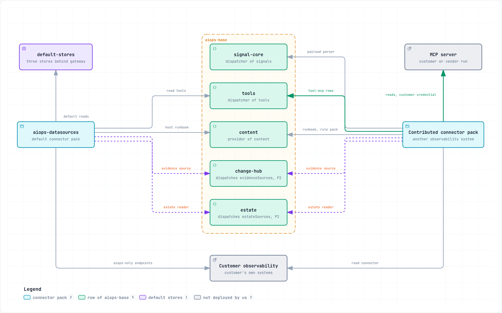
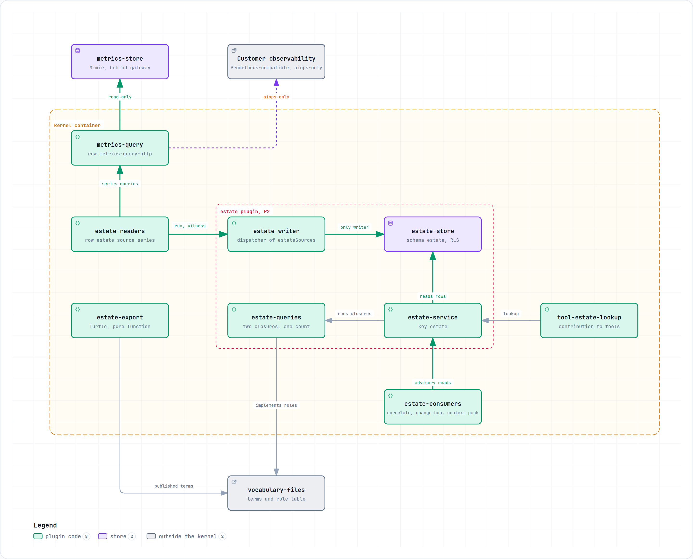
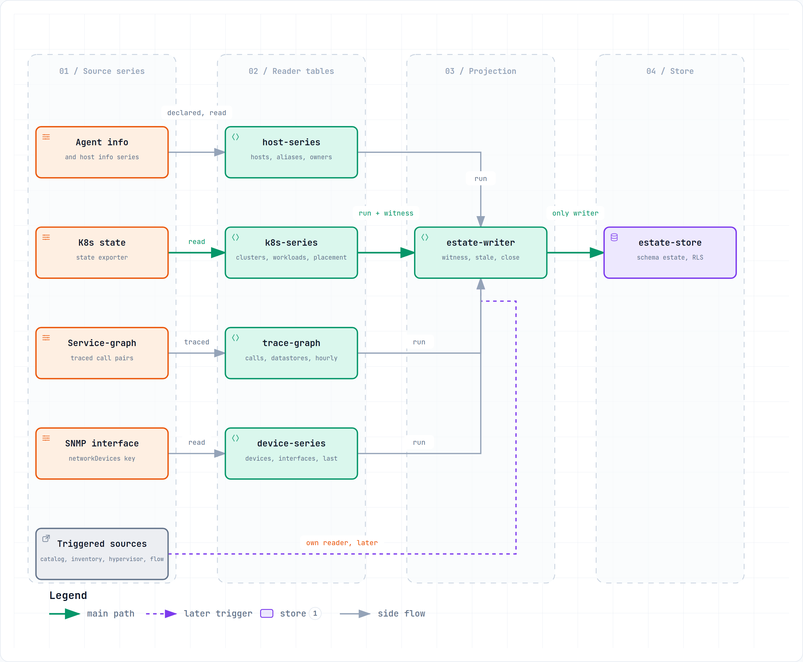
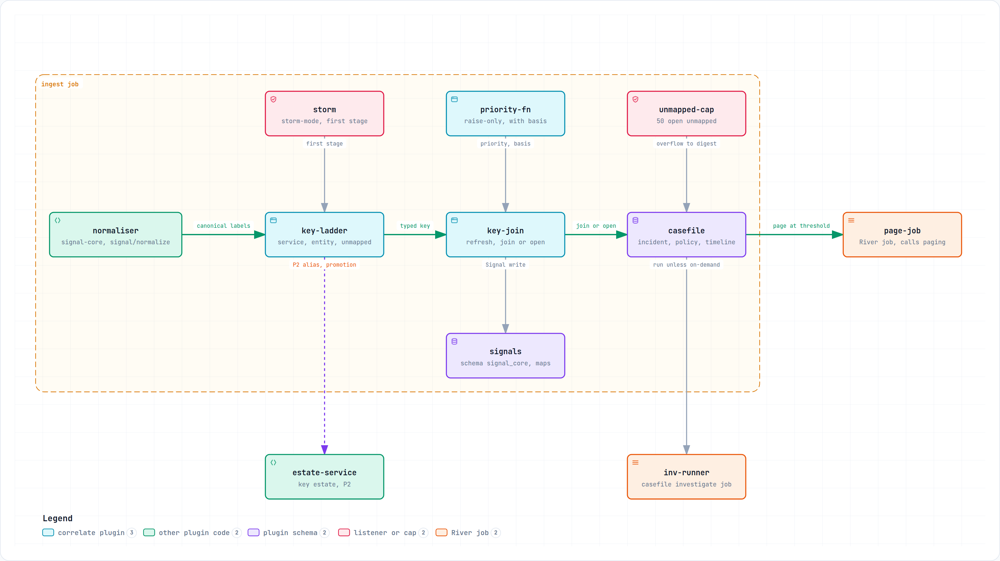
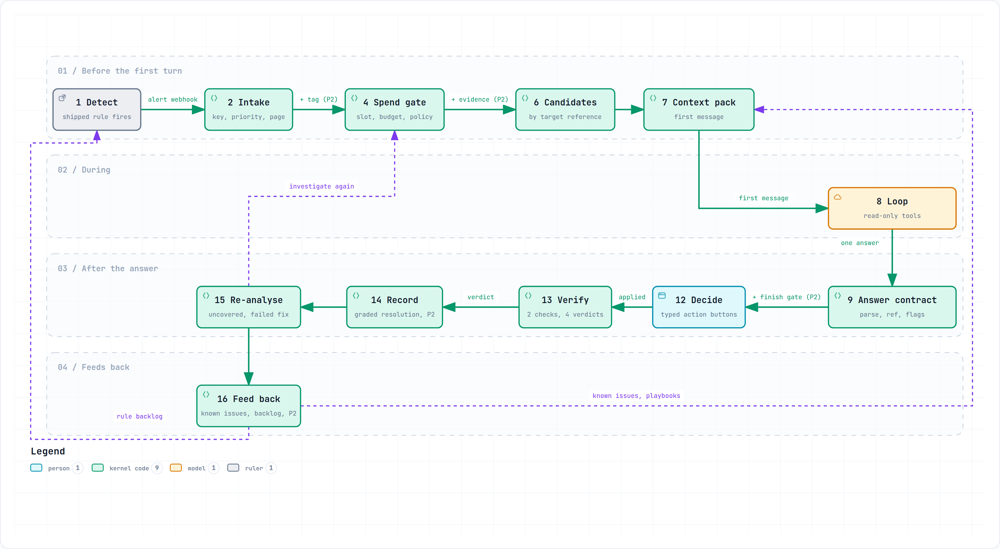
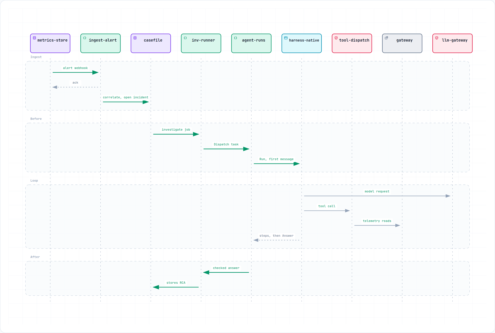
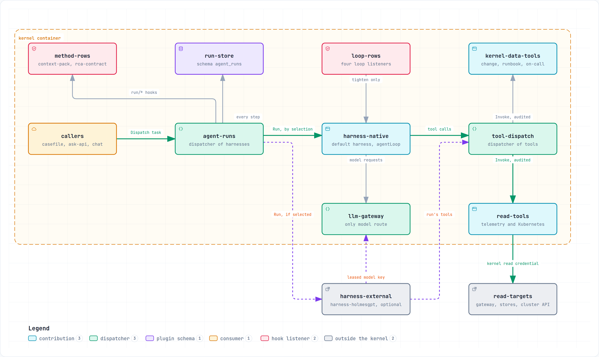
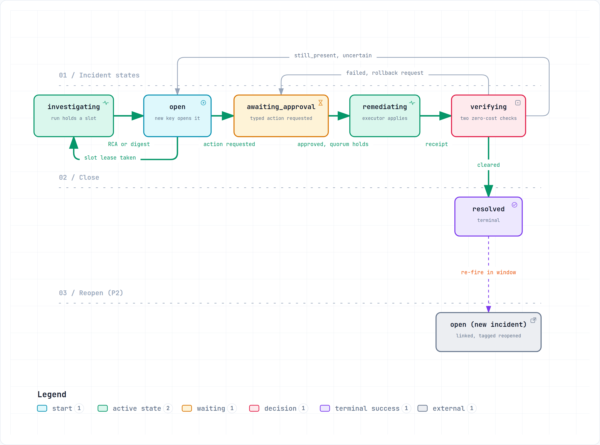
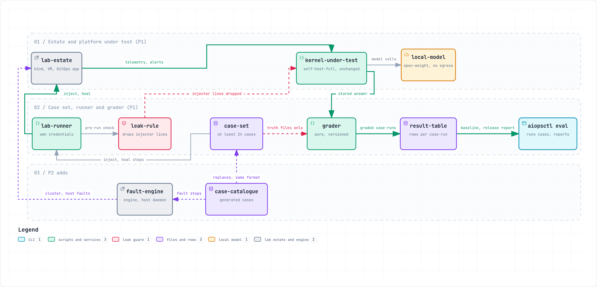

# 09. C3: estate model and troubleshooting method

Status: draft, 2026-11-11. Obeys `00-decisions.md` as amended for the plugin system, for the community-first order of work and vendor-neutral connectors, and a second time on 2026-11-11 for the agent harness as a plugin point, upstreams as plugins and the licence record, and a third time on 2026-11-11 for the owner's confirmation of W2 to W13 (00 §2.4), which are owner decisions from that date, in particular principle 9, §2.1 rows 2, 13 and 15 to 19, §2.4, §4, §6.1, §6.2 and §7.1; where this file and 00 disagree, 00 wins. Citations use `00 §n` and `03` to `08 §n` for files of this set, "plugin record §n" for `docs/design/plugin-system-2026-11.md`, "community record §n" for `docs/design/community-first-2026-11.md`, "harness record §n" for `docs/design/harness-and-upstreams-2026-11.md` and "licence record §n" for `docs/design/licence-audit-2026-11.md`. Each requirement is stated on its own merits (00 §2.3). Licence statements in this file are engineering analysis, not legal advice; a point that needs a lawyer names its question in licence record §6.

## 1. Scope and how to read it

This is the C3 view of three first-party things: an open model of the customer estate; a troubleshooting method made of plugins around whichever agent harness a pillar selects; and the agent layer the method runs on, which is new: the `harnesses` definition with its dispatcher `agent-runs`, the default harness `harness-native` with its loop rows, and the read tools the kernel offers to every harness (§4.4). All of it runs in the `kernel` container (`aiops --role all` in `self-host-full`, `aiops-only` and `dev`; `kernel-api` and `kernel-worker` in `hosted`, 03 §9), and a first install runs no harness container. Each part is a plugin behind a service definition or a listener on a hook (§1.1), so each is tested alone on the real kernel with fakes of the services around it (00 §4.5). The file also covers what the method needs around it: detection content, the lab and evaluation, and the on-prem plumbing for change evidence and remediation.

Two rules bound everything below. An upstream is a plugin, never the product (00 principle 9): the default harness is ours, HolmesGPT is one optional harness plugin that a user may select as the harness of a pillar agent, and nothing else in §1.1 names or needs it. The default stack is a choice of bundles, not a contract of this file: no plugin of §1.1 outside the default connector pack holds a query string or calls a telemetry store's query API, so another observability system is reached by a connector pack that a contributor writes, with no change to the method (§1.2; 00 principle 7, §6.2).

Not repeated here: ingest admission and storm mode (03 §4, 05 §3), the run through a harness step by step, the operations of each tool and the adapter of the optional external harness (05 §5.4, §5.5, §5.10), the full incident state table (05 §5.3), chat surfaces and on-call (06), agent templates (04), Go interfaces (07), the context API, the hook rules and the failure matrix (plugin record §4, §8, §13), and the artifact form of a connector pack with its install rules and gate checks (00 §6.1, §6.2; community record §6).

| Phase | Estate | Method and agent layer | Around the method |
|---|---|---|---|
| S7 (the round-1 P0) | Identity only: reference grammar, kind list, host stamps, machine id alias (ADR-025). No store and no vocabulary file | none | The gateway read routes, a closed list written from the operations of the read tools and the calls of the provisioned dashboard data sources (ADR-053) |
| P1, S8a (agent runtime; needs S5, may run beside S7) | none | `harnesses` with `agent-runs`, its schema `agent_runs` and `ask-api`; `agentLoop`, `harness-native` and the four loop rows; `tools` with its remote adapter, the two query rows, the four read tools and `tool-mcp`; per-run metering and caps in `llm-gateway`; the remote reference harness | Two spikes with pass criteria written first; evaluation tier V0 (§7.2); the case format and the leak rule (ADR-027); written owner confirmation of newly authored prompt and case content before S8a, with publication rights still open under 08 §5.1 L14 |
| P1, S8b (incident loop; its exit is the first community release) | No store. An alert is placed by a stamped label | Typed correlation key, priority function, change candidates by target reference, context pack v1 with the bound signals in its footer, RCA contract v1, the last request without tools before the deadline, the code-built digest for a run with no answer, not-covered marker, budgets in typed units, four verdict words; the kernel-data tools; the optional plugin `harness-holmesgpt` | Rule files `kubernetes-workload` and `host-basics` with their lint; change-evidence labels and one host runbook, content of the default connector pack; `lab/` with the live demo, the case set, the grader, `aiopsctl eval` and a smoke baseline (tier V1, leg E); the connector scenario on `aiops-only` |
| P2 (S9a; item 7 of §9.1 with S9b) | The `estate` plugin and its first reader row: reader tables, closure queries, vocabulary v1, export, consumers | `tool-profiles-query` and the compliance agent's own first-message and answer rows, first; then the kernel read of change evidence through `evidenceSources`, cause window, ranked shortlist, finish gate, condition rounds, resolution record, bounded re-analysis, known issues | Evaluation tier V2 (the fault engine and the generated catalogue, with the baseline taken again), the endpoint probe, the playbook pack with its failed-unit rule and unit-state collector, `remediation-executor-gitops-pr`, the Kubernetes audit file, the network device slice |
| On a trigger | §9.4 | §9.4 | §9.4 |

Reading rules:

- "Code" is first-party plugin code in the `aiops` binary. Where this file says the kernel does a product thing, the plugin named in §1.1 does it (00 §8.2). "Model" is the model that the harness of a run reaches through `llm-gateway`. "Harness" is a contribution to `harnesses`; unless a sentence says otherwise it is the default, `harness-native`, a first-party loop in the kernel process (00 §2.1 row 2; owner decision A). The method never depends on which harness runs (00 §2.1 row 16).
- Phase dates are planning targets, not commitments, and there is no schedule pressure (owner decisions of 2026-11-10 and 2026-11-11). The order of work is community first (00 §2.4, §7.2). P0 is the model core, steps S0, S1, S2a, S2b, S3, S4a and S5, and no product behaviour of this file is built in it; the `change-hub` ledger and token exist from S5, proven with a no-op executor. P1 is the community release, steps S6a, S7, S8a and S8b: what round 1 tagged P0 is S7, the agent runtime is S8a, the incident loop is S8b, and the exit of S8b is the first community release, version `0.1.0` (00 §7.1). A plain "P1" in a table of this file means S8b unless it says S8a. P2 runs in two tracks: the P2 items of this file belong to S9a, the community second wave, except item 7 of §9.1, which belongs to S9b with hosted. Both are re-baselined at the P1 exit review, which is the review of the first community release. No P1 component reads a table or series that P1 does not write, and P1 stores no field whose only reader ships later. A later input arrives with its consumer as an expand migration (00 §2.1 row 9).
- In S7 and P1 this file adds no container to any default set and no agent feature key; the optional `harness-sidecar` is rendered only when the operator sets its value (00 §3.2, §6.3). Its P1 plugins are rows of three bundles that every server profile composes, plus the two rows of the optional bundle `aiops-harness-holmesgpt` (`harness-holmesgpt` and `tools-mcp-facade`, S8b), which no shipped profile lists (00 §6.3), all in the inventory of 00 §4.4, with the definitions and hooks of §1.1. In `aiops-base`: `correlate`, `casefile`, `context-pack`, `rca-contract`, `agent-runs`, `ask-api`, `harness-native`, the four loop rows, `tools` and `tool-oncall-who`. In `aiops-datasources`, the default connector pack: `metrics-query-http`, `logs-query-http`, the three telemetry read tools and, as content, the host runbook. In the `pillar-incident` group of `aiops-pillars-mvp`: `tool-change-lookup`, `tool-runbook-fetch` and `tool-kubernetes-read`. P2 adds the definitions `estate`, `estateSources` and `evidenceSources`, one row in `aiops-base` (`estate` with its schema and its closure queries), three rows in `aiops-datasources` (`tool-profiles-query` at the start of S9a, then `estate-source-series` and `evidence-source-logs`), two contributions in `pillar-incident` (`tool-estate-lookup` to `tools` and `remediation-executor-gitops-pr` to `executors`; 00 §4.4), two feature keys (`changeEvidence`, `networkDevices`) and, with the `estate` first slice, the `service`, `team` and `env` declaration in the features document with the agent info series that publishes it (00 §2.1 row 11, §4.4 `agent-base`). The `runtimeSecurity` key of the SecOps wave is outside this file (00 §2.1 row 10). With the playbook pack P2 also adds one failed-unit rule to `host-basics` and switches on the unit-state collector in the `host-metrics` template, which is no new key (00 §4.4, §7.2 item 4).
- Every number is an initial value, reviewed at the P1 exit, unless 00 states it. Each view has a scope paragraph, a figure, an element table and a relationship table; §1.1 has no figure of its own and points at those of §3.1, §4.2 and §4.4. A figure shows the main path, and the tables are complete.
- A definition lands with its first consumer, its fake, its conformance suite and its `definition.yaml`, and no plugin of this file merges without `aiopsctl plugin check` and a T3 test (00 §7.2, standing rules from S2a).

### 1.1 Plugins, definitions and hooks of this file

Scope: the first-party plugins that carry the estate model, the method and the agent layer, with the key each provides, the registry it contributes to or the hook it listens on. Every row of a shipped profile runs in process in every server profile (00 §2.1 row 1). The catalogue is 00 §4.1, the row inventory 00 §4.4 and the hook list plugin record §8. This view has no figure of its own. The path from signal to incident, page and run is the figure of §3.1, the agent layer from `agent-runs` to the tools and the model route is the figure of §4.4, and the order of calls is the figure of §4.2. The arrows from `context-pack` to `change-hub` and to `estate` (P2) are in no figure; the tables below are complete.

| Id | Rows | Bundle | Provides, registers or listens | Schema | Phase |
|---|---|---|---|---|---|
| `signal-core` | `signal-core` with its `signal-ingest-*` rows | `aiops-base`; `aiops-pillars-mvp` | Dispatcher of `signals`. Owns the `signal/admit` gate and the `signal/normalize` waterfall, where the label maps and the `signal_type` lift run | `signal_core` | P1 |
| `correlate` | `correlate` | `aiops-base` | Provides `correlator`: fingerprint, the typed key and the priority function (§3.1). Owns the `incident/correlate` waterfall, whose one listener in P1 is `storm-mode`; fold rules listen on it when they ship (§9.4) | none | P1 |
| `casefile` | `casefile` | `aiops-base` | Provides `incidents`: the incident machine, the timeline, investigations and artifacts. Owns the `incident/investigate` gate. A consumer of `harnesses`: it dispatches incident runs through `agent-runs` and keeps the run id, never a transcript | `casefile` | P1 |
| `storm-mode` | `storm-mode` | `aiops-base` | Listens on `incident/correlate`, as its first stage, and on `incident/investigate` (00 §2.1 row 5) | none | P1 |
| `agent-runs` | `agent-runs` | `aiops-base` | Bound provider of `harnesses` and its dispatcher, the only caller of a harness: selects the harness, takes the slot and budget leases, hands the run a read-only tool set and model access by tier, and writes every step before it forwards it. Owns the `run/first-message` and `run/answer` waterfalls, dispatched with the pillar and the kind (§4.4) | `agent_runs` | P1 (S8a) |
| `context-pack` | `context-pack` | `aiops-base` | Listens on `run/first-message`: builds the blocks of §3.2 | none | P1 |
| `rca-contract` | `rca-contract` | `aiops-base` | Listens on `run/answer` for the kind `investigate`, on the pillars whose group names it: the answer spec, the references and the flags of §5.1 | none | P1 |
| `harness-native` | `harness-native` | `aiops-base` | A contribution to `harnesses` and the default harness of every shipped profile: the first-party loop. Provides `agentLoop` and owns the `loop/pre-step` and `loop/tool-result` waterfalls. It reaches a model only through `llm` and a tool only through `tools` (§4.4) | none | P1 (S8a) |
| `tools` | `tools` | `aiops-base` | Bound provider of `tools` and its dispatcher: filters the offered set by the actor's permissions, classifies effects, caps and scrubs output. The vendor-neutral read seam of every harness | none | P1 (S8a) |
| `llm-gateway` | `llm-gateway` | `aiops-base` | Bound provider of `llm`: the only model route, with the scrub, the per-run meter and caps, and the daily budget | `llm_gateway` | P1 (S8a) |
| `change-hub` | `change-hub` with `verify-alert-cleared` and `verify-readback` | `aiops-base` | Bound provider of `changes`: the ledger, the candidate list and the verdict. Dispatcher of `verifiers` (§5.2) and, from P2, of `evidenceSources`, through which it reads change evidence; it holds no query string (§8.1) | `change_hub` | S5 (policy spine: ledger and token); P1 for candidates and `verifiers`; P2 evidence read |
| `estate` | `estate` | `aiops-base` | Provides `estate`, dispatches `estateSources` and runs the closure queries over its own schema (§2.3). It holds no query string: its readers are contributions | `estate` | P2 |
| `loop-rows` | `loop-budget`, `loop-repeat-guard`, `loop-tool-failures`, `loop-compaction` | `aiops-base` | Listeners on `loop/pre-step` and `loop/tool-result`. A listener may only tighten: remove a tool, shorten the history view, add one notice, set answer-now or stop (§4.4) | none | P1 (S8a) |
| `ask-api` | `ask-api` | `aiops-base` | The API route behind `aiopsctl ask`: a consumer of `harnesses` for the kind `ask`, and the consumer that exists at S8a, before `casefile` | none | P1 (S8a) |
| `pillar-tools` | `tool-change-lookup`, `tool-runbook-fetch`, `tool-kubernetes-read`; `tool-oncall-who`; P2 `tool-estate-lookup` | The `pillar-incident` group of `aiops-pillars-mvp`; `tool-oncall-who` in `aiops-base` | Contributions to `tools`: the kernel-data tools, and the read-only tool for the Kubernetes API. `tool-oncall-who` is offered only where an on-call provider is registered for the tenant | none | P1; P2 |
| `default-pack` | `metrics-query-http`, `logs-query-http`, `tool-metrics-query`, `tool-logs-query`, `tool-traces-query`, and the host runbook as content; S9a `tool-profiles-query`; P2 `estate-source-series`, `evidence-source-logs` | `aiops-datasources`, the default connector pack | The only rows of this file that carry a query string to a telemetry store or call its query API. The two query rows provide the dialect keys `metricsQuery` and `logsQuery`; the telemetry read tools are contributions to `tools`, in which the model writes the query and the tool bounds it; `estate-source-series` is the first contribution to `estateSources` and `evidence-source-logs` the first to `evidenceSources` (§1.2) | none | P1 (S8a); P2 |
| `content` | `content` | `aiops-base` | Provides `content`: serves runbooks, playbooks, rule files and the content of a connector pack under the plugin id. All of it stays bundle or pack content | none | P1 |
| `harness-external` | `harness-holmesgpt`, `tools-mcp-facade` | `aiops-harness-holmesgpt`, an optional bundle that no shipped profile lists | One optional contribution to `harnesses`: an in-process client that drives the unmodified HolmesGPT process, `harness-sidecar`. `scope: tenant`. An operator enables it, and a pillar or a tenant may then select it (§4.4) | none | P1 (S8b), optional |

| From | To | Why it matters |
|---|---|---|
| `signal-core` | `correlate` | Signals reach `correlate` normalised: the maps run on `signal/normalize`, so no payload family skips them |
| `correlate` | `casefile` | Key and priority decide the join or open, which `casefile` writes. `incident/correlate` is where a fold rule would change that decision, in process only |
| `casefile` | `storm-mode` | The `incident/investigate` gate, before every incident run. Every listener runs, the strictest verdict wins, none may grant, and an expected listener that is not ACTIVE denies (00 §4.2). Paging has no hook, so no verdict here withholds a page |
| `casefile`, `ask-api` | `agent-runs` | `Dispatch` with one task: a kind (`investigate` or `ask`), the pillar and the subject. `harnesses` is provider-bound to `agent-runs` and a contribution is provided under no key, so nothing else can call a harness |
| `agent-runs` | `context-pack` | `run/first-message`: blocks in declared stage order, then plugin id. It is the one hook of this file that admits a remote listener, which receives the subject key and the scrubbed summary only |
| `context-pack` | `change-hub`; `estate` (P2) | The candidate list; the relationships and substrate blocks, which exist only while a provider of `estate` is ACTIVE |
| `context-pack` | `tools` | The footer lists each bound signal with its dialect and scope note, as the tools offered to the run describe them, and names the host runbook of the pack whose logs tool is offered, so the first message is true whichever connector pack is enabled (§3.2) |
| `agent-runs` | `harness-native` | `Run` with the persona, the operating rules, the first message, the answer spec, the tool set, model access and the budget. The harness is chosen by the tenant, then the pillar group's `harness` field, then `defaultHarness`; one that is not ACTIVE falls back to the default and the timeline says so |
| `harness-native` | `tools`, `llm-gateway` | The two views a harness holds, both in process: every tool call goes through the run's tool set and every model request through the model view. The caps are enforced at these two views, never from the stream the harness reports, and the dispatchers classify effects, cap, scrub and meter (§4.3) |
| `loop-rows` | `harness-native` | The loop compares its plan before and after each listener and refuses one that adds a tool, removes another listener's notice or moves a directive back. Both loop hooks are signed and not remote (00 §4.3) |
| `tools` | `pillar-tools`, `default-pack` | A first-party read tool is registered exactly as a tool from a connector pack. The kernel calls it with its own read credential, read per call, so no harness holds a credential (00 §2.2) |
| `agent-runs` | `rca-contract` | `run/answer`: signed, in process only. Code, not the model and not the harness, builds references and sets flags |
| `change-hub`, `estate` | `default-pack` (P2) | The two dispatchers send a typed scope and receive a run. The query text and the client stay in the contribution, so a pack for another store contributes its own and neither dispatcher changes (§2.3, §8.1) |

Rules that follow from the plugin system, stated once for this file:

- **Tested alone.** Each row above passes T1 alone on the real kernel with the fakes of what it injects, and each provider and contribution passes the conformance suite of its definition (00 §4.5). `context-pack` and `rca-contract` need no model for it. `harness-native` and each loop row are tested with the scripted driver of `agentLoop`, the fake of `harnesses` is a harness of scripted steps, and the loop on recorded transcripts is evaluation tier V0, in T3 (§7.2).
- **Optional inputs.** An input that ships later than its consumer is optional. `estate` is taken in a `When` sub-fiber, the only optional form (plugin record §4): the join, block or blast radius exists while a provider is ACTIVE and is absent otherwise. The evidence read exists while a contribution to `evidenceSources` is ACTIVE; `evidence-source-logs` needs `logsQuery` and stays PENDING without a provider. The consumer itself never waits on either. This is what "degrades to not known" means below (A9).
- **Tenant.** Every call carries the tenant handle, and no API of this file takes a tenant argument (00 §5.1). A harness never derives the tenant. The rows are process scope; the optional `harness-holmesgpt` is `scope: tenant`, because it keeps a tenant's upstream instance.
- **Transactions.** No plugin writes another plugin's schema, and only `jobs`, `events`, `audit` and `kv` take a caller's transaction (00 §4.3). Steps that cross plugins (signal to incident, incident to page and run, answer to RCA) are joined by jobs and outbox events with idempotent handlers (A8). The transcript of a run is rows of `agent_runs`, which `agent-runs` alone writes, so a compliance or FinOps run needs no incident.
- **Reload and failure.** Every change to a row goes through the `reload` queue, and a provider change restarts its consumers in place (00 §6.1). The required set is written in keys, plus a few rows named by id. Of this file's table, the key `changes` (provider `change-hub`) is required in any profile with an executor row, and `hosted` also requires the key `signals` (provider `signal-core`) and the row `signal-ingest-alert-webhook`; a required key or row that is absent, disabled or not ACTIVE stops boot. `change-hub`, `llm-gateway`, `tools` and `agent-runs` cannot be disabled in any layer, because in the release bindings each is the last provider of a provider-bound key (`changes`, `llm`, `tools`, `harnesses`; 00 §4.2), and no layer disables the last enabled provider of a bound key. They are still reconfigured live. Every other row of the table is optional and is enabled, disabled or reconfigured live; swapping the harness of a pillar is a patch on one field, applied as a live recomposition. A row of the table that fails while running is retried in place by `restart-policy`: its consumers unload and return with it, and the process stays up; while `change-hub` is down the write routes answer 503 and write readiness fails (plugin record §13). A worker crash during a run restarts the run from the first message, which is safe because every offered tool is a read. One case denies instead of degrading: while `storm-mode` is composed and not ACTIVE, the `incident/investigate` gate denies every run in that scope until the row is ACTIVE or an operator disables it (ADR-046). Pages still go out.
- **Third parties.** The method and the agent layer are extended at seven places, each a registry or a hook of 00 §4.1: a payload parser in `signals`, a tool in `tools` (which states the pillars it joins, so it needs no edit of `pillar-incident`), a block on `run/first-message`, a harness in `harnesses`, and from P2 a reader in `estateSources`, an evidence source in `evidenceSources` and an executor in `executors`. `tools` and `harnesses` take remote contributions from S8a, and a pack with no code adds tools as rows of `tool-mcp`. The loop hooks are not among the seven: they are signed and not remote, so a loop row is first-party or in-process code whose signer the site trusts. A connector pack groups the contributions that reach one observability system (§1.2). A contributor writes any of them from a template with `aiopsctl plugin new`, checks it with `aiopsctl plugin check` and no kernel checkout, and contributes it back under `contrib/` or lists it in the index (00 §4.5). A data pack and a remote contribution install with no rebuild; in-process code enters through `aiops-contrib` or through a distribution the operator builds and signs (00 §6.1). Four owner decisions of 2026-11-11 bound this: the remote runtime ships before the first community release (00 §2.4 W5), a self-hoster may build and sign a distribution (W3), in hosted a third party is a remote contribution only, one instance per tenant (W4), and `tool-mcp` ships in `0.1.0` (W9). Third-party plugins on hosted wait for the enterprise edition (00 §7.3).

### 1.2 Where another observability system plugs in

Scope: the seams of this file that reach a telemetry store or receive a vendor's payload, and the packs that fill them, in every server profile. The Grafana stack is first-party and the default. A contributor makes another system usable (for example VictoriaMetrics with VictoriaLogs, Elasticsearch or OpenSearch, SigNoz, a ClickHouse-based stack or Datadog) by writing a connector pack against the same definitions and contributing it back; no plugin of §1.1 changes. A plain Prometheus with Alertmanager needs no pack of its own: the default pack reaches it by endpoint config, with the tools of the signals it lacks disabled. The three sizes of a pack, its artifact form, its install and its naming rules are 00 §6.1, §6.2 and §8.1.

*Figure 09-connector-seams. Source: [diagrams/src/09-connector-seams.json](diagrams/src/09-connector-seams.json).*

The figure draws every row of the two tables below. Green arrows are the smallest contributed pack, a data pack whose `tool-mcp` rows register tools and read an MCP server with the customer credential; grey arrows are the other P1 contributions and reads; dashed arrows are P2. The figure draws `default-pack` under its bundle name `aiops-datasources`, `other-pack` as "Contributed connector pack", `ext-customer-observability` as "Customer observability" and `ext-mcp-server` as "MCP server".

| Id | Name | Technology | Responsibility | Phase |
|---|---|---|---|---|
| `signal-core` | Dispatcher of `signals` | Row of `aiops-base` | Admits, dedupes, writes the raw group and acks, then calls the parser of the payload family. A `Signal` names its `State` (`firing`, `resolved`) and the sender's `SourceID` | P1 |
| `tools` | Dispatcher of `tools` | Row of `aiops-base` | The read seam of every harness. Each tool describes its signal, dialect and scope note; several tools may share a signal | P1 (S8a) |
| `change-hub` | Dispatcher of `evidenceSources` | Row of `aiops-base` | Sends a typed scope, maps the typed lines it gets back and reports what the source could not see (§8.1) | P2 |
| `estate` | Dispatcher of `estateSources` | Row of `aiops-base` | Runs each reader and applies its run (§2.3) | P2 |
| `content` | Provider of `content` | Row of `aiops-base` | Serves a pack's host runbook and rule pack under the plugin id | P1 |
| `default-pack` | The default connector pack | Bundle `aiops-datasources` (§1.1) | The dialects of the default stack: PromQL and LogQL behind `metricsQuery` and `logsQuery`, and the three telemetry read tools | P1 (S8a); P2 |
| `other-pack` | A connector pack for another system | One signed artifact (rows, content and at most one plugin), kept under `contrib/` or in its author's repository and listed in the index | A data pack: rows of instantiable first-party plugins (`tool-mcp`, one row per MCP server; `signal-ingest-generic-json`), with a rule pack and a host runbook as content. A read connector: the same plus one plugin that contributes to `signals` where the system has a payload of its own, to `tools`, and at P2 to `evidenceSources` and `estateSources` | From the first community release; P2 |
| `default-stores` | `metrics-store`, `logs-store` and `traces-store` behind `gateway` | Upstream components (00 §3.2) | What the default pack reads in `self-host-full`, `hosted` and `dev` | S7 |
| `ext-customer-observability` | The customer's own observability systems | External, not deployed by us (00 §3.3) | What a pack reads in `aiops-only` | external |
| `ext-mcp-server` | An MCP server the customer or a vendor runs | External, over Streamable HTTP (00 §3.3) | The read tools that `tool-mcp` rows of a pack mount | external |

| From | To | Why it matters |
|---|---|---|
| `other-pack` | `signal-core` | Alert intake. Nothing to write where the system sends through Alertmanager: `signal-ingest-alert-webhook` of `aiops-base` receives it. Otherwise a `signals` contribution parses the payload family, and its route entry states the busy reply (429, or 503 for a sender that retries only 5xx) and a default label map (§3.1) |
| `default-pack`, `other-pack` | `tools` | The reads of a run. There is no binding registry: a tool is a contribution, and the tool set of a run is the pillar group's defaults plus the enabled tool rows that name the pillar. Each allow-listed tool of a `tool-mcp` row becomes one contribution |
| `other-pack` | `ext-mcp-server` | Through `dialer`, never over stdio, with the MCP server credential kept in tenant secrets under the pack's scope and read per call. The pack carries a digest of the recorded tool list, and the row fails when the live list hashes differently. The effects class of such a tool is asserted by the pack, not proven, and boot says so (00 §6.2) |
| `default-pack`, `other-pack` | `change-hub` | P2. `evidence-source-logs` holds the LogQL; a pack for a logs store outside that dialect contributes its own evidence source |
| `default-pack`, `other-pack` | `estate` | P2. `estate-source-series` holds the PromQL. A store that keeps the same exporter series behind the Prometheus query API needs endpoint config only; any other needs a reader of its own |
| `default-pack`, `other-pack` | `content` | The host runbook, which gives the query per change-evidence source in the store's own dialect, and for another system a rule pack in its own format (§6.1) |
| `default-pack` | `default-stores`; `ext-customer-observability` in `aiops-only` | The default pack reaches a customer store that speaks its dialects by endpoint config |
| `other-pack` | `ext-customer-observability` | A read connector reads with the customer datasource credential, kept in tenant secrets under the pack's scope and read per call by the kernel. A pack states whether its vendor's credential is read-only; one that is not is refused in the project index and in `contrib/`, and boot warns on it (00 §5.4) |

- **Dialect keys are not seams.** `metricsQuery` and `logsQuery` are dialect contracts, like `sql`: the Prometheus HTTP query API with PromQL and the Loki HTTP query API with LogQL, both from S8a. A store that does not speak the dialect provides nothing under the key, there is no negotiation, and only rows of a connector pack or a stack bundle inject them; CI checks it on the static graph (00 principle 7, §4.1). A pack never adds a second provider of a singular key: it ships a profile-layer snippet that repoints the existing row (00 §6.2).
- **What a pack with no code reaches.** A data pack reaches only a system that offers a Streamable HTTP MCP server with read tools; any other system needs a read connector with code (00 §2.4 W9). A tool whose recorded name or annotations indicate a write is refused at pack check. The pack carries the recorded text of a tool list only where the server's licence is open; otherwise its publisher writes the descriptions in its own words (licence record §7.4).
- **Proof.** A pack passes the suites of the registries it feeds and the connector scenario, one vendor-neutral script replayed from the pack's fixtures on `aiops-only`: a firing alert becomes one incident on the expected entity, the first message lists the bound signals, the default harness, on replayed model turns, makes one successful call on each tool the pack offers, and the resolve yields `cleared` (00 §6.2). The scenario has one half, runs in `aiopsctl plugin check` and needs no container runtime; it is T4 in the tiers of 00 §4.5. The first community release passes it twice: with the default pack on stores we do not deploy, and with a reference data pack for a logs store outside the default stack, rows of `tool-mcp` for that store's MCP server, installed with no rebuild (00 §7.1 legs B and C1; 00 §2.4 W6).
- **Promotion.** `signals`, `tools`, `evidenceSources` and `estateSources` are the four vendor-neutral read seams. Each is `v0` until a release review promotes it, and promotion to `v1` asks for a second contribution or pack for a different backend family, a condition the review may waive with a recorded reason (00 §4.3).
- **What stays specific to the default stack** in this edition, of the things this file uses: the agent templates that stamp identity and label change evidence, the shipped rule files, the provisioned dashboards with the annotator, and the lab (00 §6.2). Their contracts are published (§2.1, §6.1, §8.1), so a customer-run collector or alerting system can meet them.

## 2. The estate model

### 2.1 Identity scheme (S7)

One entity reference, `<kind>:<id>`, is the correlation key and the change target from P1, and the estate key and the export IRI suffix from P2. One scheme means no mapping table between incident keys, ledger targets and estate rows. `kind` is a closed lower-case list. `<id>` is the identifying parts joined by `/`, each part percent-encoded (00 §8.1).

| Kind | Id | Notes |
|---|---|---|
| `service` | `<scope>/<namespace>/<name>` | `scope` is the signal's `env`, else its cluster, else empty. `namespace` is `service.namespace`, else the Kubernetes namespace. `name` is `service.name`, an accepted alias, or the workload name. One name in two environments or clusters is two keys |
| `host` | `agent/<fleet_collector_id>`, `k8s/<cluster>/<node>` or `ext/<value>` | One form per source, next table |
| `cluster`, `namespace`, `workload` | Cluster name; cluster and name; cluster, namespace, workload kind and name | The cluster name is the chart value and must be unique in a tenant. A duplicate never refuses an install |
| `datastore` | System and address, or the declared name | An entity from P2 (trace graph). An alert key only when the `dbState` feature key ships |
| `device` | The declared target name | P2, with `networkDevices`. Stamped from the polled target, never from the poller |
| `unmapped`, `control`, `storm` | Alert fingerprint; control id; storm start time, or `unmapped` for the overflow incident | Key-only kinds: they key an incident and are never entities, change targets or estate rows |

| Where | What names the host | Key |
|---|---|---|
| Profiles with `fleet` (`hosted`, `self-host-full`, `dev`), a host agent | `fleet_collector_id`, stamped on every host pipeline | `host:agent/<id>` |
| Any profile, a cluster node with no host agent | The cluster and node labels of the chart or of the customer's state exporter | `host:k8s/<cluster>/<node>` |
| `aiops-only`, and a foreign sender in any profile | `host_id` with its OpenTelemetry meaning (the machine id), else a label that the tenant label map, or the default label map of the sender family, maps to kind `host` | `host:ext/<value>` |

Label contract, published in 04 §2.8 so that a customer-run collector can meet it:

- `fleet_collector_id` is the enrolled agent id, stamped with `host_name` on every host pipeline. It is unique by construction, so duplicated machine ids or duplicate host names never merge two machines, and no install is refused. Enrol records the machine id as an alias, and a bootstrap-token enrol keeps the agent id when its machine id and host name match exactly one active agent of the tenant (00 §2.1 row 11).
- `host_id` and `host_name` keep their OpenTelemetry meaning, as SDKs, the eBPF child and customer collectors ship them. We never overwrite upstream output. On a host that has an agent they are aliases.
- Until P2 one machine seen by our agent and by a foreign sender has two keys. From P2 the agent publishes one info series (`fleet_collector_id`, `host_id`, `host_name`, and the `service`, `team` and `env` declared in the features document; 00 §2.1 row 11, with the one place a template of ours sets `host_id`), and placement uses the agent key when exactly one agent holds the alias. An open incident is never re-keyed. `correlate` reads signals and `estate` reads the runs its readers return; neither injects `fleet`, so `aiops-only` composes them without `aiops-stack` (00 §6.3).
- A change row carries a set of target references: the service when known, workload, namespace, cluster, host. The shipped Argo CD and Flux notification templates carry the destination cluster and namespace. An alias from an application or kustomization name to a service key is a label-map entry.

Unverified until ADR-025 closes: the label sets that the pinned agent, the chart and the eBPF child actually emit. ADR-025 closes only after they are read on the dev stack, and a compose test asserts the stamp on every host pipeline output.

### 2.2 Store, schemas and growth limits (P2)

The `estate` plugin, a row of `aiops-base`, owns schema `estate` in `kernel-db` under its own database role, with RLS like every tenant table (00 §5.2). The schema is its durable namespace: the `durable` leader migrates it, and `estate` stays PENDING until its declared schema version is applied. The estate is a projection: it can be dropped and rebuilt from its sources (series, catalog files, an inventory API). No entity or relation is created or edited through the kernel API or chat. Declared facts live in the customer's files or inventory and are read back. History is what readers saw, and a rebuild loses it. This is the line against a configuration database of our own (00 §1).

| Table | Holds | Rule |
|---|---|---|
| `entity` | Reference, kind, class, attributes, origin, source run, stale mark, validity interval, last seen | Nothing is rejected: an unknown type is kept under a bookkeeping class with its raw type |
| `entity_alias` | Reference, alias kind, alias value (machine id, host name, node name, Kubernetes uid) | Two views of one thing join only when exactly one candidate exists on each side. There is no same-as relation |
| `relation` | Subject, verb, object, origin, scope, attributes, source run, flagged mark, validity interval, last seen | One row per subject, verb, object, origin and scope. An unresolved target becomes a bookkeeping entity |
| `source_run` | Reader, scope, start, end, complete, witness, counts, coverage notes | Absence counts only from a run that is complete for its scope (§2.5) |

There is no derived table. Every estate answer is advisory, carries a basis (§3.3) and never blocks ingest, paging, approval or `Apply`. A composition in which `estate` is absent, disabled or not ACTIVE degrades every consumer to "not known" (§1.1).

Growth limits. Per-tenant caps on entities and relations live in `TenantLimits` (initial 100,000 and 1,000,000, 00 §5.5). At the cap a reader stops adding, records a coverage gap and raises a tenant event. There are no pod rows. Closed rows are dropped after 30 days by a periodic job capped per run. Traced edges expire after 168 hours unseen. Each answer is bounded by the cut cap of §2.6. Tenant delete purges the schema in the `domain` stage of the delete saga, from the `durable` registry, whether or not the row is still enabled (00 §5.6).

### 2.3 C3 view: the `estate` plugin and its rows

Scope: the `estate` plugin in `aiops-base`, its first reader row `estate-source-series` in the default connector pack `aiops-datasources`, and the rows they touch, in every server profile from P2. None of them injects a key that only `aiops-stack` provides. `estate` holds no query string and does not inject `metricsQuery`: it dispatches `estateSources` and applies the run a reader returns (00 §2.1 row 15). The query text is in the reader. `estate-source-series` queries through `metricsQuery`, a dialect contract (the Prometheus HTTP query API with PromQL) provided by `metrics-query-http` (00 §4.1, §4.4), so the same reader reads `metrics-store` through the gateway read routes or, in `aiops-only`, a customer store that speaks that dialect (`ext-customer-observability`, 00 §3.3). A store that does not speak it provides nothing under the key, so `estate-source-series` stays PENDING and says what it waits for; a connector pack for that store contributes its own reader to `estateSources`, with its own client (§1.2). The read credential is the service token class of 00 §5.4, the one the read tools use; ADR-028 names its holder in `aiops-only`. `estate` and `estateSources` are definitions under `sdk/def/` (00 §4.1): the fake of `estate` is a fixed graph, and the `estateSources` suite has an obligations half for a reader and a guard half for the dispatcher (00 §4.5).

*Figure 09-estate-row-components. Source: [diagrams/src/09-estate-row-components.json](diagrams/src/09-estate-row-components.json).*

The figure shows the main path in green: readers query through `metrics-query`, the writer is the only writer of `estate-store`, and consumers read through `estate-service`. The tables below are complete. The figure names the gateway only in the sublabel of `metrics-store`, draws `estate-store` as the plugin's own schema without `kernel-db` around it, and draws `ext-customer-observability` as "Customer observability" on a dashed arrow, because that path exists in `aiops-only` only. The four reader tables are drawn one by one in the figure of §2.5.

| Id | Name | Technology | Responsibility | Phase |
|---|---|---|---|---|
| `metrics-store` | Metrics backend | Mimir 3.2 behind the gateway, in `hosted`, `self-host-full` and `dev` (00 §3.2) | Holds the series every first-slice reader queries | S7 |
| `ext-customer-observability` | The customer's own observability systems; for this reader a Prometheus-compatible store | External system, not deployed by us (00 §3.3) | The `aiops-only` counterpart of `metrics-store`: holds the same series when the customer's collectors ship them. A system outside the dialect is read by the reader of its own connector pack | external |
| `metrics-query` | Metrics query provider | Row `metrics-query-http` in `aiops-datasources`, the provider of the dialect key `metricsQuery` | Instant and range queries with the tenant's endpoint and read credential, for the tenant of the call's handle. At P1 its endpoint is row config, by default the gateway query route, and its credential is the service token of 00 §5.4. It injects nothing that only `aiops-stack` provides | P1 (S8a), for `tool-metrics-query` and `fleet-sweeper`; P2 for readers |
| `estate-readers` | Reader tables | Row `estate-source-series` in `aiops-datasources`, a contribution to `estateSources`. Go query tables: `host-series`, `k8s-series`, `trace-graph`; `device-series` last in P2 | One table row is a query plus a mapping to entities and relations; the query text of the estate lives here and nowhere in `estate`. A reader returns a run and writes nothing. A periodic job of `estate` runs each table per tenant | P2 |
| `estate-writer` | Projection writer | Go in the `estate` plugin, the dispatcher of `estateSources`; one transaction per run | Applies a run: upsert, alias join, witness check, stale and close, trust flags, caps. Refuses a source that asserts a derived or bookkeeping term | P2 |
| `estate-store` | Estate schema | PostgreSQL schema `estate`, RLS, the plugin's own role | The four tables of §2.2 | P2 |
| `estate-queries` | Closure queries | Code of the `estate` plugin over its own schema, not a row: two recursive queries and one grouped count, each named by rule ids (00 §2.1 row 15) | Hosting closure, dependency closure and lost redundancy on a bounded cut (§2.6) | P2 |
| `estate-service` | Key `estate` | Definition `sdk/def/estate/v<N>`, provided by the `estate` plugin; a consumer takes it in a `When` sub-fiber (§1.1) | Lookup, neighbours, dependents, owner, hosting chain. Every answer carries basis and coverage gaps and is memoised per tenant, estate version and question | P2 |
| `estate-export` | Turtle export | Pure function behind `aiopsctl estate export` | One tenant's asserted rows as Turtle | P2 |
| `vocabulary-files` | Vocabulary and rule table | Files under `vocabulary/` | The published terms, the rule table and its format: the specification the queries implement | P2 |
| `tool-estate-lookup` | `tool-estate-lookup` | A contribution to `tools`, offered in the tool set of a run like any tool; a row of the `pillar-incident` group in `aiops-pillars-mvp` (00 §4.4) | One read-only tool with a `question` enum for the harness of a run (§3.4) | P2 |
| `estate-consumers` | `correlate`, `change-hub`, `context-pack` | First-party plugins of `aiops-base` | Placement, blast radius, context pack v2 (§3) | P2 |

| From | To | Why it matters |
|---|---|---|
| `estate-readers` | `metrics-query` | The only read path of the first slice. `estate-source-series` holds no credential of its own. A first-party reader that does, such as one for an inventory API, is another `estate-source-*` row on its trigger (§9.4). A reader for a store outside the dialect comes with its connector pack and waits for no trigger (§1.2). The registry, its suite and its remote adapter exist from P2 (00 §4.1) |
| `metrics-query` | `metrics-store`; `ext-customer-observability` in `aiops-only` | Read-only and tenant-scoped. On-prem the agent already ships these series, so the estate needs no new credential into the customer estate. ADR-028 names the holder of the read credential (00 §5.4) |
| `estate-readers` | `estate-writer` | A run carries its scope and witness. The dispatcher, not the reader, decides what an absence means, and only the dispatcher calls a reader. A remote reader joins no transaction: it returns its run and the dispatcher commits it (00 §4.3) |
| `estate-writer` | `estate-store` | The only writer. No API or chat path writes these tables, and no other plugin's database role can (00 §5.2) |
| `estate-service` | `estate-queries`, `estate-store` | The queries read current, unflagged, asserted rows and write nothing back. Every consumer goes through the service, so basis and coverage gaps cannot be dropped on the way |
| `tool-estate-lookup`, `estate-consumers` | `estate-service` | Advisory reads. A fault or a provider that is not ACTIVE answers "not known" or `estimated`, and the caller continues |
| `estate-export`, `estate-queries` | `vocabulary-files` | The export uses only published terms, and its IRIs end in the entity reference. The rule table is the specification of the queries; a fixture per rule id is its test |

### 2.4 Classes and relations

Only first-slice terms are listed. Each names the open vocabulary it aligns with, or is marked ours. Classes are PascalCase and relations lowerCamelCase (00 §8.1).

| Term | Role | Source | Written by |
|---|---|---|---|
| `Service` | Class | OpenTelemetry `service`; Backstage Component | Agent info series, `k8s-series`, `trace-graph` |
| `Team` | Class | Backstage Group | Agent info series |
| `Cluster`, `Namespace`, `Workload` | Classes | Kubernetes API names; OpenTelemetry `k8s.*` | `k8s-series` |
| `Host` | Class: a node, a guest or a bare-metal install | OpenTelemetry `host` | `host-series`, `k8s-series` |
| `DataStore` | Class | OpenTelemetry `db.system.name`, or `messaging.system`, with `server.address` | `trace-graph` |
| `ownedBy`, `partOf` | Asserted relations | Backstage catalog relations | Agent info series, `k8s-series` |
| `calls` | Asserted relation, only ever traced | ours | `trace-graph` |
| `hostedOn`, `dependsOnInfra`, `redundancyLost` | Derived, never asserted | ours | The queries of §2.6 |
| `replicasReady`, `expectsRedundancy` | Flags a reader computes | ours | `k8s-series` |

The first slice also writes one placement relation (what runs on what), one transitive dependency relation and two bookkeeping classes (a type we do not model, a relation target that resolves to nothing). Their names, and every term reserved for a later reader, are published only when ADR-029 has given each term one source: an open vocabulary or "ours".

Discipline. No domain or range is declared. The verb carries the kind of evidence: `calls` is only ever traced, and a declared dependency and a network flow each get their own verb with their reader. Derived and bookkeeping terms are reserved, and the write path refuses a source that asserts one. There are no pod rows: the reader asserts workload placement on a host with a ready-replica count, which is all the first rules need and keeps pod churn out of the store.

### 2.5 Sources, absence and staleness

Scope: where estate rows come from and what a missing row means. The origin list is closed: `declared`, `read`, `traced`, `flow`. Elements are those of §2.3; the table lists one flow per row. The reader tables named are those of `estate-source-series`, the first reader. A reader that a connector pack contributes for another store uses the same closed origin list and the terms of §2.4.

*Figure 09-estate-sources-dataflow. Source: [diagrams/src/09-estate-sources-dataflow.json](diagrams/src/09-estate-sources-dataflow.json).*

The figure shows the main path in green, the `k8s-series` reader, and the other first-slice readers in grey; each arrow into a reader table carries its origin. The table below is complete. The figure folds its first two rows into one source node, "Agent info" with the host info series in the sublabel, drops the word "series" from the source labels, and draws the triggered sources of the last two rows as one box on a dashed arrow, because each gets a reader of its own on its trigger (§9.4).

| Origin | Source and reader table | Asserts | Feeds closure rules | Phase or trigger |
|---|---|---|---|---|
| `declared` | Agent info series: the `service`, `team` and `env` of the features document | Service placement on a host; `Host ownedBy Team` | Yes | P2 first slice |
| `read` | `host-series`: agent info and host info series | `Host` and its aliases | Yes | P2 first slice |
| `read` | `k8s-series`: Kubernetes state series | `Cluster`, `Namespace`, `Workload`, `partOf`, workload placement with ready replicas, service placement on a workload | Yes | P2 first slice |
| `traced` | `trace-graph`: service-graph series | `calls`, with database and messaging peers kept as `DataStore` | Yes, above a request floor and seen inside 168 hours | P2 first slice |
| `read` | `device-series`: SNMP interface series | Device and interface rows | Yes | P2, last, with `networkDevices` |
| `declared`, `read` | A tenant catalog file in the Backstage format, which is also where an edge a person confirmed is written; an inventory or firewall policy API read with the reader's own credential; hypervisor and hardware series | Declared dependencies and ownership; placement, cabling and policy; guest and hardware placement | Yes | §9.4, each on its own trigger and each an `estate-source-*` row of its own. The API reader is the first first-party reader that holds its own credential |
| `flow` | eBPF flow series behind a noise filter | Layer-4 edges | No, until graded against declared and traced edges | §9.4 |

Reader rules, mandatory from the first reader. They hold for a contributed reader too, because a reader only supplies its run, scope and witness, and the dispatcher applies the rules:

- **Liveness witness.** A query that succeeds and returns nothing is not a complete listing. A run is complete for a scope only when the query ran uncapped and the scope's own source has a fresh sign of life. For `estate-source-series` that is a sample of the scope's own source series no older than two scrape intervals: the state exporter's scrape health for a cluster, the agent's self-monitoring series for a host. A reader of another store names its own witness. A run with no witness marks nothing stale, writes the coverage note "scope not reporting", and answers about that scope carry basis `estimated`.
- **Stale, then closed.** An entity is marked stale after one complete run misses it, and its row is closed after the second. A capped, throttled or failed run removes nothing. A fixture stops the state exporter for 15 minutes and asserts that no row is closed.
- **Trust.** On a single-valued relation a `read` row beats a `declared` row. The weaker row is flagged, shown, and left out of reasoning.
- **Change and intervals.** On `change.verified`, and on an `external_change` row that names an entity, the entity is marked stale so answers about it say so. There are no delta or inverse patches, because readers re-read series in minutes: every five minutes for the state tables, every hour for traces.

### 2.6 Rules as data, and how they run

`vocabulary/rules.tsv` holds one Horn rule per row: id, family, one to four body triple patterns, one head, `since`. `vocabulary/RULES.md` describes the format normatively. Adding a rule is a row plus a fixture. The first slice has no engine. The `estate` plugin runs three queries over its own schema:

| Query | Rule family it implements | Shape | Reads |
|---|---|---|---|
| Hosting closure | Hosting is transitive (`hostedOn`) | Recursive query with a cycle guard | Placement relations |
| Dependency closure | Transitive dependency, and dependency on what a service is hosted on (`dependsOnInfra`) | Recursive query with a cycle guard | `calls` above the request floor, plus the hosting closure |
| Lost redundancy | A workload that expects redundancy has all its ready replicas on one host (`redundancyLost`) | One grouped count, because Horn rules cannot count or negate | `replicasReady`, `expectsRedundancy`, placement |

- **Bounds.** Each query runs on a cut: the seeds, one hop out and up to four hops in, at most 5,000 relation rows, over current, unflagged, asserted rows. An answer that reaches the cap is `estimated`.
- **Specification and test.** Each query carries the ids of the rules it implements, and a fixture per rule id states the expected derived facts. Families with no reader yet are in the table and derive nothing. A statement built on a rule says that it follows from the estate rules, never that it was observed.
- **Storage.** Derived facts are memoised per tenant, estate version and question and are never written to `estate`. A derivation that entered an approval card or an RCA is kept on that record as a reference: rule ids, premise references, estate version, basis (00 §2.1 row 15).
- **Engine.** A rule engine that executes the published table replaces these queries on its trigger (§9.4), and arrives with a definition of its own. Whether the queries then stay code of `estate`, and the key and schema access a separate rules row would need, are part of ADR-029 (00 §2.3). From then the file we publish is the file we run.

### 2.7 The open vocabulary

| Asset | Content | Phase |
|---|---|---|
| `vocabulary/estate.ttl` | Classes, relations, kinds, origins and the derived list, with a namespace IRI, a version IRI, an Apache-2.0 licence line, and one alignment triple (`rdfs:isDefinedBy` or `skos:closeMatch`) per term that has an open source | v1 in P2. Nothing is published before ADR-029 |
| `vocabulary/rules.tsv`, `vocabulary/RULES.md` | The rule table and its format | P2 |
| `aiopsctl estate export --format turtle` | One tenant's asserted rows. A pure function with golden tests; IRIs end in the entity reference | P2 |
| CI parse check | A multi-maintainer Apache-2.0 RDF command-line tool parses the vocabulary file and the golden export on every change under `vocabulary/` and to the export code. Apache Jena is the working choice (ADR-029) | P2, from the first commit of the file |
| `vocabulary/shapes.ttl` | One SHACL shape per class, validated by the same tool | §9.4 |
| Rule-parity witness | An outside tool imports the rule table and must derive the same fixture closure as our engine. Optional: its absence never fails a release | §9.4, with the rule engine |

- **The claim.** The export parses in any RDF tool, and each term points at the OpenTelemetry, Kubernetes, Backstage or NetBox term it matches. A tool that looks for those vocabularies uses the alignment triples; we publish no other crosswalk. NetBox terms arrive with the physical and network layers.
- **Role of the upstream Open Ontologies project.** It is the candidate rule-parity witness and a design reference, nothing more. It has no runtime role in any profile, is not offered to any harness and is not a release gate: at the time of writing it is a young project with one dominant maintainer, one shared graph per process and no Linux arm64 build, so nothing a tenant or a release depends on may need it. No third-party ontology file is copied into this repository (licence record §2.5). Our fixtures are the gate.
- **No engine at runtime, and fallbacks.** No triple store, ontology server or query language is offered to a tenant or to the model (00 §1). The export is plain Turtle, so any second parser replaces the first. Both tools are build-time only, fetched by checksum, deployed in no profile, never redistributed, and listed with their licences in 08 §5.3 (00 §3.2; licence record §2.1).

## 3. Consumers of the estate

Each consumer works in P1 with no estate and gains one input in P2. None waits on the estate and none fakes it: each takes `estate` in a `When` sub-fiber (§1.1).

| Consumer | P1, no estate | P2, with `estate` |
|---|---|---|
| Alert placement (`correlate`, §3.1) | The key is read from a stamped label | Alias join to the agent key, and promotion to a `service:` key when the entity declares exactly one service. New signals only |
| Priority (§3.1) | Declared criticality and signal type | A reach input, added with its reader. It raises new incidents only |
| Context pack (§3.2) | The footer lists the bound signals and names the absent inputs | A relationships block, service resources and a substrate line, each with its read path |
| Change impact (`change-hub`, §3.3) | The catalogue's fixed tier | The blast radius in `Plan` is the dependents of the target, with basis and coverage gaps on the approval card |
| RCA (§5.1) | The root-cause reference is built by code from names | A fault-domain field, filled by code from the key kind, the pinned change and the hosting chain |
| Lookup tool (§3.4) | none | `tool-estate-lookup` in the tool set of a run |
| Findings (§3.4) | Exposure is not stated | Exposure reads "unknown" until its rule family has a reader |
| Coverage | A named query over `casefile.incident` by key kind: the instrument behind the placement triggers of §9.4 | A provisioned dashboard of blind spots and orphans |

### 3.1 Alert placement: the `correlate` plugin

`correlate` is a first-party plugin of `aiops-base` and the provider of the `correlator` key (00 §4.1): fingerprint, the typed correlation key and the priority function. It runs on the ingest path after the ack (05 §3) and has no model in it. It owns the `incident/correlate` waterfall, whose one listener in P1 is `storm-mode`, the first stage (00 §2.1 row 5): fold rules arrive as listeners on it when their trigger fires (§9.4). The first rung of the ladder that holds wins.

| Rung | Key | Holds when | Phase |
|---|---|---|---|
| 1, service | `service:<scope>/<namespace>/<name>` | The signal has a declared service after the tenant maps. `job` is never an identity | P1 |
| 2, entity | The entity the alert names: `workload:`, `host:`, `namespace:` or `cluster:`; `device:` with `networkDevices`; `datastore:` when `dbState` ships | A typed identity label stamped at the source, the most specific first. A foreign rule reaches this rung through a label-map entry to a kind, in the tenant map or in the default map of its sender family | P1; P2 for `device:` |
| 3, unmapped | `unmapped:<fingerprint>` | Nothing names a service or an entity. A service is never guessed | P1 |

- **Join.** A fingerprint match refreshes the signal. The same tenant and key as an incident that is not `resolved` joins it; otherwise an incident opens. An `unmapped:` incident is never joined or folded. An entity an alert names is its own failure domain: without rung 2 every host alert of a tenant would join one incident that never resolves and never pages again.
- **P2 with `estate`, new signals only.** The alias join uses the agent key when exactly one agent holds the alias. Promotion turns a rung 2 key into a `service:` key when the entity declares exactly one service on its agent info series: one or none, never a choice between two. A miss falls back to the entity's own key.
- **Label map.** A tenant map entry maps one label of one source to a canonical label or a key kind, for new signals only. It refuses `job`, placement labels and the alert name as identity. It takes `instance` only as an explicit per-source entry to kind `host`, with the port stripped, which gives `aiops-only` a path that is not `unmapped`. A `signals` contribution may state a default label map for its payload family on its route entry. It runs on `signal/normalize` before the tenant map and under the same refusals (A12), so the alerts of another system are placed without a per-tenant entry (00 §4.1).
- **Priority.** A pure function of declared criticality (the tenant criticality map) and `signal_type` (the static label of a shipped rule, a closed list fixed in ADR-026). It only rises, and its basis is written on the timeline. An alert from a foreign rule falls back to the sender's severity. P1 has no reach input, because nothing in P1 supplies one.
- **Page on join, and the on-demand policy.** A job keyed on incident id calls `Page` through `paging`, the dispatcher of `oncallProviders`, when the incident first meets the paging threshold, at open or on a later join, once per incident (00 §2.1 row 5). Paging has no hook, so nothing a plugin registers can withhold a page. A tenant with no provider or no bound policy pages no one and says so on the incident, and the incident notice still goes to the notifier rows that receive incidents (00 §2.1 row 3). `casefile.incident.investigate_policy` withholds the paid run, never the page: `unmapped:` and `control:` incidents are investigated when a person asks, a run on a `control:` incident being a run of the compliance pillar's agent (05 §7), and storm incidents never.
- **Open-unmapped cap.** Unmapped alerts count toward the storm counter like any alert item. Above 50 open `unmapped:` incidents (00 §5.5) further ones join one digest incident `storm:unmapped`, which pages once and is never investigated. This bounds `aiops-only`, where unmapped is the default until labels are mapped.

Scope of the component view: the parts of `correlate` and the plugins it works with, in every server profile.

*Figure 09-correlate-components. Source: [diagrams/src/09-correlate-components.json](diagrams/src/09-correlate-components.json).*

The figure shows the main path in green: canonical labels, the typed key, join or open, and the page. The dashed box is the `ingest` job, `page-job` and `inv-runner` run after the incident is committed, and the dashed arrow to `estate-service` is P2. The figure draws the `Signal` write once, from `key-join`; the tables below are complete. It starts after `signal-core` has admitted and acked the signal, and it folds the `incident/investigate` gate and the dispatch to `agent-runs` into `inv-runner`, the `paging` dispatcher and the bound on-call provider into `page-job`, and the label, severity and criticality maps into `normaliser` and `signals`.

| Id | Name | Technology | Responsibility | Phase |
|---|---|---|---|---|
| `storm` | Storm mode | Row `storm-mode` in `aiops-base`, a listener on the `incident/correlate` waterfall and on the `incident/investigate` gate | Counts alert items, including a sender's truncated count. Above the threshold it answers the one `storm:` key on the waterfall, so the tenant gets one storm incident, and the gate denies its run (00 §2.1 row 5) | P1 |
| `normaliser` | Label normaliser | `signal-core`, on its `signal/normalize` waterfall | Canonical labels: the default label map of the sender family, then the tenant's versioned label, severity and criticality maps | P1 |
| `key-ladder` | Key ladder | Pure function in `correlate` | The typed correlation key | P1; alias join and promotion P2 |
| `priority-fn` | Priority function | Pure function in `correlate` | Priority from criticality and `signal_type`, raise-only, with its basis | P1 |
| `key-join` | Fingerprint and join | The fingerprint in `correlate`; the join or open is a write of `casefile` (A8) | Refresh, join on the same key, or open | P1 |
| `unmapped-cap` | Open-unmapped cap | A count over open incidents by key kind | Overflow into `storm:unmapped` | P1 |
| `signals` | Signal rows and maps | Schema `signal_core`, owned by `signal-core` | `signal` with `correlation_key` and `signal_type`; the maps | P1 |
| `casefile` | Casefile | Plugin `casefile`, the provider of `incidents`; schema `casefile` | `incident` with `correlation_key` and `investigate_policy`; the timeline | P1 |
| `page-job` | Page job | A job keyed on incident id; calls `Page` through `paging` | One page when the threshold is first met | P1 |
| `inv-runner` | Investigation runner | The `investigate` job handler of `casefile` | Dispatches the `incident/investigate` gate, then dispatches a run to `agent-runs`, by itself unless the policy is on demand or the incident is a storm | P1 |
| `estate-service` | Key `estate` | Provided by the `estate` plugin (§2.3) | Alias join and promotion answers | P2 |

| From | To | Why it matters |
|---|---|---|
| `storm`, `normaliser` | `key-ladder` | While storm mode holds, a tenant's new alerts go to one digest incident and the gate denies its run. The ladder sees canonical labels only, so no payload family can skip the map or its refusal list |
| `key-ladder` | `estate-service` | P2, new signals only. A miss, a fault or a composition with no ACTIVE `estate` falls back to the entity's own key. Ingest never fails on it |
| `key-ladder`, `priority-fn` | `key-join`, `signals` | Key and priority are stamped on the `Signal` row. The join or open is one `casefile` transaction behind an idempotent handler, so replicas never open twin incidents, and no plugin writes another's schema (00 §4.3; A8) |
| `key-join`, `unmapped-cap` | `casefile` | A join can raise priority; it never lowers it and never re-keys an open incident. Above the cap one digest incident replaces an unbounded list |
| `casefile` | `page-job` | Paging follows priority, at open or on a join. Withholding a run never withholds a page, and paging has no hook |
| `casefile` | `inv-runner` | The policy and the gate decide only whether a paid run starts by itself |

### 3.2 The context pack

The context pack is the first message of a run of the kind `investigate`. `agent-runs` dispatches the `run/first-message` waterfall with the pillar and the kind before the first turn, and the `context-pack` plugin builds the blocks on it. A harness receives the blocks as its request and sends them unchanged (§4.4). The order is fixed by declared stage and then plugin id (00 §4.3; the stage names are ADR-043), every block is fenced as data and bounded, and a block is present only when it found something. The same incident in the same composition therefore always yields the same bytes, and the pack is tested without a model: `context-pack` alone on the real kernel, with fakes of what it injects. The lab renders the same pack as production.

| # | v1 block (P1) | Content | Bound |
|---|---|---|---|
| 1 | Alert digest | The incident's alerts with canonical labels and annotations, each with its start time and an active flag. A last line, written by code, names the newest cluster: the alerts that started within five minutes of the newest start | Ten alerts, 1 KiB each |
| 2 | Group size | The number of alerts grouped in the incident | One line |
| 3 | Change candidates | The list of §4.1 step 6, each with its match level | Five, each matched by a target reference |
| 4 | Runbook titles | Titles of runbooks matched by canonical labels, among them on a `host:` key the host runbook of the pack whose logs tool is offered. Bodies come from `tool-runbook-fetch` | Ten titles |
| 5 | Answer keys | Every required key of the RCA contract (§5.1); the schema is also the answer spec of the request | Fixed text |
| 6 | Footer: bound signals and absent inputs | One line per bound signal, with its dialect and scope note, as the tools offered to the run describe them, and the name of the host runbook of the pack whose logs tool is offered. Then one constant line per input this install did not supply, a signal with no offered tool among them. In P1 it always says: host change evidence was not read by the kernel | One line each |

The footer lists signals because no harness and no row outside a connector pack names a backend: which tool serves which signal is what the enabled tool rows say, the model writes the query in that tool's dialect, and the tool bounds it (00 §2.1 row 2). The first message therefore says what is bound and in which dialect, on the default pack and on any other, and the connector scenario asserts the list (00 §6.2). `context-pack` reads the descriptions from `tools` and holds no query string (A11).

At `0.1.0` a run of the compliance pillar's agent on a `control:` incident uses these blocks and the RCA contract unchanged; its own first-message and answer rows arrive at the start of S9a, as listeners the pillar group names (00 §7.2).

v2 (P2) adds blocks, each arriving with the record it reads: capture-coverage lines in place of the constant footer line (§8.1), previous attempts, prior resolution, known issues, relationships (the hosting chain and one-hop dependencies with their origin), service resources with their read path, and a substrate line (§6.2). `tool-change-lookup` returns the same candidate list as block 3 and still answers by namespace and time.

The hook is open and marked remote, so another plugin can add a block at a stage of its own. A remote listener receives the subject key and the scrubbed summary only, and the blocks it returns are scrubbed again at `llm-gateway` (plugin record §8). `aiopsctl profile render --dump-hooks` prints the chain, and the golden hook dump of each shipped profile fixes it (00 §4.3).

### 3.3 Change impact and the basis ladder

In P1 the tier of a catalogue action is fixed (00 §2.2). From P2 `change-hub` asks `estate-service` for the dependents of the target, which is the dependency closure over the hosting closure, and shows them on the approval card as the blast radius of the `Plan`, with their basis and coverage gaps. Every estate answer carries one basis from this ladder:

| Basis | Meaning | Available |
|---|---|---|
| `estimated` | The cut cap was reached, an input was stale, a scope was not reporting, or a reader failed | P2 |
| `runtime` | Computed from current, unflagged, asserted rows | P2 |
| `computed` | A diff of derived facts before and after the proposed change | §9.4 |

The basis of a multi-part answer is its weakest part, and coverage gaps are reported by kind with a denominator. The approval digest does not bind the blast radius, so a reader run never invalidates a parked approval. An `estimated` basis never lowers a tier, and no estate answer blocks approval or `Apply`: the blast radius is an input on the card, not a listener on the `approval/gates` gate. ADR-029 ships this input and writes it into 00 §2.2 as an advisory input that the approval digest does not bind (00 §9).

### 3.4 The lookup tool and findings exposure

`tool-estate-lookup` (P2) is one read-only contribution to `tools`, a row of `pillar-incident` offered in the tool set of a run, with a `question` enum: lookup, neighbours, dependents, owner, hosting chain. It answers through the `estate` key, so every result carries basis and coverage gaps, and the `tools` dispatcher caps and scrubs its output like that of any tool (00 §4.1). It also returns the service catalogue card (criticality, owner, dependencies, runbooks) as a read-through. The model gets no estate query language and no second tool list.

The exposure and reachability rule families are in the rule table and inactive, because Service and NetworkPolicy selectors are not series and no first-slice reader supplies them. Until a reader does, a finding's exposure reads "unknown", never "not exposed". Exposure-based priority waits for its trigger (§9.4), when the compliance pusher of ADR-018 gains those objects.

## 4. The troubleshooting method

### 4.1 The procedure

Almost all of the method sits before the first turn or after the answer, so it wraps whichever harness the pillar selects and is tested without a model. The one step in the middle, the loop, is ours by default: `harness-native` runs it in the kernel process, with tools the kernel owns (§4.4). The table is the element list, and its order is the order of the figure. §1.1 names the plugin and the hook behind each step.

*Figure 09-troubleshooting-procedure. Source: [diagrams/src/09-troubleshooting-procedure.json](diagrams/src/09-troubleshooting-procedure.json).*

The figure shows the main path in green: twelve steps as boxes in the four stages, with the loop as the only model step. Steps 3, 5 and 10 (P2) are labels on the arrows they sit on, and step 11 is not drawn, because it waits for its trigger (§9.4). Dashed arrows are the returns: "investigate again" from step 15 to the spend gate, the rule backlog from step 16 to detection, and known issues and playbooks from step 16 to the context pack. The figure leaves out the data each step reads, approval and `Apply` between steps 12 and 13, and the P3 parts of step 16. The table below is complete.

| # | Stage | Step | Who | What code does | What the model does | Data read | Phase |
|---|---|---|---|---|---|---|---|
| 1 | Before | Detect | ruler | Nothing: a shipped rule fires in the ruler with the identity labels of one entity and a `signal_type` (§6.1). On another observability system the rule pack of its connector pack fires in that system's own alerting | none | Series in the metrics store, or the customer's own system | P1 |
| 2 | Before | Intake | code | Normalises, dedupes, computes the correlation key by the ladder, stamps priority with its basis on the timeline, pages when the incident first meets the threshold (§3.1) | none | The webhook payload, parsed by the `signals` contribution of its family; the `signal_core` maps; open incidents | P1 |
| 3 | Before | Tag | code | Sets the occurrence tag: new, reopened or repeated | none | Earlier incidents on the same key | P2 |
| 4 | Before | Spend gate | code | `casefile` applies the on-demand policy and the queue order, reads the `agents-paused` kill switch, from P2 checks the per-incident cap counted in runs, dispatches the `incident/investigate` gate (storm mode), then dispatches the task to `agent-runs`. `agent-runs` reads the kill switch again, selects the harness and takes the slot lease and the budget lease, which holds the daily budget; the job snoozes when a lease is refused (§4.3) | none | `limiter.tenant_lease`, `llm_gateway.llm_budget` | P1; P2 |
| 5 | Before | Evidence read | code | P1: none; the footer says so and the host runbook of the pack whose logs tool is offered gives the model the query. P2: `change-hub` reads change evidence through `evidenceSources` for every host and cluster the incident's alerts name and maps the typed lines to ledger rows (§8.1) | none | P2: change evidence in the logs store that the enabled evidence source reads | P1; P2 |
| 6 | Before | Candidates | code | P1: a change is a candidate when one of its target references equals the incident key or an entity label on the incident's alerts (host, node, cluster plus namespace). Order: same key, same host, same namespace, newest first, at most five. A change that matches by time only is not a candidate. Each states its match level. P2: a cause window whose floor is the alert's last recovery and the last verified fix, ranked by relation and recency; the error start is the start of the newest alert cluster, and later changes are listed as "during" | none | `change_hub.change_record`, `change_hub.external_change` | P1; P2 |
| 7 | Before | Context pack | code | `context-pack` builds the first message on `run/first-message` (§3.2) | none | Casefile, signals, candidates, the descriptions of the offered tools; P2 also resolution records and `estate-service` | P1; P2 |
| 8 | During | Loop | model, in a loop that is ours | `harness-native` runs the loop. Before each model request the loop rows may only tighten the plan: withdraw a tool, shorten the history view, add one notice, set answer-now. The loop validates each tool call against the offered spec and invokes it through the run's tool set, up to four calls of one step in parallel. At the step ceiling, or at the deadline minus the wrap-up time, it sends one last request without tools. `agent-runs` writes every step as a `run_step` row before it forwards it, and the caps are held at the tool set and the model view, not read from the stream (§4.3, §4.4) | Investigates with the read tools of the enabled packs, `tool-kubernetes-read` and the kernel-data tools. It writes each query and the tool bounds it. No offered tool writes or starts a process on a target, and in the default bundles none sends data to an address the model chooses | Telemetry through the read tools with the kernel's read credential, by default on the gateway read routes; the Kubernetes API, read-only; kernel data through `tool-change-lookup`, `tool-runbook-fetch` and `tool-oncall-who` | P1 |
| 9 | After | Answer contract | code | `rca-contract`, on `run/answer`: parses the answer, builds the root-cause reference, resolves the suspect change against the candidate list, sets flags, writes the not-covered line (§5.1) | Has written one structured answer | The answer; the labels of the incident's alerts; the candidate list | P1 |
| 10 | After | Finish gate | code, model | Reads evidence a second time, then hands over the alerts and changes that arrived after the run started as the one follow-up message a `run/answer` listener may return. Gaps that survive are written on the RCA | Says whether the late items are consequences or a second cause | Late signals and late change rows | P2 |
| 11 | After | Second pass | code, model | `run-second-pass`, a row at the dispatcher: starts a second independent run, on another tier or another harness, when code-computed doubt is present, and compares the two by code on the root-cause entity | Investigates again from a clean context | The stored RCA and the step rows | §9.4 |
| 12 | After | Decide | person | Offers typed catalogue actions as buttons derived from labels | none: the model never writes a plan (00 §2.2) | Canonical labels; the action catalogue | P1 |
| 13 | After | Verify | code | Runs the two zero-cost `verifiers` checks and records one of four verdicts (§5.2). P2: condition rounds; a re-fire inside the post-close window opens a linked incident | none | Signals with state `resolved` in `signal_core`; the executor's `Verify`; P2 the action's metric condition | P1; P2 |
| 14 | After | Record | code | Writes one graded resolution record per resolved incident; whether the fix held is derived at read time (§5.3) | none | `change_hub.verification`, the incident timeline | P2 |
| 15 | After | Re-analyse | code | P1: marks an RCA that later alerts or changes are not covered by, and offers "investigate again". P2: after a failed or rolled-back fix, starts a new run with the previous-attempts block, at most two per incident | Investigates again with the earlier attempts in front of it | Signals and changes newer than the run; earlier attempts | P1; P2 |
| 16 | Feeds back | Feed back | code, people | Computes known-issue relevancy, lists playbooks that have a lab case, and turns the lab's two-setup table into the rule backlog; later a problem read model and template skill drafts (§5.3) | Reads a runbook or playbook the first message lists | Resolution records; the evaluation result table | P2; P3 |

### 4.2 Dynamic view: from alert to RCA in P1

Scope: one automatic run of the kind `investigate` in `self-host-full`, on the default harness, from the alert webhook to the RCA on the incident. From message 4 to message 12 the run stays inside the kernel process, apart from the model endpoint behind `llm-gateway` and the reads of message 10; no harness container and no MCP facade takes part. The host leg of 00 §7.1 is the same sequence with a `host-basics` rule, a `host:` key, and message 10 reading the change-evidence stream through `tool-logs-query`. Leg B of 00 §7.1, the connector scenario on `aiops-only`, is the same sequence with messages 1 and 10 on stores we do not deploy and the model turns replayed; it asserts that the timeline says no policy is bound, and asserts no annotation. The step kinds and the loop inside messages 8 to 11 are in 05 §5.4.

*Figure 09-investigation-sequence-p1. Source: [diagrams/src/09-investigation-sequence-p1.json](diagrams/src/09-investigation-sequence-p1.json).*

Thick green arrows are the main path, thin grey arrows are calls inside the loop, and dashed grey arrows are replies. The figure shows the main path on nine lifelines, `metrics-store`, `ingest-alert`, `casefile`, `inv-runner`, `agent-runs`, `harness-native`, `tool-dispatch`, `gateway` and `llm-gateway`, in four bands: Ingest, Before, Loop and After. The tables below are complete. Its arrows carry no numbers, so the message numbers here are those of the table. `corr-sync` is folded into the arrow from `ingest-alert` to `casefile` (message 2). `context-pack`, `rca-contract` and `change-hub` are folded into `agent-runs` (messages 6 and 12), the loop rows into `harness-native`, and the tool rows into the arrow from `tool-dispatch` to `gateway` (message 10). `notify` is not drawn, so the figure has no arrow for the page and the incident notice (message 3) or for the post of message 12. `ext-customer-observability` and the model endpoint behind `llm-gateway` are not participants of this view.

| Id | Name | Technology | Responsibility | Phase |
|---|---|---|---|---|
| `metrics-store` | Metrics backend: ruler and Alertmanager | Mimir 3.2, in `hosted`, `self-host-full` and `dev` (00 §3.2) | Evaluates the shipped rule files and sends grouped alerts | S7 |
| `ext-customer-observability` | The customer's own alerting; by default a ruler and Alertmanager | External system, not deployed by us (00 §3.3) | The `aiops-only` counterpart of `metrics-store`: the customer's ruler loads the rule files (§6.1) and its Alertmanager sends message 1. Another system sends message 1 from a rule pack in its own format to the `signals` contribution of its connector pack (§1.2). Not a participant of this `self-host-full` view | external |
| `ingest-alert` | `signal-ingest-alert-webhook` | A contribution to `signals`; `signal-core` is its dispatcher | `signal-core` admits, dedupes and acks; the row parses its payload family in the `ingest` job | P1 |
| `corr-sync` | Correlation | The `correlate` plugin (§3.1) | Key, priority, join or open | P1 |
| `casefile` | Casefile | Plugin `casefile`, the provider of `incidents` | Incident, timeline, `investigation` with the run id, artifacts | P1 |
| `notify` | Page job, notifier rows, `annotator` | A job that calls `Page` through `paging`, which reaches the bound on-call provider; contributions to `notifiers` under `notifications`; a row of `aiops-dashboards` | One page at the threshold, to the on-call person of the bound policy; the incident notice and the RCA to the notifier rows that receive incidents, and to the thread of a chat surface where one is enabled; the dashboard annotation, where `aiops-dashboards` is composed | P1 |
| `inv-runner` | Investigation runner | The `investigate` job handler of `casefile` | Reads `agents-paused`, dispatches the `incident/investigate` gate, then dispatches the task to `agent-runs`. It takes no lease. It stores the RCA that comes back | P1 |
| `agent-runs` | Run dispatcher | Plugin `agent-runs`, the bound provider of `harnesses`; schema `agent_runs` | Selects the harness, takes the leases, writes the `run` row and every `run_step`, and dispatches `run/first-message` and `run/answer`, on which `context-pack` and `rca-contract` listen | P1 (S8a) |
| `change-hub` | Change hub | Plugin `change-hub`, the bound provider of `changes` | The candidate list from `change_record` and `external_change`, by target reference | P1 |
| `harness-native` | Default harness | A contribution to `harnesses`, called only by `agent-runs`; in process, with the four loop rows on its hooks | The loop: model request, validated tool calls, the step ceiling, the last request without tools, cancellation | P1 (S8a) |
| `llm-gateway` | LLM gateway | Plugin `llm-gateway`, the bound provider of `llm` | The only model route: scrub, the meter under the run id, the per-run caps, the daily budget | P1 (S8a) |
| `tool-dispatch` | `tools` with the tool rows | The dispatcher of the `tools` registry, called in process, and the contributions of §4.4 | Filters the offered set by the actor's permissions, gates effects, invokes the row, caps and scrubs the output, audits the call | P1 (S8a) |
| `gateway` | Tenant gateway and stores | Envoy in front of Mimir, Loki and Tempo | The read routes the telemetry tools call, with the kernel's service token, through `metrics-query-http` and `logs-query-http` or the tool's own client | S7 |

| # | From | To | Message, and why it matters |
|---|---|---|---|
| 1 | `metrics-store` | `ingest-alert` | Webhook with the tenant's bearer token. Admitted, deduplicated and acked after one durable insert |
| 2 | `ingest-alert` | `corr-sync`, `casefile` | After the ack, in the `ingest` job: correlation key and priority on the `Signal` rows, then join or open in `casefile`. The incident carries its key and policy, and `incident.opened` goes through the outbox in the transaction that wrote the incident |
| 3 | `casefile` | `notify` | The incident meets the threshold: one page, and the incident notice. Independent of everything below |
| 4 | `casefile` | `inv-runner` | An `investigate` job, unless the policy is on demand. The runner reads `agents-paused` and dispatches the `incident/investigate` gate (storm mode). It takes no lease |
| 5 | `inv-runner` | `agent-runs` | `Dispatch` with the task: the kind `investigate`, the pillar `incident`, the incident as subject, the trigger. `agent-runs` reads `agents-paused`, selects the harness, takes the slot and budget leases and writes the `run` row with the pillar, the kind, the harness id and version, the model alias and the caps. The job snoozes when a lease is refused |
| 6 | `agent-runs` | `change-hub` | `run/first-message`, dispatched with the pillar and the kind: `context-pack` builds context pack v1 (§3.2) and reads the candidates whose target references equal the incident key or an entity label on its alerts; `rca-contract` supplies the RCA schema as the answer spec |
| 7 | `agent-runs` | `harness-native` | `Run` with the persona and the operating rules that the pillar group names, the first message, the answer spec, the tool set, model access by tier and the budget |
| 8 | `harness-native` | `llm-gateway` | Every model request, through the model view. The gateway scrubs it, meters it under the run id and refuses it past a cap or while `agents-paused` is set. The harness sees a tier, never a provider, a URL or a key |
| 9 | `harness-native` | `tool-dispatch` | Each tool call the model asks for, validated against the offered spec and invoked in process through the run's tool set, which refuses a tool outside the set and the call after the cap |
| 10 | `tool-dispatch` | `gateway` | The telemetry tools read metrics, logs and traces on the gateway read routes with the kernel's service token; `tool-kubernetes-read` reads the cluster API with the Kubernetes read credential, and the kernel-data tools read `changes`, `content` and `oncallProviders`. On the host leg `tool-logs-query` reads the change-evidence stream with the query the host runbook gave. In `aiops-only` the same message goes to the endpoints of the enabled tools (§9.2) |
| 11 | `harness-native` | `agent-runs` | Each step of the stream; `agent-runs` writes it as a `run_step` row before it forwards it, and a `Message` step goes on to the timeline. Messages 8 to 10 repeat until the model answers without a tool call. At the step ceiling, or at the deadline minus the wrap-up time, the loop sends one last request without tools; the stream ends with one terminal `Answer` and its `stoppedBy` reason |
| 12 | `agent-runs` | `inv-runner`, `casefile` | The answer runs through `run/answer`: `rca-contract` parses it, builds references and sets flags. The leases are released, the runner stores the RCA (§5.1), and it is posted and annotated through `notify`; for a run with no answer, the digest that `agent-runs` built from the step rows instead. Typed action buttons follow from labels. An incident keyed `host:agent/` or `host:ext/` gets none in P1, because there is no host executor (00 §7.1); one keyed `host:k8s/<cluster>/<node>` is offered cordon node, derived from its cluster and node labels (00 §2.2) |

### 4.3 Budgets and the spend gate

On a customer-run model the marginal token is close to free and what runs out is throughput, so caps use units that exist on every install. USD applies only where a price is stated (00 §2.1 row 13).

There are two layers. The decision to spend on an incident stays with `casefile`: the gate is `incident/investigate`, which it dispatches before every incident run, and `storm-mode` is its one listener. Every listener runs, the strictest verdict wins, none may grant, and an expected listener that is not ACTIVE denies (00 §4.2). From P2 the per-incident run cap is a check `casefile` makes itself before the dispatch (00 §4.3). Everything else belongs to the run and holds for every caller and every harness: `agent-runs` takes the slot lease and the budget lease before a run, and the job snoozes when one is refused; `casefile` takes no lease. The per-run caps are keyed by pillar and kind in `TenantLimits`, with one default (00 §5.5). The `agents-paused` kill switch, which no config can undo, is read by `casefile` before the dispatch, by `agent-runs` before every run and by `llm-gateway` on every model call (00 §6.1).

A cap is held where the harness has no say: at the two views it is given, never from the stream it reports. The stream is transcript only (00 §2.1 row 2).

| Unit | Bounds | Enforced by | Phase |
|---|---|---|---|
| Steps per run | Loop length | The model view and `llm-gateway` refuse a request after the step ceiling and a request with tools at the ceiling, so the last request answers without tools | P1 |
| Tool calls per run | How much one run reads | The run's tool set refuses the call after the cap and any tool outside the offered set | P1 |
| Tokens per run, input and output | The cost of one run | The model view and `llm-gateway` refuse a request past the cap | P1 |
| Seconds per run, with a wrap-up time | How long one run holds a slot | The context of the run. Cancelling it is the only cancel, with a grace of 5 s. At the deadline minus the wrap-up time the default harness sends one last request without tools | P1 |
| Per tool call | One read | Each read tool: a required time range and limit, a maximum of response bytes read, and concurrent reads per run and per tenant from a `limiter` lease. The `tools` dispatcher caps the output | P1 |
| Slots | Concurrent runs per tenant | Lease rows in `limiter.tenant_lease`, taken by `agent-runs` (03 §8.2): the smaller of 2 and the model endpoint's parallelism, an operator value until the probe | P1 |
| Runs per day | A runaway day where the price is an explicit zero | `llm_gateway.llm_budget` with its typed unit | P1 |
| USD per day | Spend where the price table states a rate | The same row | P1 |
| Runs per incident | Repeated analysis of one incident; a person grants one more | A check `casefile` makes before the dispatch, against the cap in `TenantLimits` | P2 |
| Tokens, model seconds, USD of a run | Nothing by themselves: metered for reports and capacity | `llm_gateway.llm_usage`, under the run id, from the provider's usage fields | P1 |

- **Three price states.** Priced: the daily budget is in USD. Explicit zero: the daily budget counts runs. Absent: a configuration error, never a silent zero. When the budget is exhausted or the model server is overloaded the job snoozes and the timeline says so; the signal is never dropped and the page is never withheld.
- **Queue order.** Run jobs take incident runs before chat turns and a higher incident priority first, on the job priority the `jobs` provider already has. With one slot, the order is the whole policy.
- **What the loop adds below the caps.** The loop rows act before a cap is reached: a notice at 80 % of the token and tool-call caps and answer-now at the cap, a reminder and then a withheld call for a repeated tool call, a withdrawn tool after two failures of one class, and a deterministic compaction of old tool results (§4.4). They only tighten, and a run that reaches a cap all the same is stopped by the views.
- **Model limits.** In P1 the context and output limits of a model entry, the slot count and the deadline are operator values (A14). With one model entry configured, as at `0.1.0`, every tier of the model view resolves to it.
- **Probe (P2).** `aiopsctl llm probe` runs against the endpoint at binding time and renders the model limits, the slot count and the deadline that P1 takes from operator values. Until then a local open-weight model is a documented configuration that is shown to run (§7.2), not one that is qualified.
- **Another harness.** The caps do not move when a pillar selects another harness, because the views enforce them. A harness that cannot honour a part of the contract declares a departure, and `agent-runs` applies the fallback of that departure (§4.4).

### 4.4 The agent layer under the method

Scope: the harness definition, the first-party harness and the first-party read tools, in every server profile from S8a. The owner builds the agent layer new (00 §2.4, decision A): the loop is a first-party plugin, the tools it calls are first-party contributions, and an upstream agent is one optional harness plugin. This section states what the method relies on; the contract tables, the step kinds and the tool operations are in 05 §2.5, §5.4 and §5.5, and ADR-051 to ADR-053 fix them.

*Figure 09-agent-layer-components. Source: [diagrams/src/09-agent-layer-components.json](diagrams/src/09-agent-layer-components.json).*

The figure draws every row of the two tables below. Green arrows are the main path of a run on the default harness: the dispatch, `Run`, a tool call, the read tool and its read target. Grey arrows are the other calls of that run, and dashed arrows are the optional external harness. The figure draws `harness-external` outside the kernel region because its loop runs in the process `harness-sidecar`; the client row `harness-holmesgpt` itself runs in the kernel process.

| Id | Name | Technology | Responsibility | Phase |
|---|---|---|---|---|
| `callers` | Consumers of `harnesses` | `casefile` (incident runs), `ask-api` (the route behind `aiopsctl ask`), `chat` (questions on an enabled surface) | Each dispatches one task: a kind, a pillar, a subject and a trigger | P1 (`ask-api` S8a) |
| `agent-runs` | Run dispatcher | Row of `aiops-base`; definition `sdk/def/harnesses/v0`, provider-bound | Selection, leases, the tool set and the model view of the run, the transcript, the `run/*` hooks, the digest for a run with no answer, the fallback of each declared departure | P1 (S8a) |
| `run-store` | Run schema | PostgreSQL schema `agent_runs`, RLS, the plugin's own role | `run` (pillar, kind, harness id and version, upstream version, model alias, caps, `stoppedBy`), `run_step`, artifact references | P1 (S8a) |
| `method-rows` | `context-pack`, `rca-contract` | Rows of `aiops-base`, listeners on `run/first-message` and `run/answer` | The first message and the answer contract of the incident pillar, which the compliance pillar reuses at `0.1.0`; a pillar group names its builder and checker | P1 |
| `harness-native` | Default harness | Row of `aiops-base`, worker role; provides `agentLoop` (`sdk/def/agentloop/v0`) | The loop. It has no departure | P1 (S8a) |
| `loop-rows` | `loop-budget`, `loop-repeat-guard`, `loop-tool-failures`, `loop-compaction` | Rows of `aiops-base`, listeners on `loop/pre-step` and `loop/tool-result` | Tighten the plan of the next step; each reads per-pillar overrides from the pillar group's config | P1 (S8a) |
| `tool-dispatch` | `tools` | Row of `aiops-base`, the bound provider of `tools` | The tool set of a run: the pillar group's defaults plus the enabled tool rows that name the pillar, filtered to effects class `read` and to the actor's permissions | P1 (S8a) |
| `llm-gateway` | LLM gateway | Row of `aiops-base`, the bound provider of `llm` | The model view of a run: `Stream` at a tier inside the run's range, and the limits of that tier | P1 (S8a) |
| `read-tools` | `tool-metrics-query`, `tool-logs-query`, `tool-traces-query`, `tool-kubernetes-read`; S9a `tool-profiles-query` | Contributions to `tools`: the telemetry tools in `aiops-datasources`, the Kubernetes tool in `pillar-incident` | Closed, bounded read operations on one signal each. The model writes the query and the tool bounds it | P1 (S8a); S9a |
| `kernel-data-tools` | `tool-change-lookup`, `tool-runbook-fetch`, `tool-oncall-who`; P2 `tool-estate-lookup` | Contributions to `tools` (§1.1) | Kernel data: the candidate list, runbook bodies, who is on call, estate answers | P1; P2 |
| `read-targets` | What the read tools reach | `gateway` with the stores behind it; the customer's cluster API; in `aiops-only` the customer's stores (00 §3.2, §3.3) | Telemetry and cluster state, read with a credential the kernel holds | S7; external |
| `harness-external` | An optional external harness | `harness-holmesgpt` with `tools-mcp-facade`, driving the process `harness-sidecar` (HolmesGPT 0.46, pulled by digest); bundle `aiops-harness-holmesgpt` | Runs its own loop for a pillar that selects it, under the same dispatcher, tools, caps and transcript | P1 (S8b), optional |

| From | To | Why it matters |
|---|---|---|
| `callers` | `agent-runs` | One entry for every pillar agent and for a chat turn, so each gets the same method, caps and transcript |
| `agent-runs` | `run-store` | Each step is a row before it is forwarded, so the transcript is complete at a crash and the same for every harness. `casefile` keeps a run id only |
| `agent-runs` | `method-rows` | The hooks are dispatched with the pillar and the kind, so a pillar group names its builder and its checker, `rca-contract` runs for the kind `investigate` only, and a harness change moves neither row |
| `agent-runs` | `harness-native`, `harness-external` | Selection: the tenant (`harnessFor.<pillar>`, from S4b, only rows an operator marked tenant-selectable), then the pillar group's `harness` field, then `defaultHarness`. The run row records which harness ran |
| `loop-rows` | `harness-native` | The loop holds no prose and no policy of its own beyond the step ceiling, the wrap-up and cancellation: persona and operating rules are content the pillar group names, and what tightens a run is a row that can be tested, disabled or overridden per pillar |
| `harness-native` | `tool-dispatch`, `llm-gateway` | The only two things a harness can reach. In process for the default harness; through the `tools` and `llm` callbacks for a remote harness |
| `tool-dispatch` | `read-tools`, `kernel-data-tools` | Every call gets the actor filter, the effects gate, the cap, the scrub and an audit row, which is why the kernel owns the read tools |
| `read-tools` | `read-targets` | Credentials are read per call by the kernel: the service token class on the gateway read routes, the Kubernetes read credential, or the customer credential under a pack's scope (00 §5.4). No harness holds one |
| `harness-external` | `tool-dispatch`, `llm-gateway` | The run's tools are sent with each request, and the model is reached on the gateway's HTTP surface with a key that works only while `agent-runs` holds a run lease for that instance. That surface is off by default |

**What the method relies on in the harness contract.** The whole contract is harness record §2.

| Contract item | What it gives the method |
|---|---|
| One task in, a stream of steps and one answer out | The same entry for an incident run, a compliance or FinOps run and a question. The kinds are `investigate` and `ask` in `v0`; a kind a harness does not list goes to the default harness |
| The first message is built by code and sent unchanged | The context pack reaches the model as `context-pack` built it (§3.2), so it is tested without a model and the lab renders the same pack as production |
| The answer spec is part of the request | The RCA schema of §5.1. The harness builds no reference and sets no flag: listeners on `run/answer` do |
| A read-only tool set | Every offered tool is of effects class `read`, so there is no approval step inside a run, a crashed run restarts from the first message, and an injected instruction can at worst produce a wrong answer, which the answer contract and a person read |
| Caps at the two views | §4.3 holds for every harness without trusting what it reports |
| The transcript belongs to `agent-runs` | The code-built digest, the doubt signals (§5.1), the evaluation tables (§7) and the read-tool measure (§7.3) read `agent_runs` rows, whichever harness ran |
| What a harness never does | Write, hold a credential, reach the network except through a `sidecars` endpoint of its own row, derive the tenant, build a reference, post, page or notify |
| Departures | A closed list of ten that a harness declares, each with a fallback in `agent-runs`; boot prints them. A harness in a shipped profile has none |

**The first-party harness.** All rows are process scope, in process, on the worker role, in `aiops-base`. The numbers are initial values, set again from the first evaluation readings (ADR-052).

| Row | Does | Why the method needs it |
|---|---|---|
| `harness-native` | The loop: one model request per step, tool calls validated against the offered spec and executed up to four in parallel, the step ceiling, one last request without tools at the ceiling or at the deadline minus the wrap-up time, cancellation | The loop is the one part of the method that was not ours. With it every prompt, tool output and loop rule is a row we can test and measure (§7) |
| `loop-budget` | A notice to the model at 80 % of the token and tool-call caps; answer-now at the cap | A run ends with an answer, not with a refused request |
| `loop-repeat-guard` | The same tool with the same arguments is reminded at 3 and withheld at 5; four steps with no new output hash get answer-now | Spend goes to new evidence |
| `loop-tool-failures` | After two failures of one class a tool is withdrawn, the model is told once, and the answer lists it as unavailable | A tool that is down is named in the answer as unavailable, so a missing reading is not read as a clean one (§8.2) |
| `loop-compaction` | A deterministic stage: old tool results become a reference and a one-line summary. The first message, the answer keys and the last two steps are never touched | A long run stays inside the model's context limit without losing the context pack |

Anything a listener changed is a `Note` step, so what the model saw at any step can be rebuilt from the rows. A model-written compaction summary, a tier per step, a reminder before the answer, resume after a crash and a second loop instance wait for triggers (§9.4). Whether models with weak tool calling need a text-format fallback is decided by the S8a spike, not built on a guess (ADR-052). The loop, the read tools and the kernel-data tools run in the kernel process under the caps of §4.3, a deadline and a breaker; code or commands a model wrote never run in it (00 principle 6; owner decision W12, 00 §2.4).

**The first-party read tools.** Each is an ordinary contribution to `tools`; `tools` is the vendor-neutral read seam, and there is no binding registry (00 §2.1 row 2). The operations and their bounds are ADR-053.

| Row | Bundle | Reads | What the method uses it for | Phase |
|---|---|---|---|---|
| `tool-metrics-query` | `aiops-datasources` | Instant and range queries with a step floor and a point cap; label names and values; series by matcher. Through `metricsQuery` | Host and workload state as series (§8.2) | P1 (S8a) |
| `tool-logs-query` | `aiops-datasources` | Range queries with line and byte caps; label names and values; patterns. Through `logsQuery` | Log evidence for the RCA, and in P1 the host change-evidence stream (§8.1) | P1 (S8a) |
| `tool-traces-query` | `aiops-datasources` | Search with a limit; one trace as a capped span tree; tag names and values | Request paths and errors between services | P1 (S8a) |
| `tool-kubernetes-read` | `pillar-incident` | Get and list for a closed kind list without `Secret`; events; a bounded log tail; rollout status | Cluster state that is not a series; Kubernetes Events, which are never ledger rows | P1 (S8a) |
| `tool-profiles-query` | `aiops-datasources` | Top functions; the difference of two windows | Where time or memory goes inside one process | S9a |
| `tool-change-lookup`, `tool-runbook-fetch`, `tool-oncall-who` | `pillar-incident`; the third in `aiops-base` | The candidate list of the first message and changes by namespace and time; runbook bodies; who is on call | The last-change check, the host runbook, the hand-over to a person | P1 |

- **Bounds.** A read tool refuses a call without a time range and a limit and returns a compact typed result with a reference (query, range, deep link), which is what `evidence[]` of the RCA cites (§5.1).
- **Where they sit.** The model writes the query, so the telemetry tools are rows of the default connector pack, not of `aiops-base` (00 principle 7). Row ids name the signal, never a store. In `aiops-only` the profile layer points them at customer endpoints, or disables them in favour of another pack's tools (§9.2).
- **No store's parser.** `tool-logs-query` parses no query client-side, because the query parser of the default logs store is AGPL-3.0-only; the tool relies on its bounds (licence record §7.3).
- **What stands in for a store's own tools.** A system outside the default dialects is read by a tool of its connector pack, in code or as rows of `tool-mcp` (§1.2).

**Other harnesses.** A harness is a registry contribution, so there can be several, in three topologies: the plugin is the harness in process, the plugin is the harness in a remote plugin instance (the remote reference harness of S8a, or a third party's harness in any language), or an in-process plugin drives another process (05 §2.5). The S8b exit patches one pillar's `harness` field to the remote reference harness and back as a live recomposition, and the run rows record which harness ran (00 §7.2).

HolmesGPT is one plugin of the third kind and nothing more: `harness-holmesgpt`, in the optional bundle `aiops-harness-holmesgpt`, which no shipped profile lists. An operator enables it with `aiopsctl plugin install` and `plugin enable`, with no rebuild, and may then select it as the harness of the incident, compliance or FinOps agent. It drives the unmodified upstream image as the process `harness-sidecar`, which the chart or compose file renders only when the operator sets its value. In its default mode every native toolset of the upstream is off and the run's tools are sent with each request, so the tool fences of this file hold, and it declares the departures `instance-key`, `opaque-history` and `wrapped-prompt`. Its native toolsets are an opt-in mode that adds `native-reads` and three more departures and loses the actor filter, the effects gate, the output cap, the tool-side scrub and the audit of tool calls; boot prints what is lost and every such run records it (05 §5.10; harness record §6). The method rows, the caps and the transcript are the same in both modes. No licence forced this design: HolmesGPT is Apache-2.0 with the verdict `ok-with-conditions`, pulled by digest and never shipped in an image, mirror or bundle of ours (licence record §2.2). Whether its name may sit in the plugin id and the bundle name is a question for a lawyer (licence record Q4), and the owner of the mark is UNVERIFIED, so under licence record §7.5 rule 2 its register entry is `needs-approval`: `harness-holmesgpt` and `aiops-harness-holmesgpt` are working names that fall back to `harness-external` and `aiops-harness-external` if Q4 or the mark check fails (00 §8.1). No shipped profile and no release composes this plugin in place of the default harness: `harness-native` is first-party by owner decision A and the default harness of every shipped profile by owner decision W7 (00 §2.4).

## 5. RCA contract, verification, resolution and feedback

### 5.1 RCA contract v1 (P1)

The `rca-contract` plugin sends and checks the answer schema. It listens on the `run/answer` waterfall, which `agent-runs` dispatches with the pillar and the kind when the answer arrives and which admits no remote listener (plugin record §8); `rca-contract` runs for the kind `investigate` only, on the incident pillar and at `0.1.0` on a `control:` run of the compliance pillar (§3.2), and a run of the kind `ask` returns free text with evidence references. The schema is the answer spec of the request, also on the last request without tools, and every required key is named in the first message, so a model server that ignores a schema still sees them. A tolerant parser reads the JSON block. The harness builds no reference and sets no flag. ADR-030 fixes the schema.

| Key | Written by | Rule |
|---|---|---|
| `summary`, `cause`, `actionsTaken[]`, `followUps[]` | model | Text for the incident, its notices and the annotation. Advice may name a catalogue action; it is never a plan (00 §2.2) |
| Root-cause entity | model | A kind plus names, spelled as the alert labels spell them. The model never writes a reference |
| `evidence[]` | model | References (tool, query, time range, link), never copies of telemetry (00 §5.3) |
| `suspectChangeId` | model | An id from the candidate list, or empty |
| `confidence` | model | Stored as stated. It gates nothing in P1 |
| Root-cause reference | code | Built from the root-cause entity: a service from scope, namespace and name; a host by exactly one match among the labels of the incident's own alerts |
| Flags, step count, not-covered line | code | Below |

- **Flags.** `unresolved`: code could not build a reference from exactly one match, and the names are stored raw. `degraded`: the answer did not parse; it is stored as text, never reads as "nothing to do", and P1 spends no rewrite. `incomplete`: the run ended at the step ceiling or at the deadline, as the `stoppedBy` reason of its last step says, and the step count is stored.
- **Suspect change.** Only a change on the candidate list becomes the recorded suspect. An id outside the list stays in the stored answer as the model's text.
- **Not-covered marker.** One line written by code on the RCA: N alerts and M changes arrived after this analysis started and are not accounted for. It is updated on each join, and an alert whose `rule_id` the last finished run did not cover sets it. The API, `aiopsctl` and the thread of an enabled chat surface then offer "investigate again". No join starts a run by itself in P1: a join that lifts the incident to the paging threshold pages (00 §2.1 row 5) and leaves the offer standing. Bounded automatic re-analysis is P2 (§5.3). The marker exists because entity keys keep one incident open across faults.
- **Wrap-up and digest.** At the step ceiling, or at the deadline minus the wrap-up time, the default harness sends one last request without tools and answers with what it has, naming what is missing; that answer is checked like any other and flagged `incomplete`. A run with no answer, because it was cancelled or the harness returned nothing inside the grace, leaves a digest that `agent-runs` builds by code from the step rows (tools called, what they returned, the last model message): the investigation is `incomplete`, the digest is posted where the RCA would be, and the incident stays open (00 §2.1 row 16).
- **Doubt signals.** Computed at read time from the stored RCA and the `run_step` rows, never stored: a suspect outside the candidate list, a reference that is `unresolved` or not an alerting entity, no evidence reference that resolves, a confidence that is missing or not a number. They gate the deferred second pass, `run-second-pass` (§9.4). P2 adds the fault-domain field filled by code (§3) and the finish gate of §4.1 step 10.

### 5.2 Verification verdicts

`change-hub` runs two zero-cost checks after `Apply` returns a receipt, both contributions to its `verifiers` registry: `verify-alert-cleared` (the incident's alerts cleared) and `verify-readback` (a typed read-back through the executor's `Verify`; 00 §2.2). Neither queries a telemetry store: `verify-alert-cleared` reads the incident's signals whose `State` is `resolved`, so it holds for any sender family whose `signals` contribution passes the firing and resolved fixture pair of the suite (community record §6.3). The verdict list is closed at four words.

| Verdict | Meaning | Effect |
|---|---|---|
| `cleared` | The incident's alerts resolved after the write. An alert that cleared before the write counts only after a quiet period | The change completes; the incident resolves when its alerts clear |
| `still_present` | The write is confirmed and the condition remains | The change completes; the incident stays open and the next actions are offered |
| `failed` | The read-back shows that the write did not take | Starts the rollback policy: a rollback request at the same tier, never unattended (05 §6.2) |
| `uncertain`, with a reason: `unreadable`, `executor_lost` or `no_data` | Code could not tell | A person is asked. Nothing rolls back |

- **No fifth word.** An `Apply` that the `remediation` guard refuses before acting gets no verdict and is not a failed change, and a quorum that no longer holds at dispatch returns the change to pending approval (03 §8.3). The `uncertain` rate is the measure behind the paid verification turn (§7.3) and must keep its meaning.
- **Condition rounds (P2).** Exactly one third check, a `verifiers` contribution shipped with `remediation-executor-gitops-pr`: the metric condition the action declares is read in three rounds. A dirty round gives `still_present` and never a rollback request. A round with no data is neither dirty nor clean. The check is a row of a pillar bundle, so it holds no query string and injects neither `metricsQuery` nor `logsQuery` (00 principle 7); how the condition is then read is part of ADR-031. ADR-031 writes the check into 00 §2.2 (00 §9). Neighbour watch and reachability probes are advisory notes behind a trigger (§9.4), never verdict inputs.
- **Reopen (P2).** A re-fire inside the post-close window opens a new incident linked to the resolved one and tagged `reopened`. `resolved` stays terminal.

Scope of the lifecycle view: the incident states of 05 §5.3, with only the transitions this file adds or constrains.

*Figure 09-method-incident-lifecycle. Source: [diagrams/src/09-method-incident-lifecycle.json](diagrams/src/09-method-incident-lifecycle.json).*

The figure shows the main path in green, from `open` to `resolved` on `cleared`; grey arrows are the other verdict exits, and the dashed arrow is the P2 reopen. The table below is complete. The figure draws no start marker (the sublabel of `open` carries the first row), shows the P2 re-analysis on the same arrow as every other start of a run, and leaves the three reasons of `uncertain` to the verdict table above. The states `escalated` and `merged` and the remaining transitions are in 05 §5.3.

| From | To | When | Phase |
|---|---|---|---|
| none | `open` | `correlate` opens an incident on a new key. A page goes out when the threshold is first met, at open or on a join | P1 |
| `open` | `investigating` | `casefile` dispatches a run and `agent-runs` takes its slot and budget leases: by itself on a service or entity key, on a person's request for `unmapped:` and `control:` keys, or by "investigate again". P2: also after a failed or rolled-back fix, as a bounded re-analysis | P1; P2 |
| `investigating` | `open` | The answer is checked and the RCA stored with its flags, or the code-built digest is posted for a run with no answer | P1 |
| `open` | `awaiting_approval` | A person requests a typed action | P1 |
| `awaiting_approval` | `remediating`, then `verifying` | Approved, and the quorum still holds at dispatch; the executor returns a receipt | P1 |
| `verifying` | `resolved`; `open`; `awaiting_approval` | `cleared`; `still_present` or `uncertain`; `failed`, with a rollback request | P1 |
| `resolved` | a new `open` incident, linked | A re-fire inside the post-close window, tagged `reopened` | P2 |

### 5.3 Resolution record, re-analysis and what feeds back

| What | Phase | How |
|---|---|---|
| Resolution record | P2 | One graded record per resolved incident, written after the post-close window: verified (the newest executed change completed and its verification cleared), failed, unverified (a change ran and nothing validated it) or human reported (closed by hand with a note). A close or an approval is not evidence that anything ran. Whether a fix held is derived at read time, and a recurrence explained by an outside change does not count against it |
| Occurrence tag | P2 | Set once at incident creation: new, reopened or repeated |
| Bounded re-analysis | P2 | After a failed or rolled-back fix a new run starts with a previous-attempts block, at most two per incident. An action that just failed or left the condition present is not offered again unchanged. The per-incident cap counts runs, and a person can grant one more |
| Recall switch | P2 | One tenant switch turns off cross-incident recall. The lab uses it so that every case starts clean |
| Known issues | P2 | Code computes a relevancy level before the run from resolution records. A verified fix that held on the same key gives a three-step fast path, never for an incident at top priority |
| Host runbook | P1 | One runbook per pack that offers a logs tool. The default one is content of `aiops-datasources`, the default connector pack; a pack for another logs store carries its own. Served by `content` and read through `tool-runbook-fetch` (§8.1) |
| Playbook pack | P2 | One method document and five playbooks: crash loop, memory kill, deploy regression, failed unit, filesystem full. The failed-unit playbook arrives with its rule (§6.1) and the unit-state collector, both P2: the collector is a change to the `host-metrics` template with no new feature key. The authoring contract is a CI lint, a playbook is listed to the model only when it has a lab case, and all text is written new. A playbook names what to read and points at the runbook of the bound pack; it holds no query text in a store's dialect (A13) |
| Rule backlog | P2 | The lab's two-setup table shows which faults our rule files miss (§7.2) |
| Problems | P3 | A read model over incidents that share a key. It carries no automation flag |
| Skill drafts | P3 | Filled by template from stored rows with no model call; promoted only by a person (05 §5.8) |

## 6. Detection content and the substrate pre-check

### 6.1 Rule files (P1)

Detection content is static Prometheus rule files in `aiops-stack` (00 §2.1 row 17). They are bundle content, not rows: the `content` plugin serves them as files (00 §4.1), and there is no rule evaluator of our own. The ruler evaluates and Alertmanager sends. The two platform-health rules, `Watchdog` and the rule group `platform-page-path`, are the dead-man watchers and not detection content (00 §2.1 row 5; 06).

| Rule group | Covers | Identity labels kept in the output (one entity per rule) | Phase |
|---|---|---|---|
| `kubernetes-workload` | Workload state and lost replicas, one alert per workload and not per pod | Cluster, namespace and workload labels | P1 |
| `host-basics` | Host down, filesystem, memory, read-only filesystem, time drift | `fleet_collector_id`, or cluster and node | P1, never cut |
| One failed-unit rule, added to `host-basics` | A host unit in the failed state | The same as `host-basics` | P2, with the playbook pack and the unit-state collector (§5.3) |
| One interface-down rule | Network device interfaces | The device's declared target name | P2, with `networkDevices` |

- **Labels.** Every rule keeps the identity labels of exactly one entity in its output (cluster, namespace and workload for a workload; cluster and node for a cluster node; one label for an agent host) and carries the static labels `rule_id`, `rule_pack` and `signal_type` (00 §2.1 row 17, §8.1). They are fixed before the first alert exists, because a label added later changes alert identity. The pack content hash is an annotation: a hash in a label would resolve and re-fire every alert at each upgrade.
- **Source annotation and content rule.** Each rule names its upstream project, version and licence, or `ours`, and attribution for every upstream mixin a file starts from is in `NOTICE`. The sources the licence record rates `ok-with-conditions` are kubernetes-mixin, node-mixin and the prometheus-operator runbooks, each Apache-2.0 with a NOTICE: the upstream NOTICE text is carried in ours and a changed file says so. A source annotation is not a licence, so a rule ships only when its source has an entry in the upstream register with the verdict `ok` or `ok-with-conditions` (licence record §2.3, §7.4). No expression, threshold or text is taken from another platform, from an AGPL directory, from vendor documentation or from a vendor's public dashboard site. Upstream documentation is restated, never copied, with the source recorded (ADR-026).
- **Lint.** CI checks that each file parses, that no aggregation drops an identity label of the rule's entity or keeps the labels of a second one, that the three static labels are present, and that the source annotation is set. A fuller authoring lint waits for its trigger (§9.4).
- **Rule packs of other systems.** The shipped files are PromQL and stay specific to the default stack; what is neutral is the label contract above (00 §6.2). A connector pack for another system carries a rule pack in that system's own format as pack content, served by `content` under the plugin id, and the customer loads it into that system. The pack proves it with the connector scenario, replayed from its fixtures on `aiops-only`: the alert the rule emits becomes one incident on the expected entity, which is the test that the rule names exactly one entity; the first message lists the bound signals; the default harness, on replayed model turns, makes one successful call on each tool the pack offers; and the resolve yields `cleared` (00 §6.2). The lint of this section covers the shipped files only; a pack's content is checked by `aiopsctl plugin check` (community record §6.4). Pack content is not a `rule-pack-<name>` row: those rows and the `rules` plugin keep their triggers (§9.4).
- **Customer-run rulers.** The files are plain rule files and release assets. In `aiops-only` the customer's ruler loads them and we never write to it. From P2, in hosted, a step of the create saga, on the `tenant/create` hook, writes them to each tenant's ruler (00 §5.6). No command prints them: the rule files are release assets, and `aiopsctl agent render` prints the change-evidence stages for a customer-run collector (00 §3.1).

### 6.2 Shadow, arming and the substrate pre-check

Shadow and arming are not in P1: one tenant and one revision need no gate. A `rules` plugin with a shadow gate, arming and holds, and `rule-pack-<name>` rows, wait for their triggers (§9.4). When the gate ships it sits on the ingest path and is keyed on the static `rule_id`, never a label that flips, because changing a rule's labels changes the identity of its alerts.

The substrate pre-check asks whether the layer under a service is already known to be broken. On-prem it needs no provider health API. In P1 ordinary alerts answer it: `host-basics` opens `host:` incidents of their own. In P2 the context pack gains a substrate line, one `estate-service` query that lists open incidents on the hosting chain of the incident's entity. There is no separate mechanism.

## 7. The lab and evaluation

### 7.1 Layout

Scope: `lab/` at the repository root, outside every profile and outside `test/`. It deploys `self-host-full` unchanged and is neither a bundle nor a profile (00 §6.2), so it adds no row, no definition and nothing to the container inventory. With a first-party loop every prompt, tool output and loop row can move accuracy, and nothing but a measurement would tell us (00 §2.1 row 18), so the case set, the grader and `aiopsctl eval` are part of the first community release (owner decision W10, 00 §2.4). In the test tiers of 00 §4.5 the live run is T5 and its fixture replay in CI is T4. ADR-027 names every tool with its licence, and nothing AGPL or GPL is vendored there; the tools are listed in 08 §5.3 and are fetched, never baked into an image of ours (licence record §2.1). The lab stays specific to the default stack (00 §6.2): a connector pack is not a lab target and is proven by replay, with the connector scenario (§1.2).

*Figure 09-lab-evaluation-workflow. Source: [diagrams/src/09-lab-evaluation-workflow.json](diagrams/src/09-lab-evaluation-workflow.json).*

The figure shows the main path in green: inject, telemetry and alerts into the platform under test, the stored answer, the grade and the result table. The first two lanes are the P1 path, the estate and platform under test and the case set with its grader, and the third lane is what P2 adds: the fault engine and the generated catalogue. Red dashed arrows mark the two places where information is held back: injector lines never reach the platform, and truth files reach the grader only. Purple dashed arrows are P2. The figure draws the baseline and the release report as one arrow from `result-table` to `aiopsctl-eval`, lets the red arrow from `case-set` to `grader` stand for the truth files of the generated catalogue too, and leaves out the harness id and the model binding of a result row and evaluation tier V0, which is a replay in CI and not in the lab (§7.2); the tables below are complete.

| Id | Name | Technology | Responsibility | Phase |
|---|---|---|---|---|
| `lab-estate` | Lab estate | kind, one enrolled VM, a Git server, a GitOps controller, a demo application | The estate under test | P1 |
| `kernel-under-test` | Platform under test | `self-host-full`, unchanged | Runs the loop exactly as shipped, on the harness the pillar selects | P1 |
| `lab-runner` | Lab runner | Scripts under `lab/`, with their own cluster and host credentials | Injects, checks that the fault took hold, waits, heals, collects. Never calls the kernel's change API | P1 |
| `leak-rule` | Leak rule | A drop stage on the lab host's change-evidence pipeline, plus a pre-run check | Keeps the injector out of everything a harness can read | P1 |
| `local-model` | Local model endpoint | An open-weight model served by vLLM, public egress denied | The second arm of every reading | P1 |
| `case-set` | Case set | Hand-written case files in the format the generated catalogue will use: inject, a took-hold check, heal, a truth file | At least 24 cases whose cause is known by construction | P1 |
| `grader` | Grader | A pure function with a version | Scores a stored answer against a truth file | P1 |
| `result-table` | Result table | Rows per case-run, with dataset hash, grader version, harness id and version, model repository, revision and licence tag | The smoke baseline; from P2 the noise floor, pass rates and the measures of §7.3 | P1 |
| `aiopsctl-eval` | `aiopsctl eval` | CLI | Runs the cases and reproduces a reading; from P2 the release report | P1 |
| `fault-engine` | Fault engine | One engine with its host daemon; Chaos Mesh (Apache-2.0) is the working choice (ADR-027) | Cluster and host faults from one control plane | P2 |
| `case-catalogue` | Case catalogue | Generated files: fault kind by target by intensity, with truth files | Replaces the hand-written set | P2 |

| From | To | Why it matters |
|---|---|---|
| `lab-runner`, `fault-engine` | `lab-estate` | Injection uses the lab's own credentials, so the kernel never mints a change record for it: such a row would give the answer away. One engine, because a second would be a second control plane for the same faults |
| `lab-runner` | `leak-rule` | A pre-run check fails the run if any line naming the injector is readable |
| `leak-rule` | `kernel-under-test` | The injector account's lines are dropped, not redacted, because a redaction marker is itself a hint. The fact of a change stays visible, under a neutral actor |
| `lab-estate` | `kernel-under-test` | The estate's telemetry and alerts reach the platform as a customer estate's would, because the lab deploys `self-host-full` unchanged |
| `kernel-under-test` | `local-model` | The same loop on a model a customer can run, with nothing leaving the site |
| `case-set`, `case-catalogue` | `lab-runner`, `fault-engine` | A case holds its inject and heal steps, so the same inputs give the same faults (§7.2) |
| `kernel-under-test` | `grader` | The grader reads the stored answer only and compares the code-built root-cause reference with the truth (§7.2) |
| `case-set`, `case-catalogue` | `grader` | Truth files reach the grader only. They never enter a prompt or a tool |
| `grader` | `result-table`, `aiopsctl-eval` | The grader uses no model and never touches the estate, so a pull request can test it. A reading is reproducible from the dataset hash, the grader version, the harness and the model binding |

### 7.2 Evaluation tiers

| Tier | What | Model | Runs | Phase |
|---|---|---|---|---|
| V0 Replay | The behaviour of the loop on recorded transcripts, the `harnesses` suite, the connector scenario | `llm-provider-replay` | Every pull request; deterministic; T3 of 00 §4.5 | P1 (S8a) |
| V1 Case set | At least 24 scripted cases on the lab estate (12 on workloads, 8 on hosts, 4 with no fault to find), 3 runs per arm; the pure grader; `aiopsctl eval` | The default model binding, and one open-weight model served locally with public egress denied | A maintainer, on release candidates and on a schedule on `main`. Never a pull-request gate | P1 (S8b) |
| V2 Catalogue | The fault engine, the generated catalogue, the noise floor | As V1 | A maintainer; the release accuracy report from the P2 exit | P2 |

- **P1, the live demo.** Leg A of 00 §7.1, the six-step demo with its host leg, run live in the lab and replayed from fixtures in CI. It is also one case of the set. On the host leg a `host-basics` rule fires on the enrolled VM, one `host:` incident opens with one page, the first message says the kernel did not read host change evidence, and the RCA cites a line from that stream, read with the bound logs tool and the host runbook, or states that none was found.
- **P1, leak rule.** As in §7.1. A fault that is itself a visible change stays, under a neutral actor. ADR-027 fixes the mechanism, with the case format, before S8a starts.
- **P1, leg E, the gate of the release (W10).** Every case-run ends without a harness error and inside its caps, the leg A case passes 3 of 3 on the default model binding, and a baseline is recorded for both models. It is a smoke baseline and the release notes say so, with both models named and what passed on each. The open-weight arm has no pass threshold. A numeric accuracy floor is an owner decision at the first reading.
- **P1, ground truth and grader.** A truth file holds the canonical entity reference of the root cause plus accepted aliases, the expected rule and the first-alert window. The grader is a pure function over the stored answer: it compares the code-built root-cause reference with the truth after canonicalisation and stamps the dataset hash and its own version on every row. A case the environment cannot run is skipped with a reason and leaves the denominator.
- **P1, sizing of one reading (an estimate, not a measurement).** 24 cases by 3 runs by 2 models is 144 live case-runs. At 12 to 20 minutes each (the alert wait, the run, the heal) that is 29 to 48 hours in series, or 7 to 12 hours on four lab estates. Model cost is bounded by the 72 runs of the default binding at the per-run token cap; who pays is the owner's item (ADR-027). Sensitivity is per case: 24 cases detect only a change of roughly 20 points.
- **P1, model weights.** The weights of the open-weight arm are under Apache-2.0 or MIT at a pinned revision, fetched from the publisher's repository, and the result row records repository, revision and licence tag. The lab server is vLLM by default. No script of ours pulls weights from the Ollama model library, and the lab uses neither Llama 4 nor weights with a Model-as-a-Service clause (licence record §2.2, §5). Two points are for a lawyer: whether an EU-seated self-host customer is a licensee under the Llama 4 terms (licence record Q8), and whether Ollama's terms reach its MIT binary and registry pulls (Q9), which blocks that server in the lab until answered.
- **P1, content and publication rights.** Case files, truth files, personas, operating rules, context blocks and tool descriptions must be authored for this repository and confirmed in writing by the owner before S8a. The publication-rights gate remains **open** (08 §5.1 L14): no repository content is disclosed outside the authorized audience until written confirmation of Apache-2.0 publication rights is recorded. Unpublished material stays out of Git, including history, and is not cited. None of the new content embeds CIS, SOC 2 or ISO text, and a fixture directory named for one of them fails the release check (licence record §2.6, §7.4).
- **Prompt-affecting paths.** A pull request that touches the loop, a loop row, `context-pack`, `rca-contract`, a persona, or the description or output shape of a first-party tool needs V0; a maintainer may ask for a named subset of V1.
- **Across harnesses.** A result row names the harness that ran, so a reading on `harness-native` and a reading on an optional harness can be compared on the same cases. The optional plugin `harness-holmesgpt` is proven by the `harnesses` suite at the levels `replay` and `live` and by leg F3, not by tier V1 (00 §7.1).
- **P2, scenario format.** The generated catalogue replaces the hand-written set, in the same case format: fault kind by target by intensity, with deterministic case ids, so the same inputs give the same cases. The baseline is taken again on it.
- **P2, sizing in case-runs.** Each case runs k times per arm, and the noise floor is computed over case-runs. Initial sizing: detecting a 7-point change in pass rate at 2 sigma, near a 75 % pass rate, takes about 300 case-runs per arm, for example 60 cases run 5 times. A baseline is called a smoke baseline until the catalogue reaches that size.
- **P2, leak hygiene and the two-setup table.** The result table is reported with and without the cases where the injector stays visible on the target. The same cases also run under the demo application's own alert rules and under our rule files only; the difference is the detection backlog. The lab also measures the series volume of `networkFlows` per host (§8.2).
- **P2, gates.** Pull-request gates are deterministic: grader tests, case lint, replay cassettes, the dataset hash. Accuracy is a maintainer-run release report from the P2 exit. Its gate is a drop larger than the smallest effect the lab can detect, and one row runs on an open-weight model served locally with egress denied, reproducible with `aiopsctl eval` and no paid key.

### 7.3 Measures behind the 00 §7.3 triggers

Thresholds are set at the P1 exit review from the first readings. The first row and the last can be read in the lab; the other three only on real tenants.

| 00 §7.3 item | Measure | Data source | Population |
|---|---|---|---|
| `run-second-pass` | Share of answered case-runs with a wrong root-cause entity, and of those the share posted without a doubt flag | The evaluation result table | The case set, then the generated catalogue, on the default model binding |
| `correlator-llm-rerank` | Share of incidents a person merged or split by hand | `casefile.incident`, `casefile.incident_event` | Tenants with 50 or more incidents in 30 days |
| Fold rules, as listeners on `incident/correlate` | Incidents opened inside 30 minutes that share one alert name across distinct keys; human merges per week | `casefile.incident`, `signal_core.signal` | Real tenants only: the lab injects independent faults on purpose |
| Paid verification turn | Share of applied changes whose verdict is `uncertain`, by reason | `change_hub.verification` | Tenants with 20 or more applied changes in 30 days |
| Read tools (a standing column, no trigger) | Share of wrong or unanswered runs whose transcript shows a read tool call that failed or returned nothing for a signal that exists | The evaluation result table with `agent_runs.run_step`; tenant runs a person marked wrong | Case-runs and marked tenant runs |

## 8. On-prem plumbing the method needs

### 8.1 Change evidence

On hosts there is no deployment event, so the last-change check needs another source: lines the host already writes.

**P1: a label contract and a runbook, no kernel read.** The `host-logs` template of `agent-base` labels package, privileged-command and unit lines in always-on stages. There is no feature key and no server-side code. The contract is published in 04 §2.9.

| Field | Carried as | Values |
|---|---|---|
| `evidence` | Stream label | `change` |
| `source` | Stream label | Closed list: `package`, `privileged-command`, `unit`. The Kubernetes audit source joins in P2 |
| `operation`, `outcome` | Structured metadata | What was done; applied or denied |
| `actor`, `target` | Structured metadata | Never labels: their values are unbounded |
| Identity labels | Stream labels | Equal to the labels on alerts from the same host, so a scope is selected by label equality |

The contract is written in the terms of the default logs store. On another logs store the fields are the same and the carrier is whatever that store offers: the customer's collector tags host lines to the contract, or the footer and the coverage lines say what is missing (§9.2).

No kernel code reads the stream by itself in P1. The model of the run does, by calling `tool-logs-query`, or the logs tool of another pack, with the host runbook of that pack, served by `content` and read through `tool-runbook-fetch`: the query per source in the dialect of that store, and what to read on a host incident. The tool reads with the kernel's read credential and bounds the query like any other (§4.4). The default runbook is content of `aiops-datasources`; a connector pack for another logs store carries its own. The first message names the runbook in force and says in its footer that the kernel did not read (§3.2).

**P2: the kernel read (ADR-028, re-scoped by ADR-047).**

- **A typed registry.** `change-hub` dispatches `evidenceSources`: `Read(ctx, Scope{Entities, From, To}) -> Run{Lines, Unseen}` (00 §4.1). A line is typed (time, entity, class, actor, an evidence reference; community record §6.3), and `Unseen` states what the source could not see. `change-hub` holds no query string and injects no dialect key. It keeps the mapper, the coverage report and the rule that only references are stored.
- **First contribution.** `evidence-source-logs`, a row of `aiops-datasources`, holds the query text and injects `logsQuery`, a dialect contract (the Loki HTTP query API with LogQL) that `logs-query-http` provides from S8a, beside `metrics-query-http`, and that `tool-logs-query` already uses. It makes on-demand range reads on the gateway read route or, in `aiops-only`, on a customer store that speaks that dialect (`ext-customer-observability`). Its read credential is the service token class of 00 §5.4; ADR-028 names the holder in `aiops-only`. A logs store outside the dialect is read by the evidence source of its connector pack, with its own client, in process or remote (§1.2).
- **First read** at incident open. The scope is every host and cluster the incident's alerts name, the runner waits about 10 s at most, and reads are debounced per tenant and scope. With no ACTIVE contribution nothing is read and the coverage lines say so (§1.1).
- **One mapper**, in `change-hub`. Each typed line becomes at most one `external_change` row (source, event id, actor kind, target references, an evidence reference) or a counted drop reason. The insert is idempotent, the actor kind is decided by `change-hub` and never by the sender, and the same mapper is applied to webhook rows. The row stores a reference to the evidence, never the line (00 §5.3).
- **Second read**, code only, when the answer arrives and when `agent.recovered` fires for a host the incident names. Rows first seen after the run started are matched to the incident like a late webhook (05 §6.1) and handed over by the finish gate.
- **Coverage lines** in the context pack and in `tool-change-lookup`, built from each run and its `Unseen`: what was read (scope, through when, how many lines, truncated or not), what was not, and the agents that lapsed in the window. "No row" never reads as "no change".
- **Kubernetes audit file**, under the new feature key `changeEvidence`: the agent on control-plane nodes tails the API server's audit file with a write filter and a shipped audit policy. Kubernetes Events are collected as logs by one chart value, are read live through `tool-kubernetes-read`, and are never a ledger row or a suspect.

Not chosen: a ruler rule or an agent push as the source of change rows. The first stamps evaluation time and loses lines silently; the second ties host log shipping to the kernel (00 principle 4).

### 8.2 Host reads, remediation, devices and flows

Write credentials and an inventory stay outside our processes (00 §2.1 row 19).

| Need | Phase | How it is met |
|---|---|---|
| Host reads | P1 | Host state is read as series and logs the agent already ships (filesystem, memory, the journal), through `tool-metrics-query` and `tool-logs-query`. Unit state is not a series in P1: the unit lines of the change-evidence stream stand in until the unit-state collector ships in P2 (§5.3). A series counts as a direct read only when it is the target's own state and its newest sample is no older than two scrape intervals; a stale or absent series is "not observed", never recovered and never broken. There is no SSH or shell from the kernel or any harness, and no tool starts a process on a target. There is no read behind approval: a tool is a typed free read or it is not offered. Where series cannot give a reading, the remedy is a collector |
| Cluster reads | P1 | `tool-kubernetes-read`: get and list for a closed kind list without `Secret`, events, a bounded log tail and rollout status, with the Kubernetes read credential of 00 §5.4: the chart's read-only ServiceAccount where the kernel runs in the cluster it reads, else a read-only kubeconfig the customer supplies. The kind list and whether ConfigMap values are returned are ADR-053 |
| `remediation-executor-kubernetes` | P1 | A contribution to `executors`, called only by the `remediation` dispatcher. Five typed actions under a credential lease that `credential-lease` mints through `lease-kubernetes` (00 §2.2). An incident keyed `host:agent/` or `host:ext/` gets no button, because P1 has no host executor (00 §7.1). An incident keyed `host:k8s/<cluster>/<node>` offers cordon node, derived from its cluster and node labels. On targets a GitOps controller owns, scale and ReplicaSet rollback carry a warning (05 §6.2) |
| `remediation-executor-gitops-pr` | P2 | A contribution to `executors` in the `pillar-incident` group of `aiops-pillars-mvp` (00 §4.4). The write is a pull request and a person merges it. The controller's sync is the receipt and a revert pull request is the rollback. Fields a GitOps controller owns route here. The credential per forge is ADR-031 |
| Host executor | §9.4 | A reviewed job on an automation controller the customer runs. Its own ADR edits 00 §2.2 in the same change |
| Network devices | P2, last in the order | Feature key `networkDevices` with the SNMP interface module, one interface-down rule, the `device` kind and the `device-series` reader table. The SNMP credential stays on the polling agent and enters the credential table of 00 §5.4 before the template is built. There is no in-process device command tool: device state is read as series |
| Network flows | §9.4 | `networkFlows` is an opt-in feature key that waits for the P2 lab measurement of flow series per host against the tenant series limit. A flow edge has origin `flow` and feeds no closure rule until it is graded against declared and traced edges |

## 9. Phases, profiles, person steps and triggers

### 9.1 Phases

- **Before P1.** By the owner's decision of 2026-11-11 the plugin architecture is kept whole and the order of work brings a usable community release early (00 §2.4). No product behaviour of this file is built in the model core, steps S0, S1, S2a, S2b, S3, S4a and S5. One plugin of §1.1 exists before P1: the `change-hub` ledger and token are built at S5 with `approval`, `credential-lease` and `remediation`, proven with a no-op executor, and steps 12 and 13 of the method then use them (00 §7.2). What a contributor to the method needs is also built there: the templates, the builder, the gate and `aiopsctl plugin check` at S2a, with gate checks 8 and 10 and the instantiable list worded for `tool-mcp`, and the remote runtime at S2b (00 §2.4 W5, W9).
- **S8a, the agent runtime.** It needs S5 and may run beside S7. Two spikes come first, each with pass criteria written before measuring: tool calling and answer-schema adherence on two model servers and two open-weight models, which decides the text-format fallback, and cassettes for the open points of the optional HolmesGPT adapter. Then `llm-gateway` with per-run metering and caps, `tools` with its remote adapter, the two query rows, the four read tools, `tool-mcp`, `harnesses`, `agent-runs` with `ask-api`, `agentLoop`, `harness-native` and the four loop rows, evaluation tier V0 and the remote reference harness. Its exit: the `harnesses` suite passes for `harness-native`, the fake and the remote reference harness; a scripted question is answered through `ask-api` from a plain metrics store and logs store started by a compose file, on a replayed model and on a local model; and the eight new policy-bypass attempts are refused (00 §7.2).
- **S8b, the incident loop, and the P1 floor.** §1 gives the split. P1 ends at the exit of S8b, the first community release, accepted on the six legs of 00 §7.1. The method of this file is leg A with its host leg; leg B replays it on `aiops-only` as the connector scenario (00 §2.4 W6); leg E is the evaluation gate of §7.2 (W10); and leg F shows that the default provider map names no optional upstream plugin, with the steps `harness-holmesgpt` serves replayed from its own cassettes. The host path never leaves P1: `host-basics`, the change-evidence labels, the host runbook and the host leg of the exit test. Without it the product is not on-prem first.
- **P2 order**, proposed for the P1 exit review (00 §7.2). S9a starts with `tool-profiles-query` and the compliance agent's own first-message and answer rows. Items 1 to 6 and 8 belong to S9a, the community second wave, and item 7 to S9b: (1) evaluation tier V2, the fault engine and the generated catalogue with the baseline taken again, and the endpoint probe; (2) the kernel read of change evidence, cause window, ranked shortlist, finish gate and the Kubernetes audit file; (3) the `estate` first slice with promotion and blast radius; (4) the playbook pack and the release accuracy report; (5) `gitops-pr` with condition rounds; (6) resolution record, bounded re-analysis and known issues; (7) with hosted, ingest hardening and per-tenant rule load; (8) the network device slice. The catalogue comes first so that every later method change is measured against a baseline with a noise floor.

### 9.2 Profile differences

Behaviour that differs by profile is a profile row (00 principle 1). Host identity in `aiops-only` is the one such case here; the rest follows from which bundles a profile composes and which tool rows it enables. The plugins of §1.1 are rows of `aiops-base`, `aiops-datasources` and `aiops-pillars-mvp`, which every server profile composes, plus the two rows of the optional bundle `aiops-harness-holmesgpt` (`harness-holmesgpt` and `tools-mcp-facade`), which no shipped profile lists (00 §6.3). In `aiops-only` the bundles of installed connector packs are appended after the profile's own bundles (00 §6.1, §6.3): its profile layer either points the default pack's query and tool rows at customer endpoints, or enables another pack's tools and disables the default ones. A chat service, an external on-call engine, a paging carrier and a hosted model are optional bindings: with none bound the loop runs through the API and `aiopsctl`, email or webhook paging and a local model endpoint (00 §1).

The first community release ships `self-host-full`, `dev` and `aiops-only`. `aiops-only` is supported in it for the connector scenario, and the full demo on it is P2 (00 §2.4 W6, §6.3). `hosted` follows S9b.

| Topic | `self-host-full`, `dev` | `hosted` (P2, S9b) | `aiops-only`, default pack | `aiops-only`, another connector pack |
|---|---|---|---|---|
| Alert intake | `signal-ingest-alert-webhook`, from the stack's Alertmanager | Same, per tenant | The same row, from the customer's Alertmanager | The same row where the system sends through Alertmanager; else the pack's `signals` contribution, with its busy reply |
| Host key | `host:agent/<id>` | Same | `host:ext/<value>` from `host_id` or a mapped label; no `fleet` | The same; the mapping may come from the default label map of the pack's sender family |
| Unmapped alerts | Rare: our pipelines stamp identity | Same | The default until labels are mapped; bounded by the cap of 50 | The same, less what the family's default label map places |
| Rule files | Loaded by the chart or compose | Written to each tenant's ruler by the tenant create saga | Release assets for the customer's ruler | The rule pack of the connector pack, in the system's own format, loaded by the customer and proven by the connector scenario (§6.1) |
| Reads of a run | The three telemetry tools of the default pack, on the gateway read routes with the kernel's service token; `tool-kubernetes-read` with the chart's read-only ServiceAccount or a read-only kubeconfig | Same, per tenant; reach into customer clusters is ADR-016 | The same tools pointed at customer endpoints, with customer datasource credentials read per call | The pack's tools, with the default ones for the same signals disabled. A `tool-mcp` row carries the digest of its recorded tool list, and boot says that its effects class is asserted |
| First message | The footer lists the signals of the three telemetry tools | Same | The footer lists what is offered | The footer lists the signals of the pack's tools with their dialect and names the pack's host runbook (§3.2) |
| Change evidence | Labelled by the `host-logs` template | Same | The customer's collector meets the published contract, or the footer and coverage lines say what is missing | The same contract on the pack's logs store. P1: the pack's logs tool and host runbook. P2: the pack's evidence source; with none, the kernel reads nothing and the coverage lines say so |
| Estate readers and evidence reads (P2) | Gateway read routes | Same, per tenant | The customer's endpoints (`ext-customer-observability`), with the same queries. ADR-028 decides where the query rows take endpoint and credential in `aiops-only`, and the holder of the read credential (00 §5.4, §9) | `estate-source-series` and `evidence-source-logs` only where the store speaks the dialect of `metricsQuery` or `logsQuery`; else the pack's own contributions. With neither, those rows stay PENDING and every consumer answers "not known" |
| Harness and slots | `harness-native` in the kernel process; no harness container. Slots are lease rows | The same loop in `kernel-worker`; no harness process per tenant | As `self-host-full` | Same |
| An optional external harness | One shared `harness-sidecar`, rendered only when the operator sets its value (`sidecars-static`) | One instance per tenant, as for any single-tenant upstream process in a multi-tenant profile (00 principle 6) | As `self-host-full` | Same |
| RCA annotation | `annotator`, a row of `aiops-dashboards` | `dashboard-sync` | None, unless `aiops-dashboards` is composed against the customer's own dashboard server; the RCA reaches the incident, the API and the notifier rows | Same |
| Proof | `lab/` deploys `self-host-full` (legs A and E); the demo also replays from fixtures on `dev` in CI, where pages go to a local webhook sink | Not a lab target, and not in the first community release | Boots in CI without `aiops-stack`; the connector scenario from fixtures recorded against stores we do not deploy (leg B) | CI composes the reference pack and replays the connector scenario (leg C1); any other pack replays it in `aiopsctl plugin check` |

### 9.3 Person steps

Every step this file gives to a person has an API and an `aiopsctl` path in the phase it ships. A chat surface is optional: the column says what a person can do in the thread of one that is enabled, which in this edition is the Slack bundle (00 §2.4 W13). Route families are those of 03 §8.8; exact paths and command names belong to the API and CLI specs.

| Person step | Chat surface, where enabled | API | `aiopsctl` | Phase |
|---|---|---|---|---|
| Ask a pillar agent a question (the kind `ask`) | A mention or command | The `ask-api` route | `aiopsctl ask` | P1 (S8a) |
| Investigate on demand; investigate again; resolve or merge an incident | Button or action in the thread | `/v1/incidents` | `aiopsctl incident` | P1 |
| Map a label to a key kind | On a trigger (§9.4) | The label map, a tenant-admin route | `aiopsctl label-map` | P1 |
| Approve or deny a typed action | Button, with the surface's identity link (for Slack, Sign in with Slack) | `/v1/approvals` | `aiopsctl approvals` | P1 |
| Run an evaluation reading | none | none | `aiopsctl eval` | P1 |
| Enable an optional harness and select it for a pillar | none | none: a patch of the pillar group's `harness` field in a profile or site layer; from S4b a tenant selects among the rows an operator marked tenant-selectable | `aiopsctl plugin install`, `plugin enable` | P1 |
| Grant one more run on a capped incident | Button in the thread | `/v1/incidents` | `aiopsctl incident`, with a grant flag | P2 |
| Merge a `gitops-pr` pull request | none | The Git forge, not our API | none | P2 |
| Export the estate; probe a model endpoint | none | none | `aiopsctl estate export`; `aiopsctl llm probe` | P2 |
| Confirm a proposed edge | Thread action | Writes to the customer's catalog file or inventory, never to `estate` | Same | §9.4 |

### 9.4 Deferred items and their triggers

Each deferral carries a `ponytail:` comment at its seam in code that names the trigger (00 principle 8 and 00 §7.3). The `estateSources` and `evidenceSources` registries and the `incident/correlate` hook exist with their first use, so the seams themselves are not deferred; the first-party rows that use them keep their triggers. The first-party loop, the four read tools, `tool-mcp` and the last request without tools before a deadline are no longer deferred: they are built (00 §7.3). A connector pack for another observability system and a harness for `harnesses` have no trigger and need no customer: a contributor ships one that passes its suite, and for a pack the connector scenario. We maintain a pack outside the default one only when a maintainer and a recorded fixture set exist, the reference pack of 00 §7.1 excepted (00 §7.3).

| Area | Deferred item | Trigger |
|---|---|---|
| Placement | Shared triage page for `unmapped:` incidents; map-a-label action in chat; duplicate cluster name event | More than 5 pages in one day from `unmapped:` incidents on any tenant; `unmapped:` incidents reach 20 % of a tenant's incidents over 7 days; the first tenant with a second cluster |
| Placement | Owner routing by `team`; placement by an owner walk over `estate`; fold rules as listeners on `incident/correlate` | The first tenant that binds a second on-call service or channel; ownership rows from two sources, and unmapped plus unpromoted incidents at 10 % of a tenant's incidents over 30 days; duplicate incidents per storm measured too high on real tenants (§7.3), with shared-alertname folding the most likely first |
| Priority and runs | Shipped alert-name map for `signal_type`; priority floor for automatic runs; periodic re-check of open incidents | Alerts with no `signal_type` reach half of a tenant's alert signals over 30 days; the daily budget is exhausted on 3 days in 30 while runs went to incidents below the paging threshold; incidents open over 24 h with a not-covered RCA reach 10 % of a tenant's open incidents on 3 days in 30 |
| Loop | Stage two of `loop-compaction`, a model-written summary; `loop-tiering`; resume of a run from its step rows after a crash; a second instance of the loop with other listeners | Runs that end on the context limit after stage one reach 5 % of lab case-runs; a second model entry is configured on an install; a measured cost of restarted runs; two pillars need loop rows that per-pillar overrides cannot express |
| Answer | One bounded rewrite of an unparsed answer, as a follow-up from a `run/answer` listener; process nudges (`loop-nudges`) | `degraded` answers reach 5 % of runs over 30 days, or the first harness that declares `no-answer-schema`; more than 10 % of wrong lab case-runs never called the change lookup |
| Answer | `run-second-pass`, a second independent run on another tier or another harness, compared by code on the root-cause entity; a second investigation profile; a needs-you queue | The accuracy-gap measure of §7.3 on the default harness, gated on code-computed doubt and on configured diversity, with a numeric confidence threshold only after per-model calibration on the lab set; a second model entry is configured on any install; a tenant asks for one list of the decisions waiting on people |
| Harnesses | A harness that calls a vendor-hosted model itself (`external-model`); loopback shims in the SDKs for a remote plugin that wraps a third process | The enterprise edition; the first third-party remote harness that wraps an upstream process |
| Verification | Paid verification turn; neighbour watch and reachability probes as advisory notes | The `uncertain` rate of §7.3; one lab case where a fix clears its alert and a one-hop neighbour alerts |
| Detection | `rules` plugin with shadow gate and holds; `rule-pack-<name>` rows; full authoring lint | A pack upgrade followed within 24 h by more than 20 new incidents from rules the previous revision lacked; a second pack that a profile composes without the first; the files pass 30 rules or a second author group contributes |
| Estate sources | Catalog file reader; `estate-source-*` rows that read an inventory or firewall policy API; SHACL shapes; an edge a person confirms | The first tenant that keeps catalog files or asks to declare dependencies; the first design partner that asks us to read an inventory or firewall policy API; the first estate source written by a person or a third party; the catalog reader has shipped and a tenant asks |
| Estate rules | Rule engine with the optional parity witness; exposure and reachability families; impact as a diff (`computed`); as-of reads | The first active rule family that is neither a closure nor a count, or an estate answer p95 above 200 ms, or 5 % of answers at the cut cap; the first tenant that asks for findings ranked by exposure; the first catalogue action that changes a graph fact; two lab cases where cause ranking needs the estate at error onset |
| Agent keys | `hypervisor`, `hardwareHealth`, `dbState`, `probes`, each with its rule pack and `estate-source-*` reader row; `networkFlows` and flow edges | The first design partner on that platform, the key moving first; the P2 lab measurement shows flow series per host inside the tenant series limit, then a tenant with traced or declared edges to grade against |
| Change | Host executor; standard-change lane; sole-approver rule | The first design partner with a host fleet and an automation controller; a tenant approves the same catalogue action on the same selector ten times in 30 days; the first single-operator tenant that raises a tier to L3. Each opens its own ADR, which edits 00 §2.2 |
| Change evidence | Continuous cursor and unauthorized-change flag; `signal-ingest-kube-audit`; named payload mappings | A tenant asks for a report of changes made with no open incident; the first cluster whose control-plane nodes the agent cannot reach; a design partner names the tool |
| Lab | Judge model, model comparison, bands and a compatibility matrix with licence tags | A request to compare two models on answers the pure grader cannot score; two models have a row in the release report |

## 10. Assumptions and open items

| # | Assumption, where 00 is silent | Reason | Settled by |
|---|---|---|---|
| A1 | The bounds of context pack v1 (ten alerts of 1 KiB, ten titles, a five-minute newest cluster) are this file's initial values, and the RCA key names follow 05 §5.7 | 00 fixes the content, the footer, what code builds and the three flags, not sizes or names | ADR-030 |
| A2 | Apache Jena is the CI parse tool and Chaos Mesh the fault engine | 00 asks for a multi-maintainer Apache-2.0 RDF tool and one fault engine, and names neither. The licence record rates both `ok` as tools that are fetched and never baked into an image of ours (licence record §2.1) | ADR-029, ADR-027 |
| A3 | The first-slice placement relation, the transitive dependency relation and the two bookkeeping classes stay unnamed in public files until each has one source | A published term is hard to rename, and provenance is checked per term | ADR-029 |
| A4 | The `aiopsctl` subcommands `incident` and `label-map` in §9.3 are working names | 00 §3.1 lists command groups, among them `ask` and `eval`, and leaves exact names to the CLI spec | CLI spec |
| A5 | The 23-row P1 the owner accepted on 2026-11-10 is changed by the second amendment of 2026-11-11, so the new list is pending the owner again. If P1 is later shortened, items of this file leave in this order, none of them on the host path: the queue order, the open-unmapped cap, the return to pending approval at dispatch, the priority function (fallback: the sender's severity), the finding close reason | 00 §7.2 applies a cut order only if the owner asks to shorten P1, and names none for the items of this file | Owner, at P1 acceptance |
| A6 | The quiet period for an early-cleared alert, the post-close window and the request floor for traced edges are operator values with defaults set at the P1 exit | 00 names the rules, not the values | P1 exit review |
| A7 | Settled in 00 §2.1 row 15 and §2.3: the closure queries of §2.6 are code of the `estate` plugin over its own schema, and `estate-rules-closure` is not a row. A rule engine arrives on its trigger with a definition of its own | | ADR-029, for the key and schema access a separate rules row would then need |
| A8 | The `Signal` write and the incident join or open are separate transactions of `signal-core` and `casefile`, joined by a job or an outbox event with an idempotent handler. `correlate` computes key and priority and owns no table | 00 §4.3 lets only `jobs`, `events`, `audit` and `kv` take a caller's transaction, and 00 §5.2 lists no schema for `correlate`. 00 does not say which plugin calls which on this path | 03 §4, with ADR-045 |
| A9 | `correlate`, `change-hub` and `context-pack` take `estate` in a `When` sub-fiber. `change-hub` reads change evidence only while a contribution to `evidenceSources` is ACTIVE, and `evidence-source-logs` injects `logsQuery` as a plain need | 00 makes every estate answer advisory and the evidence read report what it could not see; the plugin record makes `When` the only optional form | ADR-028, ADR-029 |
| A10 | Settled in 00 §4.3: `storm-mode` is the one listener on `incident/investigate`. The daily budget and the run slots are leases that `agent-runs` takes, and the P2 run cap is a check `casefile` makes itself before the dispatch | | |
| A11 | `context-pack` injects `tools` and reads, for the pillar and the tenant of the run, the descriptions of the tools the run is offered: name, signal, dialect and scope note, and the runbook of the pack. It never calls `Invoke`, so it sees no endpoint and no credential. A signal with no offered tool is one of the absent inputs the footer names | 00 §4.1 gives `Describe` of a tool the display fields `signal`, `dialect` and `scopeNote`, and 00 §2.1 row 16 makes the footer list the bound signals; neither says how `context-pack` learns them | ADR-030 for the footer text; ADR-047 for what it lists per tool |
| A12 | The refusal list of the label map (`job`, placement labels, the alert name) applies to the default label map of a sender family as it does to a tenant entry | 00 §4.1 states the default map and where it runs, not what it may map | ADR-047 |
| A13 | A playbook holds no query text in a store's dialect: it names the signal and what to look for, and points at the runbook of the bound pack. The playbook pack stays content of `aiops-pillars-mvp` | 00 moved the host runbook, which holds queries, into the default connector pack and says nothing of the playbooks | ADR-047 |
| A14 | In P1 the context and output limits that the model view returns for a tier are operator values on the model entry of `llm-gateway`, as the slot count and the deadline are | 00 gives a harness model access by tier with its limits and makes the slot count an operator value until the P2 probe; it does not say where the limits come from before the probe | ADR-012, ADR-052 |

| ADR | Decides for this file | Blocks | Decide by |
|---|---|---|---|
| ADR-025 | Entity reference grammar and kind list, host identity per profile, target references on change rows, the change-evidence labels. Closes only after the emitted label sets are read on the dev stack. It also bounds the Enrol match on machine id and host name | Host templates, `correlate`, Enrol | S7 |
| ADR-026 | Rule groups, labels, lint, the source annotation, the content rule, the `signal_type` list | Rule files | S8b start |
| ADR-027 | Lab layout, the leak rule mechanism, every tool with its licence, the case file format, the grader, the sizing of a reading in case-runs and who pays for it, and the rule for model weights; then the fault engine, the generated catalogue and the release report | `lab/`, leg E, the release report | S8a start; P2 start |
| ADR-028 | Re-scoped by ADR-047: the `evidenceSources` registry dispatched by `change-hub`, its first contribution `evidence-source-logs` over `logsQuery` (`logs-query-http`), the mapper, coverage lines, the holder of the read credential that the read tools, the evidence read and the estate readers use, and where `logs-query-http`, and `metrics-query-http` in `aiops-only`, take endpoint and credential from (the P1 answer for `metrics-query-http` is in 00 §4.4) | The query rows, the `change-hub` evidence read | S8a start (endpoint and credential of the query rows); P2 start |
| ADR-029 | Estate tables, readers and their liveness witness, the closure queries, vocabulary v1 with one source per term, namespace and version IRIs, the CI parse check; the estate blast radius on the approval card, which it writes into 00 §2.2 (§3.3); whether the closure queries stay code of `estate` once a rule engine arrives, and the key and schema access a separate rules row would then need (A7) | `estate` | P2 start |
| ADR-030 | The investigation contract: context pack order and bounds, RCA schema, flags, the candidate lookback, the task kinds and the answer spec | `context-pack` and `rca-contract` | S8a start |
| ADR-031 | The `remediation-executor-gitops-pr` credential per Git forge, and the bound where no expiring per-repository token exists; condition rounds, the third verification check, which it writes into 00 §2.2, and how its condition is read with no query string in a pillar row (§5.2) | `remediation-executor-gitops-pr` | P2 start |
| ADR-047 | Vendor-neutral connectors: the read contract (no query string outside a connector pack or a stack bundle), `tools` as the read seam and `tool-mcp` with the digest of the recorded tool list, what the footer lists per tool (A11), the `signals` fields with the busy reply and the default label map (A12), `evidenceSources`, the pack artifact form | Connector packs, `tool-mcp`, the `context-pack` footer, the `change-hub` evidence read | S2a (artifact form, gate rule); S8a start (definitions) |
| ADR-051 | The harness definition: the contract, the ten departures and their fallbacks, the provider-bound class, the `tools` callback, the conformance levels `replay` and `live`, hook dispatch by pillar and kind | `harnesses`, `agent-runs`, the `run/*` hooks of §1.1 | S8a start, after the cassette spike |
| ADR-052 | The first-party loop: `agentLoop`, the two hooks and what a listener may change, the loop rows, the initial caps of §4.3, whether a text-format fallback for tool calls is needed. The reading of principle 6 is decided (00 §2.4 W12) | `harness-native`, the loop rows | S8a start, after the tool-calling spike |
| ADR-053 | Read tools: operations and bounds, the Kubernetes kind list and whether ConfigMap values are returned, credentials, the closed list of gateway read routes | The read tools of §4.4 | S7 start (routes); S8a start |

This file also rests on owner decisions W5, W6, W7, W9, W10 and W12, confirmed 2026-11-11 (00 §2.4, ADR-033), on which the default harness, `tool-mcp`, the connector scenario, the evaluation gate, the loop in the kernel process and the third-party paths of §1.1 rest, and it depends on ADR-040 (a version per definition, and the promotion rule of §1.2). It depends on ADR-012 (per-run metering and caps, budget units and price states), ADR-018 (the complete-snapshot flag, and later the objects exposure needs), ADR-019 (a catalogue target is an entity reference) and ADR-041 (the `tools` callback of a remote harness). ADR-003 and ADR-004 are re-scoped to the optional plugin `harness-holmesgpt` (its cassettes, and how an external harness reaches tools) and block nothing else in this file. From the plugin record it depends on ADR-043 (hook stages, which fix the order of context pack blocks), ADR-045 (the cross-plugin transaction behind A8) and ADR-046 (what an operator sees when a gate listener such as `storm-mode` is FAILED).

---

The Grafana Labs Marks are trademarks of Grafana Labs, and are used with Grafana Labs' permission. We are not affiliated with, endorsed or sponsored by Grafana Labs or its affiliates.
